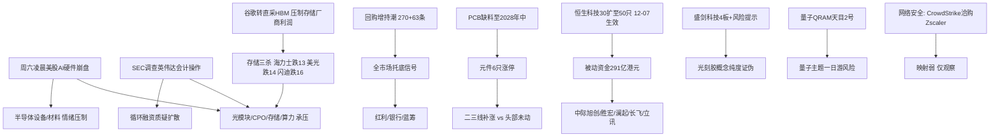

# 2026年11月21日 · **消息面事件驱动**（周末轻量档）

> **数据源新鲜度**: partial · **降级状态**: false · **置信度**: 0.52
> **覆盖窗口**: 11-20 06:01 → 11-21 18:01（36h）· **主源**: 财联社快讯 + 19 号公众号（证券时报 44 / 上证报 36）· 盘前公告窗口 2481 条 · 周五（11-20）收盘结构
> **⚠️ 周末档口径**: 非交易日。本档**不含**竞价、涨停家数前瞻、炸板率前瞻；`top_pick_logic.stop_loss / target_price` 等交易字段在周末档**不适用**（不写买卖点）。所有候选只到"**待周一（11-23）竞价验证**"为止。
> **⚠️ 时间衰减**: 本档统一用 `λ=0.15`、以 **2026-11-21 为 T** 计算 `weighted_score`；`days_since` 按**可知日**算（盘后发布 → 次日，周末不跳过）。

## 一句话结论

周六凌晨美股 AI 硬件被血洗（费半 −10.73%、英伟达 −14.01%、SEC 查会计操作、存储三巨头 −13~16%），这是压在下周一 A 股算力/存储/光模块头上的**行业级利空**；对冲它的是两件事——**回购增持潮（270+63 条公告）**与**恒生科技指数扩容（12-07 生效，被动配置约 291 亿港元）**，以及 A 股内部唯一逆势成簇的 **PCB/元件缺料链**。

## 🚦 盘面基线（先认市场：11-20 周五收盘，已发生的事实）

| 指标 | 数值 | 口径 |
|---|---|---|
| 上证 / 深成 / 创业板 | −1.23% (3500.88 最低) / −3.09% / −3.54% | 财联社收评 11-20 16:50 |
| 北证50 / 科创50 | −4.85% / −3.12% | 同上 |
| 成交额 | 14311 亿（快讯口径，放量 +1165 亿；收评口径 1.42 万亿 / +1171 亿） | news_cls 11-20 15:01 + 财联社收评 16:50 |
| 下跌家数 | 5236 只（连续 7 日 >4000，历史纪录） | 证金事 11-21 |
| 涨停 / 跌停 / 炸板 | 28 / 58 / 7（首板 22，最高 4 板） | `limit_list_20261120` |
| 最大涨停簇 | 元件 6 只（超声/东晶/中京 2 板/满坤 20cm/骏亚/澳弘） | 同上 |
| 防御端 | 工行 +3.30%、建行/中行/交行/长江电力/神华/电信创新高；上证50ETF 成交 240 亿天量 | 财联社收评 |
| 半导体内部 | 中芯 +2.63%、中微 +1.95% vs 海光 −8.75%、曙光 −6.69%、江波龙 −6.93%、兆易 −5.91% | `daily_20261120` |
| 猪价 | 9.36 元/公斤，较月初 8.63 涨约 8% | 财联社收评（行业数据） |

> 结论先行：**周五已经不是"普跌"，是"只有元件和农业养殖能红"的结构**。周末外部冲击直接打在这条唯一的科技活口（PCB 属算力载板下游）上，所以下周一的核心矛盾不是"买什么"，而是"这条活口会不会被外部情绪掐断"。

## 🗺️ 消息面全景图

## 🎯 周末催化清单（8 条 · 排序键 strength → |weighted|）

> 权重口径：`weighted = score × exp(−0.15 × days_since)`；`days_since` 以 2026-11-21 为 T。

### E20261121_001 · 美股 AI 硬件崩盘 + SEC 调查英伟达会计操作 · strength=high · polarity=负面

- **weighted_score = −0.90**（score −0.90，days_since 0）
- **可知日**: 2026-11-21（北京时间凌晨收盘，周六早间全网可知）→ 对 A 股生效日 **11-23**
- **事实**: 纳指 −5.28%（跌 1261 点）、标普 −3.70%（连跌 7 日，2020 年以来最长）、费半 **−10.73%**；英伟达 **−14.01%**（路透：SEC 正调查其会计操作，同时市场质疑"循环式 AI 融资"）；闪迪 −16.05%、ARM −14%、美光 −13.89%、海力士 −13.11%、AMD −13.25%、博通 −12.19%、台积电 −9.3%、阿斯麦 −6.63%、Anthropic −8.5%
- **bearish_scope = 行业级**；`bearish_impact_sectors = [光模块, CPO, 存储芯片, AI算力, 半导体设备, PCB-算力载板]`
- **大资金意图**: 不是"获利了结"，是**给 AI 资本开支的可持续性重新定价**。摩根士丹利大宗经纪数据：多空基金净敞口降到 42%（2010 年以来第 8 百分位），但市场一致预期明年盈利增速 16% —— 仓位与预期出现历史级裂口，钱选择先砍仓位、后谈逻辑。
- **为什么走弱**: 两个触发器叠加——①SEC 查会计（触发"收入质量"信任危机，比"需求见顶"更致命，因为它打的是估值分母的可信度）；②Anthropic 史上最大 IPO 次日 −8.5%，"新股抽血 + 风险偏好反转"同向。CTA 净空 190 亿美元、过去一月卖 570 亿，高盛的模型是"下周无论何种情景都继续卖"。
- **逻辑够不够硬**: **硬，但方向是"压制"不是"崩盘"**。硬在：海外 AI 硬件是本轮 A 股算力链的定价锚，锚掉了 10%，A 股同一环节不可能独立。不硬在：①盘后 AI 硬件已反弹 +2~3%（英伟达/AMD/应用材料/Coherent/CoreWeave），说明是"恐慌性抛售 + 空头回补"而非"基本面证伪"；②甲骨文已筹齐 OpenAI 合同全部资金、阿比林园区接近完工、Vera Rubin 机架数周内交付 —— 订单端未见取消。**结论：周一大概率是"低开 + 分化"，不是"再来一根大阴"**，但低开后的修复力度取决于国产链能否接力。
- **正反两面拆条**: 本条只含利空面；对应的"盘后反弹 + 甲骨文融资到位"单列为 E007（弱正面），**不得合并**。

### E20261121_002 · 存储链三重压制 · strength=high · polarity=负面

- **weighted_score = −0.65**（score −0.65，days_since 0）
- **可知日**: 2026-11-21
- **事实**: ①美股存储全线崩塌（闪迪 −16.05%、美光 −13.89%、海力士 −13.11%、西部数据/希捷 −12%）；②谷歌转向**直接采购 HBM**（原经博通捆绑），业内认为将压制存储厂商利润（news_cls 11-20 16:46）；③消费端 NAND 现货价已明显回落，群联称合约价相对稳定、AI 需求仍强（傅里叶的猫 11-20 23:09）
- **bearish_scope = 板块级**；`bearish_impact_sectors = [存储芯片, 存储模组]`
- **大资金意图**: 存储是本轮"涨价逻辑"最拥挤的一环，钱在这里的意图是**先撤出对"涨价可持续"的押注**，等 11/12 月 HBM4 出货数据再回来。
- **为什么走弱**: 三重压力同向——价格（消费 NAND 回落）、利润（谷歌直采压价）、筹码（美股三巨头 −13~16%）。A 股映射：江波龙 −6.93%、兆易 −5.91%、佰维 −6.47%、德明利 −6.26%（11-20 已先跌一轮）。
- **逻辑够不够硬**: **中等偏硬**。硬在：环节错配是真的（原厂吃涨价、模组被成本挤压；江波龙 Q3 单季环比 −36~−49% 的教训仍在）。不硬在：JPM 的 KV 缓存测算（100 万 token × 1024 并发 ≈ 13.2TB）与 Bernstein 的 HBM 出口指标（10 月同比 +100%）都指向"总量仍强、结构分化"。**所以这是"杀估值 + 杀拥挤"，不是"杀需求"**；模组环节最脆弱，原厂/设备相对抗跌。

### E20261121_003 · 回购增持潮（270 条回购 + 63 条增持） · strength=high · polarity=正面（托底）

- **weighted_score = +0.45**（score +0.45，days_since 0）
- **可知日**: 2026-11-20 盘后 ~ 2026-11-21
- **事实**: `anns_window` 两个自然日共 2481 条 / 1231 家，其中**回购 270 条、增持 63 条**。代表性：长鑫科技回购上调至 25-50 亿（最多注销 40 亿）、紫金矿业 20-30 亿、通威股份 10-20 亿（11-21 公告）、荣盛石化控股股东增持 10-20 亿、泸州老窖 0.5-1 亿、建发股份 0.5-1 亿、巨化股份 1-2 亿、赛力斯已回购 9.94 亿、兆易创新累计 13.10 亿、摩尔线程董事长提议回购、华勤技术第三期回购；厦门国贸/国盾量子/昊创瑞通公告"自愿承诺不减持"
- **sectors_impact**: 全市场（偏蓝筹/红利），`stocks_impact`: 上述个股（个股级，非板块级映射）
- **大资金意图**: 这是**产业资本/上市公司在 3500 点附近的自我定价**，与"官军护盘"（上证50ETF 240 亿天量、互换便利第三批）形成两条腿。意图是"用真金白银告诉市场：我们的资产便宜"，而不是"抢反弹"。
- **为什么走强（为什么重要）**: 单日 270 条回购在 A 股历史上属高位水平，且集中在**注销式回购**（长鑫最多注销 40 亿、金发/晨光/海亮等注明注销）——注销式回购直接抬 EPS，比"员工持股式回购"信息含量高一个档。
- **逻辑够不够硬**: **中等**。硬在：数量与结构（注销式占比高）、且发生在恐慌日，逆周期信号明确。不硬在：①回购潮在下跌中段极常见，2015/2018/2024 年初都出现过"越回购越跌"；②这些公告多为"方案/提议"，实际执行率与节奏未知；③市场当下缺的是**增量资金**，不是"公司自己买自己"。

### E20261121_004 · PCB/元件缺料链延续（周五 6 只涨停成簇） · strength=high · polarity=正面

- **weighted_score = +0.395**（score +0.62，days_since 3 → exp(−0.45)=0.638）
- **可知日**: 2026-11-18（全球电子协会预警首发）→ 事件在 11-20 集中定价
- **事实**: 全球电子协会 11-18 发布全行业供应链警报：PCB 缺货从局部环节蔓延到成品板交付，瓶颈在玻纤布/树脂/铜箔/设备，供应紧张"至少持续到 2027 上半年"，2028 年中之前难实质缓解；申港证券测算 2027 年 PCB 载板材料缺口约 20%；11-20 元件行业 6 只涨停（超声电子、东晶电子、中京电子 2 板、满坤科技 20cm、骏亚科技、澳弘电子），PCB 概念榜 #14→#2
- **sectors_impact**: PCB/元件/覆铜板/玻纤/树脂/铜箔
- **大资金意图**: 在"无主线 + 极恐"里找一个**有实物缺口的硬逻辑**做局部抱团。缺料 = 涨价 = 业绩可验证，这是弱势里唯一能讲"量价"的故事。
- **为什么走强**: 因为它是**唯一同时具备"海外供给缺口 + 国产替代 + 低位"三要素的链条**，且与 AI 算力需求（高阶载板）绑定——即便美股 AI 杀估值，PCB 的"缺料"是供给端事实，不随之消失。
- **逻辑够不够硬**: **中等偏硬，但纯度差**。硬在：缺料是协会级预警 + 券商测算，非小作文。不硬在：①周五涨的全是二三线（满坤、澳弘、骏亚、东晶），头部载板（生益/深南/沪电）未同步，财联社收评自己点破"业绩兑现弹性与头部差距明显，行情延续性待观察"；②材料端（沃特 −4.48%、凌玮 −8.03%、联瑞 −7.68%、宏和 −5.71%、东材 −7.66%、德福 −7.82%）周五**全线下跌**，说明资金只炒"成品板"不认"材料"，链条内部并不一致。
- **周一验证点**: 头部（生益科技/深南电路/沪电股份）能否补涨接力；若只有小票继续嗨，属"末端接力"，不作主线。

### E20261121_005 · 恒生科技指数扩容 30→50 只（12-07 生效） · strength=medium · polarity=正面

- **weighted_score = +0.387**（score +0.45，days_since 1 → exp(−0.15)=0.861）
- **可知日**: 2026-11-20（恒指公司季度检讨结果公布）
- **事实**: 恒生科技指数成份股由 30 只一次性扩至 **50 只**，纳入建滔集团、瑞声科技、立讯精密、胜宏科技、禾赛-W、英诺赛科、中际旭创、迅策、宁德时代、金山云、壁仞科技、澜起科技、长飞光纤光缆、优必选等；12-04 收市后实施、**12-07 起生效**。恒生国企指数纳入智谱、MINIMAX-W。被动追踪恒科 AUM 已从 2020 年 15 亿美元增至 **371 亿美元**；广发证券 10 月测算新增成份股配置需求约 **291 亿港元**。指数定位从"互联网平台"转向"泛硬科技"
- **sectors_impact**: 港股科技（被动资金）；A 股映射标的：中际旭创、胜宏科技、澜起科技、长飞光纤、立讯精密
- **大资金意图**: 这是一次**机制性买盘**（指数纳入 → ETF 必须买），不依赖任何人的观点。对被动资金而言，12-04 收盘前必须建仓，时间窗明确。
- **为什么走强（为什么重要）**: 在"外部 AI 杀估值"的当口，给光模块/PCB/连接器等硬件龙头提供了**与情绪无关的边际买盘**——这是下周唯一"越跌越有买盘"的机制性支撑。
- **逻辑够不够硬**: **硬（机制层面），但强度有限**。291 亿港元分散到 20 只新增股，单只平均十几亿港元，对中际旭创（A 股 4364 亿流通市值）只是"托一下"；且 A 股标的不在恒科里，受益的是**港股同一公司的 H 股/港股通联动**，不能直接推导 A 股上涨。
- **个股交织提示**: 中际旭创同时被 E001（−0.90 行业利空）与 E005（+0.387 机制买盘）夹击，净向不明 → 列为"正负交织股"，只观察不定性。

### E20261121_006 · 盛剑科技 4 连板 + 风险提示（概念纯度证伪） · strength=medium · polarity=负面

- **weighted_score = −0.40**（score −0.40，days_since 0）
- **可知日**: 2026-11-21 17:07（证券时报）
- **事实**: 盛剑科技 11-17~11-20 连续涨停、累计 +46.38%，11-21 再发异动公告：**电子化学品材料业务不含光刻胶**（主产品剥离液属光刻胶配套清洗试剂），2025 年该业务收入 4949.44 万元、占主营 **4.41%**、毛利率 **−2.26%**；2025 年营收 11.26 亿（−22.42%）、归母净利亏 0.17 亿；公告明确提示"短期涨幅较大后快速下跌风险"。同期光刻胶概念指数 11-16→11-20 跌 3.56%（11-20 单日 −5.35%），**板块并未共振**
- **bearish_scope = 个股级**；`bearish_impact_sectors = [光刻胶概念(纯度存疑个股)]`
- **大资金意图**: 4 板高标的资金意图是"赌情绪高度"，不是"赌产业"。公告把"光刻胶"标签撕掉后，剩下的是"环保设备 + 4.41% 电子化学品"，故事撑不住 4 板。
- **为什么走弱**: 周五 4 板 + 极恐 + 板块指数 −5.35%，本身已是"孤板"；周末公告等于给"接力资金"一个官方退出理由。
- **逻辑够不够硬**: **证伪很硬**。数字都在公告里（4.41% 占比、毛利率 −2.26%），不是研报口径。含义有两层：①该股本身周一补跌风险高（这是风险提示，不是推荐）；②**"光刻胶/电子化学品"这条 11-19 的主线叙事，被证明是靠一只杂毛撑起来的** —— 这也解释了为什么周五光刻胶概念 #1→#5、光刻机 #8→#18。

### E20261121_007 · 英伟达盘后反弹 + 甲骨文融资到位 · strength=medium · polarity=正面（弱）

- **weighted_score = +0.26**（score +0.30，days_since 0，强度打 7 折为情绪修复类）
- **可知日**: 2026-11-21 15:21（证券时报/券商中国）
- **事实**: 美股盘后 AI 硬件与大型科技股反弹——英伟达/英特尔/AMD/应用材料/Coherent/CoreWeave/NEBIUS 涨超 3%，美光/ARM/博通/高通/闪迪/康宁/希捷/迈威尔/甲骨文涨超 2%；甲骨文称已筹齐履行 OpenAI 基础设施合同的**全部资金**，阿比林园区接近完工，Shackelford 园区已获全部许可，英伟达 Vera Rubin 机架预计未来几周交付；得州候任州长表示愿与马斯克就州内数据中心合作
- **大资金意图**: 空头在盘后回补 + 长线资金试探性接货。甲骨文"融资齐备"这条是**冲着"循环融资质疑"去的对冲叙事**。
- **为什么走强**: 因为它直接反驳 E001 的两个触发器——"资金链断裂"（甲骨文融资齐备）与"订单取消"（机架照常交付）。
- **逻辑够不够硬**: **偏软**。盘后流动性薄，+2~3% 不构成趋势；且 SEC 调查本身未落地（"调查不代表不当行为，很多调查未导致执法"）。它的价值是**降低周一"跳空低开幅度"**，不是"翻多"。

### E20261121_008 · 量子计算 QRAM 全球首次真机实现 · strength=low · polarity=正面

- **weighted_score = +0.30 → 板块贡献 +0.12（low 权重 0.4）**
- **可知日**: 2026-11-21 10:47（证券时报，转《人民日报》探一线）
- **事实**: 浙江大学"天目2号"超导量子芯片实现 QRAM（量子随机存储器）全球首次真机运行，可调取 4 位/8 位数据，准确率 80.9% / 60.4%，线路深度较未优化方案降 30%+，成果发于《自然·物理》
- **sectors_impact**: 量子科技；`stocks_impact`: 无明确 A 股点名（国盾量子 11-20 −4.42%、科大国创 −7.77%，均未被消息点名）
- **大资金意图**: 主题资金在无主线时找"从 0 到 1"的科技故事，意图是**抢一日游**，不是建仓。
- **为什么走强（为什么会有人炒）**: 官方媒体 + 顶刊 + "全球首次"，三要素齐全，属标准的事件驱动素材。
- **逻辑够不够硬**: **软**。①准确率 80.9%/60.4% 意味着离实用远；②A 股量子标的（国盾量子/科大国创/神州信息）与浙大团队无直接业务绑定，属"概念映射"；③单源（证券时报转人民日报），无第二独立源。**只作观察，不进主线。**

## 📊 板块 × 事件热力矩阵（净分列）

> 公式：`contrib = |weighted_score| × sign(板块极性) × {high:1.0, medium:0.7, low:0.4}`；同板块多事件累加；>+0.12 正面 / <−0.12 负面 / 其余分歧。

| 板块 | 事件锚 | 逐项贡献 | 净分 | 定性 |
|---|---|---|:--:|:--:|
| AI算力硬件（光模块/CPO/算力） | E001 美股崩盘 | −0.90×1.0 | **−0.90** | 🔴 强负面 |
| 存储芯片 | E002 存储三杀 | −0.65×1.0 | **−0.65** | 🔴 强负面 |
| 光刻胶/湿电子化学品 | E006 盛剑证伪 | −0.40×0.7 | **−0.28** | 🔴 负面 |
| 全市场托底（红利/蓝筹） | E003 回购增持潮 | +0.45×0.7 | **+0.315** | 🟢 正面（防御） |
| PCB/元件/覆铜板 | E004 缺料链 | +0.395×1.0 | **+0.395** | 🟢 正面 |
| 港股科技（被动资金） | E005 恒科扩容 | +0.387×0.7 | **+0.271** | 🟢 正面（机制） |
| 量子科技 | E008 QRAM | +0.30×0.4 | **+0.12** | 🟡 边缘正面 |
| 网络安全 | E009 CrowdStrike/Zscaler | +0.25×0.4 | **+0.10** | 🟡 分歧（未达阈） |
| 养殖/农业 | E010 猪价 +8% | +0.215×0.7 | **+0.151** | 🟢 正面（单源） |

**`sector_cross_summary`（只列多事件板块）**

- **AI算力硬件**：E001（−0.90）+ 无对冲 → 净 −0.90，**周末最强负向板块**。注意 E005 的机制买盘落在"港股科技"（不同名，不累加），个龙头（中际旭创）层面属正负交织，单列观察。
- **PC​B/元件**：E004（+0.395）+ 周五 6 只涨停的价格确认 → 净 +0.395，**唯一"逻辑 + 资金"同向的正面板块**；风险是纯度（二三线 vs 头部）。
- 其余均为单事件板块，不构成叉乘。

## 📈 首板候选池（消息侧刺激池，**非开仓资格**，全部待 11-23 竞价验证）

> 底池规则：周五（11-20）**未涨停**、流通市值 ≥20 亿、消息侧有明确刺激。已剔除 肯特股份（流通 14.2 亿 < 20 亿红线）。价格与市值取自 `daily_20261120` / `daily_basic_20261120`。
> **表中每一行均为「待周一竞价验证」**——周末只做消息侧建池，位置、竞价强度、开盘是否承接全部留给 11-23 盘前。

| 代码 | 名称 | 方向 | 消息源（日期） | 11-20 收盘 | 涨跌 | 流通市值 | 质量 | 待周一竞价验证（看点） |
|---|---|:--:|---|---|:--:|:--:|:--:|:--:|---|
| 301282.SZ | 金禄电子 | PCB | 全球电子协会 11-18 + 收评 11-20 | 30.84 | +8.17% | 54.5 亿 | medium | 元件涨停潮外溢，竞价是否高开不破 |
| 300852.SZ | 四会富仕 | PCB | 同上 | 50.85 | +7.44% | 78.8 亿 | medium | 已连续两日强势，是否换手接力 |
| 301176.SZ | 逸豪新材 | PCB材料/铜箔 | 缺料瓶颈在铜箔（11-18） | 33.80 | +2.70% | 55.5 亿 | medium | 材料端周五普跌，需先看修复 |
| 605258.SH | 协和电子 | PCB | 同上 | 32.08 | +0.53% | 28.2 亿 | low | 未定价，需放量突破 |
| 000822.SZ | 山东海化 | 溴素 | 盘前纪要 11-20（潍坊 12-01~02-28 停产，卤水溴产能占国内六成+） | 3.48 | −4.66% | 31.1 亿 | medium | 限产 12-01 才执行，竞价看有无资金提前 |
| 601678.SH | 滨化股份 | 溴素 | 同上 | 4.14 | −3.72% | 84.6 亿 | medium | 同上 |
| 600727.SH | 鲁北化工 | 溴素 | 同上 | 6.14 | −4.95% | 32.5 亿 | low | 同上 |
| 002567.SZ | 唐人神 | 养殖 | 猪价 11-20 9.36 元（月初 +8%）+ 农业农村部生猪产能调控 | 3.77 | +5.31% | 54.0 亿 | medium | 防御抱团能否延续，竞价不低开 |
| 001201.SZ | 东瑞股份 | 养殖 | 同上 | 17.14 | +5.02% | 36.4 亿 | medium | 同上 |
| 600975.SH | 新五丰 | 养殖 | 同上 | 4.56 | +1.56% | 57.0 亿 | low | 未定价，需猪价数据继续走强 |
| 688027.SH | 国盾量子 | 量子 | 证券时报 11-21（QRAM 天目2号） | 284.49 | −4.42% | 228.7 亿 | low | 单源 + 无业务绑定，只看不动 |
| 300454.SZ | 深信服 | 网络安全 | 华尔街见闻 11-21（CrowdStrike 洽购 Zscaler） | 104.00 | −3.35% | 300.0 亿 | low | 并购映射弱，纯观察 |

**未列入但需盯的"高位/事件交织"标的（不作候选）**

- **真视通 002771**（4/4 板，封单 1.59 亿，华为算力）：周五已是最高板，极恐 + 外部冲击下高度压制风险最大；
- **盛剑科技 603324**（4/4 板 + 11-21 官方风险提示）：本档已列 E006，属**风险提示对象**；
- **中京电子 002579**（2/2 板，封单 2.04 亿，PCB）：连板接力位，不是首板；
- **中际旭创 300308**（恒科纳入 vs AI 硬件崩盘，正负交织）、**胜宏科技 300476 / 澜起科技 688008 / 长飞光纤 601869 / 立讯精密 002475**：机制买盘存在，但被 E001 压制。

> ⚠️ `quality` 只代表"消息侧证据密度（源数 + 逻辑硬度）"，**不代表可买**。周末档不判位置、不判竞价、不给止损/目标价——这些字段属于 11-23 盘前 P1 的工作。

## 📋 公告硬事件清单（anns_window 2481 条 / 1231 家，逐条可回溯）

**回购 / 增持（正向，金额以公告为准）**

| 类型 | 标的 | 内容 | 公告日 |
|---|---|---|---|
| 回购 | 长鑫科技 688825 | 方案上调至 25-50 亿元，最多注销 40 亿元 | 2026-11-20 |
| 回购 | 紫金矿业 601899 | 20-30 亿元，价格上限 35 元/股；11-21 已首次回购 | 2026-11-20/21 |
| 回购 | 通威股份 600438 | 10-20 亿元集中竞价回购方案 | 2026-11-21 |
| 回购 | 摩尔线程 | 实控人/董事长提议回购 | 2026-11-21 |
| 回购 | 华勤技术 603296 | 第三期集中竞价回购报告书 | 2026-11-21 |
| 回购 | 兆易创新 603986 | 累计回购 13.10 亿元（11-20 单日 5000.76 万元，205.88-210.34 元/股） | 2026-11-20/21 |
| 回购 | 赛力斯 601127 | 累计回购 1779.57 万股 / 9.94 亿元，全部注销 | 2026-11-20 |
| 增持 | 荣盛石化 002493 | 控股股东拟增持 10-20 亿元（11-23 起 6 个月） | 2026-11-21 |
| 增持 | 泸州老窖 000568 | 控股股东拟增持 0.5-1 亿元 | 2026-11-21 |
| 增持 | 建发股份 600153 | 控股股东拟增持 0.5-1 亿元 | 2026-11-21 |
| 增持 | 巨化股份 600160 | 控股股东一致行动人拟增持 1-2 亿元 | 2026-11-20 |
| 不减持承诺 | 厦门国贸 / 国盾量子 / 昊创瑞通 | 控股股东及董监高自愿承诺不减持 | 2026-11-21 |

**ST / 退市 / 停复牌（负向为主，逐条核对）**

| 标的 | 事件 | 方向 | 公告日 |
|---|---|:--:|---|
| ST汇洲 002122 | 撤销其他风险警示 → 汇洲智能，停牌一天后复牌 | 正面 | 2026-11-20 |
| ST天圣 002872 | 撤销其他风险警示，停复牌 | 正面 | 2026-11-21 |
| 欢瑞世纪 000892 | **被实施其他风险警示** + 收到行政处罚事先告知书 | 负面 | 2026-11-21 |
| *ST天宜 688033 | 行政处罚事先告知书 + 叠加实施其他风险警示 | 负面 | 2026-11-21 |
| *ST仕净 301030 | 行政处罚事先告知书 + 叠加实施其他风险警示 | 负面 | 2026-11-21 |
| *ST卓然 688121 | 收到上海证监局行政处罚决定书 | 负面 | 2026-11-21 |
| *ST香雪 300147 / *ST瑞和 002620 / *ST西旅 000610 | 法院裁定受理重整 + 叠加退市风险警示 | 负面 | 2026-11-20/21 |
| ST龙大 002726 | 与重整投资人签署《重整投资协议》 | 中性 | 2026-11-21 |
| 山鹰国际 600567 | 筹划重大事项**继续停牌**（实控人增持计划顺延） | 中性 | 2026-11-21 |
| 英力特 000635 | 控股股东协议转让 + 拟发行股份购买资产，**继续停牌** | 中性 | 2026-11-20 |
| 艾艾精工 603580 | 要约收购期满，股票停牌 | 中性 | 2026-11-21 |

**重组 / 控制权 / 收购**

| 标的 | 事件 | 公告日 |
|---|---|---|
| 麦迪科技 603990 | 间接控股股东拟公开挂牌转让控股股东股权，**控制权可能变更** | 2026-11-21 |
| 渤海化学 600800 | 签署购买资产协议，3.76 亿元收购格瑞新材 80% | 2026-11-21 |
| 海汽集团 603069 / 震安科技 300767 / 中南文化 002445 | 重大资产重组进展 | 2026-11-21 |
| 万德斯 688178 | 收购报告书 | 2026-11-21 |
| 恒尚节能 603137 | 发行股份及支付现金购买金胜电子 100%，尽调推进中 | 2026-11-20 |

**监管 / 政策**

- 证监会联合公安机关处罚编造传播资本市场虚假信息，公布 4 起典型案例（2026-11-20 16:48）
- 证监会官网披露：多家公募上报科创创业半导体 ETF、沪深港算力 ETF、中证航运 ETF（2026-11-20 18:31）
- 永赢基金公告以不低于 1 亿元自有资金投向旗下主动 ETF，该基金 11-23（周一）上市（2026-11-20 14:38）
- 人民日报《唱空中国经济者终会落空》（2026-11-21），证券时报/上证报同步转载
- 央行第三批互换便利操作招标、超 30 家机构申报 —— **仅有李大霄（11-20 13:53）转述财联社，未在本次抓取源中找到央行原文，标 `unverified_single_source`**

## 关键证据

- 证据 1：费半 −10.73%、NVDA −14.01%、标普连跌 7 日（2020 年以来最长）、纳指 −5.28% — 证券时报 2026-11-21 07:52；财联社 11-21 06:45
- 证据 2：SEC 调查英伟达会计操作（路透），焦点含地区收入口径变更、客户融资/循环交易 → 市值与收入质量质疑 — 证券时报 11-21 07:52 + 傅里叶的猫 11-21 16:09
- 证据 3：盘后 AI 硬件反弹 +2~3%、甲骨文筹齐 OpenAI 合同全部资金、阿比林园区接近完工 — 证券时报/券商中国 2026-11-21 15:21
- 证据 4：11-20 A 股涨停 28 / 跌停 58 / 炸板 7、元件 6 只涨停、最高 4 板 — `limit_list_20261120`（tushare）
- 证据 5：11-20 概念榜 猪肉 #1、PCB #2、CPO #3、存储 #9、光刻机 #18 — `attention_weekend`（dc/ths 双榜）
- 证据 6：全球电子协会 11-18 PCB 缺料警报（至 2028 年中）+ 申港证券 2027 年载板材料缺口 20% — 盘前纪要 11-20 + 财联社收评 11-20 16:50
- 证据 7：恒生科技 30→50 只、12-04 实施 / 12-07 生效、被动 AUM 371 亿美元、广发测算新增配置 291 亿港元 — 上海证券报 2026-11-21 11:12
- 证据 8：盛剑科技电子化学品收入 4949.44 万元 / 占比 4.41% / 毛利率 −2.26%、不含光刻胶 — 证券时报 2026-11-21 17:07
- 证据 9：回购 270 条 / 增持 63 条 / 2481 条 / 1231 家 — `anns_window.jsonl` 规则化分类（2026-11-20~21）
- 证据 10：猪价 9.36 元/公斤（月初 8.63，+8%）、供需宽松未改 — 财联社收评 2026-11-20 16:50
- 证据 11：谷歌转向直接采购 HBM，或压制存储厂商利润 — news_cls 2026-11-20 16:46
- 证据 12：高盛恐慌指标 9/10、CTA 净空 190 亿美元、过去一月卖 570 亿 — 财联社 2026-11-21 05:25

## 数据源审计

| 源 | 日期 | 状态 | 备注 |
|---|---|:--:|---|
| tushare/news_cls | 2026-11-21 | 🟡 | 2248 条，止于 11-21 08:59；09:00 后由公众号覆盖 |
| tushare/news_major | 2026-11-21 | 🟡 | 800 条，仅标题可用（content 空） |
| eastmoney/earnings_predict | 2026-11-21 | 🟢 | 存量核对（Q3 报告期已结束，本窗口无新增预告） |
| wechat_official_rss（19 号池） | 2026-11-21 | 🟢 | 104 篇 / 13 号有文 |
| wechat_cli_5groups（7 群） | 2026-11-21 | 🔴 | 0 条 / 0 字节，第 14 个交易日断更 |
| anns_window | 2026-11-21 | 🟢 | 2481 条 / 1231 家，含 11-20 与 11-21 |
| attention_weekend | 2026-11-21 | 🟢 | 11-21 四榜 0 = 周六 `not_available`；11-18~11-20 有榜 |
| tushare/limit_list_d | 2026-11-20 | 🟢 | 93 条（U28/D58/Z7） |
| hithink / 受益股池 | 2026-11-21 | ⚪ | 周末档未调用（无竞价、无当日涨幅，语义漂移风险大于收益） |
| weflow-analytics | — | 🔴 | 永久下线，不计 severity |

## 不确定性 / 反证（自我批判）

1. **"外部利空 → A 股补跌"不是自动成立的因果**。周五 A 股已经先跌（5236 只下跌、创业板 −3.54%），部分利空已提前定价；且盘后美股 AI 硬件反弹 +2~3%，周一更可能是"低开高走的分化"，而非"二次崩盘"。本档给 E001 的 −0.90 是"压力强度"，不是"跌幅预测"。
2. **回购潮是弱信号**。270 条回购在恐慌日集中出现，历史上（2015/2018/2024 初）都伴随继续下跌；且多数为"方案/提议"，执行率未知。托底≠反转。
3. **PCB 的纯度风险最高**。缺料是真的，但资金炒的是二三线（满坤/澳弘/骏亚/东晶），头部（生益/深南/沪电）未动、材料端（沃特/凌玮/联瑞/宏和/东材/德福）周五全线下跌。若周一头部不接力，这条线就是"末端接力"，2-3 日寿命。
4. **恒科扩容的 A 股映射被高估**。指数纳入买的是港股，A 股只能"情绪联动"；291 亿港元摊到 20 只新增股，单只体量对中际旭创（A 股流通 4364 亿）只是杯水。
5. **单源事件已降级**：量子（QRAM）只有证券时报 → 不进主线；网络安全（CrowdStrike/Zscaler）只有华尔街见闻 → 净分 0.10 未达阈；央行互换便利第三批只有李大霄转述 → 标 unverified。
6. **群聊层缺失**：7 群 0 条，观点层只有公众号（机构/官媒口径），**缺少游资一手情绪**，因此本档对"周一情绪修复力度"的判断置信度只能给 0.52。
7. **窗口缺口**：11-21 09:00-18:00 无财联社快讯落盘，若该时段有政策级事件，本档会漏。检索到的周六白天内容全部来自证券时报/上证报 RSS。

## 与其他 R/D/E 的关系

- 依赖：`news_cls` / `news_major` / `wechat_official_rss` / `anns_window` / `limit_list_20261120` / `attention_weekend` / `eastmoney_earnings_predict`（存量）
- 被消费：R1 风格（外部冲击权重）/ R2 主线（PCB 是否为真主线）/ R5 个股画像（中际旭创等正负交织股）/ R6 反证（回购潮有效性、PCB 纯度）/ D1 周一预案（外部利空 vs 机制买盘的权重）/ E1 复盘（若周一"低开不修复"，可回查本档 E001 的行业级判定）

## Sub-Agent 元数据

- skill: analyze_news_impact_v1@1.8（weekend_light 分支）
- artifact: 本 md（周末档不落 `data/research/` JSON，遵循"只写 chzl_kg"纪律；`check_r4_artifact.py` 的交易日契约字段不适用）
- method: llm_v1（事件抽取 + 时间衰减 + 极性叉乘 + 数字溯源）
- 生成时刻: 2026-11-21T18:25:00+08:00
- model: deepseek-v4.1-flash
