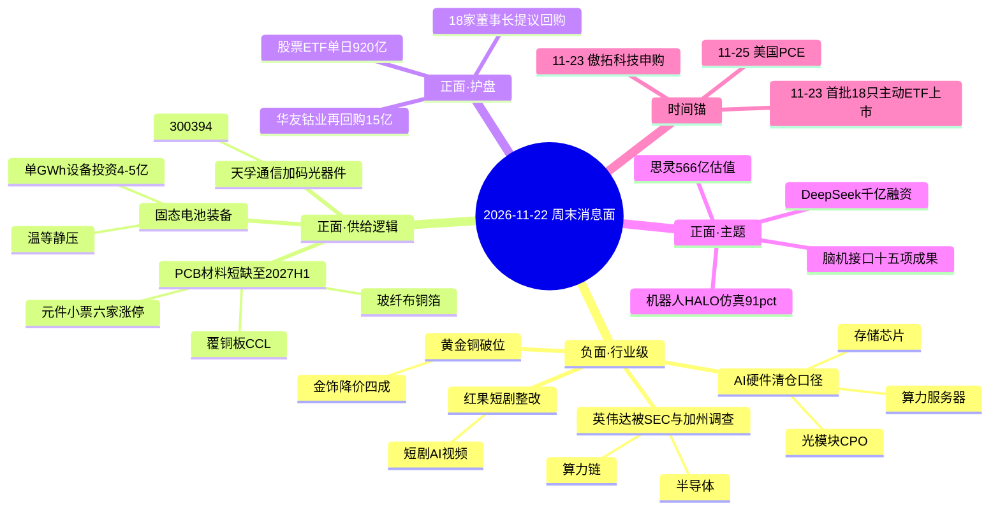

# 2026年11月22日 · **消息面事件驱动**（周末轻量档）

> **数据源新鲜度**: partial · **降级状态**: false · **置信度**: 0.55
> **覆盖窗口**: 11-21 18:01 → 11-22 18:01（24h）· **主源**: 财联社快讯 485 条 + 19 号池公众号 30 篇（证券时报 13 / 上证报 9 / 财联社早知道 1 / 调研先知 1 / 证金事 2 / 猫笔刀 1 / 李大霄 1）· 公告窗口 1335 条 · 周末榜单 24 只
> **⚠️ 周末档口径**: 非交易日。本档**不含**竞价、涨停家数前瞻、炸板率前瞻、情绪周期阶段；`stop_loss / target_price / position_size` 等交易字段周末档**不适用**（不写买卖点、不给仓位）。所有候选只到「**待周一（11-23）竞价验证**」为止。
> **⚠️ 时间衰减**: λ=0.15，以 **2026-11-22 为 T**；`days_since` 按可知日算（11-22 发布 → 0，11-21 → 1）。
> **⚠️ 与 11-21 档的分界**: 周五美股血洗（费半 −10.73%、英伟达 −14.01%）已在 11-21 档交付，本档只作**背景（decayed）**，不重复当新事件。本档增量是：**PCB 材料短缺预警、固态电池产业化节奏、买方清仓口径、回购潮落名单、周日两家公司硬公告**。

## 一句话结论

**周末增量把"AI 硬件杀"从价格层面推到业绩层面（买方几近清仓、英伟达被查），唯一逆势有供给逻辑的是 PCB 上游缺料链与固态电池设备；指数端由 920 亿 ETF + 18 家董事长提议回购托底，但托的是宽基红利、不是题材。**

## 🗺️ 消息面全景图

## 🎯 顶级事件详解（每事件三问）

> **排序键**：`(strength: high>medium>low, -|weighted_score|)`。本节详解 8 条高优先事件；章节按**叙事顺序**排列，全量 17 条的排序与净贡献见下方热力矩阵。
>
> | 排序 | 事件 | strength | weighted | 极性 |
> |:--:|---|:--:|--:|:--:|
> | 1 | E20261122_001 PCB 材料短缺预警 | high | +0.600 | 🟢 |
> | 2 | E20261122_005 英伟达被 SEC/加州调查 | high | −0.600 | 🔴 |
> | 3 | E20261122_004 买方几近清仓 AI 硬件 | high | −0.550 | 🔴 |
> | 4 | E20261122_009 固态电池装备价值量 | high | +0.450 | 🟢 |
> | 5 | E20261122_008 回购潮（18 家提议回购） | high | +0.301 | 🟢 |
> | 6 | E20261122_015 DeepSeek 千亿融资（单源） | medium | +0.400 | 🟡 |
> | 7 | E20261122_003 天孚通信扩产 | medium | +0.350 | 🟢（个股） |
> | 8 | E20261122_002 PCB 2027 订单回调 | medium | −0.250 | 🔴 |
>

### E20261122_001 · PCB 供应链短缺预警：常规材料紧张至少到 2027H1 · strength=high · polarity=正面 · w=+0.600

**事件摘要**：全球电子协会（Global Electronics Association）发布 PCB 供应预警，从玻纤布、树脂、铜箔到成品板全环节供不应求，预计常规材料紧张**至少持续至 2027 年上半年、2028 年年中前难明显缓解**；AI 服务器用板正从 20 层向 40 层以上演进，每加一层都多吃玻纤布/树脂/半固化片/铜箔/覆铜板与加工时间；FR-4 覆铜板交期已从一年前的 2–3 周延长。协会判断风险量级"可能与 2021 年芯片短缺相当"，同时提示提前采购放大了在手订单，**2027 年订单可能出现回调**。（上证报 2026-11-22 14:00）

**大资金意图**：周五（11-20）在全市场 5236 家下跌、中位 −5.08% 的盘面里，主力资金净流入**印制电路板 +22.07 亿**，元件 6 家涨停（超声电子、东晶电子、中京电子 2 板、满坤科技、骏亚科技、澳弘电子）——这是**在投降式下跌里主动做多的唯一成簇方向**。周末这条协会报告等于给周五的资金一个"事后解释"：不是博弈反弹，是抢**上游材料短缺的定价权**。

**为什么走强**：A 股对"缺料"的反应路径一向是从**上游材料 → 覆铜板 → 成品板**逐级传导。缺料的可交易性来自两点：①涨价函与交期数据可跟踪（不是纯故事）；②产能被 AI 用材料挤占，标准 FR-4 客户拿不到货——这是**结构性、跨 2027 年**的供给约束，比"AI 需求好"更硬。

**逻辑够不够硬**：**中硬，但方向要挑对**。硬的一面：协会级产业组织背书 + 交期数据 + 周五资金已用真金白银投票 + 中信建投同日提出"MLCC 超级周期"（被动元件同属缺料链）。不硬的一面：报告明确说 2027 年订单可能回调（提前采购虚增需求），且缺料利好的是**上游材料与覆铜板**，对**中下游整机/汽车电子是成本压力**——把"PCB 缺料"整体读成利好会买错环节。

**反向面（必列）**：`bearish_scope=板块级`，`bearish_impact_sectors=[PCB 中下游成品板, 汽车电子, 工业/医疗电子]`；2027 订单回调是这条逻辑自带的反身性风险（E20261122_002）。

---

### E20261122_002 · PCB 提前采购放大订单、2027 年订单可能回调 · strength=medium · polarity=负面 · w=−0.250

**事件摘要**：同一份协会报告的风险段：只能收到部分货的买家超额下单、或就同一需求向多家供应商下单，使在手订单超出实际需求；协会明确提示**2027 年订单可能出现回调**；汽车、工业、医疗项目面临更大供货压力，"能否拿到货已成为首要风险，而非价格"。

**大资金意图**：这条不是交易信号，是**给 E001 定量上限的约束**——它决定了 PCB 行情能走"涨价链"而不能走"景气度持续性"。

**为什么走强**（本条为负事件，即"为什么压制"）：A 股缺料主题的经典死法是"订单是假的（重复下单）"，2021 年芯片短缺已经演过一遍。谁在 2027 年被证伪，取决于三季度后交期是否见顶。

**逻辑够不够硬**：硬（协会原文，非推测）。但它对**当周交易不构成压制**——7 日窗口内它是背景而非扳机。

---

### E20261122_004 · 上海买方路演：几乎清仓 AI 硬件，有机构现金占比 70% · strength=high · polarity=负面 · w=−0.550 · bearish_scope=行业级

**事件摘要**：买方交流口径——硬件多头仓位基本压到接近零，有机构现金占比 70%，海外基金半导体持仓落到个位数；问到在买什么，多数反馈"暂时不做交易、先观望"。核心矛盾落在 **2028 年 AI 资本开支**：市场已一致预期 2027 年 capex 1.3–1.4 万亿美元，但定价已提前假设 2028 年持平甚至下行，验证窗口要等 **2027 年 2–3 月**云厂商业绩。算力收入缺口测算：明年新增约 10GW 推理算力 × 每 GW 需 700–800 亿美元收入 ≈ 需 8000 亿美元模型收入，而华尔街给 Anthropic 的收入预期不到 2000 亿——**6000 亿美元缺口无人能说清谁来补**。另有两个技术约束：CPO 商业化可能推迟到 2027H2 甚至 2028；晶圆键合良率约 50%（规模化需 90%）。（调研先知 2026-11-22 13:43）

**大资金意图**：这是一份**仓位实况**而非观点。它解释了周五为什么是"单边"而不是"震荡"：卖压不是来自交易盘止损，是来自**组合层面的降仓**——降仓不看价格，只看仓位上限，所以没有"跌到位就有人接"的机制。

**为什么走强**（本条为负事件，即"为什么压制"）：它把"AI 硬件下跌"从情绪事件升级为**资金结构事件**。仓位已压到近零的含义是双向的：继续砸的动能衰减，但**反弹也缺买盘**——没有人有仓位需要"回补"。这正是买方自己说的"盘面出现上涨大多只定义成反弹，不能直接判定趋势反转"。

**逻辑够不够硬**：硬（具体数字与时间锚齐全），但**样本单一**（一家调研渠道、一次路演），不能当全市场仓位普查。标注：single_channel=true，需周一成交结构（缩量 vs 放量下跌）二次验证。

---

### E20261122_005 · 英伟达被 SEC 与加州总检察署调查（含潜在刑事）· strength=high · polarity=负面 · w=−0.600

**事件摘要**：加州总检察长就英伟达芯片销售及"是否误导投资者"展开调查，并核查是否存在州法下的刑事违规；财联社早报同步"英伟达据悉被 SEC 调查"；此前美媒披露董事会罢免黄仁勋的主因与其"不够坦诚"相关。财务侧：特朗普称 H200 可以出售，贝森特称"将查明其销售情况"。（news_cls 11-22 01:15 / 07:00；CLS 11-21 23:47–23:50）

**大资金意图**：从"业绩股"变"合规股"是估值体系的切换，不是季度波动。买方在 E003 里说"英伟达风波可能外溢"，这条就是外溢源。

**为什么走强**（本条为负事件，即"为什么压制"）：A 股算力链的定价锚是英伟达的订单可见度。合规调查本身不改变当期订单，但会让**国内算力链的"跟涨"失去锚**——锚在摇晃时，跟风票先跌。

**逻辑够不够硬**：中硬。调查存在（多家媒体），但**结论未出、SEC 口径仅"据悉"**，不能当已成立的事实交易。强度给 high 是因为它会压制风险偏好，不是因为它已证实。

---

### E20261122_009 · 固态电池产业化：装备是"卡脖子"，单 GWh 设备投资 4–5 亿（液态的 4–5 倍）· strength=high · polarity=正面 · w=+0.450

**事件摘要**：CBIS 2026（11-20 开幕）上，多位专家指出固固界面接触不良是量产核心瓶颈；温等静压技术被称"通向 GWh 量产的最佳工艺甜蜜点"，可把界面有效接触面积提升 40%+、相对致密度推到 95%+，等静压设备价值 **0.8–1.2 亿元/GWh**。全固态单 GWh 设备投资 **4–5 亿元**，约为液态（约 1 亿元/GWh）的 4–5 倍。《2026 中国固态电池行业发展蓝皮书》：2026–2027 为中试线集中建成投运关键窗口，国内已建/在建中试线超 20 条（单线 0.2–2GWh）；2027 头部企业启动小批量车规交付约 2.3GWh；2030 出货约 21.9GWh；电芯成本从 3.7–6.2 元/Wh 降至 2028 年 1–3 元/Wh。（上证报 2026-11-22 17:46）

**大资金意图**：在 AI 硬件、锂电材料都被杀的环境里，"设备投资额放大 4–5 倍"是**少数能算出绝对金额增量的产业叙事**——它把固态电池从"2030 年的故事"提前压到"2026–2027 中试线的订单"。

**为什么走强**：设备先行是产业铁律：中试线 20+ 条 × 0.2–2GWh × 4–5 亿元/GWh ≈ 数十亿到百亿级设备需求，落在 2026–2027，可验证、可招标、可跟踪。

**逻辑够不够硬**：**中硬**。硬在"设备价值量倍数"和"中试线数量"是可核对的产业数据；不硬在时间跨度太长（车规交付 2027 才 2.3GWh），且固态板块估值已在过去两年被反复透支——**这条更适合作"事件日脉冲"，不适合作"跨月持仓理由"**。

---

### E20261122_008 · 回购潮：18 家董事长/实控人提议回购 + 控股股东增持群 · strength=high · polarity=正面 · w=+0.301（11-21，d=1）

**事件摘要**：11-21 公告窗口内 **18 家公司**披露董事长/实控人提议回购（摩尔线程、昂瑞微、拓荆科技、燕东微、芯碁微装、蓝特光学、厦钨新能、聚石化学、南网储能、物产中大、江特电机、利民股份、金奥博、福龙马、雅运股份、三星电气、德力佳、宏桥控股），同期控股股东增持计划群（金盘科技、凯立新材、巨化股份、建发股份、荣盛石化、北新路桥、兴业银锡、东华软件等）。11-22 晚证券时报补充：华友钴业（603799）拟再回购、最高 15 亿元。

**大资金意图**：大跌当日集中出"董事长提议回购"，是**上市公司对自家股价的公开表态**——特别注意名单里摩尔线程、昂瑞微、拓荆、燕东微、芯碁微装全是**近端科创次新/半导体设备**，说明这一轮护盘首先发生在**跌幅最深的科技新股**，而非全市场。

**为什么走强**：回购潮在 A 股是**底部区域的伴随现象而非底部本身**（2018、2022、2024 初都出现过，但对次日指数的解释力弱、对个股公告后的相对收益有正贡献）。

**逻辑够不够硬**：硬（公告级事实），但**强度要打折**：提议回购 ≠ 已回购，且科创板次新的提议回购常与解禁/破发护盘动机叠加。

---

### E20261122_015 · DeepSeek 新一轮千亿级融资落地，腾讯与宁德时代入股 · strength=medium · polarity=正面 · w=+0.400 · single_source=true

**事件摘要**：新浪财经 11-22 07:00 标题级消息：DeepSeek 新一轮千亿级融资落地，腾讯与宁德时代入股；11-21 华尔街见闻另有"十余家上市公司借道 16.5 亿元基金入股 DeepSeek"。两条**正文均为空**，未见公司或投资人公告，额度与估值未核。

**大资金意图**：在 AI 硬件被清仓的同一天，"钱转投模型层"——若成立，这是**叙事从 capex 转向应用**的分岔口，对 AI 应用/国产模型是正面对冲。

**为什么走强**（若消息成立）：它可能解释周一 A 股"算力杀、应用活"的分层能否延续。

**逻辑够不够硬**：**不硬，只到线索级**。仅标题、无正文、无公告；`single_source=true`（同源转载不算独立源）。下游只可当"待验证观察项"，**不得**作为买入理由。

---

### E20261122_003 · 天孚通信加码"追光"：南昌投建高速光器件项目 · strength=medium · polarity=正面（个股）· w=+0.350

**事件摘要**：天孚通信（300394，11-20 收盘 102.18 元、流通市值 1112 亿）11-22 晚公告，拟在南昌经开区投建新一代高速光器件研发与生产制造项目，承接主体为 9 月设立的江西天孚光互连；公司称光互连行业需求旺盛、正积极推进扩产。基本面：2026 前三季营收 47.51 亿（+21.25%）、归母 20.83 亿（+42.18%），Q3 单季营收 19.23 亿（+31.50%）、归母 8.79 亿（+55.30%）；CPO 配套产品已进入**批量交付**、预计 2027 年起逐步提量，NPO 处送样验证；已回购 88 万股、耗资 1.08 亿元。（证券时报 2026-11-22 17:23）

**大资金意图**：在光模块板块被行业级利空压制时，龙头选择"逆势扩产 + 回购"，是产业资本对**自身订单可见度**的表态——但它改不了板块 β。

**为什么走强**（个股口径，为什么不等于板块）：单票基本面硬（Q3 净利 +55.3%、CPO 已批量交付），但**所在板块正被 E003 清仓口径压制**，个股 alpha 不足以对抗行业 β。周末档不对"是否上涨"下判断。

**逻辑够不够硬**：企业侧硬（公告 + 三季度财报 + 回购记录）；板块侧软。sector_cross 里 E003（+0.245）被 E004（−0.550）净吃掉，板块仍为负——**这正是"好公司 ≠ 好板块"的教科书例子**。

---

## 📊 板块 × 事件热力矩阵

叉乘口径：`contrib = abs(weighted_score) × sign(板块极性) × {high:1.0, medium:0.7, low:0.4}`；同板块多事件累加；>+0.12 正面 / <−0.12 负面 / 其余分歧。

| 板块 | 事件锚（含单事件贡献） | 净分 | 极性 | 首推/关注 | 独立源数 | 消息面强度 |
|------|------------------------|:----:|:----:|-----------|:--:|:--:|
| AI 算力/服务器 | E004(−0.55) + E005(−0.60) | **−1.150** | 🔴 负面 | — | 3 | 🟢🟢🟢 |
| 半导体 | E005(−0.60) | **−0.600** | 🔴 负面 | — | 3 | 🟢🟢🟢 |
| 存储芯片 | E004(−0.55) | **−0.550** | 🔴 负面 | — | 2 | 🟢🟢 |
| 光模块/CPO（含光器件） | E004(−1.0×0.55) + E003(+0.7×0.35) | **−0.305** | 🔴 负面 | 天孚通信(个股alpha，不下场) | 3 | 🟢🟢 |
| 护盘资金（宽基/红利） | E006(+0.14) + E007(+0.21) + E008(+0.30) | **+0.652** | 🟢 正面 | 沪深300/上证50 ETF | 4 | 🟢🟢🟢 |
| 固态电池设备 | E009(+0.45) | **+0.450** | 🟢 正面 | 先导智能 | 2 | 🟢🟢 |
| PCB/覆铜板材料链 | E001(+0.60) + E002(−0.17) | **+0.425** | 🟢 正面 | 中京电子/超声电子/生益科技 | 2 | 🟢🟢🟢 |
| AI 应用/国产模型 | E015(+0.28，single_source) | **+0.280** | 🟡 待验证 | — | 1(+1 相关) | 🟡 |
| 人形机器人 | E010(+0.24) | **+0.245** | 🟢 正面 | 奥比中光 | 3 | 🟢🟢 |
| 脑机接口 | E012(+0.18) | **+0.181** | 🟢 正面 | 三博脑科 | 2 | 🟢🟢 |
| 工控/PLC | E016(+0.17) | **+0.175** | 🟢 正面 | 汇川技术 | 2 | 🟢🟢 |
| 短剧/AI 视频 | E011(−0.21) | **−0.210** | 🔴 负面 | — | 1 | 🟡 |
| 黄金/有色金属 | E013(−0.21) | **−0.210** | 🔴 负面 | — | 2 | 🟢🟢 |

### sector_cross_summary（只收多事件板块）

- **AI 算力/服务器 −1.150**：两条行业级负面叠加（清仓口径 + 英伟达合规），是本周末**唯一达到"双 high 叠加"**的方向。7 日窗口内任何反弹定义成反弹，不定义成反转——买方自己给了这个措辞。
- **光模块/CPO −0.305**：天孚的个股正面（+0.245）只吃掉行业负面（−0.55）的 45%。**板块仍为负，个股 alpha 不得单独成逻辑**。
- **护盘资金 +0.652**：三条独立来源（卖方研报 + 资金数据 + 公告群）方向一致，是本周末**最"干净"的正面合力**——但它指向宽基/红利，**不指向题材**。
- **PCB/覆铜板材料链 +0.425**：正面占优但被自身的 2027 订单回调风险削掉 28%。
- **分歧残留**：PCB 同时受"缺料涨价"与"AI 服务器订单可能放缓"双向牵制，是本周末最大的**逻辑内耗点**（详见不确定性第 2 条）。

## 🧵 公告硬事件清单（→ 待周一竞价验证）

### A. 重组 / 控制权 / 要约（事件驱动，非题材）

| 代码 | 名称 | 公告日 | 事件 | 状态 |
|---|---|---|---|---|
| 600567.SH | 山鹰国际 | 11-21 | 筹划重大事项**继续停牌** | 停牌中，复牌博弈 |
| 603580.SH | 艾艾精工 | 11-21 | 上海誉升同风**要约收购期满暨停牌** | 停牌中，等结果公告 |
| 688178.SH | 万德斯 | 11-21 | **收购报告书**披露（卓纬律所法律意见书） | 收购推进 |
| 603990.SH | 麦迪科技 | 11-21 | 间接控股股东公开挂牌转让控股股东股权，**控制权可能变更** | 首次提示 |
| 603069.SH | 海汽集团 | 11-21 | 重大资产重组**进展** | 连续进展 |
| 300767.SZ | 震安科技 | 11-21 | 筹划重大资产重组**进展** | 首次筹划阶段 |
| 002445.SZ | 中南文化 | 11-21 | 重大资产重组**进展** | 连续进展 |
| 000761.SZ | 本钢板材 | 11-21 | 重大资产**置换**暨关联交易进展 | 连续进展 |
| 688072.SH | 拓荆科技 | 11-21 | 发行股份购买资产获**证监会同意注册批复** | 批复落地 |
| 002185.SZ | 华天科技 | 11-21 | 并购配套募资**发行情况报告书** | 募资完成 |

### B. ST / 退市 / 停复牌（负面对照，不可当利好）

| 代码 | 名称 | 事件 |
|---|---|---|
| 002146.SZ | 荣盛发展 | 11-20 收 0.96 元再度跌破 1 元，面值退市风险；6 名董监高增持计划（≥600 万）已启动 |
| 688033.SH | *ST天宜 | 叠加实施其他风险警示 + 证监会北京局《行政处罚事先告知书》 |
| 301030.SZ | *ST仕净 | 叠加实施其他风险警示 + 处罚事先告知书 |
| 000892.SZ | 欢瑞世纪 | 实施其他风险警示暨停复牌 + 处罚事先告知书 |
| 002620.SZ / 000610.SZ | *ST瑞和 / *ST西旅 | 法院裁定受理重整并指定管理人，叠加退市风险警示 |
| 002872.SZ | ST天圣 | 撤销其他风险警示暨停复牌 |

### C. 回购 / 增持（护盘层，18 家提议回购 + 增持群）

| 类型 | 代表标的 |
|---|---|
| 董事长/实控人**提议回购**（18 家） | 摩尔线程、昂瑞微、拓荆科技、燕东微、芯碁微装、蓝特光学、厦钨新能、聚石化学、南网储能、物产中大、江特电机、利民股份、金奥博、福龙马、雅运股份、三星电气、德力佳、宏桥控股 |
| 大额回购（>=10 亿口径） | 华友钴业 603799（拟再回购，**最高 15 亿**，11-22 晚；媒体原文只给代码，名称按本地代码表映射） |
| 控股股东**增持计划/进展** | 金盘科技、凯立新材、巨化股份、建发股份、荣盛石化、北新路桥、兴业银锡、东华软件、亨通光电、兖矿能源、赛力斯 |
| 已实施回购（记录级） | 天孚通信（88 万股 / 1.08 亿）、沪电股份（首次回购）、生益电子（回购进展） |

> 口径提醒：提议回购 ≠ 已回购；科创板次新的提议回购常与破发/解禁护盘动机叠加，公告后首日的相对收益能验证诚意，但不能当趋势信号。

## 🚀 首板/接力候选池（→ **待周一竞价验证**，不做位置与买卖点判断）

> 过滤：流通市值 <20 亿一律剔除（防庄股）；20–50 亿标"警惕"；数值口径 = tushare `daily_basic.circ_mv`，时点 **2026-11-20 收盘**（已核 10 只，其余标「未核」）。

| 代码 | 名称 | 上日板型 | 流通市值 | 消息源 | 质量 | risk_flags | 周一验证条件（右侧） |
|---|---|---|--:|---|:--:|---|---|
| 002579.SZ | 中京电子 | **2 板**（首封 09:36，封单 2.04 亿，换手 12.97%） | 78.1 亿 | E001 PCB 缺料 + 印制电路板主力 +22.07 亿 + 人气榜 #1（3 日） | high | 连板断腰（周五首板→2 板晋级仅 5.6% vs 基线 16.7%）；已出异动公告 | 竞价与开盘需强于 PCB 概念（该概念 11-20 收 −4.85%）；封单不得显著低于 1.5 亿 |
| 000823.SZ | 超声电子 | 1 板（首封 10:00，封单 1.67 亿，换手 19.95%） | 110.1 亿 | E001 同上 | high | 换手近 20% 偏高；晋级环境极差 | 需出现同板块第二只封板票，孤票不做 |
| 301132.SZ | 满坤科技 | 1 板 | 48.4 亿 | E001 同上 | medium | **20–50 亿警惕区**；小票弹性大也易被砸 | 看是否跟随中京而非领涨 |
| 300450.SZ | 先导智能 | 未涨停（27.38 元） | 427.0 亿 | E009 固态电池设备（温等静压） | medium | 大市值弹性弱；固态仍处中试期 | 需固态设备端先走出 ≥1 只首板，否则只是中军跟涨 |
| 301293.SZ | 三博脑科 | 未涨停（42.11 元） | 72.5 亿 | E012 脑机接口大会 + 脑脊接口首例 | medium | PE(TTM) 127，纯概念弹性 | 需脑机概念内 ≥2 只涨停确认主题化 |
| 688322.SH | 奥比中光 | 未涨停（85.09 元） | 272.6 亿 | E010 机器人视觉/数采（83 家机构调研） | medium | PE(TTM) 375；科创 20cm 双向波动 | 需机器人概念由 −5.44% 转红 |
| 603799.SH | 华友钴业 | 未涨停（28.50 元） | 538.0 亿 | 回购最高 15 亿 + PE(TTM) 8.7 | medium | 钴锂商品价格仍弱（金铜同链破位） | 回购公告首日看承接，不看涨幅 |
| 300394.SZ | 天孚通信 | 未涨停（102.18 元） | 1112.1 亿 | E008 扩产 + CPO 批量交付 | **观察不下场** | 板块 β 为负（−0.305）；体量大 | 只在光模块板块转正后才重新纳入 |

## 🔥 业绩预告命中（硬 alpha 交叉验证）

`eastmoney_earnings_predict` 500 条均为 2026Q3 报告期、公告日 10-08~11-04，**已超 7 日事件窗口**，按 skill 口径只作背景、不作当日催化。与本文事件板块的交集核对如下：

| 代码 | 名称 | 预告类型 | 增速区间 | 与本文事件交集 | 使用口径 |
|---|---|---|--:|---|---|
| 300394.SZ | 天孚通信 | 实际 Q3 已披露（非预告） | 归母 +42.18%（前三季）/ Q3 +55.30% | E008 光器件扩产 | 公告已落地，属**已验证基本面**，非前瞻 |
| 001309.SZ | 德明利 | 扭亏 | +32046%~33154% | 存储（E004 负面） | 周期股高位同比，按 v1.5 协议须拆单季环比，未拆 → 不采信为正面 |
| 301308.SZ | 江波龙 | 预增 | +1864%~1991% | 存储（E004 负面） | 江波龙案已固化：累计同比高位 + 单季环比转负 → 不因同比高给正面 |
| 002466.SZ | 天齐锂业 | 预增 | +6957%~8219% | 锂/钴（E013 有色负面） | 同上，周期股仅作背景 |
| 688825.SH | 长鑫科技 | 扭亏 | +2581%~2609% | 存储（E004 负面） | 拐点型，需单季环比 |
| 688827.SH | 钶锐锶 | 预增 | +37.65%~57.89%（11-04 最新一条） | 无板块交集 | 窗口外 |

**结论**：本周末**没有新增业绩预告**（Q3 已收官，下一批是年报预告，通常 1 月起），所以周一的"业绩硬 alpha"只能是已披露票的二次定价，不是新催化。

## 关键证据

- 证据 1：全球电子协会 PCB 供应预警，常规材料紧张至少至 2027H1、2028 年中前难缓解，AI 服务器板 20→40 层 · 上证报 2026-11-22 14:00
- 证据 2：上海买方路演——硬件多头仓位近零、现金 70%、2028 capex 已被提前定价、算力收入缺口约 6000 亿美元 · 调研先知 2026-11-22 13:43
- 证据 3：11-20 股票型 ETF 净流入 920.66 亿（历史第三高），9-28 以来累计 7664.01 亿 · 上证报 2026-11-22 17:46；财联社同日口径 919.14 亿（股票型）/899.25 亿（全部 ETF），口径差约 1.5 亿，两口径并列不取平均
- 证据 4：11-21 公告窗口 18 家"董事长提议回购"，含摩尔线程/昂瑞微/拓荆/燕东微/芯碁微装 · data/raw/20261122/anns_window.jsonl（ann_date=20261121）
- 证据 5：固态电池蓝皮书——中试线 20+ 条、单 GWh 设备投资 4–5 亿元（液态 4–5 倍）、2030 出货 21.9GWh · 上证报 2026-11-22 17:46
- 证据 6：11-20 收盘结构——涨停 28 / 跌停 58 / 涨跌比 0.06 / 中位 −5.08% / 主力净流入印制电路板 22.07 亿 · chzl_kg/投研交易/复盘记录/20261120.md（E1，收盘口径）
- 证据 7：英伟达 11-20 单日 −14.01%、费半 −10.73%、纳指 −5.28%；加州总检察长调查含潜在刑事 · news_cls 2026-11-22 01:15 / 07:00

## 数据源审计

| 源 | 日期 | 状态 | 备注 |
|---|---|:--:|---|
| tushare/news_cls | 2026-11-22 | 🟢 | 485 条，11-21 09:00 → 11-22 08:58 |
| tushare/news_major | 2026-11-22 | 🟡 | 515 条但 `content` 为空，仅标题可读；11-22 有 81 条 |
| eastmoney/earnings_predict | 2026-11-22 | 🟢 | 500 条（2026Q3），公告日 10-08~11-04，全部超窗口 |
| wechat_official_rss | 2026-11-22 | 🟢 | 30 篇 / 19 号池 7 号有文；12 号本窗口空 |
| wechat_cli_5groups | 2026-11-22 | 🔴 | 7 群 0 条 0 字节，本地库停 2026-10-28（第 15 个交易日） |
| anns_window | 2026-11-22 | 🟡 | 1335 条，实覆盖 11-21（1333）/11-22（2）；周日夜间公告未进窗 |
| attention_weekend | 2026-11-22 | 🟡 | 11-22 四榜全 0（周日不更新）→ not_available；连续在榜 24 只取自 11-19~11-21 |
| tushare/daily_basic | 2026-11-20 | 🟢 | 候选 10 只流通市值已核，其余标「未核」 |
| xtick/hot_news | 2026-11-22 | 🟡 | 本档未调用（周末增量已由 CLS+公众号覆盖） |

## 不确定性 / 反证

1. **E004（买方清仓口径）是单渠道**：一家调研渠道的路演记录，不能当全市场仓位普查。若周一成交额大幅缩量而非放量下跌，则"降仓已到位"的反向解释成立，行业级负面的强度应下调。
2. **PCB 逻辑内耗**：同一条产业链上，"材料短缺→涨价"（正面）与"AI 服务器订单 2027 可能回调"（负面）同时成立。周五 PCB/元件 6 家涨停发生在**板块指数 −4.85%** 的背景下——这是**分层行情**（上游+小票抢筹、板块整体失血），不是板块共振。把 PCB 读成"整体利好"会买在最拥挤的环节。
3. **回购潮的诚意未验**：18 家只是"提议"，真正落地要看金额与进度；科创板次新提议回购在破发背景下有护盘动机，公告首日冲高回落是常见形态。
4. **DeepSeek 千亿融资仅标题**：无正文、无公告、无估值口径，`single_source=true`。若周一 AI 应用端整体异动但无线索可核，只能归因于"叙事轮动"而非"事件驱动"。
5. **公告窗口缺口**：周日 20:00-23:00 是本周最重要的公告时段（天孚通信、华友钴业均由媒体转述），交易所原文未进本档窗口。周一 07:30 的 R4 必须补齐，否则会漏掉周日晚间的其他硬公告。
6. **对 11-21 档的重复风险**：AI 硬件负面本周已交付两次（11-21 血洗 + 11-22 买方口径）。按 λ=0.15，11-21 的英伟达暴跌已衰减到 86%，本档给 E005 满分是因为**SEC/加州调查是新增事实**，不是因为暴跌本身。

## 与其他 R/D/E 的关系

- 依赖：`data/raw/20261122/`（news_cls / news_major / wechat_official_20 / anns_window / eastmoney_earnings_predict）、`data/research/20261122/attention_weekend.json`、`chzl_kg/投研交易/复盘记录/20261120.md`（周五收盘结构）
- 被消费：R2 主线（PCB 材料链 vs AI 算力负面的取舍）、R5 个股画像（候选池 8 只）、R6 反证（E004/E005 的行业级负面）、D1 周一预案（护盘 vs 题材的仓位结构）
- 周末档**不落 JSON artifact**（本档遵守"只写 chzl_kg 与 data/raw"的纪律），`scripts/check_r4_artifact.py` 不适用；机读版留给周一 07:30 的常规 R4。

## Sub-Agent 元数据

- skill: analyze_news_impact_v1@1.8（weekend_light 变体）
- method: 规则化抽取 + LLM 结构化 + 时间衰减（λ=0.15）
- 事件数：17 条入池 / 8 条进详解 / 13 个板块入叉乘表
- 生成时刻: 2026-11-22T18:55:00+08:00
- 模型: deepseek-v4.1-flash
