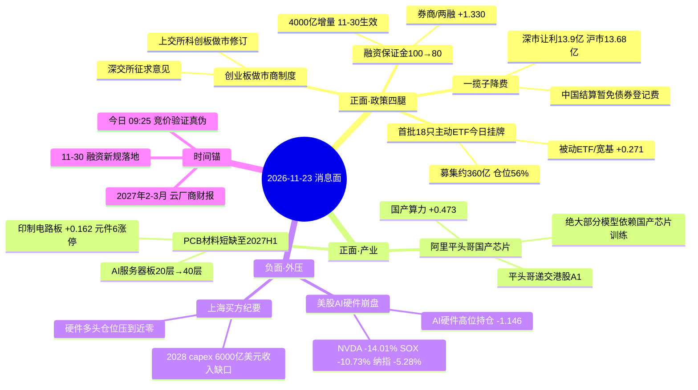

# 2026年11月23日（周一）· **消息面事件驱动**

> **数据源新鲜度**: partial · **降级状态**: false · **置信度**: 0.66
> **覆盖窗口**: 2026-11-20 09:01 → 2026-11-23 05:56（约 69 小时）· **主源**: 财联社快讯 2251 条 + 19 号公众号 RSS 55 篇（含财联社早知道/证券时报/上海证券报/调研先知/安静拆主线）+ 东财三季报预告 500 条 + 盘前公告窗口 119 条

## 一句话结论

周末四腿稳市（融资保证金 80%、创业板做市商、一揽子降费、主动 ETF 360 亿）对冲隔夜美股 AI 硬件崩盘（NVDA −14.01%／SOX −10.73%）；消息面唯一有资金的方向是 **PCB 材料短缺链**，**券商只有政策没有钱**。

## 🗺️ 消息面全景图

## 🎯 顶级事件详解（8 条硬事件 · 按 strength 与 |weighted_score| 排序）

### E20261123_001 · 融资保证金比例下限 100%→80% · strength=high · polarity=正面 · weighted=+0.646

**事件摘要**: 11-22 18:33 经证监会批准，沪深北交易所发布通知将融资保证金比例下限由 100% 降至 80%，自 2026-11-30 起实施；存量合约可按 80% 重算保证金余额，理论释放近 4000 亿增量资金（新增约 1000 亿＋存量盘活约 3000 亿）。4 个独立来源（财联社通知原文／上海证券报测算／证券时报／财联社早知道）。

**推理深度三问**:
- **大资金意图**: 这是逆周期调节工具的标准动作——1 月市场最热时把 80% 上调到 100%，现在打回原点。政策要的不是当日买盘，而是**给 11-30 之后的杠杆资金开门**；对机构而言这是“下行风险被封住”的信号，不是“立刻加仓”的信号。
- **为什么走强**: 券商是唯一直接受益的牌照方（两融余额＋交易额双变量），且 11-20 全市场涨 313:跌 5236（上涨占比 5.62%）、中位 −5.08%，券商当日仅 −1.23%（中信 +0.79%、东方财富 +0.22%）已显抗跌。政策落在情绪真空期，反弹大概率由券商先开。
- **逻辑够不够硬**: **硬在方向、软在节奏**。方向有官方通知原文＋4000 亿测算；节奏上 11-30 才生效、券商**没有当日资金证据**（未进 R7 40 板块净流入榜），周一高开就是“预期兑现”，不是“资金确认”。

**首推票思维链**:

#### 东方财富 300059 · role=首推（两融+创业板双弹性）
- **买入理由**: hithink 主营构成证券服务业收入占比 **78.30%**、毛利率 42% 级，两融余额与交易量直接进利润；同时是创业板权重＋互联网券商，做市商制度（E002）与创业板 ETF 份额 5 日 +79.74 亿份（+17.64%）三重叠加。
- **风险点**: 券商板块**零资金证据**；11-20 收盘 18.41、成交 41.03 亿、5 日 +0.66%，属“没跌但也没人买”；政策 11-30 生效存在一周空窗，若周一高开 3% 以上即为兑现盘。
- **止损条件**: 参考价 18.41，跌破 17.35（−5.76%）止损；RR=(19.6−18.41)/(18.41−17.35)=**1.12 < 2** → 只观察，不进 execution。
- **可验证假设**: 开盘 30 分钟成交额 ≥ 11-20 全日 41.03 亿的 40%（约 16.4 亿）且价格不破 18.41 → 政策腿有效；若高开后 30 分钟回落至 18.41 下方，假设作废，当日回避。

#### 中信证券 600030 · role=龙头承重
- **买入理由**: hithink 主营：证券投资 39.95%（毛利率 80.07%）、证券经纪 26.45%、资产管理 16.10%；杠杆松绑对自营＋经纪双线加分，25.39 元收盘、29.31 亿成交，是券商里最“重”的承接标的。
- **风险点**: 龙头票在情绪修复日容易被当提款机（先涨后砸）；5 日仅 +1.60%，没有资金抢跑痕迹。
- **止损条件**: 参考价 25.39，跌破 23.95（−5.67%）止损；RR=1.11 < 2 → 只观察。
- **可验证假设**: 若券商板块 09:30-10:00 涨幅进入行业前 10 且中信成交额 > 11-20 的 1.5 倍（43.9 亿）→ 资金认账；否则视为纯情绪高开。

### E20261123_006 · 美股 AI 硬件崩盘：英伟达 −14.01%、费城半导体 −11% · strength=high · polarity=负面 · weighted=−0.630

**事件摘要**: US 11-20 收盘标普 −3.699%、纳指 −5.2827%、费城半导体 −10.73%，NVDA −14.01%、MU −13.89%、AMD −13.25%、AVGO −12.19%；英伟达财报强劲仍被杀，VIX 一度破 40，纳指 100 进入熊市（中信证券口径：标普自高点回调 11.6%）。5 个来源（财联社盘中快讯 ×3／tushare 独立行情／中信证券）。

**推理深度三问**:
- **大资金意图**: 这是**估值杀不是业绩杀**——业绩超预期仍被抛，说明资金在提前定价“2028 年 AI 资本开支走平甚至下走”。卖方（中信）把 2027 AI 产业链定性为“年初估值承压”，机构在等 2027 年 2-3 月云厂商财报验证，中间这段只做反弹不做趋势。
- **为什么走强**: “走强”在这里是**做空方向走强**。R7 口径：半导体当日主力 −109.45 亿（超大单 −54.88、小单 +86.92）＝机构卖散户接；通信 5 日主力 −105.74 亿；11-20 长电 −9.50%、盛合晶微 −7.08% 已经先跌。
- **逻辑够不够硬**: **硬**。SOX −10.73%、NVDA −14.01% 是 tushare 独立行情源的硬数字，不是转述；且与 11-20 A 股科技链杀跌同向，构成“今日开盘外压”的第一性证据。唯一软点是“美股跌 → A 股必跌”不是必然，国产替代链存在反向受益的可能（见 E008）。

**首推票思维链（受损标的·只做减仓/回避）**:

#### 新易盛 300502 · role=减仓/回避（光模块对美算力敞口）
- **买入理由**: 不买。hithink 主营光互联产品收入占比 **99.87%**、毛利率 48.46%，是对海外 AI 算力最直接的 exposure，外压来时没有缓冲垫。
- **风险点**: 5 日已 −12.04%、11-20 −1.23%，但 5 日主力仍 +1.96 亿（弱正）——说明还有资金在接，反弹会诱多；一旦破 155 元，接盘方会转手。
- **止损条件**: 参考价 165.00，若持有跌破 155.00（−6.06%）减仓；不新开仓，position_size 0.02 仅作对冲口径。
- **可验证假设**: 若今日光模块板块跌幅 < 半导体板块跌幅且新易盛不破 155 → 说明 A 股走“国产替代分化”而非全线杀；若同步跌超 5%，则外压主导，全链回避。

### E20261123_005 · PCB 材料短缺至少持续至 2027H1 · strength=high · polarity=正面 · weighted=+0.602

**事件摘要**: 全球电子协会（Global Electronics Association）报告：玻纤布/树脂/铜箔/覆铜板全面供不应求，常规材料紧张至少到 2027H1、2028 年中前难缓解；AI 服务器用板从 20 层向 40 层以上演进；FR-4 覆铜板交期由 2-3 周拉长至 6-8 周、高端低损耗 14-18 周；日本主要玻纤织机供应商订单排满至 2027 年底。2026H1 中国 20 家 PCB 企业新增产能投资超 100 亿美元，A 股 PCB 厂商年内披露扩产募资超 1000 亿元。4 个来源（上海证券报全文／财联社／news_major／证券时报）。

**推理深度三问**:
- **大资金意图**: 11-20 唯一有板块效应的方向就是 PCB/元件——印制电路板主力 +20.39 亿（3 日 +69.92 亿，3/3 连续）、元件 +18.72 亿（3 日 +67.92 亿）、元件 6 只涨停。资金在“AI 硬件全链杀”里挑了一个**供给端有独立逻辑的分支**做避风港，这是不是主攻还要看 5/20 日（印制电路板 5 日 −4.18 亿、20 日 −234.58 亿，仍是刚回流）。
- **为什么走强**: 因为短缺是**物理约束不是叙事**：织机交期、认证周期、扩产 1 年建设周期都在报告里给了数字，任何 AI 服务器出货都必须先拿到板。缺料时“能不能拿到货”比价格更重要，涨价传导确定性高。
- **逻辑够不够硬**: **硬，但有两条自警**。①协会自己写了“提前采购推高订单规模，2027 年订单可能回调”——超额下单是需求幻觉；②毛利率分化极大：深南电路 32.30% vs 科翔股份 **−1.39%**（PCB 制造亏损），只能做高毛利环节，不能做“沾 PCB 就买”。

**首推票思维链**:

#### 科翔股份 300903 · role=首推（章建平第一大流通股东 + 30 亿九江 AI 服务器项目）
- **买入理由**: 章建平家族（方文艳）持股 2160.28 万股占总股本 **4.96%**、持仓市值至少 **13.35 亿元**、为第一大流通股东（证券时报／上海证券报双源）；11 月签约 30 亿元九江 AI 算力服务器项目；hithink 主营 PCB 制造占收入 **89.52%**，弹性最大。11-20 收 55.95、+3.63%、成交 16.33 亿。
- **风险点**: PCB 制造毛利率 **−1.39%**（hithink 口径）＝增收不增利；5 日 −9.47% 说明筹码在松动；游资持仓是双刃剑，出货时没人接。
- **止损条件**: 参考价 55.95，跌破 52.60（−6.00%）止损；RR=(61−55.95)/(55.95−52.60)=**1.51 < 2** → 只观察。
- **可验证假设**: 若今日 PCB 板块（元件）继续净流入且科翔站上 55.95 不破 → 短缺逻辑＋游资锁仓同时成立；若板块红而科翔绿，说明是“个股故事不是板块行情”，剔除。

#### 深南电路 002916 · role=首推（业绩硬确认＋扩产主力）
- **买入理由**: 三季报预告归母 **+74.13%~78.43%**、扣非 +84.15%~88.73%（10-16 公告）；hithink 主营电子电路收入占比 **95.65%**、毛利率 **32.30%**（PCB 链最高一档）；11-20 收 210.00、成交 41.74 亿，5 日主力 **+9.05 亿**；上证报点名扩产主力。
- **风险点**: 单价 210 元的高价票在情绪主跌日流动性折价更大；11-20 −0.59% 未跌透，若外压补跌空间大。
- **止损条件**: 参考价 210.00，跌破 198.00（−5.71%）止损；RR=(228−210)/(210−198)=**1.50 < 2** → 只观察。
- **可验证假设**: 若今日成交额 > 41.74 亿且收在 210 上方 → 高毛利＋业绩腿被资金认账；若缩量到 25 亿以下，视为外压主导，等第二只脚。

#### 超声电子 000823 · role=首板候选（11-20 首板封单 1.67 亿）
- **买入理由**: 11-20 涨停 +9.98%、封单 **1.67 亿**、5 日主力 **+7.61 亿**；三季报预告归母 **+90.78%~102%**、扣非 +89.14%~100.43%（10-13 公告）；hithink 主营电子元器件制造占 **97.61%**、毛利率 14.44%；是元件 6 只涨停里唯一“有业绩＋有资金＋首板身位”三合一的票。
- **风险点**: 首板次日接力风险最大——主跌段首板成功率本身低（11-20 炸板率 31.82%、跌停 68 家）；封单 1.67 亿相对 21.35 亿成交额偏薄。
- **止损条件**: 参考价 18.51，跌破 17.40（−6.00%）止损；RR=(20.2−18.51)/(18.51−17.40)=**1.52 < 2** → 只观察，竞价弱转强才可考虑。
- **可验证假设**: 集合竞价若高开 2%-5% 且 09:25 竞价量 > 昨日同期 → 首板接力有效；若平开或低开且 5 分钟内不能回封，按“错了快切”处理。

### E20261123_002 · 创业板引入做市商制度＋科创板做市规则修订 · strength=high · polarity=正面 · weighted=+0.473

**事件摘要**: 11-22 18:34 深交所就创业板做市交易业务规则公开征求意见；18:54 上交所推动修订科创板股票做市业务指南，聚焦优化做市报价义务指标、完善竞争评价机制、提升做市周转效率。4 个来源（财联社 ×2／证券时报五大亮点／上海证券报）。

**推理深度三问**:
- **大资金意图**: 监管在流动性端做“制度供给”——做市商用自有资金双边报价，等于给创业板/科创板装了一个常驻买方。它买的是**波动率下降**，不是当日指数涨幅。
- **为什么走强**: 创业板指自 6 月高点回撤约 47%、回吐前期涨幅超 70%（东吴证券芦哲口径），已超 2015/2022 可比区间；制度底＋估值底同时出现，是做市商制度能落地的窗口。头部券商做市业务与 ETF 生态是直接承接方。
- **逻辑够不够硬**: **中等偏硬**。制度方向确定（征求意见稿已在），但落地时点、做市券名单都没出，短期只能交易“预期”；且券商零资金证据。

**首推票思维链**:

#### 国泰海通 601211 · role=首推（ETF 做市/机构业务体量）
- **买入理由**: 国泰＋海通合并后机构业务、ETF 做市体量居行业前列（定性，未取到主营占比数字）；11-20 收 16.60、+0.61%、成交 16.54 亿，在券商里抗跌。
- **风险点**: 本票走 llm_pure_no_verification（无 hithink 主营占比＋无资金卡）；RR 低；做市牌照名单未定，利好可能落到别家。
- **止损条件**: 参考价 16.60，跌破 15.62（−5.90%）止损；RR=(17.6−16.60)/(16.60−15.62)=**1.13 < 2** → 只观察。
- **可验证假设**: 若今日券商板块整体跑赢上证 ≥1 个百分点且国泰海通成交额 > 24.8 亿（1.5 倍）→ 制度预期被资金接受；否则仅作情绪票。

### E20261123_003 · 一揽子降费：深市让利 13.9 亿／沪市 13.68 亿 · strength=high · polarity=正面 · weighted=+0.301

**事件摘要**: 11-22 深交所免收交易单元使用费、网络投票服务费、减免交易通信服务费、下调数据中心收费，预计向市场让利 **13.9 亿元**，本年度深市整体降费超 **22 亿元**；上交所组合式推出新一批降费措施让利 **13.68 亿元**；中国结算 2027-01-01 至 2028-12-31 继续暂免绿色/科创/民企公司债券登记结算费。4 个来源（财联社 ×3／上海证券报）。

**推理深度三问**:
- **大资金意图**: 降费是**成本端让利**，对券商是佣金让利（实际是减负），对交易所 IT 与高频交易是成本下降。金额量级（十几亿）远小于融资松绑的 4000 亿，属“组合拳里的情绪补丁”。
- **为什么走强**: 与融资松绑同日发布，强化“政策底”叙事；对金融 IT（同花顺类）是交易活跃度的二阶受益。
- **逻辑够不够硬**: **中等**。有官方通知与具体金额，但绝对量级小，且受益链条长、弹性低——金融 IT 板块净分只有 +0.120，仅擦线过正面阈值（>0.12）。

**首推票思维链**:

#### 同花顺 300033 · role=首推（交易活跃度弹性）
- **买入理由**: hithink 主营互联网金融信息服务 **100%**、毛利率 **88.97%**，交易频次上升直接放大信息服务与增值电信收入；11-20 收 199.03、+0.56%、成交 20.60 亿，抗跌。
- **风险点**: 高毛利高估值票在外压日最容易被杀估值；降费对它是间接利好，不是直接订单。
- **止损条件**: 参考价 199.03，跌破 187.50（−5.79%）止损；RR=(212−199.03)/(199.03−187.50)=**1.13 < 2** → 只观察。
- **可验证假设**: 若今日两市成交额回到 1.6 万亿以上（11-20 为 14311.1 亿）且同花顺站在 199 上方 → 活跃度逻辑成立；若缩量，逻辑不成立。

### E20261123_007 · 上海买方纪要：硬件多头仓位压到近零、2028 年 6000 亿美元收入缺口 · strength=medium · polarity=负面 · weighted=−0.516

**事件摘要**: 调研先知 11-22 13:43 路演纪要：硬件多头仓位基本压到接近零，部分机构现金占比达 70%，海外基金半导体持仓落到个位数；市场对 2027 年 AI capex 1.3-1.4 万亿美元已有共识，真正不安的是 2028 年已被提前定价为持平或下行；明年新增约 10GW 推理算力需约 8000 亿美元模型收入消化，而华尔街给 Anthropic 的收入预期不到 2000 亿，缺口约 6000 亿美元。**单源**（调研先知），strength 按规则顶格 medium，single_source=true。

**推理深度三问**:
- **大资金意图**: 纪要的价值不是“又看空”，而是给出**卖方一致预期与买方实际仓位的落差**——多头已空仓，意味着反弹时抛压小，但也意味着没人愿意先手；机构现金 70% 等的是“2028 年 capex 证伪”这个变量。
- **为什么走强**: 这是“空头方向走强”。11-20 长电 −9.50%、盛合晶微 −7.08%、中际旭创 −3.72%、新易盛 −1.23%，硬件链已在杀；纪要给的是“还要杀多久”的时间坐标（2027 年 2-3 月云厂商财报）。
- **逻辑够不够硬**: **叙事硬、证据软**。6000 亿美元缺口是算术推演（10GW × 700-800 亿美元/GW vs Anthropic 预期），不是订单数据；且仅单一公众号纪要来源，不得当事实用，只能作情绪与仓位证据。

**首推票思维链（受损标的·只做减仓/回避）**:

#### 中际旭创 300308 · role=减仓/回避（光模块龙头高位持仓）
- **买入理由**: 不买。hithink 主营光通信收发模块收入占比 **98.99%**、毛利率 46.59%，是 AI 硬件核心持仓标的；纪要称硬件仓位接近零＝后续抛压边际减少但买盘同样缺席。
- **风险点**: 5 日 −15.70% 已跌很多，超跌反弹会很急，容易被误判为反转；一旦反弹到 415 上方而无量，就是减仓窗口。
- **止损条件**: 参考价 393.20，若持有跌破 370.00（−5.90%）减仓；不新开仓，position_size 0.02。
- **可验证假设**: 若今日反弹但成交额低于 11-20 的 149.41 亿 → 判定为无资金反弹（减仓）；若放量突破 415 且光模块板块转正，则“反弹升级为修复”，推翻纪要结论。

### E20261123_008 · 阿里 CEO：绝大部分模型将依赖国产芯片训练、平头哥递交港股 A1 · strength=medium · polarity=正面 · weighted=+0.473

**事件摘要**: 财联社早知道 11-22 19:00 引述吴泳铭业绩电话会：2027 年一季度新一代平头哥国产芯片可支持超大规模模型训练，未来绝大部分模型（含预训练/后训练）将完全依赖国产芯片；平头哥已以保密形式向港交所递交 A1、拟主板独立上市；国金证券张真桢：真武芯片累计出货超 56 万颗、超 650 家外部客户采用，算力贡献占比目标由逾 10% 提升至 40%-50%。**单源**（财联社早知道，原始出处为阿里业绩电话会），strength 顶格 medium。

**推理深度三问**:
- **大资金意图**: 阿里把“国产芯片”从 PPT 变成财务口径（出货量、客户数、算力占比目标），并同步做资本市场动作（平头哥分拆 A1），是要让国产算力的估值锚从“主题”转成“可比公司”。
- **为什么走强**: 在海外 AI 硬件崩盘的同一时间给出“国产替代不受外压”的叙事，这是 A 股半导体自主可控唯一能对抗 SOX −10.73% 的旗帜；但注意 11-20 半导体当日主力 −109.45 亿、pct −6.86%，说明旗帜还没被资金认。
- **逻辑够不够硬**: **偏软**。单源公众号转述＋无当日资金确认＋无第二独立源；且 11-20 长电 −9.50% 已在杀。事件方向对，但只能给研究级，不能给开仓资格。

**首推票思维链**:

#### 长电科技 600584 · role=首推（封测＋阿里合作）
- **买入理由**: 财联社早知道点名“与以阿里巴巴为代表的大多数国内外半导体企业有不同层次合作”；hithink 主营电子元器件（封测）收入占比 **99.60%**、毛利率 13.95%；11-20 收 50.20、成交 48.71 亿，是被错杀的核心封测资产。
- **风险点**: 11-20 **−9.50%** 单日大跌，说明在杀；毛利率 13.95% 是链内最低档，业绩弹性靠量不靠价；无资金卡。
- **止损条件**: 参考价 50.20，跌破 47.00（−6.37%）止损；RR=(54.5−50.2)/(50.2−47.0)=**1.34 < 2** → 只观察。
- **可验证假设**: 若今日半导体板块翻红且长电收复 50.20 并放量 → 国产替代叙事被资金接住；若继续破 47，说明外压压过叙事，剔出。

#### 盛合晶微 688820 · role=首推（芯粒/晶圆级封装）
- **买入理由**: hithink 主营芯粒多芯片集成封装 **53.66%**、中段硅片加工 33.07%、晶圆级封装 12.79%，是先进封装最纯标的；5 日主力 **+4.19 亿**（11-20 −7.08% 仍在流入），个股抗跌强于板块。
- **风险点**: 板块净分只有 +0.331 且被 E006 外压消耗；11-20 −7.08% 说明接刀资金在挨打；5 日 +6.97% 已回补过一段。
- **止损条件**: 参考价 91.80，跌破 85.60（−6.75%）止损；RR=(99−91.80)/(91.80−85.60)=**1.17 < 2** → 只观察。
- **可验证假设**: 若今日站上 91.80 且成交额 > 25.60 亿（11-20 值）→ 资金继续认先进封装；若跌破 85.60，说明外压主导，撤。

### E20261123_004 · 首批 18 只主动 ETF 今日挂牌、募集约 360 亿 · strength=medium · polarity=正面 · weighted=+0.387

**事件摘要**: 11-23 首批 18 只主动 ETF 集体上市，合计募集约 **360 亿元**，截至 11-16 平均股票仓位超 **56%**（东吴证券芦哲）；自购及股东投资金额已超 **28 亿**（财联社 11-22 16:58）。4 个来源（上海证券报引述／财联社 ×2／证券时报）。

**推理深度三问**:
- **大资金意图**: 360 亿募集额是“已到账但没买完”的钱——平均仓位 56% 意味着约 44% 仍待建仓，这是**未来数周的确定性买盘**，也是监管想要的“长线资金入市”的实物证据；券商自购 28 亿是渠道方的连带下注。
- **为什么走强**: 与 ETF 份额数据同向——11-20 崩盘日宽基被大额申购：沪深300ETF 5 日 +95.62 亿份（+20.96%）、创业板ETF +79.74 亿份（+17.64%）、中证500ETF +31.92 亿份（+35.71%），是当日唯一与“散户接货”反方向的证据。
- **逻辑够不够硬**: **中等**。360 亿与仓位 56% 都有明确出处，但份额/募集数据是 T+0 口径，不代表周一继续买；首日上市常有溢价回落。

**首推票思维链**:

#### 华泰证券 601688 · role=首推（ETF 做市＋被动资管）
- **买入理由**: ETF 做市与被动资管是华泰优势业务（定性）；同集团沪深300ETF华泰柏瑞 5 日份额 +95.62 亿份（+20.96%）是生态验证；11-20 收 17.54、+1.10%、成交 12.40 亿，券商里最强之一。
- **风险点**: 券商零资金证据；ETF 首日溢价回落可能拖累渠道情绪；本票 business_relevance 为定性 0.78，无主营占比硬数字。
- **止损条件**: 参考价 17.54，跌破 16.52（−5.82%）止损；RR=(18.6−17.54)/(17.54−16.52)=**1.13 < 2** → 只观察。
- **可验证假设**: 若今日 18 只主动 ETF 首日平均溢价 >0 且成交活跃，同时华泰成交额 > 18.6 亿（1.5 倍）→ 渠道逻辑成立；若 ETF 大面积折价，剔除。

## 📊 板块 × 事件热力矩阵（净分列 · 叉乘公式 abs(weighted)×sign(polarity)×strength权重）

| 板块 | 净分 | 极性 | 事件数 | 逐事件叉乘明细 | 资金/位置口径 |
|---|---:|:--:|:--:|---|---|
| 券商/两融 | +1.330 | 正面 | 3 | 001 正面×1.00=+0.646 / 002 正面×1.00=+0.473 / 003 正面×0.70=+0.211 | +1.330 三腿叠加(融资松绑+做市商+降费) 全表最强 但券商未进 R7 40 板块净流入榜=零当日资金证据; 4000亿11-30才生效 周一高开=预期兑现不是资金确认 |
| 大盘蓝筹/宽基 | +0.723 | 正面 | 2 | 001 正面×0.70=+0.452 / 004 正面×0.70=+0.271 | +0.723 融资松绑+主动ETF 双宽基腿; 沪深300ETF 5日份额 +95.62亿份(20.96%) 是唯一与「散户接货」反方向的证据 |
| 国产算力/自主可控 | +0.473 | 正面 | 1 | 008 正面×1.00=+0.473 | +0.473 单腿(平头哥) 无第二独立源 无当日资金确认 → 研究级 不授开仓 |
| 电子布/玻纤 | +0.421 | 正面 | 1 | 005 正面×0.70=+0.421 | +0.421 单腿 交期数据硬(FR-4 2-3周→6-8周 高端14-18周) 但无个股主线身份 |
| 创业板流动性 | +0.331 | 正面 | 1 | 002 正面×0.70=+0.331 | +0.331 做市商单腿 制度供给 非当日买盘 |
| 先进封装 | +0.331 | 正面 | 1 | 008 正面×0.70=+0.331 | +0.331 单腿; 长电 11-20 -9.50%/盛合晶微 -7.08% 事件发生在杀跌之后 不是买点 |
| 被动ETF/宽基 | +0.271 | 正面 | 1 | 004 正面×0.70=+0.271 | +0.271 360亿今日上市 平均仓位56% → 约44%待建仓 是后续增量不是首日买盘 |
| 印制电路板/覆铜板 | +0.161 | 正面 | 2 | 006 负面×0.70=-0.441 / 005 正面×1.00=+0.602 | +0.162 多事件: 短缺正面(+0.602) 被外压(-0.441)削掉73%; 但 R7 印制电路板 d1 +20.39/d3 +69.92(3/3) 唯一连续吸金 + 元件 6 涨停 → 唯一有资金的真方向 5/20日仍 -4.18/-234.58 属刚回流 |
| 金融IT/交易系统 | +0.120 | 正面 | 1 | 003 正面×0.40=+0.120 | +0.120 擦线正面(>0.12 阈值仅 0.0005) 降费单腿 low 权重 不构成独立方向 |
| 算力租赁/智算中心 | -0.361 | 负面 | 1 | 007 负面×0.70=-0.361 | -0.361 2028 capex 6000亿美元收入缺口叙事 单腿 |
| 存储/DRAM | -0.441 | 负面 | 1 | 006 负面×0.70=-0.441 | -0.441 MU -13.89% 映射 单腿 |
| 半导体设备·材料 | -0.441 | 负面 | 1 | 006 负面×0.70=-0.441 | -0.441 半导体设备 d1 -0.78亿 pct -6.59% 抱团尾声 单腿 |
| 光模块/CPO | -0.630 | 负面 | 1 | 006 负面×1.00=-0.630 | -0.630 SOX -10.73%/NVDA -14.01% 直接对手盘 通信 5日主力 -105.74亿 |
| AI硬件高位持仓 | -1.146 | 负面 | 2 | 006 负面×1.00=-0.630 / 007 负面×1.00=-0.516 | -1.146 两腿叠加(美股崩盘+买方纪要) 全表最弱; 新易盛/中际旭创 5日 -12%/-15.7% 已在杀 反弹即减 |

### sector_cross_summary（只收多事件板块）

- **券商/两融** 净分 +1.330（3 事件叠加）：+1.330 三腿叠加(融资松绑+做市商+降费) 全表最强 但券商未进 R7 40 板块净流入榜=零当日资金证据; 4000亿11-30才生效 周一高开=预期兑现不是资金确认
- **大盘蓝筹/宽基** 净分 +0.723（2 事件叠加）：+0.723 融资松绑+主动ETF 双宽基腿; 沪深300ETF 5日份额 +95.62亿份(20.96%) 是唯一与「散户接货」反方向的证据
- **印制电路板/覆铜板** 净分 +0.161（2 事件叠加）：+0.162 多事件: 短缺正面(+0.602) 被外压(-0.441)削掉73%; 但 R7 印制电路板 d1 +20.39/d3 +69.92(3/3) 唯一连续吸金 + 元件 6 涨停 → 唯一有资金的真方向 5/20日仍 -4.18/-234.58 属刚回流
- **AI硬件高位持仓** 净分 -1.146（2 事件叠加）：-1.146 两腿叠加(美股崩盘+买方纪要) 全表最弱; 新易盛/中际旭创 5日 -12%/-15.7% 已在杀 反弹即减

**叉乘读法（一句话）**：全表最强 = 券商/两融 +1.330（三腿政策）但零资金证据；全表最弱 = AI 硬件高位持仓 −1.146（美股崩盘＋买方纪要双负腿）；**唯一“有资金＋有产业逻辑”的是印制电路板/覆铜板 +0.162**——净分不高是因为被 E006 外压削掉 73%，但 R7 显示它是 3 日 3/3 连续净流入＋元件 6 涨停的孤岛。

## 🔥 三季报业绩预告命中（硬 alpha 交叉验证 · eastmoney_earnings_predict 报告期 2026-09-30）

| 代码 | 名称 | 预告类型 | 增速区间 | 事件命中 | 逻辑强度 |
|---|---|---|---|:--:|
| 002916.SZ | 深南电路 | 预增 | 归母 +74.13%~78.43% / 扣非 +84.15%~88.73% | E005 PCB 短缺＋扩产主力 | 🟢🟢🟢 |
| 002463.SZ | 沪电股份 | 预增 | 归母 +100.54%~109.74% / 扣非 +100.27%~107.36% | E005 PCB 短缺＋扩产主力 | 🟢🟢🟢 |
| 000823.SZ | 超声电子 | 预增 | 归母 +90.78%~102% / 扣非 +89.14%~100.43% | E005 PCB 短缺＋11-20 首板 | 🟢🟢🟢 |
| 688183.SH | 生益电子 | 预增 | 归母 +68%~75% / 扣非 +68%~75% | E005 覆铜板/PCB 双链 | 🟢🟢 |
| 300903.SZ | 科翔股份 | 无预告 | — | E005（主营 PCB 89.52% 但毛利率 −1.39%） | 🟡 |
| 601689.SH | 拓普集团 | 无预告 | — | 机器人（watch_catalysts 未进 top8） | 🟡 |
| 300308.SZ | 中际旭创 | 无预告 | — | E007 负面对手盘 | 🔴 |
| 300502.SZ | 新易盛 | 无预告 | — | E006 负面对手盘 | 🔴 |

**读法**：PCB 是唯一“业绩预告＋产业短缺＋3 日连续资金”三重共振的子链；券商四腿政策全部没有业绩预告（纯事件驱动，只能靠竞价验证）。

## 📋 首板候选池（first_board_candidates · 19 只 · 只对正面事件产出）

| 代码 | 名称 | quality | 源数 | 收盘 | 11-20 涨跌 | 板型 | 5日主力(亿) | 5日涨幅 | 风险标记 |
|---|---|:--:|:--:|---:|---:|:--:|---:|---:|---|
| 300903.SZ | 科翔股份 | high | 3 | 55.95 | +3.63% | 无涨停 | — | -9.47% | PCB制造毛利率 -1.39%(hithink); 情绪=主跌(炸板率31.82%/跌停68) |
| 002916.SZ | 深南电路 | high | 3 | 210.0 | -0.59% | 无涨停 | 9.05 | 0.85% | 情绪=主跌(炸板率31.82%/跌停68) |
| 000823.SZ | 超声电子 | high | 3 | 18.51 | +9.98% | 涨停 | 7.61 | 6.32% | 首板(次日接力风险); 情绪=主跌(炸板率31.82%/跌停68) |
| 688183.SH | 生益电子 | high | 3 | 71.53 | -3.83% | 无涨停 | 5.02 | 7.1% | 情绪=主跌(炸板率31.82%/跌停68) |
| 002463.SZ | 沪电股份 | high | 3 | 80.32 | -0.96% | 无涨停 | 13.82 | -2.29% | 情绪=主跌(炸板率31.82%/跌停68) |
| 002579.SZ | 中京电子 | high | 3 | 13.39 | +10.02% | 涨停 | 5.34 | 15.03% | 5日涨幅 15.0%; 2连板高位; 情绪=主跌(炸板率31.82%/跌停68) |
| 300476.SZ | 胜宏科技 | medium | 1 | 108.22 | -4.20% | 无涨停 | — | -12.19% | 5日跌幅 -12.2%; 情绪=主跌(炸板率31.82%/跌停68) |
| 603228.SH | 景旺电子 | medium | 2 | 53.24 | -1.10% | 无涨停 | 1.5 | -11.53% | 5日跌幅 -11.5%; 情绪=主跌(炸板率31.82%/跌停68) |
| 688519.SH | 南亚新材 | medium | 1 | 143.6 | +0.80% | 无涨停 | — | -12.58% | 5日跌幅 -12.6%; 情绪=主跌(炸板率31.82%/跌停68) |
| 601208.SH | 东材科技 | medium | 1 | 26.63 | -7.66% | 无涨停 | — | -16.57% | 5日跌幅 -16.6%; 11-20 单日大跌 -7.66%; 情绪=主跌(炸板率31.82%/跌停68) |
| 300059.SZ | 东方财富 | high | 2 | 18.41 | +0.22% | 无涨停 | — | 0.66% | 政策11-30生效 券商无当日资金证据; 情绪=主跌(炸板率31.82%/跌停68) |
| 601066.SH | 中信建投 | high | 2 | 21.9 | -0.59% | 无涨停 | — | 0.18% | 政策11-30生效 券商无当日资金证据; 情绪=主跌(炸板率31.82%/跌停68) |
| 601881.SH | 中国银河 | high | 2 | 11.41 | -0.44% | 无涨停 | — | -1.04% | 政策11-30生效 券商无当日资金证据; 情绪=主跌(炸板率31.82%/跌停68) |
| 601688.SH | 华泰证券 | medium | 1 | 17.54 | +1.10% | 无涨停 | — | 2.87% | 政策11-30生效 券商无当日资金证据; 情绪=主跌(炸板率31.82%/跌停68) |
| 601555.SH | 东吴证券 | medium | 1 | 7.21 | -1.90% | 无涨停 | — | -1.23% | 政策11-30生效 券商无当日资金证据; 情绪=主跌(炸板率31.82%/跌停68) |
| 601211.SH | 国泰海通 | medium | 1 | 16.6 | +0.61% | 无涨停 | — | 3.23% | 政策11-30生效 券商无当日资金证据; 情绪=主跌(炸板率31.82%/跌停68) |
| 300033.SZ | 同花顺 | medium | 1 | 199.03 | +0.56% | 无涨停 | — | 0.38% | 政策11-30生效 券商无当日资金证据; 情绪=主跌(炸板率31.82%/跌停68) |
| 600584.SH | 长电科技 | medium | 1 | 50.2 | -9.50% | 无涨停 | — | -4.74% | 11-20 单日大跌 -9.50%; 情绪=主跌(炸板率31.82%/跌停68) |
| 688820.SH | 盛合晶微 | medium | 2 | 91.8 | -7.08% | 无涨停 | 4.19 | 6.97% | 11-20 单日大跌 -7.08%; 情绪=主跌(炸板率31.82%/跌停68) |

**候选池纪律**：排序键 quality→source_count→hit_count，不因可交易性重排；19 只全部 tradable_today=true（无停牌）。**中京电子 2 连板＋5 日 +15.0%、超声电子首板**属高位接力，只能竞价确认后右侧；**胜宏/南亚/东材/景旺 5 日跌幅 −11.5%~−16.6%** 是弱势票，标记只为观察不接刀。券商 7 只全部带“政策 11-30 生效＋零当日资金证据”标记。

## 关键证据

- 证据 1: 沪深北交易所通知——融资保证金下限 100%→80%，11-30 起施行，理论释放近 4000 亿（财联社 11-22 18:33／上海证券报 18:38）。
- 证据 2: 全球电子协会 PCB 供应预警——常规材料紧张至少到 2027H1，FR-4 交期 2-3 周→6-8 周，高端 14-18 周（上海证券报 11-22 14:00）。
- 证据 3: US 11-20 收盘：SPX −3.699%、IXIC −5.2827%、SOX −10.73%、NVDA −14.01%（tushare.index_global＋财联社盘中快讯）。
- 证据 4: 11-20 A 股广度：涨停 30／跌停 68／炸板 14／炸板率 31.82%／最高 4 板／上涨占比 5.62%／中位 −5.08%／成交 14311.1 亿（R7 stk_limit 复核口径 U30 D68 Z14）。
- 证据 5: PCB 资金：印制电路板 d1 +20.39 亿、d3 +69.92 亿（3/3）、d5 −4.18 亿、d20 −234.58 亿；元件 d1 +18.72 亿、d3 +67.92 亿、元件 6 只涨停（R7）。
- 证据 6: 阿里业绩电话会——绝大部分模型将依赖国产芯片训练，平头哥已递交港股 A1；真武芯片累计出货超 56 万颗、650 家外部客户（财联社早知道 11-22 19:00，单源）。
- 证据 7: 主动 ETF——18 只合计募集约 360 亿、11-16 平均仓位超 56%、自购及股东投资超 28 亿（东吴芦哲／财联社）。

## 数据源审计

| 源 | 日期 | 状态 | 备注 |
|---|---|:--:|---|
| tushare/news_cls | 2026-11-23 | 🟢 | 2251 条 · 覆盖 11-20 09:01 → 11-23 05:56 |
| tushare/news_major | 2026-11-23 | 🟡 | 800 条上限截断 · 覆盖 11-21 14:50 起 |
| eastmoney/earnings_predict | 2026-11-23 | 🟢 | 500 条 · 报告期 2026-09-30 三季报预告 |
| 公众号 RSS(19 feed) | 2026-11-23 | 🟢 | 55 篇 · 14 个 feed 有文（含盘前纪要空 feed） |
| wechat_cli 焦点群(匿名) | 2026-11-23 | 🔴 | 0 条 · 7 群任务 ok 但周末静默 群聊腿缺失 |
| 盘前公告窗口 anns_window | 2026-11-23 | 🟢 | 119 条 · 含立案 3 条/回购/天孚投资协议 |
| hithink-business-query | 2026-11-23 | 🟢 | 10 票主营构成实取（东方财富/科翔/深南/超声/同花顺/中信/长电/盛合/新易盛/中际旭创） |
| expectation_gap | 2026-11-23 | 🔴 | status=no_input · 文章 4 篇 股票名录 0 只 |
| overseas_snapshot | 2026-11-23 | 🟡 | indices 段 status=degraded 但 SPX/IXIC/KS11 数值 fresh |
| xtick/hot_news | 2026-11-23 | ⚪ | 本次未调用（news_cls 已覆盖财联社/新浪/同花顺） |

## 不确定性 / 反证

1. **政策腿可能只兑现一天**：融资保证金 11-30 才生效，本周是“预期交易周”。历史上政策底常出现“高开—回落—二次探底”，若周一券商高开 3% 后 30 分钟内回落，等于确认兑现盘，四腿政策净分 +1.330 会迅速归零。
2. **PCB 短缺有“超额下单”自警**：协会原文明确写“提前采购推高订单规模，2027 年订单可能回调”。若把 2027H1 短缺线性外推成 2026 全年景气，会在订单回调时被打回；且科翔毛利率 −1.39% 说明“短缺≠全链赚钱”。
3. **E008 单源风险**：平头哥/国产芯片全部来自财联社早知道一篇，cls 与 news_major 零命中（“平头哥”0 条）。若阿里后续澄清或 A1 撤回，国产算力 +0.473 直接归零。
4. **E007 纪要不是官方数据**：6000 亿美元缺口是买方自算，且“硬件仓位接近零”无法证实；只能当反向情绪证据，不能当事实引用。
5. **正负交织股**：天孚通信（天孚扩产＋业绩 +42.18% vs 光模块方向 −0.630）、长电科技（国产替代＋阿里合作 vs 11-20 −9.50%）、超声电子（首板＋业绩 vs 主跌首板低胜率）——三者都是“利好发生在利空之后”，只能竞价验证，不能提前定价。
6. **群聊腿缺失**：0 条意味着没有 KOL 情绪交叉验证，E007 这类“情绪型”事件少了独立确认源，权重已按单源降到 medium。

## 与其他 R/D/E 的关系

- 依赖: `data/raw/20261123/*`（news_cls/news_major/公众号 RSS/earnings_predict/anns_window）＋ `data/research/20261123/R7_capital_flow.json`（资金与涨停结构）＋ `data/cache/stock_name_index.json`（股票名录）
- 被消费: R2 主线（PCB 短缺 vs 券商政策的板块排序）／R5 个股画像（12 只 top_pick 票＋19 只首板候选）／R6 反证（E007 单源与 E008 单源为弱点）／D1 预案（FBC 19 只＋events 的 stop_loss/RR）
- 与 R3 交叉: 本时点 R3_sentiment.json 尚未产出 → `kol_confirm` 全部标 `n/a`，不伪造共振

## Sub-Agent 元数据

- skill: analyze_news_impact_v1@1.7
- artifact: data/research/20261123/R4_news.json
- method: llm_v1（官方多源硬命中 + hithink 主营构成实取 + R7 资金口径）
- 生成时刻: 2026-11-23T06:21:14+08:00
