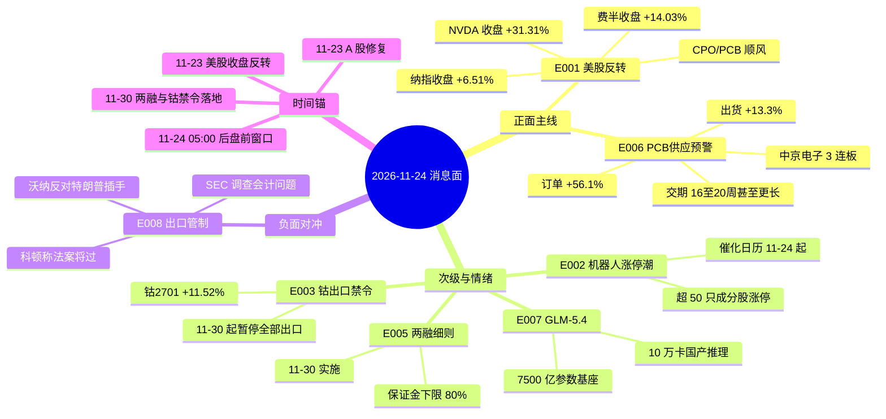

# 2026-11-24 · **消息面事件驱动**

> **数据源新鲜度**: partial · **降级状态**: true · **置信度**: 0.72
> **覆盖窗口**: 前 72h（主源）+ 盘前公告窗口（11-23 06:00 → 11-24 06:00）· **主源**: 财联社/新浪快讯 + 21 号公众号 RSS（92 篇/19 feed，含盘前纪要·财联社早知道·证券时报·上海证券报）+ 5 焦点群（0 条）+ 东财三季报预告（500 条）

## 一句话结论

隔夜美股黄仁勋复职把 AI 硬件从「崩塌」拉回「反包」，A 股侧只有 PCB/元件 与 CPO 两条腿拿到连续吸金；机器人和漫剧是超跌反抽不是主线，钴是供给端二次托底，唯一硬对冲是出口管制法案。

## 🗺️ 消息面全景图

## 🎯 顶级事件详解（每事件三问 + 首推票思维链）

### E20261124_001 · 英伟达恢复黄仁勋CEO职务 美股AI硬件暴力反弹 · strength=high · polarity=正面

**事件摘要**: 董事会一致投票恢复黄仁勋总裁兼 CEO 职务并即刻生效。开盘 NVDA 跳涨 33%、市值增加超 1 万亿美元（最新价 160.25 美元/股、总市值 3.9 万亿美元）；**收盘口径纳指 +6.51%、标普 +4.73%、道指 +3.01%、费半 +14.03%、NVDA +31.31%**（美光 +19%、英特尔 +16%、台积电 +14%、阿斯麦 +9%）。盘前道指期货 +1.91%、标普期货 +2.66%、纳指期货 +3.54%。调研先知 11-24 00:00 给出条件化判断：科技硬件已定价未来 3-4 个月 EPS 下调 25%-30%，若未来 2-3 个月未出现 20%-30% 幅度 EPS 大幅下调，科技股有望迎来 20% 以上反弹。

**推理深度三问**:
- **大资金意图**: 这不是技术反弹，而是用**不可逆的公司层动作**重置叙事锚——11-20 至 11-21 市场把 NVDA 单日 -14.01%、费半 -11%、纳指 -5.28% 定价成「AI 资本开支 2027 见顶」，董事会复职同时解掉公司层不确定性与政治层叙事压制，目的是把估值从「2027 见顶」推回「2028 见顶」，给多头多争取一个季度持仓窗口。
- **为什么走强**: 因为 A 股资金只认排序不认道理——11-23 A 股 CPO 概念 +87.16 亿、印制电路板 +48.03 亿（3 日 3/3）、元件 +54.33 亿（5 日 +101.93 亿），外部由压制转提振，内资已在 CPO/PCB 上用真金白银接了货。
- **逻辑够不够硬**: **硬**。触发源是公司公告与董事会决议（非传闻非自媒体），收盘价已确认（费半 +14.03%、NVDA +31.31%），且 A 股承接方用资金投票。缺陷两点：美股是单日反包，纳指 3 日仍 -1.38%；E008 的出口管制法案是同主体反向票，不能当噪音处理。

**首推票思维链**:

#### 新易盛 300502.SZ · role=首推·CPO 总龙(5日资金第一)
- **买入理由**: CPO/光互联产品收入占比 99.87%、毛利率 48.5%，是海外 AI 算力的直接敞口；5 日主力净额 +35.90 亿（全样本第一）、当日 +22.94 亿，收盘 181.36 站上 MA5 166.33。R7 CPO 概念 d1 +87.16 亿 / d3 +31.35 / d5 +49.91（3 日 2 日为正），通信设备板块涨幅 +4.19%。
- **风险点**: 目标区 195.0~215.0 对应 RR 1.57 < 2，**不授开仓资格，只进 watch**；隔夜美股 +31% 级别跳空会改变入场价，181.36 是 T-1 收盘不是今日可成交价；MA10 179.04 / MA20 190.21 仍压在头顶，60 日高 475.0 是极远处旧峰，位置感知失真。
- **止损条件**: 参考价 181.36 跌破 MA5 166.33（-8.3%）止损，不计隔夜跳空。
- **可验证假设**: 若今日竞价 CPO 板块高开后资金不跟、CPO 概念当日净流入转负且新易盛开盘 30 分钟内主力净额 ≤ 0，则「外部反包 → 内资接力」假设不成立，按一日反抽处理。

#### 中际旭创 300308.SZ · role=龙二·权重核心
- **买入理由**: 光通信收发模块收入占比 98.99%、毛利率 46.6%；公司 11-23 晚公告拟回购 20 亿~40 亿元、价格不超过 600 元/股（按上限约 666.67 万股占总股本 0.57%），是事件层给权重票的额外一手。5 日主力 +30.48 亿、当日 +22.23 亿，通信网络设备及器件 d3 +66.43 / d5 +68.41，收盘 417.20 破 MA5 401.62。
- **风险点**: 目标区 446.4~484.0、RR 2.30 达标，但 MA10 440.52 / MA20 485.52 压住目标区上沿，属「反弹到均线压制位」而非突破；回购是「维护公司价值及股东权益」不是业绩承诺；CPO 5 日 +49.91 亿里含 11-23 单日 +87.16 亿的集中回补，3 日只有 2 日为正，连续性弱于 PCB 的 3/3。
- **止损条件**: 参考价 417.20 跌破 396.34（-5.0%）止损；重新站上 MA10 440.52 上方才算转强确认。
- **可验证假设**: 若今日开盘 30 分钟内 CPO 概念资金不延续且中际旭创主力净额转负，则视为隔夜一次性回补，不追。

### E20261124_006 · PCB订单同比+56.1%而出货仅+13.3% 交期16至20周甚至更长 · strength=high · polarity=正面

**事件摘要**: 全球电子协会 PCB 供应预警报告：截至今年 9 月的一年内，PCB 订单量同比增长 56.1%、出货量仅增长 13.3%，订单明显快于交付；上游玻纤布、树脂到下游成品电路板各环节均供不应求，高多层板交货周期已达 16 至 20 周甚至更长。国金证券：Q3 是 PCB 环节第一个加速季度，涨价压力已传导至 PCB 环节，A 股 PCB 公司三季度营收、归母净利润同比平均增长 56%、320%。11-23 中京电子 3 连板，崇达技术、世运电路涨停，逸豪新材涨超 15%。

**推理深度三问**:
- **大资金意图**: 资金买的是**涨价传导的斜率**而不是 PCB 概念标签。订单增速是出货增速的四倍以上、交期拉到 16-20 周甚至更长，缺口不是一季能补的，Q4 业绩指引会继续验证——这正好接在 E001 的外部反转上，形成「外压解除 + 内需缺口」双驱动。
- **为什么走强**: 因为资金口径给出了唯一连续性证据：印制电路板 d1 +48.03 亿 / d3 +72.78 亿（3 日 3/3 全正）/ d5 +100.84 亿，元件 d3 +75.87 亿（3 日 3/3）/ d5 +101.93 亿，板块涨幅 +5.37%。这是本轮所有方向里**唯一 3 日全正且 5 日翻正**的链，与机器人（3 日 -20.99 亿）、券商（3 日 -9.76 亿）形成硬对比。
- **逻辑够不够硬**: **硬**。官方协会数据 + 卖方 Q3 业绩双验证，5 日 +100.84 亿是连续吸金而非单日脉冲。缺陷：涨价对下游服务器整机是成本（花旗测算 AI 服务器订单涨幅达 25%~45%），方向双向；扩产周期长也意味着涨价持续性久，**不是一日游**。

**首推票思维链**:

#### 沪电股份 002463.SZ · role=权重·业绩确认
- **买入理由**: 印制电路板业务占比 90.34%、毛利率 40.5%（对比中京电子刚性板仅 7.3%），是 AI 服务器高多层板的真受益方而非情绪映射。**东财三季报预告（公告日 2026-10-15）：归母净利 545,000 万~570,000 万，同比 +100.54%~+109.74%；扣非 536,000 万~555,000 万，同比 +100.27%~+107.36%；EPS 2.83~2.96 元**——业绩与题材同向，是本次唯一「消息 + 硬业绩 + 连续资金」三重共振的权重票。5 日主力 +22.51 亿、当日 +3.50 亿。
- **风险点**: 目标区 88.49~95.93、RR 2.30 达标，收盘 82.70 仍低于 MA20 84.11 与 60 日高 131.25，属超跌修复位置不是突破位置；三季报预告日已过 10-15，是否已被定价需 D5/R5 交叉验证；个股 5 日 +22.51 亿虽强但绝对量小于板块 +100.84 亿，说明它是**板块 beta 中弹性较弱的一档**。
- **止损条件**: 参考价 82.70 跌破 78.56（-5.0%）止损。
- **可验证假设**: 若今日印制电路板板块未能延续 3/3 资金状态、且沪电开盘后 30 分钟主力净额转负，则「涨价传导进 Q4 业绩」已被 11-23 提前定价，降级观察。

#### 中京电子 002579.SZ · role=身位·3连板
- **买入理由**: 印制电路板占比 100%（刚性板 67.48% 毛利率 7.3%、柔性板 24.55% 毛利率 15.5%），是本轮 PCB 情绪身位票，11-23 封 3 连板，收盘 14.73，5 日主力 +8.55 亿、当日 +2.89 亿。
- **风险点**: **目标区 15.76~17.09、RR 1.15 < 2，阻断开仓资格**；纯制造低毛利（整体 11.9%），涨价对其是成本传导未必是利润弹性；**封板质量差：11-23 开板 6 次，封单 1.02 亿 vs 当日成交 25.87 亿，封成比仅 3.95%**，且 60 日高 21.60 远在头顶、5 日涨幅已 +34.5%——是身位票不是质量票。
- **止损条件**: 参考价 14.73 跌破 13.26（-10.0%）止损，3 板断板即出。
- **可验证假设**: 若今日竞价不能一字或快速封板且开板次数再度放大，则身位优势丧失，只作情绪观察。

### E20261124_003 · 刚果金11月30日起暂停全部钴出口 钴2701合约单日+11.52% · strength=high · polarity=正面

**事件摘要**: 刚果（金）战略矿产市场监管局 ARECOMS 11-23 公告，自 11 月 30 日起暂停该金属所有出口，直至另行通知，理由为缓解国际市场供应过剩、推动市场可持续再平衡——这是刚果金第二次以暂停出口手段托举钴价。盘面反应：中联金 App 钴 2701 合约报 29.05 万元/吨，单日涨幅 11.52%（11-23 21:45）。上一轮 2025 年 2 月禁令曾把钴价推至 48.3 万元/吨（约禁令前 3 倍），随后随供应压力缓解回落至 26 万元/吨附近。同期华友钴业拟回购 10 亿~15 亿元、价格不超过 45 元/股，并获交行 13.50 亿元回购贷款承诺函。

**推理深度三问**:
- **大资金意图**: 这是**供给端二次托底**，资金买的是「跌无可跌的供给约束」而非需求扩张——所以资金只给了有色金属 +15.64 亿、小金属 +1.71 亿的单日流入，却给出 5 日 -89.02 亿 / -32.80 亿的深负，说明这是一次**事件驱动的价格脉冲**，不是资金建仓。
- **为什么走强**: 商品先动（钴 2701 +11.52%）→ 股票后跟（洛阳钼业 +3.67%、华友钴业 +4.88%）→ 但股票端只涨小量级且没有涨停票（小金属涨停 0 只、有色金属涨停 0 只），说明**市场只把它当涨价预期交易，没有当成主线**。
- **逻辑够不够硬**: **中**。硬在公告本身（ARECOMS 正式文件 + 期货实价 + 上市公司回购求证三级验证）；软在两点：一是上轮高点 48.3 万对应的涨幅本轮只剩「托底」性质，当前 29.05 万元/吨仍较低 40%，**涨价空间不等于上轮行情空间**；二是 5 日主力仍是净流出（洛阳钼业 -3.58 亿、华友钴业 -1.71 亿），**事件驱动 ≠ 资金确认**。

**首推票思维链**:

#### 洛阳钼业 603993.SH · role=首推·全球最大钴生产商
- **买入理由**: 矿山采掘及加工占比 36.63%、毛利率 59.6%（钴/铜/铌磷），是钴价弹性最直接的 A 股载体；当日 +3.67%、收盘 12.14 站上 MA5 12.09，5 日主力 -3.58 亿但当日 +1.95 亿，事件日已有回流迹象。
- **风险点**: 矿产贸易占 88.58% 而毛利率仅 2.5%，贸易盘对钴价无弹性；有色金属 5 日 -89.02 亿、3 日 -40.72 亿，板块还在失血；收盘 12.14 距 60 日高 19.895 仍远（MA20 13.19 也在头顶），属深跌反弹；5 日资金为负，**事件驱动 ≠ 资金确认**。
- **止损条件**: 参考价 12.14 跌破 11.53（-5.0%）止损；重新站上 MA10 12.66 才算确认。
- **可验证假设**: 若 11-30 禁令落地前钴 2701 回落至事件前价格下方（即 +11.52% 涨幅全部回吐），则供给托底叙事证伪，直接出。

#### 华友钴业 603799.SH · role=龙二·回购弹性
- **买入理由**: 新能源电池材料占比 48.95%（毛利率 16.2%）+ 有色金属 38.68%（毛利率 22.0%），双重受益；**回购 10 亿~15 亿元、价格不超 45 元/股、期限 3 个月，并获交行 13.50 亿元回购贷款承诺**——有真实现金托底动作支撑，比纯题材票硬一档；当日 +4.88%、收盘 29.89 站上 MA5 29.82。
- **风险点**: 已抢跑（当日 +4.88% 高于板块），收盘 29.89 仍压在 MA10 30.74 / MA20 31.10 之下；5 日主力 -1.71 亿为净流出；回购价上限 45 元与现价 29.89 之间是「意愿」不是「承诺成交」，价格高则买不动；有色金属 5 日 -89.02 亿、3 日 -40.72 亿，板块仍在流出通道。
- **止损条件**: 参考价 29.89 跌破 28.40（-5.0%）止损；回购价上限 45 元提供下方心理安全垫但不构成硬底。
- **可验证假设**: 若 11-30 前钴价回落且华友当日资金不转正，则「商品→股票」传导不成立，降级。

### E20261124_002 · 人形机器人+物理AI涨停潮 超50只成分股涨停 · strength=high · polarity=正面

**事件摘要**: 财联社早知道收评：机器人、物理 AI 方向全线爆发，**超 50 只成分股涨停**，其中凡拓数创 20CM 2 连板、宇树科技与上纬新材 20CM 涨停、福莱新材与襄阳轴承等人气核心反包；午报口径为早盘涨停 60 家（不含 ST 及未开板新股）、封板率 82%、连板股 9 家。催化日历（财闻私享 11-23 21:46）：11-24 智源物理 AI 开放日大会、11-25 小鹏机器人亮相科技日、11-30 宇树全国合作伙伴生态大会西南站（成都）、12/1-12/2 美国硅谷人形机器人峰会（Optimus 确认参展）、12/4 凌晨 5 点 Tesla 股东大会。马斯克称预计未来 12-18 个月 Optimus 可完成倒垃圾洗碗等多步骤家务劳动，Optimus Gen3 弗里蒙特工厂周产已达数百台，2027 年夏季大规模量产。

**推理深度三问**:
- **大资金意图**: 资金在做**事件日历套利**——11-24 到 12-4 五个催化点连续排满，所以愿意在 T-1 尾盘先抢筹人形机器人本体与前排。机构口径（FSD V15 开始推送 + Optimus 真实能力演示渐近 + 何小鹏「2027 年是高阶通用人形机器人的量产元年」）给了叙事支撑，但没人敢在 12-4 之前给估值。
- **为什么走强**: 因为催化密度本身构成**短期资金合力**：机器人概念 d1 +93.62 亿、人形机器人概念 d1 +74.85 亿，汽车零部件 23 只涨停 + 通用设备 15 只涨停把宽度做出来了。安静拆主线 11-23 16:33 的复盘口径确认「机器人、端侧、AI 漫剧基本属于同一节奏」，且是「当下区间里板块趋势和人气相对最好」。
- **逻辑够不够硬**: **中**。硬在产业催化日历与马斯克 12-18 个月 Optimus 落地的具体表述；软在**资金连续性**：人形机器人概念 3 日 -20.99 亿 / 5 日 -108.69 亿，通用设备 3 日 -11.94 亿 / 5 日 -26.63 亿，汽车零部件 3 日仅 +3.69 亿 / 5 日 -18.28 亿——**单日涨停潮 + 3/5 日仍净流出 = 低位反抽，不是主线**。这是本事件与 E006 的本质区别。

**首推票思维链**:

#### 宇树科技 688836.SH · role=总龙·产业本体
- **买入理由**: 人形机器人收入占比 51.07%、毛利率 63.2% + 四足机器人 41.05%，是**本体层**而非零部件映射的纯正标的；11-23 20CM 涨停且**开板 0 次**、封单 2.40 亿、流通市值 213.0 亿，是全样本封板质量最好的一只；催化日历（11-24 智源开放日、11-30 宇树生态大会西南站）直接点名宇树。
- **风险点**: **目标区 757.6~809.0、RR 1.06 < 2，阻断开仓资格**——20CM 涨停价入场使风险回报口径失真；5 日主力 -0.66 亿、当日 +5.82 亿，**资金是当日脉冲不是连续流入**；机器人概念 3 日 -110.76 亿 / 5 日 -224.16 亿；收盘 708.00 刚收复 MA10 674.89 与 MA20 669.48，60 日高 809.0 就是 12-4 催化兑现位。
- **止损条件**: 参考价 708.00 跌破 637.20（-10.0%）止损；60 日高 809 为第一压力。
- **可验证假设**: 若 11-24 智源开放日当日宇树高开低走且开板数 > 0，则「事件日历套利」转为「日历兑现即出货」，不再接力。

#### 凡拓数创 301313.SZ · role=前排·物理AI 2连板
- **买入理由**: 数字孪生及信息化软件 24.55% + 3D 可视化产品及服务 12.32% + 数智文化 IP 运营服务 6.76%，是物理 AI 的**仿真/可视化侧**映射；11-23 20CM 2 连板、**开板 0 次**、封单 0.92 亿；数字媒体板块 d1 +9.48 亿 / d3 +5.27 亿（2 日为正）、板块涨幅 +6.92%，是机器人链里少数 3 日仍正的子板块。
- **风险点**: **主营与物理 AI 重合度只有 0.55 权重**（题材映射强于业绩映射），目标区 75.96~81.46、RR 1.09 < 2，**阻断开仓资格**；20CM 二板位置高、60 日高 81.46 即目标区上沿；5 日主力 +1.22 亿、当日 +1.26 亿绝对量小；封成比仅 5.26%。
- **止损条件**: 参考价 70.99 跌破 63.89（-10.0%）止损，破 2 板启动位即出。
- **可验证假设**: 若数字媒体板块 d3 优势今日消失（板块资金转负）且凡拓无法封住 3 板，则前排地位不成立。

### E20261124_005 · 监管明确两融逆周期风控细则 保证金80%自11-30实施 存量合约同步适用 · strength=high · polarity=正面

**事件摘要**: 沪深北交易所《关于调整融资保证金比例等相关安排的通知》：融资保证金比例下限由 100% 下调至 80%，自 2026-11-30 实施，存量合约及展期仍按 80% 执行。配套监管《关于落实融资融券逆周期调节措施、提升风险管控有效性有关工作的通知》：市场波动期间可动态调整最低维持担保比例及追保平仓安排、以时间换空间，违约处置要稳妥审慎，注意处置金额、时点、节奏，**避免早盘尾市等时点集中卖出，冲击市场和个股**。测算口径并存：招商证券称理论新增融资空间约 5480 亿元、假设有效利用率 70% 后约 **3800 亿元**；新华社测算理论增量资金**近 4000 亿元**。

**推理深度三问**:
- **大资金意图**: 政策意图是**把杠杆从「单向收缩」改成「可逆调节」**——下调下限是给增量，逆周期细则（动态维持担保比例、严禁早盘尾市集中卖出）是给存量续命，避免 11 月那轮去杠杆式的连锁踩踏；监管明确「避免冲击市场和个股」，说明监管同样不接受在早盘尾市制造额外波动。
- **为什么走强**: 融资融券概念当日 +256.97 亿是全市场概念第一、板块涨幅 +2.97%。但这是**基准层回补**（同期 MSCI 中国 +201.35 亿、富时罗素 +194.98 亿、大盘股 +187.51 亿、深股通 +157.38 亿同步回流），不是产业资金进场；证券板块涨幅仅 +0.67%、证券Ⅲ **涨停 0 只**，3 日 -9.76 亿 / 5 日 -22.58 亿。
- **逻辑够不够硬**: **中**。政策文本本身是硬的（交易所通知 + 监管通知 + 券商测算三重），但**落地在 11-30**，离今日隔了 4 个交易日；A 股侧没有形成板块效应（证券涨停 0 只），说明市场把它当存量利好而非增量弹药。**政策未形成板块效应**是本事件最大缺陷。

**首推票思维链**:

#### 东方财富 300059.SZ · role=首推·两融+创业板双弹性
- **买入理由**: 证券服务业 78.30% + 信息技术服务业 21.64%（毛利率 86.7%），两融弹性 + 创业板 beta 双重敞口；融资融券概念 d1 +256.97 亿居全市场第一，收盘 18.62 站上 MA5/MA10/MA20（18.43/18.43/18.47）三线同穿。
- **风险点**: 5 日主力 -3.84 亿、当日仅 +0.27 亿——**概念资金第一不等于个股资金进场**，这是基准层回补的特征；目标区 19.92~21.60、RR 2.30 达标，但 60 日高 19.65 就在目标区下沿，突破空间被压住；政策 11-30 才落地，事件与资金之间有 4 天真空期。
- **止损条件**: 参考价 18.62 跌破 17.69（-5.0%）止损。
- **可验证假设**: 若今日证券Ⅲ 继续 0 涨停且东方财富当日主力净额不转正，则政策未定价，降级观察。

#### 中信证券 600030.SH · role=龙头·机构定价
- **买入理由**: 证券投资业务 39.95%（毛利率 80.1%）+ 证券经纪 26.45%（42.0%）+ 资产管理 16.10%，是机构定价能力的直接载体，杠杆率下行对头部券商的定价权弹性最直接；当日 +1.64 亿、收盘 25.26 站上 MA5/MA10/MA20（25.22/25.22/25.29）。
- **风险点**: **目标区 27.03~28.33、RR 1.92 < 2，降级 watch**；5 日主力 -2.18 亿为净流出；证券板块涨幅 +0.67%、涨停 0 只，3 日 -9.76 亿 / 5 日 -22.58 亿，**政策未形成板块效应**；60 日高 28.33 即目标区上沿，等于把第一压力当第二目标。
- **止损条件**: 参考价 25.26 跌破 24.00（-5.0%）止损；60 日高 28.33 为第一压力。
- **可验证假设**: 若 11-30 实施前券商板块无一只涨停且两融概念 3 日转负，则细则无法兑现为增量资金。

### E20261124_004 · AI漫剧爆发 1-9月微短剧49万部为去年13倍 用户8.5亿 · strength=high · polarity=正面

**事件摘要**: 国家广播电视总局数据：2026 年 1-9 月上线微短剧共 49 万部，是 2025 年全年的 13 倍；微短剧用户规模达到 8.5 亿，月活用户超过 6 亿，人均单日收看时长约 2 小时。盘面：果麦文化、华是科技 20CM 涨停，浙文影业、横店影视、上海电影、新炬网络、德才股份涨停，芒果超媒、幸福蓝海、海看股份、华智数媒等涨超 10%；龙版传媒 2 连板。机构口径：微短剧加速商业化及出海拓展打开版权运营新空间，具备 IP 储备、分发渠道及工业化制作能力的头部内容公司更易实现跨平台、跨形态的价值转化。

**推理深度三问**:
- **大资金意图**: 资金买的是**版权运营与 IP 储备的工业化变现**——机构口径明确指向「具备 IP 储备、分发渠道及工业化制作能力的头部内容公司」，即买的是能接住 49 万部产能的内容方，不是短剧制作方。
- **为什么走强**: 因为数据是**官方统计口径**（广电总局），且当日涨停宽度够：影视院线 d1 +6.15 亿、d3 +0.93 亿、板块涨幅 +7.63%（本轮涨幅第二）；传媒 d1 +21.20 亿但 5 日 -83.96 亿，说明这仍是单日修复而非资金回流。
- **逻辑够不够硬**: **中**。数据硬（官方 + 13 倍 + 8.5 亿用户 + 月活 6 亿 + 人均 2 小时）；产业链映射软——**龙版传媒主营教材教辅 67.78%、一般图书 25.35%，短剧占比极小**，果麦文化图书策划与发行 79.06%（IP 储备真受益但非制作方），都是题材映射不是主业受益；影视院线 5 日 -17.34 亿、传媒 5 日 -83.96 亿，**前期套牢盘未解**。

**首推票思维链**:

#### 龙版传媒 605577.SH · role=身位·2连板
- **买入理由**: 2 连板身位票，11-23 封板时开板 1 次、封单 0.36 亿、成交 8.36 亿；5 日主力 +2.64 亿、当日 -0.34 亿（当日小幅流出但 5 日仍正），影视院线 d1 +6.15 亿、d3 +0.93 亿、板块涨幅 +7.63%；收盘 17.81 站上 MA5 15.63 / MA10 16.23 / MA20 15.23。
- **风险点**: **目标区 19.06~20.66、RR 1.15 < 2，降级 watch**；主营是教材教辅（67.78%）与一般图书（25.35%），AI 漫剧仅题材映射，**不给首推资格**；封单 0.36 亿对应成交 8.36 亿、封成比仅 4.3%，封板质量一般；影视院线 5 日 -17.34 亿。
- **止损条件**: 参考价 17.81 跌破 16.03（-10.0%）止损，断板即出。
- **可验证假设**: 若次日无法晋级 3 板且传媒板块 5 日继续为负，则 2 板身位溢价消失。

#### 果麦文化 301052.SZ · role=弹性·20cm 反转
- **买入理由**: 图书策划与发行占比 79.06%、毛利率 44.9%，是「AI 生成内容 + IP 运营」链条上唯一有出版发行主业的标的，IP 储备是真受益；11-23 20CM 涨停、当日主力 +1.84 亿。
- **风险点**: **封板质量极差：开板 12 次、封单仅 0.07 亿 vs 当日成交 14.68 亿、流通市值 35.4 亿、换手 45.96%，封成比仅 0.48%**——典型「涨停但封不住」，**这是本事件最高优先级风险**；5 日主力 -0.13 亿（无资金确认）；**前期走势为 11-17 收 45.00 → 11-18 收 37.01 → 11-19 收 32.88 两根大阴，11-20 收 36.80、11-23 收 44.16 两连阳修复，但未收复 11-17 的 45.00**（原「四连跌停反转」表述与 K 线不符，已更正为两根大阴后 V 型反转）；目标区 47.25~51.23、RR 1.15 < 2，降级 watch；60 日高 51.50 就是目标上沿。
- **止损条件**: 参考价 44.16 跌破 39.74（-10.0%）止损，参考 MA5 39.17 区域。
- **可验证假设**: 若次日不能低开高走并快速封板、开板次数继续放大，则该票为出货而非反包，出局。

### E20261124_007 · 智谱GLM-5.4上线 7500亿参数达2-3万亿效果 10万卡国产芯片推理毛利转正 · strength=medium · polarity=正面

**事件摘要**: 智谱官方公众号 11-23 晚发布 GLM-5.4：首次采用 Loop Transformer 架构，**基于约 7500 亿参数规模的基座，智能水平可达到 2 万亿至 3 万亿参数级模型的效果**，在模型参数量不变的前提下通过增加计算深度提升复杂任务推理能力，增强编程、长程推理及视觉能力，代码应用拓展到视频生成、3D 建模、机械设计等泛 Coding 场景，已面向 GLM Coding Plan 全量用户开放并接入 ZCode/Trae/WorkBuddy，API 将在完成安全评估后开放，模型权重也计划后续开源。摩根大通研报：智谱已实现 **10 万卡级国产芯片规模化推理**，GLM-5.3-Flash 在国产芯片上的推理毛利率已转正；主要面向智谱等大模型企业需求建设的上海浦东黎明智算中心 11-17 基本落成并逐步试运行。

**推理深度三问**:
- **大资金意图**: 这是**给国产算力找需求叙事**的动作：智谱把「10 万卡国产推理 + 毛利转正」写进研报，等于告诉市场国产芯片的商用闭环已经在跑。资金买的是「国产推理从项目变生意」这一定价切换。
- **为什么走强**: 其实**没怎么走强**——半导体板块涨幅 +3.20% 但涨停只有 2 只，国产芯片概念 3 日 -172.26 亿；寒武纪当日 -0.57%、中芯国际当日主力 -1.31 亿。**消息未被定价，这是本事件与 E001/E006 的最大差别**。
- **逻辑够不够硬**: **中**。硬在官方发布 + 摩根大通研报 + 智算中心落地三件实物；软在三点：一是「10 万卡级推理毛利转正」对应的是 **GLM-5.3-Flash** 而非 GLM-5.4，摩根大通观点系上证报转述属**二手**；二是智谱为港股标的，**A 股只能做产业链映射，没有直接受益主体**；三是 A 股当日零反应，说明市场没认这条叙事。
- **结论**: 情绪=震荡（炸板率 14.12% < 35%，不触发减半）。这条腿**不进主线候选**，只做观察。

**首推票思维链**:

#### 寒武纪 688256.SH · role=首推·国产算力芯片
- **买入理由**: 云端智能芯片及加速卡占比 99.98%、毛利率 55.3%，是国产推理算力最直接载体；5 日主力 +18.88 亿、当日 +1.73 亿为净流入，收盘 914.80 站上 MA20 892.51 一线（MA5 924.52 / MA10 921.05 尚在头上）。
- **风险点**: **目标区 978.84~1061.17、RR 1.92 < 2，降级 watch**；个股当日 -0.57% 未跟涨、半导体板块仅 2 只涨停，**消息完全没被定价**——这既是机会也是「叙事不成立」的证据；国产芯片概念 3 日 -172.26 亿；60 日高 1154.79 远在头顶。
- **止损条件**: 参考价 914.80 跌破 859.91（-6.0%）止损，MA20 892.5 下方确认。
- **可验证假设**: 若国产算力相关标的今日集体不涨反跌，则智谱事件对 A 股无传导，永久降级。

#### 中芯国际 688981.SH · role=龙二·先进制程
- **买入理由**: 集成电路晶圆代工占比 92.81%、毛利率 22.8%，是国产算力扩产的必要产能；5 日主力 +21.40 亿为净流入，收盘 121.60 站上 MA5 119.57 / MA10 114.36 / MA20 109.37，60 日高 129.89 就在头顶。
- **风险点**: 当日主力 **-1.31 亿为净流出**，与「板块转强」矛盾；半导体设备 -4.32 亿 / 集成电路制造 -2.52 亿，**半导体当日资金是派发结构不是抢筹结构**；目标区 130.11~141.06、RR 2.30 达标，但上沿 141.06 远超 60 日高 129.89，需题材二次催化才成立。
- **止损条件**: 参考价 121.60 跌破 115.52（-5.0%）止损。
- **可验证假设**: 若半导体设备/制造当日资金不转正，则扩产叙事无资金承接，先进制程只作观察。

### E20261124_008 · 美参议员反对黄仁勋复职并推芯片出口管制法案 SEC调查英伟达会计问题 · strength=medium · polarity=负面

**事件摘要**: 11-24 05:43（北京时间，对应美股 11-23 尾盘）新浪快讯：**参议员科顿称争议不会因黄仁勋复职而平息，国会需要调查的事情很多，两党芯片出口管制法案将会获得通过**；05:47 参议员沃纳称特朗普插手企业事务的做法令人难以accept、应当聚焦美国国家安全事务而不是英伟达。旧腿：公众号盘前纪要 11-23 06:43 载「美国证券交易委员会据悉正对英伟达潜在会计问题展开调查」+ 特朗普表示将对在海外建设数据中心的美国公司征税。

**推理深度三问**:
- **大资金意图**: 反对方（参议员 + SEC）要的不是英伟达股价，是**重新拿回对 AI 算力的政策定价权**。同一主体（英伟达）上同时出现「董事会恢复 CEO」与「国会推动出口管制 + SEC 调查」两条腿，说明这不是旧闻翻炒，而是**在事件驱动窗口内被重新激活的政策压制**。
- **为什么走强**: 对空逻辑——E001 的反弹本质是**估值回补**，而这条腿直接压制出口链的远期需求：光模块/CPO 与 AI 服务器/算力硬件的对美敞口被重新定价。叉乘口径下它把光模块/CPO 从 +1.149 削到 **+0.764**（净分被削约 33%），把 AI 服务器/算力硬件打成 **-0.385**。
- **逻辑够不够硬**: **中**。硬在两条独立源（新浪快讯双条 + 公众号盘前纪要），且 SEC 调查与出口管制法案是**立法/执法层动作**，不是政治表态；软在：科顿与沃纳是**政治表态非立法结果**，SEC 调查目前仅盘前纪要单源需二次核实。**本条为行业级强制占位的负面腿，不得因 E001 走强而过滤。**

**首推票思维链**:

#### 天孚通信 300394.SZ · role=风险敞口·不新开 持有减仓
- **买入理由**: 光无源器件占比 54.12%（毛利率 71.9%）+ 光有源器件 44.55%，是海外算力链纯敞口最高的标的之一；11-23 当日 +13.82%、5 日主力 +13.19 亿、当日 +14.13 亿，是情绪腿最强的一只。
- **风险点**: **与政策风险方向完全相反**——情绪腿强、政策腿弱，正是最危险的组合（11-23 全天 +13.82% 是抢跑不是基本面兑现）；出口管制法案直指对美 AI 硬件敞口；目标区 124.44~134.91、RR 1.70 < 2；收盘 116.30 仍低于 MA10 118.82 与 MA20 133.18，60 日高 292.07。
- **止损条件**: 参考价 116.30 跌破 108.44（-6.8%）止损；若已持有则减仓，**不新开**。
- **可验证假设**: 若美股 11-24 盘后出口管制法案进入实质审议、或 SEC 调查出现第二独立源，则该敞口继续加价，优先减仓而非持有。

## 📊 板块 × 事件热力矩阵

| 板块 | 事件锚 | 首推龙头 | 独立源数 | 三季报预告 | 净综合置信 |
|------|--------|----------|----------|----------|:--:|
| 印制电路板/覆铜板 | E006 + E001 | 沪电股份 / 中京电子 | 4 | 沪电归母 +100.54%~+109.74% | 🟢🟢🟢 |
| AI算力芯片 | E001 + E007 | 寒武纪 / 中芯国际 | 4 | 海光 +38.16%~+51.93% | 🟢🟢 |
| 光模块/CPO | E001 + E006 + E008 | 新易盛 / 中际旭创 | 5 | 光迅 +65.37%~+82.26% | 🟢🟢 |
| 人形机器人 | E002 | 宇树科技 | 5 | 无 | 🟢🟡 |
| 物理AI | E002 | 凡拓数创 | 4 | 无 | 🟢🟡 |
| 人形机器人零部件 | E002 | 宇树科技 | 4 | 鼎龙 +61.72%~+65.57%（弱映射） | 🟡 |
| 钴/能源金属 | E003 | 洛阳钼业 / 华友钴业 | 3 | 无 | 🟡 |
| 影视院线/AI漫剧 | E004 | 龙版传媒 / 果麦文化 | 4 | 无 | 🟡 |
| 锂电上游 | E003 | 洛阳钼业 | 3 | 天齐 +2734.97%~+3235.26%（基数失真） | 🟡 |
| 券商/两融 | E005 | 东方财富 / 中信证券 | 4 | 无 | 🟡 |
| 国产大模型/国产算力 | E007 | 寒武纪 | 3 | 无 | 🟡 |
| AI服务器/算力硬件 | E008（负） | — | 3 | 无 | 🔴 |

### sector_cross_summary · 多事件叉乘结论（仅收 cross_events_count ≥ 2）

| 板块 | 逐事件叉乘 | 净分 | 位置结论 |
|------|--------|------|---------|
| 印制电路板/覆铜板 | E001 正面×0.70=+0.518 ＋ E006 正面×1.00=+0.585 | **+1.103** | 外部反转与供给缺口同向叠加；印制电路板 3 日 3/3、5 日 +100.84 亿，是唯一连续吸金链 |
| AI算力芯片 | E001 正面×0.70=+0.518 ＋ E007 正面×0.70=+0.349 | **+0.867** | 外压解除 + 国产推理双腿，但 E008 管制风险直指该链；国产芯片 3 日 -172.26 亿未确认 |
| 光模块/CPO | E001 正面×1.00=+0.740 ＋ E006 正面×0.70=+0.409 ＋ E008 负面×0.70=-0.385 | **+0.764** | 全球 risk-on 与回购腿对冲管制风险腿，净分仍正但被削约 33%；5 日资金 +49.91 亿是真金，CPO 3 日仅 2 日为正 |

> 叉乘口径：净分 = Σ |weighted_score| × sign(板块极性) × {high 1.0 / medium 0.7 / low 0.4}；加权分 = raw × exp(-0.15 × days_since)。全部事件 days_since ≤ 1、decayed=false；E008 因最新腿为 11-24 05:43 可知日，days_since=0 不衰减，旧腿（11-23 06:43 盘前纪要 SEC 调查）已在 notes 标明。

## 🔥 三季报业绩预告命中（硬 alpha 交叉验证）

源：`data/raw/20261124/eastmoney_earnings_predict.json`（report_date=2026-09-30，500 条 / 193 只，三季报预告口径）。按本文事件板块取交集：

| 代码 | 名称 | 预告类型 | 归母净利同比区间 | 事件命中 | 逻辑强度 |
|------|------|----------|------------------|----------|:--:|
| 002463.SZ | 沪电股份 | 预增 | +100.54%~+109.74%（545,000万~570,000万） | E006 PCB ＋ E001 | 🟢🟢🟢 |
| 002436.SZ | 兴森科技 | 预增 | +204.20%~+227.02% | E006 PCB | 🟢🟢 |
| 600183.SH | 生益科技 | 预增 | +164.00%~+181.00% | E006 PCB | 🟢🟢 |
| 002815.SZ | 崇达技术 | 预增 | +89.73%~+118.43% | E006 PCB | 🟢🟢 |
| 001389.SZ | 广合科技 | 预增 | +100.33%~+107.23% | E006 PCB | 🟢🟢 |
| 000823.SZ | 超声电子 | 预增 | +90.78%~+102.00% | E006 PCB（首板池） | 🟢🟢 |
| 002916.SZ | 深南电路 | 预增 | +74.13%~+78.43% | E006 PCB | 🟢🟢 |
| 688183.SH | 生益电子 | 预增 | +68.00%~+75.00% | E006 PCB | 🟢🟢 |
| 002281.SZ | 光迅科技 | 预增 | +65.37%~+82.26% | E001 光模块 | 🟢🟢 |
| 688041.SH | 海光信息 | 预增 | +38.16%~+51.93% | E001/E007 算力芯片 | 🟢🟡 |
| 300054.SZ | 鼎龙股份 | 预增 | +61.72%~+65.57% | E002 机器人（弱映射） | 🟡 |
| 002466.SZ | 天齐锂业 | 预增 | +2734.97%~+3235.26%（510,000万~600,000万） | E003 锂电上游（基数失真） | 🟡 |
| 688388.SH | 嘉元科技 | 预增 | +1196.60%~+1318.92% | E003 锂电上游（基数失真） | 🟡 |
| 002812.SZ | 恩捷股份 | 扭亏 | +1884.00%~+2474.80% | E003 锂电上游 | 🟡 |

**首推票逐票预告交叉**：15 只首推票中**仅沪电股份 002463 命中**（3 条记录：归母 004 / 扣非 005 / EPS 003，公告日 2026-10-15），其余 14 只在 500 条三季报预告中无记录 → 其业绩催化一律标 has_pre_increase=false。

**存储链（观察级，非本文 8 事件板块，单列不并入热力矩阵）**：

| 代码 | 名称 | 预告类型 | 归母净利同比区间 | 判定 |
|------|------|----------|------------------|------|
| 301308.SZ | 江波龙 | 预增 | +1864.55%~+1990.84%（1,400,000万~1,490,000万） | 存储属周期行业，累计同比为低基数/周期顶部背景；本轮 artifact 内无单季拆分，**polarity=中性 + earnings_qoq_unverified**，不作首推依据 |
| 001309.SZ | 德明利 | 扭亏 | +17127.99%~+17722.26% | 低基数，判定同上 |
| 688825.SH | 长鑫科技 | 扭亏 | +2581.06%~+2609.47% | 低基数，判定同上 |

## 📌 首板候选池（消息侧，17 只入库）

排序键 = quality → source_count → hit_count（降序）。

| 代码 | 名称 | quality | 源数 | 命中 | 收盘 | 当日% | 板型 | 封单 | 封成比 | 5日主力 | 风险标记 |
|------|------|:--:|--:|--:|--:|--:|:--:|--:|--:|--:|------|
| 688836.SH | 宇树科技 | high | 9 | 20 | 708.00 | +20.00 | 20CM 1板 | 2.40亿 | 5.12% | -0.66亿 | 5日主力净流出；开板0次·封成比5.12% |
| 300308.SZ | 中际旭创 | high | 8 | 21 | 417.20 | +6.10 | 无涨停 | — | — | +30.48亿 | 回购上限600元/股 |
| 300394.SZ | 天孚通信 | high | 6 | 8 | 116.30 | +13.82 | 无涨停 | — | — | +13.19亿 | **E008政策敞口·不新开** |
| 603799.SH | 华友钴业 | high | 6 | 8 | 29.89 | +4.88 | 无涨停 | — | — | -1.71亿 | 5日主力净流出；已抢跑 |
| 300502.SZ | 新易盛 | high | 5 | 9 | 181.36 | +9.92 | 无涨停 | — | — | +35.90亿 | 5日资金第一 |
| 605018.SH | 长华集团 | high | 5 | 9 | 11.29 | +10.04 | 2板 | 0.25亿 | 11.72% | +0.61亿 | 开板2次 |
| 601066.SH | 中信建投 | high | 5 | 8 | 22.02 | +0.55 | 无涨停 | — | — | +0.01亿 | 5日资金近乎持平 |
| 301313.SZ | 凡拓数创 | high | 5 | 7 | 70.99 | +20.00 | 20CM 2板 | 0.92亿 | 5.26% | +1.22亿 | 封成比仅5.26%；题材映射>主营 |
| 601595.SH | 上海电影 | high | 5 | 6 | 32.52 | +10.01 | 1板 | 0.75亿 | 12.26% | -1.85亿 | 5日主力净流出；5日涨幅 -13.7% |
| 002579.SZ | 中京电子 | high | 4 | 9 | 14.73 | +10.01 | 3板 | 1.02亿 | 3.95% | +8.55亿 | **3连板高位·开板6次·封成比仅3.95%** |
| 600030.SH | 中信证券 | high | 4 | 7 | 25.26 | -0.51 | 无涨停 | — | — | -2.18亿 | 5日主力净流出 |
| 603960.SH | 克来机电 | high | 4 | 5 | 15.37 | +10.02 | 2板 | 1.69亿 | 454.35% | +0.65亿 | 封单远大于成交·封板极强 |
| 605577.SH | 龙版传媒 | high | 4 | 5 | 17.81 | +10.01 | 2板 | 0.36亿 | 4.30% | +2.64亿 | 开板1次·封成比仅4.3%·题材映射 |
| 301052.SZ | 果麦文化 | high | 3 | 7 | 44.16 | +20.00 | 20CM 1板 | 0.07亿 | 0.48% | -0.13亿 | **开板12次·封成比仅0.48%·5日主力净流出** |
| 603993.SH | 洛阳钼业 | high | 3 | 4 | 12.14 | +3.67 | 无涨停 | — | — | -3.58亿 | 5日主力净流出 |
| 000823.SZ | 超声电子 | medium | 2 | 3 | 19.89 | +7.46 | 无涨停 | — | — | +5.27亿 | 三季报预增 +90.78%~+102.00% |
| 688256.SH | 寒武纪 | medium | 1 | 1 | 914.80 | -0.57 | 无涨停 | — | — | +18.88亿 | 单一源；消息未被定价 |

> 口径：封单/开板次数取 `limit_today`（limit="U" 集合，limit_times / open_times / fd_amount）；封成比 = 封单额 / 当日成交额；5 日主力净额取 20261117~20261123 五个交易日 `mf_dc` 的 net_amount（超大单+大单）求和，单位万元→亿元，**为净额不是净流入**。停牌票本批为 0（tradable_today 全为 true）。

## 📈 首推票行情与风控表

| 代码 | 名称 | 收盘 | MA5 | MA20 | 60日高 | 5日主力净额 | 止损 | 目标区 | RR | 仓位建议 |
|------|------|--:|--:|--:|--:|--:|--:|--:|--:|:--:|
| 300502.SZ | 新易盛 | 181.36 | 166.33 | 190.21 | 475.00 | +35.90亿 | 166.33 | 195.0~215.0 | 1.57 | 0.05（watch） |
| 300308.SZ | 中际旭创 | 417.20 | 401.62 | 485.52 | 974.99 | +30.48亿 | 396.34 | 446.4~484.0 | 2.30 | 0.08 |
| 688836.SH | 宇树科技 | 708.00 | 624.41 | 669.48 | 809.00 | -0.66亿 | 637.20 | 757.6~809.0 | 1.06 | 0.04（watch） |
| 301313.SZ | 凡拓数创 | 70.99 | 57.28 | 64.36 | 81.46 | +1.22亿 | 63.89 | 75.96~81.46 | 1.09 | 0.04（watch） |
| 603993.SH | 洛阳钼业 | 12.14 | 12.09 | 13.19 | 19.895 | -3.58亿 | 11.53 | 12.99~14.08 | 2.29 | 0.08 |
| 603799.SH | 华友钴业 | 29.89 | 29.82 | 31.10 | 41.77 | -1.71亿 | 28.40 | 31.98~34.67 | 2.31 | 0.08 |
| 002579.SZ | 中京电子 | 14.73 | 12.45 | 12.15 | 21.60 | +8.55亿 | 13.26 | 15.76~17.09 | 1.15 | 0.04（watch） |
| 002463.SZ | 沪电股份 | 82.70 | 79.44 | 84.11 | 131.25 | +22.51亿 | 78.56 | 88.49~95.93 | 2.30 | 0.08 |
| 300059.SZ | 东方财富 | 18.62 | 18.43 | 18.47 | 19.65 | -3.84亿 | 17.69 | 19.92~21.60 | 2.30 | 0.07 |
| 600030.SH | 中信证券 | 25.26 | 25.22 | 25.29 | 28.33 | -2.18亿 | 24.00 | 27.03~28.33 | 1.92 | 0.05（watch） |
| 605577.SH | 龙版传媒 | 17.81 | 15.63 | 15.23 | 21.27 | +2.64亿 | 16.03 | 19.06~20.66 | 1.15 | 0.04（watch） |
| 301052.SZ | 果麦文化 | 44.16 | 39.17 | 39.95 | 51.50 | -0.13亿 | 39.74 | 47.25~51.23 | 1.15 | 0.04（watch） |
| 688256.SH | 寒武纪 | 914.80 | 924.52 | 892.51 | 1154.79 | +18.88亿 | 859.91 | 978.84~1061.17 | 1.92 | 0.05（watch） |
| 688981.SH | 中芯国际 | 121.60 | 119.57 | 109.37 | 129.89 | +21.40亿 | 115.52 | 130.11~141.06 | 2.30 | 0.08 |
| 300394.SZ | 天孚通信 | 116.30 | 108.44 | 133.18 | 292.07 | +13.19亿 | 108.44 | 124.44~134.91 | 1.70 | 0.02（不新开） |

> 口径：收盘/MA5/MA10/MA20/60 日高取 `data/research/20261124/_work/_risk_params.json`（T-1 20261123 收盘口径，75 日窗口）；5 日主力净额 = 20261117~20261123 五个交易日 `mf_dc` net_amount 求和（万元→亿元），为**净额**非净流入；止损/目标区/RR/仓位取自 `R4_news.json` 的 top_pick_logic 契约字段；**RR<2 一律降级 watch，RR≥2 才具备开仓资格讨论空间**。

## 关键证据

- 证据 1 · 上海证券报 11-23 22:40「英伟达开盘跳涨 33%，市值暴涨 1 万亿美元」，最新价 160.25 美元/股、总市值 3.9 万亿美元；同日 11-24 05:00 新浪美股收盘：纳指涨 6.52%、英伟达涨 31.31%、费半收涨 14%（R1 overseas latest_session 校准纳指 +6.51%、费半 +14.03%）
- 证据 2 · 财联社早知道 11-23 收评：机器人、物理 AI 全线爆发，超 50 只成分股涨停，凡拓数创 20CM 2 连板，宇树科技、上纬新材 20CM 涨停；PCB 中京电子 3 连板；AI 漫剧果麦文化、华是科技 20CM 涨停
- 证据 3 · 财联社早知道 11-23 午报：PCB 订单同比 +56.1%、出货 +13.3%、高多层交期 16 至 20 周甚至更长；早盘涨停 60 家、封板率 82%、连板股 9 家
- 证据 4 · 上海证券报 11-23 23:29：钴价大涨 11.52%，钴 2701 报 29.05 万元/吨，上轮禁令高点 48.3 万元/吨、约禁令前 3 倍，后回落至 26 万元/吨附近；ARECOMS 公告自 11-30 起暂停该金属所有出口
- 证据 5 · 财联社早知道 11-23 VIP 日报 + 午报：国家广播电视总局数据 2026 年 1-9 月微短剧 49 万部（2025 全年 13 倍）、用户 8.5 亿、月活超 6 亿、人均单日约 2 小时
- 证据 6 · 上海证券报 11-23 20:00「智谱 GLM-5.4 上线」：Loop Transformer 架构、约 7500 亿参数基座达 2 万亿~3 万亿参数级效果、权重计划后续开源；摩根大通研报称智谱已实现 10 万卡级国产芯片规模化推理，GLM-5.3-Flash 在国产芯片推理毛利率已转正
- 证据 7 · 交易所两融通知：融资保证金比例下限由 100% 降至 80%，自 2026-11-30 实施，存量合约及展期仍按 80% 执行；招商证券测算约 3800 亿元潜在融资空间，新华社测算理论增量资金近 4000 亿元
- 证据 8 · 新浪快讯 11-24 05:43 科顿「两党芯片出口管制法案将会获得通过」、05:47 沃纳「特朗普插手企业事务的做法令人难以接受」；公众号盘前纪要 11-23 06:43「美国证券交易委员会据悉正对英伟达潜在会计问题展开调查」
- 证据 9 · 资金面（`R7_capital_flow.json` / `_calc_market.json`）：印制电路板 d1 +48.03 / d3 +72.78（3/3）/ d5 +100.84；元件 d3 +75.87（3/3）/ d5 +101.93；CPO 概念 d1 +87.16 / d5 +49.91；融资融券 d1 +256.97 / d3 -543.03；人形机器人概念 d1 +74.85 / d3 -20.99 / d5 -108.69；有色金属 d5 -89.02；半导体 3 日 -80.62；全市场主力当日 +274.83 亿、20 日 -3903.35 亿仅 8 日为正

## 数据源审计

| 源 | 日期 | 状态 | 备注 |
|---|---|:--:|---|
| tushare/news_cls | 2026-11-24 | 🟢 | 2168 条 · 覆盖 11-21 09:19→11-24 05:59（财联社/新浪/同花顺） |
| tushare/news_major | 2026-11-24 | 🔴 | 800 条上限截断 · 最早仅到 11-23 15:58，更早要闻由 news_cls 补齐 |
| eastmoney/earnings_predict | 2026-11-24 | 🟢 | 500 条 / 193 只 · 三季报预告（report_date 2026-09-30）· 15 只首推票中仅沪电命中 |
| 微信公众号 RSS（21 号池） | 2026-11-24 | 🟢 | 92 篇 / 19 feed（16 个有文）· 含盘前纪要、财联社早知道（午报+收评+VIP）、证券时报、上海证券报 |
| 微信群聊（5 焦点群，匿名） | 2026-11-24 | 🔴 | 7 群全部 0 条 · 周一早间静默 · 群聊腿缺失，KOL 独立验证不可用 |
| 盘前公告窗口 anns | 2026-11-24 | 🟢 | 1808 条（11-23 534 + 11-24 1274）· 813 家公司 · 并购重组 74 / 股权激励 74 / 定增可转债 73 / 业绩预告财报 32 / 回购 169 |
| 预期差对账 expectation_gap | 2026-11-24 | 🔴 | no_input · 4 篇文章 / 股票名录 0 只，个股级预期差层不可用 |
| hithink 主营构成 | 2026-11-24 | 🟢 | 14 只首推票官方 OpenAPI 200 全成功（经营相关度证据） |
| R7 资金面 | 2026-11-24 | 🟢 | 39 记录 · 个股 5 日主力 + 行业/概念资金流，用于 capital_flow_verification |
| WeFlow Analytics | 2026-11-24 | 🔴 | 已下线（ngrok 隧道 404） |
| 美股快照 | 2026-11-24 | 🟢 | 11-23 收盘确认（纳指 +6.51% / 费半 +14.03%）；指数与商品分类为 degraded |

## 不确定性 / 反证

1. **群聊腿全空（0/7 群）**：本轮 KOL 独立验证不可用，`kol_confirm` 全部标 n/a，事件强度只能靠财联社/官媒/公众号多源互证兜底；R4 置信度因此封顶 0.72 而非更高。
2. **E008 的 SEC 腿单源**：SEC 调查仅见于公众号盘前纪要（11-23 06:43），新浪快讯只有科顿/沃纳的政治表态；SEC 调查属「据悉」级信息，若二次核实失败，E008 的 strength 应从 medium 下调，光模块/CPO 净分将回升至约 +1.149。
3. **美股单日反包的持续性**：纳指 3 日仍 -1.38%，11-23 是对 11-20/21 暴跌的修复性反包；「AI 资本开支 2027 见顶」的核心定价分歧并未被一份董事会决议解决（调研先知原话前提是「2-3 个月 EPS 未出现 20%-30% 下调」）。
4. **主线与非主线的资金背离**：印制电路板 3 日 3/3 且 5 日 +100.84 亿（真主线），而机器人 3 日 -20.99 亿、通用设备 3 日 -11.94 亿、汽车零部件 3 日仅 +3.69 亿、券商 3 日 -9.76 亿、传媒 5 日 -83.96 亿——**超 50 只涨停的机器人与多板漫剧是单日反抽，不是主线**；本报告据此把机器人/漫剧/钴/两融/GLM 四条腿全部降级为观察或 watch。
5. **封板质量是本轮最大未定价风险**：果麦文化开板 12 次、封单 0.07 亿对应成交 14.68 亿、换手 45.96%；中京电子开板 6 次、封单 1.02 亿对应成交 25.87 亿；龙版传媒封成比 4.3%。三票的涨停是情绪封板而非资金封板，D1 不应按涨停价给开仓价。
6. **周期股业绩口径未完成单季拆分**：江波龙（归母 +1864.55%~+1990.84%）、德明利、长鑫科技等存储链预告为低基数/周期顶部背景，本轮 artifact 内无单季环比数据，按 skill v1.5 协议一律标 earnings_qoq_unverified 并判中性，不进入任何推票依据。
7. **与上游阶段判定存在口径差**：R1 的 emotion_cycle 判 phase=main_up（置信度 0.53，证据标注「补跌直跳主升 V 型反转」），R7 结论则写「情绪=修复（主跌后第 1 日）」；本报告采用 emotion_cycle 口径（炸板率 14.12%、最高 5 板、涨停 146 / 跌停 3）并据此不触发「炸板率≥35% 候选砍半」，若以 R7 的逐票比对口径（涨停 152 / 跌停 7 / 炸板 27 / 炸板率 15.08%）计则同样不触发减半，两口径结论一致。

## 与其他 R/D/E 的关系

- 依赖: R1_style.json（风格=连板情绪型、情绪 72.0 贪婪、仓位上限 0.95、阶段 main_up）、R7_capital_flow.json（板块/概念/个股资金）、emotion_cycle.json（阶段与涨跌停口径）、data/raw/20261124/*（news_cls / news_major / 微信 RSS / 群聊 / 东财预告 / 盘前公告）
- 被消费: R2 主线板块（叉乘净分与 sector_cross_summary 用于主线评分）、R5 个股画像（15 只首推票的 stop_loss / target / RR / 业绩预告）、R6 反证（E008 为唯一硬否决权来源，本轮为 medium 而非 hard_reject）、D1 预案（execution_pool 候选与 RR<2 降级名单）、E1 复盘

## Sub-Agent 元数据

- skill: analyze_news_impact_v1@1.7（prompt_version r4_news_v1.7_20261124）
- artifact: data/research/20261124/R4_news.json
- method: llm_v1（八源硬约束 + 板块极性叉乘 + 首板候选池 + 三季报预告交叉）
- 事件: 8 条（7 正面 / 1 负面行业级强制占位）· 首推票 15 只 · 首板候选 17 只 · 多事件叉乘板块 3 个
- 生成时刻: 2026-11-24T06:21:12+08:00
