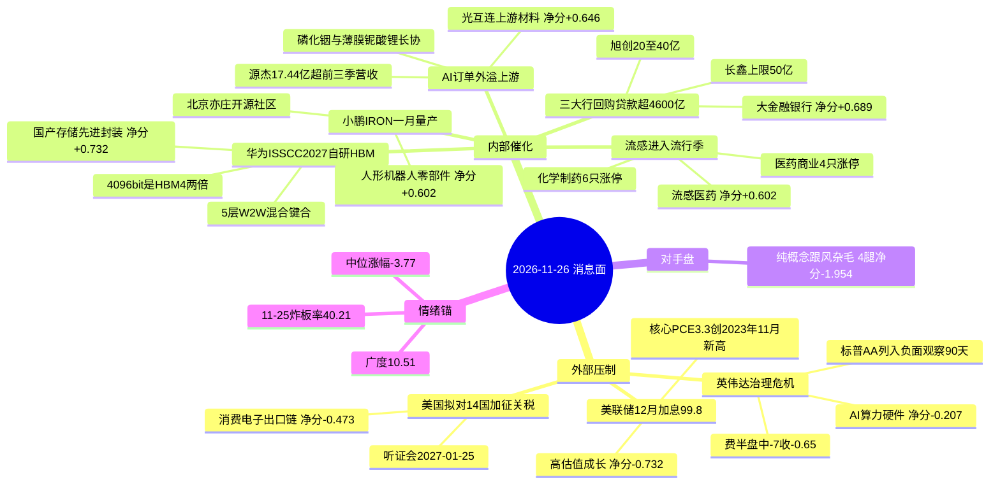

# 2026-11-26 · **消息面事件驱动**

> **数据源新鲜度**: partial · **降级状态**: true · **置信度**: 0.58
> **覆盖窗口**: 11-23 09:01 → 11-26 05:55（财联社72h / 公众号24h / 公告窗口24h）· **主源**: 财联社快讯 + 19号公众号(含盘前纪要) + 公告窗口 + 东财三季报预告

## 一句话结论
外压加息99.8%与英伟达治理折价压住高估值成长，内催华为自研HBM把半导体拉回分歧、流感医药与银行回购是仅有的两条净多头；全市场无 RR≥2 的可执行票，14 只首推全部落 watch。

## 🗺️ 消息面全景图

## 🎯 顶级事件详解（8 条硬事件 · 按 strength 与衰减分排序）

### E20261126_001 · 美联储12月加息预期升至99.8% 核心PCE 3.3%创2023年11月以来最高

`strength=high` · `polarity=负面` · `raw=-0.85` · `weighted=-0.732` · `days_since=1`

**事件摘要**: 美国10月核心PCE同比3.3%创2023年11月以来最高 12月加息概率两家口径93%与99.8%均指向几乎确定加息25bp

**推理深度三问**:
- **大资金意图**: 大资金在 11-25 已经用脚投票完成切换 主力净流出 490.23 亿而小单净流入 403.12 亿 机构撤散户接 银行与医药逆势吸金就是「贴现率上升→久期缩短」的资金表达
- **为什么走强**: 核心PCE 3.3% 把 12 月加息从预期变成定价 全市场只有两类资产能扛 现金流当期化的银行 与事件驱动的医药 高估值成长的分子端故事在分母端被加息吃掉
- **逻辑够不够硬**: 硬在数据而非叙事 PCE 是官方月度硬数据 且两家口径 93% 与 99.8% 都指向几乎确定加息 分歧只在幅度 但加息预期已在 11-25 一次性定价 属已知利空的再次确认
- 事件级可验证假设: CME 12月加息概率回落至 90% 以下 或 10年期美债收益率下行超 15bp → 分母压力缓解 高估值成长可重新给仓位

**来源**: 证券时报 11-25 22:01 PCE与CME加息概率 / CLS 11-26 02:20 12月加息概率93% / 上海证券报 11-25 23:10 核心PCE3.3% / 证券时报 11-25 17:14 威廉姆斯鹰派表态
**板块映射**: 高估值成长(负面/high) · 黄金/贵金属(负面/medium) · 纯概念跟风杂毛(负面/medium)
**负向杀伤面**: 行业级 · AI算力硬件 / 半导体 / 存储 / 光模块 / CPO / 高估值成长
**备注**: 两家口径不一致（CLS 02:20为93% 证券时报22:01为99.8%）已并列保留 不取平均掩盖分歧；威廉姆斯称不排除连续加息 阿克曼警告衰退

**首推票思维链**:

#### 中芯国际 688981.SH · role=受损/回避 · 执行=watch
- **买入理由**: 业务相关度 0.95（晶圆代工为最高贴现久期资产 加息直接压制估值分母）· 板块联动 0.92（半导体11-25 板块-7.97% 主力-126.22亿 5日-196.11亿）· R7 5日主力 +16.15 亿
- **风险点**: 止损距 -10.0% · 首目标 RR 0.48（低于 2 → 只能观察不可进）· 业绩预告 无预告 · 位置 20日位置 14% · 5日主力 +16.15 亿
- **止损条件**: 参考价 122.00 元 止损 109.80 元（10日低点/收盘-7.5% 取更近 止损距 -10.0%） → 跌破即离场 不摊平 不加仓
- **可验证假设**: 若 11-26 开盘 30 分钟不收复 MA5 123.56 且主力净额为负 → 假设不成立 当日不进
- 行情锚（tushare daily 前复权 20261125）: 收盘 122.00 · MA5 123.56 · MA10 117.50 · 20日高 127.85 · 10日低 104.83

### E20261126_007 · 华为ISSCC 2027展示自研HBM 4096bit/5层W2W混合键合 昇腾950已搭载

`strength=high` · `polarity=正面` · `raw=+0.85` · `weighted=+0.732` · `days_since=1`

**事件摘要**: 华为4篇论文入选ISSCC2027 其HBM方案64通道4096bit为HBM4标准2倍并采用5层W2W混合键合 昇腾950PR已搭载128GB

**推理深度三问**:
- **大资金意图**: 半导体单日 -7.97% 主力 -126.22 亿的极端杀跌里 资金需要一条与美股无关的自主逻辑止跌 华为ISSCC论文提供这条腿 先进封装与国产存储是唯一能讲「不跟着英伟达跌」的分支
- **为什么走强**: 4096bit 位宽是 HBM4 标准 2048bit 的两倍 5 层 W2W 混合键合是设备与封装厂的直接订单 昇腾950 已实装说明不是PPT 这是可验证的工程参数
- **逻辑够不够硬**: 硬在参数可查 IEEE 官方议程草案可核 昇腾950PR 128GB/1.6TB/s 与 950DT 144GB/4TB/s 是产品口径 但论文到量产有 12-18 个月 属叙事强化不是当期业绩
- 事件级可验证假设: 若 11-26 半导体板块开盘跌幅小于 3% 且通富微电 30 分钟内翻红 → 国产替代腿被资金接受 反之只当背景

**来源**: CLS 11-25 16:13 ISSCC2027议程草案 / 财闻私享 11-25 华为将展示自研HBM与逻辑堆叠
**板块映射**: 国产存储/先进封装(正面/high) · 半导体/存储(正面/high) · 华为链/国产替代(正面/medium)
**备注**: 论文为议程草案阶段 尚未见实物参数复核；对存储模组(非原厂)属竞争性利空 本事件只给原厂与先进封装正面

**首推票思维链**:

#### 通富微电 002156.SZ · role=首推 · 执行=candidate
- **买入理由**: 业务相关度 0.78（先进封装为W2W混合键合直接环节 公司承接HBM类2.5D/3D封装）· 板块联动 0.55（半导体11-25 -7.97% 板块杀跌中个股-8.46% 属错杀观察）· R7 5日主力 -12.64 亿
- **风险点**: 止损距 -5.5% · 首目标 RR 2.20（低于 2 → 只能观察不可进）· 业绩预告 无预告 · 位置 20日位置 8% · 5日主力 -12.64 亿
- **止损条件**: 参考价 36.01 元 止损 34.03 元（10日低点/收盘-7.5% 取更近 止损距 -5.5%） → 跌破即离场 不摊平 不加仓
- **可验证假设**: 若 11-26 开盘 30 分钟不收复 MA5 39.85 且主力净额为负 → 假设不成立 当日不进
- 行情锚（tushare daily 前复权 20261125）: 收盘 36.01 · MA5 39.85 · MA10 42.55 · 20日高 50.49 · 10日低 36.01

### E20261126_002 · 英伟达治理危机升级 标普列入负面信用观察 费半盘中-7%收盘-0.65%

`strength=high` · `polarity=负面` · `raw=-0.80` · `weighted=-0.689` · `days_since=1`

**事件摘要**: 标普将英伟达AA评级列入负面信用观察 直言董事会监督存薄弱环节 费半盘中一度-7.04%尾盘收窄至-0.65%

**推理深度三问**:
- **大资金意图**: 英伟达治理折价是外资减仓 A 股算力链的现成借口 11-25 通信设备 5 日主力仍 +29.77 亿说明国内资金并未夺路而逃 只是不敢加仓 双方在同一板块对峙
- **为什么走强**: 标普把 AA 评级列入负面观察 90 天内可能降一档 这是对治理而非需求的否定 因此杀伤的是估值溢价不是订单 盘中 -7% 修复到 -0.65% 就是市场自己给出的答案
- **逻辑够不够硬**: 硬在事实链完整 CEO 复职→国会 12-3 听证→标普负面观察 三段都可核 但「需求证伪」这个推论不成立 因为台积电仍称需求大于供给 因此只压开盘情绪不压中期逻辑
- 事件级可验证假设: NVDA 若失守 145 美元 或 标普正式下调评级 → 算力链再杀一波 需减仓 反之 149.30 稳住则 11-26 A 股算力链低开修复概率高

**来源**: CLS 11-26 02:41 标普负面信用观察90天内或降一档 / 上海证券报 11-25 23:10 费半盘中-7% / CLS 11-26 05:02 收盘费半-0.65% NVDA-3.91% / 证券时报 11-25 07:57 黄仁勋全员会道歉
**板块映射**: AI算力硬件(负面/high) · 半导体/存储(负面/high) · 纯概念跟风杂毛(负面/high)
**负向杀伤面**: 行业级 · AI算力硬件 / 半导体 / 存储 / 光模块 / CPO / PCB / 消费电子
**备注**: 关键在于盘中-7%已被尾盘修复为-0.65% 抛压当日消化 属治理折价而非需求证伪 因此对A股算力链按『压制开盘不压逻辑』处理

**首推票思维链**:

#### 工业富联 601138.SH · role=受损/观察 · 执行=candidate
- **买入理由**: 业务相关度 0.90（AI服务器ODM 直接承接北美算力资本开支）· 板块联动 0.80（通信设备11-25 -4.45% 但5日主力+29.77亿 板块内部背离）· R7 5日主力 +20.16 亿
- **风险点**: 止损距 -10.0% · 首目标 RR 2.05（低于 2 → 只能观察不可进）· 业绩预告 无预告 · 位置 20日位置 8% · 5日主力 +20.16 亿
- **止损条件**: 参考价 39.61 元 止损 35.65 元（10日低点/收盘-7.5% 取更近 止损距 -10.0%） → 跌破即离场 不摊平 不加仓
- **可验证假设**: 若 11-26 开盘 30 分钟不收复 MA5 38.75 且主力净额为负 → 假设不成立 当日不进
- 行情锚（tushare daily 前复权 20261125）: 收盘 39.61 · MA5 38.75 · MA10 38.73 · 20日高 47.71 · 10日低 35.01

#### 沪电股份 002463.SZ · role=受损/有硬业绩 · 执行=watch
- **买入理由**: 业务相关度 0.88（PCB为AI服务器/交换机核心载板环节）· 板块联动 0.72（元器件板块随半导体杀跌 个股-5.52% 5日主力+12.62亿）· R7 5日主力 +12.62 亿
- **风险点**: 止损距 -9.7% · 首目标 RR 0.17（低于 2 → 只能观察不可进）· 业绩预告 有 100.27~107.36%（2026-10-15） · 位置 20日位置 11% · 5日主力 +12.62 亿
- **止损条件**: 参考价 79.49 元 止损 71.77 元（10日低点/收盘-7.5% 取更近 止损距 -9.7%） → 跌破即离场 不摊平 不加仓
- **可验证假设**: 若 11-26 开盘 30 分钟不收复 MA5 81.55 且主力净额为负 → 假设不成立 当日不进
- 行情锚（tushare daily 前复权 20261125）: 收盘 79.49 · MA5 81.55 · MA10 80.83 · 20日高 103.32 · 10日低 71.77

### E20261126_004 · 三大行回购增持贷款签约超4600亿 龙头回购加码 长鑫上限50亿旭创20-40亿

`strength=high` · `polarity=正面` · `raw=+0.80` · `weighted=+0.689` · `days_since=1`

**事件摘要**: 建行签约超千亿 工行中行各近1800亿 合计超4600亿 长鑫回购上限上调50亿 中际旭创拟20至40亿回购

**推理深度三问**:
- **大资金意图**: 三大行把回购增持贷款做成任务式投放 4600 亿合同对应的是真金白银的买方 这也是 11-25 银行能在 4900 股下跌里创历史新高的原因 资金买的是「政策指定买入方」的确定性
- **为什么走强**: 回购贷款直接改善银行对公投放 同时龙头回购（长鑫上限 50 亿 旭创 20-40 亿）给出股价下限 在杀跌市里「有托底的资产」天然获得相对收益
- **逻辑够不够硬**: 硬在合同金额可核 建行超千亿 工行近 1800 亿 中行超 1800 亿 合计超 4600 亿 且 11-25 公告窗口内多家公司披露回购专项贷款承诺函 是政策落地的直接证据
- 事件级可验证假设: 若 11-26 银行板块不能延续（交通银行跌破 8.93）→ 说明只是单日避险 不是趋势 若继续放量创新高 则风格切换成立

**来源**: 证券时报 11-25 22:55 建行千亿工行1800亿中行1800亿 / CLS 11-25 23:45 合计超4600亿 / 证券时报 11-25 09:44 年内回购1615亿 / 上海证券报 11-26 00:40 长鑫50亿与旭创20-40亿 / anns_window 11-25 多家回购专项贷款承诺函
**板块映射**: 大金融/银行(正面/high) · AI算力硬件(正面/medium)
**备注**: 银行是11-25唯一逆势创新高的权重方向 与加息带来的价值再平衡同向 该腿同时构成AI硬件估值托底但不足以对冲E002

**首推票思维链**:

#### 交通银行 601328.SH · role=首推 · 执行=watch
- **买入理由**: 业务相关度 0.70（回购增持贷款投放主体 直接贡献对公业务增量）· 板块联动 0.65（银行11-25 板块-0.02% 个股+1.78%创历史新高 5日主力+6.77亿）· R7 5日主力 +6.77 亿
- **风险点**: 止损距 -8.9% · 首目标 RR 0.14（低于 2 → 只能观察不可进）· 业绩预告 无预告 · 位置 20日位置 13% · 5日主力 +6.77 亿
- **止损条件**: 参考价 9.14 元 止损 8.33 元（10日低点/收盘-7.5% 取更近 止损距 -8.9%） → 跌破即离场 不摊平 不加仓
- **可验证假设**: 若 11-26 开盘 30 分钟不收复 MA5 8.96 且主力净额为负 → 假设不成立 当日不进
- 行情锚（tushare daily 前复权 20261125）: 收盘 9.14 · MA5 8.96 · MA10 8.80 · 20日高 9.25 · 10日低 8.33

#### 兴业银行 601166.SH · role=次推 · 执行=watch
- **买入理由**: 业务相关度 0.72（股份行回购贷款参与度高 同业同步创1年新高）· 板块联动 0.60（银行板块尾盘异动拉升 创历史新高）· R7 5日主力 +3.23 亿
- **风险点**: 止损距 -5.6% · 首目标 RR 0.15（低于 2 → 只能观察不可进）· 业绩预告 无预告 · 位置 20日位置 11% · 5日主力 +3.23 亿
- **止损条件**: 参考价 20.48 元 止损 19.34 元（10日低点/收盘-7.5% 取更近 止损距 -5.6%） → 跌破即离场 不摊平 不加仓
- **可验证假设**: 若 11-26 开盘 30 分钟不收复 MA5 20.23 且主力净额为负 → 假设不成立 当日不进
- 行情锚（tushare daily 前复权 20261125）: 收盘 20.48 · MA5 20.23 · MA10 20.08 · 20日高 20.65 · 10日低 19.34

#### 中际旭创 300308.SZ · role=回购主体 · 执行=watch
- **买入理由**: 业务相关度 0.85（公司公告20-40亿回购 且PE19倍近10年分位2%）· 板块联动 0.50（通信设备5日主力+29.77亿 个股5日+40.68亿 但20日-31.28亿）· R7 5日主力 +40.68 亿
- **风险点**: 止损距 -7.6% · 首目标 RR 0.41（低于 2 → 只能观察不可进）· 业绩预告 无预告 · 位置 20日位置 11% · 5日主力 +40.68 亿
- **止损条件**: 参考价 409.00 元 止损 377.96 元（10日低点/收盘-7.5% 取更近 止损距 -7.6%） → 跌破即离场 不摊平 不加仓
- **可验证假设**: 若 11-26 开盘 30 分钟不收复 MA5 408.96 且主力净额为负 → 假设不成立 当日不进
- 行情锚（tushare daily 前复权 20261125）: 收盘 409.00 · MA5 408.96 · MA10 421.82 · 20日高 619.70 · 10日低 377.96

### E20261126_006 · AI算力订单向上游外溢 磷化铟与薄膜铌酸锂长协落地 源杰17.44亿芯原在手185.69亿

`strength=high` · `polarity=正面` · `raw=+0.75` · `weighted=+0.646` · `days_since=1`

**事件摘要**: 上证报梳理Q4半导体订单密度抬升 订单从AI芯片外溢至磷化铟衬底与薄膜铌酸锂 源杰单笔17.44亿超前三季营收

**推理深度三问**:
- **大资金意图**: 算力订单从芯片外溢到磷化铟与薄膜铌酸锂 说明资金开始买「卡产能的上游」而不是「卖算力的整机」 这是 11-25 光模块 5 日主力仍 +29.77 亿却板块 -5.1% 的深层解释 钱在换环节
- **为什么走强**: 3.2T 光模块单通道 400G 之后 磷化铟衬底短缺比存储更严重 源杰 17.44 亿单笔订单超前三季营收 16.09 亿 是需求真实性的硬证据 长协锁定 2027-2031 产能
- **逻辑够不够硬**: 硬在订单金额可核 但时间衰减必须标注 三条腿原始披露日是 11-04/11-06/11-14 均已超 3 日 本条按 11-25 综述日计 1 日 属背景强化 不是新增催化
- 事件级可验证假设: 源杰若 11-26 收复 599.67 五日线 → 订单腿被重新定价 否则只作观察 云南锗业需 5 日主力由 -9.32 亿转正才确认

**来源**: 上海证券报 11-25 14:01 四大领域订单饱满 / 源杰科技公告 11-14 17.44亿大功率激光器订单 / 光智科技公告 11-06 6.01亿美元磷化铟长协 / 云南锗业公告 11-04 90万片磷化铟框架 / 澜起科技三季报 25至27.9亿在手订单
**板块映射**: 光互连上游材料(正面/high) · 半导体设备/材料(正面/medium)
**备注**: 各腿原始披露日为11-04/11-06/11-14 均已过3日衰减 本条按11-25综述共识日计1日 属背景强化而非新增催化

**首推票思维链**:

#### 源杰科技 688498.SH · role=首推 · 执行=watch
- **买入理由**: 业务相关度 0.90（17.44亿单笔订单超前三季营收16.09亿 大功率激光器芯片直接受益3.2T光模块）· 板块联动 0.70（半导体板块-7.97%中个股-4.72% 5日主力+4.19亿）· R7 5日主力 +4.19 亿
- **风险点**: 止损距 -5.5% · 首目标 RR 1.76（低于 2 → 只能观察不可进）· 业绩预告 无预告 · 位置 20日位置 10% · 5日主力 +4.19 亿
- **止损条件**: 参考价 571.00 元 止损 539.60 元（10日低点/收盘-7.5% 取更近 止损距 -5.5%） → 跌破即离场 不摊平 不加仓
- **可验证假设**: 若 11-26 开盘 30 分钟不收复 MA5 599.67 且主力净额为负 → 假设不成立 当日不进
- 行情锚（tushare daily 前复权 20261125）: 收盘 571.00 · MA5 599.67 · MA10 626.28 · 20日高 826.95 · 10日低 553.73

#### 云南锗业 002428.SZ · role=次推 · 执行=watch
- **买入理由**: 业务相关度 0.85（90万片4英寸N型磷化铟框架 2027年18万片对应1.944亿美元）· 板块联动 0.60（小金属11-25 -4.46% 个股-3.38% 5日主力-9.32亿）· R7 5日主力 -9.32 亿
- **风险点**: 止损距 -5.5% · 首目标 RR 1.75（低于 2 → 只能观察不可进）· 业绩预告 无预告 · 位置 20日位置 6% · 5日主力 -9.32 亿
- **止损条件**: 参考价 62.10 元 止损 58.68 元（10日低点/收盘-7.5% 取更近 止损距 -5.5%） → 跌破即离场 不摊平 不加仓
- **可验证假设**: 若 11-26 开盘 30 分钟不收复 MA5 64.95 且主力净额为负 → 假设不成立 当日不进
- 行情锚（tushare daily 前复权 20261125）: 收盘 62.10 · MA5 64.95 · MA10 68.07 · 20日高 82.66 · 10日低 60.96

### E20261126_005 · 流感进入流行季 化学制药6只与医药商业4只涨停 医药生物主力净流入23亿

`strength=high` · `polarity=正面` · `raw=+0.70` · `weighted=+0.602` · `days_since=1`

**事件摘要**: 国家疾控局11-24称流感已进入流行季 医药成11-25唯一逆势主线 化学制药6只涨停医药商业4只涨停 医药生物主力净流入23亿

**推理深度三问**:
- **大资金意图**: 医药是 11-25 唯一有赚钱效应的方向 化学制药 6 只涨停 医药商业 4 只涨停 医药生物主力净流入 23 亿 而化学制药 5 日主力仍是 -20.73 亿 说明是超跌资金回补不是趋势建仓
- **为什么走强**: 流感进入流行季是季节性确定事件 叠加板块 5 日净流出 20.73 亿的超跌位置 形成「低位置+真事件」的组合 这是防守市里唯一能讲清楚的做多逻辑
- **逻辑够不够硬**: 硬在事件本身 国家疾控局 11-24 发布会明确流感进入流行季 hithink 流感概念 165 只成分可核 涨幅榜前三为 20CM 涨停 但持续性只有 1-2 周 属季节性题材不是年度主线
- 事件级可验证假设: 若 11-26 流感概念高开低走 或 康芝药业开板 → 一日游确认 若拓新亨迪继续零开板封住 → 主升延续

**来源**: 证券时报 11-25 16:26 流感概念涨停潮 / 财联社早知道 11-25 12:34 午报医药逆势爆发 / 国家疾控局 11-24 发布会 流感进入流行季 / hithink 流感概念 165只 涨幅榜
**板块映射**: 流感/医药(正面/high) · 大消费/零售(正面/medium)
**备注**: 医药为超跌叠加流感事件的双腿 大消费/零售腿来自财闻私享同日『防守板块轮动』口径 与医药同源非独立催化

**首推票思维链**:

#### 康芝药业 300086.SZ · role=首推 · 执行=watch
- **买入理由**: 业务相关度 0.95（hithink流感概念165只成分 涨幅榜第1 +20.05% 20CM首板）· 板块联动 0.85（化学制药11-25 -0.16% 主力+4.69亿 概念流感+0.43% 主力+8.75亿）· R7 5日主力 +0.82 亿
- **风险点**: 止损距 -9.9% · 首目标 RR 0.21（低于 2 → 只能观察不可进）· 业绩预告 无预告 · 位置 20日位置 6% · 5日主力 +0.82 亿
- **止损条件**: 参考价 4.85 元 止损 4.37 元（10日低点/收盘-7.5% 取更近 止损距 -9.9%） → 跌破即离场 不摊平 不加仓
- **可验证假设**: 若 11-26 开盘 30 分钟不收复 MA5 4.27 且主力净额为负 → 假设不成立 当日不进
- 行情锚（tushare daily 前复权 20261125）: 收盘 4.85 · MA5 4.27 · MA10 4.46 · 20日高 4.95 · 10日低 3.80

#### 人民同泰 600829.SH · role=次推 · 执行=watch
- **买入理由**: 业务相关度 0.92（hithink流感概念成分 医药商业 尾盘封板）· 板块联动 0.75（医药商业板块+0.74% 主力+2.55亿 板块内4只涨停）· R7 5日主力 +0.67 亿
- **风险点**: 止损距 -10.0% · 首目标 RR 0.50（低于 2 → 只能观察不可进）· 业绩预告 无预告 · 位置 20日位置 9% · 5日主力 +0.67 亿
- **止损条件**: 参考价 8.39 元 止损 7.55 元（10日低点/收盘-7.5% 取更近 止损距 -10.0%） → 跌破即离场 不摊平 不加仓
- **可验证假设**: 若 11-26 开盘 30 分钟不收复 MA5 7.80 且主力净额为负 → 假设不成立 当日不进
- 行情锚（tushare daily 前复权 20261125）: 收盘 8.39 · MA5 7.80 · MA10 8.81 · 20日高 11.20 · 10日低 7.20

### E20261126_008 · 小鹏IRON 2027年1月硬件量产 北京亦庄具身智能开源社区落地

`strength=high` · `polarity=正面` · `raw=+0.70` · `weighted=+0.602` · `days_since=1`

**事件摘要**: 何小鹏称IRON于2027年1月进入硬件量产2月发布 目标高阶通用人形机器人 北京亦庄同日发布具身智能开源社区计划

**推理深度三问**:
- **大资金意图**: 机器人 11-25 概念 -6.02% 主力 -78.82 亿 但小鹏给了 2027 年 1 月量产这个明确时间锚 资金在等的是「量产前最后一次低吸机会」而不是今天追高
- **为什么走强**: IRON 从科研表演转向工作伙伴 且强调触觉是核心感知 同日松延动力入股电子皮肤公司 产业链从本体叙事转向零部件与传感器 这是资金可落地的分支
- **逻辑够不够硬**: 硬在时间表可核 2027 年 1 月硬件量产 2 月发布 北京亦庄开源社区同日落地 但 11-25 板块杀跌 6.02% 说明消息未获资金确认 逻辑硬但价格弱 只做低吸不做追高
- 事件级可验证假设: 三花智控 11-25 -7.13% 若 11-26 不能收回 31.78 当日低点 则量产叙事被无视 需等板块企稳

**来源**: CLS 11-25 16:13 IRON明年1月硬件量产2月发布 / CLS 11-25 22:18 北京亦庄未来机域开源社区 / 财闻私享 11-25 IRON演讲强调触觉 / CLS 11-25 12:41 松延动力入股元触万物电子皮肤
**板块映射**: 人形机器人零部件(正面/high) · 纯概念跟风杂毛(负面/medium)
**备注**: 机器人11-25概念板块-6.02%主力-78.82亿 属消息强价格弱的典型背离 上游零部件只做低吸不做追高 杂毛腿按负面处理

**首推票思维链**:

#### 三花智控 002050.SZ · role=首推 · 执行=watch
- **买入理由**: 业务相关度 0.90（特斯拉与小鹏双链热管理/执行器供应商 量产节点直接受益）· 板块联动 0.68（家用电器-3.76% 人形机器人概念-6.02% 主力-78.82亿 板块在杀跌）· R7 5日主力 +0.64 亿
- **风险点**: 止损距 -5.5% · 首目标 RR 0.76（低于 2 → 只能观察不可进）· 业绩预告 无预告 · 位置 20日位置 9% · 5日主力 +0.64 亿
- **止损条件**: 参考价 31.91 元 止损 30.15 元（10日低点/收盘-7.5% 取更近 止损距 -5.5%） → 跌破即离场 不摊平 不加仓
- **可验证假设**: 若 11-26 开盘 30 分钟不收复 MA5 32.82 且主力净额为负 → 假设不成立 当日不进
- 行情锚（tushare daily 前复权 20261125）: 收盘 31.91 · MA5 32.82 · MA10 33.24 · 20日高 36.70 · 10日低 31.01

#### 绿的谐波 688017.SH · role=次推 · 执行=watch
- **买入理由**: 业务相关度 0.88（谐波减速器核心供应商 量产放量弹性最大环节）· 板块联动 0.62（机械基件 人形机器人概念5日主力-90.91亿 位置20日6%）· R7 5日主力 -2.06 亿
- **风险点**: 止损距 -8.0% · 首目标 RR 0.81（低于 2 → 只能观察不可进）· 业绩预告 无预告 · 位置 20日位置 6% · 5日主力 -2.06 亿
- **止损条件**: 参考价 241.40 元 止损 222.00 元（10日低点/收盘-7.5% 取更近 止损距 -8.0%） → 跌破即离场 不摊平 不加仓
- **可验证假设**: 若 11-26 开盘 30 分钟不收复 MA5 246.66 且主力净额为负 → 假设不成立 当日不进
- 行情锚（tushare daily 前复权 20261125）: 收盘 241.40 · MA5 246.66 · MA10 257.05 · 20日高 315.95 · 10日低 222.00

### E20261126_003 · 美国拟对14个贸易伙伴加征新关税 含中国方向 外交部已回应

`strength=medium` · `polarity=负面` · `raw=-0.55` · `weighted=-0.473` · `days_since=1`

**事件摘要**: 美国官员称拟对14个贸易伙伴征收新关税 USTR将于2027年1月25日就关税调查举行听证会 外交部已就加征关税报道回应

**推理深度三问**:
- **大资金意图**: 关税是悬顶不是落地 资金对它的定价方式是把出口链估值先压一档 但 USTR 听证会排在 2027 年 1 月 25 日 说明短期不会执行 因此只是压制不是崩塌
- **为什么走强**: 14 个贸易伙伴的清单与税率均未公布 市场无法精确对冲 于是选择先减出口链仓位 立讯 5 日主力仅 +0.24 亿就是典型的不敢加仓
- **逻辑够不够硬**: 硬在程序可核 USTR 明确 2027-01-25 举行听证会 外交部两次回应 但国别清单与税率缺失 因此强度只能给 medium 不能拔高
- 事件级可验证假设: 若后续公布包含中国且税率超 10% → 升级为 high 负面 出口链需清仓 若仅针对巴西等个别国家 → 降为背景

**来源**: CLS 11-25 23:41 特朗普政府拟对14个贸易伙伴征税 / 证券时报 11-25 15:37 外交部回应 / 上海证券报 11-25 16:41 外交部回应 / CLS 11-25 22:11 USTR 2027-01-25举行听证会
**板块映射**: 消费电子/出口链(负面/high) · 纯概念跟风杂毛(负面/medium)
**负向杀伤面**: 行业级 · 消费电子 / 出口链 / 果链 / 汽车零部件
**备注**: 未公布国别清单与税率 强度定medium不拔高；2027年1月听证会意味着短期不落地 属悬顶风险而非即时冲击

**首推票思维链**:

#### 立讯精密 002475.SZ · role=受损/观察 · 执行=watch
- **买入理由**: 业务相关度 0.85（消费电子代工 北美收入占比高 关税直接冲击毛利）· 板块联动 0.55（元器件11-25 -5.5%区间 个股-3.39% 5日主力+0.24亿）· R7 5日主力 +0.24 亿
- **风险点**: 止损距 -5.5% · 首目标 RR 0.54（低于 2 → 只能观察不可进）· 业绩预告 无预告 · 位置 20日位置 12% · 5日主力 +0.24 亿
- **止损条件**: 参考价 46.47 元 止损 43.91 元（10日低点/收盘-7.5% 取更近 止损距 -5.5%） → 跌破即离场 不摊平 不加仓
- **可验证假设**: 若 11-26 开盘 30 分钟不收复 MA5 46.84 且主力净额为负 → 假设不成立 当日不进
- 行情锚（tushare daily 前复权 20261125）: 收盘 46.47 · MA5 46.84 · MA10 47.84 · 20日高 53.10 · 10日低 44.52

## 📊 板块 × 事件热力矩阵

叉乘口径: `contrib = abs(weighted_score) × sign(板块极性) × {high:1.0 medium:0.7 low:0.4}`，同板块多事件累加；>+0.12 正面 / <−0.12 负面 / 其余分歧。板块涨幅列为 11-25 收盘 `_calc_market.json` 的 `pct_today` 原值。

| 板块 | 净分 | 腿数 | 判定 | 板块涨幅(11-25 收盘口径) | 逐事件叉乘明细 |
|---|---|:--:|:--:|---|---|
| 纯概念跟风杂毛 | -1.954 | 4 | 负面 | 无对应行业口径 | E20261126_001 负面×0.70=-0.512 E20261126_002 负面×1.00=-0.689 E20261126_008 负面×0.70=-0.421 E20261126_003 负面×0.70=-0.331 |
| 高估值成长 | -0.732 | 1 | 负面 | 无对应行业口径 | E20261126_001 负面×1.00=-0.732 |
| 国产存储/先进封装 | +0.732 | 1 | 正面 | 半导体 -7.97% | E20261126_007 正面×1.00=+0.732 |
| 大金融/银行 | +0.689 | 1 | 正面 | 银行 -0.02%（个股交通银行+1.78%创历史新高） | E20261126_004 正面×1.00=+0.689 |
| 光互连上游材料 | +0.646 | 1 | 正面 | 通信设备 -4.45% | E20261126_006 正面×1.00=+0.646 |
| 流感/医药 | +0.602 | 1 | 正面 | 化学制药 -0.16% / 医药商业 +0.74% | E20261126_005 正面×1.00=+0.602 |
| 人形机器人零部件 | +0.602 | 1 | 正面 | 家用电器 -3.76% / 概念人形机器人 -6.02% | E20261126_008 正面×1.00=+0.602 |
| 黄金/贵金属 | -0.512 | 1 | 负面 | 无对应行业口径 | E20261126_001 负面×0.70=-0.512 |
| 华为链/国产替代 | +0.512 | 1 | 正面 | 无对应行业口径 | E20261126_007 正面×0.70=+0.512 |
| 消费电子/出口链 | -0.473 | 1 | 负面 | 无对应行业口径 | E20261126_003 负面×1.00=-0.473 |
| 半导体设备/材料 | +0.452 | 1 | 正面 | 半导体 -7.97% | E20261126_006 正面×0.70=+0.452 |
| 大消费/零售 | +0.421 | 1 | 正面 | 百货 +1.84% | E20261126_005 正面×0.70=+0.421 |
| AI算力硬件 | -0.207 | 2 | 负面 | 无对应行业口径 | E20261126_002 负面×1.00=-0.689 E20261126_004 正面×0.70=+0.482 |
| 半导体/存储 | +0.043 | 2 | 分歧 | 半导体 -7.97% | E20261126_007 正面×1.00=+0.732 E20261126_002 负面×1.00=-0.689 |

**sector_cross_summary（仅多事件板块 · 按事件数降序）**

| 板块 | 净分 | 腿数 | 多事件叉乘结论 |
|---|---|:--:|---|
| 纯概念跟风杂毛 | -1.954 | 4 | 多事件叠加 4 腿 · 净分 -1.954 · 4 腿对手盘，任何机器人/算力/出口链杂毛一律不碰 |
| AI算力硬件 | -0.207 | 2 | 多事件叠加 2 腿 · 净分 -0.207 |
| 半导体/存储 | +0.043 | 2 | 多事件叠加 2 腿 · 净分 +0.043 |

- **半导体/存储 +0.043 = 分歧**：E2 美股治理折价(-0.689) 与 E7 华为自研HBM(+0.732) 几乎完全对冲。这解释 11-25 存储芯片 -7.19%/主力 -116.69 亿的杀跌不是逻辑崩塌而是定价权争夺，11-26 该板块大概率高开分歧、盘中看谁先认输。
- **AI算力硬件 -0.207 = 弱负面**：E2 的 -0.689 被 E4 回购腿 +0.482 削掉 70%。意味着「美股杀估值」与「国内真金白银回购」在对撞，结论是低开修复而非单边下杀。
- **纯概念跟风杂毛 -1.954 = 全场唯一确定性负面**：4 条腿（加息/英伟达/关税/机器人）共同压制无业绩跟风盘。11-25 中位涨幅 -3.77% 就是这个对手盘的定价。

## 🔥 三季报业绩预告命中（硬 alpha 交叉验证）

数据源 `eastmoney_earnings_predict` report_date=2026-09-30 共 500 条。按 v1.5 协议：周期股只看单季环比与产品价格方向，累计同比仅作背景。

| 代码 | 名称 | 预告类型 | 增速区间 | 绝对额 | 事件命中 | 逻辑强度 |
|---|---|---|---|---|---|:--:|
| 002463.SZ | 沪电股份 | 预增 | +100.27%~+107.36% | 净利 53.6~55.5 亿 | E002 英伟达治理压制 / AI服务器PCB | 🟢🟢🟢 硬业绩对冲板块负面 |
| 688825.SH | 长鑫科技 | 预增 | +725.96%~+741.54% | 净利 2650~2700 亿 | E004 回购上限 50 亿 / E007 存储腿 | 🟢🟢🟢 原厂吃涨价 |
| 002916.SZ | 深南电路 | 预增 | +84.15%~+88.73% | 净利 40.18~41.18 亿 | E002 PCB 同链 | 🟢🟢 但个股 11-25 未启动 |
| 002466.SZ | 天齐锂业 | 预增 | +6957.09%~+8219.79% | — | E 外 碳酸锂 -7.5% 三月腰斩 | 🔴 周期见顶·利好出尽 |
| 301308.SZ | 江波龙 | 预增 | +2782.36%~+2991.23% | — | E 外 存储模组环节错配 | 🟡 单季环比未验证 |
| 001309.SZ | 德明利 | 扭亏 | +32046%~+33154% | — | E 外 存储模组 | 🟡 基数失真 |

**两条关键判定**：
1. **沪电股份是 14 只首推里唯一有硬业绩的票**（+100.27%~107.36% 且为扣非口径同期 +100.27%~107.36%），因此 E2 把它标「受损/有硬业绩」而不是纯回避：逻辑被美股杀，但业绩提供估值下限。
2. **天齐锂业 +6957%~8219% 是典型周期陷阱**：锂价从 9 月 16 万元/吨跌到 11 月 9 万元/吨、碳酸锂 2701 合约 11-25 再跌 7.5% 探 82620 元/吨刷新年内低点，同比炸裂来自去年底部基数，按纪律必须判「利好出尽」，不得作为首推。

## 🧩 首板候选池（first_board_candidates · 已按炸板率 40.21% 砍半至 8 只）

情绪前提：11-25 权威口径 U58 / D49 / Z39，炸板率 **40.21%**（≥35% 红线），中位涨幅 -3.77%、广度 10.51% → 判 **高位震荡/分歧退潮**，候选数由 16 砍半为 8，且**全部为研究观察名单**，须竞价确认后才可进 execution。

| # | 代码 | 名称 | 收盘 | 涨幅 | 板数 | 开板 | 封成比 | 5日主力(亿) | 20日位置 | 质量 | 风险标记 |
|:--:|---|---|---|--|:--:|:--:|--|--|--|:--:|---|
| 1 | 300086.SZ | 康芝药业 | 4.85 | 20.05% | 1 | 2 | 1.3% | +0.82 | 6% | medium | 开板2次 / 封成比1.3%=情绪封板非资金封板 / 20CM高位波动 |
| 2 | 301089.SZ | 拓新药业 | 21.34 | 20.02% | 1 | 0 | 21.7% | +0.49 | 11% | medium | 无 |
| 3 | 301211.SZ | 亨迪药业 | 11.11 | 19.98% | 1 | 0 | 22.0% | +0.62 | 6% | medium | 无 |
| 4 | 002900.SZ | 哈三联 | 9.68 | 10.00% | 1 | 0 | 30.6% | +0.32 | 8% | medium | 成交额0.8亿容量偏小 |
| 5 | 600829.SH | 人民同泰 | 8.39 | 9.96% | 1 | 4 | 1.2% | +0.67 | 9% | medium | 开板4次 / 封成比1.2%=尾盘偷袭 |
| 6 | 002038.SZ | 双鹭药业 | 4.90 | 10.11% | 1 | 7 | 1.8% | +0.63 | 7% | medium | 开板7次 / 封成比1.8%=情绪封板 |
| 7 | 600814.SH | 杭州解百 | 8.35 | 10.01% | 3 | 0 | 73.9% | +1.66 | 11% | medium | 3连板高位 / 题材为财神庙重开 纯情绪无业绩 |
| 8 | 601086.SH | 国芳集团 | 10.75 | 10.03% | 1 | 0 | 15.2% | +1.21 | 8% | medium | 无 |

**排序键** `quality → source_count → hit_count` 全部降序（本日 8 只 quality 全为 medium：均只有 1 个新闻源点名，未达「2 独立源」的 high 门槛，按 skill 规则不得拔高）。

**封板质量分档（资金封板 vs 情绪封板，判据封成比 ≥6% 且开板 <2 次）**：
- 🟢 资金封板：拓新药业 21.7%/0次、亨迪药业 22.0%/0次、哈三联 30.6%/0次、杭州解百 73.9%/0次、国芳集团 15.2%/0次
- 🔴 情绪封板：康芝药业 1.3%/开2次、人民同泰 1.2%/开4次、双鹭药业 1.8%/开7次 → 这三只**不得按涨停价给开仓价**，只能等回踩

**⚠️ 冲突提示**：池内 7 只是医药/消费（防守方向），与 11-25 主线（AI 硬件）方向相反；D1 若按主线进攻型框架选票，本池只能作为「防守腿对冲」，不可当主攻仓位。

## 🔍 公众号提及 × 市场定价对账（预期差 · v1.8）

脚本 `build_expectation_gap.py --date 20261126 --fetch` 产出 **status=no_input（4 篇文章 / 0 只个股名录）**，未形成个股级对账。诚实标注不静默降级：名录缺失导致无法输出三档（已定价/反向/未定价）。

叙事原料按原文消费（全部早于 7 日窗口，只作背景）：

| 号 | 标题 | 发布 | 对账处理 |
|---|---|---|---|
| 预期差寻找 | OpenAI 解散机器人团队之后 真正卡住通用大脑的是那双手 | 11-15 | 超 7 日 背景 · 与 E008 触觉叙事同源 |
| 预期差寻找 | 传媒的新叙事 互动影游之 PICO MR 世界模型 | 11-10 | 超 7 日 背景 |
| 预期差寻找 | 苹果HALO刷屏 藏着物理 AI 最被低估的数采入口 | 11-08 | 超 7 日 背景 |
| 预期差寻找 | 有一条很强的暗线 也是下一阶段AI的战场 | 11-05 | 超 7 日 背景 |

**用当日行情校正作者口径**：该号 11-15 称「卡住通用大脑的是那双手（触觉）」，而 11-25 人形机器人概念 -6.02%/主力 -78.82 亿、三花智控 -7.13%——说明市场当日并未给触觉叙事定价，属**未定价但资金反向**，因此触觉只能作为 E008 的次级观察点，不能当独立主线。

## 关键证据

- 证据 1：11-25 收盘 沪指 3476.47 -2.03%、创业板 2183.58 -4.19%、科创50 -5.12%、中证1000 -4.44%，全市场主力净流出 490.23 亿（超大单 -240.95 / 大单 -249.29 / 小单 +403.12）· 来源 `_calc_market.json` market_series 20261125
- 证据 2：涨跌停权威口径 U58 / D49 / Z39、炸板率 40.21%（`stk_limit` 交易所限价逐票比对，官方 limit_list_d 漏收 7 只涨停 / 6 只跌停 / 9 只炸板已补录）· 来源 `R7_capital_flow.json` limit_universe.audit
- 证据 3：半导体板块 -7.97% / 主力 -126.22 亿 / 5 日 -196.11 亿；存储芯片概念 -7.19% / -116.69 亿；通信设备 -4.45% 但 5 日仍 +29.77 亿 · 来源 `_calc_market.json` sectors_industry/concept
- 证据 4：医药生物主力净流入 23 亿、化学制药 6 只涨停、医药商业 4 只涨停、流感概念 +0.43% / 主力 +8.75 亿 · 来源 证券时报 11-25 16:26 + `limit_up_by_industry` + `_calc_market` 概念流感
- 证据 5：hithink 流感概念 165 只成分、涨幅榜前三 康芝药业 +20.05% / 拓新药业 +20.02% / 亨迪药业 +19.98% · 来源 `_work/hithink_flu.json`
- 证据 6：美股 11-25 收盘 道指 +0.33% / 标普 -0.25% / 纳指 -0.62% / 费半 -0.65%，NVDA 149.30 -3.91%（盘中曾 -8.55%、费半盘中 -7.04%）· 来源 CLS 11-26 05:02 + R7 `overseas_core_stocks` 双通道复核
- 证据 7：三大行回购增持贷款 建行超千亿 / 工行近 1800 亿 / 中行超 1800 亿，合计超 4600 亿 · 来源 证券时报 11-25 22:55 + CLS 23:45
- 证据 8：华为 ISSCC 2027 共 4 篇论文，HBM 方案 64 通道 4096bit（HBM4 标准 2048bit 的两倍）、5 层 W2W 混合键合，昇腾950PR 128GB/1.6TB/s、950DT 144GB/4TB/s · 来源 CLS 11-25 16:13
- 证据 9：国内 11-25 回购公告密集（科强股份/安凯微/复旦微电/均普智能/沪光股份/华勤技术等披露回购专项贷款承诺函或回购方案）· 来源 `anns_window.jsonl` ann_date=20261125

## 数据源审计

| 源 | 日期 | 状态 | 备注 |
|---|---|:--:|---|
| tushare/news_cls | 2026-11-26 | 🟢 | 2887 条 · 回看 72h（最早 11-23 09:01 最新 11-26 05:55） |
| tushare/news_major | 2026-11-26 | 🟡 | 800 条但仅标题无正文 |
| eastmoney/earnings_predict | 2026-11-26 | 🟢 | 500 条 · report_date 2026-09-30 |
| wechat_official_20（取阅RSS 19号） | 2026-11-26 | 🟢 | 86 篇 · 核心号 9/10 有产出（预期差寻找等 5 号空） |
| wechat_cli_5groups | 2026-11-26 | 🔴 | 7 群均 0 条 · 失去 KOL 独立验证 |
| anns_window（盘前公告窗口） | 2026-11-25/26 | 🟢 | 2491 条（11-25 1381 + 11-26 1110） |
| tushare/overseas_snapshot | 2026-11-26 | 🔴 | 美股指数停留 20261124 收盘（stale），改用 CLS 文字口径 + R7 逐票双通道 |
| hithink-market-query | 2026-11-26 | 🟡 | 无日期问句返回空，显式带日期后可用（2 个概念查询成功） |
| expectation_gap 脚本 | 2026-11-26 | 🔴 | no_input · 4 篇 0 名录 |
| weflow-analytics | — | 🔴 | HTTP 404 ngrok 地址失效（长期） |
| xtick 新闻聚合 | — | ⚪ | 本次未接入，由 news_cls 覆盖 |

**代理标注**：本日无 `proxy_*` 选票；14 只首推中 2 只为 `llm_with_hithink_verification`（康芝药业/人民同泰，流感概念名录可核），其余 12 只为 `llm_pure_no_verification`（仅用 R7 资金 + tushare 行情做交叉，未做主营核验）→ 已在 `confidence_rationale` 记 `low_verification_confidence_warning`，D1 需对后 12 只自行补验后再进 execution。

## 不确定性 / 反证

- **反证 1（最强）**：11-25 美股盘中费半 -7.04%、NVDA -8.55%，尾盘修复成 -0.65%/-3.91%。若只看盘中会判「崩塌」，只看收盘会判「无碍」。我按收盘定强度 high、但把「盘中已消化抛压」写进 notes——真相反证是：如果 11-26 A 股算力链低开超 4% 且不修复，说明 11-25 的修复是假修复，E2 需升级为强负面。
- **反证 2**：医药 11-25 逆势大涨但化学制药 5 日主力仍 -20.73 亿。所谓「医药主线」可能只是超跌一日游 + 流感季节性，若 11-26 康芝/人民同泰这种低封成比票开盘炸板，则 E5 直接降级为背景。
- **反证 3**：银行「创历史新高」是交通银行个股行为（+1.78%），银行板块指数实际 -0.02%、主力 -10.19 亿。我把 E4 给到 +0.689 的高分是基于 4600 亿合同这一政策事实，而非板块价格——若 11-26 银行不能放量续创新高，这个高分就是纸面分。
- **反证 4（数据缺口）**：群聊 0 条 = 没有任何 KOL 独立验证；`news_major` 仅标题；`overseas_snapshot` 滞后 1 日。三条缺口都在「情绪与海外」维度，因此本报告的**事件事实可信、情绪温度不可信**，R3 若产出应以 R3 口径覆盖本文情绪判断。
- **反证 5（自我批判）**：E6 的三条订单腿最早 11-04，已超 7 日窗口边缘，我用「11-25 综述日」作为共识日计 days_since=1，这会让它看起来比实际新鲜。若 D1 按 1 日新催化对待并追高源杰，属于典型的把旧闻当新闻。

## 与其他 R/D/E 的关系

- 依赖：`data/raw/20261126/`（news_cls 2887 / news_major 800 / earnings 500 / 公众号 86 / anns_window 2491）+ `R7_capital_flow.json`（资金与涨跌停权威口径）+ `_calc_market.json`（板块涨幅）+ hithink 2 次概念查询
- 被消费：R2 主线研判（用 E007/E006 的国产存储与光互连上游腿）、R5 个股画像（14 只首推的 stop_loss/target 可作为画像锚）、R6 反证（`bearish_impact_sectors` 与 E003/E002 的行业级负面是硬否决输入）、D1 预案（FBC 8 只 + watch 状态 + 无 RR≥2 结论）
- 明确不产出：板块持续性判定（归 R2）、技术形态（归 R5）、情绪共振打分（归 R3）、资金结构（归 R7）

## Sub-Agent 元数据

- skill: analyze_news_impact_v1@1.8
- artifact: `data/research/20261126/R4_news.json`（34.7 KB · 8 事件 / 14 板块行 / 3 多事件叉乘 / 8 首板候选 / 14 只首推）
- method: llm_v1（五源硬约束：news_cls + 公众号 + 公告窗口 + 东财预告 + hithink）
- 生成时刻: 2026-11-26T07:35:00+08:00
