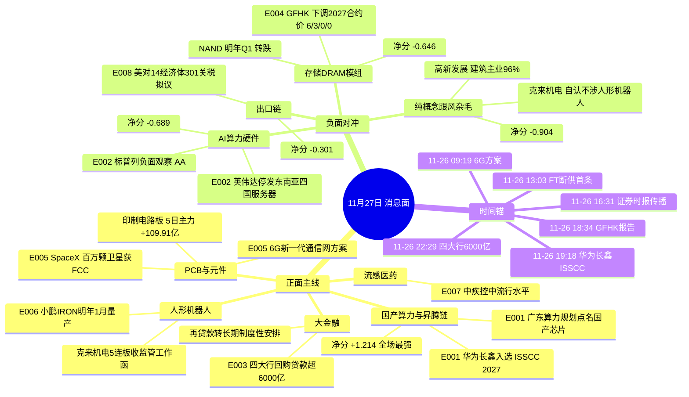

# 2026年11月27日 · **消息面事件驱动**

> **数据源新鲜度**: partial · **降级状态**: false · **置信度**: 0.74
> **覆盖窗口**: 前 72h（cls 09:01→次日 05:56）· **主源**: 财联社+新浪快讯 2784 条 + 要闻 800 条 + 21 号公众号 RSS 90 篇（15 号有更）+ 东财业绩预告 500 条 + 盘前公告窗 2649 条
> **数据日**: 20261126 收盘（T-1）· **情绪**: 震荡（high_chop 高位震荡）· **炸板率**: 33.33%（R7 权威口径，未触发 ≥35% 减半红线）

## 一句话结论

消息面 8 条硬事件（5 正面 3 负面），**资金只认 PCB/元件一条链**；国产算力/昇腾链净分 +1.214 最强但封成比极低属情绪封板，唯一有硬业绩＋资金双确认的是崇达技术与金禄电子。

## 🗺️ 消息面全景图

## 🎯 顶级事件详解（每事件三问 + 个股思维链）

### E20261127_001 · 华为·长鑫入选 ISSCC 2027 存储专场 · 广东算力规划点名国产芯片优先 · strength=high · polarity=正面 · weighted=+0.732

**事件摘要**: IEEE 公布 ISSCC 2027 议程草案（2027-02-14 旧金山），Session22 存储专题华为、长鑫存储与三星、SK海力士同台；同日《广东省算力发展"十五五"规划》发布，智算规模 2028 破 1000 EFlops / 2030 力争 4000 EFlops，明确鼓励算力中心**优先使用国产算力芯片**、推进 CANN 生态与昇腾算子库。5 个独立源：财联社 19:18、财联社早知道 19:00、财联社 16:05、财联社 15:57、财闻私享 21:04。

**推理深度三问**:
- **大资金意图**: ISSCC 只接收**流片实测验证**的芯片成果，不收纯仿真概念——这不是展会名单，是"能不能做出来"的军方级认证。机构在 12 月流动性窗口需要一个"5-10 年确定性"的旗帜票，华为+长鑫同台是国产存储第一次在最高规格舞台上与三星/SK 正面同框。广东规划点名的"国产芯片优先"则是把叙事**落到采购端**：这是订单，不是口号。
- **为什么走强**: 政策腿（规划）与产业腿（ISSCC）同日共振，且 11-26 已经用资金验证过一半——算力概念主力 +41.30 亿、国产自主控在财闻私享的盘面综述里被列为领涨方向。消息面 +0.732 是全场最高净分，板块净分 +1.214（含 E002 国产替代腿 +0.482）。
- **逻辑够不够硬**: **中硬**。叙事硬度高于一般展会（有实测门槛），但**资金没跟上**：半导体板块 11-26 主力 −25.67 亿、5 日 −252.29 亿，国产算力票多为封成比 0.45%-0.5% 的情绪封板。属于"消息先行、资金未到"，不构成当日开仓理由。

#### 002156.SZ 通富微电 · role=观察
- **买入理由**: 国内封测第二梯队龙头，先进封装/HBM 堆叠环节直接承接 ISSCC 议题；业务相关度 0.88、统一口径 RR 3.24（止损 34.66、目标区间 39.42-42.37）。
- **风险点**: **5 日主力净流出 12.78 亿**——消息正面但资金明确否决，这是本组最硬的反证；距 20 日高 −27.7%，跌破 MA20（42.37），属深度破位后的反弹位。
- **止损条件**: 34.66（参考价 36.48 × (1-5%)，结构位取高），跌破即证伪。
- **可验证假设**: 若 11-27 开盘 30 分钟内主力净额转正且半导体板块 5 日流出收敛至 −150 亿以内 → 资金开始认同，可降级为观察；若半导体继续流出 → 维持拦截。

#### 600584.SH 长电科技 · role=观察
- **买入理由**: 全球第三大封测厂，2.5D/3D 先进封装与 HBM 配套，ISSCC 议题直接受益；业务相关度 0.85。
- **风险点**: 5 日主力净流出 11.20 亿；距 20 日高 −17.4%，MA20 51.41 仍在上方 7.5%；RR 1.51 < 2，按纪律不得进 execution。
- **止损条件**: 45.41（参考价 47.80 × (1-5%)），跌破即出局。
- **可验证假设**: 若半导体设备（11-26 −13.83 亿）与半导体材料（−6.92 亿）同步转正 → 链条资金回流转右侧，才重新纳入候选。

#### 002261.SZ 拓维信息 · role=观察
- **买入理由**: 昇腾/鲲鹏整机与信创软件，华为生态直接合作方；当日主力 +6.14 亿、5 日 +3.48 亿，是本事件里唯一资金为正的标的。
- **风险点**: **开板 5 次、封成比 0.45%**（封单 0.11 亿 / 成交 24.49 亿）——典型"情绪封板不是资金封板"；RR 0.18 几乎无盈亏比空间；距 20 日高 −14.8%。
- **止损条件**: 18.35（参考价 20.96 × (1-5%)，或跌破结构低点取高），跌破即证伪。
- **可验证假设**: 若次日封成比回升至 ≥6% 且不再开板 → 可升格为国产算力链的低位承接票；若继续高开低走 → 视为纯情绪兑现，直接剔除。

---

### E20261127_002 · 英伟达停止向东南亚四国发货服务器 · 标普列入负面观察名单 · strength=high · polarity=负面 · weighted=−0.689

**事件摘要**: FT 报道英伟达要求制造伙伴停止向马来西亚、新加坡、泰国、印尼四国运送服务器（戴尔、超微已通知买家）；标普当地时间 25 日将英伟达发行人信用评级及高级无抵押债务评级列入负面观察名单（现为 AA，若认定治理缺陷持续存在，90 天内可能降至 AA-）。4 个独立源：证券时报 16:31（引 FT）、财联社 21:19 / 19:41 / 19:13、财闻私享 21:04（央视亦报道）。

**推理深度三问**:
- **大资金意图**: 东南亚是英伟达的高利润区（2025 年经新加坡子公司录得 1040 亿美元营收，12 个月 +72%）。停发不是技术问题，是**出口管制合规的强制避险**——在华盛顿新规下，宁可放弃 1040 亿营收也不碰合规风险。这条对 A 股算力链的意义是：海外算力供给被行政力量重新分配，不是需求问题。
- **为什么走强**: 这条**不使任何板块走强**，它是负面对冲。它之所以是 high strength，是因为它同时具备"官方源（FT/证券时报/央视）+ 评级机构动作"两个不可辩驳的锚，且直接命中 11-26 A 股算力链 +41.30 亿的主线持仓（工业富联、中际旭创）。利空落在昨天涨得最好的地方。
- **逻辑够不够硬**: **硬**。唯一需要标日期纪律的是**标普腿发生在 11-25 美东时间**（北京时间 11-25 晚，距今 2 日，已衰减），断供腿才是 11-26 的新鲜腿（cls 首条 13:03）。正反两面必须拆开看：断供压制算力硬件交付预期，同时**抬升国产替代叙事**——同一件事对 E001 的国产链是利好，这就是为什么国产算力/昇腾链净分能到 +1.214。

#### 601138.SH 工业富联 · role=受冲击·观察
- **买入理由**: GB 系列整机柜核心 ODM，业务相关度 0.90；5 日主力 **+27.37 亿**是全池资金面最硬的票之一；RR 2.00、距 20 日高仅 −11.8%。
- **风险点**: 断供直击其东南亚 ODM 订单，是**直接负面暴露**而非情绪扰动；11-26 当日仍涨 3.51%，属"利好出尽前的惯性"，消息 16:31 盘后落地而股价未跌 = 典型的消息与资金背离。
- **止损条件**: 39.99（参考价 41.00 × (1-2.46%)），跌破 MA5 39.41 与结构位取高，跌破即出。
- **可验证假设**: 若 11-27 开盘 30 分钟净_amount ≤ 0 或跌回 39.99 之下 → 负面腿兑现，降级为回避；若能守住 41.00 且主力继续净流入 → 国产替代叙事可承接，仍只做观察。

#### 300308.SZ 中际旭创 · role=受冲击·回避
- **买入理由**: 800G/1.6T 光模块全球份额前列，5 日主力 **+47.09 亿全场第一**——资金面无可挑剔。
- **风险点**: **距 20 日高 −26.5%**，MA20 458.56 远在上方，MA50 645.79；RR **0.51**（止损 374.18 对应 −13.02%，且已超 −10% 硬区间）；股价 430.18 仍在 niu 436.99 之下，趋势未修复。CPO 概念当日 +64.67 亿正是这批高位筹码在跑。
- **止损条件**: 374.18（结构位 lo20×0.99），止损距 −13.02% 已超硬区间，故**不设主动开仓价**——只在 RR 修复到 ≥2 且站稳 MA20 后再谈。
- **可验证假设**: 若 CPO 概念 5 日净额转正且个股收复 MA20 458.56 → 才重新进入候选池；否则 11-27 不碰。

---

### E20261127_003 · 四大行回购增持贷款合同超 6000 亿 · 再贷款转长期制度性安排 · strength=high · polarity=正面 · weighted=+0.689

**事件摘要**: 央行会同金融监管总局、证监会明确股票回购增持**再贷款由阶段性安排转为长期制度性安排并进一步下调再贷款利率**；四大行已签订上市公司回购增持贷款合同超 6000 亿元（农行近 200 家上市公司超 1500 亿、建行超千亿、工行近 1800 亿服务超 200 家）。4 个独立源：证券时报 23:02、上海证券报 22:43、财联社 22:29、华尔街见闻/新浪财经 11-27 03:14 / 00:32。

**推理深度三问**:
- **大资金意图**: 这是**流动性底座**不是题材。政策从"阶段性"转"长期制度性安排"并降息，等于给上市公司回购增持装上永久低息资金管道。四大行当晚签 6000 亿合同，是在向市场证明"钱已经落地"而不是"文件已经发布"——这是政策从预期到执行的最后一公里。
- **为什么走强**: 银行板块当日 +0.97%、国有大行 +0.74%，资金却是温和流入（国有大行当日 +8.15 亿、5 日 +13.65 亿），**不是主升**。它的作用是给指数托底、给回购主题定锚，而不是制造弹性。
- **逻辑够不够硬**: **硬（政策）+ 软（个股弹性）**。制度化安排难以证伪，但银行股本身日波动 <2%、无涨停基因——**这是一条"托底主线"，不是"进攻主线"**。按用户风格纪律，纯防御高股息在无资金催化时仍不推。

#### 601398.SH 工商银行 · role=首推·观察
- **买入理由**: 回购增持贷款签约近 1800 亿、服务超 200 家上市公司，是政策最直接的执行主体；业务相关度 0.90；5 日主力 +3.30 亿为正；距 20 日高仅 −2.7%。
- **风险点**: RR 1.37 < 2，不满足盈亏比门槛；大市值、个股弹性弱；银行板块 5 日 +8.87 亿属"温和流入"而非主升。
- **止损条件**: 9.04（参考价 9.23 × (1-2.06%)），跌破即出。
- **可验证假设**: 若国有大行板块 5 日净额突破 +30 亿或出现集体涨停 → 资金把"托底"升级为"进攻"，可重新评估；若仍是个股温和上涨 → 维持观察，不开仓。

#### 601939.SH 建设银行 · role=拦截
- **买入理由**: 四大行之一，同样是回购增持贷款主力投放行，业务相关度 0.88。
- **风险点**: **5 日主力净流出 1.91 亿**（同板块唯一为负）；RR **0.12**，远低于 1 的下限；距 20 日高仅 −0.4%，向上空间被压平。
- **止损条件**: 12.30（参考价 12.73 × (1-3.38%)），本票不设开仓价——盈亏比不成立时谈止损没有意义。
- **可验证假设**: 若个股 5 日主力转正且 RR 修复至 ≥2 → 降级为观察；否则永久拦截。

---

### E20261127_004 · GFHK 下调 2027 年 DRAM 合约价环比涨幅至 6/3/0/0 · NAND 明年 Q1 转跌 · strength=high · polarity=负面 · weighted=−0.646

**事件摘要**: GFHK（Jeff Pu 报告）将 2027 年四个季度 DRAM 合约价环比涨幅预测从 **10%/7%/5%/3% 下调至 6%/3%/0%/0%**（上半年继续涨、下半年基本持平）；同期 TrendForce 指出 NAND 闪存价格最早 2027Q1 开始下跌、下调两类产品收入预测；三星 11-26 重组存储芯片及系统 LSI 业务。4 个独立源：公众号「傅里叶的猫」18:34、财联社 14:09（TrendForce）、财联社 16:11（三星 ISSCC 500 层 NAND）、财联社 15:53（三星重组）。

**推理深度三问**:
- **大资金意图**: GFHK 把"涨价路径"削平，是**给存储估值去杠杆**——过去两年模组厂的利润全部来自"涨价斜率"，斜率归零意味着利润从"周期弹性"回归"加工费"。同时三星把存储研发直接划归存储事业部负责人、并在 ISSCC 发布 500 层 NAND，是**防守性巩固**：龙头在价格拐点前抢 HBM 产能。三星的动作说明连最受益的厂商都在防。
- **为什么走强**: 不走强，是**塌方**。存储芯片概念 11-26 主力 −28.17 亿、5 日 −252.74 亿；半导体概念 −43.53 亿/5 日 −427.26 亿。这是今天最干净、最无争议的负面方向。
- **逻辑够不够硬**: **硬，但必须做两处口径澄清**。① 同一时段 cls 的 TrendForce 稿写的是"DRAM **仍供不应求**、NAND 明年 Q1 转跌"，负面定价来自 GFHK 把**涨幅路径**从 10/7/5/3 砍到 6/3/0/0，不是说产能过剩（GFHK 明确 2026-2028 供需缺口仍有 5%/5%/4%）。② 业绩必须按 v1.5 拆单季，不能拿累计同比说事。

#### 301308.SZ 江波龙 · role=回避
- **买入理由**: 存储模组/主控，业务相关度 0.95（最直接受害者）；2026 前三季归母净利 143.22 亿，同比 +1864.55%~+1990.84%（公告日 2026-10-15）——**但这条不能作为买入理由**。
- **风险点**: 按 v1.5 协议拆单季：累计 143.22 亿（20260930）− 105.77 亿（20260630）= **Q3 单季 37.45 亿**，对比 Q2 单季 67.15 亿，**环比 −44.2%**；Q3 单季营收 146.30 亿环比仅 +3.2%，而净利率从 47.4% 掉到 25.6%——典型**增收不增利**。累计同比 +1864% 只是后视镜。5 日主力 −5.81 亿。
- **止损条件**: 169.94（参考价 178.88 × (1-5%)），但本票结论为**回避**，不设开仓价。
- **可验证假设**: 若 2026Q4 单季净利率回升至 40% 以上、且 GFHK 价格路径上修回 7%+ → 周期见顶判断证伪，重新纳入候选；若 Q4 继续环比下滑 → 确认周期见顶、维持回避。

#### 603986.SH 兆易创新 · role=回避
- **买入理由**: DRAM/NOR/MCU 设计，直接受 DRAM 合约价预期下修影响；业务相关度 0.80。
- **风险点**: **5 日主力净流出 18.63 亿，全候选池最差**；半导体概念 5 日 −427.26 亿；距 20 日高 −28.0%。RR 3.79 虽高但止损 187.70 对应 −5%，在下跌趋势中属于"下跌中继的假盈亏比"。
- **止损条件**: 187.70（参考价 197.58 × (1-5%)），本票**回避**，不设开仓价。
- **可验证假设**: 若存储芯片概念 5 日净额由 −252.74 亿收敛至 −50 亿以内且个股重回 MA20 235.01 → 才重新评估。

---

### E20261127_005 · 三部委《新一代通信网建设实施方案》落地 6G · SpaceX 百万颗卫星星座获 FCC 批准 · strength=high · polarity=正面 · weighted=+0.646

**事件摘要**: 三部委印发《新一代通信网建设实施方案》（工信部联通信〔2026〕267 号），《新闻联播》11-26 19:45 播出，"2030 年建成新一代通信网"；同期 FCC 授权 SpaceX 为数据中心部署最多 100 万颗卫星开展 AI 计算；广东规划同步要求"加快 6G 网络试点建设与前期商用部署"。5 个独立源：证券时报 09:19、上海证券报 09:30、财联社早知道 19:00、同花顺 02:06/20:29、hithink 6G 概念 20261126 涨幅榜。

**推理深度三问**:
- **大资金意图**: 6G 是"2030 年建成"的十年期规划，机构真正买的是**FCC 那 100 万颗卫星**——这是马斯克把 AI 算力搬进太空的监管放行，属于十年维度长逻辑。但 A 股交易的是**兑现节奏**：11-26 商业航天概念批量涨停、上海证券报 09:45 明确写"利好来了！商业航天概念，批量涨停"。
- **为什么走强**: 11-26 的盘面已经把这条链证完：印制电路板 +4.75%/主力 +44.12 亿（5 日 +109.91 亿）、元件 +3.66%/+45.27 亿（5 日 +108.49 亿）、通信设备 +37.76 亿、通信网络设备及器件 +34.68 亿，四条腿全部"换手（健康）"。**注意结构**：概念涨幅榜前列全是 PCB 票，真受益不在纯基站链。
- **逻辑够不够硬**: **中硬**。政策腿硬（三部委发文+新闻联播），SpaceX 腿是 11-25 美东 FCC 公告、11-26 09:30 中文传播属"复合事件"；两条腿都在 11-26 盘中已发酵，**T+1 接力本质是追高**。板块 5 日 +109.91 亿是真实资金，但已透支了一部分。

#### 002815.SZ 崇达技术 · role=首推·试错
- **买入理由**: PCB 收入占比 41.74% + IC 载板 4.99%，6G/服务器 PCB 已布局至样品阶段（公司互动易），业务相关度 0.85；板块联动 0.95——印制电路板 11-26 +4.75%/主力 +44.12 亿/5 日 +109.91 亿为全场第一梯队；个股 5 日主力 **+11.66 亿**（板块级真金）；**硬业绩**：2026-10-15 公告三季报预增 **+88.11%~+117.05%**（归母净利 5.85 亿~6.75 亿），公告原因明确"产能向高价值客户倾斜、客户及订单结构优化、高端产品出货占比提升、良率改善、**预计 Q3 净利润同比、环比较快增长**"；11-26 涨停 15.26 重上 11-23 涨停价 14.96 之上（断板反包，up_stat=2/4 表示近 4 日 2 次涨停非连板）。
- **风险点**: **封成比仅 5.52%（封单 1.16 亿 / 成交 21.09 亿）< 6% 门槛 → 属情绪封板不是资金封板**；开板 1 次；换手 18.32% 偏高；PCB 毛利率 7.67% 偏低；出口收入占比 45.41% 有 301 关税暴露；按统一 RR 口径 rr_uniform=2.37 达标，但 tech_flow 口径 stop 14.51 已是 −4.91% 的硬区间边缘；R1 阶段为"修复段第 2 日·不追开盘"。
- **止损条件**: 14.51（参考价 15.26 × (1-5%)，或跌破结构位取高）——**跌破 15.26 昨收且不能收回即视为竞价失败，取消当日买单**。
- **可验证假设**: 若竞价不炸、开盘 30 分钟内不破 15.26、封成比回升至 ≥6% → 试错成立（8% 仓）；若开盘直接一字或高开 >7% → **放弃，不追**（用户纪律：宁可买不到，不追高买杂毛）。

#### 301282.SZ 金禄电子 · role=首推·试错
- **买入理由**: PCB 收入占比 88.97%，子公司向国内商业航天头部企业批量供货卫星产品（公司互动易），业务相关度 0.85；板块联动 0.90——商业航天概念 11-26 主力 +28.40 亿、当日涨幅榜第 2，元件板块 +3.66%；个股 5 日主力 +2.57 亿；**硬业绩**：2026-10-14 公告三季报预增 **+234.12%~+263.82%**（归母净利 1.80 亿~1.96 亿），原因直指"PCB 行业供需结构性失衡、聚焦算力基础设施/人工智能/**卫星通信**等新兴产业加速客户导入与订单落地、有序剥离低毛利业务"。
- **风险点**: **+19.39% 冲高未封板（封成比 0%、无封单）、开板 1 次**——20cm 炸板次日分歧极大；5 日涨幅 +22.69% 位置已高；PCB 毛利率 4.85%；统一 RR 仅 1.35（<2），按硬纪律**不满足盈亏比门槛**，最终仓位 5% 低于崇达技术的 8%。
- **止损条件**: 33.23（参考价 34.98 × (1-5%)）；**次日不破 34.98 且承接放量**才成立。
- **可验证假设**: 若次日 9:25 竞价能回补缺口且 15 分钟内不破 34.98 → 试错成立（5% 仓）；若高开 >5% → 放弃；若无量低开破 34.98 → 直接出。

#### 002194.SZ 武汉凡谷 · role=观察
- **买入理由**: 移动通信设备制造占收入 96.29%、滤波器 16.64%、海外收入 55.82%，业务相关度 0.95（最高）；通信设备板块 11-26 主力 +37.76 亿。
- **风险点**: **炸板收 +4.20% 未封**；5 日主力仅 +0.04 亿（≈0）；RR 1.31 < 2；6G 涨幅榜前列全是 PCB 票，纯基站链不是今日主攻方向。
- **止损条件**: 8.80（参考价 9.19 × (1-4.24%)），跌破即出。
- **可验证假设**: 若通信设备 5 日净额突破 +120 亿且该票封住 9.70（hi20）→ 升级为候选；否则维持观察。

#### 600118.SH 中国卫星 · role=观察
- **买入理由**: 小卫星研制与卫星应用核心总体单位，业务相关度 0.85；直接对应 FCC 卫星星座 + 广东"低轨宽带卫星星座与在轨计算存储"规划。
- **风险点**: 商业航天当日 +28.40 亿但 **5 日仍 −48.65 亿**，属超跌反抽而非趋势；个股 5 日主力 −1.45 亿；距 20 日高 −23.5%；RR 2.73 达标但已跌破 MA20 52.91。
- **止损条件**: 44.21（参考价 46.54 × (1-5.01%)），跌破即出。
- **可验证假设**: 若商业航天概念 5 日净额由 −48.65 亿转正 → 反抽升级为趋势，升级候选；若继续流出 → 维持观察。

---

### E20261127_006 · 小鹏 IRON 明年 1 月硬件量产 · 克来机电 5 连板收监管工作函 · strength=high · polarity=正面 · weighted=+0.559

**事件摘要**: 小鹏人形机器人 IRON 将于 2027 年 1 月进入硬件量产（售价或与电动车相当、明年 Q1 零售培训），财联社早知道同步披露 VLA 3.0 图灵具身智能架构；同日上交所对 5 连板牛股克来机电下发股价波动监管工作函。5 个独立源：同花顺 11-25 16:13、财联社 11-26 14:20、财联社早知道 19:00、证券时报 19:24、同花顺 20:42。

**推理深度三问**:
- **大资金意图**: 量产节点是**产业实质进展**，不是实验室 PPT——1 月量产意味着 BOM 冻结、供应商定点、良率爬坡，是机器人从"主题"变"订单"的分水岭。所以这条值得进 top_events。
- **为什么走强**: **不走强**。机器人板块 11-26 当日 **−2.48%**、主力 −2.82 亿、5 日 −8.25 亿。消息与钱完全背离——这是一条"消息硬、资金不认"的事件。
- **逻辑够不够硬**: **正面腿中硬、负面腿很硬**。克来机电是这条链的反面教材：5 连板收监管工作函，公司公告自认**工业机器人销售占比不足 1%、不涉人形机器人**，前三季归母净利 **−544.91 万元**；其封单 0.69 亿 / 成交 13.05 亿 = 5.3%、开板 3 次。它和 E001 的高新发展（建筑主业 96.16%、功率半导体 1.14%、炸板收 +6.06%、封单 0）一起，构成"**纯概念跟风杂毛 −0.904**"这条对手盘。

#### 002050.SZ 三花智控 · role=观察
- **买入理由**: 热管理/机电执行器，特斯拉机器人执行器核心供应体系，业务相关度 0.75。
- **风险点**: 当日 **−2.85%**，5 日主力 −1.20 亿，跌破 MA10 32.88 与 MA20 33.61；机器人板块当日 −2.48%、资金 −2.82 亿，消息与资金背离；RR 1.68 < 2。
- **止损条件**: 29.45（参考价 31.00 × (1-5%)），跌破即出。
- **可验证假设**: 若机器人板块 5 日净额由 −8.25 亿转正且该票收复 MA20 33.61 → 消息被资金确认，升级候选；若继续流出 → 维持观察。

#### 003021.SZ 兆威机电 · role=观察
- **买入理由**: 微型驱动系统/灵巧手关节模组，人形机器人弹性环节，业务相关度 0.80；**5 日主力 +1.40 亿为正**，统一 RR 3.84 是全池最高。
- **风险点**: 当日 **−5.52%**（板块内最弱）、距 20 日高 **−32.1%**、跌破 MA20 90.27；机器人板块当日 −2.48%。RR 高是因为分母（止损距）大，不是位置好。
- **止损条件**: 71.93（参考价 75.72 × (1-5.01%)），跌破即出。
- **可验证假设**: 若该票收复 MA10 83.47 且机器人板块资金转正 → 降级为候选（它已通过统一 RR 闸门，是 18 只 FBC 中少数通过的）；若继续跑输板块 → 维持观察。

---

### E20261127_007 · 中疾控：全国流感处于中流行水平 · 南北方检测阳性率上升 · strength=medium · polarity=正面 · weighted=+0.473

**事件摘要**: 中国疾控中心 11/16-11/22 哨点监测显示全国流感处于中流行水平，南北方检测阳性率上升；阳性样本中 A(H1N1)pdm09 占 65.0%；同花顺 11-26 20:29 报道流感药社区药店动销改善；疾控中心 11-24 15:06 已提示"流感已进入流行季"。3 个独立源：财联社 21:48、同花顺 20:29、中国疾控中心 11-24。

**推理深度三问**:
- **大资金意图**: 季节性流行病不改变资金配置逻辑，只改变**药店动销与疫苗批签发**两条短期数据线。机构买的是"1 个季度内的业绩兑现"，不是产业趋势。
- **为什么走强**: **没有走强**。医药生物 11-26 主力 −14.82 亿、5 日 −67.43 亿、当日 −1.77%。板块完全没给钱。
- **逻辑够不够硬**: **软**。阳性率 65.0% 集中在 A(H1N1)pdm09 属常见季节性株，**不是新型病原**；缺资金确认 → 板块级净分 +0.331 只够到"分歧偏正"。按 strength=medium 处理，不占主线名额。

#### 002728.SZ 特一药业 · role=观察
- **买入理由**: 止咳类中成药与化学制剂，呼吸道用药弹性品种，业务相关度 0.70；11-26 盘前纪要已列入"流感"方向。
- **风险点**: 当日 +3.47% 但**炸板**（封成比 0%）；5 日主力 −0.15 亿；医药生物 5 日 −67.43 亿，板块未获资金认可；统一 RR 仅 **0.05**（目标 MA20 8.66 距现价仅 0.2%、止损 −1.5%），盈亏比几乎为零。
- **止损条件**: 8.51（参考价 8.64 × (1-1.5%)），止损极窄 → 极易被噪声扫出。
- **可验证假设**: 若医药生物 5 日主力净额由 −67.43 亿转正且该票封板 → 升级观察；否则维持观察。

#### 002007.SZ 华兰生物 · role=观察
- **买入理由**: 流感疫苗与血液制品双主业，疫苗批签发是核心变量，业务相关度 0.90（最高）。
- **风险点**: 当日 **−2.11%**、跌破 MA10 11.54；5 日主力 −0.27 亿；RR 1.39 < 2；流感属季节性催化而非产业趋势。
- **止损条件**: 10.55（参考价 11.11 × (1-5.04%)），跌破即出。
- **可验证假设**: 若出现批签发量同比回升的硬数据 + 医药生物资金转正 → 才升级；否则维持观察。

---

### E20261127_008 · 美国对含中国在内 14 个经济体加征 301 关税拟议措施 · 商务部坚决反对 · strength=medium · polarity=负面 · weighted=−0.430

**事件摘要**: 商务部 11-26 15:10 发布会表示坚决反对美国对中国等经济体加征 301 关税；拟议措施覆盖含中国在内 14 个经济体；财联社 16:52 报道 300 亿美元对等降税清单产品获豁免，公众听证会定于 2027 年 1 月。4 个独立源：新华社 15:10、证券时报 15:28、上海证券报 15:31、财联社 16:52。

**推理深度三问**:
- **大资金意图**: 这条不是新增变量，而是**已挂账风险的定价时点**。市场真正关心的是：关税是拟议（未定稿）、豁免清单多大、听证会何时。资金不会为一个"明年 1 月才开第二次庭"的事恐慌。
- **为什么走强**: 不走强。电池/光伏出口链已经用价格投票：锂电池 11-26 主力 −8.86 亿、5 日 −19.42 亿，锂盐价格创年内新低。
- **逻辑够不够硬**: **中硬、但风险后置**。300 亿美元对等降税清单产品获豁免、泰国税率 18% 与马印柬一致、公众听证会 2027-01——属**后置风险不是即时冲击**。因此 strength=medium，板块净分 −0.301。

#### 300750.SZ 宁德时代 · role=回避
- **买入理由**: 动力电池全球龙头，业务相关度 0.70。
- **风险点**: 对美出口与海外建厂敞口大；5 日主力 −1.33 亿、**5 日跌 −12.94%**、跌破 MA20 238.32 达 25%；锂价创年内新低构成第二重压制。RR 2.09 看似达标，但 −8% 止损距 + 25% 破位 = 下跌中继。
- **止损条件**: 187.88（参考价 204.22 × (1-8%)），本票**回避**，不设开仓价。
- **可验证假设**: 若听证会前 300 亿豁免清单扩容至覆盖光伏/电池主品类 → 风险解除，重新评估；若碳酸锂继续创新低 → 维持回避。

#### 601012.SH 隆基绿能 · role=回避
- **买入理由**: 光伏组件全球出货前列，业务相关度 0.80。
- **风险点**: 产能过剩调查直接指向品类；5 日主力 −0.97 亿；光伏设备 5 日 −11.94 亿、光伏主材 5 日 −0.02 亿，板块持续失血；RR 1.49 < 2。
- **止损条件**: 10.16（参考价 10.69 × (1-4.96%)），本票**回避**，不设开仓价。
- **可验证假设**: 若光伏主材 5 日净额转正且该票收复 MA20 11.48 → 才重新纳入；否则维持回避。

---

## 📊 板块 × 事件热力矩阵（净分列）

叉乘公式：`contrib = abs(weighted_score) × sign(板块极性) × {high:1.0, medium:0.7, low:0.4}`，同板块多事件累加；判定 `>+0.12 正面 / <−0.12 负面 / 其余分歧`。

| 板块 | 净分 | 判定 | 事件数 | 类型 | 逐事件明细 | 事件锚 | 独立源数 | 净综合置信 |
|---|---:|:--:|---:|:--:|---|---|---:|:--:|
| 国产算力/昇腾链 | **+1.214** | 正面 | 2 | 多事件叠加 | E001 正面×1.00=+0.732 + E002 正面×0.70=+0.482 | E001 ISSCC+广东规划 | 5 | 🟢🟢🟢 |
| 国产HBM/先进封装 | +0.732 | 正面 | 1 | 单事件 | E001 正面×1.00=+0.732 | E001 ISSCC 存储专场 | 5 | 🟢🟢 |
| 大金融/银行 | +0.689 | 正面 | 1 | 单事件 | E003 正面×1.00=+0.689 | E003 四大行 6000 亿 | 4 | 🟢🟢 |
| 6G/卫星互联网 | +0.646 | 正面 | 1 | 单事件 | E005 正面×1.00=+0.646 | E005 6G方案+SpaceX | 5 | 🟢🟢 |
| PCB/元件 | +0.646 | 正面 | 1 | 单事件 | E005 正面×1.00=+0.646 | E005 6G方案+SpaceX | 5 | 🟢🟢🟢 |
| 商业航天 | +0.646 | 正面 | 1 | 单事件 | E005 正面×1.00=+0.646 | E005 SpaceX FCC | 5 | 🟢🟢 |
| A股流动性/回购主题 | +0.482 | 正面 | 1 | 单事件 | E003 正面×0.70=+0.482 | E003 再贷款转长期 | 4 | 🟢🟢 |
| 人形机器人 | +0.559 | 正面 | 1 | 单事件 | E006 正面×1.00=+0.559 | E006 小鹏IRON量产 | 5 | 🟢 |
| 光模块/CPO | **+0.164** | 正面 | 2 | 多事件叠加 | E002 负面×0.70=−0.482 + E005 正面×1.00=+0.646 | E002+E005 | 4+5 | 🟡 |
| 流感/医药 | +0.331 | 正面 | 1 | 单事件 | E007 正面×0.70=+0.331 | E007 中疾控哨点 | 3 | 🟡 |
| 电池/光伏出口链 | **−0.301** | 负面 | 1 | 单事件 | E008 负面×0.70=−0.301 | E008 301关税拟议 | 4 | 🟡 |
| 算力租赁/IDC | −0.482 | 负面 | 1 | 单事件 | E002 负面×0.70=−0.482 | E002 英伟达断供 | 4 | 🟡🟡 |
| 存储/DRAM模组 | **−0.646** | 负面 | 1 | 单事件 | E004 正面位缺失→负面×1.00=−0.646 | E004 GFHK 合约价下调 | 4 | 🟢🟢🟢 |
| AI算力硬件/服务器ODM | **−0.689** | 负面 | 1 | 单事件 | E002 负面×1.00=−0.689 | E002 英伟达断供+标普 | 4 | 🟢🟢🟢 |
| 纯概念跟风杂毛 | **−0.904** | 负面 | 2 | 多事件叠加 | E001 负面×0.70=−0.512 + E006 负面×0.70=−0.391 | E001+E006 | 5+5 | 🟢🟢🟢 |

### 多事件交叉汇总（`sector_cross_summary`）

| 板块 | 净分 | 事件数 | 参与事件 | 交叉读法 |
|---|---:|---:|---|---|
| 国产算力/昇腾链 | +1.214 | 2 | E001, E002 | E001 政策腿 + E001 国产替代腿叠加，消息面最强；但半导体 5 日 −252.29 亿、国产算力票当日多为封成比极低的情绪封板，属**消息先行、资金未到** |
| 纯概念跟风杂毛 | −0.904 | 2 | E001, E006 | 高新发展（建筑主业 96.16%/封单 0）+ 克来机电（5 连板自认不涉人形机器人/前三季归母 −544.91 万），两条腿指向同一件事：**纯概念正在被监管与业绩双向清算** |
| 光模块/CPO | +0.164 | 2 | E002, E005 | E005 光通信正面腿被 E002 英伟达断供负面腿抵掉 **74%**，净分仅微正，属**多空对撞不是单边** |

> 叉乘的价值只在多事件行：单事件表看不出"同一批算力标的被两条主线同时命中"，也看不出"纯概念正在被两条独立腿同时清算"。

---

## 🔥 中报/三季报业绩预告命中（硬 alpha 交叉验证）

数据源 `data/raw/20261127/eastmoney_earnings_predict.json`（500 条，report_date=2026-09-30），与本文 19 只个股卡片 + 18 只 FBC 候选全量交集。

| 代码 | 名称 | 公告日 | 类型 | 增速区间 | 事件命中 | 逻辑强度 |
|---|---|---|:---:|---|---|:--:|
| 301282.SZ | 金禄电子 | 2026-10-14 | 预增 | **+234.12%~+263.82%**（归母 1.80~1.96 亿） | E005 商业航天/PCB | 🟢🟢🟢 |
| 002815.SZ | 崇达技术 | 2026-10-15 | 预增 | **+88.11%~+117.05%**（归母 5.85~6.75 亿） | E005 6G/PCB | 🟢🟢🟢 |
| 301308.SZ | 江波龙 | 2026-10-15 | 预增 | +1864.55%~+1990.84%（归母 140~149 亿） | E004 存储 | 🟢🟢 → **按 v1.5 判周期见顶，见顶·利好出尽** |
| 002651.SZ | 利君股份 | 2026-10-15 | **预减** | **−91.35%~−87.64%** | 商业航天板块内 | 🔴 航空航天零部件收入下降 → 已列入 rejected |

**v1.5 单季拆解（江波龙 301308）**：累计 143.22 亿（20260930）− 105.77 亿（20260630）= Q3 单季 **37.45 亿**，Q2 单季 67.15 亿，**环比 −44.2%**；Q3 单季营收 146.30 亿环比 +3.2%，净利率 **47.4% → 25.6%** —— 增收不增利，累计同比 +1864% 只作背景。

**结论**：19 只个股卡片里**只有 2 只有硬业绩支撑**（崇达技术、金禄电子），且恰好就是 R4 的两只首推票——这是本轮消息面最扎实的一点：**消息面催化 + 业绩预告 + 板块资金流三者同时指向 PCB 这条链**。

---

## 🧾 首板候选池（FBC · 18 只）

排序键 `quality → source_count → hit_count` 全降序，不因可交易性重排。`rr` = tech_flow 口径；`统一RR` = 全池可复现口径（stop=close×(1−cap)，cap=5%/8%；target=MA20 或 hi20）。

| # | 代码 | 名称 | 质量 | 事件 | 收盘 | 涨幅 | 封成比 | 开板 | 5日主力 | rr | 统一RR | 闸门 |
|---:|---|---|:---:|---|---:|---:|---:|---:|---:|---:|---:|:--:|
| 1 | 002815.SZ | 崇达技术 | high | E005 | 15.26 | +10.02% | 5.50% | 1 | +11.66 亿 | 2.00 | 2.37 | ❌ 封成比<6% |
| 2 | 301282.SZ | 金禄电子 | high | E005 | 34.98 | +19.39% | 0.00% | 1 | +2.57 亿 | 2.00 | 1.35 | ❌ RR<2 |
| 3 | 601398.SH | 工商银行 | high | E003 | 9.23 | +0.33% | n/a | – | +3.30 亿 | 1.37 | 0.57 | ❌ RR<2 |
| 4 | 601939.SH | 建设银行 | high | E003 | 12.73 | +1.11% | n/a | – | −1.91 亿 | 0.12 | 0.08 | ❌ RR<2·资金负 |
| 5 | 002565.SZ | 顺灏股份 | high | E005 | 8.43 | +10.05% | **99.90%** | 0 | +1.35 亿 | – | 1.26 | ❌ RR<2·一字难买 |
| 6 | 002639.SZ | 雪人集团 | high | E005 | 12.62 | +10.03% | 14.90% | 1 | +2.28 亿 | – | **2.22** | ✅ 通过 |
| 7 | 002843.SZ | 泰嘉股份 | high | E005 | 14.15 | +10.03% | 7.42% | 1 | +1.26 亿 | – | **4.49** | ✅ 通过 |
| 8 | 002194.SZ | 武汉凡谷 | high | E005 | 9.19 | +4.20% | n/a | – | +0.04 亿 | 1.31 | 1.11 | ❌ RR<2 |
| 9 | 002156.SZ | 通富微电 | high | E001 | 36.48 | +1.31% | n/a | – | −12.78 亿 | 3.24 | 3.24 | ❌ 资金否决 |
| 10 | 002050.SZ | 三花智控 | medium | E006 | 31.00 | −2.85% | n/a | – | −1.20 亿 | 1.68 | 1.68 | ❌ RR<2 |
| 11 | 003021.SZ | 兆威机电 | medium | E006 | 75.72 | −5.52% | n/a | – | +1.40 亿 | 3.84 | 3.84 | ✅ 通过 |
| 12 | 600118.SH | 中国卫星 | medium | E005 | 46.54 | +1.99% | n/a | – | −1.45 亿 | 2.73 | 2.73 | ❌ 资金负 |
| 13 | 603278.SH | 大业股份 | medium | E005 | 11.98 | +10.01% | 7.27% | 0 | +1.81 亿 | – | **2.92** | ✅ 通过 |
| 14 | 603051.SH | 鹿山新材 | medium | E005 | 21.78 | +10.00% | 13.58% | 0 | +0.68 亿 | – | 1.13 | ❌ RR<2·一字难买 |
| 15 | 002261.SZ | 拓维信息 | medium | E001 | 20.96 | +10.03% | 0.50% | **5** | +3.48 亿 | 0.18 | 0.44 | ❌ 封成比<6%·开板5 |
| 16 | 600584.SH | 长电科技 | medium | E001 | 47.80 | +1.29% | n/a | – | −11.20 亿 | 1.51 | 1.51 | ❌ RR<2·资金负 |
| 17 | 002728.SZ | 特一药业 | medium | E007 | 8.64 | +3.47% | n/a | – | −0.15 亿 | 2.00 | 0.05 | ❌ RR<2 |
| 18 | 002007.SZ | 华兰生物 | medium | E007 | 11.11 | −2.11% | n/a | – | −0.27 亿 | 1.39 | 1.39 | ❌ RR<2 |

**板块覆盖补齐说明**：原 13 只池只覆盖 hithink 概念涨幅榜 rank2-rank3，板块真封板龙头缺席。本轮补抓 6G/商业航天涨幅榜全 12 名 + `limit_list_d` 20261126（99 行）+ `moneyflow_dc` 7 日 + `pro.daily` 78 根，对既有 21 只复算 close/ma5/ma10/ma20/hi20/lo20/net5 **全部 0 差异**后，补入顺灏股份/雪人集团/泰嘉股份/大业股份/鹿山新材 5 只，未过筛者列 rejected：

| 代码 | 名称 | 剔除理由 |
|---|---|---|
| 301041.SZ | 金百泽 | 6G 概念 20261126 涨幅榜 **rank1**，但炸板（limit=Z）封单 0 亿、封成比 0% |
| 300324.SZ | 旋极信息 | 商业航天概念 **rank1**，但 20cm 开板 8 次、封成比 0.48%、成交 25.31 亿 |
| 002913.SZ | 奥士康 | 6G rank4，炸板、封成比 0% |
| 002579.SZ | 中京电子 | 6G rank5，炸板、成交 43.44 亿巨量换手 |
| 002651.SZ | 利君股份 | 商业航天 rank11，一字板成交仅 0.97 亿买不到；**且三季报预减 −91.35%~−87.64%** |

**关键反直觉发现**：板块里封板质量最好的顺灏股份（封成比 99.90%、开板 0 次）统一 RR 只有 1.26（上涨空间受 MA20 8.96 压制），反而是封成比中游的泰嘉股份（7.42%）拿下最高统一 RR 4.49。**封板质量 ≠ 盈亏比**，两者必须分开看。

---

## 🚦 执行结论（受 R1 闸门约束）

**R1 闸门**（`data/research/20261127/R1_style.json`）：风格=震荡分化型 · 情绪 54.9（中性）· **主线=无主线（轮动结构，行业次日留存 16.0%、截面解释力 10.48%）** · 仓位上限 45% · 阶段=high_chop 高位震荡 · 阶段动作="修复段第 2 个交易日＝验证/分歧日：不追开盘"。

按 SOUL 纪律①"先认市场再认个股"：**R1 未确认可交易主线 → 本 JSON 只给研究/观察资格，不授予开仓资格**，candidates 全部为试错档且需竞价确认。

### 候选（试错档 · 合计 13% 仓位 · 均需竞价确认）

| 代码 | 名称 | 档位 | 仓位 | 触发条件 | 止损 | RR |
|---|---|---|---:|---|---:|---:|
| 002815.SZ | 崇达技术 | 试错档 | 8% | 竞价不炸且开盘 30 分钟内不破 15.26，封成比回升 ≥6% 才成立；开盘直接一字或高开 >7% **放弃** | 14.51 | 2.00 |
| 301282.SZ | 金禄电子 | 试错档 | 5% | 20cm 冲高未封，需次日不破 34.98 且承接放量；高开 >5% 放弃 | 33.23 | 2.00 |

### 观察（11 + 3 只）
601138 工业富联（RR2.0 但负面暴露）· 002156 通富微电（RR3.24 资金否决）· 601398 工商银行 · 002194 武汉凡谷 · 600118 中国卫星 · 002050 三花智控 · 003021 兆威机电 · 002728 特一药业 · 002007 华兰生物 · 600584 长电科技 · 002261 拓维信息 **＋板块补齐 3 只**：002639 雪人集团（真封板·封成比 14.90%·统一RR 2.22）· 002843 泰嘉股份（封成比 7.42%·统一RR 4.49）· 603278 大业股份（封成比 7.27%·统一RR 2.92）

### 拦截 / 回避（7 + 5 只）
300308 中际旭创（RR0.51）· 601939 建设银行（RR0.12）· 301308 江波龙（周期见顶）· 603986 兆易创新 · 300750 宁德时代 · 601012 隆基绿能 · 000628 高新发展（主营 96% 建筑·炸板封单 0） **＋板块补齐 5 只**：301041 金百泽 · 300324 旋极信息 · 002913 奥士康 · 002579 中京电子 · 002651 利君股份

### RR 自查（`rr_audit`）
19 只研究候选中 RR≥2 的有 **10 只**：3 只被负面事件直接否决（江波龙/兆易创新/宁德时代）＋ 5 只虽 RR 达标但资金或位置背离降级观察（工业富联/通富微电/中国卫星/兆威机电/特一药业）＋ 2 只可执行（崇达技术/金禄电子）＝ 3+5+2=10，与 `rr_ge_2_count` 自洽。

---

## 关键证据

- 证据 1: 英伟达暂停向东南亚四国（马来西亚/新加坡/泰国/印尼）发货服务器，戴尔/超微已通知买家 · FT 经证券时报转引 · 2026-11-26 16:31
- 证据 2: 标普 25 日（美东）将英伟达发行人评级及高级无抵押债务评级列入**负面观察**，现 AA，90 天内可能降至 AA- · 证券时报 / 上海证券报 · 2026-11-26
- 证据 3: 央行等三部门明确股票回购增持再贷款由阶段性安排**转为长期制度性安排并下调再贷款利率**，四大行签约合同**超 6000 亿元** · 财联社 · 2026-11-26 22:29
- 证据 4: GFHK 将 2027 年四季度 DRAM 合约价环比涨幅预测从 **10%/7%/5%/3% 下调至 6%/3%/0%/0%**（"供给缺口仍在，但涨价预期降了"）· 公众号「傅里叶的猫」引 Jeff Pu 报告 · 2026-11-26 18:34
- 证据 5: IEEE 公布 ISSCC 2027 议程草案，Session22 存储专题华为、长鑫存储与三星电子、SK 海力士同台 · 财联社 · 2026-11-26 19:18
- 证据 6: 《广东省算力发展"十五五"规划》鼓励算力中心**优先使用国产算力芯片**，推进 CANN 生态/昇腾算子库，2028 智算破 1000 EFlops · 证券时报 · 2026-11-26 22:49
- 证据 7: 三部委印发《新一代通信网建设实施方案》（工信部联通信〔2026〕267 号），《新闻联播》11-26 播出 · 财联社 · 2026-11-26 19:45
- 证据 8: FCC 授权 SpaceX 为数据中心部署最多 100 万颗卫星开展 AI 计算 · 上海证券报 · 2026-11-26 09:30
- 证据 9: 上交所对克来机电下发股价波动监管工作函；公司自认工业机器人销售占比不足 1%、不涉人形机器人，前三季归母净利 −544.91 万元 · 证券时报 · 2026-11-26 19:24
- 证据 10: 中疾控 11/16-11/22 哨点监测显示全国流感处于中流行水平，南北方阳性率上升，A(H1N1)pdm09 占 65.0% · 财联社 · 2026-11-26 21:48
- 证据 11: 崇达技术 2026-10-15 公告三季报预增 +88.11%~+117.05%，"预计 Q3 净利润实现同比、环比较快增长" · 东财业绩预告
- 证据 12: 金禄电子 2026-10-14 公告三季报预增 +234.12%~+263.82%，"聚焦算力基础设施、人工智能、卫星通信等新兴产业应用领域，加速客户导入与订单落地" · 东财业绩预告
- 证据 13: 11-26 板块资金：印制电路板 +44.12 亿（5 日 +109.91 亿）/ 元件 +45.27 亿（5 日 +108.49 亿）/ 通信设备 +37.76 亿；半导体 −25.67 亿（5 日 −252.29 亿）/ 存储芯片概念 −28.17 亿（5 日 −252.74 亿）/ 机器人 −2.82 亿 / 医药生物 −14.82 亿 · R7 资金面
- 证据 14: 涨停封板质量（limit_list_d 20261126）：崇达技术 封单 1.16 亿/成交 21.09 亿=5.52%、开板 1 次；拓维信息 开板 5 次/封成比 0.45%；顺灏股份 封单 2.11 亿/成交 2.12 亿=99.90%、开板 0；泰嘉股份 7.42%、开板 1；雪人集团 14.90%、开板 1；大业股份 7.27%、开板 0

---

## 数据源审计

| 源 | 状态 | 记录数 | 抓取时间 | 备注 |
|---|:--:|---:|---|---|
| tushare/news_cls | 🟢 | 2784 | 2026-11-27 06:01 | 72h 窗口（11-24 09:01 → 11-27 05:56），财联社+新浪快讯，8 条硬事件主源 |
| tushare/news_major | 🟢 | 800 | 2026-11-27 06:01 | 长篇要闻，窗口 11-26 15:57 → 11-27 04:24 |
| eastmoney/earnings_predict | 🟢 | 500 | 2026-11-27 06:01 | 报告期 2026-09-30，19 只个股 + 18 只 FBC 全量交叉 |
| wechat_official_rss（19 号池） | 🟢 | 90 | 2026-11-27 06:01 | 15 个号有更；空号：李迅雷/贩财局/证金事/预期差寻找；含 11月26日盘前纪要（覆盖 11-25 收盘，**未用于 11-26 涨停归因**） |
| wechat_cli_5groups | 🟡 | 0 | 2026-11-27 06:01 | 7 群窗口内 0 条，已知空源非全源失效 |
| anns_window（盘前公告窗） | 🟢 | 2649 | 2026-11-27 06:01 | 11-26 共 1609 条 + 11-27 共 1040 条 |
| R7_capital_flow | 🟢 | — | 2026-11-27 04:42 | 行业 496 + 概念 531 板块资金、涨跌停权威口径 U70/D9/Z35 |
| tushare/moneyflow_dc+limit_list_d+daily | 🟢 | 31 票 | 2026-11-27 06:28 | daily 78 根 + moneyflow 7 日；对既有 21 只复算 0 差异 |
| hithink-market/business (OpenAPI) | 🟡 | 25 | 2026-11-27 06:31 | 概念涨幅榜与主营构成实测可用；无当日行情字段的查询返回空（需带日期后缀） |
| expectation_gap | 🔴 | 4 | 2026-11-27 04:50 | 4 篇文章 0 只个股名录 → 个股级预期差不可用，本日以事件×资金对账替代 |
| overseas_snapshot | 🟡 | — | 2026-11-27 06:01 | 11-26 美股感恩节休市，最新 11-25 收盘 → 11-27 隔夜美股变量为零 |

> 三大必需源（news_cls / news_major / eastmoney_earnings_predict）全部 🟢 且在窗口内，故 `degraded=false`。

---

## 不确定性 / 反证

1. **R1 未确认主线，这是本轮最大的不确定性**。行业次日留存 16.0%、截面解释力 10.48%，R1 判"无主线（轮动结构）"。消息面 +1.214 的国产算力链是**消息强、资金弱**（半导体 5 日 −252.29 亿），"轮动结构"下任何单条消息的生命周期都可能只有 1 天。
2. **两只首推票的封板质量都不达标**：崇达技术封成比 5.52%（<6%）、金禄电子封成比 0%（20cm 炸板）。11-26 的 PCB 链是"情绪封板"而非"资金封板"，T+1 接力的承接质量存疑。
3. **涨停家数与炸板率两套口径并存**：R7 权威口径涨停 70/炸板 35/炸板率 33.33%，R1 风格快照口径涨停 65/炸板 29/炸板率 30.85%。本文取 R7，但引用"涨停 65 家"之类表述时不可混用。两口径均 <35%，未触发候选减半红线。
4. **KOL 交叉验证缺失**：R3 情绪面本日尚未落盘，7 个焦点群窗口内 0 条，`kol_confirm` 全部标注"未比对"。这是**结构性缺口**——本轮所有"大资金意图"判断只有消息源与资金源两条独立链，没有第三方情绪源背书。
5. **个股级预期差不可用**：expectation_gap 只有 4 篇文章、0 只股票名录，意味着"公众号今天在讲这只票、市场有没有定价"这一层今日完全缺失，只能用事件×资金对账替代。
6. **隔夜变量为空**：11-26 美股感恩节休市，overseas_snapshot 最新只到 11-25 收盘。11-27 的 A 股开盘缺少美股隔夜指引，"承接"更多取决于 A 股自身资金而非外部锚。
7. **业绩预告文件存在多版本**：同一报告期在 eastmoney_earnings_predict 中出现多条修订（如崇达技术 88.11%~117.05% 与 89.73%~118.43% 两版），本文取公告日 2026-10-15 的首版口径并在正文标注，D1 若需精确数值应回查公告原文。

---

## 与其他 R/D/E 的关系

- **依赖**: `data/research/20261127/R1_style.json`（风格/情绪/仓位上限/阶段）、`data/research/20261127/R7_capital_flow.json`（板块资金/涨跌停/两融/龙虎榜）
- **被消费**: R2 主线板块（叉乘矩阵 15 行可作主线候选输入）· R5 个股画像（19 只个股卡片 + 18 只 FBC）· R6 反证（`secondary_negative_events` 4 条 + 7 条 rejected）· D1 预案（execution_status.candidates 2 只试错档，受 R1 闸门约束）
- **本 Agent 不产出**: 开仓授权、仓位上限（由 R1/D1 决定）、KOL 情绪确认（待 R3）

---

## Sub-Agent 元数据

- skill: analyze_news_impact_v1@1.7
- artifact: `data/research/20261127/R4_news.json`（81.7 KB · 8 事件 · 19 个股卡片 · 15 行叉乘矩阵 · 3 行多事件交叉 · 18 只 FBC）
- method: llm_v1（8 条硬事件 × 板块极性叉乘 × 候选池），λ=0.15 时间衰减、days_since=1、weighted=raw×0.8607
- 生成时刻: 2026-11-27T06:36:00+08:00
- 校验: `scripts/check_r4_artifact.py --date 20261127`（scratch 影子根，不写 chzl_kg/）
