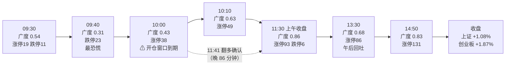

# 2026-11-02 盘中分析 · 精读版

> 原始 957 行快照日志保留在同目录 `20261102.md`，本文是给人读的版本。
> 所有价格都带时点；收盘价用 Tushare 日线补齐（15:00 快照只采到 2902/5581 只）。

---

## 0. 一句话结论

**修复是真的，但开仓窗口在确认之前就关了。**
D1 预案给的四只条件单，全天只有**国泰海通**价格触发过（10:10 站上 16.10，在窗口内），但资格门（三判据 + 板块资金转正）只有广度一条成立 → **零成交**。
这是纪律，不是踏空；真正的错在**判据确认晚了 86 分钟**，以及**板块资金映射全挂（UNMAPPED）导致资格门无法验证**。

---

## 1. 盘面节奏：三次转折，一次假摔

| 时点 | 涨/跌 | 广度 | 涨停 | 跌停 | 成交额 | 读法 |
|---|---|---|---|---|---|---|
| 09:30 | 3027/2252 | 0.54 | 19 | 11 | 764.6 亿 | 平开，看不出方向 |
| **09:40** | 1701/3728 | **0.31** | 25 | **23** | 3241.8 亿 | **最恐慌**，跌停最多 |
| 10:00 | 2390/2970 | 0.43 | 38 | 16 | 5754.0 亿 | 反抽失败，窗口到期 |
| 10:10 | 3529/1885 | **0.63** | 49 | 14 | 6810.7 亿 | 广度首次过 0.55 |
| 11:10 | 3959/1478 | 0.71 | **63** | 13 | 10043.4 亿 | 涨停首次过 60 |
| **11:30** | 4783/714 | **0.86** | **93** | 6 | 11474.2 亿 | 上午收盘定稿 |
| 13:30 | 3809/1637 | 0.68 | 86 | 10 | 13151.7 亿 | 午后获利回吐 |
| 14:50 | 4647/856 | 0.83 | **131** | 9 | 17274.8 亿 | 全天最强 |
| ~~15:00~~ | ~~2536/335~~ | ~~0.87~~ | ~~64~~ | ~~4~~ | ~~9360.9 亿~~ | **样本只 2902 只，不可用** |

**两个必须说清的坑：**

1. **15:00 那行不能用。** 只采到 2902/5581 只（缺失 2679），所以"涨停从 131 掉到 64"是**样本腰斩**，不是炸板。收盘涨停数**未知**，只能以 14:50 的 131 为最近有效值，别用 64。
2. **11:40–12:50 六份快照完全一样**（广度 0.86、成交 11474.2 亿不动），是午休停更，不是数据停滞——采集在跑，报价停在 11:30。

---

## 2. 重点票：四只执行池，今天到底该不该买

### 2.1 执行池总览（仓位是有上限的，不是目标）

| 票 | 仓位 | 买区 | 触发 | 止损 | 止盈 | RR | 真实开盘 | 日内高/低 | **收盘** | 今日触发 | 动作 |
|---|---|---|---|---|---|---|---|---|---|---|---|
| **康龙化成** 300759 | 1.5% | 42.90–43.40 | **42.90** | 39.93（-8.0%） | 50.34 | 2.0 | 41.54 | 43.34 / 40.70 | **42.76（+3.36%）** | 14:50 才摸 42.90，窗口早过 | ❌ 不买 |
| **迎驾贡酒** 603198 | 1.0% | 40.91–43.14 | **43.14** | 40.70（-5.7%） | 48.02 | 2.0 | 45.13 | 48.92 / 44.80 | **48.53（+9.13%）** | 全天最低 44.80，从未回踩 43.14 | ❌ 不买 |
| **国泰海通** 601211 | 1.5% | 16.10–16.52 | **16.10** | 15.36（-7.0%） | 18.84 | 2.0 | 15.94 | 16.30 / 15.75 | **16.30（+2.77%）** | ✅ 10:10 站上 16.10（窗口内） | ⚠️ 价格达标、资格门未过 |
| **中国海油** 600938 | 1.5% | 35.96–36.68 | **36.14** | 34.84（-5.0%） | 40.36 | 2.0 | **34.92** | 35.69 / 34.57 | **35.26（-1.97%）** | ❌ 开盘价直接低于"放弃线"35.43 | ✅ 放弃对了 |

**预算口径**：新建仓预算上限 7.5%（R1 cap 0.10 × 跷跷板 0.75），四只合计 5.5%，单票上限 3%，单板块 4%，全部 `auto_trade_enabled=false` + 需人工确认。

### 2.2 逐票核对：为什么没买

**① 康龙化成 — 价格没到，不是不想要**

- 真实开盘 41.54（+0.41%），落在"预期内"档 → 预案要求**站回 MA50 42.90** 才买。
- 全天大部分时间在 40.70–42.90 之间磨，11:10 最低 41.10；14:50 第一次摸到 42.90，尾盘冲到 43.34，收盘 42.76。
- 就算买了：42.90 买、42.76 收 = **-0.33%**。窗口救了一次小亏。
- 唯一遗憾：它日内高点 43.34 出现在 14:50 之后（快照没捕到），但那是尾盘脉冲，不在预案窗口。

**② 迎驾贡酒 — 给了打板价，但预案明令不给打板通道**

- 真实开盘 45.13（+1.48%），落在"预期内"档（43.80–45.36）→ 预案要求**回踩 43.14** 才买。
- 全天最低 44.80，**从未回到 43.14**。它 10:00 冲到 48.91（距涨停 48.92 差 1 分），13:20 砸到 46.09，尾盘又拉到 48.53。
- 结论：**这不是"踏空 9%"，是"预案的价格从未出现"**。想吃到这 9%，必须追高于预案上沿 12%——那就是违反自己的预案。这条要在复盘里写清楚，别把"没追高"记成"错过"。

**③ 国泰海通 — 今天唯一真触发，但资格门没过**

- 开盘 15.94（预期内 15.62–16.18）→ 预案要求**站回 16.10**。10:10 报 16.21，**窗口 09:30–10:15 内成立**。
- 但资格门三条（`buy_eligibility.conditions`）：
  | 条件 | 10:10 读数 | 判定 |
  |---|---|---|
  | 三判据至少两条（广度>0.55 / 昨涨停红盘率>60% / 板块级涨停潮≥3） | 广度 0.63 ✅；昨涨停红盘率**未采**；板块级涨停潮**无法分解** | **1 条可证** |
  | 个股站上触发价 **且所属板块资金转正** | 板块资金表整张是 `UNMAPPED`（映射失败） | **无法验证** |
  | 用户确认 | — | 未确认 |
- 所以：**价格条件成立，资格条件不成立**。如果按 16.10 买入，收盘 16.30 = **+1.24%**。这是一次"数据缺口造成的漏单"，不是逻辑错误——要记在缺陷栏，不是纪律栏。

**④ 中国海油 — 预案最干净的一次否决**

- 霍尔木兹消息（E002）隔夜是正面，但伊朗同时称"条件满足两天内可重开"。
- 开盘 **34.92（-2.92%）**，直接跌破预案的"不及预期 < 35.43 放弃"线 → 按预案**开盘即放弃**，不需要任何盘中判断。
- 全天最低 34.57、收盘 35.26（-1.97%）。**这条腿救了一笔**：若按突破 36.14 追，根本没有触发；若按"事件必涨"硬做，今天亏 2%。

### 2.3 观察池：真实收盘（Tushare 日线）

| 票 | 主题 | 收盘 | 涨跌 | 日内特征 | 读法 |
|---|---|---|---|---|---|
| 中信证券 600030 | 券商 E001 | 25.56 | **+5.19%** | 低 24.40 → 高 25.65，全天走强 | 券商是今天**真正被定价**的主线 |
| 泸州老窖 000568 | 白酒① | 79.77 | +3.50% | 高 81.62 后回落 | 高位换手，未续攻 |
| 贵州茅台 600519 | 白酒① | 1439.10 | +3.38% | 低 1395 → 高 1447 | 避险资金主仓 |
| 五粮液 000858 | 白酒① | 74.25 | **-0.60%** | 高 76.30 后翻绿 | **白酒内部分化**：Q3 -48% 的被抛弃 |
| 药明康德 603259 | CRO 龙头 | 138.65 | **-2.37%** | 高开 144.00 即最高，一路杀 | **CRO 龙头失血**，见 3.3 |
| 亨通光电 600487 | 光模块 | 43.52 | +2.59% | 高 44.80 | E008"行业级负面"盘中被打脸 |
| 招商轮船 601872 | 油运 E002 | 17.97 | +1.47% | — | 事件腿只走了一半 |
| 中远海特 600428 | 航运 | 11.63 | +1.39% | — | 同上 |
| 上海沪工 603131 | 商业航天 3 板 | 17.30 | **-1.42%** | **高开 19.00（+8.3%）→ 杀到 17.20**，长上影 | 典型**高开出货**，验证"热度是派发燃料" |
| 万邦医药 301520 | CRO 小票 | 62.69 | **+4.38%** | 低 57.00 → 高 62.82 | 小票吸走弹性，大票不涨 |
| 创新医疗 002173 | 脑机接口 | 16.53 | -4.01% | — | E006 被资金否决 |
| 三博脑科 301293 | 脑机接口 | 49.22 | -1.05% | — | 同上 |
| 长鑫科技 688825 | 存储 | 41.72 | -0.19% | 高 42.80 | 高位不跟 |
| 九安医疗 002432 | 医药 | 55.50 | -1.32% | 振幅 7% | 低 PE 陷阱验证中 |
| 百亚股份 003006 | 个护 | 22.40 | -2.52% | 高 23.52 → 低 21.67 | 弱势 |
| 金安国纪 002636 | PCB | 63.70 | +0.03% | **高 67.66（+6.3%）→ 回落 5.9%** | PCB 冲高失败，E008 对 |

---

## 3. 消息面与板块效应：三个事件，三种结局

### 3.1 隔夜外部（背景，不是借口）

| 项目 | 读数 | 含义 |
|---|---|---|
| 纳指 | -2.86% | 科技链无顺风 |
| AMD / INTC | -10.88% / -28.58% | 半导体杀估值 |
| 半导体篮子 / 光模块 | -6.37% / -7.19% | AI 硬件全线承压 |
| AI 表外负债 | 4.1 万亿美元 | 资本开支叙事的反面 |

### 3.2 三个事件，盘中的裁决

| 事件 | 预案判断 | 盘中结果 | 裁决 |
|---|---|---|---|
| **E001 券商政策**（一行一局一会 + 国新/诚通千亿回购增持额度） | "全表最高极性 +0.74，全市场未定价" | 券商 ETF 上午 **+3.45%**，中信 +5.19%、国泰 +2.77% | ✅ **兑现**，是今天最干净的主线 |
| **E002 霍尔木兹油轮触雷** | "事件硬 + 资金有 + 涨停无，给突破确认单" | 海油低开 -2.92% 收 -1.97%；油运（招商 +1.47%、中远 +1.39%）小涨 | ⚠️ **半失败**：只有运输端走，龙头没走 |
| **E008 AI 算力链行业级负面** | 覆盖光模块/CPO/PCB/存储高位 | 光通信 ETF 上午 **+4.23%**（最强），亨通 +2.59%；但 PCB 金安冲高回落、存储长鑫 -0.19% | ⚠️ **部分打脸**：光通信反着走，PCB/存储对 |

### 3.3 板块效应：钱到底去了哪

**板块 ETF 上午涨幅（09:30–11:30，xtick）**

| 板块 | 上午涨幅 | 阵营 |
|---|---|---|
| **光通信** | **+4.23%** | 进攻 |
| **券商** | **+3.45%** | 政策 |
| 军工 | +1.93% | 进攻 |
| 商业航天 | +1.87% | 题材 |
| AI 算力 | +1.40% | 进攻 |
| 半导体 | +1.27% | 进攻 |
| 存储芯片 | +1.05% | 进攻 |
| 有色 | -0.21% | 防守 |
| **医药** | **-0.53%** | **唯一下跌** |

**指数**：创业板 +1.87%、深成 +1.63%、上证 +1.08%（收盘）；上午收盘时创业板已 +2.21%。**今天是小盘成长修复，不是权重护盘。**

**四个板块内部的结构（这才是能指导明天的）：**

| 板块 | 强的 | 弱的 | 结论 |
|---|---|---|---|
| 券商 | 中信 +5.19%、国泰 +2.77% | — | **板块级共振**，明天仍可跟 |
| 白酒 | 迎驾 +9.13%、茅台 +3.38%、泸州 +3.50% | 五粮液 -0.60% | **分化**：只有区域龙头和高确定性高端被买 |
| CRO/医药 | 万邦 +4.38%、康龙 +3.36% | 药明 -2.37%、九安 -1.32% | **龙头跌、小票涨** = 没有 β，只有博弈 |
| 商业航天 | ETF +1.87% | 上海沪工 -1.42%（高开 8.3% 杀回） | **板块涨、龙头杀** = 派发 |
| 油运 | 招商 +1.47%、中远 +1.39% | 海油 -1.97% | 事件只兑现在运输端 |

> **对明天的直接含义**：预案把医药 CRO 当"主线②资金迁移型"，但医药 ETF 是今天唯一下跌的板块（-0.53%）。康龙化成 +3.36% 是**逆板块的个股行为**，不是板块行情——它的"低位补涨"腿缺 β，这条要在重定价时降级。

### 3.4 竞价在做假动作（今天最值钱的一条观察）

| 票 | 09:15 竞价指示价 | 真实开盘 | 差 |
|---|---|---|---|
| 迎驾贡酒 | 48.92（涨停价） | 45.13 | **-7.7%** |
| 康龙化成 | 43.40（+4.9%） | 41.54 | **-4.3%** |
| 中国海油 | 35.90 | 34.92 | **-2.7%** |
| 国泰海通 | 15.85 | 15.94 | +0.6% |

**四只里三只竞价高挂后低开**。这直接印证了"竞价不是真实目的"——09:15–09:20 可撤单阶段的指示价不具备决策价值，**必须用 09:25 最终撮合价/真实开盘**。预案的"竞价四档"要用真实开盘对照，不能用 09:15 指示价。

---

## 4. 三判据核对：差在哪一分钟

| 判据 | 阈值 | 09:30 | 09:40 | 10:00 | 10:10 | 10:30 | 11:10 | 11:30 |
|---|---|---|---|---|---|---|---|---|
| 广度 | >0.55 | 0.54 | 0.31 | 0.43 | **0.63 ✅** | 0.55 | 0.71 ✅ | 0.86 ✅ |
| 涨停数 | ≥60 | 19 | 25 | 38 | 49 | 51 | **63 ✅** | 93 ✅ |
| 昨涨停红盘率 | >60% | — | — | — | 未采 | 未采 | 未采 | 11:41 实测 **78.72% ✅** |

- **窗口内（09:30–10:15）最多只有 1 条成立**（10:10 广度 0.63）。
- **两条同时成立最早是 11:10**（广度 0.71 + 涨停 63），比窗口关闭晚 **55 分钟**。
- **翻多检测器 11:41 给出 `reversal_confirmed`**（广度 0.8552 / 昨涨停红盘率 0.7872 / 上证 +1.165%），比窗口晚 **86 分钟**。

**这不是判据错了，是判据的采样频率和窗口不匹配。** 09:30–10:00 半小时里市场刚从恐慌（0.31）爬出来，任何"要求两条成立"的闸门都必然不通过。真正的问题是：**确认机制设计成"事后确认"，却用来做"事前开仓许可"。**

---

## 5. 今天做对 / 做错

| 做对的 | 证据 |
|---|---|
| 海油开盘放弃 | 开盘 34.92 < 放弃线 35.43，全天 -1.97%，一刀未伤 |
| 迎驾不追高 | 预案上沿 43.14，全天未回踩；追高需付 +12% 溢价 |
| 15:00 数据降级没有当成"炸板" | 缺失 2679 只，样本腰斩，不是市场崩 |
| 四只条件单全部带止损位 | 无一只是"裸买" |

| 做错的 | 证据 | 归属 |
|---|---|---|
| 判据确认晚 86 分钟 | 11:41 才确认，窗口 10:15 关闭 | 机制设计 |
| 板块资金全表 UNMAPPED | `sector_morning_flows` 只有 UNMAPPED 一档，21 只成员 | **程序缺陷** |
| 国泰海通漏单 | 价格 10:10 达标，但板块资金正负无法验证 | 程序缺陷的后果 |
| P2 午盘修订未落盘 | `data/plans/20261102/` 只有 09:29 竞价修订 + 09:56 预案 | 链路缺口 |
| R7 午盘增量缺失 | `r7_midday_increment.status=missing`，P2 置信度打折 0.15 | 链路缺口 |

---

## 6. 数据质量（读结论前必看）

| 项目 | 状态 | 影响 |
|---|---|---|
| 15:00 全市场快照 | 🔴 降级：valid 2902 / 5581，缺 2679 | 收盘涨停/广度不可用，本文用 14:50 |
| 15:00 执行池报价 | 🔴 迎驾/国泰/海油三只 `no_data` | 收盘价改用 Tushare 日线补齐 |
| 板块资金（午盘） | 🔴 `UNMAPPED`，仅 21 只成员归集 | **板块资金无法验证**，本文用 9 只 ETF 代理 |
| 昨涨停红盘率 | 🟡 盘中快照未采，仅 11:41 检测器实测 78.72% | 三判据长期只能证 2/3 |
| 11:40–12:50 快照 | 🟡 六份重复（午休停更） | 不是数据停滞 |
| 报价时效 | 🟡 `age_limit_not_configured`，最大 101 秒 | 未配置上限 = 未验证新鲜度 |
| P2 午盘修订 | 🔴 未落盘 | "用上午数据重算"未发生 |
| 09:15 竞价指示价 | 🟡 与真实开盘差 -7.7%~+0.6% | 竞价指示价不可作决策依据 |

---

## 7. 明日（11-03）观察清单

**不改结论、只列条件**——今天的预案没有一条被证伪，但有三条要重定价：

| 票/板块 | 明日看什么 | 触发才动 |
|---|---|---|
| **券商** | 今天是板块级共振（ETF +3.45%，两只个股涨 3%+）。明天看**是否 ≥2 家继续涨 3%、成交是否延续** | 延续 → 券商从"条件单"升为"可做"；一日游 → 回观察 |
| **国泰海通 16.10** | 今天收 16.30，已站上 MA5/MA20 | 若回踩 16.10–16.30 不破，且券商仍强 → 这是今天漏掉的那一笔 |
| **康龙化成 42.90** | 今天收 42.76，仍在 MA50 下方；医药 ETF 是唯一下跌板块 | 需**医药板块转正 + 站回 42.90** 两条同时成立，不能只看个股 |
| **迎驾贡酒 43–45** | 今天收 48.53（+9.13%），已远离买区 | **不追**。等回踩 45 以下再重评，不回踩就放弃 |
| **中国海油 36.14** | 今天 -1.97%，霍尔木兹事件被"两天内可重开"压制 | 突破 36.14 且伊朗未复航 → 才重新成立 |
| **商业航天** | 上海沪工高开 8.3% 杀回 -1.42%，长上影 | **明确回避**，不要接 3 板后的高开 |
| **光通信** | ETF +4.23%，E008 被打脸 | 明天看能否连续；若只是一日反弹，不追 |

**仓位纪律不变**：新建仓预算上限 7.5%，单票 3%，单板块 4%；任何买入前先过三判据，不再用"事后确认"当开仓许可。

---

## 8. 给系统的三条修复建议（不是今天能改的）

1. **三判据时点前移**：把"09:30–10:00 采样"改成"09:30–11:30 滚动采样 + 首次达标即刻通知"，否则修复行情的确认永远晚于窗口。
2. **板块资金映射修复**：`sector_morning_flows` 全表 UNMAPPED，导致所有"板块资金转正"类条件不可验证——这是今天国泰海通漏单的直接原因。
3. **15:00 快照补采**：收盘快照缺失 2679 只，涨停数从 131 掉到 64 是采样问题，容易被误读成炸板。收盘数据应改用日线口径兜底。
