```yaml
### 09:30 · 广度 0.91

| 指标 | 上轮 | 本轮 | Δ |
|
```
|---|---|---|
| 广度 | 缺失 | 0.913 | — |
| 涨停 | 缺失 | 25 | — |
| 跌停 | 缺失 | 3 | — |
| 涨>3% | 缺失 | 1559 | — |
| 跌>3% | 缺失 | 35 | — |
| 成交(亿) | 缺失 | 1,065 | — |

**钱在**：元器件 8封/+4.25% ｜ 汽车配件 4封/+2.45% ｜ 机械基件 2封/+3.09%
**异动**：源杰科技 +12.27% · 中际旭创 +11.83% · 新易盛 +10.82% · 景旺电子 +10.00%(涨停) · 剑桥科技 +10.00%(涨停)
**结论**：广度 0.91 → 修复延续，板块内可做

<details><summary>预案池 24 只（点开）</summary>

| 票 | 池 | 现价 | 涨幅 | 状态 |
|---|---|---|---|---|
| 新易盛 `300502.SZ` | execution_pool | 200.99 | +10.82% | up |
| 中际旭创 `300308.SZ` | execution_pool | 466.55 | +11.83% | up |
| 源杰科技 `688498.SH` | execution_pool | 686.00 | +12.27% | up |
| 景旺电子 `603228.SH` | execution_pool | 62.57 | +10.00% | limit_up |
| 沪电股份 `002463.SZ` | watch_pool | 89.21 | +7.87% | up |
| 深南电路 `002916.SZ` | watch_pool | 221.50 | +6.44% | up |
| 生益电子 `688183.SH` | watch_pool | 77.61 | +9.19% | up |
| 长川科技 `300604.SZ` | watch_pool | 187.39 | +5.33% | up |
| 中芯国际 `688981.SH` | watch_pool | 123.64 | +1.68% | up |
| 寒武纪 `688256.SH` | watch_pool | 927.97 | +1.44% | up |
| 剑桥科技 `603083.SH` | watch_pool | 110.00 | +10.00% | limit_up |
| 宇树科技 `688836.SH` | watch_pool | 710.00 | +0.28% | up |
| 双环传动 `002472.SZ` | watch_pool | 38.68 | -0.23% | down |
| 凡拓数创 `301313.SZ` | watch_pool | 77.00 | +8.47% | up |
| 中京电子 `002579.SZ` | watch_pool | 16.20 | +9.98% | limit_up |
| 风华高科 `000636.SZ` | watch_pool | 30.22 | +4.24% | up |
| 龙版传媒 `605577.SH` | watch_pool | 18.50 | +3.87% | up |
| 浙文影业 `601599.SH` | watch_pool | 3.90 | +6.85% | up |
| 有研新材 `600206.SH` | watch_pool | 41.81 | +4.53% | up |
| 瑞芯微 `603893.SH` | watch_pool | 207.71 | +2.38% | up |
| 北方华创 `002371.SZ` | watch_pool | 549.13 | +1.49% | up |
| 洛阳钼业 `603993.SH` | watch_pool | 12.46 | +2.64% | up |
| 中信证券 `600030.SH` | watch_pool | 25.24 | -0.08% | down |
| 东方财富 `300059.SZ` | watch_pool | 18.53 | -0.48% | down |

</details>

---
### 09:30 盯盘卡

**温度** 广度 **0.92** · 涨停 **25** · 炸板 **13** · 跌停 **3** · 成交 **1065.3 亿**
**判据** 广度>0.55 ✅ · 涨停≥60 ❌ · 昨涨停红盘率>60% ⏳未采 → **1/2 可证**

**连板梯队** 最高 **4** 板（中京电子 4板、东晶电子 3板、克来机电 3板）｜ 1板 5家 / 2板 15家 / 3板 4家 / 4板 1家
**主线（按行业涨停数）** 元器件 **8**家 均+4.25% ｜ 汽车配件 **4**家 均+2.45% ｜ 机械基件 **2**家 均+3.09% ｜ IT设备 **2**家 均+3.04% ｜ 通信设备 **1**家 均+4.13%
**板块分时** 半导体 +3.71% ｜ AI算力 +3.62% ｜ 光通信 +3.04% ｜ 商业航天 +1.86% ｜ 军工 +1.76% ｜ 券商 +0.21% ｜ 医药 -0.26% ｜ 白酒 -0.69%
**进攻位（距涨停≤3%）** 九阳股份 +9.98%（差0.03%，家用电器，量比23.7，换手1.8%） ｜ 工业富联 +9.17%（差0.77%，通信设备，量比59.9，换手0.2%） ｜ 生益科技 +8.95%（差0.97%，元器件，量比49.1，换手0.7%） ｜ 豪尔赛 +8.88%（差1.01%，装修装饰，量比32.0，换手0.4%） ｜ 联域股份 +8.90%（差1.01%，电气设备，量比15.2，换手0.6%）
**风险（炸板）** 浙文影业 高+10.14%→收+6.85% ｜ 飞龙股份 高+10.02%→收+8.70% ｜ 德龙汇能 高+10.02%→收+6.44% ｜ 生益科技 高+10.01%→收+8.95%
**资金（行业成交额）** 元器件 162亿 ｜ 通信设备 140亿 ｜ 软件服务 44亿 ｜ 汽车配件 32亿
**资金（个股成交额）** 中际旭创 35亿 ｜ 新易盛 28亿 ｜ 天孚通信 15亿 ｜ 长鑫科技 14亿 ｜ 工业富联 13亿

**我的池子**

| 票 | 仓位 | 现价 | 触发 | 距触发 | 距止损 | 状态 | 现在做什么 |
|---|---|---|---|---|---|---|---|
| 新易盛 | — | 200.99 | —↑ | —% | 20.8% | 等触发 | 盯 — |
| 中际旭创 | — | 466.55 | —↑ | —% | 20.6% | 等触发 | 盯 — |
| 源杰科技 | — | 686.0 | —↑ | —% | 20.9% | 等触发 | 盯 — |
| 景旺电子 | — | 62.57 | —↑ | —% | 19.5% | 等触发 | 盯 — |

**观察池** 强：剑桥科技 +10.00%、中京电子 +9.98%、生益电子 +9.19% ｜ 弱：东方财富 -0.48%、双环传动 -0.23%

**结论** ⚪ 窗口已过 —— 今日不再开新仓，只做记录与止损管理
**下一档盯** 中际旭创 466.55 → —（需涨 0.00%） ｜ 新易盛 200.99 → —（需涨 0.00%） ｜ 景旺电子 62.57 → —（需涨 0.00%）

---
### 09:40 · 广度 0.93 ↑

| 指标 | 上轮 | 本轮 | Δ |
|---|---|---|---|
| 广度 | 0.913 | 0.934 | +0.020 |
| 涨停 | 25 | 47 | **+22** |
| 跌停 | 3 | 3 | +0 |
| 涨>3% | 1559 | 1877 | **+318** |
| 跌>3% | 35 | 16 | **-19** |
| 成交(亿) | 1,065 | 3,830 | +2,764 |

**钱在**：元器件 9封/+4.80% ｜ 汽车配件 9封/+3.54% ｜ 塑料 3封/+3.35%
**异动**：凡拓数创 +13.34% · 生益电子 +11.16% · 浙文影业 +10.14%(涨停) · 景旺电子 +10.00%(涨停) · 剑桥科技 +10.00%(涨停)
**结论**：广度 +0.02 横住｜涨停 +22 → 修复延续，板块内可做

<details><summary>预案池 24 只（点开）</summary>

| 票 | 池 | 现价 | 涨幅 | 状态 |
|---|---|---|---|---|
| 新易盛 `300502.SZ` | execution_pool | 194.87 | +7.45% | up |
| 中际旭创 `300308.SZ` | execution_pool | 454.99 | +9.06% | up |
| 源杰科技 `688498.SH` | execution_pool | 657.43 | +7.59% | up |
| 景旺电子 `603228.SH` | execution_pool | 62.57 | +10.00% | limit_up |
| 沪电股份 `002463.SZ` | watch_pool | 89.84 | +8.63% | up |
| 深南电路 `002916.SZ` | watch_pool | 221.60 | +6.49% | up |
| 生益电子 `688183.SH` | watch_pool | 79.01 | +11.16% | up |
| 长川科技 `300604.SZ` | watch_pool | 189.48 | +6.50% | up |
| 中芯国际 `688981.SH` | watch_pool | 125.23 | +2.99% | up |
| 寒武纪 `688256.SH` | watch_pool | 944.07 | +3.20% | up |
| 剑桥科技 `603083.SH` | watch_pool | 110.00 | +10.00% | limit_up |
| 宇树科技 `688836.SH` | watch_pool | 731.19 | +3.28% | up |
| 双环传动 `002472.SZ` | watch_pool | 40.05 | +3.30% | up |
| 凡拓数创 `301313.SZ` | watch_pool | 80.46 | +13.34% | up |
| 中京电子 `002579.SZ` | watch_pool | 16.20 | +9.98% | limit_up |
| 风华高科 `000636.SZ` | watch_pool | 30.07 | +3.73% | up |
| 龙版传媒 `605577.SH` | watch_pool | 18.44 | +3.54% | up |
| 浙文影业 `601599.SH` | watch_pool | 4.02 | +10.14% | limit_up |
| 有研新材 `600206.SH` | watch_pool | 41.10 | +2.75% | up |
| 瑞芯微 `603893.SH` | watch_pool | 213.03 | +5.00% | up |
| 北方华创 `002371.SZ` | watch_pool | 554.69 | +2.51% | up |
| 洛阳钼业 `603993.SH` | watch_pool | 12.36 | +1.81% | up |
| 中信证券 `600030.SH` | watch_pool | 25.30 | +0.16% | up |
| 东方财富 `300059.SZ` | watch_pool | 18.46 | -0.86% | down |

</details>

---
### 09:40 盯盘卡

**温度** 广度 **0.94**（+0.02） · 涨停 **47**（+22） · 炸板 **12** · 跌停 **3**（+0） · 成交 **3829.8 亿**（+2764）
**判据** 广度>0.55 ✅ · 涨停≥60 ❌ · 昨涨停红盘率>60% ⏳未采 → **1/2 可证**

**连板梯队** 最高 **4** 板（中京电子 4板、长华集团 3板、克来机电 3板）｜ 1板 19家 / 2板 23家 / 3板 4家 / 4板 1家
**主线（按行业涨停数）** 元器件 **9**家 均+4.80% ｜ 汽车配件 **9**家 均+3.54% ｜ 塑料 **3**家 均+3.35% ｜ IT设备 **3**家 均+3.05% ｜ 通信设备 **2**家 均+4.32%
**板块分时** AI算力 +3.77% ｜ 半导体 +3.71% ｜ 光通信 +2.96% ｜ 商业航天 +2.48% ｜ 军工 +2.20% ｜ 白酒 +0.23% ｜ 券商 +0.21% ｜ 医药 +0.00%
**进攻位（距涨停≤3%）** 上海电影 +9.78%（差0.20%，影视音像，量比8.2，换手2.0%） ｜ 荣联科技 +9.51%（差0.46%，软件服务，量比112.7，换手16.2%） ｜ 模塑科技 +9.29%（差0.63%，汽车配件，量比9.1，换手2.5%） ｜ 柯力传感 +9.21%（差0.72%，电器仪表，量比9.7，换手1.3%） ｜ 征和工业 +9.12%（差0.81%，汽车配件，量比10.0，换手1.4%）
**风险（炸板）** 德龙汇能 高+10.02%→收+6.65% ｜ 生益科技 高+10.01%→收+8.30% ｜ 鹏鼎控股 高+10.01%→收+7.02% ｜ 荣联科技 高+10.01%→收+9.51%
**资金（行业成交额）** 半导体 593亿 ｜ 元器件 516亿 ｜ 通信设备 431亿 ｜ 专用机械 175亿
**资金（个股成交额）** 中际旭创 100亿 ｜ 新易盛 88亿 ｜ 天孚通信 39亿 ｜ 工业富联 38亿 ｜ 长鑫科技 37亿
**新晋涨停（vs 上一条）** 24 家：工业富联(通信设备)、九阳股份(家用电器)、京蓝科技(环境保护)、浙文影业(纺织)、福莱新材(塑料)、鸿富诚(半导体)、飞龙股份(汽车配件)、浙江荣泰(汽车配件)

**我的池子**

| 票 | 仓位 | 现价 | 触发 | 距触发 | 距止损 | 状态 | 现在做什么 |
|---|---|---|---|---|---|---|---|
| 新易盛 | — | 194.87 | —↑ | —% | 18.3% | 等触发 | 盯 — |
| 中际旭创 | — | 454.99 | —↑ | —% | 18.6% | 等触发 | 盯 — |
| 源杰科技 | — | 657.43 | —↑ | —% | 17.5% | 等触发 | 盯 — |
| 景旺电子 | — | 62.57 | —↑ | —% | 19.5% | 等触发 | 盯 — |

**观察池** 强：凡拓数创 +13.34%、生益电子 +11.16%、浙文影业 +10.14% ｜ 弱：东方财富 -0.86%、中信证券 +0.16%

**结论** ⚪ 窗口已过 —— 今日不再开新仓，只做记录与止损管理
**下一档盯** 中际旭创 454.99 → —（需涨 0.00%） ｜ 新易盛 194.87 → —（需涨 0.00%） ｜ 景旺电子 62.57 → —（需涨 0.00%）

---
### 09:50 · 广度 0.88 ↓

| 指标 | 上轮 | 本轮 | Δ |
|---|---|---|---|
| 广度 | 0.934 | 0.880 | **-0.053** |
| 涨停 | 47 | 53 | **+6** |
| 跌停 | 3 | 3 | +0 |
| 涨>3% | 1877 | 2149 | **+272** |
| 跌>3% | 16 | 18 | +2 |
| 成交(亿) | 3,830 | 5,489 | +1,660 |

**钱在**：汽车配件 13封/+4.06% ｜ 元器件 7封/+4.70% ｜ 机械基件 3封/+4.56%
**异动**：凡拓数创 +16.17% · 浙文影业 +10.14%(涨停) · 中京电子 +9.98%(涨停) · 剑桥科技 +8.42% · 生益电子 +8.12%
**结论**：广度 -0.05 横住｜涨停 +6 → 修复延续，板块内可做

<details><summary>预案池 24 只（点开）</summary>

| 票 | 池 | 现价 | 涨幅 | 状态 |
|---|---|---|---|---|
| 新易盛 `300502.SZ` | execution_pool | 192.07 | +5.91% | up |
| 中际旭创 `300308.SZ` | execution_pool | 449.00 | +7.62% | up |
| 源杰科技 `688498.SH` | execution_pool | 655.77 | +7.32% | up |
| 景旺电子 `603228.SH` | execution_pool | 61.43 | +8.00% | up |
| 沪电股份 `002463.SZ` | watch_pool | 87.86 | +6.24% | up |
| 深南电路 `002916.SZ` | watch_pool | 214.42 | +3.04% | up |
| 生益电子 `688183.SH` | watch_pool | 76.85 | +8.12% | up |
| 长川科技 `300604.SZ` | watch_pool | 187.25 | +5.25% | up |
| 中芯国际 `688981.SH` | watch_pool | 123.97 | +1.95% | up |
| 寒武纪 `688256.SH` | watch_pool | 944.99 | +3.30% | up |
| 剑桥科技 `603083.SH` | watch_pool | 108.42 | +8.42% | up |
| 宇树科技 `688836.SH` | watch_pool | 750.00 | +5.93% | up |
| 双环传动 `002472.SZ` | watch_pool | 40.07 | +3.35% | up |
| 凡拓数创 `301313.SZ` | watch_pool | 82.47 | +16.17% | up |
| 中京电子 `002579.SZ` | watch_pool | 16.20 | +9.98% | limit_up |
| 风华高科 `000636.SZ` | watch_pool | 29.92 | +3.21% | up |
| 龙版传媒 `605577.SH` | watch_pool | 18.42 | +3.43% | up |
| 浙文影业 `601599.SH` | watch_pool | 4.02 | +10.14% | limit_up |
| 有研新材 `600206.SH` | watch_pool | 40.88 | +2.20% | up |
| 瑞芯微 `603893.SH` | watch_pool | 211.28 | +4.14% | up |
| 北方华创 `002371.SZ` | watch_pool | 543.59 | +0.46% | up |
| 洛阳钼业 `603993.SH` | watch_pool | 12.15 | +0.08% | up |
| 中信证券 `600030.SH` | watch_pool | 25.22 | -0.16% | down |
| 东方财富 `300059.SZ` | watch_pool | 18.43 | -1.02% | down |

</details>

---
### 09:50 盯盘卡

**温度** 广度 **0.88**（-0.05） · 涨停 **53**（+6） · 炸板 **26** · 跌停 **3**（+0） · 成交 **5489.3 亿**（+1660）
**判据** 广度>0.55 ✅ · 涨停≥60 ❌ · 昨涨停红盘率>60% ⏳未采 → **1/2 可证**

**连板梯队** 最高 **4** 板（中京电子 4板、长华集团 3板、东晶电子 3板）｜ 1板 19家 / 2板 29家 / 3板 4家 / 4板 1家
**主线（按行业涨停数）** 汽车配件 **13**家 均+4.06% ｜ 元器件 **7**家 均+4.70% ｜ 机械基件 **3**家 均+4.56% ｜ 专用机械 **3**家 均+3.88% ｜ 塑料 **3**家 均+3.64%
**板块分时** AI算力 +3.38% ｜ 半导体 +3.09% ｜ 商业航天 +2.97% ｜ 光通信 +2.72% ｜ 军工 +2.42% ｜ 券商 +0.00% ｜ 白酒 +0.00% ｜ 医药 -0.53%
**进攻位（距涨停≤3%）** 东方海洋 +9.69%（差0.22%，渔业，量比8.0，换手20.3%） ｜ 日盈电子 +9.60%（差0.35%，汽车配件，量比6.6，换手3.0%） ｜ 征和工业 +9.60%（差0.37%，汽车配件，量比6.5，换手1.8%） ｜ 横河精密 +19.34%（差0.53%，塑料，量比8.4，换手9.3%） ｜ 鸣志电器 +9.29%（差0.65%，电气设备，量比7.2，换手1.3%）
**风险（炸板）** 鸿富诚 高+20.00%→收+16.38% ｜ 京蓝科技 高+10.12%→收+6.35% ｜ ST雪发 高+10.10%→收+7.69% ｜ 高乐股份 高+10.03%→收+9.26%
**资金（行业成交额）** 元器件 759亿 ｜ 通信设备 615亿 ｜ 专用机械 250亿 ｜ 汽车配件 190亿
**资金（个股成交额）** 中际旭创 136亿 ｜ 新易盛 127亿 ｜ 东山精密 59亿 ｜ 天孚通信 53亿 ｜ 工业富联 53亿
**新晋涨停（vs 上一条）** 14 家：利欧股份(互联网)、模塑科技(汽车配件)、上海电影(影视音像)、柯力传感(电器仪表)、飞亚达(服饰)、同星科技(机械基件)、泉阳泉  (软饮料)、福达股份(汽车配件)

**我的池子**

| 票 | 仓位 | 现价 | 触发 | 距触发 | 距止损 | 状态 | 现在做什么 |
|---|---|---|---|---|---|---|---|
| 新易盛 | — | 192.07 | —↑ | —% | 17.1% | 等触发 | 盯 — |
| 中际旭创 | — | 449.0 | —↑ | —% | 17.5% | 等触发 | 盯 — |
| 源杰科技 | — | 655.77 | —↑ | —% | 17.3% | 等触发 | 盯 — |
| 景旺电子 | — | 61.43 | —↑ | —% | 18.0% | 等触发 | 盯 — |

**观察池** 强：凡拓数创 +16.17%、浙文影业 +10.14%、中京电子 +9.98% ｜ 弱：东方财富 -1.02%、中信证券 -0.16%

**结论** ⚪ 窗口已过 —— 今日不再开新仓，只做记录与止损管理
**下一档盯** 中际旭创 449.0 → —（需涨 0.00%） ｜ 新易盛 192.07 → —（需涨 0.00%） ｜ 景旺电子 61.43 → —（需涨 0.00%）

---
### 10:00 · 广度 0.85 ↓

| 指标 | 上轮 | 本轮 | Δ |
|---|---|---|---|
| 广度 | 0.880 | 0.853 | -0.028 |
| 涨停 | 53 | 58 | **+5** |
| 跌停 | 3 | 4 | +1 |
| 涨>3% | 2149 | 1917 | **-232** |
| 跌>3% | 18 | 21 | +3 |
| 成交(亿) | 5,489 | 6,582 | +1,093 |

**钱在**：汽车配件 13封/+3.57% ｜ 元器件 6封/+4.61% ｜ 塑料 5封/+3.55%
**异动**：凡拓数创 +15.95% · 浙文影业 +10.14%(涨停) · 中京电子 +9.98%(涨停) · 景旺电子 +8.72% · 中际旭创 +7.38%
**结论**：广度 -0.03 横住｜涨停 +5 → 修复延续，板块内可做

<details><summary>预案池 24 只（点开）</summary>

| 票 | 池 | 现价 | 涨幅 | 状态 |
|---|---|---|---|---|
| 新易盛 `300502.SZ` | execution_pool | 192.95 | +6.39% | up |
| 中际旭创 `300308.SZ` | execution_pool | 447.99 | +7.38% | up |
| 源杰科技 `688498.SH` | execution_pool | 647.30 | +5.94% | up |
| 景旺电子 `603228.SH` | execution_pool | 61.84 | +8.72% | up |
| 沪电股份 `002463.SZ` | watch_pool | 87.48 | +5.78% | up |
| 深南电路 `002916.SZ` | watch_pool | 215.30 | +3.46% | up |
| 生益电子 `688183.SH` | watch_pool | 76.31 | +7.36% | up |
| 长川科技 `300604.SZ` | watch_pool | 190.87 | +7.28% | up |
| 中芯国际 `688981.SH` | watch_pool | 125.65 | +3.33% | up |
| 寒武纪 `688256.SH` | watch_pool | 958.66 | +4.79% | up |
| 剑桥科技 `603083.SH` | watch_pool | 107.09 | +7.09% | up |
| 宇树科技 `688836.SH` | watch_pool | 736.00 | +3.95% | up |
| 双环传动 `002472.SZ` | watch_pool | 39.54 | +1.99% | up |
| 凡拓数创 `301313.SZ` | watch_pool | 82.31 | +15.95% | up |
| 中京电子 `002579.SZ` | watch_pool | 16.20 | +9.98% | limit_up |
| 风华高科 `000636.SZ` | watch_pool | 29.83 | +2.90% | up |
| 龙版传媒 `605577.SH` | watch_pool | 18.23 | +2.36% | up |
| 浙文影业 `601599.SH` | watch_pool | 4.02 | +10.14% | limit_up |
| 有研新材 `600206.SH` | watch_pool | 41.00 | +2.50% | up |
| 瑞芯微 `603893.SH` | watch_pool | 209.38 | +3.20% | up |
| 北方华创 `002371.SZ` | watch_pool | 551.38 | +1.90% | up |
| 洛阳钼业 `603993.SH` | watch_pool | 12.09 | -0.41% | down |
| 中信证券 `600030.SH` | watch_pool | 25.16 | -0.40% | down |
| 东方财富 `300059.SZ` | watch_pool | 18.38 | -1.29% | down |

</details>

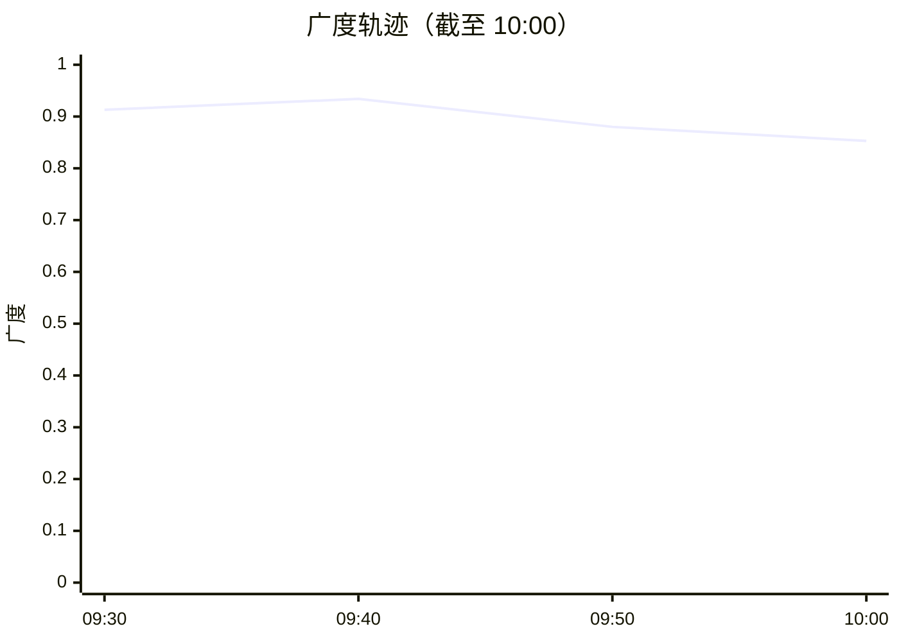

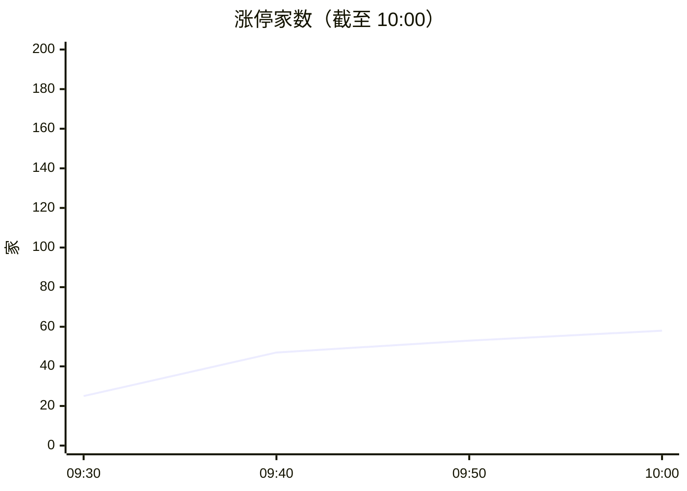


---
### 10:00 盯盘卡

**温度** 广度 **0.85**（-0.03） · 涨停 **58**（+5） · 炸板 **30** · 跌停 **4**（+1） · 成交 **6581.9 亿**（+1093）
**判据** 广度>0.55 ✅ · 涨停≥60 ❌ · 昨涨停红盘率>60% ⏳未采 → **1/2 可证**

**连板梯队** 最高 **4** 板（中京电子 4板、东晶电子 3板、长华集团 3板）｜ 1板 24家 / 2板 29家 / 3板 4家 / 4板 1家
**主线（按行业涨停数）** 汽车配件 **13**家 均+3.57% ｜ 元器件 **6**家 均+4.61% ｜ 塑料 **5**家 均+3.55% ｜ 机械基件 **3**家 均+4.27% ｜ 专用机械 **3**家 均+3.66%
**板块分时** 半导体 +3.96% ｜ AI算力 +3.62% ｜ 商业航天 +2.85% ｜ 光通信 +2.64% ｜ 军工 +2.42% ｜ 白酒 -0.23% ｜ 医药 -0.26% ｜ 券商 -0.42%
**进攻位（距涨停≤3%）** 慧博云通 +19.42%（差0.49%，软件服务，量比5.7，换手3.3%） ｜ 泰嘉股份 +9.05%（差0.91%，钢加工，量比4.6，换手10.7%） ｜ 瀛通通讯 +8.88%（差1.04%，元器件，量比2.1，换手4.7%） ｜ 日盈电子 +8.85%（差1.05%，汽车配件，量比5.0，换手3.5%） ｜ 灵动股份 +8.82%（差1.08%，建筑工程，量比3.7，换手4.1%）
**风险（炸板）** 慧博云通 高+20.01%→收+19.42% ｜ 鸿富诚 高+20.00%→收+15.90% ｜ 阿尔特 高+19.98%→收+18.67% ｜ 京蓝科技 高+10.12%→收+6.35%
**资金（行业成交额）** 元器件 894亿 ｜ 软件服务 309亿 ｜ 专用机械 297亿 ｜ 汽车配件 224亿
**资金（个股成交额）** 中际旭创 150亿 ｜ 新易盛 141亿 ｜ 东山精密 72亿 ｜ 天孚通信 59亿 ｜ 长鑫科技 59亿
**新晋涨停（vs 上一条）** 6 家：华胜天成(软件服务)、安培龙(电器仪表)、横河精密(塑料)、高乐股份(文教休闲)、艾艾精工(塑料)、原尚股份(公路)

**我的池子**

| 票 | 仓位 | 现价 | 触发 | 距触发 | 距止损 | 状态 | 现在做什么 |
|---|---|---|---|---|---|---|---|
| 新易盛 | — | 192.95 | —↑ | —% | 17.5% | 等触发 | 盯 — |
| 中际旭创 | — | 447.99 | —↑ | —% | 17.4% | 等触发 | 盯 — |
| 源杰科技 | — | 647.3 | —↑ | —% | 16.2% | 等触发 | 盯 — |
| 景旺电子 | — | 61.84 | —↑ | —% | 18.5% | 等触发 | 盯 — |

**观察池** 强：凡拓数创 +15.95%、浙文影业 +10.14%、中京电子 +9.98% ｜ 弱：东方财富 -1.29%、洛阳钼业 -0.41%

**结论** ⚪ 窗口已过 —— 今日不再开新仓，只做记录与止损管理
**下一档盯** 中际旭创 447.99 → —（需涨 0.00%） ｜ 新易盛 192.95 → —（需涨 0.00%） ｜ 景旺电子 61.84 → —（需涨 0.00%）


---

### 10:05 盘中总结（基于 10:00 快照）

① 广度连续两档回落：0.93（09:40 高点）→ 0.88（09:50）→ 0.85（10:00），下跌家数 316→695；涨停 25→58 在扩张，但炸板 13→30 同步抬升（盘中口径炸板/(涨停+炸板)≈34%），跌停 3→4，成交 6581.9 亿（较 09:50 单档 +1093 亿）。高开兑现＋换手分歧，不是单边加强。
② 预案池：4 只执行池竞价全部 +8.62%~+11.29%，P1 09:29 全判 skip/移出执行池（far_above 超 +7% 硬线）；10:00 已从 09:30 高点回落——新易盛 200.99→192.95、中际旭创 466.55→447.99、源杰科技 686.0→647.3、景旺电子 62.57 涨停→61.84 破板，但现价仍比各票买区上沿高 7.4%~10.5%（新易盛 +9.1%、中际 +8.9%、源杰 +7.4%、景旺 +10.5%），回踩承接的买点全天没给。观察池强势：凡拓数创 +15.95%（09:30 时 +8.47%）、浙文影业涨停、中京电子 4 板涨停；偏弱：东方财富 -1.29%、洛阳钼业 -0.41%。行业层面汽车配件涨停 4→13 家（涨停最多），AI 硬件链（元器件）涨停 8→6 家，分歧已在板块内部发生。
③ 与预案对照：预案原话是"今日能赚的是回踩承接的钱，不是追高开的钱"，盘面走的正是追高开→回落，买区（新易盛 174.27-176.90、中际旭创 405.27-411.38、源杰 593.96-602.91、景旺 55.13-55.96）一档都不可及 → 预案定位被验证，P1 全部 skip 是对的动作。但预案 no_trade_conditions 的"炸板率 >25% 即当日零新开"按盘中口径已越线（34%），动作上与"P1 已全 skip"结论一致，无需另行处置；涨停 58 仍差 2 家未过 60 判据。
④ 一句话结论：今天不动手就是对的——分歧日高开已在高位兑现，执行池没有合规买点；午后只认两种许可（价格回到买区、或广度自低位快速翻上 0.55 且涨停倍增的 13:15-14:00 第二窗口），否则维持空仓观察。
---
### 10:10 · 广度 0.79 ↓

| 指标 | 上轮 | 本轮 | Δ |
|---|---|---|---|
| 广度 | 0.853 | 0.795 | **-0.058** |
| 涨停 | 58 | 54 | -4 |
| 跌停 | 4 | 4 | +0 |
| 涨>3% | 1917 | 1380 | **-537** |
| 跌>3% | 21 | 30 | **+9** |
| 成交(亿) | 6,582 | 7,502 | +920 |

**钱在**：汽车配件 10封/+3.11% ｜ 元器件 6封/+3.62% ｜ 塑料 4封/+2.95%
**异动**：凡拓数创 +14.76% · 浙文影业 +10.14%(涨停) · 中京电子 +9.98%(涨停) · 景旺电子 +6.61% · 长川科技 +6.39%
**结论**：广度 -0.06 横住｜涨停 -4 → 分歧，只做板块首板不接力

<details><summary>预案池 24 只（点开）</summary>

| 票 | 池 | 现价 | 涨幅 | 状态 |
|---|---|---|---|---|
| 新易盛 `300502.SZ` | execution_pool | 190.82 | +5.22% | up |
| 中际旭创 `300308.SZ` | execution_pool | 442.58 | +6.08% | up |
| 源杰科技 `688498.SH` | execution_pool | 633.61 | +3.70% | up |
| 景旺电子 `603228.SH` | execution_pool | 60.64 | +6.61% | up |
| 沪电股份 `002463.SZ` | watch_pool | 86.33 | +4.39% | up |
| 深南电路 `002916.SZ` | watch_pool | 212.87 | +2.29% | up |
| 生益电子 `688183.SH` | watch_pool | 75.31 | +5.95% | up |
| 长川科技 `300604.SZ` | watch_pool | 189.28 | +6.39% | up |
| 中芯国际 `688981.SH` | watch_pool | 126.23 | +3.81% | up |
| 寒武纪 `688256.SH` | watch_pool | 963.81 | +5.36% | up |
| 剑桥科技 `603083.SH` | watch_pool | 105.16 | +5.16% | up |
| 宇树科技 `688836.SH` | watch_pool | 734.01 | +3.67% | up |
| 双环传动 `002472.SZ` | watch_pool | 39.65 | +2.27% | up |
| 凡拓数创 `301313.SZ` | watch_pool | 81.47 | +14.76% | up |
| 中京电子 `002579.SZ` | watch_pool | 16.20 | +9.98% | limit_up |
| 风华高科 `000636.SZ` | watch_pool | 29.47 | +1.66% | up |
| 龙版传媒 `605577.SH` | watch_pool | 18.50 | +3.87% | up |
| 浙文影业 `601599.SH` | watch_pool | 4.02 | +10.14% | limit_up |
| 有研新材 `600206.SH` | watch_pool | 40.66 | +1.65% | up |
| 瑞芯微 `603893.SH` | watch_pool | 210.49 | +3.75% | up |
| 北方华创 `002371.SZ` | watch_pool | 552.81 | +2.17% | up |
| 洛阳钼业 `603993.SH` | watch_pool | 12.03 | -0.91% | down |
| 中信证券 `600030.SH` | watch_pool | 25.11 | -0.59% | down |
| 东方财富 `300059.SZ` | watch_pool | 18.31 | -1.66% | down |

</details>

---
### 10:10 盯盘卡

**温度** 广度 **0.80**（-0.06） · 涨停 **54**（-4） · 炸板 **38** · 跌停 **4**（+0） · 成交 **7501.9 亿**（+920）
**判据** 广度>0.55 ✅ · 涨停≥60 ❌ · 昨涨停红盘率>60% ⏳未采 → **1/2 可证**

**连板梯队** 最高 **4** 板（中京电子 4板、东晶电子 3板、长华集团 3板）｜ 1板 24家 / 2板 25家 / 3板 4家 / 4板 1家
**主线（按行业涨停数）** 汽车配件 **10**家 均+3.11% ｜ 元器件 **6**家 均+3.62% ｜ 塑料 **4**家 均+2.95% ｜ 机械基件 **3**家 均+3.65% ｜ 专用机械 **3**家 均+2.95%
**板块分时** 半导体 +3.84% ｜ AI算力 +3.07% ｜ 商业航天 +2.85% ｜ 军工 +1.98% ｜ 光通信 +1.92% ｜ 白酒 -0.23% ｜ 券商 -0.64% ｜ 医药 -0.79%
**进攻位（距涨停≤3%）** 柯力传感 +9.96%（差0.04%，电器仪表，量比5.8，换手3.0%） ｜ 模塑科技 +9.85%（差0.13%，汽车配件，量比4.2，换手4.7%） ｜ 浙江荣泰 +9.52%（差0.43%，汽车配件，量比5.0，换手2.1%） ｜ 东方海洋 +9.44%（差0.44%，渔业，量比4.7，换手23.8%） ｜ ST交昂   +9.46%（差0.49%，医疗保健，量比2.6，换手1.0%）
**风险（炸板）** 鸿富诚 高+20.00%→收+13.25% ｜ 阿尔特 高+19.98%→收+16.43% ｜ 京蓝科技 高+10.12%→收+7.76% ｜ ST雪发 高+10.10%→收+6.97%
**资金（行业成交额）** 元器件 999亿 ｜ 软件服务 346亿 ｜ 专用机械 338亿 ｜ 汽车配件 258亿
**资金（个股成交额）** 中际旭创 163亿 ｜ 新易盛 151亿 ｜ 东山精密 80亿 ｜ 长鑫科技 65亿 ｜ 寒武纪   64亿
**新晋涨停（vs 上一条）** 4 家：慧博云通(软件服务)、全筑股份(装修装饰)、百傲化学(农药化肥)、建设机械(工程机械)

**我的池子**

| 票 | 仓位 | 现价 | 触发 | 距触发 | 距止损 | 状态 | 现在做什么 |
|---|---|---|---|---|---|---|---|
| 新易盛 | — | 190.82 | —↑ | —% | 16.6% | 等触发 | 盯 — |
| 中际旭创 | — | 442.58 | —↑ | —% | 16.3% | 等触发 | 盯 — |
| 源杰科技 | — | 633.61 | —↑ | —% | 14.4% | 等触发 | 盯 — |
| 景旺电子 | — | 60.64 | —↑ | —% | 16.9% | 等触发 | 盯 — |

**观察池** 强：凡拓数创 +14.76%、浙文影业 +10.14%、中京电子 +9.98% ｜ 弱：东方财富 -1.66%、洛阳钼业 -0.91%

**结论** ⚪ 窗口已过 —— 今日不再开新仓，只做记录与止损管理
**下一档盯** 中际旭创 442.58 → —（需涨 0.00%） ｜ 新易盛 190.82 → —（需涨 0.00%） ｜ 景旺电子 60.64 → —（需涨 0.00%）

---
### 10:20 · 广度 0.77 ↓

| 指标 | 上轮 | 本轮 | Δ |
|---|---|---|---|
| 广度 | 0.795 | 0.773 | -0.021 |
| 涨停 | 54 | 62 | **+8** |
| 跌停 | 4 | 4 | +0 |
| 涨>3% | 1380 | 1390 | **+10** |
| 跌>3% | 30 | 35 | **+5** |
| 成交(亿) | 7,502 | 8,166 | +664 |

**钱在**：汽车配件 11封/+3.11% ｜ 元器件 6封/+3.51% ｜ 塑料 4封/+2.87%
**异动**：凡拓数创 +15.13% · 浙文影业 +10.14%(涨停) · 中京电子 +9.98%(涨停) · 景旺电子 +6.31% · 长川科技 +6.23%
**结论**：广度 -0.02 横住｜涨停 +8 → 修复延续，板块内可做

<details><summary>预案池 24 只（点开）</summary>

| 票 | 池 | 现价 | 涨幅 | 状态 |
|---|---|---|---|---|
| 新易盛 `300502.SZ` | execution_pool | 190.20 | +4.87% | up |
| 中际旭创 `300308.SZ` | execution_pool | 440.11 | +5.49% | up |
| 源杰科技 `688498.SH` | execution_pool | 628.66 | +2.89% | up |
| 景旺电子 `603228.SH` | execution_pool | 60.47 | +6.31% | up |
| 沪电股份 `002463.SZ` | watch_pool | 86.33 | +4.39% | up |
| 深南电路 `002916.SZ` | watch_pool | 212.16 | +1.95% | up |
| 生益电子 `688183.SH` | watch_pool | 75.18 | +5.77% | up |
| 长川科技 `300604.SZ` | watch_pool | 189.00 | +6.23% | up |
| 中芯国际 `688981.SH` | watch_pool | 126.18 | +3.77% | up |
| 寒武纪 `688256.SH` | watch_pool | 967.10 | +5.72% | up |
| 剑桥科技 `603083.SH` | watch_pool | 103.72 | +3.72% | up |
| 宇树科技 `688836.SH` | watch_pool | 744.00 | +5.08% | up |
| 双环传动 `002472.SZ` | watch_pool | 39.51 | +1.91% | up |
| 凡拓数创 `301313.SZ` | watch_pool | 81.73 | +15.13% | up |
| 中京电子 `002579.SZ` | watch_pool | 16.20 | +9.98% | limit_up |
| 风华高科 `000636.SZ` | watch_pool | 29.33 | +1.17% | up |
| 龙版传媒 `605577.SH` | watch_pool | 18.64 | +4.66% | up |
| 浙文影业 `601599.SH` | watch_pool | 4.02 | +10.14% | limit_up |
| 有研新材 `600206.SH` | watch_pool | 40.71 | +1.77% | up |
| 瑞芯微 `603893.SH` | watch_pool | 211.09 | +4.05% | up |
| 北方华创 `002371.SZ` | watch_pool | 553.46 | +2.29% | up |
| 洛阳钼业 `603993.SH` | watch_pool | 11.94 | -1.65% | down |
| 中信证券 `600030.SH` | watch_pool | 25.12 | -0.55% | down |
| 东方财富 `300059.SZ` | watch_pool | 18.31 | -1.66% | down |

</details>

---
### 10:20 盯盘卡

**温度** 广度 **0.77**（-0.02） · 涨停 **62**（+8） · 炸板 **36** · 跌停 **4**（+0） · 成交 **8166.4 亿**（+664）
**判据** 广度>0.55 ✅ · 涨停≥60 ✅ · 昨涨停红盘率>60% ⏳未采 → **2/2 可证**

**连板梯队** 最高 **4** 板（中京电子 4板、东方海洋 3板、金新农 3板）｜ 1板 29家 / 2板 27家 / 3板 5家 / 4板 1家
**主线（按行业涨停数）** 汽车配件 **11**家 均+3.11% ｜ 元器件 **6**家 均+3.51% ｜ 塑料 **4**家 均+2.87% ｜ 机械基件 **3**家 均+3.50% ｜ 专用机械 **3**家 均+2.83%
**板块分时** 半导体 +3.84% ｜ 商业航天 +3.09% ｜ AI算力 +3.07% ｜ 军工 +2.31% ｜ 光通信 +1.68% ｜ 白酒 -0.23% ｜ 券商 -0.64% ｜ 医药 -0.79%
**进攻位（距涨停≤3%）** 浙江荣泰 +9.39%（差0.56%，汽车配件，量比4.5，换手2.4%） ｜ ST交昂   +9.29%（差0.65%，医疗保健，量比2.3，换手1.1%） ｜ 慈文传媒 +8.96%（差1.00%，影视音像，量比4.2，换手18.9%） ｜ 华东重机 +8.85%（差1.02%，机床制造，量比6.3，换手30.4%） ｜ 德龙汇能 +8.77%（差1.15%，供气供热，量比11.0，换手4.9%）
**风险（炸板）** 黄山谷捷 高+20.01%→收+15.08% ｜ 鸿富诚 高+20.00%→收+12.44% ｜ 阿尔特 高+19.98%→收+16.81% ｜ 志特新材 高+19.95%→收+17.47%
**资金（行业成交额）** 元器件 1078亿 ｜ 软件服务 370亿 ｜ 专用机械 370亿 ｜ 汽车配件 277亿
**资金（个股成交额）** 中际旭创 173亿 ｜ 新易盛 158亿 ｜ 东山精密 86亿 ｜ 寒武纪   71亿 ｜ 长鑫科技 70亿
**新晋涨停（vs 上一条）** 8 家：东方海洋(渔业)、模塑科技(汽车配件)、柯力传感(电器仪表)、高乐股份(文教休闲)、灵动股份(建筑工程)、阳光股份(区域地产)、原尚股份(公路)、利君股份(航空)

**我的池子**

| 票 | 仓位 | 现价 | 触发 | 距触发 | 距止损 | 状态 | 现在做什么 |
|---|---|---|---|---|---|---|---|
| 新易盛 | — | 190.2 | —↑ | —% | 16.3% | 等触发 | 盯 — |
| 中际旭创 | — | 440.11 | —↑ | —% | 15.9% | 等触发 | 盯 — |
| 源杰科技 | — | 628.66 | —↑ | —% | 13.7% | 等触发 | 盯 — |
| 景旺电子 | — | 60.47 | —↑ | —% | 16.7% | 等触发 | 盯 — |

**观察池** 强：凡拓数创 +15.13%、浙文影业 +10.14%、中京电子 +9.98% ｜ 弱：东方财富 -1.66%、洛阳钼业 -1.65%

**结论** ⚪ 窗口已过 —— 今日不再开新仓，只做记录与止损管理
**下一档盯** 中际旭创 440.11 → —（需涨 0.00%） ｜ 新易盛 190.2 → —（需涨 0.00%） ｜ 景旺电子 60.47 → —（需涨 0.00%）

---
### 10:30 · 广度 0.75 ↓

| 指标 | 上轮 | 本轮 | Δ |
|---|---|---|---|
| 广度 | 0.773 | 0.753 | -0.020 |
| 涨停 | 62 | 67 | **+5** |
| 跌停 | 4 | 4 | +0 |
| 涨>3% | 1390 | 1129 | **-261** |
| 跌>3% | 35 | 36 | +1 |
| 成交(亿) | 8,166 | 8,740 | +574 |

**钱在**：汽车配件 10封/+2.68% ｜ 元器件 6封/+3.03% ｜ 机械基件 4封/+3.07%
**异动**：凡拓数创 +15.02% · 浙文影业 +10.14%(涨停) · 中京电子 +9.98%(涨停) · 景旺电子 +6.26% · 长川科技 +5.68%
**结论**：广度 -0.02 横住｜涨停 +5 → 修复延续，板块内可做

<details><summary>预案池 24 只（点开）</summary>

| 票 | 池 | 现价 | 涨幅 | 状态 |
|---|---|---|---|---|
| 新易盛 `300502.SZ` | execution_pool | 190.08 | +4.81% | up |
| 中际旭创 `300308.SZ` | execution_pool | 437.96 | +4.98% | up |
| 源杰科技 `688498.SH` | execution_pool | 628.79 | +2.91% | up |
| 景旺电子 `603228.SH` | execution_pool | 60.44 | +6.26% | up |
| 沪电股份 `002463.SZ` | watch_pool | 86.46 | +4.55% | up |
| 深南电路 `002916.SZ` | watch_pool | 211.63 | +1.70% | up |
| 生益电子 `688183.SH` | watch_pool | 75.07 | +5.61% | up |
| 长川科技 `300604.SZ` | watch_pool | 188.01 | +5.68% | up |
| 中芯国际 `688981.SH` | watch_pool | 125.86 | +3.50% | up |
| 寒武纪 `688256.SH` | watch_pool | 956.53 | +4.56% | up |
| 剑桥科技 `603083.SH` | watch_pool | 103.22 | +3.22% | up |
| 宇树科技 `688836.SH` | watch_pool | 732.79 | +3.50% | up |
| 双环传动 `002472.SZ` | watch_pool | 39.18 | +1.06% | up |
| 凡拓数创 `301313.SZ` | watch_pool | 81.65 | +15.02% | up |
| 中京电子 `002579.SZ` | watch_pool | 16.20 | +9.98% | limit_up |
| 风华高科 `000636.SZ` | watch_pool | 29.26 | +0.93% | up |
| 龙版传媒 `605577.SH` | watch_pool | 18.50 | +3.87% | up |
| 浙文影业 `601599.SH` | watch_pool | 4.02 | +10.14% | limit_up |
| 有研新材 `600206.SH` | watch_pool | 40.43 | +1.08% | up |
| 瑞芯微 `603893.SH` | watch_pool | 209.84 | +3.43% | up |
| 北方华创 `002371.SZ` | watch_pool | 555.00 | +2.57% | up |
| 洛阳钼业 `603993.SH` | watch_pool | 11.92 | -1.81% | down |
| 中信证券 `600030.SH` | watch_pool | 25.11 | -0.59% | down |
| 东方财富 `300059.SZ` | watch_pool | 18.29 | -1.77% | down |

</details>

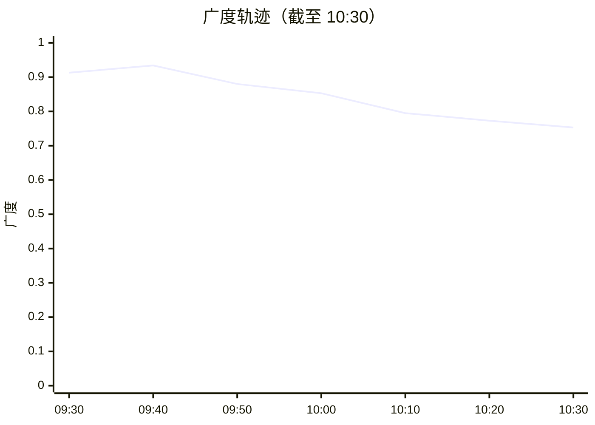

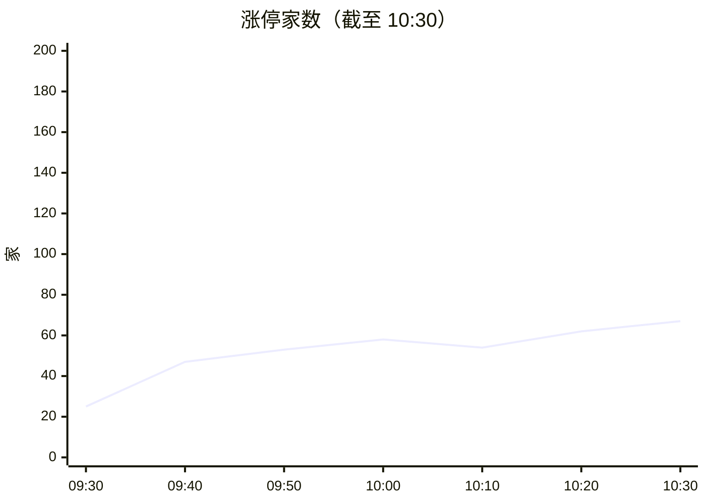


---
### 10:30 盯盘卡

**温度** 广度 **0.75**（-0.02） · 涨停 **67**（+5） · 炸板 **35** · 跌停 **4**（+0） · 成交 **8740.3 亿**（+574）
**判据** 广度>0.55 ✅ · 涨停≥60 ✅ · 昨涨停红盘率>60% ⏳未采 → **2/2 可证**

**连板梯队** 最高 **4** 板（中京电子 4板、金新农 3板、克来机电 3板）｜ 1板 34家 / 2板 27家 / 3板 5家 / 4板 1家
**主线（按行业涨停数）** 汽车配件 **10**家 均+2.68% ｜ 元器件 **6**家 均+3.03% ｜ 机械基件 **4**家 均+3.07% ｜ 塑料 **4**家 均+2.70% ｜ 专用机械 **3**家 均+2.37%
**板块分时** 半导体 +3.34% ｜ AI算力 +2.59% ｜ 商业航天 +2.35% ｜ 军工 +1.98% ｜ 光通信 +1.44% ｜ 白酒 +0.23% ｜ 医药 -0.79% ｜ 券商 -0.85%
**进攻位（距涨停≤3%）** 中马传动 +9.43%（差0.50%，汽车配件，量比2.5，换手3.6%） ｜ 星源卓镁 +19.38%（差0.51%，汽车配件，量比4.7，换手2.9%） ｜ ST交昂   +8.93%（差0.98%，医疗保健，量比2.0，换手1.2%） ｜ 德龙汇能 +8.46%（差1.44%，供气供热，量比9.9，换手5.2%） ｜ 宏英智能 +8.18%（差1.69%，电器仪表，量比4.0，换手4.3%）
**风险（炸板）** 黄山谷捷 高+20.01%→收+13.42% ｜ 鸿富诚 高+20.00%→收+10.82% ｜ 京蓝科技 高+10.12%→收+6.59% ｜ ST雪发 高+10.10%→收+7.45%
**资金（行业成交额）** 元器件 1146亿 ｜ 通信设备 864亿 ｜ 软件服务 399亿 ｜ 专用机械 396亿
**资金（个股成交额）** 中际旭创 181亿 ｜ 新易盛 163亿 ｜ 东山精密 90亿 ｜ 寒武纪   75亿 ｜ 长鑫科技 73亿
**新晋涨停（vs 上一条）** 7 家：四川长虹(家用电器)、阿尔特(汽车服务)、泰嘉股份(钢加工)、志特新材(建筑工程)、方正电机(纺织机械)、正泰电源(机械基件)、嘉环科技(通信设备)

**我的池子**

| 票 | 仓位 | 现价 | 触发 | 距触发 | 距止损 | 状态 | 现在做什么 |
|---|---|---|---|---|---|---|---|
| 新易盛 | — | 190.08 | —↑ | —% | 16.2% | 等触发 | 盯 — |
| 中际旭创 | — | 437.96 | —↑ | —% | 15.5% | 等触发 | 盯 — |
| 源杰科技 | — | 628.79 | —↑ | —% | 13.7% | 等触发 | 盯 — |
| 景旺电子 | — | 60.44 | —↑ | —% | 16.7% | 等触发 | 盯 — |

**观察池** 强：凡拓数创 +15.02%、浙文影业 +10.14%、中京电子 +9.98% ｜ 弱：洛阳钼业 -1.81%、东方财富 -1.77%

**结论** ⚪ 窗口已过 —— 今日不再开新仓，只做记录与止损管理
**下一档盯** 中际旭创 437.96 → —（需涨 0.00%） ｜ 新易盛 190.08 → —（需涨 0.00%） ｜ 景旺电子 60.44 → —（需涨 0.00%）

---
### 10:40 · 广度 0.80 ↑

| 指标 | 上轮 | 本轮 | Δ |
|---|---|---|---|
| 广度 | 0.753 | 0.798 | +0.045 |
| 涨停 | 67 | 74 | **+7** |
| 跌停 | 4 | 4 | +0 |
| 涨>3% | 1129 | 1468 | **+339** |
| 跌>3% | 36 | 29 | **-7** |
| 成交(亿) | 8,740 | 9,337 | +596 |

**钱在**：汽车配件 12封/+3.30% ｜ 元器件 7封/+3.33% ｜ 机械基件 4封/+3.64%
**异动**：凡拓数创 +18.12% · 浙文影业 +10.14%(涨停) · 中京电子 +9.98%(涨停) · 长川科技 +5.91% · 景旺电子 +5.57%
**结论**：广度 +0.04 横住｜涨停 +7 → 修复延续，板块内可做

<details><summary>预案池 24 只（点开）</summary>

| 票 | 池 | 现价 | 涨幅 | 状态 |
|---|---|---|---|---|
| 新易盛 `300502.SZ` | execution_pool | 188.88 | +4.15% | up |
| 中际旭创 `300308.SZ` | execution_pool | 437.50 | +4.87% | up |
| 源杰科技 `688498.SH` | execution_pool | 622.86 | +1.94% | up |
| 景旺电子 `603228.SH` | execution_pool | 60.05 | +5.57% | up |
| 沪电股份 `002463.SZ` | watch_pool | 85.68 | +3.60% | up |
| 深南电路 `002916.SZ` | watch_pool | 211.63 | +1.70% | up |
| 生益电子 `688183.SH` | watch_pool | 75.00 | +5.51% | up |
| 长川科技 `300604.SZ` | watch_pool | 188.42 | +5.91% | up |
| 中芯国际 `688981.SH` | watch_pool | 126.35 | +3.91% | up |
| 寒武纪 `688256.SH` | watch_pool | 959.00 | +4.83% | up |
| 剑桥科技 `603083.SH` | watch_pool | 102.54 | +2.54% | up |
| 宇树科技 `688836.SH` | watch_pool | 741.05 | +4.67% | up |
| 双环传动 `002472.SZ` | watch_pool | 39.67 | +2.32% | up |
| 凡拓数创 `301313.SZ` | watch_pool | 83.85 | +18.12% | up |
| 中京电子 `002579.SZ` | watch_pool | 16.20 | +9.98% | limit_up |
| 风华高科 `000636.SZ` | watch_pool | 29.27 | +0.97% | up |
| 龙版传媒 `605577.SH` | watch_pool | 18.78 | +5.45% | up |
| 浙文影业 `601599.SH` | watch_pool | 4.02 | +10.14% | limit_up |
| 有研新材 `600206.SH` | watch_pool | 40.51 | +1.28% | up |
| 瑞芯微 `603893.SH` | watch_pool | 211.45 | +4.22% | up |
| 北方华创 `002371.SZ` | watch_pool | 553.02 | +2.20% | up |
| 洛阳钼业 `603993.SH` | watch_pool | 11.95 | -1.57% | down |
| 中信证券 `600030.SH` | watch_pool | 25.12 | -0.55% | down |
| 东方财富 `300059.SZ` | watch_pool | 18.26 | -1.93% | down |

</details>

---
### 10:40 盯盘卡

**温度** 广度 **0.80**（+0.04） · 涨停 **74**（+7） · 炸板 **34** · 跌停 **4**（+0） · 成交 **9336.6 亿**（+596）
**判据** 广度>0.55 ✅ · 涨停≥60 ✅ · 昨涨停红盘率>60% ⏳未采 → **2/2 可证**

**连板梯队** 最高 **4** 板（中京电子 4板、长华集团 3板、金新农 3板）｜ 1板 39家 / 2板 29家 / 3板 5家 / 4板 1家
**主线（按行业涨停数）** 汽车配件 **12**家 均+3.30% ｜ 元器件 **7**家 均+3.33% ｜ 机械基件 **4**家 均+3.64% ｜ 塑料 **4**家 均+3.10% ｜ 电器仪表 **3**家 均+3.20%
**板块分时** 半导体 +3.59% ｜ 商业航天 +2.85% ｜ AI算力 +2.83% ｜ 军工 +2.20% ｜ 光通信 +1.68% ｜ 白酒 +0.23% ｜ 医药 -0.53% ｜ 券商 -0.85%
**进攻位（距涨停≤3%）** 双枪科技 +9.29%（差0.64%，家居用品，量比2.6，换手3.2%） ｜ 新泉股份 +9.23%（差0.70%，汽车配件，量比2.9，换手2.9%） ｜ 华友钴业 +9.17%（差0.77%，小金属，量比5.2，换手3.0%） ｜ 日盈电子 +9.11%（差0.81%，汽车配件，量比2.7，换手4.3%） ｜ 华东重机 +8.97%（差0.90%，机床制造，量比4.9，换手32.9%）
**风险（炸板）** 黄山谷捷 高+20.01%→收+12.91% ｜ 鸿富诚 高+20.00%→收+11.09% ｜ 凡拓数创 高+19.99%→收+18.12% ｜ 京蓝科技 高+10.12%→收+5.18%
**资金（行业成交额）** 元器件 1208亿 ｜ 通信设备 904亿 ｜ 专用机械 422亿 ｜ 软件服务 420亿
**资金（个股成交额）** 中际旭创 188亿 ｜ 新易盛 169亿 ｜ 东山精密 95亿 ｜ 寒武纪   79亿 ｜ 长鑫科技 77亿
**新晋涨停（vs 上一条）** 7 家：闽发铝业(铝)、首航新能(电气设备)、红豆股份(服饰)、中马传动(汽车配件)、星源卓镁(汽车配件)、振邦智能(元器件)、宏英智能(电器仪表)

**我的池子**

| 票 | 仓位 | 现价 | 触发 | 距触发 | 距止损 | 状态 | 现在做什么 |
|---|---|---|---|---|---|---|---|
| 新易盛 | — | 188.88 | —↑ | —% | 15.7% | 等触发 | 盯 — |
| 中际旭创 | — | 437.5 | —↑ | —% | 15.4% | 等触发 | 盯 — |
| 源杰科技 | — | 622.86 | —↑ | —% | 12.9% | 等触发 | 盯 — |
| 景旺电子 | — | 60.05 | —↑ | —% | 16.1% | 等触发 | 盯 — |

**观察池** 强：凡拓数创 +18.12%、浙文影业 +10.14%、中京电子 +9.98% ｜ 弱：东方财富 -1.93%、洛阳钼业 -1.57%

**结论** ⚪ 窗口已过 —— 今日不再开新仓，只做记录与止损管理
**下一档盯** 中际旭创 437.5 → —（需涨 0.00%） ｜ 新易盛 188.88 → —（需涨 0.00%） ｜ 景旺电子 60.05 → —（需涨 0.00%）

---
### 10:50 · 广度 0.80 ↑

| 指标 | 上轮 | 本轮 | Δ |
|---|---|---|---|
| 广度 | 0.798 | 0.798 | +0.000 |
| 涨停 | 74 | 80 | **+6** |
| 跌停 | 4 | 4 | +0 |
| 涨>3% | 1468 | 1470 | +2 |
| 跌>3% | 29 | 31 | +2 |
| 成交(亿) | 9,337 | 9,788 | +451 |

**钱在**：汽车配件 12封/+3.20% ｜ 元器件 6封/+3.36% ｜ 服饰 5封/+2.28%
**异动**：凡拓数创 +17.34% · 浙文影业 +10.14%(涨停) · 中京电子 +9.98%(涨停) · 长川科技 +6.48% · 生益电子 +5.26%
**结论**：广度 +0.00 横住｜涨停 +6 → 修复延续，板块内可做

<details><summary>预案池 24 只（点开）</summary>

| 票 | 池 | 现价 | 涨幅 | 状态 |
|---|---|---|---|---|
| 新易盛 `300502.SZ` | execution_pool | 187.20 | +3.22% | up |
| 中际旭创 `300308.SZ` | execution_pool | 435.50 | +4.39% | up |
| 源杰科技 `688498.SH` | execution_pool | 623.50 | +2.04% | up |
| 景旺电子 `603228.SH` | execution_pool | 59.60 | +4.78% | up |
| 沪电股份 `002463.SZ` | watch_pool | 85.97 | +3.95% | up |
| 深南电路 `002916.SZ` | watch_pool | 211.32 | +1.55% | up |
| 生益电子 `688183.SH` | watch_pool | 74.82 | +5.26% | up |
| 长川科技 `300604.SZ` | watch_pool | 189.44 | +6.48% | up |
| 中芯国际 `688981.SH` | watch_pool | 126.46 | +4.00% | up |
| 寒武纪 `688256.SH` | watch_pool | 960.66 | +5.01% | up |
| 剑桥科技 `603083.SH` | watch_pool | 102.29 | +2.29% | up |
| 宇树科技 `688836.SH` | watch_pool | 743.29 | +4.98% | up |
| 双环传动 `002472.SZ` | watch_pool | 39.58 | +2.09% | up |
| 凡拓数创 `301313.SZ` | watch_pool | 83.30 | +17.34% | up |
| 中京电子 `002579.SZ` | watch_pool | 16.20 | +9.98% | limit_up |
| 风华高科 `000636.SZ` | watch_pool | 29.14 | +0.52% | up |
| 龙版传媒 `605577.SH` | watch_pool | 18.62 | +4.55% | up |
| 浙文影业 `601599.SH` | watch_pool | 4.02 | +10.14% | limit_up |
| 有研新材 `600206.SH` | watch_pool | 40.70 | +1.75% | up |
| 瑞芯微 `603893.SH` | watch_pool | 212.46 | +4.72% | up |
| 北方华创 `002371.SZ` | watch_pool | 555.40 | +2.64% | up |
| 洛阳钼业 `603993.SH` | watch_pool | 11.89 | -2.06% | down |
| 中信证券 `600030.SH` | watch_pool | 25.10 | -0.63% | down |
| 东方财富 `300059.SZ` | watch_pool | 18.23 | -2.09% | down |

</details>

---
### 10:50 盯盘卡

**温度** 广度 **0.80**（+0.00） · 涨停 **80**（+6） · 炸板 **36** · 跌停 **4**（+0） · 成交 **9787.9 亿**（+451）
**判据** 广度>0.55 ✅ · 涨停≥60 ✅ · 昨涨停红盘率>60% ⏳未采 → **2/2 可证**

**连板梯队** 最高 **4** 板（中京电子 4板、克来机电 3板、长华集团 3板）｜ 1板 45家 / 2板 29家 / 3板 5家 / 4板 1家
**主线（按行业涨停数）** 汽车配件 **12**家 均+3.20% ｜ 元器件 **6**家 均+3.36% ｜ 服饰 **5**家 均+2.28% ｜ 机械基件 **4**家 均+3.62% ｜ 塑料 **4**家 均+3.05%
**板块分时** 半导体 +3.71% ｜ 商业航天 +3.09% ｜ AI算力 +2.67% ｜ 军工 +2.42% ｜ 光通信 +1.68% ｜ 白酒 +0.23% ｜ 医药 -0.26% ｜ 券商 -1.06%
**进攻位（距涨停≤3%）** ST交昂   +9.29%（差0.65%，医疗保健，量比1.6，换手1.2%） ｜ 新泉股份 +9.06%（差0.86%，汽车配件，量比2.6，换手3.0%） ｜ 华东重机 +8.72%（差1.13%，机床制造，量比4.4，换手34.3%） ｜ 千味央厨 +8.73%（差1.17%，食品，量比3.7，换手3.0%） ｜ 来伊份   +8.45%（差1.39%，食品，量比2.2，换手2.3%）
**风险（炸板）** 首航新能 高+20.02%→收+15.03% ｜ 黄山谷捷 高+20.01%→收+12.50% ｜ 凡拓数创 高+20.00%→收+17.34% ｜ 鸿富诚 高+20.00%→收+11.47%
**资金（行业成交额）** 元器件 1260亿 ｜ 软件服务 439亿 ｜ 汽车配件 325亿 ｜ 机械基件 204亿
**资金（个股成交额）** 中际旭创 194亿 ｜ 新易盛 177亿 ｜ 东山精密 99亿 ｜ 寒武纪   81亿 ｜ 长鑫科技 78亿
**新晋涨停（vs 上一条）** 7 家：值得买(互联网)、遥望科技(广告包装)、天创股份(服饰)、新炬网络(软件服务)、凯迪股份(电气设备)、环球印务(广告包装)、双枪科技(家居用品)

**我的池子**

| 票 | 仓位 | 现价 | 触发 | 距触发 | 距止损 | 状态 | 现在做什么 |
|---|---|---|---|---|---|---|---|
| 新易盛 | — | 187.2 | —↑ | —% | 15.0% | 等触发 | 盯 — |
| 中际旭创 | — | 435.5 | —↑ | —% | 15.0% | 等触发 | 盯 — |
| 源杰科技 | — | 623.5 | —↑ | —% | 13.0% | 等触发 | 盯 — |
| 景旺电子 | — | 59.6 | —↑ | —% | 15.5% | 等触发 | 盯 — |

**观察池** 强：凡拓数创 +17.34%、浙文影业 +10.14%、中京电子 +9.98% ｜ 弱：东方财富 -2.09%、洛阳钼业 -2.06%

**结论** ⚪ 窗口已过 —— 今日不再开新仓，只做记录与止损管理
**下一档盯** 中际旭创 435.5 → —（需涨 0.00%） ｜ 新易盛 187.2 → —（需涨 0.00%） ｜ 景旺电子 59.6 → —（需涨 0.00%）

---
### 11:00 · 广度 0.73 ↓

| 指标 | 上轮 | 本轮 | Δ |
|---|---|---|---|
| 广度 | 0.798 | 0.728 | **-0.070** |
| 涨停 | 80 | 79 | -1 |
| 跌停 | 4 | 4 | +0 |
| 涨>3% | 1470 | 1195 | **-275** |
| 跌>3% | 31 | 38 | **+7** |
| 成交(亿) | 9,788 | 10,155 | +367 |

**钱在**：汽车配件 12封/+2.74% ｜ 元器件 6封/+2.98% ｜ 机械基件 4封/+3.06%
**异动**：凡拓数创 +16.81% · 浙文影业 +10.14%(涨停) · 中京电子 +9.98%(涨停) · 龙版传媒 +6.91% · 长川科技 +5.62%
**结论**：广度 -0.07 横住｜涨停 -1 → 分歧，只做板块首板不接力

<details><summary>预案池 24 只（点开）</summary>

| 票 | 池 | 现价 | 涨幅 | 状态 |
|---|---|---|---|---|
| 新易盛 `300502.SZ` | execution_pool | 188.10 | +3.72% | up |
| 中际旭创 `300308.SZ` | execution_pool | 434.89 | +4.24% | up |
| 源杰科技 `688498.SH` | execution_pool | 623.37 | +2.02% | up |
| 景旺电子 `603228.SH` | execution_pool | 59.60 | +4.78% | up |
| 沪电股份 `002463.SZ` | watch_pool | 86.17 | +4.20% | up |
| 深南电路 `002916.SZ` | watch_pool | 211.86 | +1.81% | up |
| 生益电子 `688183.SH` | watch_pool | 74.78 | +5.21% | up |
| 长川科技 `300604.SZ` | watch_pool | 187.91 | +5.62% | up |
| 中芯国际 `688981.SH` | watch_pool | 125.83 | +3.48% | up |
| 寒武纪 `688256.SH` | watch_pool | 954.50 | +4.34% | up |
| 剑桥科技 `603083.SH` | watch_pool | 102.44 | +2.44% | up |
| 宇树科技 `688836.SH` | watch_pool | 739.96 | +4.51% | up |
| 双环传动 `002472.SZ` | watch_pool | 39.41 | +1.65% | up |
| 凡拓数创 `301313.SZ` | watch_pool | 82.92 | +16.81% | up |
| 中京电子 `002579.SZ` | watch_pool | 16.20 | +9.98% | limit_up |
| 风华高科 `000636.SZ` | watch_pool | 28.97 | -0.07% | down |
| 龙版传媒 `605577.SH` | watch_pool | 19.04 | +6.91% | up |
| 浙文影业 `601599.SH` | watch_pool | 4.02 | +10.14% | limit_up |
| 有研新材 `600206.SH` | watch_pool | 40.46 | +1.15% | up |
| 瑞芯微 `603893.SH` | watch_pool | 211.72 | +4.36% | up |
| 北方华创 `002371.SZ` | watch_pool | 550.81 | +1.80% | up |
| 洛阳钼业 `603993.SH` | watch_pool | 11.90 | -1.98% | down |
| 中信证券 `600030.SH` | watch_pool | 25.10 | -0.63% | down |
| 东方财富 `300059.SZ` | watch_pool | 18.23 | -2.09% | down |

</details>

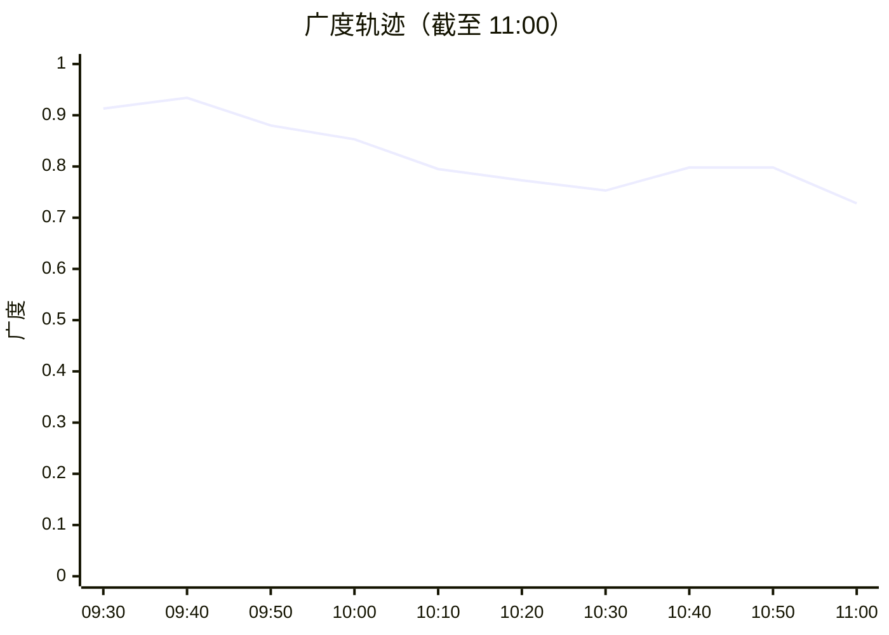

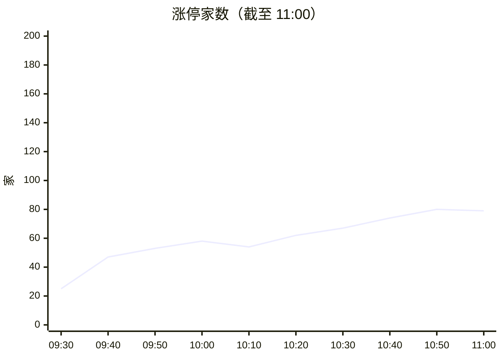


---
### 11:00 盯盘卡

**温度** 广度 **0.73**（-0.07） · 涨停 **79**（-1） · 炸板 **39** · 跌停 **4**（+0） · 成交 **10155.3 亿**（+367）
**判据** 广度>0.55 ✅ · 涨停≥60 ✅ · 昨涨停红盘率>60% ⏳未采 → **2/2 可证**

**连板梯队** 最高 **4** 板（中京电子 4板、克来机电 3板、东晶电子 3板）｜ 1板 45家 / 2板 28家 / 3板 5家 / 4板 1家
**主线（按行业涨停数）** 汽车配件 **12**家 均+2.74% ｜ 元器件 **6**家 均+2.98% ｜ 机械基件 **4**家 均+3.06% ｜ 塑料 **4**家 均+2.60% ｜ 软件服务 **4**家 均+2.20%
**板块分时** 半导体 +3.09% ｜ 商业航天 +2.72% ｜ AI算力 +2.52% ｜ 军工 +2.20% ｜ 光通信 +1.44% ｜ 白酒 +0.23% ｜ 医药 -0.79% ｜ 券商 -0.85%
**进攻位（距涨停≤3%）** 日盈电子 +8.89%（差1.01%，汽车配件，量比2.2，换手4.7%） ｜ ST交昂   +8.75%（差1.15%，医疗保健，量比1.5，换手1.3%） ｜ 新泉股份 +8.63%（差1.26%，汽车配件，量比2.4，换手3.1%） ｜ 鸣志电器 +8.49%（差1.39%，电气设备，量比2.6，换手2.1%） ｜ 易明医药 +8.18%（差1.72%，化学制药，量比4.0，换手2.3%）
**风险（炸板）** 首航新能 高+20.02%→收+13.09% ｜ 黄山谷捷 高+20.01%→收+11.59% ｜ 凡拓数创 高+20.00%→收+16.81% ｜ 鸿富诚 高+20.00%→收+10.71%
**资金（行业成交额）** 元器件 1301亿 ｜ 通信设备 968亿 ｜ 软件服务 454亿 ｜ 汽车配件 336亿
**资金（个股成交额）** 中际旭创 200亿 ｜ 新易盛 182亿 ｜ 东山精密 102亿 ｜ 寒武纪   83亿 ｜ 长鑫科技 80亿
**新晋涨停（vs 上一条）** 1 家：天安新材(塑料)

**我的池子**

| 票 | 仓位 | 现价 | 触发 | 距触发 | 距止损 | 状态 | 现在做什么 |
|---|---|---|---|---|---|---|---|
| 新易盛 | — | 188.1 | —↑ | —% | 15.4% | 等触发 | 盯 — |
| 中际旭创 | — | 434.89 | —↑ | —% | 14.9% | 等触发 | 盯 — |
| 源杰科技 | — | 623.37 | —↑ | —% | 13.0% | 等触发 | 盯 — |
| 景旺电子 | — | 59.6 | —↑ | —% | 15.5% | 等触发 | 盯 — |

**观察池** 强：凡拓数创 +16.81%、浙文影业 +10.14%、中京电子 +9.98% ｜ 弱：东方财富 -2.09%、洛阳钼业 -1.98%

**结论** ⚪ 窗口已过 —— 今日不再开新仓，只做记录与止损管理
**下一档盯** 中际旭创 434.89 → —（需涨 0.00%） ｜ 新易盛 188.1 → —（需涨 0.00%） ｜ 景旺电子 59.6 → —（需涨 0.00%）

---
### 11:05 盘中总结（11:00 快照 vs 10:50）

① 广度单档急降 0.800→0.730（-0.070），上涨 4460→4068、下跌 972→1306，为今日最低（09:40 高点 0.936 起一路下滑）；涨停 80→79 首次掉头，炸板 36→39、跌停 4→4；成交 9787.9→10155.3 亿（+367 亿），但涨幅 >5% 家数 553→440（-20.4%）——放量滞涨，是高位分歧不是增量进场。炸板率盘中口径 33.05%（1050 为 31.03%），连抬两档、仍压在预案 25% 红线上方。
② 预案池：执行池 4 只全红但全在买区之外——新易盛 188.10 +3.72%（较 1050 +0.50）、中际旭创 434.89 +4.24%（-0.15）、源杰 623.37 +2.02%（-0.02）、景旺电子 59.60 +4.78%（持平），现价高各票买区上沿 3.4%~6.5%。观察池边际转弱：长川科技 6.48%→5.62%、寒武纪 5.01%→4.34%、中芯国际 4.00%→3.48%、北方华创 2.64%→1.80%，生益/宇树/双环/有研同步回落，凡拓数创 +16.81%（-0.53）高位腾挪；逆势走强只有龙版传媒 4.55%→6.91%（+2.36pp）、沪电股份 +4.20%；中京电子 4 板、浙文影业涨停均未开板；风华高科 0.52%→-0.07% 翻绿。
③ 与预案对照：预案 decision_status=conditional_only、风格 mainline_right_side_with_trend_pullback，要的是「回踩承接才进」，4 张条件单触发价均低于昨收约 3%。早盘窗口 09:35-10:30 已过、全天一档未触达 → 空仓是预案的执行结果，不是错过。午后 13:15-14:00 第二窗口的前置条件是「广度自 <0.35 快速翻上 0.55 且涨停倍增」，今日广度最低 0.730，该前提结构上不可能成立，等于午后无窗口。反过来看广度 0.73>0.55、涨停 79≥60，右侧 2/2 判据依然成立——方向没坏，只是没有合规买点。
④ 一句话结论：上午是「指数不跌、赚钱变难」的放量分歧，预案唯一许可的买点（回踩）一次没开，继续空仓不追；午后只剩一个动手理由——价格主动回到买区（新易盛 174.27-176.90、中际旭创 405.27-411.38、源杰科技 593.96-602.91、景旺电子 55.13-55.96），否则 11:30 收摊、等 13:15 重新定价。

---
### 11:10 · 广度 0.66 ↓

| 指标 | 上轮 | 本轮 | Δ |
|---|---|---|---|
| 广度 | 0.728 | 0.661 | **-0.067** |
| 涨停 | 79 | 72 | **-7** |
| 跌停 | 4 | 4 | +0 |
| 涨>3% | 1195 | 953 | **-242** |
| 跌>3% | 38 | 57 | **+19** |
| 成交(亿) | 10,155 | 10,553 | +398 |

**钱在**：汽车配件 13封/+2.42% ｜ 元器件 5封/+2.54% ｜ 机械基件 4封/+2.76%
**异动**：凡拓数创 +17.44% · 浙文影业 +10.14%(涨停) · 中京电子 +9.98%(涨停) · 龙版传媒 +6.12% · 长川科技 +5.71%
**结论**：广度 -0.07 横住｜涨停 -7 → 分歧，只做板块首板不接力

<details><summary>预案池 24 只（点开）</summary>

| 票 | 池 | 现价 | 涨幅 | 状态 |
|---|---|---|---|---|
| 新易盛 `300502.SZ` | execution_pool | 187.05 | +3.14% | up |
| 中际旭创 `300308.SZ` | execution_pool | 432.71 | +3.72% | up |
| 源杰科技 `688498.SH` | execution_pool | 620.87 | +1.61% | up |
| 景旺电子 `603228.SH` | execution_pool | 59.10 | +3.90% | up |
| 沪电股份 `002463.SZ` | watch_pool | 85.64 | +3.56% | up |
| 深南电路 `002916.SZ` | watch_pool | 210.63 | +1.22% | up |
| 生益电子 `688183.SH` | watch_pool | 74.69 | +5.08% | up |
| 长川科技 `300604.SZ` | watch_pool | 188.06 | +5.71% | up |
| 中芯国际 `688981.SH` | watch_pool | 125.53 | +3.23% | up |
| 寒武纪 `688256.SH` | watch_pool | 954.40 | +4.33% | up |
| 剑桥科技 `603083.SH` | watch_pool | 101.61 | +1.61% | up |
| 宇树科技 `688836.SH` | watch_pool | 744.48 | +5.15% | up |
| 双环传动 `002472.SZ` | watch_pool | 39.41 | +1.65% | up |
| 凡拓数创 `301313.SZ` | watch_pool | 83.37 | +17.44% | up |
| 中京电子 `002579.SZ` | watch_pool | 16.20 | +9.98% | limit_up |
| 风华高科 `000636.SZ` | watch_pool | 28.90 | -0.31% | down |
| 龙版传媒 `605577.SH` | watch_pool | 18.90 | +6.12% | up |
| 浙文影业 `601599.SH` | watch_pool | 4.02 | +10.14% | limit_up |
| 有研新材 `600206.SH` | watch_pool | 40.09 | +0.23% | up |
| 瑞芯微 `603893.SH` | watch_pool | 211.99 | +4.49% | up |
| 北方华创 `002371.SZ` | watch_pool | 547.21 | +1.13% | up |
| 洛阳钼业 `603993.SH` | watch_pool | 11.86 | -2.31% | down |
| 中信证券 `600030.SH` | watch_pool | 25.07 | -0.75% | down |
| 东方财富 `300059.SZ` | watch_pool | 18.24 | -2.04% | down |

</details>

---
### 11:10 盯盘卡

**温度** 广度 **0.66**（-0.07） · 涨停 **72**（-7） · 炸板 **47** · 跌停 **4**（+0） · 成交 **10553.3 亿**（+398）
**判据** 广度>0.55 ✅ · 涨停≥60 ✅ · 昨涨停红盘率>60% ⏳未采 → **2/2 可证**

**连板梯队** 最高 **4** 板（中京电子 4板、东晶电子 3板、长华集团 3板）｜ 1板 39家 / 2板 28家 / 3板 4家 / 4板 1家
**主线（按行业涨停数）** 汽车配件 **13**家 均+2.42% ｜ 元器件 **5**家 均+2.54% ｜ 机械基件 **4**家 均+2.76% ｜ 服饰 **4**家 均+1.54% ｜ 塑料 **3**家 均+2.20%
**板块分时** 半导体 +2.85% ｜ AI算力 +2.36% ｜ 商业航天 +2.23% ｜ 军工 +1.87% ｜ 光通信 +1.04% ｜ 白酒 +0.00% ｜ 医药 -0.79% ｜ 券商 -0.85%
**进攻位（距涨停≤3%）** 宏英智能 +9.71%（差0.28%，电器仪表，量比3.2，换手5.9%） ｜ 工业富联 +9.32%（差0.62%，通信设备，量比3.2，换手0.8%） ｜ ST交昂   +9.29%（差0.65%，医疗保健，量比1.4，换手1.3%） ｜ 东方海洋 +8.96%（差0.89%，渔业，量比2.1，换手26.9%） ｜ 新泉股份 +8.94%（差0.97%，汽车配件，量比2.2，换手3.2%）
**风险（炸板）** 首航新能 高+20.02%→收+12.59% ｜ 慧博云通 高+20.01%→收+17.13% ｜ 黄山谷捷 高+20.01%→收+11.25% ｜ 凡拓数创 高+20.00%→收+17.44%
**资金（行业成交额）** 元器件 1346亿 ｜ 软件服务 470亿 ｜ 汽车配件 347亿 ｜ 机械基件 217亿
**资金（个股成交额）** 中际旭创 205亿 ｜ 新易盛 185亿 ｜ 东山精密 105亿 ｜ 寒武纪   85亿 ｜ 长鑫科技 83亿
**新晋涨停（vs 上一条）** 7 家：日盈电子(汽车配件)、瑞玛精密(汽车配件)、原尚股份(公路)、起帆电缆(电气设备)、纵横通信(通信设备)、天圣制药(医药商业)、长华集团(汽车配件)

**我的池子**

| 票 | 仓位 | 现价 | 触发 | 距触发 | 距止损 | 状态 | 现在做什么 |
|---|---|---|---|---|---|---|---|
| 新易盛 | — | 187.05 | —↑ | —% | 14.9% | 等触发 | 盯 — |
| 中际旭创 | — | 432.71 | —↑ | —% | 14.4% | 等触发 | 盯 — |
| 源杰科技 | — | 620.87 | —↑ | —% | 12.6% | 等触发 | 盯 — |
| 景旺电子 | — | 59.1 | —↑ | —% | 14.8% | 等触发 | 盯 — |

**观察池** 强：凡拓数创 +17.44%、浙文影业 +10.14%、中京电子 +9.98% ｜ 弱：洛阳钼业 -2.31%、东方财富 -2.04%

**结论** ⚪ 窗口已过 —— 今日不再开新仓，只做记录与止损管理
**下一档盯** 中际旭创 432.71 → —（需涨 0.00%） ｜ 新易盛 187.05 → —（需涨 0.00%） ｜ 景旺电子 59.1 → —（需涨 0.00%）

---
### 11:20 · 广度 0.59 ↓

| 指标 | 上轮 | 本轮 | Δ |
|---|---|---|---|
| 广度 | 0.661 | 0.592 | **-0.069** |
| 涨停 | 72 | 69 | -3 |
| 跌停 | 4 | 5 | +1 |
| 涨>3% | 953 | 795 | **-158** |
| 跌>3% | 57 | 72 | **+15** |
| 成交(亿) | 10,553 | 10,929 | +376 |

**钱在**：汽车配件 12封/+2.09% ｜ 元器件 5封/+2.23% ｜ 机械基件 4封/+2.44%
**异动**：凡拓数创 +17.19% · 浙文影业 +10.14%(涨停) · 中京电子 +9.98%(涨停) · 龙版传媒 +5.78% · 生益电子 +5.23%
**结论**：广度 -0.07 横住｜涨停 -3 → 分歧，只做板块首板不接力

<details><summary>预案池 24 只（点开）</summary>

| 票 | 池 | 现价 | 涨幅 | 状态 |
|---|---|---|---|---|
| 新易盛 `300502.SZ` | execution_pool | 187.21 | +3.23% | up |
| 中际旭创 `300308.SZ` | execution_pool | 431.27 | +3.37% | up |
| 源杰科技 `688498.SH` | execution_pool | 620.99 | +1.63% | up |
| 景旺电子 `603228.SH` | execution_pool | 59.08 | +3.87% | up |
| 沪电股份 `002463.SZ` | watch_pool | 85.50 | +3.39% | up |
| 深南电路 `002916.SZ` | watch_pool | 210.25 | +1.03% | up |
| 生益电子 `688183.SH` | watch_pool | 74.80 | +5.23% | up |
| 长川科技 `300604.SZ` | watch_pool | 186.95 | +5.08% | up |
| 中芯国际 `688981.SH` | watch_pool | 126.36 | +3.91% | up |
| 寒武纪 `688256.SH` | watch_pool | 954.52 | +4.34% | up |
| 剑桥科技 `603083.SH` | watch_pool | 101.71 | +1.71% | up |
| 宇树科技 `688836.SH` | watch_pool | 740.38 | +4.57% | up |
| 双环传动 `002472.SZ` | watch_pool | 39.34 | +1.47% | up |
| 凡拓数创 `301313.SZ` | watch_pool | 83.19 | +17.19% | up |
| 中京电子 `002579.SZ` | watch_pool | 16.20 | +9.98% | limit_up |
| 风华高科 `000636.SZ` | watch_pool | 28.96 | -0.10% | down |
| 龙版传媒 `605577.SH` | watch_pool | 18.84 | +5.78% | up |
| 浙文影业 `601599.SH` | watch_pool | 4.02 | +10.14% | limit_up |
| 有研新材 `600206.SH` | watch_pool | 39.91 | -0.23% | down |
| 瑞芯微 `603893.SH` | watch_pool | 211.04 | +4.02% | up |
| 北方华创 `002371.SZ` | watch_pool | 544.12 | +0.56% | up |
| 洛阳钼业 `603993.SH` | watch_pool | 11.90 | -1.98% | down |
| 中信证券 `600030.SH` | watch_pool | 25.08 | -0.71% | down |
| 东方财富 `300059.SZ` | watch_pool | 18.22 | -2.15% | down |

</details>

---
### 11:20 盯盘卡

**温度** 广度 **0.59**（-0.07） · 涨停 **69**（-3） · 炸板 **50** · 跌停 **5**（+1） · 成交 **10928.8 亿**（+376）
**判据** 广度>0.55 ✅ · 涨停≥60 ✅ · 昨涨停红盘率>60% ⏳未采 → **2/2 可证**

**连板梯队** 最高 **4** 板（中京电子 4板、克来机电 3板、东晶电子 3板）｜ 1板 35家 / 2板 28家 / 3板 5家 / 4板 1家
**主线（按行业涨停数）** 汽车配件 **12**家 均+2.09% ｜ 元器件 **5**家 均+2.23% ｜ 机械基件 **4**家 均+2.44% ｜ 服饰 **4**家 均+1.19% ｜ 塑料 **3**家 均+1.86%
**板块分时** 半导体 +2.72% ｜ AI算力 +2.20% ｜ 商业航天 +1.98% ｜ 军工 +1.76% ｜ 光通信 +0.88% ｜ 白酒 -0.23% ｜ 医药 -0.53% ｜ 券商 -1.06%
**进攻位（距涨停≤3%）** 工业富联 +9.35%（差0.60%，通信设备，量比3.2，换手0.9%） ｜ 新泉股份 +9.13%（差0.79%，汽车配件，量比2.1，换手3.3%） ｜ ST交昂   +8.93%（差0.98%，医疗保健，量比1.2，换手1.3%） ｜ 宏英智能 +8.79%（差1.12%，电器仪表，量比3.4，换手6.8%） ｜ 鸣志电器 +8.37%（差1.51%，电气设备，量比2.2，换手2.1%）
**风险（炸板）** 首航新能 高+20.02%→收+11.65% ｜ 慧博云通 高+20.01%→收+14.03% ｜ 黄山谷捷 高+20.01%→收+10.63% ｜ 值得买 高+20.01%→收+14.06%
**资金（行业成交额）** 元器件 1384亿 ｜ 软件服务 486亿 ｜ 汽车配件 358亿 ｜ 机械基件 224亿
**资金（个股成交额）** 中际旭创 211亿 ｜ 新易盛 187亿 ｜ 东山精密 108亿 ｜ 寒武纪   87亿 ｜ 长鑫科技 85亿
**新晋涨停（vs 上一条）** 3 家：东方海洋(渔业)、威派格  (专用机械)、宁波东力(机械基件)

**我的池子**

| 票 | 仓位 | 现价 | 触发 | 距触发 | 距止损 | 状态 | 现在做什么 |
|---|---|---|---|---|---|---|---|
| 新易盛 | — | 187.21 | —↑ | —% | 15.0% | 等触发 | 盯 — |
| 中际旭创 | — | 431.27 | —↑ | —% | 14.1% | 等触发 | 盯 — |
| 源杰科技 | — | 620.99 | —↑ | —% | 12.6% | 等触发 | 盯 — |
| 景旺电子 | — | 59.08 | —↑ | —% | 14.7% | 等触发 | 盯 — |

**观察池** 强：凡拓数创 +17.19%、浙文影业 +10.14%、中京电子 +9.98% ｜ 弱：东方财富 -2.15%、洛阳钼业 -1.98%

**结论** ⚪ 窗口已过 —— 今日不再开新仓，只做记录与止损管理
**下一档盯** 中际旭创 431.27 → —（需涨 0.00%） ｜ 新易盛 187.21 → —（需涨 0.00%） ｜ 景旺电子 59.08 → —（需涨 0.00%）

---
### 11:30 · 广度 0.56 ↓

| 指标 | 上轮 | 本轮 | Δ |
|---|---|---|---|
| 广度 | 0.592 | 0.559 | -0.033 |
| 涨停 | 69 | 67 | -2 |
| 跌停 | 5 | 5 | +0 |
| 涨>3% | 795 | 762 | **-33** |
| 跌>3% | 72 | 79 | **+7** |
| 成交(亿) | 10,929 | 11,302 | +373 |

**钱在**：汽车配件 12封/+1.93% ｜ 元器件 5封/+1.97% ｜ 机械基件 4封/+2.28%
**异动**：凡拓数创 +17.75% · 浙文影业 +10.14%(涨停) · 中京电子 +9.98%(涨停) · 龙版传媒 +5.78% · 宇树科技 +5.37%
**结论**：广度 -0.03 横住｜涨停 -2 → 分歧，只做板块首板不接力

<details><summary>预案池 24 只（点开）</summary>

| 票 | 池 | 现价 | 涨幅 | 状态 |
|---|---|---|---|---|
| 新易盛 `300502.SZ` | execution_pool | 187.75 | +3.52% | up |
| 中际旭创 `300308.SZ` | execution_pool | 434.80 | +4.22% | up |
| 源杰科技 `688498.SH` | execution_pool | 620.89 | +1.61% | up |
| 景旺电子 `603228.SH` | execution_pool | 59.09 | +3.89% | up |
| 沪电股份 `002463.SZ` | watch_pool | 85.01 | +2.79% | up |
| 深南电路 `002916.SZ` | watch_pool | 209.59 | +0.72% | up |
| 生益电子 `688183.SH` | watch_pool | 74.30 | +4.53% | up |
| 长川科技 `300604.SZ` | watch_pool | 186.09 | +4.60% | up |
| 中芯国际 `688981.SH` | watch_pool | 126.38 | +3.93% | up |
| 寒武纪 `688256.SH` | watch_pool | 955.45 | +4.44% | up |
| 剑桥科技 `603083.SH` | watch_pool | 101.89 | +1.89% | up |
| 宇树科技 `688836.SH` | watch_pool | 745.99 | +5.37% | up |
| 双环传动 `002472.SZ` | watch_pool | 39.20 | +1.11% | up |
| 凡拓数创 `301313.SZ` | watch_pool | 83.59 | +17.75% | up |
| 中京电子 `002579.SZ` | watch_pool | 16.20 | +9.98% | limit_up |
| 风华高科 `000636.SZ` | watch_pool | 28.89 | -0.34% | down |
| 龙版传媒 `605577.SH` | watch_pool | 18.84 | +5.78% | up |
| 浙文影业 `601599.SH` | watch_pool | 4.02 | +10.14% | limit_up |
| 有研新材 `600206.SH` | watch_pool | 40.19 | +0.48% | up |
| 瑞芯微 `603893.SH` | watch_pool | 211.60 | +4.30% | up |
| 北方华创 `002371.SZ` | watch_pool | 543.80 | +0.50% | up |
| 洛阳钼业 `603993.SH` | watch_pool | 11.88 | -2.14% | down |
| 中信证券 `600030.SH` | watch_pool | 25.16 | -0.40% | down |
| 东方财富 `300059.SZ` | watch_pool | 18.23 | -2.09% | down |

</details>

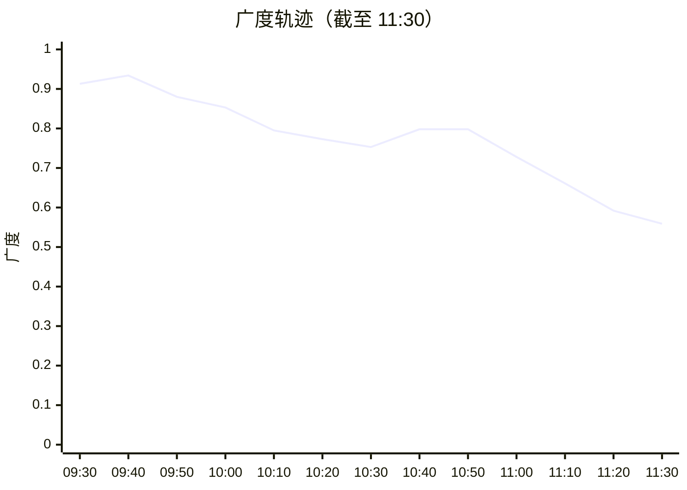


---
### 11:30 盯盘卡

**温度** 广度 **0.56**（-0.03） · 涨停 **67**（-2） · 炸板 **52** · 跌停 **5**（+0） · 成交 **11302.0 亿**（+373）
**判据** 广度>0.55 ✅ · 涨停≥60 ✅ · 昨涨停红盘率>60% ⏳未采 → **2/2 可证**

**连板梯队** 最高 **4** 板（中京电子 4板、长华集团 3板、东方海洋 3板）｜ 1板 33家 / 2板 28家 / 3板 5家 / 4板 1家
**主线（按行业涨停数）** 汽车配件 **12**家 均+1.93% ｜ 元器件 **5**家 均+1.97% ｜ 机械基件 **4**家 均+2.28% ｜ 服饰 **4**家 均+1.11% ｜ 塑料 **3**家 均+1.77%
**板块分时** 半导体 +2.72% ｜ AI算力 +2.36% ｜ 商业航天 +1.98% ｜ 军工 +1.76% ｜ 光通信 +0.88% ｜ 白酒 -0.23% ｜ 医药 -0.53% ｜ 券商 -1.06%
**进攻位（距涨停≤3%）** 工业富联 +9.14%（差0.79%，通信设备，量比3.1，换手1.0%） ｜ 鹿山新材 +9.14%（差0.79%，塑料，量比1.9，换手5.3%） ｜ 宏英智能 +8.86%（差1.06%，电器仪表，量比3.3，换手7.2%） ｜ 新泉股份 +8.72%（差1.17%，汽车配件，量比1.9，换手3.3%） ｜ 龙旗科技 +8.58%（差1.31%，通信设备，量比2.2，换手5.2%）
**风险（炸板）** 首航新能 高+20.02%→收+10.98% ｜ 慧博云通 高+20.01%→收+13.81% ｜ 黄山谷捷 高+20.01%→收+9.64% ｜ 值得买 高+20.01%→收+14.25%
**资金（行业成交额）** 元器件 1421亿 ｜ 软件服务 498亿 ｜ 汽车配件 367亿 ｜ 机械基件 230亿
**资金（个股成交额）** 中际旭创 215亿 ｜ 新易盛 191亿 ｜ 东山精密 110亿 ｜ 寒武纪   89亿 ｜ 长鑫科技 88亿
**新晋涨停（vs 上一条）** 2 家：汇洲智能(机床制造)、联创电子(元器件)

**我的池子**

| 票 | 仓位 | 现价 | 触发 | 距触发 | 距止损 | 状态 | 现在做什么 |
|---|---|---|---|---|---|---|---|
| 新易盛 | — | 187.75 | —↑ | —% | 15.2% | 等触发 | 盯 — |
| 中际旭创 | — | 434.8 | —↑ | —% | 14.8% | 等触发 | 盯 — |
| 源杰科技 | — | 620.89 | —↑ | —% | 12.6% | 等触发 | 盯 — |
| 景旺电子 | — | 59.09 | —↑ | —% | 14.8% | 等触发 | 盯 — |

**观察池** 强：凡拓数创 +17.75%、浙文影业 +10.14%、中京电子 +9.98% ｜ 弱：洛阳钼业 -2.14%、东方财富 -2.09%

**结论** ⚪ 窗口已过 —— 今日不再开新仓，只做记录与止损管理
**下一档盯** 中际旭创 434.8 → —（需涨 0.00%） ｜ 新易盛 187.75 → —（需涨 0.00%） ｜ 景旺电子 59.09 → —（需涨 0.00%）

---
### 11:40 · 广度 0.56 →

| 指标 | 上轮 | 本轮 | Δ |
|---|---|---|---|
| 广度 | 0.559 | 0.559 | +0.000 |
| 涨停 | 67 | 67 | +0 |
| 跌停 | 5 | 5 | +0 |
| 涨>3% | 762 | 762 | +0 |
| 跌>3% | 79 | 79 | +0 |
| 成交(亿) | 11,302 | 11,302 | +0 |

**钱在**：汽车配件 12封/+1.93% ｜ 元器件 5封/+1.97% ｜ 机械基件 4封/+2.28%
**异动**：凡拓数创 +17.75% · 浙文影业 +10.14%(涨停) · 中京电子 +9.98%(涨停) · 龙版传媒 +5.78% · 宇树科技 +5.37%
**结论**：广度 +0.00 横住｜涨停 +0 → 修复延续，板块内可做

<details><summary>预案池 24 只（点开）</summary>

| 票 | 池 | 现价 | 涨幅 | 状态 |
|---|---|---|---|---|
| 新易盛 `300502.SZ` | execution_pool | 187.75 | +3.52% | up |
| 中际旭创 `300308.SZ` | execution_pool | 434.80 | +4.22% | up |
| 源杰科技 `688498.SH` | execution_pool | 620.89 | +1.61% | up |
| 景旺电子 `603228.SH` | execution_pool | 59.09 | +3.89% | up |
| 沪电股份 `002463.SZ` | watch_pool | 85.01 | +2.79% | up |
| 深南电路 `002916.SZ` | watch_pool | 209.59 | +0.72% | up |
| 生益电子 `688183.SH` | watch_pool | 74.30 | +4.53% | up |
| 长川科技 `300604.SZ` | watch_pool | 186.09 | +4.60% | up |
| 中芯国际 `688981.SH` | watch_pool | 126.38 | +3.93% | up |
| 寒武纪 `688256.SH` | watch_pool | 955.45 | +4.44% | up |
| 剑桥科技 `603083.SH` | watch_pool | 101.89 | +1.89% | up |
| 宇树科技 `688836.SH` | watch_pool | 745.99 | +5.37% | up |
| 双环传动 `002472.SZ` | watch_pool | 39.20 | +1.11% | up |
| 凡拓数创 `301313.SZ` | watch_pool | 83.59 | +17.75% | up |
| 中京电子 `002579.SZ` | watch_pool | 16.20 | +9.98% | limit_up |
| 风华高科 `000636.SZ` | watch_pool | 28.89 | -0.34% | down |
| 龙版传媒 `605577.SH` | watch_pool | 18.84 | +5.78% | up |
| 浙文影业 `601599.SH` | watch_pool | 4.02 | +10.14% | limit_up |
| 有研新材 `600206.SH` | watch_pool | 40.19 | +0.48% | up |
| 瑞芯微 `603893.SH` | watch_pool | 211.60 | +4.30% | up |
| 北方华创 `002371.SZ` | watch_pool | 543.80 | +0.50% | up |
| 洛阳钼业 `603993.SH` | watch_pool | 11.88 | -2.14% | down |
| 中信证券 `600030.SH` | watch_pool | 25.16 | -0.40% | down |
| 东方财富 `300059.SZ` | watch_pool | 18.23 | -2.09% | down |

</details>

---
### 11:40 盯盘卡

**温度** 广度 **0.56**（+0.00） · 涨停 **67**（+0） · 炸板 **52** · 跌停 **5**（+0） · 成交 **11302.0 亿**（+0）
**判据** 广度>0.55 ✅ · 涨停≥60 ✅ · 昨涨停红盘率>60% ⏳未采 → **2/2 可证**

**连板梯队** 最高 **4** 板（中京电子 4板、长华集团 3板、东晶电子 3板）｜ 1板 33家 / 2板 28家 / 3板 5家 / 4板 1家
**主线（按行业涨停数）** 汽车配件 **12**家 均+1.93% ｜ 元器件 **5**家 均+1.97% ｜ 机械基件 **4**家 均+2.28% ｜ 服饰 **4**家 均+1.11% ｜ 塑料 **3**家 均+1.77%
**板块分时** 半导体 +2.72% ｜ AI算力 +2.36% ｜ 商业航天 +1.98% ｜ 军工 +1.76% ｜ 光通信 +0.88% ｜ 白酒 -0.23% ｜ 医药 -0.53% ｜ 券商 -1.06%
**进攻位（距涨停≤3%）** 工业富联 +9.14%（差0.79%，通信设备，量比3.1，换手1.0%） ｜ 鹿山新材 +9.14%（差0.79%，塑料，量比1.9，换手5.3%） ｜ 宏英智能 +8.86%（差1.06%，电器仪表，量比3.3，换手7.2%） ｜ 新泉股份 +8.72%（差1.17%，汽车配件，量比1.9，换手3.3%） ｜ 龙旗科技 +8.58%（差1.31%，通信设备，量比2.2，换手5.2%）
**风险（炸板）** 首航新能 高+20.02%→收+10.98% ｜ 慧博云通 高+20.01%→收+13.81% ｜ 黄山谷捷 高+20.01%→收+9.64% ｜ 值得买 高+20.01%→收+14.25%
**资金（行业成交额）** 元器件 1421亿 ｜ 软件服务 498亿 ｜ 汽车配件 367亿 ｜ 机械基件 230亿
**资金（个股成交额）** 中际旭创 215亿 ｜ 新易盛 191亿 ｜ 东山精密 110亿 ｜ 寒武纪   89亿 ｜ 长鑫科技 88亿

**我的池子**

| 票 | 仓位 | 现价 | 触发 | 距触发 | 距止损 | 状态 | 现在做什么 |
|---|---|---|---|---|---|---|---|
| 新易盛 | — | 187.75 | —↑ | —% | 15.2% | 等触发 | 盯 — |
| 中际旭创 | — | 434.8 | —↑ | —% | 14.8% | 等触发 | 盯 — |
| 源杰科技 | — | 620.89 | —↑ | —% | 12.6% | 等触发 | 盯 — |
| 景旺电子 | — | 59.09 | —↑ | —% | 14.8% | 等触发 | 盯 — |

**观察池** 强：凡拓数创 +17.75%、浙文影业 +10.14%、中京电子 +9.98% ｜ 弱：洛阳钼业 -2.14%、东方财富 -2.09%

**结论** ⚪ 窗口已过 —— 今日不再开新仓，只做记录与止损管理
**下一档盯** 中际旭创 434.8 → —（需涨 0.00%） ｜ 新易盛 187.75 → —（需涨 0.00%） ｜ 景旺电子 59.09 → —（需涨 0.00%）

---
### 11:50 · 广度 0.56 →

| 指标 | 上轮 | 本轮 | Δ |
|---|---|---|---|
| 广度 | 0.559 | 0.559 | +0.000 |
| 涨停 | 67 | 67 | +0 |
| 跌停 | 5 | 5 | +0 |
| 涨>3% | 762 | 762 | +0 |
| 跌>3% | 79 | 79 | +0 |
| 成交(亿) | 11,302 | 11,302 | +0 |

**钱在**：汽车配件 12封/+1.93% ｜ 元器件 5封/+1.97% ｜ 机械基件 4封/+2.28%
**异动**：凡拓数创 +17.75% · 浙文影业 +10.14%(涨停) · 中京电子 +9.98%(涨停) · 龙版传媒 +5.78% · 宇树科技 +5.37%
**结论**：广度 +0.00 横住｜涨停 +0 → 修复延续，板块内可做

<details><summary>预案池 24 只（点开）</summary>

| 票 | 池 | 现价 | 涨幅 | 状态 |
|---|---|---|---|---|
| 新易盛 `300502.SZ` | execution_pool | 187.75 | +3.52% | up |
| 中际旭创 `300308.SZ` | execution_pool | 434.80 | +4.22% | up |
| 源杰科技 `688498.SH` | execution_pool | 620.89 | +1.61% | up |
| 景旺电子 `603228.SH` | execution_pool | 59.09 | +3.89% | up |
| 沪电股份 `002463.SZ` | watch_pool | 85.01 | +2.79% | up |
| 深南电路 `002916.SZ` | watch_pool | 209.59 | +0.72% | up |
| 生益电子 `688183.SH` | watch_pool | 74.30 | +4.53% | up |
| 长川科技 `300604.SZ` | watch_pool | 186.09 | +4.60% | up |
| 中芯国际 `688981.SH` | watch_pool | 126.38 | +3.93% | up |
| 寒武纪 `688256.SH` | watch_pool | 955.45 | +4.44% | up |
| 剑桥科技 `603083.SH` | watch_pool | 101.89 | +1.89% | up |
| 宇树科技 `688836.SH` | watch_pool | 745.99 | +5.37% | up |
| 双环传动 `002472.SZ` | watch_pool | 39.20 | +1.11% | up |
| 凡拓数创 `301313.SZ` | watch_pool | 83.59 | +17.75% | up |
| 中京电子 `002579.SZ` | watch_pool | 16.20 | +9.98% | limit_up |
| 风华高科 `000636.SZ` | watch_pool | 28.89 | -0.34% | down |
| 龙版传媒 `605577.SH` | watch_pool | 18.84 | +5.78% | up |
| 浙文影业 `601599.SH` | watch_pool | 4.02 | +10.14% | limit_up |
| 有研新材 `600206.SH` | watch_pool | 40.19 | +0.48% | up |
| 瑞芯微 `603893.SH` | watch_pool | 211.60 | +4.30% | up |
| 北方华创 `002371.SZ` | watch_pool | 543.80 | +0.50% | up |
| 洛阳钼业 `603993.SH` | watch_pool | 11.88 | -2.14% | down |
| 中信证券 `600030.SH` | watch_pool | 25.16 | -0.40% | down |
| 东方财富 `300059.SZ` | watch_pool | 18.23 | -2.09% | down |

</details>

---
### 11:50 盯盘卡

**温度** 广度 **0.56**（+0.00） · 涨停 **67**（+0） · 炸板 **52** · 跌停 **5**（+0） · 成交 **11302.0 亿**（+0）
**判据** 广度>0.55 ✅ · 涨停≥60 ✅ · 昨涨停红盘率>60% ⏳未采 → **2/2 可证**

**连板梯队** 最高 **4** 板（中京电子 4板、长华集团 3板、东方海洋 3板）｜ 1板 33家 / 2板 28家 / 3板 5家 / 4板 1家
**主线（按行业涨停数）** 汽车配件 **12**家 均+1.93% ｜ 元器件 **5**家 均+1.97% ｜ 机械基件 **4**家 均+2.28% ｜ 服饰 **4**家 均+1.11% ｜ 塑料 **3**家 均+1.77%
**板块分时** 半导体 +2.72% ｜ AI算力 +2.36% ｜ 商业航天 +1.98% ｜ 军工 +1.76% ｜ 光通信 +0.88% ｜ 白酒 -0.23% ｜ 医药 -0.53% ｜ 券商 -1.06%
**进攻位（距涨停≤3%）** 工业富联 +9.14%（差0.79%，通信设备，量比3.1，换手1.0%） ｜ 鹿山新材 +9.14%（差0.79%，塑料，量比1.9，换手5.3%） ｜ 宏英智能 +8.86%（差1.06%，电器仪表，量比3.3，换手7.2%） ｜ 新泉股份 +8.72%（差1.17%，汽车配件，量比1.9，换手3.3%） ｜ 龙旗科技 +8.58%（差1.31%，通信设备，量比2.2，换手5.2%）
**风险（炸板）** 首航新能 高+20.02%→收+10.98% ｜ 慧博云通 高+20.01%→收+13.81% ｜ 黄山谷捷 高+20.01%→收+9.64% ｜ 值得买 高+20.01%→收+14.25%
**资金（行业成交额）** 元器件 1421亿 ｜ 软件服务 498亿 ｜ 汽车配件 367亿 ｜ 机械基件 230亿
**资金（个股成交额）** 中际旭创 215亿 ｜ 新易盛 191亿 ｜ 东山精密 110亿 ｜ 寒武纪   89亿 ｜ 长鑫科技 88亿

**我的池子**

| 票 | 仓位 | 现价 | 触发 | 距触发 | 距止损 | 状态 | 现在做什么 |
|---|---|---|---|---|---|---|---|
| 新易盛 | — | 187.75 | —↑ | —% | 15.2% | 等触发 | 盯 — |
| 中际旭创 | — | 434.8 | —↑ | —% | 14.8% | 等触发 | 盯 — |
| 源杰科技 | — | 620.89 | —↑ | —% | 12.6% | 等触发 | 盯 — |
| 景旺电子 | — | 59.09 | —↑ | —% | 14.8% | 等触发 | 盯 — |

**观察池** 强：凡拓数创 +17.75%、浙文影业 +10.14%、中京电子 +9.98% ｜ 弱：洛阳钼业 -2.14%、东方财富 -2.09%

**结论** ⚪ 窗口已过 —— 今日不再开新仓，只做记录与止损管理
**下一档盯** 中际旭创 434.8 → —（需涨 0.00%） ｜ 新易盛 187.75 → —（需涨 0.00%） ｜ 景旺电子 59.09 → —（需涨 0.00%）

---
### 12:00 · 广度 0.56 →

| 指标 | 上轮 | 本轮 | Δ |
|---|---|---|---|
| 广度 | 0.559 | 0.559 | +0.000 |
| 涨停 | 67 | 67 | +0 |
| 跌停 | 5 | 5 | +0 |
| 涨>3% | 762 | 762 | +0 |
| 跌>3% | 79 | 79 | +0 |
| 成交(亿) | 11,302 | 11,302 | +0 |

**钱在**：汽车配件 12封/+1.93% ｜ 元器件 5封/+1.97% ｜ 机械基件 4封/+2.28%
**异动**：凡拓数创 +17.75% · 浙文影业 +10.14%(涨停) · 中京电子 +9.98%(涨停) · 龙版传媒 +5.78% · 宇树科技 +5.37%
**结论**：广度 +0.00 横住｜涨停 +0 → 修复延续，板块内可做

<details><summary>预案池 24 只（点开）</summary>

| 票 | 池 | 现价 | 涨幅 | 状态 |
|---|---|---|---|---|
| 新易盛 `300502.SZ` | execution_pool | 187.75 | +3.52% | up |
| 中际旭创 `300308.SZ` | execution_pool | 434.80 | +4.22% | up |
| 源杰科技 `688498.SH` | execution_pool | 620.89 | +1.61% | up |
| 景旺电子 `603228.SH` | execution_pool | 59.09 | +3.89% | up |
| 沪电股份 `002463.SZ` | watch_pool | 85.01 | +2.79% | up |
| 深南电路 `002916.SZ` | watch_pool | 209.59 | +0.72% | up |
| 生益电子 `688183.SH` | watch_pool | 74.30 | +4.53% | up |
| 长川科技 `300604.SZ` | watch_pool | 186.09 | +4.60% | up |
| 中芯国际 `688981.SH` | watch_pool | 126.38 | +3.93% | up |
| 寒武纪 `688256.SH` | watch_pool | 955.45 | +4.44% | up |
| 剑桥科技 `603083.SH` | watch_pool | 101.89 | +1.89% | up |
| 宇树科技 `688836.SH` | watch_pool | 745.99 | +5.37% | up |
| 双环传动 `002472.SZ` | watch_pool | 39.20 | +1.11% | up |
| 凡拓数创 `301313.SZ` | watch_pool | 83.59 | +17.75% | up |
| 中京电子 `002579.SZ` | watch_pool | 16.20 | +9.98% | limit_up |
| 风华高科 `000636.SZ` | watch_pool | 28.89 | -0.34% | down |
| 龙版传媒 `605577.SH` | watch_pool | 18.84 | +5.78% | up |
| 浙文影业 `601599.SH` | watch_pool | 4.02 | +10.14% | limit_up |
| 有研新材 `600206.SH` | watch_pool | 40.19 | +0.48% | up |
| 瑞芯微 `603893.SH` | watch_pool | 211.60 | +4.30% | up |
| 北方华创 `002371.SZ` | watch_pool | 543.80 | +0.50% | up |
| 洛阳钼业 `603993.SH` | watch_pool | 11.88 | -2.14% | down |
| 中信证券 `600030.SH` | watch_pool | 25.16 | -0.40% | down |
| 东方财富 `300059.SZ` | watch_pool | 18.23 | -2.09% | down |

</details>

---
### 12:00 盯盘卡

**温度** 广度 **0.56**（+0.00） · 涨停 **67**（+0） · 炸板 **52** · 跌停 **5**（+0） · 成交 **11302.0 亿**（+0）
**判据** 广度>0.55 ✅ · 涨停≥60 ✅ · 昨涨停红盘率>60% ⏳未采 → **2/2 可证**

**连板梯队** 最高 **4** 板（中京电子 4板、东晶电子 3板、克来机电 3板）｜ 1板 33家 / 2板 28家 / 3板 5家 / 4板 1家
**主线（按行业涨停数）** 汽车配件 **12**家 均+1.93% ｜ 元器件 **5**家 均+1.97% ｜ 机械基件 **4**家 均+2.28% ｜ 服饰 **4**家 均+1.11% ｜ 塑料 **3**家 均+1.77%
**板块分时** 半导体 +2.72% ｜ AI算力 +2.36% ｜ 商业航天 +1.98% ｜ 军工 +1.76% ｜ 光通信 +0.88% ｜ 白酒 -0.23% ｜ 医药 -0.53% ｜ 券商 -1.06%
**进攻位（距涨停≤3%）** 工业富联 +9.14%（差0.79%，通信设备，量比3.1，换手1.0%） ｜ 鹿山新材 +9.14%（差0.79%，塑料，量比1.9，换手5.3%） ｜ 宏英智能 +8.86%（差1.06%，电器仪表，量比3.3，换手7.2%） ｜ 新泉股份 +8.72%（差1.17%，汽车配件，量比1.9，换手3.3%） ｜ 龙旗科技 +8.58%（差1.31%，通信设备，量比2.2，换手5.2%）
**风险（炸板）** 首航新能 高+20.02%→收+10.98% ｜ 慧博云通 高+20.01%→收+13.81% ｜ 黄山谷捷 高+20.01%→收+9.64% ｜ 值得买 高+20.01%→收+14.25%
**资金（行业成交额）** 元器件 1421亿 ｜ 软件服务 498亿 ｜ 汽车配件 367亿 ｜ 机械基件 230亿
**资金（个股成交额）** 中际旭创 215亿 ｜ 新易盛 191亿 ｜ 东山精密 110亿 ｜ 寒武纪   89亿 ｜ 长鑫科技 88亿

**我的池子**

| 票 | 仓位 | 现价 | 触发 | 距触发 | 距止损 | 状态 | 现在做什么 |
|---|---|---|---|---|---|---|---|
| 新易盛 | — | 187.75 | —↑ | —% | 15.2% | 等触发 | 盯 — |
| 中际旭创 | — | 434.8 | —↑ | —% | 14.8% | 等触发 | 盯 — |
| 源杰科技 | — | 620.89 | —↑ | —% | 12.6% | 等触发 | 盯 — |
| 景旺电子 | — | 59.09 | —↑ | —% | 14.8% | 等触发 | 盯 — |

**观察池** 强：凡拓数创 +17.75%、浙文影业 +10.14%、中京电子 +9.98% ｜ 弱：洛阳钼业 -2.14%、东方财富 -2.09%

**结论** ⚪ 窗口已过 —— 今日不再开新仓，只做记录与止损管理
**下一档盯** 中际旭创 434.8 → —（需涨 0.00%） ｜ 新易盛 187.75 → —（需涨 0.00%） ｜ 景旺电子 59.09 → —（需涨 0.00%）

---
### 12:05 盘中总结（11:20→11:30 收盘读数；11:40/11:50/12:00 三档快照数值完全相同，午休无成交）

① 广度最后一档继续走弱：0.592（11:20）→ 0.559（11:30 收），上涨 3308→3123、下跌 2088→2273，为上午最低；涨停 69→67（今日峰值 80 出现在 10:50），炸板 50→52，炸板率 42.0%→43.7%（11-23 全天口径 15.08%），跌停维持 5 家；半日成交 11302 亿（+373 亿），但涨幅>5% 家数 322→311 反而减少——放量而赚钱面收窄，是高开兑现后的分歧消化，不是增量进场。全天口径：广度自 09:30 的 0.914 单边降到 0.559，涨停 25→80→67 冲高回落，炸板 13→52 单调抬升。
② 预案池：执行池 4 票继续收红，但无一贴进买区——新易盛 187.75（+3.52%，高买区上沿 6.1%）、中际旭创 434.80（+4.22%，高 5.7%）、源杰科技 620.89（+1.61%，高 3.0%）、景旺电子 59.09（+3.89%，高 5.6%）；11:20→11:30 只有中际旭创逆势 +0.85pp、宇树科技 +0.80pp（总龙未断板），沪电 -0.60、生益 -0.70、长川 -0.48 回落，属链内高低切而非全面走弱。观察池：中京电子一字 4 板（全场最高标）、浙文影业涨停、凡拓数创 +17.75%（距涨停 1.91%，封板未成）；偏弱仍是洛阳钼业 -2.14%、东方财富 -2.09%、中信证券 -0.40%。
③ 与预案对照：预案原话是「能赚的是回踩承接的钱，不是追高开的钱」，实际走的就是高开→逐档回落，四张条件单一档未触达，空仓是预案的执行结果，不是错过。但要更正 11:05 的说法：预案 no_trade_conditions 的「当日炸板率 >25% → 当日零新开」已在盘中口径成立（快照 43.7%，P2 11:44 复核 41.74%），这是全天性禁令，优先级高于「价格回到买区就买」，午后即便价格回到买区也按零新开执行，不由盘中自由度改写；同时午后 13:15-14:00 第二窗口的前置条件（广度自 <0.35 快速翻上 0.55 且涨停倍增）今日广度最低只到 0.5601，结构上不可能成立，该窗口名存实亡。
④ 一句话结论：上午是「指数不跌、赚钱面一路收窄」的退潮式分歧，预案未被打脸只是价没来；午后维持空仓零新开，只做记录，价格回买区也需用户当面改令才谈得上动手。
---
### 12:10 · 广度 0.56 →

| 指标 | 上轮 | 本轮 | Δ |
|---|---|---|---|
| 广度 | 0.559 | 0.559 | +0.000 |
| 涨停 | 67 | 67 | +0 |
| 跌停 | 5 | 5 | +0 |
| 涨>3% | 762 | 762 | +0 |
| 跌>3% | 79 | 79 | +0 |
| 成交(亿) | 11,302 | 11,302 | +0 |

**钱在**：汽车配件 12封/+1.93% ｜ 元器件 5封/+1.97% ｜ 机械基件 4封/+2.28%
**异动**：凡拓数创 +17.75% · 浙文影业 +10.14%(涨停) · 中京电子 +9.98%(涨停) · 龙版传媒 +5.78% · 宇树科技 +5.37%
**结论**：广度 +0.00 横住｜涨停 +0 → 修复延续，板块内可做

<details><summary>预案池 24 只（点开）</summary>

| 票 | 池 | 现价 | 涨幅 | 状态 |
|---|---|---|---|---|
| 新易盛 `300502.SZ` | execution_pool | 187.75 | +3.52% | up |
| 中际旭创 `300308.SZ` | execution_pool | 434.80 | +4.22% | up |
| 源杰科技 `688498.SH` | execution_pool | 620.89 | +1.61% | up |
| 景旺电子 `603228.SH` | execution_pool | 59.09 | +3.89% | up |
| 沪电股份 `002463.SZ` | watch_pool | 85.01 | +2.79% | up |
| 深南电路 `002916.SZ` | watch_pool | 209.59 | +0.72% | up |
| 生益电子 `688183.SH` | watch_pool | 74.30 | +4.53% | up |
| 长川科技 `300604.SZ` | watch_pool | 186.09 | +4.60% | up |
| 中芯国际 `688981.SH` | watch_pool | 126.38 | +3.93% | up |
| 寒武纪 `688256.SH` | watch_pool | 955.45 | +4.44% | up |
| 剑桥科技 `603083.SH` | watch_pool | 101.89 | +1.89% | up |
| 宇树科技 `688836.SH` | watch_pool | 745.99 | +5.37% | up |
| 双环传动 `002472.SZ` | watch_pool | 39.20 | +1.11% | up |
| 凡拓数创 `301313.SZ` | watch_pool | 83.59 | +17.75% | up |
| 中京电子 `002579.SZ` | watch_pool | 16.20 | +9.98% | limit_up |
| 风华高科 `000636.SZ` | watch_pool | 28.89 | -0.34% | down |
| 龙版传媒 `605577.SH` | watch_pool | 18.84 | +5.78% | up |
| 浙文影业 `601599.SH` | watch_pool | 4.02 | +10.14% | limit_up |
| 有研新材 `600206.SH` | watch_pool | 40.19 | +0.48% | up |
| 瑞芯微 `603893.SH` | watch_pool | 211.60 | +4.30% | up |
| 北方华创 `002371.SZ` | watch_pool | 543.80 | +0.50% | up |
| 洛阳钼业 `603993.SH` | watch_pool | 11.88 | -2.14% | down |
| 中信证券 `600030.SH` | watch_pool | 25.16 | -0.40% | down |
| 东方财富 `300059.SZ` | watch_pool | 18.23 | -2.09% | down |

</details>

---
### 12:10 盯盘卡

**温度** 广度 **0.56**（+0.00） · 涨停 **67**（+0） · 炸板 **52** · 跌停 **5**（+0） · 成交 **11302.0 亿**（+0）
**判据** 广度>0.55 ✅ · 涨停≥60 ✅ · 昨涨停红盘率>60% ⏳未采 → **2/2 可证**

**连板梯队** 最高 **4** 板（中京电子 4板、金新农 3板、东方海洋 3板）｜ 1板 33家 / 2板 28家 / 3板 5家 / 4板 1家
**主线（按行业涨停数）** 汽车配件 **12**家 均+1.93% ｜ 元器件 **5**家 均+1.97% ｜ 机械基件 **4**家 均+2.28% ｜ 服饰 **4**家 均+1.11% ｜ 塑料 **3**家 均+1.77%
**板块分时** 半导体 +2.72% ｜ AI算力 +2.36% ｜ 商业航天 +1.98% ｜ 军工 +1.76% ｜ 光通信 +0.88% ｜ 白酒 -0.23% ｜ 医药 -0.53% ｜ 券商 -1.06%
**进攻位（距涨停≤3%）** 工业富联 +9.14%（差0.79%，通信设备，量比3.1，换手1.0%） ｜ 鹿山新材 +9.14%（差0.79%，塑料，量比1.9，换手5.3%） ｜ 宏英智能 +8.86%（差1.06%，电器仪表，量比3.3，换手7.2%） ｜ 新泉股份 +8.72%（差1.17%，汽车配件，量比1.9，换手3.3%） ｜ 龙旗科技 +8.58%（差1.31%，通信设备，量比2.2，换手5.2%）
**风险（炸板）** 首航新能 高+20.02%→收+10.98% ｜ 慧博云通 高+20.01%→收+13.81% ｜ 黄山谷捷 高+20.01%→收+9.64% ｜ 值得买 高+20.01%→收+14.25%
**资金（行业成交额）** 元器件 1421亿 ｜ 软件服务 498亿 ｜ 汽车配件 367亿 ｜ 机械基件 230亿
**资金（个股成交额）** 中际旭创 215亿 ｜ 新易盛 191亿 ｜ 东山精密 110亿 ｜ 寒武纪   89亿 ｜ 长鑫科技 88亿

**我的池子**

| 票 | 仓位 | 现价 | 触发 | 距触发 | 距止损 | 状态 | 现在做什么 |
|---|---|---|---|---|---|---|---|
| 新易盛 | — | 187.75 | —↑ | —% | 15.2% | 等触发 | 盯 — |
| 中际旭创 | — | 434.8 | —↑ | —% | 14.8% | 等触发 | 盯 — |
| 源杰科技 | — | 620.89 | —↑ | —% | 12.6% | 等触发 | 盯 — |
| 景旺电子 | — | 59.09 | —↑ | —% | 14.8% | 等触发 | 盯 — |

**观察池** 强：凡拓数创 +17.75%、浙文影业 +10.14%、中京电子 +9.98% ｜ 弱：洛阳钼业 -2.14%、东方财富 -2.09%

**结论** ⚪ 窗口已过 —— 今日不再开新仓，只做记录与止损管理
**下一档盯** 中际旭创 434.8 → —（需涨 0.00%） ｜ 新易盛 187.75 → —（需涨 0.00%） ｜ 景旺电子 59.09 → —（需涨 0.00%）

---
### 12:20 · 广度 0.56 →

| 指标 | 上轮 | 本轮 | Δ |
|---|---|---|---|
| 广度 | 0.559 | 0.559 | +0.000 |
| 涨停 | 67 | 67 | +0 |
| 跌停 | 5 | 5 | +0 |
| 涨>3% | 762 | 762 | +0 |
| 跌>3% | 79 | 79 | +0 |
| 成交(亿) | 11,302 | 11,302 | +0 |

**钱在**：汽车配件 12封/+1.93% ｜ 元器件 5封/+1.97% ｜ 机械基件 4封/+2.28%
**异动**：凡拓数创 +17.75% · 浙文影业 +10.14%(涨停) · 中京电子 +9.98%(涨停) · 龙版传媒 +5.78% · 宇树科技 +5.37%
**结论**：广度 +0.00 横住｜涨停 +0 → 修复延续，板块内可做

<details><summary>预案池 24 只（点开）</summary>

| 票 | 池 | 现价 | 涨幅 | 状态 |
|---|---|---|---|---|
| 新易盛 `300502.SZ` | execution_pool | 187.75 | +3.52% | up |
| 中际旭创 `300308.SZ` | execution_pool | 434.80 | +4.22% | up |
| 源杰科技 `688498.SH` | execution_pool | 620.89 | +1.61% | up |
| 景旺电子 `603228.SH` | execution_pool | 59.09 | +3.89% | up |
| 沪电股份 `002463.SZ` | watch_pool | 85.01 | +2.79% | up |
| 深南电路 `002916.SZ` | watch_pool | 209.59 | +0.72% | up |
| 生益电子 `688183.SH` | watch_pool | 74.30 | +4.53% | up |
| 长川科技 `300604.SZ` | watch_pool | 186.09 | +4.60% | up |
| 中芯国际 `688981.SH` | watch_pool | 126.38 | +3.93% | up |
| 寒武纪 `688256.SH` | watch_pool | 955.45 | +4.44% | up |
| 剑桥科技 `603083.SH` | watch_pool | 101.89 | +1.89% | up |
| 宇树科技 `688836.SH` | watch_pool | 745.99 | +5.37% | up |
| 双环传动 `002472.SZ` | watch_pool | 39.20 | +1.11% | up |
| 凡拓数创 `301313.SZ` | watch_pool | 83.59 | +17.75% | up |
| 中京电子 `002579.SZ` | watch_pool | 16.20 | +9.98% | limit_up |
| 风华高科 `000636.SZ` | watch_pool | 28.89 | -0.34% | down |
| 龙版传媒 `605577.SH` | watch_pool | 18.84 | +5.78% | up |
| 浙文影业 `601599.SH` | watch_pool | 4.02 | +10.14% | limit_up |
| 有研新材 `600206.SH` | watch_pool | 40.19 | +0.48% | up |
| 瑞芯微 `603893.SH` | watch_pool | 211.60 | +4.30% | up |
| 北方华创 `002371.SZ` | watch_pool | 543.80 | +0.50% | up |
| 洛阳钼业 `603993.SH` | watch_pool | 11.88 | -2.14% | down |
| 中信证券 `600030.SH` | watch_pool | 25.16 | -0.40% | down |
| 东方财富 `300059.SZ` | watch_pool | 18.23 | -2.09% | down |

</details>

---
### 12:20 盯盘卡

**温度** 广度 **0.56**（+0.00） · 涨停 **67**（+0） · 炸板 **52** · 跌停 **5**（+0） · 成交 **11302.0 亿**（+0）
**判据** 广度>0.55 ✅ · 涨停≥60 ✅ · 昨涨停红盘率>60% ⏳未采 → **2/2 可证**

**连板梯队** 最高 **4** 板（中京电子 4板、长华集团 3板、克来机电 3板）｜ 1板 33家 / 2板 28家 / 3板 5家 / 4板 1家
**主线（按行业涨停数）** 汽车配件 **12**家 均+1.93% ｜ 元器件 **5**家 均+1.97% ｜ 机械基件 **4**家 均+2.28% ｜ 服饰 **4**家 均+1.11% ｜ 塑料 **3**家 均+1.77%
**板块分时** 半导体 +2.72% ｜ AI算力 +2.36% ｜ 商业航天 +1.98% ｜ 军工 +1.76% ｜ 光通信 +0.88% ｜ 白酒 -0.23% ｜ 医药 -0.53% ｜ 券商 -1.06%
**进攻位（距涨停≤3%）** 工业富联 +9.14%（差0.79%，通信设备，量比3.1，换手1.0%） ｜ 鹿山新材 +9.14%（差0.79%，塑料，量比1.9，换手5.3%） ｜ 宏英智能 +8.86%（差1.06%，电器仪表，量比3.3，换手7.2%） ｜ 新泉股份 +8.72%（差1.17%，汽车配件，量比1.9，换手3.3%） ｜ 龙旗科技 +8.58%（差1.31%，通信设备，量比2.2，换手5.2%）
**风险（炸板）** 首航新能 高+20.02%→收+10.98% ｜ 慧博云通 高+20.01%→收+13.81% ｜ 黄山谷捷 高+20.01%→收+9.64% ｜ 值得买 高+20.01%→收+14.25%
**资金（行业成交额）** 元器件 1421亿 ｜ 软件服务 498亿 ｜ 汽车配件 367亿 ｜ 机械基件 230亿
**资金（个股成交额）** 中际旭创 215亿 ｜ 新易盛 191亿 ｜ 东山精密 110亿 ｜ 寒武纪   89亿 ｜ 长鑫科技 88亿

**我的池子**

| 票 | 仓位 | 现价 | 触发 | 距触发 | 距止损 | 状态 | 现在做什么 |
|---|---|---|---|---|---|---|---|
| 新易盛 | — | 187.75 | —↑ | —% | 15.2% | 等触发 | 盯 — |
| 中际旭创 | — | 434.8 | —↑ | —% | 14.8% | 等触发 | 盯 — |
| 源杰科技 | — | 620.89 | —↑ | —% | 12.6% | 等触发 | 盯 — |
| 景旺电子 | — | 59.09 | —↑ | —% | 14.8% | 等触发 | 盯 — |

**观察池** 强：凡拓数创 +17.75%、浙文影业 +10.14%、中京电子 +9.98% ｜ 弱：洛阳钼业 -2.14%、东方财富 -2.09%

**结论** ⚪ 窗口已过 —— 今日不再开新仓，只做记录与止损管理
**下一档盯** 中际旭创 434.8 → —（需涨 0.00%） ｜ 新易盛 187.75 → —（需涨 0.00%） ｜ 景旺电子 59.09 → —（需涨 0.00%）

---
### 12:30 · 广度 0.56 →

| 指标 | 上轮 | 本轮 | Δ |
|---|---|---|---|
| 广度 | 0.559 | 0.559 | +0.000 |
| 涨停 | 67 | 67 | +0 |
| 跌停 | 5 | 5 | +0 |
| 涨>3% | 762 | 762 | +0 |
| 跌>3% | 79 | 79 | +0 |
| 成交(亿) | 11,302 | 11,302 | +0 |

**钱在**：汽车配件 12封/+1.93% ｜ 元器件 5封/+1.97% ｜ 机械基件 4封/+2.28%
**异动**：凡拓数创 +17.75% · 浙文影业 +10.14%(涨停) · 中京电子 +9.98%(涨停) · 龙版传媒 +5.78% · 宇树科技 +5.37%
**结论**：广度 +0.00 横住｜涨停 +0 → 修复延续，板块内可做

<details><summary>预案池 24 只（点开）</summary>

| 票 | 池 | 现价 | 涨幅 | 状态 |
|---|---|---|---|---|
| 新易盛 `300502.SZ` | execution_pool | 187.75 | +3.52% | up |
| 中际旭创 `300308.SZ` | execution_pool | 434.80 | +4.22% | up |
| 源杰科技 `688498.SH` | execution_pool | 620.89 | +1.61% | up |
| 景旺电子 `603228.SH` | execution_pool | 59.09 | +3.89% | up |
| 沪电股份 `002463.SZ` | watch_pool | 85.01 | +2.79% | up |
| 深南电路 `002916.SZ` | watch_pool | 209.59 | +0.72% | up |
| 生益电子 `688183.SH` | watch_pool | 74.30 | +4.53% | up |
| 长川科技 `300604.SZ` | watch_pool | 186.09 | +4.60% | up |
| 中芯国际 `688981.SH` | watch_pool | 126.38 | +3.93% | up |
| 寒武纪 `688256.SH` | watch_pool | 955.45 | +4.44% | up |
| 剑桥科技 `603083.SH` | watch_pool | 101.89 | +1.89% | up |
| 宇树科技 `688836.SH` | watch_pool | 745.99 | +5.37% | up |
| 双环传动 `002472.SZ` | watch_pool | 39.20 | +1.11% | up |
| 凡拓数创 `301313.SZ` | watch_pool | 83.59 | +17.75% | up |
| 中京电子 `002579.SZ` | watch_pool | 16.20 | +9.98% | limit_up |
| 风华高科 `000636.SZ` | watch_pool | 28.89 | -0.34% | down |
| 龙版传媒 `605577.SH` | watch_pool | 18.84 | +5.78% | up |
| 浙文影业 `601599.SH` | watch_pool | 4.02 | +10.14% | limit_up |
| 有研新材 `600206.SH` | watch_pool | 40.19 | +0.48% | up |
| 瑞芯微 `603893.SH` | watch_pool | 211.60 | +4.30% | up |
| 北方华创 `002371.SZ` | watch_pool | 543.80 | +0.50% | up |
| 洛阳钼业 `603993.SH` | watch_pool | 11.88 | -2.14% | down |
| 中信证券 `600030.SH` | watch_pool | 25.16 | -0.40% | down |
| 东方财富 `300059.SZ` | watch_pool | 18.23 | -2.09% | down |

</details>

---
### 12:30 盯盘卡

**温度** 广度 **0.56**（+0.00） · 涨停 **67**（+0） · 炸板 **52** · 跌停 **5**（+0） · 成交 **11302.0 亿**（+0）
**判据** 广度>0.55 ✅ · 涨停≥60 ✅ · 昨涨停红盘率>60% ⏳未采 → **2/2 可证**

**连板梯队** 最高 **4** 板（中京电子 4板、克来机电 3板、长华集团 3板）｜ 1板 33家 / 2板 28家 / 3板 5家 / 4板 1家
**主线（按行业涨停数）** 汽车配件 **12**家 均+1.93% ｜ 元器件 **5**家 均+1.97% ｜ 机械基件 **4**家 均+2.28% ｜ 服饰 **4**家 均+1.11% ｜ 塑料 **3**家 均+1.77%
**板块分时** 半导体 +2.72% ｜ AI算力 +2.36% ｜ 商业航天 +1.98% ｜ 军工 +1.76% ｜ 光通信 +0.88% ｜ 白酒 -0.23% ｜ 医药 -0.53% ｜ 券商 -1.06%
**进攻位（距涨停≤3%）** 工业富联 +9.14%（差0.79%，通信设备，量比3.1，换手1.0%） ｜ 鹿山新材 +9.14%（差0.79%，塑料，量比1.9，换手5.3%） ｜ 宏英智能 +8.86%（差1.06%，电器仪表，量比3.3，换手7.2%） ｜ 新泉股份 +8.72%（差1.17%，汽车配件，量比1.9，换手3.3%） ｜ 龙旗科技 +8.58%（差1.31%，通信设备，量比2.2，换手5.2%）
**风险（炸板）** 首航新能 高+20.02%→收+10.98% ｜ 慧博云通 高+20.01%→收+13.81% ｜ 黄山谷捷 高+20.01%→收+9.64% ｜ 值得买 高+20.01%→收+14.25%
**资金（行业成交额）** 元器件 1421亿 ｜ 软件服务 498亿 ｜ 汽车配件 367亿 ｜ 机械基件 230亿
**资金（个股成交额）** 中际旭创 215亿 ｜ 新易盛 191亿 ｜ 东山精密 110亿 ｜ 寒武纪   89亿 ｜ 长鑫科技 88亿

**我的池子**

| 票 | 仓位 | 现价 | 触发 | 距触发 | 距止损 | 状态 | 现在做什么 |
|---|---|---|---|---|---|---|---|
| 新易盛 | — | 187.75 | —↑ | —% | 15.2% | 等触发 | 盯 — |
| 中际旭创 | — | 434.8 | —↑ | —% | 14.8% | 等触发 | 盯 — |
| 源杰科技 | — | 620.89 | —↑ | —% | 12.6% | 等触发 | 盯 — |
| 景旺电子 | — | 59.09 | —↑ | —% | 14.8% | 等触发 | 盯 — |

**观察池** 强：凡拓数创 +17.75%、浙文影业 +10.14%、中京电子 +9.98% ｜ 弱：洛阳钼业 -2.14%、东方财富 -2.09%

**结论** ⚪ 窗口已过 —— 今日不再开新仓，只做记录与止损管理
**下一档盯** 中际旭创 434.8 → —（需涨 0.00%） ｜ 新易盛 187.75 → —（需涨 0.00%） ｜ 景旺电子 59.09 → —（需涨 0.00%）

---
### 12:40 · 广度 0.56 →

| 指标 | 上轮 | 本轮 | Δ |
|---|---|---|---|
| 广度 | 0.559 | 0.559 | +0.000 |
| 涨停 | 67 | 67 | +0 |
| 跌停 | 5 | 5 | +0 |
| 涨>3% | 762 | 762 | +0 |
| 跌>3% | 79 | 79 | +0 |
| 成交(亿) | 11,302 | 11,302 | +0 |

**钱在**：汽车配件 12封/+1.93% ｜ 元器件 5封/+1.97% ｜ 机械基件 4封/+2.28%
**异动**：凡拓数创 +17.75% · 浙文影业 +10.14%(涨停) · 中京电子 +9.98%(涨停) · 龙版传媒 +5.78% · 宇树科技 +5.37%
**结论**：广度 +0.00 横住｜涨停 +0 → 修复延续，板块内可做

<details><summary>预案池 24 只（点开）</summary>

| 票 | 池 | 现价 | 涨幅 | 状态 |
|---|---|---|---|---|
| 新易盛 `300502.SZ` | execution_pool | 187.75 | +3.52% | up |
| 中际旭创 `300308.SZ` | execution_pool | 434.80 | +4.22% | up |
| 源杰科技 `688498.SH` | execution_pool | 620.89 | +1.61% | up |
| 景旺电子 `603228.SH` | execution_pool | 59.09 | +3.89% | up |
| 沪电股份 `002463.SZ` | watch_pool | 85.01 | +2.79% | up |
| 深南电路 `002916.SZ` | watch_pool | 209.59 | +0.72% | up |
| 生益电子 `688183.SH` | watch_pool | 74.30 | +4.53% | up |
| 长川科技 `300604.SZ` | watch_pool | 186.09 | +4.60% | up |
| 中芯国际 `688981.SH` | watch_pool | 126.38 | +3.93% | up |
| 寒武纪 `688256.SH` | watch_pool | 955.45 | +4.44% | up |
| 剑桥科技 `603083.SH` | watch_pool | 101.89 | +1.89% | up |
| 宇树科技 `688836.SH` | watch_pool | 745.99 | +5.37% | up |
| 双环传动 `002472.SZ` | watch_pool | 39.20 | +1.11% | up |
| 凡拓数创 `301313.SZ` | watch_pool | 83.59 | +17.75% | up |
| 中京电子 `002579.SZ` | watch_pool | 16.20 | +9.98% | limit_up |
| 风华高科 `000636.SZ` | watch_pool | 28.89 | -0.34% | down |
| 龙版传媒 `605577.SH` | watch_pool | 18.84 | +5.78% | up |
| 浙文影业 `601599.SH` | watch_pool | 4.02 | +10.14% | limit_up |
| 有研新材 `600206.SH` | watch_pool | 40.19 | +0.48% | up |
| 瑞芯微 `603893.SH` | watch_pool | 211.60 | +4.30% | up |
| 北方华创 `002371.SZ` | watch_pool | 543.80 | +0.50% | up |
| 洛阳钼业 `603993.SH` | watch_pool | 11.88 | -2.14% | down |
| 中信证券 `600030.SH` | watch_pool | 25.16 | -0.40% | down |
| 东方财富 `300059.SZ` | watch_pool | 18.23 | -2.09% | down |

</details>

---
### 12:40 盯盘卡

**温度** 广度 **0.56**（+0.00） · 涨停 **67**（+0） · 炸板 **52** · 跌停 **5**（+0） · 成交 **11302.0 亿**（+0）
**判据** 广度>0.55 ✅ · 涨停≥60 ✅ · 昨涨停红盘率>60% ⏳未采 → **2/2 可证**

**连板梯队** 最高 **4** 板（中京电子 4板、金新农 3板、长华集团 3板）｜ 1板 33家 / 2板 28家 / 3板 5家 / 4板 1家
**主线（按行业涨停数）** 汽车配件 **12**家 均+1.93% ｜ 元器件 **5**家 均+1.97% ｜ 机械基件 **4**家 均+2.28% ｜ 服饰 **4**家 均+1.11% ｜ 塑料 **3**家 均+1.77%
**板块分时** 半导体 +2.72% ｜ AI算力 +2.36% ｜ 商业航天 +1.98% ｜ 军工 +1.76% ｜ 光通信 +0.88% ｜ 白酒 -0.23% ｜ 医药 -0.53% ｜ 券商 -1.06%
**进攻位（距涨停≤3%）** 工业富联 +9.14%（差0.79%，通信设备，量比3.1，换手1.0%） ｜ 鹿山新材 +9.14%（差0.79%，塑料，量比1.9，换手5.3%） ｜ 宏英智能 +8.86%（差1.06%，电器仪表，量比3.3，换手7.2%） ｜ 新泉股份 +8.72%（差1.17%，汽车配件，量比1.9，换手3.3%） ｜ 龙旗科技 +8.58%（差1.31%，通信设备，量比2.2，换手5.2%）
**风险（炸板）** 首航新能 高+20.02%→收+10.98% ｜ 慧博云通 高+20.01%→收+13.81% ｜ 黄山谷捷 高+20.01%→收+9.64% ｜ 值得买 高+20.01%→收+14.25%
**资金（行业成交额）** 元器件 1421亿 ｜ 软件服务 498亿 ｜ 汽车配件 367亿 ｜ 机械基件 230亿
**资金（个股成交额）** 中际旭创 215亿 ｜ 新易盛 191亿 ｜ 东山精密 110亿 ｜ 寒武纪   89亿 ｜ 长鑫科技 88亿

**我的池子**

| 票 | 仓位 | 现价 | 触发 | 距触发 | 距止损 | 状态 | 现在做什么 |
|---|---|---|---|---|---|---|---|
| 新易盛 | — | 187.75 | —↑ | —% | 15.2% | 等触发 | 盯 — |
| 中际旭创 | — | 434.8 | —↑ | —% | 14.8% | 等触发 | 盯 — |
| 源杰科技 | — | 620.89 | —↑ | —% | 12.6% | 等触发 | 盯 — |
| 景旺电子 | — | 59.09 | —↑ | —% | 14.8% | 等触发 | 盯 — |

**观察池** 强：凡拓数创 +17.75%、浙文影业 +10.14%、中京电子 +9.98% ｜ 弱：洛阳钼业 -2.14%、东方财富 -2.09%

**结论** ⚪ 窗口已过 —— 今日不再开新仓，只做记录与止损管理
**下一档盯** 中际旭创 434.8 → —（需涨 0.00%） ｜ 新易盛 187.75 → —（需涨 0.00%） ｜ 景旺电子 59.09 → —（需涨 0.00%）

---
### 12:50 · 广度 0.56 →

| 指标 | 上轮 | 本轮 | Δ |
|---|---|---|---|
| 广度 | 0.559 | 0.559 | +0.000 |
| 涨停 | 67 | 67 | +0 |
| 跌停 | 5 | 5 | +0 |
| 涨>3% | 762 | 762 | +0 |
| 跌>3% | 79 | 79 | +0 |
| 成交(亿) | 11,302 | 11,302 | +0 |

**钱在**：汽车配件 12封/+1.93% ｜ 元器件 5封/+1.97% ｜ 机械基件 4封/+2.28%
**异动**：凡拓数创 +17.75% · 浙文影业 +10.14%(涨停) · 中京电子 +9.98%(涨停) · 龙版传媒 +5.78% · 宇树科技 +5.37%
**结论**：广度 +0.00 横住｜涨停 +0 → 修复延续，板块内可做

<details><summary>预案池 24 只（点开）</summary>

| 票 | 池 | 现价 | 涨幅 | 状态 |
|---|---|---|---|---|
| 新易盛 `300502.SZ` | execution_pool | 187.75 | +3.52% | up |
| 中际旭创 `300308.SZ` | execution_pool | 434.80 | +4.22% | up |
| 源杰科技 `688498.SH` | execution_pool | 620.89 | +1.61% | up |
| 景旺电子 `603228.SH` | execution_pool | 59.09 | +3.89% | up |
| 沪电股份 `002463.SZ` | watch_pool | 85.01 | +2.79% | up |
| 深南电路 `002916.SZ` | watch_pool | 209.59 | +0.72% | up |
| 生益电子 `688183.SH` | watch_pool | 74.30 | +4.53% | up |
| 长川科技 `300604.SZ` | watch_pool | 186.09 | +4.60% | up |
| 中芯国际 `688981.SH` | watch_pool | 126.38 | +3.93% | up |
| 寒武纪 `688256.SH` | watch_pool | 955.45 | +4.44% | up |
| 剑桥科技 `603083.SH` | watch_pool | 101.89 | +1.89% | up |
| 宇树科技 `688836.SH` | watch_pool | 745.99 | +5.37% | up |
| 双环传动 `002472.SZ` | watch_pool | 39.20 | +1.11% | up |
| 凡拓数创 `301313.SZ` | watch_pool | 83.59 | +17.75% | up |
| 中京电子 `002579.SZ` | watch_pool | 16.20 | +9.98% | limit_up |
| 风华高科 `000636.SZ` | watch_pool | 28.89 | -0.34% | down |
| 龙版传媒 `605577.SH` | watch_pool | 18.84 | +5.78% | up |
| 浙文影业 `601599.SH` | watch_pool | 4.02 | +10.14% | limit_up |
| 有研新材 `600206.SH` | watch_pool | 40.19 | +0.48% | up |
| 瑞芯微 `603893.SH` | watch_pool | 211.60 | +4.30% | up |
| 北方华创 `002371.SZ` | watch_pool | 543.80 | +0.50% | up |
| 洛阳钼业 `603993.SH` | watch_pool | 11.88 | -2.14% | down |
| 中信证券 `600030.SH` | watch_pool | 25.16 | -0.40% | down |
| 东方财富 `300059.SZ` | watch_pool | 18.23 | -2.09% | down |

</details>

---
### 12:50 盯盘卡

**温度** 广度 **0.56**（+0.00） · 涨停 **67**（+0） · 炸板 **52** · 跌停 **5**（+0） · 成交 **11302.0 亿**（+0）
**判据** 广度>0.55 ✅ · 涨停≥60 ✅ · 昨涨停红盘率>60% ⏳未采 → **2/2 可证**

**连板梯队** 最高 **4** 板（中京电子 4板、东晶电子 3板、克来机电 3板）｜ 1板 33家 / 2板 28家 / 3板 5家 / 4板 1家
**主线（按行业涨停数）** 汽车配件 **12**家 均+1.93% ｜ 元器件 **5**家 均+1.97% ｜ 机械基件 **4**家 均+2.28% ｜ 服饰 **4**家 均+1.11% ｜ 塑料 **3**家 均+1.77%
**板块分时** 半导体 +2.72% ｜ AI算力 +2.36% ｜ 商业航天 +1.98% ｜ 军工 +1.76% ｜ 光通信 +0.88% ｜ 白酒 -0.23% ｜ 医药 -0.53% ｜ 券商 -1.06%
**进攻位（距涨停≤3%）** 工业富联 +9.14%（差0.79%，通信设备，量比3.1，换手1.0%） ｜ 鹿山新材 +9.14%（差0.79%，塑料，量比1.9，换手5.3%） ｜ 宏英智能 +8.86%（差1.06%，电器仪表，量比3.3，换手7.2%） ｜ 新泉股份 +8.72%（差1.17%，汽车配件，量比1.9，换手3.3%） ｜ 龙旗科技 +8.58%（差1.31%，通信设备，量比2.2，换手5.2%）
**风险（炸板）** 首航新能 高+20.02%→收+10.98% ｜ 慧博云通 高+20.01%→收+13.81% ｜ 黄山谷捷 高+20.01%→收+9.64% ｜ 值得买 高+20.01%→收+14.25%
**资金（行业成交额）** 元器件 1421亿 ｜ 软件服务 498亿 ｜ 汽车配件 367亿 ｜ 机械基件 230亿
**资金（个股成交额）** 中际旭创 215亿 ｜ 新易盛 191亿 ｜ 东山精密 110亿 ｜ 寒武纪   89亿 ｜ 长鑫科技 88亿

**我的池子**

| 票 | 仓位 | 现价 | 触发 | 距触发 | 距止损 | 状态 | 现在做什么 |
|---|---|---|---|---|---|---|---|
| 新易盛 | — | 187.75 | —↑ | —% | 15.2% | 等触发 | 盯 — |
| 中际旭创 | — | 434.8 | —↑ | —% | 14.8% | 等触发 | 盯 — |
| 源杰科技 | — | 620.89 | —↑ | —% | 12.6% | 等触发 | 盯 — |
| 景旺电子 | — | 59.09 | —↑ | —% | 14.8% | 等触发 | 盯 — |

**观察池** 强：凡拓数创 +17.75%、浙文影业 +10.14%、中京电子 +9.98% ｜ 弱：洛阳钼业 -2.14%、东方财富 -2.09%

**结论** ⚪ 窗口已过 —— 今日不再开新仓，只做记录与止损管理
**下一档盯** 中际旭创 434.8 → —（需涨 0.00%） ｜ 新易盛 187.75 → —（需涨 0.00%） ｜ 景旺电子 59.09 → —（需涨 0.00%）

---
### 13:00 · 广度 0.52 ↓

| 指标 | 上轮 | 本轮 | Δ |
|---|---|---|---|
| 广度 | 0.559 | 0.516 | -0.043 |
| 涨停 | 67 | 67 | +0 |
| 跌停 | 5 | 5 | +0 |
| 涨>3% | 762 | 751 | **-11** |
| 跌>3% | 79 | 111 | **+32** |
| 成交(亿) | 11,302 | 11,418 | +116 |

**钱在**：汽车配件 12封/+1.95% ｜ 元器件 5封/+1.80% ｜ 机械基件 4封/+2.24%
**异动**：凡拓数创 +17.38% · 浙文影业 +10.14%(涨停) · 中京电子 +9.98%(涨停) · 龙版传媒 +5.67% · 生益电子 +4.95%
**结论**：广度 -0.04 横住｜涨停 +0 → 分歧，只做板块首板不接力

<details><summary>预案池 24 只（点开）</summary>

| 票 | 池 | 现价 | 涨幅 | 状态 |
|---|---|---|---|---|
| 新易盛 `300502.SZ` | execution_pool | 186.77 | +2.98% | up |
| 中际旭创 `300308.SZ` | execution_pool | 431.00 | +3.31% | up |
| 源杰科技 `688498.SH` | execution_pool | 618.40 | +1.21% | up |
| 景旺电子 `603228.SH` | execution_pool | 58.64 | +3.09% | up |
| 沪电股份 `002463.SZ` | watch_pool | 84.90 | +2.66% | up |
| 深南电路 `002916.SZ` | watch_pool | 208.69 | +0.28% | up |
| 生益电子 `688183.SH` | watch_pool | 74.60 | +4.95% | up |
| 长川科技 `300604.SZ` | watch_pool | 185.97 | +4.53% | up |
| 中芯国际 `688981.SH` | watch_pool | 125.86 | +3.50% | up |
| 寒武纪 `688256.SH` | watch_pool | 955.90 | +4.49% | up |
| 剑桥科技 `603083.SH` | watch_pool | 101.14 | +1.14% | up |
| 宇树科技 `688836.SH` | watch_pool | 743.01 | +4.94% | up |
| 双环传动 `002472.SZ` | watch_pool | 39.34 | +1.47% | up |
| 凡拓数创 `301313.SZ` | watch_pool | 83.33 | +17.38% | up |
| 中京电子 `002579.SZ` | watch_pool | 16.20 | +9.98% | limit_up |
| 风华高科 `000636.SZ` | watch_pool | 28.85 | -0.48% | down |
| 龙版传媒 `605577.SH` | watch_pool | 18.82 | +5.67% | up |
| 浙文影业 `601599.SH` | watch_pool | 4.02 | +10.14% | limit_up |
| 有研新材 `600206.SH` | watch_pool | 40.03 | +0.08% | up |
| 瑞芯微 `603893.SH` | watch_pool | 211.11 | +4.06% | up |
| 北方华创 `002371.SZ` | watch_pool | 542.58 | +0.28% | up |
| 洛阳钼业 `603993.SH` | watch_pool | 11.82 | -2.64% | down |
| 中信证券 `600030.SH` | watch_pool | 25.08 | -0.71% | down |
| 东方财富 `300059.SZ` | watch_pool | 18.23 | -2.09% | down |

</details>

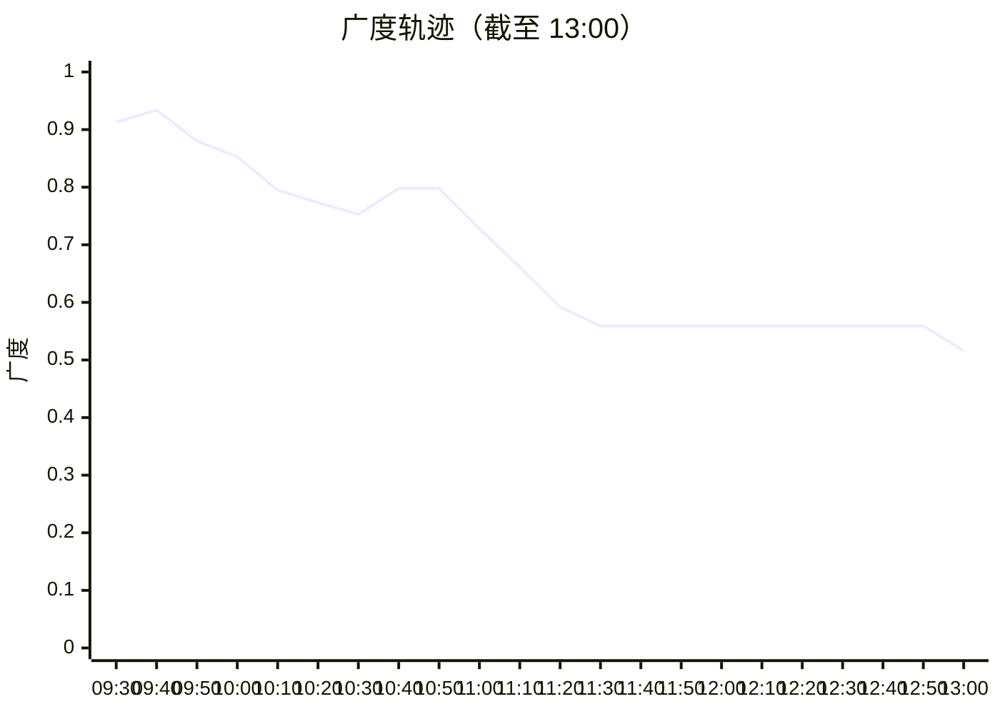

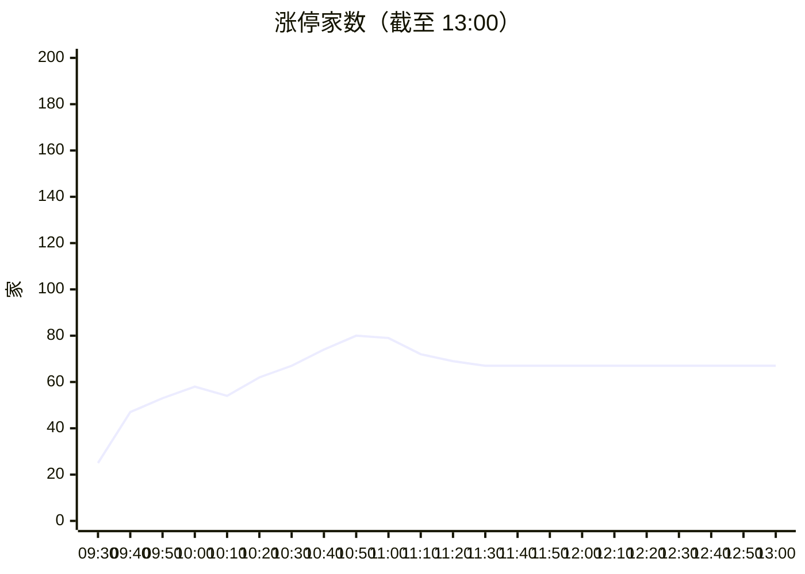


---
### 13:00 盯盘卡

**温度** 广度 **0.52**（-0.04） · 涨停 **67**（+0） · 炸板 **54** · 跌停 **5**（+0） · 成交 **11418.5 亿**（+116）
**判据** 广度>0.55 ❌ · 涨停≥60 ✅ · 昨涨停红盘率>60% ⏳未采 → **1/2 可证**

**连板梯队** 最高 **4** 板（中京电子 4板、东晶电子 3板、东方海洋 3板）｜ 1板 33家 / 2板 28家 / 3板 5家 / 4板 1家
**主线（按行业涨停数）** 汽车配件 **12**家 均+1.95% ｜ 元器件 **5**家 均+1.80% ｜ 机械基件 **4**家 均+2.24% ｜ 服饰 **4**家 均+0.94% ｜ 塑料 **3**家 均+1.56%
**板块分时** 半导体 +2.60% ｜ AI算力 +2.12% ｜ 商业航天 +1.98% ｜ 军工 +1.65% ｜ 光通信 +0.64% ｜ 白酒 -0.23% ｜ 医药 -0.79% ｜ 券商 -1.06%
**进攻位（距涨停≤3%）** 龙旗科技 +9.43%（差0.52%，通信设备，量比2.3，换手5.4%） ｜ 新泉股份 +9.35%（差0.59%，汽车配件，量比1.9，换手3.4%） ｜ 鹿山新材 +9.33%（差0.61%，塑料，量比1.9，换手5.5%） ｜ 中广天择 +8.96%（差0.98%，影视音像，量比1.8，换手6.5%） ｜ 工业富联 +8.70%（差1.20%，通信设备，量比3.2，换手1.0%）
**风险（炸板）** 首航新能 高+20.02%→收+10.15% ｜ 慧博云通 高+20.01%→收+13.40% ｜ 黄山谷捷 高+20.01%→收+9.45% ｜ 值得买 高+20.01%→收+13.40%
**资金（行业成交额）** 元器件 1433亿 ｜ 专用机械 507亿 ｜ 汽车配件 371亿 ｜ 机械基件 232亿
**资金（个股成交额）** 中际旭创 216亿 ｜ 新易盛 191亿 ｜ 东山精密 111亿 ｜ 寒武纪   90亿 ｜ 长鑫科技 88亿
**新晋涨停（vs 上一条）** 1 家：东方精工(轻工机械)

**我的池子**

| 票 | 仓位 | 现价 | 触发 | 距触发 | 距止损 | 状态 | 现在做什么 |
|---|---|---|---|---|---|---|---|
| 新易盛 | — | 186.77 | —↑ | —% | 14.8% | 等触发 | 盯 — |
| 中际旭创 | — | 431.0 | —↑ | —% | 14.1% | 等触发 | 盯 — |
| 源杰科技 | — | 618.4 | —↑ | —% | 12.3% | 等触发 | 盯 — |
| 景旺电子 | — | 58.64 | —↑ | —% | 14.1% | 等触发 | 盯 — |

**观察池** 强：凡拓数创 +17.38%、浙文影业 +10.14%、中京电子 +9.98% ｜ 弱：洛阳钼业 -2.64%、东方财富 -2.09%

**结论** ⚪ 窗口已过 —— 今日不再开新仓，只做记录与止损管理
**下一档盯** 中际旭创 431.0 → —（需涨 0.00%） ｜ 新易盛 186.77 → —（需涨 0.00%） ｜ 景旺电子 58.64 → —（需涨 0.00%）


---
### 13:05 盘中总结（13:00 快照 vs 11:30 收盘读数；11:40–12:50 午休快照数值全等，无成交）

① 广度继续单向泄：0.559（11:30 收）→ **0.516**（13:00），上涨 3123→2884、下跌 2273→2526（净 -239/-253），且跌幅>3% 家数 79→111 单档跳增 32 家，是这半小时恶化的核心；涨停 67→67（今日峰值 80 仍在 10:50）、炸板 52→54、炸板率 43.7%→**44.6%**（11-23 全天 15.08%）、跌停维持 5 家；午后半小时成交 11302→11418.5 亿（+116.5 亿），但涨幅>5% 家数 311→312 原地——**量在走、赚钱面在退**，是全天线「高开→逐档兑现」的延续。
② 预案池：执行池 4 票仍全红，但无一贴进买区，距买区上沿 新易盛 186.77（+4.5%）、中际旭创 431.0（+3.7%）、景旺电子 58.64（+3.7%）、源杰科技 618.4（+1.6%），11:30→13:00 中际 -0.91pp、景旺 -0.80pp、新易盛 -0.54pp 是链内回落主力；观察池 中京电子一字 4 板（全场最高标）与浙文影业涨停均封住未动，凡拓数创 +17.38%（距涨停 1.9%，封板未成），生益电子 +0.42pp 逆势是唯一走强；弱侧 洛阳钼业 -2.64%、东方财富 -2.09%、中信证券 -0.71%。
③ 与预案对照：预案定位原话「能赚的是回踩承接的钱，不是追高开的钱」，实际走的就是高开→逐档回落，**四张条件单一档未触达**——这不是错过，是预案按设计落地成空仓；且预案自带 no_trade_conditions「当日炸板率 >25% → 当日零新开」，13:00 口径 44.6% 已远超，午后 13:15–14:00 第二窗口的前置（广度自 <0.35 快速翻上 0.55 且涨停倍增）今日最低广度只到 0.516、涨停无倍增，结构性不成立——**两条独立理由都指向零新开**。
④ 一句话结论：午后是「指数撑、广度泄、炸板抬」的分歧加深，预案没被打脸也没给机会；维持空仓零新开，只做记录与止损管理，价格即便回到买区也须用户当面改令才谈得上动手。
---
### 13:10 · 广度 0.64 ↑

| 指标 | 上轮 | 本轮 | Δ |
|---|---|---|---|
| 广度 | 0.516 | 0.642 | **+0.126** |
| 涨停 | 67 | 78 | **+11** |
| 跌停 | 5 | 5 | +0 |
| 涨>3% | 751 | 1075 | **+324** |
| 跌>3% | 111 | 78 | **-33** |
| 成交(亿) | 11,418 | 11,883 | +465 |

**钱在**：汽车配件 14封/+2.49% ｜ 元器件 5封/+2.82% ｜ 机械基件 4封/+2.94%
**异动**：凡拓数创 +18.96% · 浙文影业 +10.14%(涨停) · 中京电子 +9.98%(涨停) · 龙版传媒 +6.40% · 寒武纪 +6.09%
**结论**：广度 +0.13 走强｜涨停 +11 → 修复延续，板块内可做

<details><summary>预案池 24 只（点开）</summary>

| 票 | 池 | 现价 | 涨幅 | 状态 |
|---|---|---|---|---|
| 新易盛 `300502.SZ` | execution_pool | 189.00 | +4.21% | up |
| 中际旭创 `300308.SZ` | execution_pool | 432.02 | +3.55% | up |
| 源杰科技 `688498.SH` | execution_pool | 617.66 | +1.09% | up |
| 景旺电子 `603228.SH` | execution_pool | 59.41 | +4.45% | up |
| 沪电股份 `002463.SZ` | watch_pool | 85.65 | +3.57% | up |
| 深南电路 `002916.SZ` | watch_pool | 210.37 | +1.09% | up |
| 生益电子 `688183.SH` | watch_pool | 74.83 | +5.28% | up |
| 长川科技 `300604.SZ` | watch_pool | 187.18 | +5.21% | up |
| 中芯国际 `688981.SH` | watch_pool | 126.40 | +3.95% | up |
| 寒武纪 `688256.SH` | watch_pool | 970.54 | +6.09% | up |
| 剑桥科技 `603083.SH` | watch_pool | 102.07 | +2.07% | up |
| 宇树科技 `688836.SH` | watch_pool | 746.61 | +5.45% | up |
| 双环传动 `002472.SZ` | watch_pool | 39.45 | +1.75% | up |
| 凡拓数创 `301313.SZ` | watch_pool | 84.45 | +18.96% | up |
| 中京电子 `002579.SZ` | watch_pool | 16.20 | +9.98% | limit_up |
| 风华高科 `000636.SZ` | watch_pool | 29.10 | +0.38% | up |
| 龙版传媒 `605577.SH` | watch_pool | 18.95 | +6.40% | up |
| 浙文影业 `601599.SH` | watch_pool | 4.02 | +10.14% | limit_up |
| 有研新材 `600206.SH` | watch_pool | 40.20 | +0.50% | up |
| 瑞芯微 `603893.SH` | watch_pool | 212.40 | +4.69% | up |
| 北方华创 `002371.SZ` | watch_pool | 545.04 | +0.73% | up |
| 洛阳钼业 `603993.SH` | watch_pool | 11.82 | -2.64% | down |
| 中信证券 `600030.SH` | watch_pool | 25.11 | -0.59% | down |
| 东方财富 `300059.SZ` | watch_pool | 18.28 | -1.83% | down |

</details>

---
### 13:10 盯盘卡

**温度** 广度 **0.64**（+0.13） · 涨停 **78**（+11） · 炸板 **50** · 跌停 **5**（+0） · 成交 **11883.4 亿**（+465）
**判据** 广度>0.55 ✅ · 涨停≥60 ✅ · 昨涨停红盘率>60% ⏳未采 → **2/2 可证**

**连板梯队** 最高 **4** 板（中京电子 4板、东晶电子 3板、金新农 3板）｜ 1板 41家 / 2板 32家 / 3板 4家 / 4板 1家
**主线（按行业涨停数）** 汽车配件 **14**家 均+2.49% ｜ 元器件 **5**家 均+2.82% ｜ 机械基件 **4**家 均+2.94% ｜ 软件服务 **4**家 均+1.85% ｜ 服饰 **4**家 均+1.47%
**板块分时** 半导体 +3.09% ｜ AI算力 +2.83% ｜ 商业航天 +2.48% ｜ 军工 +2.09% ｜ 光通信 +1.44% ｜ 白酒 -0.23% ｜ 医药 -0.79% ｜ 券商 -0.85%
**进攻位（距涨停≤3%）** 宏英智能 +9.84%（差0.15%，电器仪表，量比3.5，换手8.4%） ｜ 东方海洋 +9.69%（差0.22%，渔业，量比1.8，换手30.3%） ｜ 兴欣新材 +9.45%（差0.51%，化工原料，量比1.9，换手25.4%） ｜ *ST美芝 +9.35%（差0.58%，装修装饰，量比2.1，换手3.3%） ｜ 工业富联 +9.09%（差0.84%，通信设备，量比3.1，换手1.0%）
**风险（炸板）** 首航新能 高+20.02%→收+9.82% ｜ 慧博云通 高+20.01%→收+14.36% ｜ 黄山谷捷 高+20.01%→收+12.47% ｜ 值得买 高+20.01%→收+14.29%
**资金（行业成交额）** 半导体 1731亿 ｜ 元器件 1491亿 ｜ 通信设备 1110亿 ｜ 软件服务 521亿
**资金（个股成交额）** 中际旭创 221亿 ｜ 新易盛 197亿 ｜ 东山精密 114亿 ｜ 寒武纪   97亿 ｜ 长鑫科技 90亿
**新晋涨停（vs 上一条）** 11 家：华东重机(机床制造)、江化微  (半导体)、新泉股份(汽车配件)、浙江荣泰(汽车配件)、泰嘉股份(钢加工)、大港股份(半导体)、高争民爆(化工原料)、龙旗科技(通信设备)

**我的池子**

| 票 | 仓位 | 现价 | 触发 | 距触发 | 距止损 | 状态 | 现在做什么 |
|---|---|---|---|---|---|---|---|
| 新易盛 | — | 189.0 | —↑ | —% | 15.8% | 等触发 | 盯 — |
| 中际旭创 | — | 432.02 | —↑ | —% | 14.3% | 等触发 | 盯 — |
| 源杰科技 | — | 617.66 | —↑ | —% | 12.1% | 等触发 | 盯 — |
| 景旺电子 | — | 59.41 | —↑ | —% | 15.2% | 等触发 | 盯 — |

**观察池** 强：凡拓数创 +18.96%、浙文影业 +10.14%、中京电子 +9.98% ｜ 弱：洛阳钼业 -2.64%、东方财富 -1.83%

**结论** ⚪ 窗口已过 —— 今日不再开新仓，只做记录与止损管理
**下一档盯** 中际旭创 432.02 → —（需涨 0.00%） ｜ 新易盛 189.0 → —（需涨 0.00%） ｜ 景旺电子 59.41 → —（需涨 0.00%）

---
### 13:20 · 广度 0.60 ↓

| 指标 | 上轮 | 本轮 | Δ |
|---|---|---|---|
| 广度 | 0.642 | 0.600 | -0.042 |
| 涨停 | 78 | 74 | -4 |
| 跌停 | 5 | 6 | +1 |
| 涨>3% | 1075 | 914 | **-161** |
| 跌>3% | 78 | 97 | **+19** |
| 成交(亿) | 11,883 | 12,259 | +376 |

**钱在**：汽车配件 13封/+2.15% ｜ 元器件 5封/+2.41% ｜ 机械基件 4封/+2.48%
**异动**：凡拓数创 +18.61% · 浙文影业 +10.14%(涨停) · 中京电子 +9.98%(涨停) · 寒武纪 +7.01% · 龙版传媒 +6.96%
**结论**：广度 -0.04 横住｜涨停 -4 → 分歧，只做板块首板不接力

<details><summary>预案池 24 只（点开）</summary>

| 票 | 池 | 现价 | 涨幅 | 状态 |
|---|---|---|---|---|
| 新易盛 `300502.SZ` | execution_pool | 188.80 | +4.10% | up |
| 中际旭创 `300308.SZ` | execution_pool | 430.65 | +3.22% | up |
| 源杰科技 `688498.SH` | execution_pool | 617.00 | +0.98% | up |
| 景旺电子 `603228.SH` | execution_pool | 59.30 | +4.25% | up |
| 沪电股份 `002463.SZ` | watch_pool | 85.63 | +3.54% | up |
| 深南电路 `002916.SZ` | watch_pool | 210.08 | +0.95% | up |
| 生益电子 `688183.SH` | watch_pool | 74.81 | +5.25% | up |
| 长川科技 `300604.SZ` | watch_pool | 186.86 | +5.03% | up |
| 中芯国际 `688981.SH` | watch_pool | 126.01 | +3.63% | up |
| 寒武纪 `688256.SH` | watch_pool | 978.94 | +7.01% | up |
| 剑桥科技 `603083.SH` | watch_pool | 101.67 | +1.67% | up |
| 宇树科技 `688836.SH` | watch_pool | 742.22 | +4.83% | up |
| 双环传动 `002472.SZ` | watch_pool | 39.50 | +1.88% | up |
| 凡拓数创 `301313.SZ` | watch_pool | 84.20 | +18.61% | up |
| 中京电子 `002579.SZ` | watch_pool | 16.20 | +9.98% | limit_up |
| 风华高科 `000636.SZ` | watch_pool | 28.98 | -0.03% | down |
| 龙版传媒 `605577.SH` | watch_pool | 19.05 | +6.96% | up |
| 浙文影业 `601599.SH` | watch_pool | 4.02 | +10.14% | limit_up |
| 有研新材 `600206.SH` | watch_pool | 39.95 | -0.12% | down |
| 瑞芯微 `603893.SH` | watch_pool | 211.88 | +4.44% | up |
| 北方华创 `002371.SZ` | watch_pool | 548.35 | +1.34% | up |
| 洛阳钼业 `603993.SH` | watch_pool | 11.79 | -2.88% | down |
| 中信证券 `600030.SH` | watch_pool | 25.14 | -0.48% | down |
| 东方财富 `300059.SZ` | watch_pool | 18.25 | -1.99% | down |

</details>

---
### 13:20 盯盘卡

**温度** 广度 **0.60**（-0.04） · 涨停 **74**（-4） · 炸板 **58** · 跌停 **6**（+1） · 成交 **12259.2 亿**（+376）
**判据** 广度>0.55 ✅ · 涨停≥60 ✅ · 昨涨停红盘率>60% ⏳未采 → **2/2 可证**

**连板梯队** 最高 **4** 板（中京电子 4板、金新农 3板、长华集团 3板）｜ 1板 38家 / 2板 31家 / 3板 4家 / 4板 1家
**主线（按行业涨停数）** 汽车配件 **13**家 均+2.15% ｜ 元器件 **5**家 均+2.41% ｜ 机械基件 **4**家 均+2.48% ｜ 塑料 **4**家 均+2.07% ｜ 软件服务 **4**家 均+1.46%
**板块分时** 半导体 +3.09% ｜ AI算力 +2.67% ｜ 商业航天 +2.23% ｜ 军工 +2.09% ｜ 光通信 +0.96% ｜ 白酒 +0.00% ｜ 医药 -0.79% ｜ 券商 -1.06%
**进攻位（距涨停≤3%）** *ST华西 +9.52%（差0.54%，专用机械，量比2.2，换手1.6%） ｜ 宏英智能 +9.30%（差0.65%，电器仪表，量比3.4，换手8.7%） ｜ 东方海洋 +9.20%（差0.67%，渔业，量比1.8，换手32.3%） ｜ 泰嘉股份 +9.28%（差0.70%，钢加工，量比1.8，换手19.9%） ｜ 新泉股份 +8.96%（差0.95%，汽车配件，量比2.0，换手4.0%）
**风险（炸板）** 首航新能 高+20.02%→收+9.37% ｜ 慧博云通 高+20.01%→收+13.59% ｜ 黄山谷捷 高+20.01%→收+9.60% ｜ 值得买 高+20.01%→收+13.79%
**资金（行业成交额）** 元器件 1528亿 ｜ 通信设备 1138亿 ｜ 软件服务 534亿 ｜ 汽车配件 401亿
**资金（个股成交额）** 中际旭创 225亿 ｜ 新易盛 200亿 ｜ 东山精密 117亿 ｜ 寒武纪   102亿 ｜ 长鑫科技 92亿
**新晋涨停（vs 上一条）** 5 家：铁流股份(汽车配件)、光洋股份(汽车配件)、起帆电缆(电气设备)、ST交昂  (医疗保健)、*ST泉为(塑料)

**我的池子**

| 票 | 仓位 | 现价 | 触发 | 距触发 | 距止损 | 状态 | 现在做什么 |
|---|---|---|---|---|---|---|---|
| 新易盛 | — | 188.8 | —↑ | —% | 15.7% | 等触发 | 盯 — |
| 中际旭创 | — | 430.65 | —↑ | —% | 14.0% | 等触发 | 盯 — |
| 源杰科技 | — | 617.0 | —↑ | —% | 12.1% | 等触发 | 盯 — |
| 景旺电子 | — | 59.3 | —↑ | —% | 15.1% | 等触发 | 盯 — |

**观察池** 强：凡拓数创 +18.61%、浙文影业 +10.14%、中京电子 +9.98% ｜ 弱：洛阳钼业 -2.88%、东方财富 -1.99%

**结论** ⚪ 窗口已过 —— 今日不再开新仓，只做记录与止损管理
**下一档盯** 中际旭创 430.65 → —（需涨 0.00%） ｜ 新易盛 188.8 → —（需涨 0.00%） ｜ 景旺电子 59.3 → —（需涨 0.00%）

---
### 13:30 · 广度 0.55 ↓

| 指标 | 上轮 | 本轮 | Δ |
|---|---|---|---|
| 广度 | 0.600 | 0.550 | **-0.051** |
| 涨停 | 74 | 68 | **-6** |
| 跌停 | 6 | 5 | -1 |
| 涨>3% | 914 | 725 | **-189** |
| 跌>3% | 97 | 110 | **+13** |
| 成交(亿) | 12,259 | 12,616 | +357 |

**钱在**：汽车配件 12封/+1.77% ｜ 元器件 5封/+1.94% ｜ 服饰 4封/+1.33%
**异动**：凡拓数创 +17.90% · 浙文影业 +10.14%(涨停) · 中京电子 +9.98%(涨停) · 龙版传媒 +6.63% · 寒武纪 +6.25%
**结论**：广度 -0.05 横住｜涨停 -6 → 分歧，只做板块首板不接力

<details><summary>预案池 24 只（点开）</summary>

| 票 | 池 | 现价 | 涨幅 | 状态 |
|---|---|---|---|---|
| 新易盛 `300502.SZ` | execution_pool | 187.20 | +3.22% | up |
| 中际旭创 `300308.SZ` | execution_pool | 427.27 | +2.41% | up |
| 源杰科技 `688498.SH` | execution_pool | 613.89 | +0.47% | up |
| 景旺电子 `603228.SH` | execution_pool | 59.09 | +3.89% | up |
| 沪电股份 `002463.SZ` | watch_pool | 85.05 | +2.84% | up |
| 深南电路 `002916.SZ` | watch_pool | 209.20 | +0.53% | up |
| 生益电子 `688183.SH` | watch_pool | 74.56 | +4.90% | up |
| 长川科技 `300604.SZ` | watch_pool | 185.11 | +4.05% | up |
| 中芯国际 `688981.SH` | watch_pool | 125.10 | +2.88% | up |
| 寒武纪 `688256.SH` | watch_pool | 972.00 | +6.25% | up |
| 剑桥科技 `603083.SH` | watch_pool | 101.33 | +1.33% | up |
| 宇树科技 `688836.SH` | watch_pool | 732.59 | +3.47% | up |
| 双环传动 `002472.SZ` | watch_pool | 39.20 | +1.11% | up |
| 凡拓数创 `301313.SZ` | watch_pool | 83.70 | +17.90% | up |
| 中京电子 `002579.SZ` | watch_pool | 16.20 | +9.98% | limit_up |
| 风华高科 `000636.SZ` | watch_pool | 28.81 | -0.62% | down |
| 龙版传媒 `605577.SH` | watch_pool | 18.99 | +6.63% | up |
| 浙文影业 `601599.SH` | watch_pool | 4.02 | +10.14% | limit_up |
| 有研新材 `600206.SH` | watch_pool | 39.59 | -1.02% | down |
| 瑞芯微 `603893.SH` | watch_pool | 210.26 | +3.64% | up |
| 北方华创 `002371.SZ` | watch_pool | 545.03 | +0.73% | up |
| 洛阳钼业 `603993.SH` | watch_pool | 11.79 | -2.88% | down |
| 中信证券 `600030.SH` | watch_pool | 25.17 | -0.36% | down |
| 东方财富 `300059.SZ` | watch_pool | 18.21 | -2.20% | down |

</details>

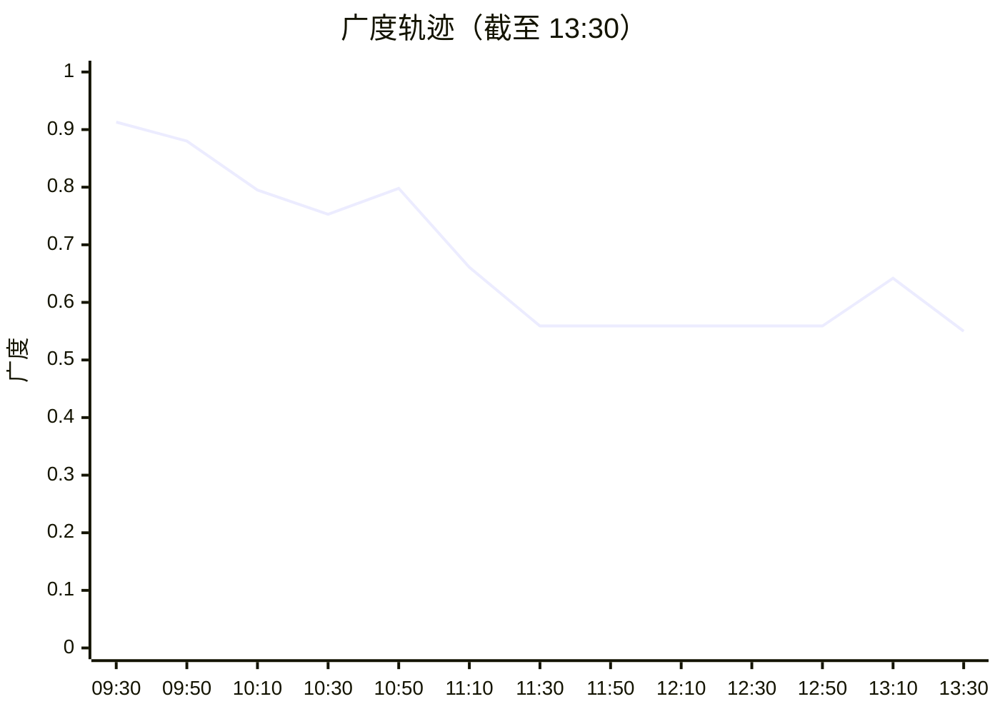

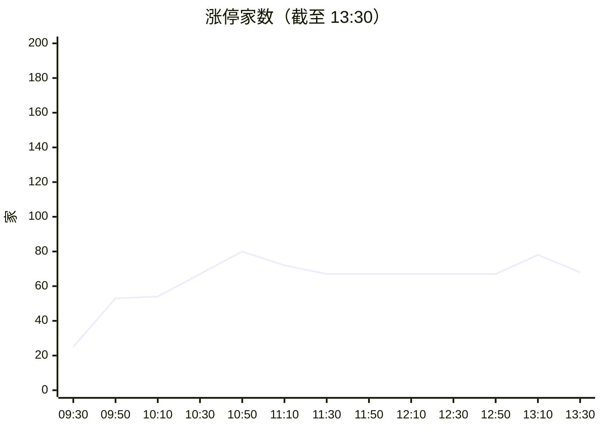


---
### 13:30 盯盘卡

**温度** 广度 **0.55**（-0.05） · 涨停 **68**（-6） · 炸板 **66** · 跌停 **5**（-1） · 成交 **12616.2 亿**（+357）
**判据** 广度>0.55 ✅ · 涨停≥60 ✅ · 昨涨停红盘率>60% ⏳未采 → **2/2 可证**

**连板梯队** 最高 **4** 板（中京电子 4板、东方海洋 3板、金新农 3板）｜ 1板 33家 / 2板 29家 / 3板 5家 / 4板 1家
**主线（按行业涨停数）** 汽车配件 **12**家 均+1.77% ｜ 元器件 **5**家 均+1.94% ｜ 服饰 **4**家 均+1.33% ｜ 机械基件 **3**家 均+2.00% ｜ 塑料 **3**家 均+1.72%
**板块分时** 半导体 +2.48% ｜ AI算力 +2.04% ｜ 商业航天 +1.73% ｜ 军工 +1.54% ｜ 光通信 +0.56% ｜ 白酒 +0.46% ｜ 医药 -0.79% ｜ 券商 -0.85%
**进攻位（距涨停≤3%）** *ST美芝 +9.77%（差0.19%，装修装饰，量比2.2，换手4.1%） ｜ ST雪发 +9.38%（差0.66%，商贸代理，量比3.5，换手1.0%） ｜ 华东重机 +8.72%（差1.13%，机床制造，量比3.0，换手42.7%） ｜ 和仁科技 +18.57%（差1.18%，软件服务，量比3.2，换手6.5%） ｜ 新泉股份 +8.22%（差1.64%，汽车配件，量比1.9，换手4.2%）
**风险（炸板）** 首航新能 高+20.02%→收+8.82% ｜ 慧博云通 高+20.01%→收+12.52% ｜ 黄山谷捷 高+20.01%→收+9.64% ｜ 值得买 高+20.01%→收+12.60%
**资金（行业成交额）** 元器件 1563亿 ｜ 通信设备 1164亿 ｜ 汽车配件 412亿 ｜ 机械基件 257亿
**资金（个股成交额）** 中际旭创 231亿 ｜ 新易盛 203亿 ｜ 东山精密 119亿 ｜ 寒武纪   106亿 ｜ 工业富联 94亿
**新晋涨停（vs 上一条）** 7 家：东方海洋(渔业)、兴欣新材(化工原料)、威派格  (专用机械)、天圣制药(医药商业)、长华集团(汽车配件)、宁波东力(机械基件)、汇洲智能(机床制造)

**我的池子**

| 票 | 仓位 | 现价 | 触发 | 距触发 | 距止损 | 状态 | 现在做什么 |
|---|---|---|---|---|---|---|---|
| 新易盛 | — | 187.2 | —↑ | —% | 15.0% | 等触发 | 盯 — |
| 中际旭创 | — | 427.27 | —↑ | —% | 13.3% | 等触发 | 盯 — |
| 源杰科技 | — | 613.89 | —↑ | —% | 11.6% | 等触发 | 盯 — |
| 景旺电子 | — | 59.09 | —↑ | —% | 14.8% | 等触发 | 盯 — |

**观察池** 强：凡拓数创 +17.90%、浙文影业 +10.14%、中京电子 +9.98% ｜ 弱：洛阳钼业 -2.88%、东方财富 -2.20%

**结论** ⚪ 窗口已过 —— 今日不再开新仓，只做记录与止损管理
**下一档盯** 中际旭创 427.27 → —（需涨 0.00%） ｜ 新易盛 187.2 → —（需涨 0.00%） ｜ 景旺电子 59.09 → —（需涨 0.00%）

---
### 13:40 · 广度 0.56 ↑

| 指标 | 上轮 | 本轮 | Δ |
|---|---|---|---|
| 广度 | 0.550 | 0.562 | +0.013 |
| 涨停 | 68 | 69 | +1 |
| 跌停 | 5 | 5 | +0 |
| 涨>3% | 725 | 799 | **+74** |
| 跌>3% | 110 | 100 | **-10** |
| 成交(亿) | 12,616 | 12,965 | +349 |

**钱在**：汽车配件 12封/+1.95% ｜ 元器件 6封/+2.23% ｜ 服饰 4封/+1.55%
**异动**：凡拓数创 +17.95% · 浙文影业 +10.14%(涨停) · 中京电子 +9.98%(涨停) · 寒武纪 +7.45% · 生益电子 +5.49%
**结论**：广度 +0.01 横住｜涨停 +1 → 修复延续，板块内可做

<details><summary>预案池 24 只（点开）</summary>

| 票 | 池 | 现价 | 涨幅 | 状态 |
|---|---|---|---|---|
| 新易盛 `300502.SZ` | execution_pool | 188.82 | +4.11% | up |
| 中际旭创 `300308.SZ` | execution_pool | 432.39 | +3.64% | up |
| 源杰科技 `688498.SH` | execution_pool | 615.66 | +0.76% | up |
| 景旺电子 `603228.SH` | execution_pool | 59.46 | +4.54% | up |
| 沪电股份 `002463.SZ` | watch_pool | 85.77 | +3.71% | up |
| 深南电路 `002916.SZ` | watch_pool | 211.80 | +1.78% | up |
| 生益电子 `688183.SH` | watch_pool | 74.98 | +5.49% | up |
| 长川科技 `300604.SZ` | watch_pool | 186.30 | +4.72% | up |
| 中芯国际 `688981.SH` | watch_pool | 125.15 | +2.92% | up |
| 寒武纪 `688256.SH` | watch_pool | 982.99 | +7.45% | up |
| 剑桥科技 `603083.SH` | watch_pool | 102.60 | +2.60% | up |
| 宇树科技 `688836.SH` | watch_pool | 730.01 | +3.11% | up |
| 双环传动 `002472.SZ` | watch_pool | 39.42 | +1.68% | up |
| 凡拓数创 `301313.SZ` | watch_pool | 83.73 | +17.95% | up |
| 中京电子 `002579.SZ` | watch_pool | 16.20 | +9.98% | limit_up |
| 风华高科 `000636.SZ` | watch_pool | 28.90 | -0.31% | down |
| 龙版传媒 `605577.SH` | watch_pool | 18.75 | +5.28% | up |
| 浙文影业 `601599.SH` | watch_pool | 4.02 | +10.14% | limit_up |
| 有研新材 `600206.SH` | watch_pool | 39.71 | -0.72% | down |
| 瑞芯微 `603893.SH` | watch_pool | 211.12 | +4.06% | up |
| 北方华创 `002371.SZ` | watch_pool | 548.00 | +1.28% | up |
| 洛阳钼业 `603993.SH` | watch_pool | 11.78 | -2.97% | down |
| 中信证券 `600030.SH` | watch_pool | 25.11 | -0.59% | down |
| 东方财富 `300059.SZ` | watch_pool | 18.16 | -2.47% | down |

</details>

---
### 13:40 盯盘卡

**温度** 广度 **0.56**（+0.01） · 涨停 **69**（+1） · 炸板 **67** · 跌停 **5**（+0） · 成交 **12964.9 亿**（+349）
**判据** 广度>0.55 ✅ · 涨停≥60 ✅ · 昨涨停红盘率>60% ⏳未采 → **2/2 可证**

**连板梯队** 最高 **4** 板（中京电子 4板、长华集团 3板、东方海洋 3板）｜ 1板 33家 / 2板 30家 / 3板 5家 / 4板 1家
**主线（按行业涨停数）** 汽车配件 **12**家 均+1.95% ｜ 元器件 **6**家 均+2.23% ｜ 服饰 **4**家 均+1.55% ｜ 机械基件 **3**家 均+2.24% ｜ 塑料 **3**家 均+1.92%
**板块分时** 半导体 +2.72% ｜ AI算力 +2.36% ｜ 商业航天 +1.73% ｜ 军工 +1.65% ｜ 光通信 +0.48% ｜ 白酒 +0.23% ｜ 医药 -0.79% ｜ 券商 -1.06%
**进攻位（距涨停≤3%）** 兴欣新材 +9.70%（差0.28%，化工原料，量比1.9，换手30.7%） ｜ *ST美芝 +9.14%（差0.77%，装修装饰，量比2.2，换手4.3%） ｜ 正泰电源 +8.95%（差0.97%，机械基件，量比1.9，换手3.7%） ｜ 浙江荣泰 +8.93%（差0.98%，汽车配件，量比2.3，换手3.9%） ｜ ST海钦   +8.89%（差1.04%，商贸代理，量比5.9，换手1.4%）
**风险（炸板）** 首航新能 高+20.02%→收+9.43% ｜ 慧博云通 高+20.01%→收+12.22% ｜ 黄山谷捷 高+20.01%→收+9.78% ｜ 值得买 高+20.01%→收+12.02%
**资金（行业成交额）** 元器件 1598亿 ｜ 通信设备 1189亿 ｜ 软件服务 579亿 ｜ 汽车配件 423亿
**资金（个股成交额）** 中际旭创 235亿 ｜ 新易盛 206亿 ｜ 东山精密 122亿 ｜ 寒武纪   112亿 ｜ 工业富联 96亿
**新晋涨停（vs 上一条）** 3 家：华东重机(机床制造)、海洋王(元器件)、和仁科技(软件服务)

**我的池子**

| 票 | 仓位 | 现价 | 触发 | 距触发 | 距止损 | 状态 | 现在做什么 |
|---|---|---|---|---|---|---|---|
| 新易盛 | — | 188.82 | —↑ | —% | 15.7% | 等触发 | 盯 — |
| 中际旭创 | — | 432.39 | —↑ | —% | 14.4% | 等触发 | 盯 — |
| 源杰科技 | — | 615.66 | —↑ | —% | 11.9% | 等触发 | 盯 — |
| 景旺电子 | — | 59.46 | —↑ | —% | 15.3% | 等触发 | 盯 — |

**观察池** 强：凡拓数创 +17.95%、浙文影业 +10.14%、中京电子 +9.98% ｜ 弱：洛阳钼业 -2.97%、东方财富 -2.47%

**结论** ⚪ 窗口已过 —— 今日不再开新仓，只做记录与止损管理
**下一档盯** 中际旭创 432.39 → —（需涨 0.00%） ｜ 新易盛 188.82 → —（需涨 0.00%） ｜ 景旺电子 59.46 → —（需涨 0.00%）

---
### 13:50 · 广度 0.56 ↓

| 指标 | 上轮 | 本轮 | Δ |
|---|---|---|---|
| 广度 | 0.562 | 0.558 | -0.004 |
| 涨停 | 69 | 73 | +4 |
| 跌停 | 5 | 5 | +0 |
| 涨>3% | 799 | 805 | **+6** |
| 跌>3% | 100 | 111 | **+11** |
| 成交(亿) | 12,965 | 13,269 | +304 |

**钱在**：汽车配件 13封/+1.87% ｜ 元器件 6封/+2.24% ｜ 服饰 4封/+1.47%
**异动**：凡拓数创 +17.20% · 浙文影业 +10.14%(涨停) · 中京电子 +9.98%(涨停) · 寒武纪 +8.77% · 长川科技 +5.63%
**结论**：广度 -0.00 横住｜涨停 +4 → 修复延续，板块内可做

<details><summary>预案池 24 只（点开）</summary>

| 票 | 池 | 现价 | 涨幅 | 状态 |
|---|---|---|---|---|
| 新易盛 `300502.SZ` | execution_pool | 187.01 | +3.12% | up |
| 中际旭创 `300308.SZ` | execution_pool | 430.35 | +3.15% | up |
| 源杰科技 `688498.SH` | execution_pool | 616.90 | +0.96% | up |
| 景旺电子 `603228.SH` | execution_pool | 59.37 | +4.38% | up |
| 沪电股份 `002463.SZ` | watch_pool | 85.40 | +3.26% | up |
| 深南电路 `002916.SZ` | watch_pool | 211.17 | +1.48% | up |
| 生益电子 `688183.SH` | watch_pool | 74.45 | +4.74% | up |
| 长川科技 `300604.SZ` | watch_pool | 187.93 | +5.63% | up |
| 中芯国际 `688981.SH` | watch_pool | 126.43 | +3.97% | up |
| 寒武纪 `688256.SH` | watch_pool | 995.00 | +8.77% | up |
| 剑桥科技 `603083.SH` | watch_pool | 102.08 | +2.08% | up |
| 宇树科技 `688836.SH` | watch_pool | 727.50 | +2.75% | up |
| 双环传动 `002472.SZ` | watch_pool | 39.32 | +1.42% | up |
| 凡拓数创 `301313.SZ` | watch_pool | 83.20 | +17.20% | up |
| 中京电子 `002579.SZ` | watch_pool | 16.20 | +9.98% | limit_up |
| 风华高科 `000636.SZ` | watch_pool | 28.88 | -0.38% | down |
| 龙版传媒 `605577.SH` | watch_pool | 18.62 | +4.55% | up |
| 浙文影业 `601599.SH` | watch_pool | 4.02 | +10.14% | limit_up |
| 有研新材 `600206.SH` | watch_pool | 39.76 | -0.60% | down |
| 瑞芯微 `603893.SH` | watch_pool | 210.65 | +3.83% | up |
| 北方华创 `002371.SZ` | watch_pool | 551.00 | +1.83% | up |
| 洛阳钼业 `603993.SH` | watch_pool | 11.78 | -2.97% | down |
| 中信证券 `600030.SH` | watch_pool | 25.10 | -0.63% | down |
| 东方财富 `300059.SZ` | watch_pool | 18.10 | -2.79% | down |

</details>

---
### 13:50 盯盘卡

**温度** 广度 **0.56**（-0.00） · 涨停 **73**（+4） · 炸板 **65** · 跌停 **5**（+0） · 成交 **13269.4 亿**（+304）
**判据** 广度>0.55 ✅ · 涨停≥60 ✅ · 昨涨停红盘率>60% ⏳未采 → **2/2 可证**

**连板梯队** 最高 **4** 板（中京电子 4板、金新农 3板、东方海洋 3板）｜ 1板 36家 / 2板 31家 / 3板 5家 / 4板 1家
**主线（按行业涨停数）** 汽车配件 **13**家 均+1.87% ｜ 元器件 **6**家 均+2.24% ｜ 服饰 **4**家 均+1.47% ｜ 文教休闲 **3**家 均+2.44% ｜ 机械基件 **3**家 均+2.14%
**板块分时** 半导体 +3.09% ｜ AI算力 +2.44% ｜ 军工 +1.87% ｜ 商业航天 +1.86% ｜ 光通信 +0.56% ｜ 白酒 +0.00% ｜ 医药 -0.79% ｜ 券商 -1.06%
**进攻位（距涨停≤3%）** *ST泉为 +19.26%（差0.61%，塑料，量比2.1，换手4.4%） ｜ 丸美生物 +9.15%（差0.77%，日用化工，量比1.3，换手1.9%） ｜ 豪美新材 +9.14%（差0.79%，铝，量比1.1，换手1.7%） ｜ 泰嘉股份 +8.90%（差1.05%，钢加工，量比1.6，换手20.6%） ｜ 超颖电子 +8.76%（差1.14%，元器件，量比2.6，换手6.9%）
**风险（炸板）** 首航新能 高+20.02%→收+9.26% ｜ 慧博云通 高+20.01%→收+12.78% ｜ 黄山谷捷 高+20.01%→收+9.60% ｜ 值得买 高+20.01%→收+11.98%
**资金（行业成交额）** 元器件 1629亿 ｜ 通信设备 1209亿 ｜ 软件服务 594亿 ｜ 汽车配件 431亿
**资金（个股成交额）** 中际旭创 238亿 ｜ 新易盛 208亿 ｜ 东山精密 125亿 ｜ 寒武纪   121亿 ｜ 工业富联 97亿
**新晋涨停（vs 上一条）** 3 家：兴欣新材(化工原料)、*ST美芝(装修装饰)、天龙股份(汽车配件)

**我的池子**

| 票 | 仓位 | 现价 | 触发 | 距触发 | 距止损 | 状态 | 现在做什么 |
|---|---|---|---|---|---|---|---|
| 新易盛 | — | 187.01 | —↑ | —% | 14.9% | 等触发 | 盯 — |
| 中际旭创 | — | 430.35 | —↑ | —% | 14.0% | 等触发 | 盯 — |
| 源杰科技 | — | 616.9 | —↑ | —% | 12.0% | 等触发 | 盯 — |
| 景旺电子 | — | 59.37 | —↑ | —% | 15.2% | 等触发 | 盯 — |

**观察池** 强：凡拓数创 +17.20%、浙文影业 +10.14%、中京电子 +9.98% ｜ 弱：洛阳钼业 -2.97%、东方财富 -2.79%

**结论** ⚪ 窗口已过 —— 今日不再开新仓，只做记录与止损管理
**下一档盯** 中际旭创 430.35 → —（需涨 0.00%） ｜ 新易盛 187.01 → —（需涨 0.00%） ｜ 景旺电子 59.37 → —（需涨 0.00%）

---
### 14:00 · 广度 0.44 ↓

| 指标 | 上轮 | 本轮 | Δ |
|---|---|---|---|
| 广度 | 0.558 | 0.445 | **-0.113** |
| 涨停 | 73 | 63 | **-10** |
| 跌停 | 5 | 5 | +0 |
| 涨>3% | 805 | 591 | **-214** |
| 跌>3% | 111 | 171 | **+60** |
| 成交(亿) | 13,269 | 13,638 | +368 |

**钱在**：汽车配件 12封/+1.32% ｜ 元器件 5封/+1.45% ｜ 服饰 4封/+1.03%
**异动**：凡拓数创 +16.81% · 浙文影业 +10.14%(涨停) · 中京电子 +9.98%(涨停) · 寒武纪 +7.52% · 长川科技 +4.39%
**结论**：广度 -0.11 走弱｜涨停 -10 → 分歧，只做板块首板不接力

<details><summary>预案池 24 只（点开）</summary>

| 票 | 池 | 现价 | 涨幅 | 状态 |
|---|---|---|---|---|
| 新易盛 `300502.SZ` | execution_pool | 184.98 | +2.00% | up |
| 中际旭创 `300308.SZ` | execution_pool | 425.01 | +1.87% | up |
| 源杰科技 `688498.SH` | execution_pool | 608.94 | -0.34% | down |
| 景旺电子 `603228.SH` | execution_pool | 58.85 | +3.46% | up |
| 沪电股份 `002463.SZ` | watch_pool | 84.88 | +2.64% | up |
| 深南电路 `002916.SZ` | watch_pool | 210.03 | +0.93% | up |
| 生益电子 `688183.SH` | watch_pool | 74.05 | +4.18% | up |
| 长川科技 `300604.SZ` | watch_pool | 185.72 | +4.39% | up |
| 中芯国际 `688981.SH` | watch_pool | 125.99 | +3.61% | up |
| 寒武纪 `688256.SH` | watch_pool | 983.59 | +7.52% | up |
| 剑桥科技 `603083.SH` | watch_pool | 100.85 | +0.85% | up |
| 宇树科技 `688836.SH` | watch_pool | 723.90 | +2.25% | up |
| 双环传动 `002472.SZ` | watch_pool | 39.17 | +1.03% | up |
| 凡拓数创 `301313.SZ` | watch_pool | 82.92 | +16.81% | up |
| 中京电子 `002579.SZ` | watch_pool | 16.20 | +9.98% | limit_up |
| 风华高科 `000636.SZ` | watch_pool | 28.62 | -1.28% | down |
| 龙版传媒 `605577.SH` | watch_pool | 18.47 | +3.71% | up |
| 浙文影业 `601599.SH` | watch_pool | 4.02 | +10.14% | limit_up |
| 有研新材 `600206.SH` | watch_pool | 39.44 | -1.40% | down |
| 瑞芯微 `603893.SH` | watch_pool | 209.95 | +3.48% | up |
| 北方华创 `002371.SZ` | watch_pool | 549.43 | +1.54% | up |
| 洛阳钼业 `603993.SH` | watch_pool | 11.77 | -3.05% | down |
| 中信证券 `600030.SH` | watch_pool | 25.15 | -0.44% | down |
| 东方财富 `300059.SZ` | watch_pool | 18.10 | -2.79% | down |

</details>

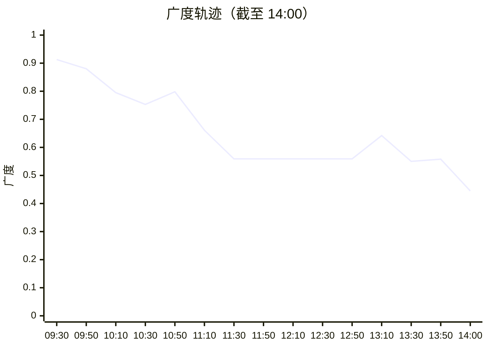

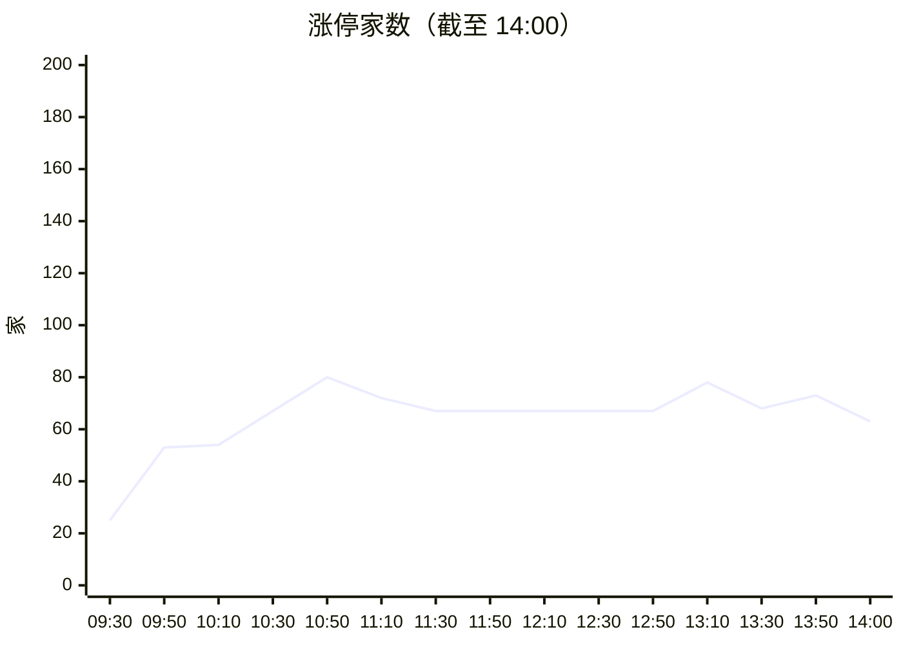


---
### 14:00 盯盘卡

**温度** 广度 **0.45**（-0.11） · 涨停 **63**（-10） · 炸板 **76** · 跌停 **5**（+0） · 成交 **13637.5 亿**（+368）
**判据** 广度>0.55 ❌ · 涨停≥60 ✅ · 昨涨停红盘率>60% ⏳未采 → **1/2 可证**

**连板梯队** 最高 **4** 板（中京电子 4板、东晶电子 3板、金新农 3板）｜ 1板 30家 / 2板 27家 / 3板 5家 / 4板 1家
**主线（按行业涨停数）** 汽车配件 **12**家 均+1.32% ｜ 元器件 **5**家 均+1.45% ｜ 服饰 **4**家 均+1.03% ｜ 文教休闲 **3**家 均+1.91% ｜ 机械基件 **3**家 均+1.54%
**板块分时** 半导体 +2.60% ｜ AI算力 +1.89% ｜ 军工 +1.54% ｜ 商业航天 +1.49% ｜ 光通信 -0.08% ｜ 白酒 -0.23% ｜ 医药 -0.79% ｜ 券商 -1.06%
**进攻位（距涨停≤3%）** 兴欣新材 +9.76%（差0.22%，化工原料，量比1.8，换手31.8%） ｜ *ST柳化  +9.73%（差0.40%，农药化肥，量比3.9，换手1.2%） ｜ *ST美芝 +9.49%（差0.45%，装修装饰，量比2.3，换手5.0%） ｜ 华东重机 +9.09%（差0.79%，机床制造，量比2.6，换手46.0%） ｜ *ST泉为 +18.89%（差0.92%，塑料，量比2.0，换手4.6%）
**风险（炸板）** *ST开元 高+20.25%→收+19.02% ｜ 首航新能 高+20.02%→收+8.15% ｜ 慧博云通 高+20.01%→收+11.15% ｜ 黄山谷捷 高+20.01%→收+8.86%
**资金（行业成交额）** 元器件 1666亿 ｜ 通信设备 1237亿 ｜ 汽车配件 443亿 ｜ 机械基件 279亿
**资金（个股成交额）** 中际旭创 242亿 ｜ 新易盛 213亿 ｜ 东山精密 127亿 ｜ 寒武纪   124亿 ｜ 长鑫科技 100亿
**新晋涨停（vs 上一条）** 8 家：长华集团(汽车配件)、宁波东力(机械基件)、汇洲智能(机床制造)、联创电子(元器件)、一彬科技(汽车配件)、奥康国际(服饰)、ST中路  (文教休闲)、克来机电(汽车配件)

**我的池子**

| 票 | 仓位 | 现价 | 触发 | 距触发 | 距止损 | 状态 | 现在做什么 |
|---|---|---|---|---|---|---|---|
| 新易盛 | — | 184.98 | —↑ | —% | 13.9% | 等触发 | 盯 — |
| 中际旭创 | — | 425.01 | —↑ | —% | 12.9% | 等触发 | 盯 — |
| 源杰科技 | — | 608.94 | —↑ | —% | 10.9% | 等触发 | 盯 — |
| 景旺电子 | — | 58.85 | —↑ | —% | 14.4% | 等触发 | 盯 — |

**观察池** 强：凡拓数创 +16.81%、浙文影业 +10.14%、中京电子 +9.98% ｜ 弱：洛阳钼业 -3.05%、东方财富 -2.79%

**结论** ⚪ 窗口已过 —— 今日不再开新仓，只做记录与止损管理
**下一档盯** 中际旭创 425.01 → —（需涨 0.00%） ｜ 新易盛 184.98 → —（需涨 0.00%） ｜ 景旺电子 58.85 → —（需涨 0.00%）


---
### 14:05 盘中总结（14:00 快照 vs 13:50）

① 广度单档塌到全天最低：0.558（13:50）→ **0.445**（14:00），上涨 3119→2485、下跌 2286→2956（净 -634/+670），跌幅>3% 家数 111→171（+60）、涨幅>3% 家数 805→591（-214），涨停 73→63（-10，全天峰值 80 仍在 10:50）、炸板 65→76、炸板率 47.1%→**54.7%**（11-23 全天 15.08%）、跌停维持 5 家，成交 13269.4→13637.5 亿（+368）。板块 ETF 同向：光通信 +0.56%→**-0.08%**、半导体 +3.09%→+2.60%、AI算力 +2.44%→+1.89%，个股与板块代理一致，是真实抛压而非单批取数失真；但今日广度读数本身跳动极大（13:00 0.516→13:10 0.642→13:50 0.558→14:00 0.445），单档不作结论，趋势看「午后单边下行、14:00 为全天最低」。
② 预案池全线退档，没有一只逆势：执行池 新易盛 184.98（+2.00%，13:50 为 +3.12%）、中际旭创 425.01（+1.87%，+3.15%）、景旺电子 58.85（+3.46%，+4.38%）、源杰科技 608.94（**-0.34%**，由红转绿）；观察池 寒武纪 +8.77%→+7.52%（995→983.59，仍是全场最强之一）、长川 +5.63%→+4.39%、生益 +4.74%→+4.18%、龙版传媒 +4.55%→+3.71% 同步回落；封住的没动：中京电子 16.20 元一字 4 板（全场最高标）、浙文影业 4.02 涨停守住，凡拓数创 +16.81% 仍差 2 个点未封；弱侧 洛阳钼业 -3.05%、东方财富 -2.79%、风华高科 -1.28%。
③ 与预案对照：预案原话「能赚的是回踩承接的钱，不是追高开的钱」——四票现价仍全部在买区上方（买区上沿 新易盛 176.90 / 中际旭创 411.38 / 源杰 602.91 / 景旺 55.96，还需再跌 4.4% / 3.3% / 1.0% / 4.9% 才进区），执行池条件单全天一档未触达；no_trade_conditions 里「当日炸板率 >25% → 当日零新开」在 47.1%→54.7% 下持续成立，叠加午后第二窗口（13:15-14:00）已于 14:00 关门、其前置条件（广度自 <0.35 翻上 0.55 且涨停倍增）全天未出现——空仓是预案的结算结果，不是错过。
④ 一句话结论：尾盘是「广度塌到全天最低、炸板率过半、梯队只剩 4 板一个独苗」的分歧兑现，预案方向没被打脸也无需改判；维持空仓零新开，14:00 之后不再盯买区，只做记录与止损管理。
---
### 14:10 · 广度 0.34 ↓

| 指标 | 上轮 | 本轮 | Δ |
|---|---|---|---|
| 广度 | 0.445 | 0.341 | **-0.104** |
| 涨停 | 63 | 61 | -2 |
| 跌停 | 5 | 6 | +1 |
| 涨>3% | 591 | 435 | **-156** |
| 跌>3% | 171 | 291 | **+120** |
| 成交(亿) | 13,638 | 14,129 | +491 |

**钱在**：汽车配件 10封/+0.74% ｜ 元器件 5封/+0.78% ｜ 文教休闲 4封/+1.44%
**异动**：凡拓数创 +16.14% · 浙文影业 +10.14%(涨停) · 中京电子 +9.98%(涨停) · 寒武纪 +7.07% · 长川科技 +3.79%
**结论**：广度 -0.10 走弱｜涨停 -2 → 分歧，只做板块首板不接力

<details><summary>预案池 24 只（点开）</summary>

| 票 | 池 | 现价 | 涨幅 | 状态 |
|---|---|---|---|---|
| 新易盛 `300502.SZ` | execution_pool | 183.96 | +1.43% | up |
| 中际旭创 `300308.SZ` | execution_pool | 420.70 | +0.84% | up |
| 源杰科技 `688498.SH` | execution_pool | 605.99 | -0.82% | down |
| 景旺电子 `603228.SH` | execution_pool | 58.50 | +2.85% | up |
| 沪电股份 `002463.SZ` | watch_pool | 84.34 | +1.98% | up |
| 深南电路 `002916.SZ` | watch_pool | 208.70 | +0.29% | up |
| 生益电子 `688183.SH` | watch_pool | 73.51 | +3.42% | up |
| 长川科技 `300604.SZ` | watch_pool | 184.66 | +3.79% | up |
| 中芯国际 `688981.SH` | watch_pool | 125.53 | +3.23% | up |
| 寒武纪 `688256.SH` | watch_pool | 979.50 | +7.07% | up |
| 剑桥科技 `603083.SH` | watch_pool | 99.81 | -0.19% | down |
| 宇树科技 `688836.SH` | watch_pool | 720.20 | +1.72% | up |
| 双环传动 `002472.SZ` | watch_pool | 38.89 | +0.31% | up |
| 凡拓数创 `301313.SZ` | watch_pool | 82.45 | +16.14% | up |
| 中京电子 `002579.SZ` | watch_pool | 16.20 | +9.98% | limit_up |
| 风华高科 `000636.SZ` | watch_pool | 28.40 | -2.04% | down |
| 龙版传媒 `605577.SH` | watch_pool | 18.33 | +2.92% | up |
| 浙文影业 `601599.SH` | watch_pool | 4.02 | +10.14% | limit_up |
| 有研新材 `600206.SH` | watch_pool | 39.07 | -2.32% | down |
| 瑞芯微 `603893.SH` | watch_pool | 208.30 | +2.67% | up |
| 北方华创 `002371.SZ` | watch_pool | 548.61 | +1.39% | up |
| 洛阳钼业 `603993.SH` | watch_pool | 11.70 | -3.62% | down |
| 中信证券 `600030.SH` | watch_pool | 25.12 | -0.55% | down |
| 东方财富 `300059.SZ` | watch_pool | 18.07 | -2.95% | down |

</details>

---
### 14:10 盯盘卡

**温度** 广度 **0.34**（-0.10） · 涨停 **61**（-2） · 炸板 **81** · 跌停 **6**（+1） · 成交 **14128.7 亿**（+491）
**判据** 广度>0.55 ❌ · 涨停≥60 ✅ · 昨涨停红盘率>60% ⏳未采 → **1/2 可证**

**连板梯队** 最高 **4** 板（中京电子 4板、长华集团 3板、东方海洋 3板）｜ 1板 32家 / 2板 23家 / 3板 5家 / 4板 1家
**主线（按行业涨停数）** 汽车配件 **10**家 均+0.74% ｜ 元器件 **5**家 均+0.78% ｜ 文教休闲 **4**家 均+1.44% ｜ 机械基件 **3**家 均+0.85% ｜ 塑料 **3**家 均+0.69%
**板块分时** 半导体 +1.86% ｜ AI算力 +1.26% ｜ 军工 +0.88% ｜ 商业航天 +0.87% ｜ 白酒 -0.23% ｜ 光通信 -0.80% ｜ 券商 -1.27% ｜ 医药 -1.32%
**进攻位（距涨停≤3%）** 兴欣新材 +9.70%（差0.28%，化工原料，量比1.7，换手32.3%） ｜ ST雪发 +9.38%（差0.66%，商贸代理，量比3.9，换手1.4%） ｜ 国光股份 +9.19%（差0.79%，农药化肥，量比2.5，换手6.9%） ｜ 柯力传感 +8.88%（差1.03%，电器仪表，量比2.0，换手5.1%） ｜ 华东重机 +8.72%（差1.13%，机床制造，量比2.5，换手46.5%）
**风险（炸板）** 首航新能 高+20.02%→收+7.82% ｜ 慧博云通 高+20.01%→收+10.04% ｜ 黄山谷捷 高+20.01%→收+6.69% ｜ 值得买 高+20.01%→收+9.60%
**资金（行业成交额）** 元器件 1716亿 ｜ 通信设备 1274亿 ｜ 专用机械 623亿 ｜ 汽车配件 460亿
**资金（个股成交额）** 中际旭创 248亿 ｜ 新易盛 219亿 ｜ 东山精密 129亿 ｜ 寒武纪   127亿 ｜ 长鑫科技 103亿
**新晋涨停（vs 上一条）** 5 家：*ST开元(文教休闲)、*ST东珠 (建筑工程)、*ST柳化 (农药化肥)、魅视科技(IT设备)、*ST华鹏 (家居用品)

**我的池子**

| 票 | 仓位 | 现价 | 触发 | 距触发 | 距止损 | 状态 | 现在做什么 |
|---|---|---|---|---|---|---|---|
| 新易盛 | — | 183.96 | —↑ | —% | 13.5% | 等触发 | 盯 — |
| 中际旭创 | — | 420.7 | —↑ | —% | 12.0% | 等触发 | 盯 — |
| 源杰科技 | — | 605.99 | —↑ | —% | 10.5% | 等触发 | 盯 — |
| 景旺电子 | — | 58.5 | —↑ | —% | 13.9% | 等触发 | 盯 — |

**观察池** 强：凡拓数创 +16.14%、浙文影业 +10.14%、中京电子 +9.98% ｜ 弱：洛阳钼业 -3.62%、东方财富 -2.95%

**结论** ⚪ 窗口已过 —— 今日不再开新仓，只做记录与止损管理
**下一档盯** 中际旭创 420.7 → —（需涨 0.00%） ｜ 新易盛 183.96 → —（需涨 0.00%） ｜ 景旺电子 58.5 → —（需涨 0.00%）

---
### 14:20 · 广度 0.36 ↑

| 指标 | 上轮 | 本轮 | Δ |
|---|---|---|---|
| 广度 | 0.341 | 0.359 | +0.018 |
| 涨停 | 61 | 54 | **-7** |
| 跌停 | 6 | 5 | -1 |
| 涨>3% | 435 | 471 | **+36** |
| 跌>3% | 291 | 253 | **-38** |
| 成交(亿) | 14,129 | 14,617 | +488 |

**钱在**：汽车配件 9封/+0.77% ｜ 元器件 5封/+0.86% ｜ 文教休闲 4封/+1.48%
**异动**：凡拓数创 +17.20% · 浙文影业 +10.14%(涨停) · 中京电子 +9.98%(涨停) · 寒武纪 +7.13% · 长川科技 +4.21%
**结论**：广度 +0.02 横住｜涨停 -7 → 分歧，只做板块首板不接力

<details><summary>预案池 24 只（点开）</summary>

| 票 | 池 | 现价 | 涨幅 | 状态 |
|---|---|---|---|---|
| 新易盛 `300502.SZ` | execution_pool | 183.54 | +1.20% | up |
| 中际旭创 `300308.SZ` | execution_pool | 422.21 | +1.20% | up |
| 源杰科技 `688498.SH` | execution_pool | 603.52 | -1.23% | down |
| 景旺电子 `603228.SH` | execution_pool | 58.60 | +3.02% | up |
| 沪电股份 `002463.SZ` | watch_pool | 84.50 | +2.18% | up |
| 深南电路 `002916.SZ` | watch_pool | 208.52 | +0.20% | up |
| 生益电子 `688183.SH` | watch_pool | 73.77 | +3.78% | up |
| 长川科技 `300604.SZ` | watch_pool | 185.40 | +4.21% | up |
| 中芯国际 `688981.SH` | watch_pool | 125.95 | +3.58% | up |
| 寒武纪 `688256.SH` | watch_pool | 980.00 | +7.13% | up |
| 剑桥科技 `603083.SH` | watch_pool | 100.29 | +0.29% | up |
| 宇树科技 `688836.SH` | watch_pool | 722.21 | +2.01% | up |
| 双环传动 `002472.SZ` | watch_pool | 38.94 | +0.44% | up |
| 凡拓数创 `301313.SZ` | watch_pool | 83.20 | +17.20% | up |
| 中京电子 `002579.SZ` | watch_pool | 16.20 | +9.98% | limit_up |
| 风华高科 `000636.SZ` | watch_pool | 28.43 | -1.93% | down |
| 龙版传媒 `605577.SH` | watch_pool | 18.35 | +3.03% | up |
| 浙文影业 `601599.SH` | watch_pool | 4.02 | +10.14% | limit_up |
| 有研新材 `600206.SH` | watch_pool | 39.30 | -1.75% | down |
| 瑞芯微 `603893.SH` | watch_pool | 208.21 | +2.63% | up |
| 北方华创 `002371.SZ` | watch_pool | 548.15 | +1.30% | up |
| 洛阳钼业 `603993.SH` | watch_pool | 11.70 | -3.62% | down |
| 中信证券 `600030.SH` | watch_pool | 25.19 | -0.28% | down |
| 东方财富 `300059.SZ` | watch_pool | 18.11 | -2.74% | down |

</details>

---
### 14:20 盯盘卡

**温度** 广度 **0.36**（+0.02） · 涨停 **54**（-7） · 炸板 **89** · 跌停 **5**（-1） · 成交 **14616.7 亿**（+488）
**判据** 广度>0.55 ❌ · 涨停≥60 ❌ · 昨涨停红盘率>60% ⏳未采 → **0/2 可证**

**连板梯队** 最高 **4** 板（中京电子 4板、东晶电子 3板、长华集团 3板）｜ 1板 26家 / 2板 22家 / 3板 5家 / 4板 1家
**主线（按行业涨停数）** 汽车配件 **9**家 均+0.77% ｜ 元器件 **5**家 均+0.86% ｜ 文教休闲 **4**家 均+1.48% ｜ 机械基件 **3**家 均+0.91% ｜ 服饰 **3**家 均+0.71%
**板块分时** 半导体 +2.10% ｜ AI算力 +1.42% ｜ 军工 +1.32% ｜ 商业航天 +1.24% ｜ 白酒 +0.00% ｜ 光通信 -0.56% ｜ 券商 -1.06% ｜ 医药 -1.06%
**进攻位（距涨停≤3%）** 柯力传感 +9.65%（差0.32%，电器仪表，量比2.0，换手5.3%） ｜ 东方精工 +9.55%（差0.45%，轻工机械，量比3.7，换手8.2%） ｜ 华东重机 +9.46%（差0.45%，机床制造，量比2.4，换手47.1%） ｜ *ST仕净 +19.24%（差0.64%，环境保护，量比1.6，换手17.7%） ｜ 兴欣新材 +9.14%（差0.79%，化工原料，量比1.6，换手32.8%）
**风险（炸板）** *ST动力 高+20.19%→收+19.23% ｜ 首航新能 高+20.02%→收+8.32% ｜ 慧博云通 高+20.01%→收+9.93% ｜ 黄山谷捷 高+20.01%→收+7.47%
**资金（行业成交额）** 元器件 1772亿 ｜ 专用机械 643亿 ｜ 汽车配件 477亿 ｜ 机械基件 299亿
**资金（个股成交额）** 中际旭创 254亿 ｜ 新易盛 224亿 ｜ 东山精密 133亿 ｜ 寒武纪   131亿 ｜ 长鑫科技 106亿
**新晋涨停（vs 上一条）** 1 家：*ST春天 (医疗保健)

**我的池子**

| 票 | 仓位 | 现价 | 触发 | 距触发 | 距止损 | 状态 | 现在做什么 |
|---|---|---|---|---|---|---|---|
| 新易盛 | — | 183.54 | —↑ | —% | 13.3% | 等触发 | 盯 — |
| 中际旭创 | — | 422.21 | —↑ | —% | 12.3% | 等触发 | 盯 — |
| 源杰科技 | — | 603.52 | —↑ | —% | 10.1% | 等触发 | 盯 — |
| 景旺电子 | — | 58.6 | —↑ | —% | 14.0% | 等触发 | 盯 — |

**观察池** 强：凡拓数创 +17.20%、浙文影业 +10.14%、中京电子 +9.98% ｜ 弱：洛阳钼业 -3.62%、东方财富 -2.74%

**结论** ⚪ 窗口已过 —— 今日不再开新仓，只做记录与止损管理
**下一档盯** 中际旭创 422.21 → —（需涨 0.00%） ｜ 新易盛 183.54 → —（需涨 0.00%） ｜ 景旺电子 58.6 → —（需涨 0.00%）

---
### 14:30 · 广度 0.32 ↓

| 指标 | 上轮 | 本轮 | Δ |
|---|---|---|---|
| 广度 | 0.359 | 0.317 | -0.042 |
| 涨停 | 54 | 55 | +1 |
| 跌停 | 5 | 6 | +1 |
| 涨>3% | 471 | 409 | **-62** |
| 跌>3% | 253 | 328 | **+75** |
| 成交(亿) | 14,617 | 15,031 | +414 |

**钱在**：汽车配件 8封/+0.50% ｜ 元器件 5封/+0.50% ｜ 文教休闲 4封/+1.28%
**异动**：凡拓数创 +16.61% · 浙文影业 +10.14%(涨停) · 中京电子 +9.98%(涨停) · 寒武纪 +6.50% · 洛阳钼业 -3.95%
**结论**：广度 -0.04 横住｜涨停 +1 → 分歧，只做板块首板不接力

<details><summary>预案池 24 只（点开）</summary>

| 票 | 池 | 现价 | 涨幅 | 状态 |
|---|---|---|---|---|
| 新易盛 `300502.SZ` | execution_pool | 182.00 | +0.35% | up |
| 中际旭创 `300308.SZ` | execution_pool | 418.50 | +0.31% | up |
| 源杰科技 `688498.SH` | execution_pool | 599.00 | -1.97% | down |
| 景旺电子 `603228.SH` | execution_pool | 58.21 | +2.34% | up |
| 沪电股份 `002463.SZ` | watch_pool | 84.10 | +1.69% | up |
| 深南电路 `002916.SZ` | watch_pool | 207.16 | -0.45% | down |
| 生益电子 `688183.SH` | watch_pool | 73.12 | +2.87% | up |
| 长川科技 `300604.SZ` | watch_pool | 184.70 | +3.82% | up |
| 中芯国际 `688981.SH` | watch_pool | 125.77 | +3.43% | up |
| 寒武纪 `688256.SH` | watch_pool | 974.29 | +6.50% | up |
| 剑桥科技 `603083.SH` | watch_pool | 99.50 | -0.50% | down |
| 宇树科技 `688836.SH` | watch_pool | 720.06 | +1.70% | up |
| 双环传动 `002472.SZ` | watch_pool | 38.83 | +0.15% | up |
| 凡拓数创 `301313.SZ` | watch_pool | 82.78 | +16.61% | up |
| 中京电子 `002579.SZ` | watch_pool | 16.20 | +9.98% | limit_up |
| 风华高科 `000636.SZ` | watch_pool | 28.24 | -2.59% | down |
| 龙版传媒 `605577.SH` | watch_pool | 18.18 | +2.08% | up |
| 浙文影业 `601599.SH` | watch_pool | 4.02 | +10.14% | limit_up |
| 有研新材 `600206.SH` | watch_pool | 38.96 | -2.60% | down |
| 瑞芯微 `603893.SH` | watch_pool | 207.16 | +2.11% | up |
| 北方华创 `002371.SZ` | watch_pool | 547.46 | +1.18% | up |
| 洛阳钼业 `603993.SH` | watch_pool | 11.66 | -3.95% | down |
| 中信证券 `600030.SH` | watch_pool | 25.13 | -0.51% | down |
| 东方财富 `300059.SZ` | watch_pool | 18.07 | -2.95% | down |

</details>


---
### 14:30 盯盘卡

**温度** 广度 **0.32**（-0.04） · 涨停 **55**（+1） · 炸板 **89** · 跌停 **6**（+1） · 成交 **15030.6 亿**（+414）
**判据** 广度>0.55 ❌ · 涨停≥60 ❌ · 昨涨停红盘率>60% ⏳未采 → **0/2 可证**

**连板梯队** 最高 **4** 板（中京电子 4板、长华集团 3板、克来机电 3板）｜ 1板 27家 / 2板 22家 / 3板 5家 / 4板 1家
**主线（按行业涨停数）** 汽车配件 **8**家 均+0.50% ｜ 元器件 **5**家 均+0.50% ｜ 文教休闲 **4**家 均+1.28% ｜ 机械基件 **3**家 均+0.68% ｜ 服饰 **3**家 均+0.51%
**板块分时** 半导体 +1.73% ｜ 商业航天 +1.36% ｜ 军工 +1.32% ｜ AI算力 +1.10% ｜ 白酒 +0.00% ｜ 光通信 -0.72% ｜ 券商 -1.27% ｜ 医药 -1.32%
**进攻位（距涨停≤3%）** 兴欣新材 +9.80%（差0.19%，化工原料，量比1.6，换手33.5%） ｜ 闽发铝业 +9.44%（差0.44%，铝，量比1.5，换手24.7%） ｜ 柯力传感 +9.28%（差0.66%，电器仪表，量比2.0，换手5.5%） ｜ 华东重机 +9.21%（差0.67%，机床制造，量比2.3，换手47.4%） ｜ *ST仕净 +18.73%（差1.07%，环境保护，量比1.5，换手17.9%）
**风险（炸板）** *ST动力 高+20.19%→收+17.31% ｜ 首航新能 高+20.02%→收+8.60% ｜ 慧博云通 高+20.01%→收+9.42% ｜ 黄山谷捷 高+20.01%→收+6.62%
**资金（行业成交额）** 元器件 1811亿 ｜ 专用机械 662亿 ｜ 汽车配件 491亿 ｜ 化工原料 469亿
**资金（个股成交额）** 中际旭创 260亿 ｜ 新易盛 230亿 ｜ 东山精密 135亿 ｜ 寒武纪   133亿 ｜ 长鑫科技 109亿
**新晋涨停（vs 上一条）** 3 家：金牛化工(化工原料)、东方精工(轻工机械)、利君股份(航空)

**我的池子**

| 票 | 仓位 | 现价 | 触发 | 距触发 | 距止损 | 状态 | 现在做什么 |
|---|---|---|---|---|---|---|---|
| 新易盛 | — | 182.0 | —↑ | —% | 12.5% | 等触发 | 盯 — |
| 中际旭创 | — | 418.5 | —↑ | —% | 11.5% | 等触发 | 盯 — |
| 源杰科技 | — | 599.0 | —↑ | —% | 9.4% | 等触发 | 盯 — |
| 景旺电子 | — | 58.21 | —↑ | —% | 13.5% | 等触发 | 盯 — |

**观察池** 强：凡拓数创 +16.61%、浙文影业 +10.14%、中京电子 +9.98% ｜ 弱：洛阳钼业 -3.95%、东方财富 -2.95%

**结论** ⚪ 窗口已过 —— 今日不再开新仓，只做记录与止损管理
**下一档盯** 中际旭创 418.5 → —（需涨 0.00%） ｜ 新易盛 182.0 → —（需涨 0.00%） ｜ 景旺电子 58.21 → —（需涨 0.00%）

---
### 14:40 · 广度 0.35 ↑

| 指标 | 上轮 | 本轮 | Δ |
|---|---|---|---|
| 广度 | 0.317 | 0.347 | +0.030 |
| 涨停 | 55 | 54 | -1 |
| 跌停 | 6 | 6 | +0 |
| 涨>3% | 409 | 468 | **+59** |
| 跌>3% | 328 | 301 | **-27** |
| 成交(亿) | 15,031 | 15,478 | +447 |

**钱在**：汽车配件 8封/+0.71% ｜ 元器件 5封/+0.80% ｜ 文教休闲 4封/+1.54%
**异动**：凡拓数创 +17.34% · 浙文影业 +10.14%(涨停) · 中京电子 +9.98%(涨停) · 寒武纪 +6.16% · 长川科技 +3.95%
**结论**：广度 +0.03 横住｜涨停 -1 → 分歧，只做板块首板不接力

<details><summary>预案池 24 只（点开）</summary>

| 票 | 池 | 现价 | 涨幅 | 状态 |
|---|---|---|---|---|
| 新易盛 `300502.SZ` | execution_pool | 181.65 | +0.16% | up |
| 中际旭创 `300308.SZ` | execution_pool | 417.20 | +0.00% | flat |
| 源杰科技 `688498.SH` | execution_pool | 600.10 | -1.79% | down |
| 景旺电子 `603228.SH` | execution_pool | 58.26 | +2.43% | up |
| 沪电股份 `002463.SZ` | watch_pool | 84.18 | +1.79% | up |
| 深南电路 `002916.SZ` | watch_pool | 207.78 | -0.15% | down |
| 生益电子 `688183.SH` | watch_pool | 73.15 | +2.91% | up |
| 长川科技 `300604.SZ` | watch_pool | 184.94 | +3.95% | up |
| 中芯国际 `688981.SH` | watch_pool | 126.27 | +3.84% | up |
| 寒武纪 `688256.SH` | watch_pool | 971.11 | +6.16% | up |
| 剑桥科技 `603083.SH` | watch_pool | 99.23 | -0.77% | down |
| 宇树科技 `688836.SH` | watch_pool | 720.73 | +1.80% | up |
| 双环传动 `002472.SZ` | watch_pool | 38.87 | +0.26% | up |
| 凡拓数创 `301313.SZ` | watch_pool | 83.30 | +17.34% | up |
| 中京电子 `002579.SZ` | watch_pool | 16.20 | +9.98% | limit_up |
| 风华高科 `000636.SZ` | watch_pool | 28.32 | -2.31% | down |
| 龙版传媒 `605577.SH` | watch_pool | 18.16 | +1.97% | up |
| 浙文影业 `601599.SH` | watch_pool | 4.02 | +10.14% | limit_up |
| 有研新材 `600206.SH` | watch_pool | 39.00 | -2.50% | down |
| 瑞芯微 `603893.SH` | watch_pool | 207.21 | +2.13% | up |
| 北方华创 `002371.SZ` | watch_pool | 546.30 | +0.96% | up |
| 洛阳钼业 `603993.SH` | watch_pool | 11.68 | -3.79% | down |
| 中信证券 `600030.SH` | watch_pool | 25.12 | -0.55% | down |
| 东方财富 `300059.SZ` | watch_pool | 17.99 | -3.38% | down |

</details>

---
### 14:40 盯盘卡

**温度** 广度 **0.35**（+0.03） · 涨停 **54**（-1） · 炸板 **91** · 跌停 **6**（+0） · 成交 **15477.7 亿**（+447）
**判据** 广度>0.55 ❌ · 涨停≥60 ❌ · 昨涨停红盘率>60% ⏳未采 → **0/2 可证**

**连板梯队** 最高 **4** 板（中京电子 4板、长华集团 3板、金新农 3板）｜ 1板 26家 / 2板 22家 / 3板 5家 / 4板 1家
**主线（按行业涨停数）** 汽车配件 **8**家 均+0.71% ｜ 元器件 **5**家 均+0.80% ｜ 文教休闲 **4**家 均+1.54% ｜ 机械基件 **3**家 均+0.95% ｜ 服饰 **3**家 均+0.71%
**板块分时** 半导体 +1.73% ｜ 商业航天 +1.61% ｜ 军工 +1.32% ｜ AI算力 +1.02% ｜ 白酒 -0.23% ｜ 光通信 -0.80% ｜ 券商 -1.27% ｜ 医药 -1.32%
**进攻位（距涨停≤3%）** 柯力传感 +9.98%（差0.02%，电器仪表，量比2.0，换手5.8%） ｜ 华东重机 +9.83%（差0.11%，机床制造，量比2.3，换手48.0%） ｜ 兴欣新材 +9.59%（差0.38%，化工原料，量比1.5，换手33.8%） ｜ *ST春天  +9.41%（差0.54%，医疗保健，量比2.2，换手1.1%） ｜ 模塑科技 +9.36%（差0.57%，汽车配件，量比1.7，换手10.4%）
**风险（炸板）** *ST动力 高+20.19%→收+18.27% ｜ 首航新能 高+20.02%→收+8.87% ｜ 慧博云通 高+20.01%→收+9.68% ｜ 黄山谷捷 高+20.01%→收+7.80%
**资金（行业成交额）** 元器件 1858亿 ｜ 专用机械 683亿 ｜ 汽车配件 506亿 ｜ 化工原料 483亿
**资金（个股成交额）** 中际旭创 268亿 ｜ 新易盛 235亿 ｜ 东山精密 138亿 ｜ 寒武纪   136亿 ｜ 长鑫科技 112亿
**新晋涨停（vs 上一条）** 1 家：ST雪发(商贸代理)

**我的池子**

| 票 | 仓位 | 现价 | 触发 | 距触发 | 距止损 | 状态 | 现在做什么 |
|---|---|---|---|---|---|---|---|
| 新易盛 | — | 181.65 | —↑ | —% | 12.4% | 等触发 | 盯 — |
| 中际旭创 | — | 417.2 | —↑ | —% | 11.3% | 等触发 | 盯 — |
| 源杰科技 | — | 600.1 | —↑ | —% | 9.6% | 等触发 | 盯 — |
| 景旺电子 | — | 58.26 | —↑ | —% | 13.5% | 等触发 | 盯 — |

**观察池** 强：凡拓数创 +17.34%、浙文影业 +10.14%、中京电子 +9.98% ｜ 弱：洛阳钼业 -3.79%、东方财富 -3.38%

**结论** ⚪ 窗口已过 —— 今日不再开新仓，只做记录与止损管理
**下一档盯** 中际旭创 417.2 → —（需涨 0.00%） ｜ 新易盛 181.65 → —（需涨 0.00%） ｜ 景旺电子 58.26 → —（需涨 0.00%）

---
### 14:50 · 广度 0.36 ↑

| 指标 | 上轮 | 本轮 | Δ |
|---|---|---|---|
| 广度 | 0.347 | 0.362 | +0.015 |
| 涨停 | 54 | 62 | **+8** |
| 跌停 | 6 | 5 | -1 |
| 涨>3% | 468 | 495 | **+27** |
| 跌>3% | 301 | 280 | **-21** |
| 成交(亿) | 15,478 | 15,988 | +510 |

**钱在**：汽车配件 8封/+0.81% ｜ 元器件 5封/+0.89% ｜ 文教休闲 4封/+1.62%
**异动**：凡拓数创 +16.76% · 浙文影业 +10.14%(涨停) · 中京电子 +9.98%(涨停) · 寒武纪 +5.71% · 生益电子 +5.51%
**结论**：广度 +0.01 横住｜涨停 +8 → 分歧，只做板块首板不接力

<details><summary>预案池 24 只（点开）</summary>

| 票 | 池 | 现价 | 涨幅 | 状态 |
|---|---|---|---|---|
| 新易盛 `300502.SZ` | execution_pool | 181.27 | -0.05% | down |
| 中际旭创 `300308.SZ` | execution_pool | 417.50 | +0.07% | up |
| 源杰科技 `688498.SH` | execution_pool | 601.10 | -1.63% | down |
| 景旺电子 `603228.SH` | execution_pool | 58.38 | +2.64% | up |
| 沪电股份 `002463.SZ` | watch_pool | 84.20 | +1.81% | up |
| 深南电路 `002916.SZ` | watch_pool | 207.77 | -0.16% | down |
| 生益电子 `688183.SH` | watch_pool | 75.00 | +5.51% | up |
| 长川科技 `300604.SZ` | watch_pool | 184.32 | +3.60% | up |
| 中芯国际 `688981.SH` | watch_pool | 126.05 | +3.66% | up |
| 寒武纪 `688256.SH` | watch_pool | 967.00 | +5.71% | up |
| 剑桥科技 `603083.SH` | watch_pool | 99.20 | -0.80% | down |
| 宇树科技 `688836.SH` | watch_pool | 721.28 | +1.88% | up |
| 双环传动 `002472.SZ` | watch_pool | 38.85 | +0.21% | up |
| 凡拓数创 `301313.SZ` | watch_pool | 82.89 | +16.76% | up |
| 中京电子 `002579.SZ` | watch_pool | 16.20 | +9.98% | limit_up |
| 风华高科 `000636.SZ` | watch_pool | 28.30 | -2.38% | down |
| 龙版传媒 `605577.SH` | watch_pool | 18.18 | +2.08% | up |
| 浙文影业 `601599.SH` | watch_pool | 4.02 | +10.14% | limit_up |
| 有研新材 `600206.SH` | watch_pool | 38.99 | -2.52% | down |
| 瑞芯微 `603893.SH` | watch_pool | 207.37 | +2.21% | up |
| 北方华创 `002371.SZ` | watch_pool | 546.50 | +1.00% | up |
| 洛阳钼业 `603993.SH` | watch_pool | 11.68 | -3.79% | down |
| 中信证券 `600030.SH` | watch_pool | 25.13 | -0.51% | down |
| 东方财富 `300059.SZ` | watch_pool | 17.97 | -3.49% | down |

</details>

---
### 14:50 盯盘卡

**温度** 广度 **0.36**（+0.01） · 涨停 **62**（+8） · 炸板 **85** · 跌停 **5**（-1） · 成交 **15988.0 亿**（+510）
**判据** 广度>0.55 ❌ · 涨停≥60 ✅ · 昨涨停红盘率>60% ⏳未采 → **1/2 可证**

**连板梯队** 最高 **4** 板（中京电子 4板、东晶电子 3板、长华集团 3板）｜ 1板 31家 / 2板 25家 / 3板 5家 / 4板 1家
**主线（按行业涨停数）** 汽车配件 **8**家 均+0.81% ｜ 元器件 **5**家 均+0.89% ｜ 文教休闲 **4**家 均+1.62% ｜ 机械基件 **3**家 均+0.98% ｜ 服饰 **3**家 均+0.83%
**板块分时** 半导体 +1.61% ｜ 商业航天 +1.49% ｜ 军工 +1.32% ｜ AI算力 +0.86% ｜ 白酒 -0.23% ｜ 光通信 -0.80% ｜ 医药 -1.06% ｜ 券商 -1.49%
**进攻位（距涨停≤3%）** *ST美芝 +9.85%（差0.13%，装修装饰，量比2.0，换手5.8%） ｜ *ST泉为 +19.53%（差0.38%，塑料，量比1.8，换手5.2%） ｜ ST雪发 +9.62%（差0.44%，商贸代理，量比3.6，换手1.6%） ｜ 模塑科技 +9.22%（差0.70%，汽车配件，量比1.7，换手10.8%） ｜ *ST建艺 +9.10%（差0.83%，装修装饰，量比1.0，换手2.9%）
**风险（炸板）** 首航新能 高+20.02%→收+8.76% ｜ 慧博云通 高+20.01%→收+9.97% ｜ 黄山谷捷 高+20.01%→收+9.08% ｜ 值得买 高+20.01%→收+8.99%
**资金（行业成交额）** 元器件 1911亿 ｜ 汽车配件 522亿 ｜ 化工原料 498亿 ｜ 机械基件 326亿
**资金（个股成交额）** 中际旭创 276亿 ｜ 新易盛 240亿 ｜ 东山精密 142亿 ｜ 寒武纪   140亿 ｜ 长鑫科技 115亿
**新晋涨停（vs 上一条）** 9 家：华东重机(机床制造)、阳光照明(家用电器)、横河精密(塑料)、柯力传感(电器仪表)、兴欣新材(化工原料)、天安新材(塑料)、*ST动力(环境保护)、*ST瑞茂 (仓储物流)

**我的池子**

| 票 | 仓位 | 现价 | 触发 | 距触发 | 距止损 | 状态 | 现在做什么 |
|---|---|---|---|---|---|---|---|
| 新易盛 | — | 181.27 | —↑ | —% | 12.2% | 等触发 | 盯 — |
| 中际旭创 | — | 417.5 | —↑ | —% | 11.3% | 等触发 | 盯 — |
| 源杰科技 | — | 601.1 | —↑ | —% | 9.7% | 等触发 | 盯 — |
| 景旺电子 | — | 58.38 | —↑ | —% | 13.7% | 等触发 | 盯 — |

**观察池** 强：凡拓数创 +16.76%、浙文影业 +10.14%、中京电子 +9.98% ｜ 弱：洛阳钼业 -3.79%、东方财富 -3.49%

**结论** ⚪ 窗口已过 —— 今日不再开新仓，只做记录与止损管理
**下一档盯** 中际旭创 417.5 → —（需涨 0.00%） ｜ 新易盛 181.27 → —（需涨 0.00%） ｜ 景旺电子 58.38 → —（需涨 0.00%）

---
### 15:00 · 广度 0.19 ↓

| 指标 | 上轮 | 本轮 | Δ |
|---|---|---|---|
| 广度 | 0.362 | 0.185 | **-0.176** |
| 涨停 | 62 | 64 | +2 |
| 跌停 | 5 | 4 | -1 |
| 涨>3% | 495 | 293 | **-202** |
| 跌>3% | 280 | 152 | **-128** |
| 成交(亿) | 15,988 | 8,832 | -7,156 |

**钱在**：汽车配件 8封/+0.74% ｜ 元器件 5封/+0.79% ｜ 文教休闲 4封/+1.53%
**异动**：凡拓数创 +16.64% · 中京电子 +9.98%(涨停) · 长川科技 +3.28% · 东方财富 -3.28% · 双环传动 -0.13%
**结论**：广度 -0.18 走弱｜涨停 +2 → 弱势，不开新仓

<details><summary>预案池 24 只（点开）</summary>

| 票 | 池 | 现价 | 涨幅 | 状态 |
|---|---|---|---|---|
| 新易盛 `300502.SZ` | execution_pool | 180.01 | -0.74% | down |
| 中际旭创 `300308.SZ` | execution_pool | 417.00 | -0.05% | down |
| 源杰科技 `688498.SH` | execution_pool | 未知 | 未知 | no_data |
| 景旺电子 `603228.SH` | execution_pool | 未知 | 未知 | no_data |
| 沪电股份 `002463.SZ` | watch_pool | 84.13 | +1.73% | up |
| 深南电路 `002916.SZ` | watch_pool | 207.50 | -0.29% | down |
| 生益电子 `688183.SH` | watch_pool | 未知 | 未知 | no_data |
| 长川科技 `300604.SZ` | watch_pool | 183.74 | +3.28% | up |
| 中芯国际 `688981.SH` | watch_pool | 未知 | 未知 | no_data |
| 寒武纪 `688256.SH` | watch_pool | 未知 | 未知 | no_data |
| 剑桥科技 `603083.SH` | watch_pool | 未知 | 未知 | no_data |
| 宇树科技 `688836.SH` | watch_pool | 未知 | 未知 | no_data |
| 双环传动 `002472.SZ` | watch_pool | 38.72 | -0.13% | down |
| 凡拓数创 `301313.SZ` | watch_pool | 82.80 | +16.64% | up |
| 中京电子 `002579.SZ` | watch_pool | 16.20 | +9.98% | limit_up |
| 风华高科 `000636.SZ` | watch_pool | 28.25 | -2.55% | down |
| 龙版传媒 `605577.SH` | watch_pool | 未知 | 未知 | no_data |
| 浙文影业 `601599.SH` | watch_pool | 未知 | 未知 | no_data |
| 有研新材 `600206.SH` | watch_pool | 未知 | 未知 | no_data |
| 瑞芯微 `603893.SH` | watch_pool | 未知 | 未知 | no_data |
| 北方华创 `002371.SZ` | watch_pool | 547.24 | +1.14% | up |
| 洛阳钼业 `603993.SH` | watch_pool | 未知 | 未知 | no_data |
| 中信证券 `600030.SH` | watch_pool | 未知 | 未知 | no_data |
| 东方财富 `300059.SZ` | watch_pool | 18.01 | -3.28% | down |

</details>

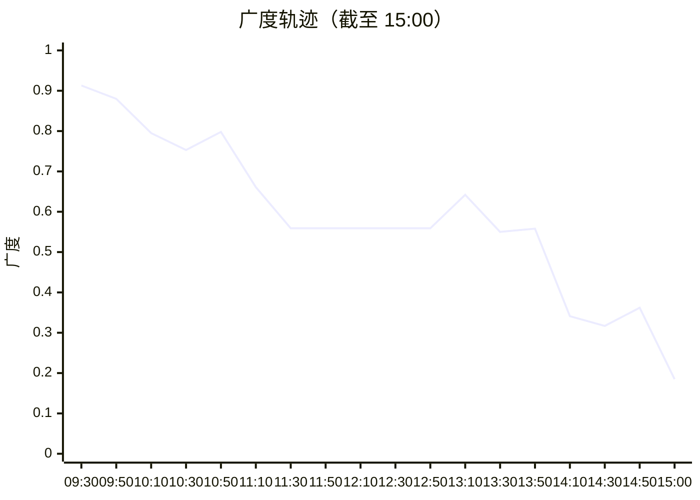

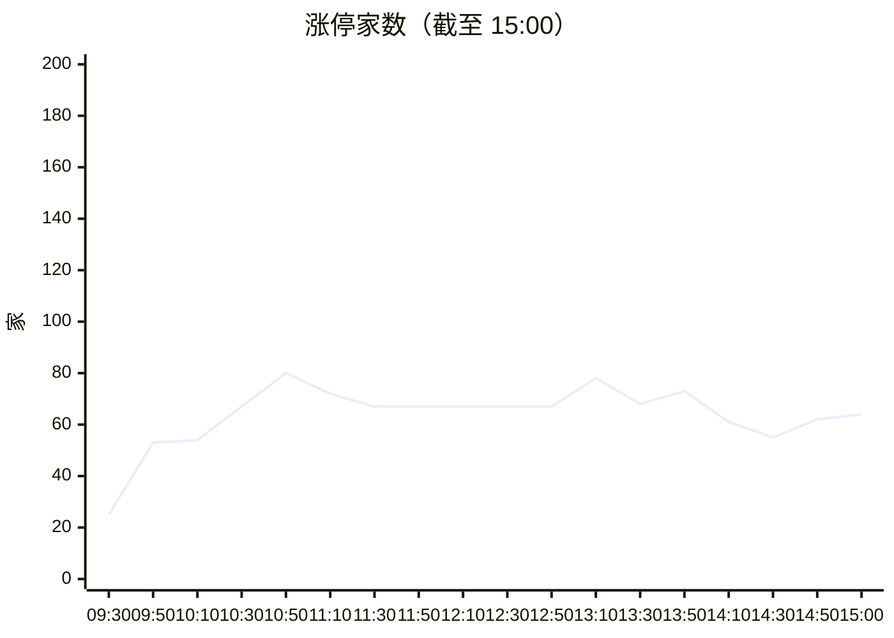


---
### 15:00 盯盘卡

> ⚠️ **数据降级**：有效样本 2904/5586，缺 2682 只 —— 下面的广度/涨停/成交都不可比，涨停变少是样本少了，不是炸板。

**温度** 广度 **0.36** · 涨停 **64** · 炸板 **85** · 跌停 **4** · 成交 **8831.9 亿**
**判据** ⏸ 数据降级，本快照不判定（不以缺样本的口径开仓）

**连板梯队** 最高 **4** 板（中京电子 4板、东方海洋 3板、长华集团 3板）｜ 1板 34家 / 2板 25家 / 3板 4家 / 4板 1家
**主线（按行业涨停数）** 汽车配件 **8**家 均+0.74% ｜ 元器件 **5**家 均+0.79% ｜ 文教休闲 **4**家 均+1.53% ｜ 机械基件 **3**家 均+0.87% ｜ 塑料 **3**家 均+0.75%
**板块分时** 半导体 +1.61% ｜ 军工 +1.43% ｜ 商业航天 +1.36% ｜ AI算力 +0.79% ｜ 白酒 -0.23% ｜ 光通信 -0.88% ｜ 医药 -1.32% ｜ 券商 -1.49%
**进攻位（距涨停≤3%）** 东晶电子 +9.62%（差0.35%，元器件，量比2.5，换手7.5%） ｜ *ST泉为 +19.53%（差0.38%，塑料，量比1.8，换手5.4%） ｜ ST雪发 +9.62%（差0.44%，商贸代理，量比3.5，换手1.7%） ｜ *ST建艺 +9.41%（差0.55%，装修装饰，量比1.1，换手3.0%） ｜ *ST动力 +19.23%（差0.81%，环境保护，量比2.4，换手8.8%）
**风险（炸板）** *ST动力 高+20.19%→收+19.23% ｜ 首航新能 高+20.02%→收+9.54% ｜ 慧博云通 高+20.01%→收+9.68% ｜ 黄山谷捷 高+20.01%→收+9.23%
**资金（行业成交额）** 元器件 1981亿 ｜ 汽车配件 542亿 ｜ 化工原料 517亿 ｜ 机械基件 342亿
**资金（个股成交额）** 中际旭创 286亿 ｜ 新易盛 250亿 ｜ 东山精密 147亿 ｜ 寒武纪   143亿 ｜ 长鑫科技 119亿

**我的池子**

| 票 | 仓位 | 现价 | 触发 | 距触发 | 距止损 | 状态 | 现在做什么 |
|---|---|---|---|---|---|---|---|
| 新易盛 | — | 180.01 | —↑ | —% | 11.6% | 等触发 | 盯 — |
| 中际旭创 | — | 417.0 | —↑ | —% | 11.2% | 等触发 | 盯 — |
| 源杰科技 | — | 无报价 | — | — | — | 无数据 | 忽略 |
| 景旺电子 | — | 无报价 | — | — | — | 无数据 | 忽略 |

**观察池** 强：凡拓数创 +16.64%、中京电子 +9.98%、长川科技 +3.28% ｜ 弱：东方财富 -3.28%、风华高科 -2.55%

**结论** ⚪ 窗口已过 —— 今日不再开新仓，只做记录与止损管理
**下一档盯** 中际旭创 417.0 → —（需涨 0.00%） ｜ 新易盛 180.01 → —（需涨 0.00%）

