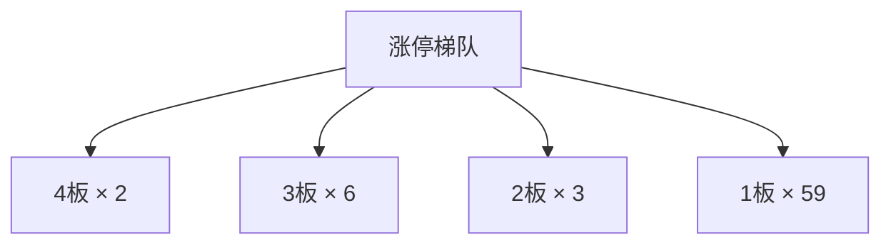
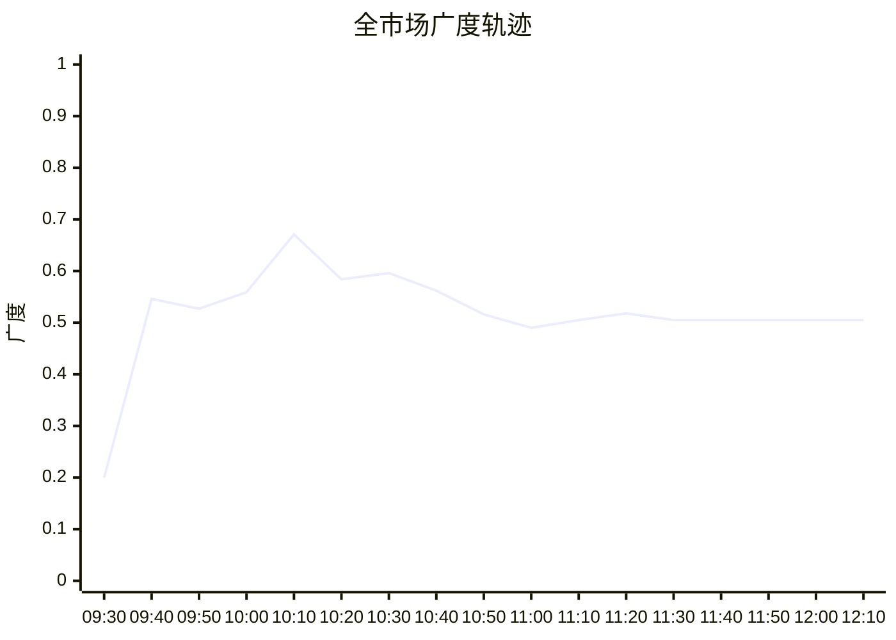

# 20261125 盘中总览（截至 12:10）

> **结论**：全市场涨2824/跌2626（广度0.51）；涨停70/跌停3。 钱在：百货(涨停7/成分35，密度0.200)、医药商业(涨停4/成分37，密度0.108)、纺织(涨停3/成分44，密度0.068)；零星涨停：渔业(2)、装修装饰(2)。 退潮（上涨广度最低）：汽车配件(上涨广度0.34)、软件服务(上涨广度0.50)、装修装饰(上涨广度0.68)。 梯队：4板×2、3板×6、2板×3、1板×59，最高4板。 预案：超买区 中际旭创、新易盛、源杰科技、中京电子、拓普集团、中芯国际、克来机电、长华集团、剑桥科技、福莱新材、奥比中光；未到价 胜宏科技、生益科技、鸣志电器、寒武纪、北方华创、工业富联、天孚通信、景旺电子、宁德时代、襄阳轴承、七匹狼、金牛化工、创维数字、均普智能；已触发 深南电路、长川科技、沪电股份、三花智控、华虹宏力。 较上一轮：广度持平。

### 盘前路径对照

> 未生成 market_scenarios.json（跑 scripts/plan/build_market_scenarios.py）

### 概念扩散

> 口径：涨停密度 = 涨停数/有效成分数；排序用密度，不用涨停家数（大板块天然涨停多）。

| 行业 | 涨停 | 有效成分 | 涨停密度 | 上涨广度 |
|---|---|---|---|---|
| 渔业 ⬦ | 2 | 7 | 0.286 | 0.86 |
| 百货 | 7 | 35 | 0.200 | 1.00 |
| 医药商业 | 4 | 37 | 0.108 | 1.00 |
| 装修装饰 ⬦ | 2 | 25 | 0.080 | 0.68 |
| 纺织 | 3 | 44 | 0.068 | 0.70 |
| 中成药 | 4 | 68 | 0.059 | 0.93 |
| 文教休闲 | 3 | 51 | 0.059 | 0.71 |
| 化学制药 | 8 | 149 | 0.054 | 0.83 |
| 汽车配件 | 4 | 273 | 0.015 | 0.34 |
| 软件服务 | 3 | 280 | 0.011 | 0.50 |

> ⬦ = 涨停 <3 只，零星个例，不构成扩散（不计入「钱在」判定）。

### 涨停梯队

| 身位 | 家数 |
|---|---|
| 4板 | 2 |
| 3板 | 6 |
| 2板 | 3 |
| 1板 | 59 |

| 最高板个股 | 板数 |
|---|---|
| 克来机电 | 4 |
| 金新农 | 4 |
| 汇洲智能 | 3 |
| 铁流股份 | 3 |
| 创源股份 | 3 |
| 九阳股份 | 3 |

### 预案池对照

| 票 | 池 | 板块 | 现价 | 涨幅 | 触发价 | 买区 | 风险位 | 判定 |
|---|---|---|---|---|---|---|---|---|
| 中际旭创 `300308.SZ` | execution_pool | AI硬件·CPO/光模块（守正·资金腿） | 418.79 | 0.43% | 410.00 | [403.00, 410.00] | 387.40 | **超买区** |
| 新易盛 `300502.SZ` | execution_pool | AI硬件·CPO/光模块（守正·资金腿） | 183.68 | 2.04% | 176.00 | [172.00, 176.00] | 165.40 | **超买区** |
| 深南电路 `002916.SZ` | execution_pool | AI硬件·PCB/元件（出奇·弹性奇标） | 203.45 | -1.95% | 203.50 | [199.00, 203.50] | 191.00 | **已触发** |
| 长川科技 `300604.SZ` | execution_pool | 半导体国产链·设备（出奇·低位设备腿） | 173.69 | -5.47% | 181.00 | [176.00, 181.00] | 170.00 | **已触发** |
| 源杰科技 `688498.SH` | watch_pool | AI硬件·CPO 光芯片（守正·资金腿｜最高 | 601.41 | 0.35% | 558.00 | [553.00, 558.00] | 528.00 | **超买区** |
| 沪电股份 `002463.SZ` | watch_pool | AI硬件·PCB/元件 | 82.31 | -2.16% | 83.35 | [82.00, 83.35] | 78.00 | **已触发** |
| 中京电子 `002579.SZ` | watch_pool | AI硬件·PCB（身位股·全市场最高标） | 16.61 | 2.53% | 15.71 | [14.90, 15.71] | — | **超买区** |
| 拓普集团 `601689.SH` | watch_pool | 人形机器人·执行器/整机 | 51.60 | -4.99% | 51.00 | [50.30, 51.00] | 47.80 | **超买区** |
| 三花智控 `002050.SZ` | watch_pool | 人形机器人·心智锚 | 32.74 | -4.71% | 33.41 | [33.41, 34.53] | — | **已触发** |
| 中芯国际 `688981.SH` | watch_pool | 半导体国产链·代工（守正·价格锚） | 123.90 | -2.06% | 122.71 | [116.39, 122.71] | — | **超买区** |
| 胜宏科技 `300476.SZ` | watch_pool | AI硬件·PCB 弹性 | 125.46 | 2.57% | 135.47 | [134.80, 136.82] | 127.34 | **未到价** |
| 生益科技 `600183.SH` | watch_pool | AI硬件·覆铜板 | 60.37 | -2.00% | 67.16 | [66.83, 67.83] | 63.13 | **未到价** |
| 克来机电 `603960.SH` | watch_pool | 人形机器人·3 板一字 | 18.60 | 9.99% | 16.40 | [15.56, 16.40] | — | **超买区** |
| 华虹宏力 `688347.SH` | watch_pool | 半导体国产链·代工 | 188.09 | -10.17% | 202.00 | [202.00, 206.00] | 190.00 | **已触发** |
| 鸣志电器 `603728.SH` | watch_pool | 人形机器人·步进电机 | 50.21 | -4.14% | 54.12 | [53.85, 54.66] | 50.87 | **未到价** |
| 长华集团 `605018.SH` | watch_pool | 人形机器人·3 板一字 | 12.87 | 3.62% | 12.05 | [11.43, 12.05] | — | **超买区** |
| 寒武纪 `688256.SH` | watch_pool | 半导体国产链·算力芯片 | 930.60 | -4.06% | 1002.99 | [998.00, 1012.97] | 942.81 | **未到价** |
| 北方华创 `002371.SZ` | watch_pool | 半导体国产链·设备 | 500.98 | -8.45% | 563.08 | [560.28, 568.68] | 529.30 | **未到价** |
| 工业富联 `601138.SH` | watch_pool | AI硬件·服务器 | 40.28 | -1.66% | 42.33 | [42.12, 42.75] | 39.79 | **未到价** |
| 天孚通信 `300394.SZ` | watch_pool | AI硬件·CPO 龙三 | 133.83 | 10.08% | 134.90 | [134.23, 136.24] | 126.81 | **未到价** |
| 景旺电子 `603228.SH` | watch_pool | AI硬件·PCB 二线 | 59.48 | 1.42% | 62.88 | [62.57, 63.51] | 59.11 | **未到价** |
| 剑桥科技 `603083.SH` | watch_pool | AI硬件·CPO 连接 | 99.25 | 0.05% | 94.90 | [94.90, 97.00] | 90.60 | **超买区** |
| 宁德时代 `300750.SZ` | watch_pool | 新能源·锂电权重（B 计划·对手盘） | 216.50 | -4.78% | 229.74 | [227.00, 230.50] | 216.00 | **未到价** |
| 襄阳轴承 `000678.SZ` | watch_pool | 妖·羊年谐音(yáng)+减速器真成分 | 19.02 | -2.86% | 20.39 | [20.29, 20.59] | 19.17 | **未到价** |
| 七匹狼 `002029.SZ` | watch_pool | 妖·狼族（狼吃羊叙事对） | 6.74 | 1.05% | 6.86 | [6.83, 6.93] | 6.45 | **未到价** |
| 福莱新材 `605488.SH` | watch_pool | 妖·羊年吉祥字（福） | 51.21 | -0.47% | 49.44 | [49.44, 50.94] | — | **超买区** |
| 金牛化工 `600722.SH` | watch_pool | 妖·吉祥字（金牛） | 12.93 | 8.20% | 13.58 | [13.58, 13.99] | — | **未到价** |
| 创维数字 `000810.SZ` | watch_pool | 具身数据/物理AI（R3 L1_only 新 | 9.64 | -3.60% | 10.31 | [10.26, 10.41] | 9.69 | **未到价** |
| 奥比中光 `688322.SH` | watch_pool | 具身数据/3D 视觉 | 97.40 | -4.61% | 93.41 | [93.41, 95.30] | — | **超买区** |
| 均普智能 `688306.SH` | watch_pool | 具身数据/智能装备 | 8.21 | -2.26% | 8.84 | [8.84, 9.20] | — | **未到价** |

### 全天广度轨迹

| 时点 | 涨 | 跌 | 广度 | 涨停 | 跌停 | 成交(亿) | 有效样本 |
|---|---|---|---|---|---|---|---|
| 0930 | 1115 | 4120 | 0.200 | 14 | 4 | 581 | 5554 |
| 0940 | 3048 | 2318 | 0.546 | 34 | 5 | 2366 | 5573 |
| 0950 | 2942 | 2435 | 0.527 | 35 | 3 | 3471 | 5573 |
| 1000 | 3121 | 2302 | 0.559 | 42 | 4 | 4277 | 5573 |
| 1010 | 3748 | 1693 | 0.671 | 53 | 3 | 4950 | 5573 |
| 1020 | 3263 | 2188 | 0.584 | 56 | 3 | 5420 | 5573 |
| 1030 | 3328 | 2117 | 0.596 | 58 | 3 | 5828 | 5573 |
| 1040 | 3138 | 2318 | 0.562 | 65 | 3 | 6237 | 5573 |
| 1050 | 2884 | 2571 | 0.516 | 68 | 3 | 6610 | 5573 |
| 1100 | 2736 | 2697 | 0.490 | 70 | 3 | 6932 | 5573 |
| 1110 | 2820 | 2622 | 0.505 | 69 | 3 | 7218 | 5573 |
| 1120 | 2894 | 2543 | 0.518 | 67 | 3 | 7462 | 5573 |
| 1130 | 2824 | 2626 | 0.505 | 70 | 3 | 7689 | 5573 |
| 1140 | 2824 | 2626 | 0.505 | 70 | 3 | 7689 | 5573 |
| 1150 | 2824 | 2626 | 0.505 | 70 | 3 | 7689 | 5573 |
| 1200 | 2824 | 2626 | 0.505 | 70 | 3 | 7689 | 5573 |
| 1210 | 2824 | 2626 | 0.505 | 70 | 3 | 7689 | 5573 |

### 观察建议（仅研究）

- **环境**：广度 0.51、涨停 70、跌停 3。
- **方向**：百货(涨停7/成分35)、医药商业(涨停4/成分37)、纺织(涨停3/成分44)。
- **预案**：超买区 11 只、已触发 5 只、未到价 14 只。买区已错过的票不追高，要参与需等新剧本。
- **定性**：分歧（广度 0.45–0.75）。

---
### 11:50 盯盘卡

**温度** 广度 **0.51**（+0.00） · 涨停 **70**（+0） · 炸板 **17** · 跌停 **3**（+0） · 成交 **7688.7 亿**（+0）
**判据** 广度>0.55 ❌ · 涨停≥60 ✅ · 昨涨停红盘率>60% ⏳未采 → **1/2 可证**

> **当前落点**：判据不足 → 不开，只观察｜判据 1/2｜预案 4 只｜钱在：化学制药 8封、百货 7封

**连板梯队** 最高 **4** 板（金新农 4板、克来机电 4板、创源股份 3板）｜ 1板 59家 / 2板 3家 / 3板 6家 / 4板 2家
**主线（按行业涨停数）** 化学制药 **8**家 均+2.41% ｜ 百货 **7**家 均+4.72% ｜ 医药商业 **4**家 均+3.22% ｜ 中成药 **4**家 均+2.54% ｜ 汽车配件 **4**家 均-0.87%
**板块分时** 白酒 +1.16% ｜ 医药 +0.53% ｜ 商业航天 -0.49% ｜ 券商 -0.86% ｜ 军工 -0.87% ｜ 光通信 -1.21% ｜ AI算力 -1.87% ｜ 半导体 -3.90%
**进攻位（距涨停≤3%）** *ST闻泰  +9.38%（差0.59%，半导体，量比2.4，换手3.0%） ｜ 金牛化工 +8.20%（差1.70%，化工原料，量比3.4，换手18.8%） ｜ 红四方   +8.01%（差1.84%，农药化肥，量比6.0，换手14.0%） ｜ 华孚时尚 +7.81%（差1.93%，纺织，量比1.6，换手6.3%） ｜ 报 喜 鸟 +7.59%（差2.35%，服饰，量比3.3，换手7.4%）
**风险（炸板）** 报 喜 鸟 高+10.13%→收+7.59% ｜ 中哲精化 高+10.10%→收+4.81% ｜ 益盛药业 高+10.04%→收+5.41% ｜ 合富中国 高+10.03%→收+6.54%
**资金（行业成交额）** 软件服务 332亿 ｜ 汽车配件 261亿 ｜ 化学制药 176亿 ｜ 中成药 61亿
**资金（个股成交额）** 新易盛 112亿 ｜ 中际旭创 108亿 ｜ 天孚通信 83亿 ｜ 宁德时代 63亿 ｜ 华虹宏力 61亿

**我的池子**

| 票 | 仓位 | 现价 | 触发 | 距触发 | 距止损 | 状态 | 现在做什么 |
|---|---|---|---|---|---|---|---|
| 中际旭创 | — | 418.79 | 410.0↑ | -2.10% | 7.5% | 已触发·窗口已过 | 只记录不追 |
| 新易盛 | — | 183.68 | 176.0↑ | -4.18% | 10.0% | 已触发·窗口已过 | 只记录不追 |
| 深南电路 | — | 203.45 | 203.5↑ | 0.02% | 6.1% | 未触发·窗口已过 | 今日不再开仓 |
| 长川科技 | — | 173.69 | 181.0↑ | 4.21% | 2.1% | 未触发·窗口已过 | 今日不再开仓 |

**观察池** 强：天孚通信 +10.08%、克来机电 +9.99%、金牛化工 +8.20% ｜ 弱：华虹宏力 -10.17%、北方华创 -8.45%

**结论** ⚪ 窗口已过 —— 今日不再开新仓，只做记录与止损管理

---
### 12:00 盯盘卡

**温度** 广度 **0.51**（+0.00） · 涨停 **70**（+0） · 炸板 **17** · 跌停 **3**（+0） · 成交 **7688.7 亿**（+0）
**判据** 广度>0.55 ❌ · 涨停≥60 ✅ · 昨涨停红盘率>60% ⏳未采 → **1/2 可证**

> **当前落点**：判据不足 → 不开，只观察｜判据 1/2｜预案 4 只｜钱在：化学制药 8封、百货 7封

**连板梯队** 最高 **4** 板（克来机电 4板、金新农 4板、杭州解百 3板）｜ 1板 59家 / 2板 3家 / 3板 6家 / 4板 2家
**主线（按行业涨停数）** 化学制药 **8**家 均+2.41% ｜ 百货 **7**家 均+4.72% ｜ 医药商业 **4**家 均+3.22% ｜ 中成药 **4**家 均+2.54% ｜ 汽车配件 **4**家 均-0.87%
**板块分时** 白酒 +1.16% ｜ 医药 +0.53% ｜ 商业航天 -0.49% ｜ 券商 -0.86% ｜ 军工 -0.87% ｜ 光通信 -1.21% ｜ AI算力 -1.87% ｜ 半导体 -3.90%
**进攻位（距涨停≤3%）** *ST闻泰  +9.38%（差0.59%，半导体，量比2.4，换手3.0%） ｜ 金牛化工 +8.20%（差1.70%，化工原料，量比3.4，换手18.8%） ｜ 红四方   +8.01%（差1.84%，农药化肥，量比6.0，换手14.0%） ｜ 华孚时尚 +7.81%（差1.93%，纺织，量比1.6，换手6.3%） ｜ 报 喜 鸟 +7.59%（差2.35%，服饰，量比3.3，换手7.4%）
**风险（炸板）** 报 喜 鸟 高+10.13%→收+7.59% ｜ 中哲精化 高+10.10%→收+4.81% ｜ 益盛药业 高+10.04%→收+5.41% ｜ 合富中国 高+10.03%→收+6.54%
**资金（行业成交额）** 软件服务 332亿 ｜ 汽车配件 261亿 ｜ 化学制药 176亿 ｜ 中成药 61亿
**资金（个股成交额）** 新易盛 112亿 ｜ 中际旭创 108亿 ｜ 天孚通信 83亿 ｜ 宁德时代 63亿 ｜ 华虹宏力 61亿

**我的池子**

| 票 | 仓位 | 现价 | 触发 | 距触发 | 距止损 | 状态 | 现在做什么 |
|---|---|---|---|---|---|---|---|
| 中际旭创 | — | 418.79 | 410.0↑ | -2.10% | 7.5% | 已触发·窗口已过 | 只记录不追 |
| 新易盛 | — | 183.68 | 176.0↑ | -4.18% | 10.0% | 已触发·窗口已过 | 只记录不追 |
| 深南电路 | — | 203.45 | 203.5↑ | 0.02% | 6.1% | 未触发·窗口已过 | 今日不再开仓 |
| 长川科技 | — | 173.69 | 181.0↑ | 4.21% | 2.1% | 未触发·窗口已过 | 今日不再开仓 |

**观察池** 强：天孚通信 +10.08%、克来机电 +9.99%、金牛化工 +8.20% ｜ 弱：华虹宏力 -10.17%、北方华创 -8.45%

**结论** ⚪ 窗口已过 —— 今日不再开新仓，只做记录与止损管理

---

### 12:05 盘中总结 · 半日收官（LLM）

**① 广度/涨跌停（12:00 快照 = 11:30 收盘值；11:40/11:50/12:00 三张完全相同，午休冻结，Δ 全 0，趋势按 11:20→11:30 最后一跳）**：广度 **0.506**（11:20 0.518，早盘峰值 0.596@10:30）· 涨停 **70**（早盘 09:30 仅 14 → 09:40 34 → 10:00 42 → 10:30 58 → 11:20 67 → 11:30 70，后半段在 67–70 横住）· 跌停 **3** · 炸板 **17**（炸板率 19.5%，盘中峰值 19@11:20）· 半日成交 **7688.7 亿**。涨停家数站住 60+ 且炸板率远低于 45%，但广度从 0.60 退到 0.51 → **涨停在增、中位票在跌，典型分化而非普涨**。

**② 预案池异动**：execution_pool 4 只无涨跌停——中际旭创 +0.43%（418.79）、新易盛 +2.04%（183.68）均已站到买区上方；深南电路 -1.95%、长川科技 -5.47%（半导体系拖累，距止损只剩 2.1%）。watch_pool 强：克来机电 **+9.99% 封板（4板）**、天孚通信 +10.08%（光模块只剩它独走）、金牛化工 +8.20%；弱：华虹宏力 -10.17%、北方华创 -8.45%、宁德时代 -4.78%、拓普集团 -4.99% —— 半导体与机器人两条腿全在杀；中京电子（昨 4 板）+2.53% 断板。

**③ 预案对照**：预案 intraday_focus 的三条闸门里，涨停 ≥40 ✅（70）、炸板率 <45% ✅（19.5%）两条硬闸门实际已打开；中际旭创/新易盛也都在昨收上方。但买区 403–410 只在 09:40 前后短暂可达（彼时涨停仅 34 家，闸门未开），10:00 涨停到 42 家时价格已回到 421（> max_acceptable_ask 412）→ **「价格到位」与「闸门打开」从未同时成立**，09:35–10:30 窗口已过；深南/长川全天上不到触发价。P2 午盘修订的定性一致：中际旭创/新易盛属「闸门开着但价格跑掉」，深南/长川属「闸门自己关着」。**所以预案「今日零新开」的结果是对的，但性质是被价格跑掉，不是被盘面否掉。**

**④ 一句话结论**：温度够、买点没给，今日不开新仓不算踏空；钱在医药商业/百货/化学制药，光模块只剩天孚独走，半导体全链承压——下午 13:00 后只盯两件事：涨停家数能否守住 60、中际旭创能否站稳 417（昨收）。

---
### 12:10 盯盘卡

**温度** 广度 **0.51**（+0.00） · 涨停 **70**（+0） · 炸板 **17** · 跌停 **3**（+0） · 成交 **7688.7 亿**（+0）
**判据** 广度>0.55 ❌ · 涨停≥60 ✅ · 昨涨停红盘率>60% ⏳未采 → **1/2 可证**

> **当前落点**：判据不足 → 不开，只观察｜判据 1/2｜预案 4 只｜钱在：化学制药 8封、百货 7封

**连板梯队** 最高 **4** 板（克来机电 4板、金新农 4板、汇洲智能 3板）｜ 1板 59家 / 2板 3家 / 3板 6家 / 4板 2家
**主线（按行业涨停数）** 化学制药 **8**家 均+2.41% ｜ 百货 **7**家 均+4.72% ｜ 医药商业 **4**家 均+3.22% ｜ 中成药 **4**家 均+2.54% ｜ 汽车配件 **4**家 均-0.87%
**板块分时** 白酒 +1.16% ｜ 医药 +0.53% ｜ 商业航天 -0.49% ｜ 券商 -0.86% ｜ 军工 -0.87% ｜ 光通信 -1.21% ｜ AI算力 -1.87% ｜ 半导体 -3.90%
**进攻位（距涨停≤3%）** *ST闻泰  +9.38%（差0.59%，半导体，量比2.4，换手3.0%） ｜ 金牛化工 +8.20%（差1.70%，化工原料，量比3.4，换手18.8%） ｜ 红四方   +8.01%（差1.84%，农药化肥，量比6.0，换手14.0%） ｜ 华孚时尚 +7.81%（差1.93%，纺织，量比1.6，换手6.3%） ｜ 报 喜 鸟 +7.59%（差2.35%，服饰，量比3.3，换手7.4%）
**风险（炸板）** 报 喜 鸟 高+10.13%→收+7.59% ｜ 中哲精化 高+10.10%→收+4.81% ｜ 益盛药业 高+10.04%→收+5.41% ｜ 合富中国 高+10.03%→收+6.54%
**资金（行业成交额）** 软件服务 332亿 ｜ 汽车配件 261亿 ｜ 化学制药 176亿 ｜ 中成药 61亿
**资金（个股成交额）** 新易盛 112亿 ｜ 中际旭创 108亿 ｜ 天孚通信 83亿 ｜ 宁德时代 63亿 ｜ 华虹宏力 61亿

**我的池子**

| 票 | 仓位 | 现价 | 触发 | 距触发 | 距止损 | 状态 | 现在做什么 |
|---|---|---|---|---|---|---|---|
| 中际旭创 | — | 418.79 | 410.0↑ | -2.10% | 7.5% | 已触发·窗口已过 | 只记录不追 |
| 新易盛 | — | 183.68 | 176.0↑ | -4.18% | 10.0% | 已触发·窗口已过 | 只记录不追 |
| 深南电路 | — | 203.45 | 203.5↑ | 0.02% | 6.1% | 未触发·窗口已过 | 今日不再开仓 |
| 长川科技 | — | 173.69 | 181.0↑ | 4.21% | 2.1% | 未触发·窗口已过 | 今日不再开仓 |

**观察池** 强：天孚通信 +10.08%、克来机电 +9.99%、金牛化工 +8.20% ｜ 弱：华虹宏力 -10.17%、北方华创 -8.45%

**结论** ⚪ 窗口已过 —— 今日不再开新仓，只做记录与止损管理

---
### 12:11 盯盘卡

**温度** 广度 **0.51**（+0.00） · 涨停 **70**（+0） · 炸板 **17** · 跌停 **3**（+0） · 成交 **7688.7 亿**（+0）
**判据** 广度>0.55 ❌ · 涨停≥60 ✅ · 昨涨停红盘率>60% ⏳未采 → **1/2 可证**

> **当前落点**：判据不足 → 不开，只观察｜判据 1/2｜预案 4 只｜钱在：化学制药 8封、百货 7封

**连板梯队** 最高 **4** 板（金新农 4板、克来机电 4板、创源股份 3板）｜ 1板 59家 / 2板 3家 / 3板 6家 / 4板 2家
**主线（按行业涨停数）** 化学制药 **8**家 均+2.41% ｜ 百货 **7**家 均+4.72% ｜ 医药商业 **4**家 均+3.22% ｜ 中成药 **4**家 均+2.54% ｜ 汽车配件 **4**家 均-0.87%
**板块分时** 白酒 +1.16% ｜ 医药 +0.53% ｜ 商业航天 -0.49% ｜ 券商 -0.86% ｜ 军工 -0.87% ｜ 光通信 -1.21% ｜ AI算力 -1.87% ｜ 半导体 -3.90%
**进攻位（距涨停≤3%）** *ST闻泰  +9.38%（差0.59%，半导体，量比2.4，换手3.0%） ｜ 金牛化工 +8.20%（差1.70%，化工原料，量比3.4，换手18.8%） ｜ 红四方   +8.01%（差1.84%，农药化肥，量比6.0，换手14.0%） ｜ 华孚时尚 +7.81%（差1.93%，纺织，量比1.6，换手6.3%） ｜ 报 喜 鸟 +7.59%（差2.35%，服饰，量比3.3，换手7.4%）
**风险（炸板）** 报 喜 鸟 高+10.13%→收+7.59% ｜ 中哲精化 高+10.10%→收+4.81% ｜ 益盛药业 高+10.04%→收+5.41% ｜ 合富中国 高+10.03%→收+6.54%
**资金（行业成交额）** 软件服务 332亿 ｜ 汽车配件 261亿 ｜ 化学制药 176亿 ｜ 中成药 61亿
**资金（个股成交额）** 新易盛 112亿 ｜ 中际旭创 108亿 ｜ 天孚通信 83亿 ｜ 宁德时代 63亿 ｜ 华虹宏力 61亿

**我的池子**

| 票 | 仓位 | 现价 | 触发 | 距触发 | 距止损 | 状态 | 现在做什么 |
|---|---|---|---|---|---|---|---|
| 中际旭创 | — | 418.79 | 410.0↑ | -2.10% | 7.5% | 已触发·窗口已过 | 只记录不追 |
| 新易盛 | — | 183.68 | 176.0↑ | -4.18% | 10.0% | 已触发·窗口已过 | 只记录不追 |
| 深南电路 | — | 203.45 | 203.5↑ | 0.02% | 6.1% | 未触发·窗口已过 | 今日不再开仓 |
| 长川科技 | — | 173.69 | 181.0↑ | 4.21% | 2.1% | 未触发·窗口已过 | 今日不再开仓 |

**观察池** 强：天孚通信 +10.08%、克来机电 +9.99%、金牛化工 +8.20% ｜ 弱：华虹宏力 -10.17%、北方华创 -8.45%

**结论** ⚪ 窗口已过 —— 今日不再开新仓，只做记录与止损管理

---
### 12:20 盯盘卡

**温度** 广度 **0.51**（+0.00） · 涨停 **70**（+0） · 炸板 **17** · 跌停 **3**（+0） · 成交 **7688.7 亿**（+0）
**判据** 广度>0.55 ❌ · 涨停≥60 ✅ · 昨涨停红盘率>60% ⏳未采 → **1/2 可证**

> **当前落点**：判据不足 → 不开，只观察｜判据 1/2｜预案 4 只｜钱在：化学制药 8封、百货 7封

**连板梯队** 最高 **4** 板（金新农 4板、克来机电 4板、汇洲智能 3板）｜ 1板 59家 / 2板 3家 / 3板 6家 / 4板 2家
**主线（按行业涨停数）** 化学制药 **8**家 均+2.41% ｜ 百货 **7**家 均+4.72% ｜ 医药商业 **4**家 均+3.22% ｜ 中成药 **4**家 均+2.54% ｜ 汽车配件 **4**家 均-0.87%
**板块分时** 白酒 +1.16% ｜ 医药 +0.53% ｜ 商业航天 -0.49% ｜ 券商 -0.86% ｜ 军工 -0.87% ｜ 光通信 -1.21% ｜ AI算力 -1.87% ｜ 半导体 -3.90%
**进攻位（距涨停≤3%）** *ST闻泰  +9.38%（差0.59%，半导体，量比2.4，换手3.0%） ｜ 金牛化工 +8.20%（差1.70%，化工原料，量比3.4，换手18.8%） ｜ 红四方   +8.01%（差1.84%，农药化肥，量比6.0，换手14.0%） ｜ 华孚时尚 +7.81%（差1.93%，纺织，量比1.6，换手6.3%） ｜ 报 喜 鸟 +7.59%（差2.35%，服饰，量比3.3，换手7.4%）
**风险（炸板）** 报 喜 鸟 高+10.13%→收+7.59% ｜ 中哲精化 高+10.10%→收+4.81% ｜ 益盛药业 高+10.04%→收+5.41% ｜ 合富中国 高+10.03%→收+6.54%
**资金（行业成交额）** 软件服务 332亿 ｜ 汽车配件 261亿 ｜ 化学制药 176亿 ｜ 中成药 61亿
**资金（个股成交额）** 新易盛 112亿 ｜ 中际旭创 108亿 ｜ 天孚通信 83亿 ｜ 宁德时代 63亿 ｜ 华虹宏力 61亿

**我的池子**

| 票 | 仓位 | 现价 | 触发 | 距触发 | 距止损 | 状态 | 现在做什么 |
|---|---|---|---|---|---|---|---|
| 中际旭创 | — | 418.79 | 410.0↑ | -2.10% | 7.5% | 已触发·窗口已过 | 只记录不追 |
| 新易盛 | — | 183.68 | 176.0↑ | -4.18% | 10.0% | 已触发·窗口已过 | 只记录不追 |
| 深南电路 | — | 203.45 | 203.5↑ | 0.02% | 6.1% | 未触发·窗口已过 | 今日不再开仓 |
| 长川科技 | — | 173.69 | 181.0↑ | 4.21% | 2.1% | 未触发·窗口已过 | 今日不再开仓 |

**观察池** 强：天孚通信 +10.08%、克来机电 +9.99%、金牛化工 +8.20% ｜ 弱：华虹宏力 -10.17%、北方华创 -8.45%

**结论** ⚪ 窗口已过 —— 今日不再开新仓，只做记录与止损管理

