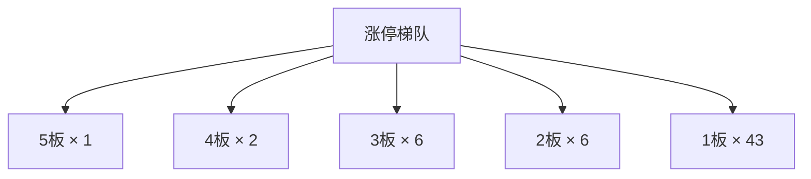
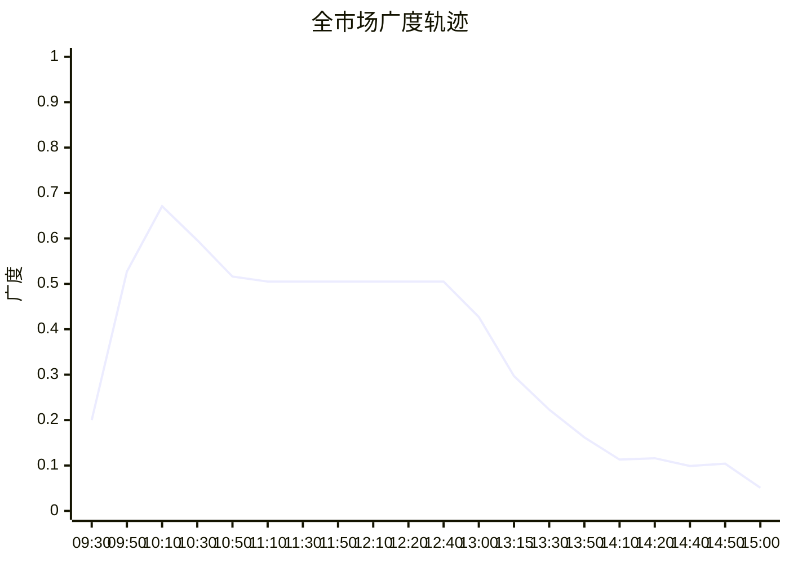
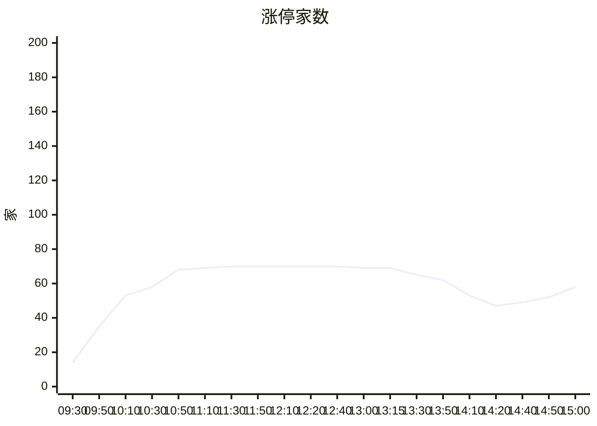
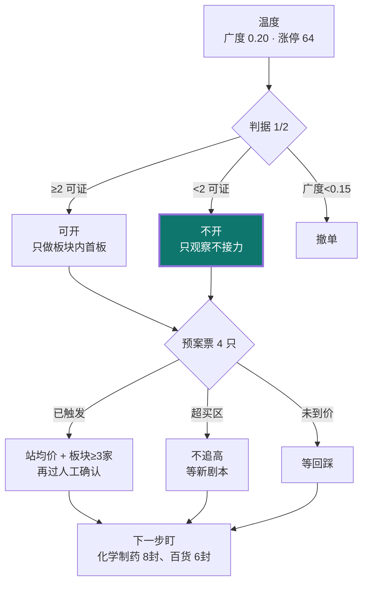
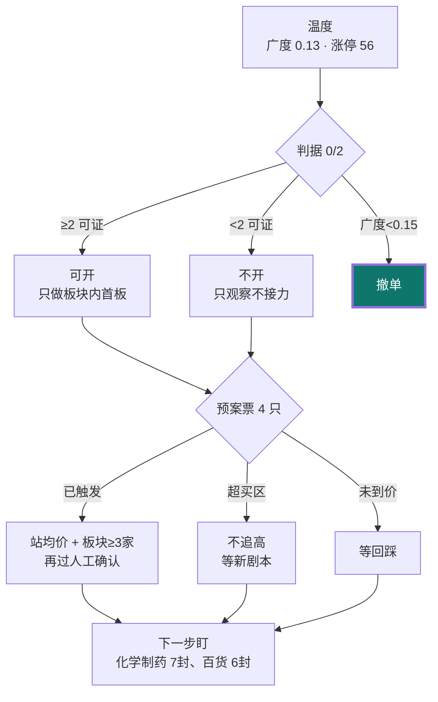

# 20261125 盘中总览（截至 15:00）

> **结论**：全市场涨287/跌2587（广度0.05）；涨停58/跌停49。 钱在：麦角硫因概念(涨停3/成分17，密度0.176)、预制菜(涨停3/成分29，密度0.103)、医美(涨停3/成分32，密度0.094)；零星涨停：NMN概念(2)、IC载板(1)、超聚变(2)、国潮消费(2)、拆解回收概念(2)。 退潮（上涨广度最低）：拆解回收概念(上涨广度0.10)、韧性城市概念(上涨广度0.10)、影石全景相机(上涨广度0.10)。 梯队：5板×1、4板×2、3板×6、2板×6、1板×43，最高5板。 预案：超买区 新易盛、中京电子；未到价 源杰科技、拓普集团、中芯国际、胜宏科技、生益科技、克来机电、华虹宏力、鸣志电器、长华集团、寒武纪、北方华创、工业富联、天孚通信、景旺电子、剑桥科技、宁德时代、襄阳轴承、七匹狼、福莱新材、金牛化工、创维数字、奥比中光、均普智能；已触发 中际旭创、深南电路、长川科技、沪电股份、三花智控。 较上一轮：广度回落。

### 盘前路径对照

> 未生成 market_scenarios.json（跑 scripts/plan/build_market_scenarios.py）

### 概念扩散

> 口径：涨停密度 = 涨停数/有效成分数；排序用密度，不用涨停家数（大板块天然涨停多）。

| 概念 | 涨停 | 有效成分 | 涨停密度 | 上涨广度 | 中位涨幅 | 相对全市场 | 成交(亿) |
|---|---|---|---|---|---|---|---|
| 麦角硫因概念 | 3 | 17 | 0.176 | 0.41 | -0.82% | +2.94% | 31 |
| NMN概念 ⬦ | 2 | 16 | 0.125 | 0.25 | -1.06% | +2.70% | 20 |
| IC载板 ⬦ | 1 | 8 | 0.125 | 0.12 | -4.68% | -0.92% | 140 |
| 超聚变 ⬦ | 2 | 18 | 0.111 | 0.17 | -4.53% | -0.77% | 136 |
| 国潮消费 ⬦ | 2 | 18 | 0.111 | 0.28 | -0.24% | +3.52% | 28 |
| 预制菜 | 3 | 29 | 0.103 | 0.48 | -0.34% | +3.42% | 50 |
| 拆解回收概念 ⬦ | 2 | 20 | 0.100 | 0.10 | -3.73% | +0.03% | 25 |
| 韧性城市概念 ⬦ | 2 | 20 | 0.100 | 0.10 | -3.32% | +0.45% | 17 |
| 影石全景相机 ⬦ | 1 | 10 | 0.100 | 0.10 | -4.09% | -0.33% | 21 |
| 医美 | 3 | 32 | 0.094 | 0.22 | -1.18% | +2.58% | 50 |
| 再生医学 ⬦ | 1 | 11 | 0.091 | 0.18 | -2.34% | +1.43% | 17 |
| 干细胞概念 ⬦ | 1 | 14 | 0.071 | 0.29 | -2.30% | +1.46% | 22 |
| 海南VPN ⬦ | 1 | 14 | 0.071 | 0.21 | -2.39% | +1.38% | 14 |
| 甲骨文概念 ⬦ | 1 | 14 | 0.071 | 0.14 | -4.07% | -0.31% | 85 |
| 离境退税概念 | 3 | 45 | 0.067 | 0.51 | +0.22% | +3.98% | 110 |

> ⬦ = 涨停 <3 只，零星个例，不构成扩散（不计入「钱在」判定）。

### 涨停梯队

| 身位 | 家数 |
|---|---|
| 5板 | 1 |
| 4板 | 2 |
| 3板 | 6 |
| 2板 | 6 |
| 1板 | 43 |

| 最高板个股 | 板数 |
|---|---|
| 中京电子 | 5 |
| 克来机电 | 4 |
| 金新农 | 4 |
| 宁波东力 | 3 |
| 创源股份 | 3 |
| 汇洲智能 | 3 |



### 预案池对照

| 票 | 池 | 板块 | 现价 | 涨幅 | 触发价 | 买区 | 风险位 | 判定 |
|---|---|---|---|---|---|---|---|---|
| 中际旭创 `300308.SZ` | execution_pool | AI硬件·CPO/光模块（守正·资金腿） | 409.00 | -1.92% | 410.00 | [403.00, 410.00] | 387.40 | **已触发** |
| 新易盛 `300502.SZ` | execution_pool | AI硬件·CPO/光模块（守正·资金腿） | 181.30 | 0.72% | 176.00 | [172.00, 176.00] | 165.40 | **超买区** |
| 深南电路 `002916.SZ` | execution_pool | AI硬件·PCB/元件（出奇·弹性奇标） | 196.96 | -5.08% | 203.50 | [199.00, 203.50] | 191.00 | **已触发** |
| 长川科技 `300604.SZ` | execution_pool | 半导体国产链·设备（出奇·低位设备腿） | 165.59 | -9.88% | 181.00 | [176.00, 181.00] | 170.00 | **已触发** |
| 源杰科技 `688498.SH` | watch_pool | AI硬件·CPO 光芯片（守正·资金腿｜最高 | 缺失 | 缺失 | 558.00 | [553.00, 558.00] | 528.00 | **未到价** |
| 沪电股份 `002463.SZ` | watch_pool | AI硬件·PCB/元件 | 79.49 | -5.52% | 83.35 | [82.00, 83.35] | 78.00 | **已触发** |
| 中京电子 `002579.SZ` | watch_pool | AI硬件·PCB（身位股·全市场最高标） | 17.82 | 10.00% | 15.71 | [14.90, 15.71] | — | **超买区** |
| 拓普集团 `601689.SH` | watch_pool | 人形机器人·执行器/整机 | 缺失 | 缺失 | 51.00 | [50.30, 51.00] | 47.80 | **未到价** |
| 三花智控 `002050.SZ` | watch_pool | 人形机器人·心智锚 | 31.91 | -7.13% | 33.41 | [33.41, 34.53] | — | **已触发** |
| 中芯国际 `688981.SH` | watch_pool | 半导体国产链·代工（守正·价格锚） | 缺失 | 缺失 | 122.71 | [116.39, 122.71] | — | **未到价** |
| 胜宏科技 `300476.SZ` | watch_pool | AI硬件·PCB 弹性 | 121.49 | -0.68% | 135.47 | [134.80, 136.82] | 127.34 | **未到价** |
| 生益科技 `600183.SH` | watch_pool | AI硬件·覆铜板 | 缺失 | 缺失 | 67.16 | [66.83, 67.83] | 63.13 | **未到价** |
| 克来机电 `603960.SH` | watch_pool | 人形机器人·3 板一字 | 缺失 | 缺失 | 16.40 | [15.56, 16.40] | — | **未到价** |
| 华虹宏力 `688347.SH` | watch_pool | 半导体国产链·代工 | 缺失 | 缺失 | 202.00 | [202.00, 206.00] | 190.00 | **未到价** |
| 鸣志电器 `603728.SH` | watch_pool | 人形机器人·步进电机 | 缺失 | 缺失 | 54.12 | [53.85, 54.66] | 50.87 | **未到价** |
| 长华集团 `605018.SH` | watch_pool | 人形机器人·3 板一字 | 缺失 | 缺失 | 12.05 | [11.43, 12.05] | — | **未到价** |
| 寒武纪 `688256.SH` | watch_pool | 半导体国产链·算力芯片 | 缺失 | 缺失 | 1002.99 | [998.00, 1012.97] | 942.81 | **未到价** |
| 北方华创 `002371.SZ` | watch_pool | 半导体国产链·设备 | 495.00 | -9.55% | 563.08 | [560.28, 568.68] | 529.30 | **未到价** |
| 工业富联 `601138.SH` | watch_pool | AI硬件·服务器 | 缺失 | 缺失 | 42.33 | [42.12, 42.75] | 39.79 | **未到价** |
| 天孚通信 `300394.SZ` | watch_pool | AI硬件·CPO 龙三 | 130.87 | 7.65% | 134.90 | [134.23, 136.24] | 126.81 | **未到价** |
| 景旺电子 `603228.SH` | watch_pool | AI硬件·PCB 二线 | 缺失 | 缺失 | 62.88 | [62.57, 63.51] | 59.11 | **未到价** |
| 剑桥科技 `603083.SH` | watch_pool | AI硬件·CPO 连接 | 缺失 | 缺失 | 94.90 | [94.90, 97.00] | 90.60 | **未到价** |
| 宁德时代 `300750.SZ` | watch_pool | 新能源·锂电权重（B 计划·对手盘） | 208.42 | -8.33% | 229.74 | [227.00, 230.50] | 216.00 | **未到价** |
| 襄阳轴承 `000678.SZ` | watch_pool | 妖·羊年谐音(yáng)+减速器真成分 | 19.96 | 1.94% | 20.39 | [20.29, 20.59] | 19.17 | **未到价** |
| 七匹狼 `002029.SZ` | watch_pool | 妖·狼族（狼吃羊叙事对） | 6.32 | -5.25% | 6.86 | [6.83, 6.93] | 6.45 | **未到价** |
| 福莱新材 `605488.SH` | watch_pool | 妖·羊年吉祥字（福） | 缺失 | 缺失 | 49.44 | [49.44, 50.94] | — | **未到价** |
| 金牛化工 `600722.SH` | watch_pool | 妖·吉祥字（金牛） | 缺失 | 缺失 | 13.58 | [13.58, 13.99] | — | **未到价** |
| 创维数字 `000810.SZ` | watch_pool | 具身数据/物理AI（R3 L1_only 新 | 9.31 | -6.90% | 10.31 | [10.26, 10.41] | 9.69 | **未到价** |
| 奥比中光 `688322.SH` | watch_pool | 具身数据/3D 视觉 | 缺失 | 缺失 | 93.41 | [93.41, 95.30] | — | **未到价** |
| 均普智能 `688306.SH` | watch_pool | 具身数据/智能装备 | 缺失 | 缺失 | 8.84 | [8.84, 9.20] | — | **未到价** |

### 全天广度轨迹

| 时点 | 涨 | 跌 | 广度 | 涨停 | 跌停 | 成交(亿) | 有效样本 |
|---|---|---|---|---|---|---|---|
| 0930 | 1115 | 4120 | 0.200 | 14 | 4 | 581 | 5554 |
| 0940 | 3048 | 2318 | 0.546 | 34 | 5 | 2366 | 5573 |
| 0950 | 2942 | 2435 | 0.527 | 35 | 3 | 3471 | 5573 |
| 1000 | 3121 | 2302 | 0.559 | 42 | 4 | 4277 | 5573 |
| 1010 | 3748 | 1693 | 0.671 | 53 | 3 | 4950 | 5573 |
| 1020 | 3263 | 2188 | 0.584 | 56 | 3 | 5420 | 5573 |
| 1030 | 3328 | 2117 | 0.596 | 58 | 3 | 5828 | 5573 |
| 1040 | 3138 | 2318 | 0.562 | 65 | 3 | 6237 | 5573 |
| 1050 | 2884 | 2571 | 0.516 | 68 | 3 | 6610 | 5573 |
| 1100 | 2736 | 2697 | 0.490 | 70 | 3 | 6932 | 5573 |
| 1110 | 2820 | 2622 | 0.505 | 69 | 3 | 7218 | 5573 |
| 1120 | 2894 | 2543 | 0.518 | 67 | 3 | 7462 | 5573 |
| 1130 | 2824 | 2626 | 0.505 | 70 | 3 | 7689 | 5573 |
| 1140 | 2824 | 2626 | 0.505 | 70 | 3 | 7689 | 5573 |
| 1150 | 2824 | 2626 | 0.505 | 70 | 3 | 7689 | 5573 |
| 1200 | 2824 | 2626 | 0.505 | 70 | 3 | 7689 | 5573 |
| 1210 | 2824 | 2626 | 0.505 | 70 | 3 | 7689 | 5573 |
| 1211 | 2824 | 2626 | 0.505 | 70 | 3 | 7689 | 5573 |
| 1220 | 2824 | 2626 | 0.505 | 70 | 3 | 7689 | 5573 |
| 1230 | 2824 | 2626 | 0.505 | 70 | 3 | 7689 | 5573 |
| 1240 | 2824 | 2626 | 0.505 | 70 | 3 | 7689 | 5573 |
| 1250 | 2824 | 2626 | 0.505 | 70 | 3 | 7689 | 5573 |
| 1300 | 2387 | 3037 | 0.427 | 69 | 3 | 7796 | 5573 |
| 1310 | 2175 | 3237 | 0.389 | 67 | 4 | 8140 | 5573 |
| 1315 | 1659 | 3733 | 0.297 | 69 | 5 | 8717 | 5573 |
| 1320 | 1634 | 3746 | 0.292 | 69 | 5 | 8729 | 5573 |
| 1330 | 1248 | 4156 | 0.223 | 65 | 5 | 8995 | 5573 |
| 1340 | 1093 | 4313 | 0.196 | 64 | 7 | 9390 | 5573 |
| 1350 | 905 | 4536 | 0.162 | 62 | 9 | 9780 | 5573 |
| 1400 | 734 | 4732 | 0.131 | 56 | 9 | 10164 | 5573 |
| 1410 | 630 | 4866 | 0.113 | 53 | 15 | 10677 | 5573 |
| 1415 | 1522 | 3861 | 0.273 | 68 | 5 | 8814 | 5573 |
| 1420 | 645 | 4839 | 0.116 | 47 | 17 | 11209 | 5573 |
| 1430 | 684 | 4812 | 0.122 | 51 | 23 | 11745 | 5573 |
| 1440 | 552 | 4952 | 0.099 | 49 | 39 | 12293 | 5573 |
| 1448 | 557 | 4941 | 0.100 | 51 | 43 | 12837 | 5573 |
| 1450 | 581 | 4925 | 0.104 | 52 | 48 | 13023 | 5573 |
| 1500 | 287 | 2587 | 0.051 | 58 | 49 | 7303 | 2902 |





### 观察建议（仅研究）

- **环境**：广度 0.05、涨停 58、跌停 49。
- **方向**：麦角硫因概念(涨停3/成分17)、预制菜(涨停3/成分29)、医美(涨停3/成分32)。
- **预案**：已触发 5 只、超买区 2 只、未到价 23 只。买区已错过的票不追高，要参与需等新剧本。
- **定性**：退潮（广度 <0.15）。

---
### 11:50 盯盘卡

**温度** 广度 **0.51**（+0.00） · 涨停 **70**（+0） · 炸板 **17** · 跌停 **3**（+0） · 成交 **7688.7 亿**（+0）
**判据** 广度>0.55 ❌ · 涨停≥60 ✅ · 昨涨停红盘率>60% ⏳未采 → **1/2 可证**


> **当前落点**：判据不足 → 不开，只观察｜判据 1/2｜预案 4 只｜钱在：化学制药 8封、百货 7封

**连板梯队** 最高 **4** 板（金新农 4板、克来机电 4板、创源股份 3板）｜ 1板 59家 / 2板 3家 / 3板 6家 / 4板 2家
**主线（按行业涨停数）** 化学制药 **8**家 均+2.41% ｜ 百货 **7**家 均+4.72% ｜ 医药商业 **4**家 均+3.22% ｜ 中成药 **4**家 均+2.54% ｜ 汽车配件 **4**家 均-0.87%
**板块分时** 白酒 +1.16% ｜ 医药 +0.53% ｜ 商业航天 -0.49% ｜ 券商 -0.86% ｜ 军工 -0.87% ｜ 光通信 -1.21% ｜ AI算力 -1.87% ｜ 半导体 -3.90%
**进攻位（距涨停≤3%）** *ST闻泰  +9.38%（差0.59%，半导体，量比2.4，换手3.0%） ｜ 金牛化工 +8.20%（差1.70%，化工原料，量比3.4，换手18.8%） ｜ 红四方   +8.01%（差1.84%，农药化肥，量比6.0，换手14.0%） ｜ 华孚时尚 +7.81%（差1.93%，纺织，量比1.6，换手6.3%） ｜ 报 喜 鸟 +7.59%（差2.35%，服饰，量比3.3，换手7.4%）
**风险（炸板）** 报 喜 鸟 高+10.13%→收+7.59% ｜ 中哲精化 高+10.10%→收+4.81% ｜ 益盛药业 高+10.04%→收+5.41% ｜ 合富中国 高+10.03%→收+6.54%
**资金（行业成交额）** 软件服务 332亿 ｜ 汽车配件 261亿 ｜ 化学制药 176亿 ｜ 中成药 61亿
**资金（个股成交额）** 新易盛 112亿 ｜ 中际旭创 108亿 ｜ 天孚通信 83亿 ｜ 宁德时代 63亿 ｜ 华虹宏力 61亿

**我的池子**

| 票 | 仓位 | 现价 | 触发 | 距触发 | 距止损 | 状态 | 现在做什么 |
|---|---|---|---|---|---|---|---|
| 中际旭创 | — | 418.79 | 410.0↑ | -2.10% | 7.5% | 已触发·窗口已过 | 只记录不追 |
| 新易盛 | — | 183.68 | 176.0↑ | -4.18% | 10.0% | 已触发·窗口已过 | 只记录不追 |
| 深南电路 | — | 203.45 | 203.5↑ | 0.02% | 6.1% | 未触发·窗口已过 | 今日不再开仓 |
| 长川科技 | — | 173.69 | 181.0↑ | 4.21% | 2.1% | 未触发·窗口已过 | 今日不再开仓 |

**观察池** 强：天孚通信 +10.08%、克来机电 +9.99%、金牛化工 +8.20% ｜ 弱：华虹宏力 -10.17%、北方华创 -8.45%

**结论** ⚪ 窗口已过 —— 今日不再开新仓，只做记录与止损管理


---
### 12:00 盯盘卡

**温度** 广度 **0.51**（+0.00） · 涨停 **70**（+0） · 炸板 **17** · 跌停 **3**（+0） · 成交 **7688.7 亿**（+0）
**判据** 广度>0.55 ❌ · 涨停≥60 ✅ · 昨涨停红盘率>60% ⏳未采 → **1/2 可证**


> **当前落点**：判据不足 → 不开，只观察｜判据 1/2｜预案 4 只｜钱在：化学制药 8封、百货 7封

**连板梯队** 最高 **4** 板（克来机电 4板、金新农 4板、杭州解百 3板）｜ 1板 59家 / 2板 3家 / 3板 6家 / 4板 2家
**主线（按行业涨停数）** 化学制药 **8**家 均+2.41% ｜ 百货 **7**家 均+4.72% ｜ 医药商业 **4**家 均+3.22% ｜ 中成药 **4**家 均+2.54% ｜ 汽车配件 **4**家 均-0.87%
**板块分时** 白酒 +1.16% ｜ 医药 +0.53% ｜ 商业航天 -0.49% ｜ 券商 -0.86% ｜ 军工 -0.87% ｜ 光通信 -1.21% ｜ AI算力 -1.87% ｜ 半导体 -3.90%
**进攻位（距涨停≤3%）** *ST闻泰  +9.38%（差0.59%，半导体，量比2.4，换手3.0%） ｜ 金牛化工 +8.20%（差1.70%，化工原料，量比3.4，换手18.8%） ｜ 红四方   +8.01%（差1.84%，农药化肥，量比6.0，换手14.0%） ｜ 华孚时尚 +7.81%（差1.93%，纺织，量比1.6，换手6.3%） ｜ 报 喜 鸟 +7.59%（差2.35%，服饰，量比3.3，换手7.4%）
**风险（炸板）** 报 喜 鸟 高+10.13%→收+7.59% ｜ 中哲精化 高+10.10%→收+4.81% ｜ 益盛药业 高+10.04%→收+5.41% ｜ 合富中国 高+10.03%→收+6.54%
**资金（行业成交额）** 软件服务 332亿 ｜ 汽车配件 261亿 ｜ 化学制药 176亿 ｜ 中成药 61亿
**资金（个股成交额）** 新易盛 112亿 ｜ 中际旭创 108亿 ｜ 天孚通信 83亿 ｜ 宁德时代 63亿 ｜ 华虹宏力 61亿

**我的池子**

| 票 | 仓位 | 现价 | 触发 | 距触发 | 距止损 | 状态 | 现在做什么 |
|---|---|---|---|---|---|---|---|
| 中际旭创 | — | 418.79 | 410.0↑ | -2.10% | 7.5% | 已触发·窗口已过 | 只记录不追 |
| 新易盛 | — | 183.68 | 176.0↑ | -4.18% | 10.0% | 已触发·窗口已过 | 只记录不追 |
| 深南电路 | — | 203.45 | 203.5↑ | 0.02% | 6.1% | 未触发·窗口已过 | 今日不再开仓 |
| 长川科技 | — | 173.69 | 181.0↑ | 4.21% | 2.1% | 未触发·窗口已过 | 今日不再开仓 |

**观察池** 强：天孚通信 +10.08%、克来机电 +9.99%、金牛化工 +8.20% ｜ 弱：华虹宏力 -10.17%、北方华创 -8.45%

**结论** ⚪ 窗口已过 —— 今日不再开新仓，只做记录与止损管理


---

### 12:05 盘中总结 · 半日收官（LLM）

**① 广度/涨跌停（12:00 快照 = 11:30 收盘值；11:40/11:50/12:00 三张完全相同，午休冻结，Δ 全 0，趋势按 11:20→11:30 最后一跳）**：广度 **0.506**（11:20 0.518，早盘峰值 0.596@10:30）· 涨停 **70**（早盘 09:30 仅 14 → 09:40 34 → 10:00 42 → 10:30 58 → 11:20 67 → 11:30 70，后半段在 67–70 横住）· 跌停 **3** · 炸板 **17**（炸板率 19.5%，盘中峰值 19@11:20）· 半日成交 **7688.7 亿**。涨停家数站住 60+ 且炸板率远低于 45%，但广度从 0.60 退到 0.51 → **涨停在增、中位票在跌，典型分化而非普涨**。

**② 预案池异动**：execution_pool 4 只无涨跌停——中际旭创 +0.43%（418.79）、新易盛 +2.04%（183.68）均已站到买区上方；深南电路 -1.95%、长川科技 -5.47%（半导体系拖累，距止损只剩 2.1%）。watch_pool 强：克来机电 **+9.99% 封板（4板）**、天孚通信 +10.08%（光模块只剩它独走）、金牛化工 +8.20%；弱：华虹宏力 -10.17%、北方华创 -8.45%、宁德时代 -4.78%、拓普集团 -4.99% —— 半导体与机器人两条腿全在杀；中京电子（昨 4 板）+2.53% 断板。

**③ 预案对照**：预案 intraday_focus 的三条闸门里，涨停 ≥40 ✅（70）、炸板率 <45% ✅（19.5%）两条硬闸门实际已打开；中际旭创/新易盛也都在昨收上方。但买区 403–410 只在 09:40 前后短暂可达（彼时涨停仅 34 家，闸门未开），10:00 涨停到 42 家时价格已回到 421（> max_acceptable_ask 412）→ **「价格到位」与「闸门打开」从未同时成立**，09:35–10:30 窗口已过；深南/长川全天上不到触发价。P2 午盘修订的定性一致：中际旭创/新易盛属「闸门开着但价格跑掉」，深南/长川属「闸门自己关着」。**所以预案「今日零新开」的结果是对的，但性质是被价格跑掉，不是被盘面否掉。**

**④ 一句话结论**：温度够、买点没给，今日不开新仓不算踏空；钱在医药商业/百货/化学制药，光模块只剩天孚独走，半导体全链承压——下午 13:00 后只盯两件事：涨停家数能否守住 60、中际旭创能否站稳 417（昨收）。

---
### 12:10 盯盘卡

**温度** 广度 **0.51**（+0.00） · 涨停 **70**（+0） · 炸板 **17** · 跌停 **3**（+0） · 成交 **7688.7 亿**（+0）
**判据** 广度>0.55 ❌ · 涨停≥60 ✅ · 昨涨停红盘率>60% ⏳未采 → **1/2 可证**


> **当前落点**：判据不足 → 不开，只观察｜判据 1/2｜预案 4 只｜钱在：化学制药 8封、百货 7封

**连板梯队** 最高 **4** 板（克来机电 4板、金新农 4板、汇洲智能 3板）｜ 1板 59家 / 2板 3家 / 3板 6家 / 4板 2家
**主线（按行业涨停数）** 化学制药 **8**家 均+2.41% ｜ 百货 **7**家 均+4.72% ｜ 医药商业 **4**家 均+3.22% ｜ 中成药 **4**家 均+2.54% ｜ 汽车配件 **4**家 均-0.87%
**板块分时** 白酒 +1.16% ｜ 医药 +0.53% ｜ 商业航天 -0.49% ｜ 券商 -0.86% ｜ 军工 -0.87% ｜ 光通信 -1.21% ｜ AI算力 -1.87% ｜ 半导体 -3.90%
**进攻位（距涨停≤3%）** *ST闻泰  +9.38%（差0.59%，半导体，量比2.4，换手3.0%） ｜ 金牛化工 +8.20%（差1.70%，化工原料，量比3.4，换手18.8%） ｜ 红四方   +8.01%（差1.84%，农药化肥，量比6.0，换手14.0%） ｜ 华孚时尚 +7.81%（差1.93%，纺织，量比1.6，换手6.3%） ｜ 报 喜 鸟 +7.59%（差2.35%，服饰，量比3.3，换手7.4%）
**风险（炸板）** 报 喜 鸟 高+10.13%→收+7.59% ｜ 中哲精化 高+10.10%→收+4.81% ｜ 益盛药业 高+10.04%→收+5.41% ｜ 合富中国 高+10.03%→收+6.54%
**资金（行业成交额）** 软件服务 332亿 ｜ 汽车配件 261亿 ｜ 化学制药 176亿 ｜ 中成药 61亿
**资金（个股成交额）** 新易盛 112亿 ｜ 中际旭创 108亿 ｜ 天孚通信 83亿 ｜ 宁德时代 63亿 ｜ 华虹宏力 61亿

**我的池子**

| 票 | 仓位 | 现价 | 触发 | 距触发 | 距止损 | 状态 | 现在做什么 |
|---|---|---|---|---|---|---|---|
| 中际旭创 | — | 418.79 | 410.0↑ | -2.10% | 7.5% | 已触发·窗口已过 | 只记录不追 |
| 新易盛 | — | 183.68 | 176.0↑ | -4.18% | 10.0% | 已触发·窗口已过 | 只记录不追 |
| 深南电路 | — | 203.45 | 203.5↑ | 0.02% | 6.1% | 未触发·窗口已过 | 今日不再开仓 |
| 长川科技 | — | 173.69 | 181.0↑ | 4.21% | 2.1% | 未触发·窗口已过 | 今日不再开仓 |

**观察池** 强：天孚通信 +10.08%、克来机电 +9.99%、金牛化工 +8.20% ｜ 弱：华虹宏力 -10.17%、北方华创 -8.45%

**结论** ⚪ 窗口已过 —— 今日不再开新仓，只做记录与止损管理

---
### 12:11 盯盘卡

**温度** 广度 **0.51**（+0.00） · 涨停 **70**（+0） · 炸板 **17** · 跌停 **3**（+0） · 成交 **7688.7 亿**（+0）
**判据** 广度>0.55 ❌ · 涨停≥60 ✅ · 昨涨停红盘率>60% ⏳未采 → **1/2 可证**


> **当前落点**：判据不足 → 不开，只观察｜判据 1/2｜预案 4 只｜钱在：化学制药 8封、百货 7封

**连板梯队** 最高 **4** 板（金新农 4板、克来机电 4板、创源股份 3板）｜ 1板 59家 / 2板 3家 / 3板 6家 / 4板 2家
**主线（按行业涨停数）** 化学制药 **8**家 均+2.41% ｜ 百货 **7**家 均+4.72% ｜ 医药商业 **4**家 均+3.22% ｜ 中成药 **4**家 均+2.54% ｜ 汽车配件 **4**家 均-0.87%
**板块分时** 白酒 +1.16% ｜ 医药 +0.53% ｜ 商业航天 -0.49% ｜ 券商 -0.86% ｜ 军工 -0.87% ｜ 光通信 -1.21% ｜ AI算力 -1.87% ｜ 半导体 -3.90%
**进攻位（距涨停≤3%）** *ST闻泰  +9.38%（差0.59%，半导体，量比2.4，换手3.0%） ｜ 金牛化工 +8.20%（差1.70%，化工原料，量比3.4，换手18.8%） ｜ 红四方   +8.01%（差1.84%，农药化肥，量比6.0，换手14.0%） ｜ 华孚时尚 +7.81%（差1.93%，纺织，量比1.6，换手6.3%） ｜ 报 喜 鸟 +7.59%（差2.35%，服饰，量比3.3，换手7.4%）
**风险（炸板）** 报 喜 鸟 高+10.13%→收+7.59% ｜ 中哲精化 高+10.10%→收+4.81% ｜ 益盛药业 高+10.04%→收+5.41% ｜ 合富中国 高+10.03%→收+6.54%
**资金（行业成交额）** 软件服务 332亿 ｜ 汽车配件 261亿 ｜ 化学制药 176亿 ｜ 中成药 61亿
**资金（个股成交额）** 新易盛 112亿 ｜ 中际旭创 108亿 ｜ 天孚通信 83亿 ｜ 宁德时代 63亿 ｜ 华虹宏力 61亿

**我的池子**

| 票 | 仓位 | 现价 | 触发 | 距触发 | 距止损 | 状态 | 现在做什么 |
|---|---|---|---|---|---|---|---|
| 中际旭创 | — | 418.79 | 410.0↑ | -2.10% | 7.5% | 已触发·窗口已过 | 只记录不追 |
| 新易盛 | — | 183.68 | 176.0↑ | -4.18% | 10.0% | 已触发·窗口已过 | 只记录不追 |
| 深南电路 | — | 203.45 | 203.5↑ | 0.02% | 6.1% | 未触发·窗口已过 | 今日不再开仓 |
| 长川科技 | — | 173.69 | 181.0↑ | 4.21% | 2.1% | 未触发·窗口已过 | 今日不再开仓 |

**观察池** 强：天孚通信 +10.08%、克来机电 +9.99%、金牛化工 +8.20% ｜ 弱：华虹宏力 -10.17%、北方华创 -8.45%

**结论** ⚪ 窗口已过 —— 今日不再开新仓，只做记录与止损管理


---
### 12:20 盯盘卡

**温度** 广度 **0.51**（+0.00） · 涨停 **70**（+0） · 炸板 **17** · 跌停 **3**（+0） · 成交 **7688.7 亿**（+0）
**判据** 广度>0.55 ❌ · 涨停≥60 ✅ · 昨涨停红盘率>60% ⏳未采 → **1/2 可证**


> **当前落点**：判据不足 → 不开，只观察｜判据 1/2｜预案 4 只｜钱在：化学制药 8封、百货 7封

**连板梯队** 最高 **4** 板（金新农 4板、克来机电 4板、汇洲智能 3板）｜ 1板 59家 / 2板 3家 / 3板 6家 / 4板 2家
**主线（按行业涨停数）** 化学制药 **8**家 均+2.41% ｜ 百货 **7**家 均+4.72% ｜ 医药商业 **4**家 均+3.22% ｜ 中成药 **4**家 均+2.54% ｜ 汽车配件 **4**家 均-0.87%
**板块分时** 白酒 +1.16% ｜ 医药 +0.53% ｜ 商业航天 -0.49% ｜ 券商 -0.86% ｜ 军工 -0.87% ｜ 光通信 -1.21% ｜ AI算力 -1.87% ｜ 半导体 -3.90%
**进攻位（距涨停≤3%）** *ST闻泰  +9.38%（差0.59%，半导体，量比2.4，换手3.0%） ｜ 金牛化工 +8.20%（差1.70%，化工原料，量比3.4，换手18.8%） ｜ 红四方   +8.01%（差1.84%，农药化肥，量比6.0，换手14.0%） ｜ 华孚时尚 +7.81%（差1.93%，纺织，量比1.6，换手6.3%） ｜ 报 喜 鸟 +7.59%（差2.35%，服饰，量比3.3，换手7.4%）
**风险（炸板）** 报 喜 鸟 高+10.13%→收+7.59% ｜ 中哲精化 高+10.10%→收+4.81% ｜ 益盛药业 高+10.04%→收+5.41% ｜ 合富中国 高+10.03%→收+6.54%
**资金（行业成交额）** 软件服务 332亿 ｜ 汽车配件 261亿 ｜ 化学制药 176亿 ｜ 中成药 61亿
**资金（个股成交额）** 新易盛 112亿 ｜ 中际旭创 108亿 ｜ 天孚通信 83亿 ｜ 宁德时代 63亿 ｜ 华虹宏力 61亿

**我的池子**

| 票 | 仓位 | 现价 | 触发 | 距触发 | 距止损 | 状态 | 现在做什么 |
|---|---|---|---|---|---|---|---|
| 中际旭创 | — | 418.79 | 410.0↑ | -2.10% | 7.5% | 已触发·窗口已过 | 只记录不追 |
| 新易盛 | — | 183.68 | 176.0↑ | -4.18% | 10.0% | 已触发·窗口已过 | 只记录不追 |
| 深南电路 | — | 203.45 | 203.5↑ | 0.02% | 6.1% | 未触发·窗口已过 | 今日不再开仓 |
| 长川科技 | — | 173.69 | 181.0↑ | 4.21% | 2.1% | 未触发·窗口已过 | 今日不再开仓 |

**观察池** 强：天孚通信 +10.08%、克来机电 +9.99%、金牛化工 +8.20% ｜ 弱：华虹宏力 -10.17%、北方华创 -8.45%

**结论** ⚪ 窗口已过 —— 今日不再开新仓，只做记录与止损管理


---
### 12:30 盯盘卡

**温度** 广度 **0.51**（+0.00） · 涨停 **70**（+0） · 炸板 **17** · 跌停 **3**（+0） · 成交 **7688.7 亿**（+0）
**判据** 广度>0.55 ❌ · 涨停≥60 ✅ · 昨涨停红盘率>60% ⏳未采 → **1/2 可证**


> **当前落点**：判据不足 → 不开，只观察｜判据 1/2｜预案 4 只｜钱在：化学制药 8封、百货 7封

**连板梯队** 最高 **4** 板（克来机电 4板、金新农 4板、创源股份 3板）｜ 1板 59家 / 2板 3家 / 3板 6家 / 4板 2家
**主线（按行业涨停数）** 化学制药 **8**家 均+2.41% ｜ 百货 **7**家 均+4.72% ｜ 医药商业 **4**家 均+3.22% ｜ 中成药 **4**家 均+2.54% ｜ 汽车配件 **4**家 均-0.87%
**板块分时** 白酒 +1.16% ｜ 医药 +0.53% ｜ 商业航天 -0.49% ｜ 券商 -0.86% ｜ 军工 -0.87% ｜ 光通信 -1.21% ｜ AI算力 -1.87% ｜ 半导体 -3.90%
**进攻位（距涨停≤3%）** *ST闻泰  +9.38%（差0.59%，半导体，量比2.4，换手3.0%） ｜ 金牛化工 +8.20%（差1.70%，化工原料，量比3.4，换手18.8%） ｜ 红四方   +8.01%（差1.84%，农药化肥，量比6.0，换手14.0%） ｜ 华孚时尚 +7.81%（差1.93%，纺织，量比1.6，换手6.3%） ｜ 报 喜 鸟 +7.59%（差2.35%，服饰，量比3.3，换手7.4%）
**风险（炸板）** 报 喜 鸟 高+10.13%→收+7.59% ｜ 中哲精化 高+10.10%→收+4.81% ｜ 益盛药业 高+10.04%→收+5.41% ｜ 合富中国 高+10.03%→收+6.54%
**资金（行业成交额）** 软件服务 332亿 ｜ 汽车配件 261亿 ｜ 化学制药 176亿 ｜ 中成药 61亿
**资金（个股成交额）** 新易盛 112亿 ｜ 中际旭创 108亿 ｜ 天孚通信 83亿 ｜ 宁德时代 63亿 ｜ 华虹宏力 61亿

**我的池子**

| 票 | 仓位 | 现价 | 触发 | 距触发 | 距止损 | 状态 | 现在做什么 |
|---|---|---|---|---|---|---|---|
| 中际旭创 | — | 418.79 | 410.0↑ | -2.10% | 7.5% | 已触发·窗口已过 | 只记录不追 |
| 新易盛 | — | 183.68 | 176.0↑ | -4.18% | 10.0% | 已触发·窗口已过 | 只记录不追 |
| 深南电路 | — | 203.45 | 203.5↑ | 0.02% | 6.1% | 未触发·窗口已过 | 今日不再开仓 |
| 长川科技 | — | 173.69 | 181.0↑ | 4.21% | 2.1% | 未触发·窗口已过 | 今日不再开仓 |

**观察池** 强：天孚通信 +10.08%、克来机电 +9.99%、金牛化工 +8.20% ｜ 弱：华虹宏力 -10.17%、北方华创 -8.45%

**结论** ⚪ 窗口已过 —— 今日不再开新仓，只做记录与止损管理


---
### 12:40 盯盘卡

**温度** 广度 **0.51**（+0.00） · 涨停 **70**（+0） · 炸板 **17** · 跌停 **3**（+0） · 成交 **7688.7 亿**（+0）
**判据** 广度>0.55 ❌ · 涨停≥60 ✅ · 昨涨停红盘率>60% ⏳未采 → **1/2 可证**


> **当前落点**：判据不足 → 不开，只观察｜判据 1/2｜预案 4 只｜钱在：化学制药 8封、百货 7封

**连板梯队** 最高 **4** 板（金新农 4板、克来机电 4板、杭州解百 3板）｜ 1板 59家 / 2板 3家 / 3板 6家 / 4板 2家
**主线（按行业涨停数）** 化学制药 **8**家 均+2.41% ｜ 百货 **7**家 均+4.72% ｜ 医药商业 **4**家 均+3.22% ｜ 中成药 **4**家 均+2.54% ｜ 汽车配件 **4**家 均-0.87%
**板块分时** 白酒 +1.16% ｜ 医药 +0.53% ｜ 商业航天 -0.49% ｜ 券商 -0.86% ｜ 军工 -0.87% ｜ 光通信 -1.21% ｜ AI算力 -1.87% ｜ 半导体 -3.90%
**进攻位（距涨停≤3%）** *ST闻泰  +9.38%（差0.59%，半导体，量比2.4，换手3.0%） ｜ 金牛化工 +8.20%（差1.70%，化工原料，量比3.4，换手18.8%） ｜ 红四方   +8.01%（差1.84%，农药化肥，量比6.0，换手14.0%） ｜ 华孚时尚 +7.81%（差1.93%，纺织，量比1.6，换手6.3%） ｜ 报 喜 鸟 +7.59%（差2.35%，服饰，量比3.3，换手7.4%）
**风险（炸板）** 报 喜 鸟 高+10.13%→收+7.59% ｜ 中哲精化 高+10.10%→收+4.81% ｜ 益盛药业 高+10.04%→收+5.41% ｜ 合富中国 高+10.03%→收+6.54%
**资金（行业成交额）** 软件服务 332亿 ｜ 汽车配件 261亿 ｜ 化学制药 176亿 ｜ 中成药 61亿
**资金（个股成交额）** 新易盛 112亿 ｜ 中际旭创 108亿 ｜ 天孚通信 83亿 ｜ 宁德时代 63亿 ｜ 华虹宏力 61亿

**我的池子**

| 票 | 仓位 | 现价 | 触发 | 距触发 | 距止损 | 状态 | 现在做什么 |
|---|---|---|---|---|---|---|---|
| 中际旭创 | — | 418.79 | 410.0↑ | -2.10% | 7.5% | 已触发·窗口已过 | 只记录不追 |
| 新易盛 | — | 183.68 | 176.0↑ | -4.18% | 10.0% | 已触发·窗口已过 | 只记录不追 |
| 深南电路 | — | 203.45 | 203.5↑ | 0.02% | 6.1% | 未触发·窗口已过 | 今日不再开仓 |
| 长川科技 | — | 173.69 | 181.0↑ | 4.21% | 2.1% | 未触发·窗口已过 | 今日不再开仓 |

**观察池** 强：天孚通信 +10.08%、克来机电 +9.99%、金牛化工 +8.20% ｜ 弱：华虹宏力 -10.17%、北方华创 -8.45%

**结论** ⚪ 窗口已过 —— 今日不再开新仓，只做记录与止损管理


---
### 12:50 盯盘卡

**温度** 广度 **0.51**（+0.00） · 涨停 **70**（+0） · 炸板 **17** · 跌停 **3**（+0） · 成交 **7688.7 亿**（+0）
**判据** 广度>0.55 ❌ · 涨停≥60 ✅ · 昨涨停红盘率>60% ⏳未采 → **1/2 可证**


> **当前落点**：判据不足 → 不开，只观察｜判据 1/2｜预案 4 只｜钱在：化学制药 8封、百货 7封

**连板梯队** 最高 **4** 板（克来机电 4板、金新农 4板、九阳股份 3板）｜ 1板 59家 / 2板 3家 / 3板 6家 / 4板 2家
**主线（按行业涨停数）** 化学制药 **8**家 均+2.41% ｜ 百货 **7**家 均+4.72% ｜ 医药商业 **4**家 均+3.22% ｜ 中成药 **4**家 均+2.54% ｜ 汽车配件 **4**家 均-0.87%
**板块分时** 白酒 +1.16% ｜ 医药 +0.53% ｜ 商业航天 -0.49% ｜ 券商 -0.86% ｜ 军工 -0.87% ｜ 光通信 -1.21% ｜ AI算力 -1.87% ｜ 半导体 -3.90%
**进攻位（距涨停≤3%）** *ST闻泰  +9.38%（差0.59%，半导体，量比2.4，换手3.0%） ｜ 金牛化工 +8.20%（差1.70%，化工原料，量比3.4，换手18.8%） ｜ 红四方   +8.01%（差1.84%，农药化肥，量比6.0，换手14.0%） ｜ 华孚时尚 +7.81%（差1.93%，纺织，量比1.6，换手6.3%） ｜ 报 喜 鸟 +7.59%（差2.35%，服饰，量比3.3，换手7.4%）
**风险（炸板）** 报 喜 鸟 高+10.13%→收+7.59% ｜ 中哲精化 高+10.10%→收+4.81% ｜ 益盛药业 高+10.04%→收+5.41% ｜ 合富中国 高+10.03%→收+6.54%
**资金（行业成交额）** 软件服务 332亿 ｜ 汽车配件 261亿 ｜ 化学制药 176亿 ｜ 中成药 61亿
**资金（个股成交额）** 新易盛 112亿 ｜ 中际旭创 108亿 ｜ 天孚通信 83亿 ｜ 宁德时代 63亿 ｜ 华虹宏力 61亿

**我的池子**

| 票 | 仓位 | 现价 | 触发 | 距触发 | 距止损 | 状态 | 现在做什么 |
|---|---|---|---|---|---|---|---|
| 中际旭创 | — | 418.79 | 410.0↑ | -2.10% | 7.5% | 已触发·窗口已过 | 只记录不追 |
| 新易盛 | — | 183.68 | 176.0↑ | -4.18% | 10.0% | 已触发·窗口已过 | 只记录不追 |
| 深南电路 | — | 203.45 | 203.5↑ | 0.02% | 6.1% | 未触发·窗口已过 | 今日不再开仓 |
| 长川科技 | — | 173.69 | 181.0↑ | 4.21% | 2.1% | 未触发·窗口已过 | 今日不再开仓 |

**观察池** 强：天孚通信 +10.08%、克来机电 +9.99%、金牛化工 +8.20% ｜ 弱：华虹宏力 -10.17%、北方华创 -8.45%

**结论** ⚪ 窗口已过 —— 今日不再开新仓，只做记录与止损管理

---
### 13:00 盯盘卡

**温度** 广度 **0.43**（-0.08） · 涨停 **69**（-1） · 炸板 **18** · 跌停 **3**（+0） · 成交 **7795.5 亿**（+107）
**判据** 广度>0.55 ❌ · 涨停≥60 ✅ · 昨涨停红盘率>60% ⏳未采 → **1/2 可证**


> **当前落点**：判据不足 → 不开，只观察｜判据 1/2｜预案 4 只｜钱在：化学制药 8封、百货 6封

**连板梯队** 最高 **4** 板（克来机电 4板、金新农 4板、九阳股份 3板）｜ 1板 58家 / 2板 3家 / 3板 6家 / 4板 2家
**主线（按行业涨停数）** 化学制药 **8**家 均+2.06% ｜ 百货 **6**家 均+4.28% ｜ 医药商业 **4**家 均+2.89% ｜ 中成药 **4**家 均+2.27% ｜ 汽车配件 **4**家 均-1.27%
**板块分时** 白酒 +1.16% ｜ 医药 +0.00% ｜ 商业航天 -0.61% ｜ 券商 -0.86% ｜ 军工 -1.08% ｜ 光通信 -1.45% ｜ AI算力 -2.11% ｜ 半导体 -4.38%
**进攻位（距涨停≤3%）** *ST闻泰  +9.70%（差0.29%，半导体，量比2.4，换手3.1%） ｜ ST文峰   +8.82%（差0.90%，百货，量比3.1，换手3.1%） ｜ *ST九鼎  +7.96%（差1.98%，多元金融，量比2.2，换手0.3%） ｜ 金牛化工 +7.62%（差2.26%，化工原料，量比3.4，换手18.9%） ｜ *ST亿晶  +7.50%（差2.33%，电气设备，量比2.0，换手4.0%）
**风险（炸板）** 报 喜 鸟 高+10.13%→收+6.96% ｜ 中哲精化 高+10.10%→收+3.61% ｜ 益盛药业 高+10.04%→收+5.02% ｜ 合富中国 高+10.03%→收+6.00%
**资金（行业成交额）** 软件服务 335亿 ｜ 汽车配件 265亿 ｜ 化学制药 179亿 ｜ 中成药 62亿
**资金（个股成交额）** 新易盛 113亿 ｜ 中际旭创 109亿 ｜ 天孚通信 83亿 ｜ 宁德时代 65亿 ｜ 华虹宏力 61亿
**新晋涨停（vs 上一条）** 1 家：雪龙集团(汽车配件)

**我的池子**

| 票 | 仓位 | 现价 | 触发 | 距触发 | 距止损 | 状态 | 现在做什么 |
|---|---|---|---|---|---|---|---|
| 中际旭创 | — | 417.22 | 410.0↑ | -1.73% | 7.1% | 已触发·窗口已过 | 只记录不追 |
| 新易盛 | — | 183.56 | 176.0↑ | -4.12% | 9.9% | 已触发·窗口已过 | 只记录不追 |
| 深南电路 | — | 202.5 | 203.5↑ | 0.49% | 5.7% | 未触发·窗口已过 | 今日不再开仓 |
| 长川科技 | — | 173.34 | 181.0↑ | 4.42% | 1.9% | 未触发·窗口已过 | 今日不再开仓 |

**观察池** 强：克来机电 +9.99%、天孚通信 +9.76%、金牛化工 +7.62% ｜ 弱：华虹宏力 -10.91%、北方华创 -8.65%

**结论** ⚪ 窗口已过 —— 今日不再开新仓，只做记录与止损管理


---

### 13:05 盘中总结 · 午后开盘（LLM）

**① 广度/涨跌停（13:00 快照 vs 上一条有效快照 11:30；11:40–12:50 为午休冻结、Δ 全 0）**：广度 **0.506 → 0.427**（-0.079，早盘峰值 0.596@10:30 后一路回落）· 上涨 **2824 → 2387**（-437）/ 下跌 **2626 → 3037**（+411）· 涨停 **70 → 69** · 跌停 **3**（英力特/北纬科技/ST欢瑞，未变）· 炸板 **17 → 18**（封炸率 20.7%）· 跌>5% **154 → 228**（+74，跌幅在扩散）· 成交 **7688.7 → 7795.5 亿**（午后 47 秒 +106.8 亿）。涨停家数守住 60+，炸板没有失控，但下跌家数与深跌家数同步扩张 → **不是转弱而是缩圈：家数还在，宽度在塌**。对照昨日 13:00：涨停 67→69、炸板 54→18（今日封板质量明显好于昨），广度 0.516→0.427（今日更窄）。

**② 预案池异动**：execution_pool 4 只仍无涨跌停 —— 中际旭创 +0.05%（417.22，退回昨收平位）、新易盛 +1.97%（183.56）、深南电路 -2.41%（202.50，回到买区 [199,203.5] 内；09:30 199.38、09:40 200.20、10:50 203.00 也曾在内）、长川科技 -5.66%（173.34，**距止损 170 只剩 1.9%**）。watch_pool 30 只 10 涨 20 跌：强 —— 克来机电 **+9.99% 封板（4 板、0 开板）**、天孚通信 **+9.76%（成交 83 亿，光模块独走）**、金牛化工 +7.62%（冲板未封、距涨停 2.26%）；弱 —— 华虹宏力 **-10.91%**、北方华创 **-8.65%**、拓普集团 -5.30%、奥比中光 -5.27%、宁德时代 -5.15%、三花智控 -5.06%（半导体 + 机器人两条腿同时被杀），中京电子 +2.16%（昨 4 板断板）。

**③ 预案对照**：预案 09:35–10:30 三闸门 —— 涨停≥40 ✅（69）、炸板率<45% ✅（20.7%）成立，①中际旭创/新易盛「站回均价线且回到买区」现在 ❌（09:30 新易盛 175.70、09:40 中际 409.01 曾在买区内，但窗口内三条闸门从未同时成立；13:00 中际只在昨收平位、新易盛高出买区上沿 4.3%），三条仍只成两条 → 按预案本就零新开。深南电路 202.50 现在在买区内（09:30 199.38、09:40 200.20、10:50 203.00 也在内），但破均价、破 199.00 上午即成立，且窗口已过 → 不进；长川低于买区下沿，只当止损观察。P2 午盘定性未被打脸：中际/新易盛是「闸门开着、价格跑掉」（机会成本），深南/长川是「闸门自己关着」（半导体红盘率 0.08 << 0.6，D1 自写的证伪条件已成立，纪律挡了亏损）。**所以盘面与预案"今日不开仓"一致，但依据是主线被证伪 + 买点没给，不是盘面转好。**

**④ 一句话结论**：钱在医药/百货/消费（化学制药 8 封、百货 6 封），光模块只剩天孚独走，半导体全链加速杀（半导体 -4.38%、元器件 -1.84%）—— 午后只守不攻，盯两件事：涨停家数能否守住 60、广度会不会跌破 0.40。

---
### 13:10 盯盘卡

**温度** 广度 **0.39**（-0.04） · 涨停 **67**（-2） · 炸板 **23** · 跌停 **4**（+1） · 成交 **8140.2 亿**（+345）
**判据** 广度>0.55 ❌ · 涨停≥60 ✅ · 昨涨停红盘率>60% ⏳未采 → **1/2 可证**


> **当前落点**：判据不足 → 不开，只观察｜判据 1/2｜预案 4 只｜钱在：化学制药 8封、百货 6封

**连板梯队** 最高 **4** 板（克来机电 4板、金新农 4板、铁流股份 3板）｜ 1板 56家 / 2板 3家 / 3板 6家 / 4板 2家
**主线（按行业涨停数）** 化学制药 **8**家 均+2.02% ｜ 百货 **6**家 均+4.17% ｜ 医药商业 **4**家 均+2.87% ｜ 中成药 **4**家 均+2.21% ｜ 汽车配件 **4**家 均-1.44%
**板块分时** 白酒 +0.93% ｜ 医药 +0.00% ｜ 券商 -0.86% ｜ 商业航天 -1.10% ｜ 军工 -1.41% ｜ 光通信 -1.77% ｜ AI算力 -2.57% ｜ 半导体 -4.63%
**进攻位（距涨停≤3%）** *ST闻泰  +9.48%（差0.49%，半导体，量比2.4，换手3.2%） ｜ 城市传媒 +9.15%（差0.74%，出版业，量比2.3，换手3.8%） ｜ *ST九鼎  +9.13%（差0.89%，多元金融，量比3.0，换手0.4%） ｜ ST文峰   +8.82%（差0.90%，百货，量比2.9，换手3.2%） ｜ ST龙元   +8.33%（差1.71%，建筑工程，量比2.8，换手3.5%）
**风险（炸板）** 德豪润达 高+10.27%→收+4.32% ｜ ST龙元   高+10.19%→收+8.33% ｜ 报 喜 鸟 高+10.13%→收+6.33% ｜ *ST九鼎  高+10.10%→收+9.13%
**资金（行业成交额）** 汽车配件 280亿 ｜ 化学制药 186亿 ｜ 中成药 64亿 ｜ 文教休闲 62亿
**资金（个股成交额）** 新易盛 117亿 ｜ 中际旭创 114亿 ｜ 天孚通信 85亿 ｜ 宁德时代 71亿 ｜ 华虹宏力 62亿
**新晋涨停（vs 上一条）** 2 家：*ST发展(区域地产)、新筑股份(运输设备)

**我的池子**

| 票 | 仓位 | 现价 | 触发 | 距触发 | 距止损 | 状态 | 现在做什么 |
|---|---|---|---|---|---|---|---|
| 中际旭创 | — | 414.41 | 410.0↑ | -1.06% | 6.5% | 已触发·窗口已过 | 只记录不追 |
| 新易盛 | — | 181.72 | 176.0↑ | -3.15% | 9.0% | 已触发·窗口已过 | 只记录不追 |
| 深南电路 | — | 201.02 | 203.5↑ | 1.23% | 5.0% | 未触发·窗口已过 | 今日不再开仓 |
| 长川科技 | — | 172.72 | 181.0↑ | 4.79% | 1.6% | 未触发·窗口已过 | 今日不再开仓 |

**观察池** 强：克来机电 +9.99%、天孚通信 +8.49%、金牛化工 +7.28% ｜ 弱：华虹宏力 -10.12%、北方华创 -8.79%

**结论** ⚪ 窗口已过 —— 今日不再开新仓，只做记录与止损管理


---
### 13:20 盯盘卡

**温度** 广度 **0.38**（-0.01） · 涨停 **67**（+0） · 炸板 **24** · 跌停 **4**（+0） · 成交 **8562.9 亿**（+423）
**判据** 广度>0.55 ❌ · 涨停≥60 ✅ · 昨涨停红盘率>60% ⏳未采 → **1/2 可证**


> **当前落点**：判据不足 → 不开，只观察｜判据 1/2｜预案 4 只｜钱在：化学制药 8封、百货 6封

**连板梯队** 最高 **4** 板（金新农 4板、克来机电 4板、宁波东力 3板）｜ 1板 56家 / 2板 3家 / 3板 6家 / 4板 2家
**主线（按行业涨停数）** 化学制药 **8**家 均+2.00% ｜ 百货 **6**家 均+4.11% ｜ 医药商业 **4**家 均+2.87% ｜ 中成药 **4**家 均+2.20% ｜ 汽车配件 **4**家 均-1.67%
**板块分时** 白酒 +1.39% ｜ 医药 +0.53% ｜ 券商 -0.65% ｜ 商业航天 -0.98% ｜ 军工 -1.19% ｜ 光通信 -1.69% ｜ AI算力 -2.18% ｜ 半导体 -4.14%
**进攻位（距涨停≤3%）** 金牛化工 +9.46%（差0.54%，化工原料，量比3.1，换手19.9%） ｜ ST荣科 +19.06%（差0.79%，软件服务，量比3.4，换手5.9%） ｜ ST文峰   +8.82%（差0.90%，百货，量比2.8，换手3.3%） ｜ *ST闻泰  +8.51%（差1.39%，半导体，量比2.3，换手3.3%） ｜ *ST九鼎  +8.54%（差1.43%，多元金融，量比2.9，换手0.5%）
**风险（炸板）** 德豪润达 高+10.27%→收+4.32% ｜ ST龙元   高+10.19%→收+8.33% ｜ 报 喜 鸟 高+10.13%→收+5.70% ｜ *ST九鼎  高+10.10%→收+8.54%
**资金（行业成交额）** 汽车配件 295亿 ｜ 化学制药 193亿 ｜ 中成药 67亿 ｜ 文教休闲 63亿
**资金（个股成交额）** 新易盛 123亿 ｜ 中际旭创 121亿 ｜ 天孚通信 89亿 ｜ 宁德时代 76亿 ｜ 寒武纪   65亿
**新晋涨停（vs 上一条）** 1 家：城市传媒(出版业)

**我的池子**

| 票 | 仓位 | 现价 | 触发 | 距触发 | 距止损 | 状态 | 现在做什么 |
|---|---|---|---|---|---|---|---|
| 中际旭创 | — | 411.84 | 410.0↑ | -0.45% | 5.9% | 已触发·窗口已过 | 只记录不追 |
| 新易盛 | — | 180.94 | 176.0↑ | -2.73% | 8.6% | 已触发·窗口已过 | 只记录不追 |
| 深南电路 | — | 200.47 | 203.5↑ | 1.51% | 4.7% | 未触发·窗口已过 | 今日不再开仓 |
| 长川科技 | — | 171.86 | 181.0↑ | 5.32% | 1.1% | 未触发·窗口已过 | 今日不再开仓 |

**观察池** 强：克来机电 +9.99%、金牛化工 +9.46%、天孚通信 +7.75% ｜ 弱：北方华创 -8.50%、华虹宏力 -7.56%

**结论** ⚪ 窗口已过 —— 今日不再开新仓，只做记录与止损管理

---
### 14:15 盯盘卡

**温度** 广度 **0.27**（-0.01） · 涨停 **68**（+0） · 炸板 **24** · 跌停 **5**（+0） · 成交 **8814.0 亿**（+12）
**判据** 广度>0.55 ❌ · 涨停≥60 ✅ · 昨涨停红盘率>60% ⏳未采 → **1/2 可证**


> **当前落点**：判据不足 → 不开，只观察｜判据 1/2｜预案 4 只｜钱在：化学制药 8封、百货 7封

**连板梯队** 最高 **4** 板（克来机电 4板、金新农 4板、宁波东力 3板）｜ 1板 54家 / 2板 6家 / 3板 6家 / 4板 2家
**主线（按行业涨停数）** 化学制药 **8**家 均+1.58% ｜ 百货 **7**家 均+3.57% ｜ 医药商业 **4**家 均+2.40% ｜ 中成药 **4**家 均+1.82% ｜ 汽车配件 **4**家 均-2.23%
**板块分时** 白酒 +1.16% ｜ 医药 +0.53% ｜ 券商 -0.86% ｜ 商业航天 -1.47% ｜ 军工 -1.52% ｜ 光通信 -1.94% ｜ AI算力 -2.50% ｜ 半导体 -4.26%
**进攻位（距涨停≤3%）** *ST福成  +9.24%（差0.50%，农业综合，量比2.2，换手1.1%） ｜ 金牛化工 +9.21%（差0.77%，化工原料，量比2.3，换手20.2%） ｜ 真视通 +8.94%（差0.95%，软件服务，量比2.1，换手51.9%） ｜ 荣联科技 +8.89%（差1.07%，软件服务，量比3.4，换手24.4%） ｜ *ST闻泰  +8.19%（差1.69%，半导体，量比1.6，换手3.4%）
**风险（炸板）** 德豪润达 高+10.27%→收+2.70% ｜ ST龙元   高+10.19%→收+6.48% ｜ 报 喜 鸟 高+10.13%→收+6.01% ｜ *ST九鼎  高+10.10%→收+7.77%
**资金（行业成交额）** 软件服务 381亿 ｜ 汽车配件 303亿 ｜ 化学制药 197亿 ｜ 中成药 69亿
**资金（个股成交额）** 新易盛 125亿 ｜ 中际旭创 123亿 ｜ 天孚通信 91亿 ｜ 宁德时代 83亿 ｜ 寒武纪   67亿

**我的池子**

| 票 | 仓位 | 现价 | 触发 | 距触发 | 距止损 | 状态 | 现在做什么 |
|---|---|---|---|---|---|---|---|
| 中际旭创 | — | 411.98 | 410.0↑ | -0.48% | 6.0% | 已触发·窗口已过 | 只记录不追 |
| 新易盛 | — | 180.28 | 176.0↑ | -2.37% | 8.3% | 已触发·窗口已过 | 只记录不追 |
| 深南电路 | — | 199.79 | 203.5↑ | 1.86% | 4.4% | 未触发·窗口已过 | 今日不再开仓 |
| 长川科技 | — | 171.23 | 181.0↑ | 5.71% | 0.7% | 未触发·窗口已过 | 今日不再开仓 |

**观察池** 强：克来机电 +9.99%、金牛化工 +9.21%、天孚通信 +7.50% ｜ 弱：北方华创 -8.75%、华虹宏力 -7.79%

**全市场机会** 观察，不开（温度不够）
> 口径：距涨停 ≥0.5%（还有空间）· 未摸板 · 非 ST · 所属行业当日 ≥3 家涨停。候选池 near_limit 共 9 只。

| 票 | 行业 | 现价 | 涨幅 | 距涨停 | 量比 | 换手 | 板块封板 |
|---|---|---|---|---|---|---|---|
| 真视通 `002771.SZ` | 软件服务 | 18.88 | +8.94% | 0.95% | 2.1 | 51.9% | 3 家 |

**盘中快讯**（最近 20 分钟，11 条命中 / 共 78 条）

- `13:23` 【湖北：推进国家医学“双中心”建设】11月25日，湖北省政府新闻办举行发布会解读《湖北省卫生健康事业发展“十五五”规划》。湖北省卫生健康委员会党组书记、主任王云甫介绍，“十五五…（新浪财经-快讯）
- `13:22` 研报掘金丨中邮证券：首予协创数据“买入”评级，长期业绩确定性强（格隆汇-事件）
- `13:22` 【湖北：加快构建“1＋N”托育服务体系】11月25日，湖北省政府新闻办举行发布会解读《湖北省卫生健康事业发展“十五五”规划》。湖北省卫生健康委员会党组书记、主任王云甫介绍，生育…（新浪财经-快讯）
- `13:21` 【全球科创中心百强中国有23城 科创中心加快向城市群集聚】25日，华东师范大学全球创新与发展研究院发布了《全球科技创新中心100强（2026）》（2026GIS100）研究报告…（新浪财经-快讯）
- `13:18` 研报掘金丨东吴证券：维持泉阳泉“买入”评级，拟收购核心资产的少数股权（格隆汇-快讯）
- `13:18` 【天奇股份中标两所高校人工智能教育重点项目】据天奇股份消息，近日，天奇股份中标无锡学院人工智能创新实验室、无锡职业技术大学工业具身智能场景集成实训室设备采购两大高校重点建设项目。（新浪财经-快讯）

**结论** ⚪ 窗口已过 —— 今日不再开新仓，只做记录与止损管理

---
### 13:30 盯盘卡

**温度** 广度 **0.22**（-0.07） · 涨停 **65**（-4） · 炸板 **27** · 跌停 **5**（+0） · 成交 **8995.3 亿**（+266）
**判据** 广度>0.55 ❌ · 涨停≥60 ✅ · 昨涨停红盘率>60% ⏳未采 → **1/2 可证**


> **当前落点**：判据不足 → 不开，只观察｜判据 1/2｜预案 4 只｜钱在：化学制药 8封、百货 6封

**连板梯队** 最高 **4** 板（克来机电 4板、金新农 4板、九阳股份 3板）｜ 1板 51家 / 2板 6家 / 3板 6家 / 4板 2家
**主线（按行业涨停数）** 化学制药 **8**家 均+1.36% ｜ 百货 **6**家 均+3.30% ｜ 医药商业 **4**家 均+2.20% ｜ 中成药 **4**家 均+1.60% ｜ 汽车配件 **4**家 均-2.56%
**板块分时** 白酒 +1.16% ｜ 医药 +0.27% ｜ 券商 -1.08% ｜ 商业航天 -1.59% ｜ 军工 -1.84% ｜ 光通信 -2.18% ｜ AI算力 -2.65% ｜ 半导体 -4.63%
**进攻位（距涨停≤3%）** ST荣科 +19.76%（差0.20%，软件服务，量比4.0，换手7.3%） ｜ 金牛化工 +9.12%（差0.84%，化工原料，量比3.0，换手20.4%） ｜ ST文峰   +8.82%（差0.90%，百货，量比2.6，换手3.3%） ｜ *ST华幸  +8.51%（差0.98%，园区开发，量比1.2，换手2.7%） ｜ *ST闻泰  +8.41%（差1.49%，半导体，量比2.1，换手3.4%）
**风险（炸板）** ST荣科 高+20.00%→收+19.76% ｜ 德豪润达 高+10.27%→收+2.16% ｜ ST龙元   高+10.19%→收+7.41% ｜ 报 喜 鸟 高+10.13%→收+6.01%
**资金（行业成交额）** 汽车配件 310亿 ｜ 化学制药 200亿 ｜ 中成药 70亿 ｜ 文教休闲 66亿
**资金（个股成交额）** 新易盛 127亿 ｜ 中际旭创 125亿 ｜ 天孚通信 92亿 ｜ 宁德时代 86亿 ｜ 寒武纪   68亿
**新晋涨停（vs 上一条）** 9 家：雪龙集团(汽车配件)、新筑股份(运输设备)、*ST发展(区域地产)、石药景峰(化学制药)、正虹科技(饲料)、海汽集团(公共交通)、*ST东珠 (建筑工程)、*ST瑞茂 (仓储物流)

**我的池子**

| 票 | 仓位 | 现价 | 触发 | 距触发 | 距止损 | 状态 | 现在做什么 |
|---|---|---|---|---|---|---|---|
| 中际旭创 | — | 411.09 | 410.0↑ | -0.27% | 5.8% | 已触发·窗口已过 | 只记录不追 |
| 新易盛 | — | 180.0 | 176.0↑ | -2.22% | 8.1% | 已触发·窗口已过 | 只记录不追 |
| 深南电路 | — | 199.37 | 203.5↑ | 2.07% | 4.2% | 未触发·窗口已过 | 今日不再开仓 |
| 长川科技 | — | 170.3 | 181.0↑ | 6.28% | 0.2% | 未触发·窗口已过 | 今日不再开仓 |

**观察池** 强：克来机电 +9.99%、金牛化工 +9.12%、天孚通信 +7.35% ｜ 弱：华虹宏力 -9.23%、北方华创 -9.06%

**全市场机会** 无（无「板块≥3家涨停 + 距涨停≥0.5% + 未摸板」的票）

**盘中快讯**（最近 20 分钟，10 条命中 / 共 88 条）

- `13:25` 【湖北：“十五五”时期每千人口基层卫生人员数提高到4人】11月25日，湖北省政府新闻办举行发布会解读《湖北省卫生健康事业发展“十五五”规划》。湖北省卫生健康委员会党组书记、主任…（凤凰网-快讯）
- `13:23` 【湖北：推进国家医学“双中心”建设】11月25日，湖北省政府新闻办举行发布会解读《湖北省卫生健康事业发展“十五五”规划》。湖北省卫生健康委员会党组书记、主任王云甫介绍，“十五五…（新浪财经-快讯）
- `13:23` 【湖北：“十五五”时期3岁以下婴幼儿入托率较2025年提高6个百分点】财联社11月25日电，湖北省政府新闻办11月25日举行发布会解读《湖北省卫生健康事业发展“十五五”规划》。…（凤凰网-快讯）
- `13:22` 研报掘金丨中邮证券：首予协创数据“买入”评级，长期业绩确定性强（格隆汇-事件）
- `13:22` 【湖北：加快构建“1＋N”托育服务体系】11月25日，湖北省政府新闻办举行发布会解读《湖北省卫生健康事业发展“十五五”规划》。湖北省卫生健康委员会党组书记、主任王云甫介绍，生育…（新浪财经-快讯）
- `13:21` 【全球科创中心百强中国有23城 科创中心加快向城市群集聚】25日，华东师范大学全球创新与发展研究院发布了《全球科技创新中心100强（2026）》（2026GIS100）研究报告…（新浪财经-快讯）

**结论** ⚪ 窗口已过 —— 今日不再开新仓，只做记录与止损管理


---
### 13:40 盯盘卡

**温度** 广度 **0.20**（-0.03） · 涨停 **64**（-1） · 炸板 **30** · 跌停 **7**（+2） · 成交 **9390.4 亿**（+395）
**判据** 广度>0.55 ❌ · 涨停≥60 ✅ · 昨涨停红盘率>60% ⏳未采 → **1/2 可证**



> **当前落点**：判据不足 → 不开，只观察｜判据 1/2｜预案 4 只｜钱在：化学制药 8封、百货 6封

**连板梯队** 最高 **4** 板（金新农 4板、克来机电 4板、汇洲智能 3板）｜ 1板 49家 / 2板 7家 / 3板 6家 / 4板 2家
**主线（按行业涨停数）** 化学制药 **8**家 均+1.23% ｜ 百货 **6**家 均+3.12% ｜ 医药商业 **4**家 均+2.06% ｜ 中成药 **4**家 均+1.44% ｜ 汽车配件 **4**家 均-2.85%
**板块分时** 白酒 +0.93% ｜ 医药 +0.27% ｜ 券商 -1.08% ｜ 商业航天 -1.95% ｜ 军工 -2.06% ｜ 光通信 -2.26% ｜ AI算力 -2.81% ｜ 半导体 -4.75%
**进攻位（距涨停≤3%）** ST荣科 +19.29%（差0.59%，软件服务，量比3.8，换手7.6%） ｜ *ST启环 +9.43%（差0.86%，环境保护，量比1.8，换手9.2%） ｜ 永顺泰 +8.74%（差1.22%，啤酒，量比5.0，换手2.9%） ｜ 青山纸业 +8.43%（差1.34%，造纸，量比2.2，换手27.6%） ｜ *ST闻泰  +8.19%（差1.69%，半导体，量比2.0，换手3.5%）
**风险（炸板）** ST荣科 高+20.00%→收+19.29% ｜ *ST启环 高+10.38%→收+9.43% ｜ 德豪润达 高+10.27%→收+1.62% ｜ ST龙元   高+10.19%→收+7.41%
**资金（行业成交额）** 汽车配件 323亿 ｜ 化学制药 208亿 ｜ 中成药 72亿 ｜ 文教休闲 67亿
**资金（个股成交额）** 新易盛 129亿 ｜ 中际旭创 128亿 ｜ 天孚通信 94亿 ｜ 宁德时代 93亿 ｜ 寒武纪   70亿
**新晋涨停（vs 上一条）** 1 家：金牛化工(化工原料)

**我的池子**

| 票 | 仓位 | 现价 | 触发 | 距触发 | 距止损 | 状态 | 现在做什么 |
|---|---|---|---|---|---|---|---|
| 中际旭创 | — | 413.0 | 410.0↑ | -0.73% | 6.2% | 已触发·窗口已过 | 只记录不追 |
| 新易盛 | — | 180.75 | 176.0↑ | -2.63% | 8.5% | 已触发·窗口已过 | 只记录不追 |
| 深南电路 | — | 199.69 | 203.5↑ | 1.91% | 4.4% | 未触发·窗口已过 | 今日不再开仓 |
| 长川科技 | — | 170.11 | 181.0↑ | 6.40% | 0.1% | 未触发·窗口已过 | 今日不再开仓 |

**观察池** 强：金牛化工 +10.04%、克来机电 +9.99%、天孚通信 +7.32% ｜ 弱：华虹宏力 -9.85%、北方华创 -8.92%

**全市场机会** 无（无「板块≥3家涨停 + 距涨停≥0.5% + 未摸板」的票）

**盘中快讯**（最近 20 分钟，10 条命中 / 共 104 条）

- `13:39` 【中金公司：A股短期有望震荡修复】中金公司发布研报表示，日前证监会及沪深北交易所集中推出下调融资保证金比例下限、减免交易费用、创业板拟引入做市商制度三项稳市措施，有助于提振市场…（新浪财经-快讯）
- `13:35` 丰田将于12月23日发布美国制造的凯美瑞。（新浪财经-快讯）
- `13:33` 【湖北：到2029年基本实现基本医疗保险省级统筹】财联社11月25日电，湖北省政府新闻办25日举行发布会解读《湖北省卫生健康事业发展“十五五”规划》。湖北省医疗保障局党组成员、…（凤凰网-快讯）
- `13:31` 【湖北：到2029年基本实现基本医疗保险省级统筹】11月25日，湖北省政府新闻办举行发布会解读《湖北省卫生健康事业发展“十五五”规划》。湖北省医疗保障局党组成员、副局长王玉介绍…（新浪财经-快讯）
- `13:25` 【湖北：“十五五”时期每千人口基层卫生人员数提高到4人】11月25日，湖北省政府新闻办举行发布会解读《湖北省卫生健康事业发展“十五五”规划》。湖北省卫生健康委员会党组书记、主任…（凤凰网-快讯）
- `13:23` 【湖北：推进国家医学“双中心”建设】11月25日，湖北省政府新闻办举行发布会解读《湖北省卫生健康事业发展“十五五”规划》。湖北省卫生健康委员会党组书记、主任王云甫介绍，“十五五…（新浪财经-快讯）

**结论** ⚪ 窗口已过 —— 今日不再开新仓，只做记录与止损管理


---
### 13:50 盯盘卡

**温度** 广度 **0.16**（-0.03） · 涨停 **62**（-2） · 炸板 **32** · 跌停 **9**（+2） · 成交 **9779.9 亿**（+390）
**判据** 广度>0.55 ❌ · 涨停≥60 ✅ · 昨涨停红盘率>60% ⏳未采 → **1/2 可证**


> **当前落点**：判据不足 → 不开，只观察｜判据 1/2｜预案 4 只｜钱在：化学制药 8封、百货 6封

**连板梯队** 最高 **4** 板（克来机电 4板、金新农 4板、宁波东力 3板）｜ 1板 47家 / 2板 7家 / 3板 6家 / 4板 2家
**主线（按行业涨停数）** 化学制药 **8**家 均+0.97% ｜ 百货 **6**家 均+2.93% ｜ 中成药 **4**家 均+1.19% ｜ 汽车配件 **4**家 均-3.12% ｜ 文教休闲 **3**家 均-0.33%
**板块分时** 白酒 +0.93% ｜ 医药 +0.00% ｜ 券商 -1.29% ｜ 商业航天 -2.32% ｜ 军工 -2.39% ｜ 光通信 -2.58% ｜ AI算力 -2.89% ｜ 半导体 -4.75%
**进攻位（距涨停≤3%）** 青山纸业 +9.01%（差0.80%，造纸，量比2.2，换手28.6%） ｜ *ST华幸  +8.51%（差0.98%，园区开发，量比1.3，换手3.2%） ｜ 荣联科技 +8.89%（差1.07%，软件服务，量比4.1，换手25.5%） ｜ 一心堂 +8.72%（差1.15%，医药商业，量比3.6，换手6.1%） ｜ 华升股份 +8.29%（差1.62%，纺织，量比1.4，换手19.7%）
**风险（炸板）** ST荣科 高+20.00%→收+17.65% ｜ 德豪润达 高+10.27%→收+1.62% ｜ ST龙元   高+10.19%→收+7.41% ｜ 报 喜 鸟 高+10.13%→收+4.43%
**资金（行业成交额）** 汽车配件 337亿 ｜ 化学制药 215亿 ｜ 中成药 74亿 ｜ 文教休闲 69亿
**资金（个股成交额）** 新易盛 132亿 ｜ 中际旭创 131亿 ｜ 宁德时代 102亿 ｜ 天孚通信 95亿 ｜ 寒武纪   72亿
**新晋涨停（vs 上一条）** 1 家：*ST启环(环境保护)

**我的池子**

| 票 | 仓位 | 现价 | 触发 | 距触发 | 距止损 | 状态 | 现在做什么 |
|---|---|---|---|---|---|---|---|
| 中际旭创 | — | 412.99 | 410.0↑ | -0.72% | 6.2% | 已触发·窗口已过 | 只记录不追 |
| 新易盛 | — | 180.85 | 176.0↑ | -2.68% | 8.5% | 已触发·窗口已过 | 只记录不追 |
| 深南电路 | — | 199.49 | 203.5↑ | 2.01% | 4.3% | 未触发·窗口已过 | 今日不再开仓 |
| 长川科技 | — | 170.0 | 181.0↑ | 6.47% | 0.0% | 未触发·窗口已过 | 今日不再开仓 |

**观察池** 强：金牛化工 +10.04%、克来机电 +9.99%、天孚通信 +7.39% ｜ 弱：华虹宏力 -9.59%、北方华创 -9.19%

**全市场机会** 无（无「板块≥3家涨停 + 距涨停≥0.5% + 未摸板」的票）

**盘中快讯**（最近 20 分钟，6 条命中 / 共 86 条）

- `13:47` 【驻智利大使牛清报会见智利广泛阵线主席】2026年10月24日，驻智利大使牛清报会见广泛阵线主席、众议员耶曼斯。牛大使回顾两党友好交往历程，高度评价两党关系，期待广泛阵线在耶曼…（新浪财经-快讯）
- `13:44` 【钛能化学股价涨停，公司回应】11月25日早盘，钛能化学股价涨停。截至午间收盘，公司股价报3.72元/股，涨幅为10.06%。消息面上，钛能化学11月24日晚间公告，拟6亿元至…（新浪财经-快讯）
- `13:39` 【中金公司：A股短期有望震荡修复】中金公司发布研报表示，日前证监会及沪深北交易所集中推出下调融资保证金比例下限、减免交易费用、创业板拟引入做市商制度三项稳市措施，有助于提振市场…（新浪财经-快讯）
- `13:35` 丰田将于12月23日发布美国制造的凯美瑞。（新浪财经-快讯）
- `13:33` 【湖北：到2029年基本实现基本医疗保险省级统筹】财联社11月25日电，湖北省政府新闻办25日举行发布会解读《湖北省卫生健康事业发展“十五五”规划》。湖北省医疗保障局党组成员、…（凤凰网-快讯）
- `13:31` 【湖北：到2029年基本实现基本医疗保险省级统筹】11月25日，湖北省政府新闻办举行发布会解读《湖北省卫生健康事业发展“十五五”规划》。湖北省医疗保障局党组成员、副局长王玉介绍…（新浪财经-快讯）

**结论** ⚪ 窗口已过 —— 今日不再开新仓，只做记录与止损管理

---
### 14:00 盯盘卡

**温度** 广度 **0.13**（-0.03） · 涨停 **56**（-6） · 炸板 **38** · 跌停 **9**（+0） · 成交 **10163.9 亿**（+384）
**判据** 广度>0.55 ❌ · 涨停≥60 ❌ · 昨涨停红盘率>60% ⏳未采 → **0/2 可证**



> **当前落点**：广度破 0.15 → 撤单｜判据 0/2｜预案 4 只｜钱在：化学制药 7封、百货 6封

**连板梯队** 最高 **4** 板（克来机电 4板、金新农 4板、宁波东力 3板）｜ 1板 42家 / 2板 7家 / 3板 5家 / 4板 2家
**主线（按行业涨停数）** 化学制药 **7**家 均+0.63% ｜ 百货 **6**家 均+2.68% ｜ 中成药 **3**家 均+1.01% ｜ 文教休闲 **3**家 均-0.81% ｜ 汽车配件 **3**家 均-3.52%
**板块分时** 白酒 +0.70% ｜ 医药 +0.27% ｜ 券商 -1.29% ｜ 商业航天 -2.81% ｜ 光通信 -2.82% ｜ 军工 -2.82% ｜ AI算力 -3.12% ｜ 半导体 -4.99%
**进攻位（距涨停≤3%）** *ST华幸  +8.51%（差0.98%，园区开发，量比1.2，换手3.3%） ｜ 铁流股份 +8.87%（差1.01%，汽车配件，量比4.0，换手9.2%） ｜ 双鹭药业 +8.99%（差1.03%，生物制药，量比5.3，换手5.6%） ｜ 城市传媒 +8.54%（差1.31%，出版业，量比2.4，换手5.4%） ｜ 胜利股份 +8.70%（差1.33%，供气供热，量比1.8，换手5.6%）
**风险（炸板）** ST荣科 高+20.00%→收+18.12% ｜ 德豪润达 高+10.27%→收+1.08% ｜ ST龙元   高+10.19%→收+6.48% ｜ 胜利股份 高+10.14%→收+8.70%
**资金（行业成交额）** 汽车配件 350亿 ｜ 化学制药 223亿 ｜ 中成药 77亿 ｜ 文教休闲 71亿
**资金（个股成交额）** 新易盛 134亿 ｜ 中际旭创 134亿 ｜ 宁德时代 108亿 ｜ 天孚通信 97亿 ｜ 寒武纪   74亿
**新晋涨停（vs 上一条）** 1 家：青山纸业(造纸)

**我的池子**

| 票 | 仓位 | 现价 | 触发 | 距触发 | 距止损 | 状态 | 现在做什么 |
|---|---|---|---|---|---|---|---|
| 中际旭创 | — | 411.2 | 410.0↑ | -0.29% | 5.8% | 已触发·窗口已过 | 只记录不追 |
| 新易盛 | — | 180.58 | 176.0↑ | -2.54% | 8.4% | 已触发·窗口已过 | 只记录不追 |
| 深南电路 | — | 199.59 | 203.5↑ | 1.96% | 4.3% | 未触发·窗口已过 | 今日不再开仓 |
| 长川科技 | — | 169.22 | 181.0↑ | 6.96% | -0.5% | 未触发·窗口已过 | 今日不再开仓 |

**观察池** 强：金牛化工 +10.04%、克来机电 +9.99%、天孚通信 +7.12% ｜ 弱：华虹宏力 -10.04%、北方华创 -9.18%

**全市场机会** 无（无「板块≥3家涨停 + 距涨停≥0.5% + 未摸板」的票）

**盘中快讯**（最近 20 分钟，9 条命中 / 共 85 条）

- `14:00` 日本10月机床订单终值同比增长42.5%。（新浪财经-快讯）
- `13:59` Sand.ai发布MAGI-2：1080P每秒0.5元，支持按脚本精确切镜（华尔街-快讯）
- `13:59` 【亚马逊计划2027年将在线购车服务拓展至英国】亚马逊表示，计划于 2027 年初在英国推出在线汽车购物服务，这将标志着 Amazon Autos 首次向美国以外的地区扩张。现…（新浪财经-快讯）
- `13:57` 【逐际动⼒与商汤⼤装置达成合作 ⽀撑机器⼈仿真训练与测试】近⽇，逐际动⼒与商汤⼤装置达成合作。商汤⼤装置将为逐际动⼒的机器⼈仿真、视觉策略训练和强化学习提供算⼒服务，⽀撑复杂具…（新浪财经-快讯）
- `13:53` 亚马逊汽车将于2027年初在英国上线。亚马逊汽车将现代汽车列为首个英国上线合作伙伴。（新浪财经-快讯）
- `13:52` Sand.ai发布MAGI-2，1080P每秒0.5元（东方财富-快讯）

**结论** ⚪ 窗口已过 —— 今日不再开新仓，只做记录与止损管理


---

### 14:05 盘中总结（基于 14:00 快照，对比 13:50）

> ⚠️ 数据提示：`intraday_snapshot_1410.json` / `_1415.json` 文件名与内容不符（captured_at 均为 13:26，装的是 13:26 的行情），本页头部「截至 14:15 · 广度 0.27 · 涨停 68」取自这两个错名文件，不可信；真实最新有效快照是 14:00（captured_at 14:00:49）。

① **广度加速塌陷**：0.162（13:50）→ 0.131（14:00），上涨 905→734、下跌 4536→4732，跌超 5% 从 683 扩到 904（+221）；涨停 62→56（较 11:30 高点 70 已掉 14 家），炸板 32→38（炸板率 34.0%→40.4%），跌停 9 持平，成交 +384 亿至 10163.9 亿——放量下跌、越跌越有卖盘，不是缩量整理。

② **预案池**：执行池 4 只无涨跌停，但方向已分明——中际旭创 -1.39%（411.2）、新易盛 +0.32%（180.58）贴在买区上方，深南电路 -3.81%（199.59）回到买区但 09:35-10:30 窗口已过、元器件红盘率不达标，长川科技 -7.90%（169.22）已破 170 止损线（无持仓，只记录）。观察池两极：克来机电 4 板 +9.99%、金牛化工 +10.04% 封住；华虹宏力跌停 -10.04%、北方华创 -9.18%、拓普集团 -8.30%、宁德时代 -7.09%（跷跷板 B 腿触发价 229.74，差 8.2%，B 计划未成立）。行业端半导体 -5.94%（200 只仅 1% 红盘）、元器件 -4.34%。

③ **对照预案**：预案要的是「低开进买区 + 站回均价线 + 涨停≥40」三条件同框。09:30-09:40 确有三只在买区内（中际 403.77→409.01、新易盛 175.70、深南 199.38→200.20），但涨停只有 14→34 家，闸门不过；09:50 三只全部涨出买区（425.15 / 186.07 / 208.29）；10:00 涨停 42 首次过闸时，价格已在买区上方 3%~5% —— 全天没有任何一刻三条件同时成立。预案的证伪线（涨停<40 家、炸板率≥45%、10:30 前中际/新易盛跌幅扩大超 3%）一条都没越线，「修复未确认、不追高」的判断成立；但 14:00 开仓判据 0/2（广度 0.131 远低于 0.55、涨停 56 低于 60），本就不许可开仓。

④ **一句话结论**：今天零开仓是对的 —— 让交易不成立的除了纪律，还有预案条件的时序互斥（价格在买区时涨停不够、涨停够了价格已走）；午后放量普跌是承接失败后的加速，不接反弹，收盘前只做记录与止损管理。

---
### 14:10 盯盘卡

**温度** 广度 **0.11**（-0.02） · 涨停 **53**（-3） · 炸板 **41** · 跌停 **15**（+6） · 成交 **10676.9 亿**（+513）
**判据** 广度>0.55 ❌ · 涨停≥60 ❌ · 昨涨停红盘率>60% ⏳未采 → **0/2 可证**


> **当前落点**：广度破 0.15 → 撤单｜判据 0/2｜预案 4 只｜钱在：化学制药 7封、百货 4封

**连板梯队** 最高 **4** 板（金新农 4板、克来机电 4板、汇洲智能 3板）｜ 1板 39家 / 2板 6家 / 3板 6家 / 4板 2家
**主线（按行业涨停数）** 化学制药 **7**家 均+0.28% ｜ 百货 **4**家 均+2.04% ｜ 中成药 **3**家 均+0.72% ｜ 汽车配件 **3**家 均-4.01% ｜ 渔业 **2**家 均+2.59%
**板块分时** 白酒 +0.70% ｜ 医药 +0.00% ｜ 券商 -1.29% ｜ 军工 -3.04% ｜ 商业航天 -3.05% ｜ 光通信 -3.39% ｜ AI算力 -3.51% ｜ 半导体 -5.48%
**进攻位（距涨停≤3%）** 城市传媒 +9.76%（差0.19%，出版业，量比2.5，换手6.1%） ｜ 百大集团 +9.61%（差0.39%，百货，量比2.2，换手12.2%） ｜ *ST华幸  +8.51%（差0.98%，园区开发，量比1.2，换手3.4%） ｜ 荣联科技 +8.63%（差1.30%，软件服务，量比3.8，换手26.2%） ｜ 双鹭药业 +8.54%（差1.45%，生物制药，量比5.4，换手6.0%）
**风险（炸板）** ST荣科 高+20.00%→收+17.65% ｜ *ST开元 高+19.90%→收+17.35% ｜ 德豪润达 高+10.27%→收+1.08% ｜ ST龙元   高+10.19%→收+6.48%
**资金（行业成交额）** 汽车配件 367亿 ｜ 化学制药 234亿 ｜ 中成药 81亿 ｜ 文教休闲 74亿
**资金（个股成交额）** 中际旭创 139亿 ｜ 新易盛 138亿 ｜ 宁德时代 116亿 ｜ 天孚通信 99亿 ｜ 寒武纪   77亿
**新晋涨停（vs 上一条）** 1 家：铁流股份(汽车配件)

**我的池子**

| 票 | 仓位 | 现价 | 触发 | 距触发 | 距止损 | 状态 | 现在做什么 |
|---|---|---|---|---|---|---|---|
| 中际旭创 | — | 407.53 | 410.0↑ | 0.61% | 4.9% | 未触发·窗口已过 | 今日不再开仓 |
| 新易盛 | — | 178.8 | 176.0↑ | -1.57% | 7.5% | 已触发·窗口已过 | 只记录不追 |
| 深南电路 | — | 197.62 | 203.5↑ | 2.98% | 3.3% | 未触发·窗口已过 | 今日不再开仓 |
| 长川科技 | — | 168.31 | 181.0↑ | 7.54% | -1.0% | 未触发·窗口已过 | 今日不再开仓 |

**观察池** 强：金牛化工 +10.04%、克来机电 +9.99%、天孚通信 +6.47% ｜ 弱：华虹宏力 -10.97%、北方华创 -9.37%

**全市场机会** 无（无「板块≥3家涨停 + 距涨停≥0.5% + 未摸板」的票）

**盘中快讯**（最近 20 分钟，11 条命中 / 共 91 条）

- `14:10` A股新零售股逆势上涨，中央商场、茂业商业等多股涨停（格隆汇-快讯）
- `14:05` 【泽宇智能：公司围绕虚拟电厂 / 智慧能源管理方向持续开展技术与产品储备】有投资者在互动平台向泽宇智能（301179.SZ）提问，从11月19日，国家能源局发布《中国虚拟电厂发…（新浪财经-快讯）
- `14:02` 【6G创新发展部省协同试点正式启动】工业和信息化部昨日正式启动6G创新发展部省协同试点，多地获批开展6G试点工作。6G部省协同试点的重点任务是：在国家层面体系布局基础上，因地制…（新浪财经-快讯）
- `14:00` 沪深两市成交额突破1万亿元 较上一个交易日此时缩量超3400亿元（东方财富-快讯）
- `14:00` 日本10月机床订单终值同比增长42.5%。（新浪财经-快讯）
- `13:59` Sand.ai发布MAGI-2：1080P每秒0.5元，支持按脚本精确切镜（华尔街-快讯）

**结论** ⚪ 窗口已过 —— 今日不再开新仓，只做记录与止损管理


---
### 14:20 盯盘卡

**温度** 广度 **0.12**（-0.16） · 涨停 **47**（-21） · 炸板 **47** · 跌停 **17**（+12） · 成交 **11208.9 亿**（+2395）
**判据** 广度>0.55 ❌ · 涨停≥60 ❌ · 昨涨停红盘率>60% ⏳未采 → **0/2 可证**

```mermaid
flowchart TD
    T["温度<br/>广度 0.12 · 涨停 47"] --> D{"判据 0/2"}
    D -->|"≥2 可证"| OK["可开<br/>只做板块内首板"]
    D -->|"<2 可证"| NO["不开<br/>只观察不接力"]
    D -->|"广度<0.15"| CUT["撤单"]
    OK --> P{"预案票 4 只"}
    NO --> P
    P -->|"已触发"| P1["站均价 + 板块≥3家<br/>再过人工确认"]
    P -->|"超买区"| P2["不追高<br/>等新剧本"]
    P -->|"未到价"| P3["等回踩"]
    P1 --> N["下一步盯<br/>化学制药 5封、百货 3封"]
    P2 --> N
    P3 --> N
    class CUT cur
    classDef cur fill:#0f766e,color:#fff,stroke-width:3px
```

> **当前落点**：广度破 0.15 → 撤单｜判据 0/2｜预案 4 只｜钱在：化学制药 5封、百货 3封

**连板梯队** 最高 **4** 板（克来机电 4板、金新农 4板、创源股份 3板）｜ 1板 35家 / 2板 5家 / 3板 5家 / 4板 2家
**主线（按行业涨停数）** 化学制药 **5**家 均+0.30% ｜ 百货 **3**家 均+1.58% ｜ 中成药 **3**家 均+0.67% ｜ 汽车配件 **3**家 均-3.92% ｜ 渔业 **2**家 均+2.02%
**板块分时** 白酒 +0.70% ｜ 医药 +0.27% ｜ 券商 -1.29% ｜ 军工 -2.82% ｜ 商业航天 -2.93% ｜ 光通信 -3.06% ｜ AI算力 -3.59% ｜ 半导体 -5.60%
**进攻位（距涨停≤3%）** 荣联科技 +9.79%（差0.23%，软件服务，量比3.8，换手27.8%） ｜ 城市传媒 +9.55%（差0.37%，出版业，量比2.5，换手6.4%） ｜ *ST东珠  +8.51%（差0.98%，建筑工程，量比1.6，换手7.3%） ｜ *ST华幸  +8.51%（差0.98%，园区开发，量比1.1，换手3.4%） ｜ 康芝药业 +18.81%（差1.04%，化学制药，量比5.9，换手13.3%）
**风险（炸板）** 康芝药业 高+20.05%→收+18.81% ｜ ST荣科 高+20.00%→收+17.65% ｜ *ST开元 高+19.90%→收+15.31% ｜ 德豪润达 高+10.27%→收+0.00%
**资金（行业成交额）** 软件服务 484亿 ｜ 汽车配件 386亿 ｜ 化学制药 245亿 ｜ 环境保护 97亿
**资金（个股成交额）** 中际旭创 144亿 ｜ 新易盛 142亿 ｜ 宁德时代 122亿 ｜ 天孚通信 102亿 ｜ 寒武纪   81亿
**新晋涨停（vs 上一条）** 1 家：金牛化工(化工原料)

**我的池子**

| 票 | 仓位 | 现价 | 触发 | 距触发 | 距止损 | 状态 | 现在做什么 |
|---|---|---|---|---|---|---|---|
| 中际旭创 | — | 408.5 | 410.0↑ | 0.37% | 5.2% | 未触发·窗口已过 | 今日不再开仓 |
| 新易盛 | — | 179.21 | 176.0↑ | -1.79% | 7.7% | 已触发·窗口已过 | 只记录不追 |
| 深南电路 | — | 198.72 | 203.5↑ | 2.41% | 3.9% | 未触发·窗口已过 | 今日不再开仓 |
| 长川科技 | — | 169.0 | 181.0↑ | 7.10% | -0.6% | 未触发·窗口已过 | 今日不再开仓 |

**观察池** 强：金牛化工 +10.04%、克来机电 +9.99%、天孚通信 +6.84% ｜ 弱：华虹宏力 -10.85%、北方华创 -9.44%

**全市场机会** 无（无「板块≥3家涨停 + 距涨停≥0.5% + 未摸板」的票）

**盘中快讯**（最近 20 分钟，7 条命中 / 共 87 条）

- `14:20` 【深圳：牢牢守住不发生系统性区域性金融风险的底线】2026年11月24日，深圳市委金融办召开干部大会。会议强调，围绕进一步扩大高水平对外开放、增强创新动能、凝聚合作力量，统筹做…（新浪财经-快讯）
- `14:20` 【韩国科学技术部长谈黄仁勋复职：回归快于预期，韩方GPU供应合作已落地】韩国科学技术部长裴庆勋也英伟达首席执行官黄仁勋复职一事作出表态。他称，原本预料黄仁勋会回归，但这次重新履…（新浪财经-快讯）
- `14:16` 【罗博特科：ficonTEC的耦合设备可以为客户提供高精度的激光校准功能】有投资者在互动平台向罗博特科（300757.SZ）提问，请问贵公司在卫星通信领域收到明年订单的资源强不…（新浪财经-快讯）
- `14:16` 【李炳军会见中国贸促会会长任鸿斌及参加外资企业“贵州行”活动的嘉宾】11月24日，贵州省委副书记、省长李炳军在贵阳会见中国贸促会党组书记、会长任鸿斌，及参加外资企业“贵州行”活…（新浪财经-快讯）
- `14:10` A股新零售股逆势上涨，中央商场、茂业商业等多股涨停（格隆汇-快讯）
- `14:05` 【泽宇智能：公司围绕虚拟电厂 / 智慧能源管理方向持续开展技术与产品储备】有投资者在互动平台向泽宇智能（301179.SZ）提问，从11月19日，国家能源局发布《中国虚拟电厂发…（新浪财经-快讯）

**结论** ⚪ 窗口已过 —— 今日不再开新仓，只做记录与止损管理

---
### 14:30 盯盘卡

**温度** 广度 **0.12**（+0.01） · 涨停 **51**（+4） · 炸板 **44** · 跌停 **23**（+6） · 成交 **11745.2 亿**（+536）
**判据** 广度>0.55 ❌ · 涨停≥60 ❌ · 昨涨停红盘率>60% ⏳未采 → **0/2 可证**

```mermaid
flowchart TD
    T["温度<br/>广度 0.12 · 涨停 51"] --> D{"判据 0/2"}
    D -->|"≥2 可证"| OK["可开<br/>只做板块内首板"]
    D -->|"<2 可证"| NO["不开<br/>只观察不接力"]
    D -->|"广度<0.15"| CUT["撤单"]
    OK --> P{"预案票 4 只"}
    NO --> P
    P -->|"已触发"| P1["站均价 + 板块≥3家<br/>再过人工确认"]
    P -->|"超买区"| P2["不追高<br/>等新剧本"]
    P -->|"未到价"| P3["等回踩"]
    P1 --> N["下一步盯<br/>化学制药 6封、百货 3封"]
    P2 --> N
    P3 --> N
    class CUT cur
    classDef cur fill:#0f766e,color:#fff,stroke-width:3px
```

> **当前落点**：广度破 0.15 → 撤单｜判据 0/2｜预案 4 只｜钱在：化学制药 6封、百货 3封

**连板梯队** 最高 **4** 板（克来机电 4板、金新农 4板、汇洲智能 3板）｜ 1板 38家 / 2板 5家 / 3板 6家 / 4板 2家
**主线（按行业涨停数）** 化学制药 **6**家 均+0.21% ｜ 百货 **3**家 均+1.55% ｜ 中成药 **3**家 均+0.65% ｜ 软件服务 **3**家 均-2.98% ｜ 渔业 **2**家 均+2.04%
**板块分时** 白酒 +0.70% ｜ 医药 +0.27% ｜ 券商 -1.08% ｜ 商业航天 -2.69% ｜ 军工 -2.71% ｜ 光通信 -2.74% ｜ AI算力 -3.43% ｜ 半导体 -5.36%
**进攻位（距涨停≤3%）** *ST福成  +9.24%（差0.50%，农业综合，量比2.6，换手1.4%） ｜ 成飞集成 +9.31%（差0.62%，汽车配件，量比5.6，换手6.1%） ｜ 胜利股份 +9.28%（差0.80%，供气供热，量比2.0，换手7.1%） ｜ 华升股份 +8.18%（差1.73%，纺织，量比1.3，换手21.9%） ｜ ST荣科 +17.88%（差1.80%，软件服务，量比3.2，换手8.3%）
**风险（炸板）** ST荣科 高+20.00%→收+17.88% ｜ *ST开元 高+19.90%→收+15.31% ｜ 德豪润达 高+10.27%→收+0.00% ｜ ST龙元   高+10.19%→收+6.48%
**资金（行业成交额）** 软件服务 505亿 ｜ 化学制药 257亿 ｜ 环境保护 101亿 ｜ 中成药 88亿
**资金（个股成交额）** 中际旭创 148亿 ｜ 新易盛 146亿 ｜ 宁德时代 130亿 ｜ 天孚通信 104亿 ｜ 寒武纪   87亿
**新晋涨停（vs 上一条）** 5 家：九阳股份(家用电器)、荣联科技(软件服务)、龙版传媒(出版业)、康芝药业(化学制药)、城市传媒(出版业)

**我的池子**

| 票 | 仓位 | 现价 | 触发 | 距触发 | 距止损 | 状态 | 现在做什么 |
|---|---|---|---|---|---|---|---|
| 中际旭创 | — | 409.54 | 410.0↑ | 0.11% | 5.4% | 未触发·窗口已过 | 今日不再开仓 |
| 新易盛 | — | 179.47 | 176.0↑ | -1.93% | 7.8% | 已触发·窗口已过 | 只记录不追 |
| 深南电路 | — | 198.95 | 203.5↑ | 2.29% | 4.0% | 未触发·窗口已过 | 今日不再开仓 |
| 长川科技 | — | 169.19 | 181.0↑ | 6.98% | -0.5% | 未触发·窗口已过 | 今日不再开仓 |

**观察池** 强：金牛化工 +10.04%、克来机电 +9.99%、天孚通信 +7.07% ｜ 弱：华虹宏力 -9.37%、拓普集团 -8.84%

**全市场机会** 观察，不开（温度不够）
> 口径：距涨停 ≥0.5%（还有空间）· 未摸板 · 非 ST · 所属行业当日 ≥3 家涨停。候选池 near_limit 共 12 只。

| 票 | 行业 | 现价 | 涨幅 | 距涨停 | 量比 | 换手 | 板块封板 |
|---|---|---|---|---|---|---|---|
| 真视通 `002771.SZ` | 软件服务 | 18.65 | +7.62% | 2.20% | 2.2 | 57.2% | 3 家 |

**盘中快讯**（最近 20 分钟，8 条命中 / 共 92 条）

- `14:25` 【罗博特科：苏州基地目前处于较满负荷运行状态，产能仍在持续扩张】11月25日，公司回答表示，苏州基地目前处于较满负荷运行状态，产能仍在持续扩张。公司核心客户通常会提供覆盖明年乃…（新浪财经-快讯）
- `14:23` 【机构：部分CSP需求下修影响价格展望，2027年存储器产值增速放缓】根据TrendForce集邦咨询最新存储器产业研究，由于部分云端服务供应商（CSP）下修2027年存储器订…（新浪财经-快讯）
- `14:21` 【罗博特科：公司已在台湾地区导入合作伙伴】11月25日，公司回答表示，公司已在台湾地区导入合作伙伴，相关合作伙伴主要协助承担部分特定测试设备的产能需求。相关产品量产进度及客户下…（新浪财经-快讯）
- `14:20` 【深圳：牢牢守住不发生系统性区域性金融风险的底线】2026年11月24日，深圳市委金融办召开干部大会。会议强调，围绕进一步扩大高水平对外开放、增强创新动能、凝聚合作力量，统筹做…（新浪财经-快讯）
- `14:20` 【韩国科学技术部长谈黄仁勋复职：回归快于预期，韩方GPU供应合作已落地】韩国科学技术部长裴庆勋也英伟达首席执行官黄仁勋复职一事作出表态。他称，原本预料黄仁勋会回归，但这次重新履…（新浪财经-快讯）
- `14:19` 摩根大通将雷诺评级从增持下调至中性（东方财富-快讯）

**结论** ⚪ 窗口已过 —— 今日不再开新仓，只做记录与止损管理


---
### 14:40 盯盘卡

**温度** 广度 **0.10**（-0.02） · 涨停 **49**（-2） · 炸板 **46** · 跌停 **39**（+16） · 成交 **12293.4 亿**（+548）
**判据** 广度>0.55 ❌ · 涨停≥60 ❌ · 昨涨停红盘率>60% ⏳未采 → **0/2 可证**

```mermaid
flowchart TD
    T["温度<br/>广度 0.10 · 涨停 49"] --> D{"判据 0/2"}
    D -->|"≥2 可证"| OK["可开<br/>只做板块内首板"]
    D -->|"<2 可证"| NO["不开<br/>只观察不接力"]
    D -->|"广度<0.15"| CUT["撤单"]
    OK --> P{"预案票 4 只"}
    NO --> P
    P -->|"已触发"| P1["站均价 + 板块≥3家<br/>再过人工确认"]
    P -->|"超买区"| P2["不追高<br/>等新剧本"]
    P -->|"未到价"| P3["等回踩"]
    P1 --> N["下一步盯<br/>化学制药 6封、百货 3封"]
    P2 --> N
    P3 --> N
    class CUT cur
    classDef cur fill:#0f766e,color:#fff,stroke-width:3px
```

> **当前落点**：广度破 0.15 → 撤单｜判据 0/2｜预案 4 只｜钱在：化学制药 6封、百货 3封

**连板梯队** 最高 **4** 板（克来机电 4板、金新农 4板、宁波东力 3板）｜ 1板 37家 / 2板 5家 / 3板 5家 / 4板 2家
**主线（按行业涨停数）** 化学制药 **6**家 均-0.18% ｜ 百货 **3**家 均+1.26% ｜ 中成药 **3**家 均+0.36% ｜ 软件服务 **3**家 均-3.49% ｜ 渔业 **2**家 均+1.85%
**板块分时** 白酒 +0.70% ｜ 医药 +0.00% ｜ 券商 -1.29% ｜ 军工 -3.04% ｜ 商业航天 -3.05% ｜ 光通信 -3.31% ｜ AI算力 -3.82% ｜ 半导体 -5.97%
**进攻位（距涨停≤3%）** 铁流股份 +9.79%（差0.17%，汽车配件，量比3.9，换手10.8%） ｜ 华升股份 +9.81%（差0.21%，纺织，量比1.3，换手23.3%） ｜ *ST福成  +9.24%（差0.50%，农业综合，量比2.7，换手1.4%） ｜ *ST华幸  +8.51%（差0.98%，园区开发，量比1.1，换手3.5%） ｜ 成飞集成 +8.53%（差1.35%，汽车配件，量比5.5，换手6.2%）
**风险（炸板）** ST荣科 高+20.00%→收+17.65% ｜ 万事利 高+19.96%→收+17.98% ｜ *ST开元 高+19.90%→收+15.31% ｜ 德豪润达 高+10.27%→收-1.08%
**资金（行业成交额）** 软件服务 525亿 ｜ 化工原料 406亿 ｜ 化学制药 269亿 ｜ 环境保护 105亿
**资金（个股成交额）** 中际旭创 154亿 ｜ 新易盛 151亿 ｜ 宁德时代 138亿 ｜ 天孚通信 107亿 ｜ 寒武纪   92亿

**我的池子**

| 票 | 仓位 | 现价 | 触发 | 距触发 | 距止损 | 状态 | 现在做什么 |
|---|---|---|---|---|---|---|---|
| 中际旭创 | — | 407.65 | 410.0↑ | 0.58% | 5.0% | 未触发·窗口已过 | 今日不再开仓 |
| 新易盛 | — | 178.47 | 176.0↑ | -1.38% | 7.3% | 已触发·窗口已过 | 只记录不追 |
| 深南电路 | — | 198.39 | 203.5↑ | 2.58% | 3.7% | 未触发·窗口已过 | 今日不再开仓 |
| 长川科技 | — | 167.2 | 181.0↑ | 8.25% | -1.7% | 未触发·窗口已过 | 今日不再开仓 |

**观察池** 强：金牛化工 +10.04%、克来机电 +9.99%、天孚通信 +6.77% ｜ 弱：华虹宏力 -11.51%、北方华创 -9.31%

**全市场机会** 观察，不开（温度不够）
> 口径：距涨停 ≥0.5%（还有空间）· 未摸板 · 非 ST · 所属行业当日 ≥3 家涨停。候选池 near_limit 共 12 只。

| 票 | 行业 | 现价 | 涨幅 | 距涨停 | 量比 | 换手 | 板块封板 |
|---|---|---|---|---|---|---|---|
| 真视通 `002771.SZ` | 软件服务 | 18.66 | +7.67% | 2.14% | 2.1 | 58.2% | 3 家 |

**盘中快讯**（最近 20 分钟，13 条命中 / 共 82 条）

- `14:40` 【联想刘军：AI PC将成为算力基础设施重要组成部分】11月24日，联想中国举行FY2026/2027财年上半年总结会。会上披露，联想AI PC累计销量突破700万台，AI P…（新浪财经-快讯）
- `14:38` 【HPE CEO：预计供应链紧张的困境将持续到2028年】HPE CEO Antonio Neri表示，该司从夏季开始增加采购承诺，第三季度增长了100%，第四季度又增长了25…（新浪财经-快讯）
- `14:37` 【三星电子HBM4E单引脚传输速度达17Gbps】三星电子在下一代高带宽内存HBM4E的研发上取得进展，将单引脚动作速度提升至17Gbps，正式进入英伟达要求的17~18Gbp…（新浪财经-快讯）
- `14:35` 【首华燃气：收购中海沃邦11.29%股权事项提升公司核心资产权益比例】有投资者在互动平台向首华燃气（300483.SZ）提问，公司前面实施了两个收购方案：1、20126年11月…（新浪财经-快讯）
- `14:35` 沙特阿美：与S-OIL长达35年的合作伙伴关系为先进技术的大规模开发和商业化提供了支撑。（新浪财经-快讯）
- `14:34` 巴基斯坦总理：巴中航天合作体现两国牢不可破友谊（华尔街-快讯）

**结论** ⚪ 窗口已过 —— 今日不再开新仓，只做记录与止损管理


---
### 14:50 盯盘卡

**温度** 广度 **0.10**（+0.00） · 涨停 **52**（+1） · 炸板 **44** · 跌停 **48**（+5） · 成交 **13022.6 亿**（+186）
**判据** 广度>0.55 ❌ · 涨停≥60 ❌ · 昨涨停红盘率>60% ⏳未采 → **0/2 可证**

```mermaid
flowchart TD
    T["温度<br/>广度 0.10 · 涨停 52"] --> D{"判据 0/2"}
    D -->|"≥2 可证"| OK["可开<br/>只做板块内首板"]
    D -->|"<2 可证"| NO["不开<br/>只观察不接力"]
    D -->|"广度<0.15"| CUT["撤单"]
    OK --> P{"预案票 4 只"}
    NO --> P
    P -->|"已触发"| P1["站均价 + 板块≥3家<br/>再过人工确认"]
    P -->|"超买区"| P2["不追高<br/>等新剧本"]
    P -->|"未到价"| P3["等回踩"]
    P1 --> N["下一步盯<br/>化学制药 6封、医药商业 4封"]
    P2 --> N
    P3 --> N
    class CUT cur
    classDef cur fill:#0f766e,color:#fff,stroke-width:3px
```

> **当前落点**：广度破 0.15 → 撤单｜判据 0/2｜预案 4 只｜钱在：化学制药 6封、医药商业 4封

**连板梯队** 最高 **4** 板（克来机电 4板、金新农 4板、宁波东力 3板）｜ 1板 39家 / 2板 6家 / 3板 5家 / 4板 2家
**主线（按行业涨停数）** 化学制药 **6**家 均-0.20% ｜ 医药商业 **4**家 均+0.82% ｜ 百货 **3**家 均+1.27% ｜ 中成药 **3**家 均+0.49% ｜ 渔业 **2**家 均+1.92%
**板块分时** 白酒 +0.93% ｜ 医药 +0.27% ｜ 券商 -1.29% ｜ 军工 -3.25% ｜ 商业航天 -3.30% ｜ 光通信 -3.31% ｜ AI算力 -3.82% ｜ 半导体 -6.46%
**进攻位（距涨停≤3%）** 铁流股份 +9.91%（差0.06%，汽车配件，量比3.8，换手11.1%） ｜ ST荣科 +19.76%（差0.20%，软件服务，量比3.2，换手9.1%） ｜ 荣联科技 +9.66%（差0.35%，软件服务，量比3.5，换手29.2%） ｜ *ST福成  +8.70%（差1.00%，农业综合，量比2.6，换手1.4%） ｜ 华升股份 +8.88%（差1.07%，纺织，量比1.3，换手23.9%）
**风险（炸板）** ST荣科 高+20.00%→收+19.76% ｜ *ST开元 高+19.90%→收+13.27% ｜ 德豪润达 高+10.27%→收-1.08% ｜ ST龙元   高+10.19%→收+5.56%
**资金（行业成交额）** 软件服务 554亿 ｜ 化学制药 284亿 ｜ 环境保护 110亿 ｜ 中成药 96亿
**资金（个股成交额）** 中际旭创 161亿 ｜ 新易盛 156亿 ｜ 宁德时代 147亿 ｜ 天孚通信 111亿 ｜ 寒武纪   97亿
**新晋涨停（vs 上一条）** 2 家：百傲化学(农药化肥)、合富中国(医药商业)

**我的池子**

| 票 | 仓位 | 现价 | 触发 | 距触发 | 距止损 | 状态 | 现在做什么 |
|---|---|---|---|---|---|---|---|
| 中际旭创 | — | 411.0 | 410.0↑ | -0.24% | 5.7% | 已触发·窗口已过 | 只记录不追 |
| 新易盛 | — | 180.0 | 176.0↑ | -2.22% | 8.1% | 已触发·窗口已过 | 只记录不追 |
| 深南电路 | — | 197.74 | 203.5↑ | 2.91% | 3.4% | 未触发·窗口已过 | 今日不再开仓 |
| 长川科技 | — | 167.0 | 181.0↑ | 8.38% | -1.8% | 未触发·窗口已过 | 今日不再开仓 |

**观察池** 强：金牛化工 +10.04%、克来机电 +9.99%、天孚通信 +7.84% ｜ 弱：华虹宏力 -11.65%、拓普集团 -9.06%

**全市场机会** 无（无「板块≥3家涨停 + 距涨停≥0.5% + 未摸板」的票）

**盘中快讯**（最近 20 分钟，15 条命中 / 共 97 条）

- `14:44` 【宁波舟山港：到2030年力争货物吞吐量达15亿吨】记者25日从浙江省海港集团、宁波舟山港集团“十五五”发展规划新闻发布会上获悉，到2030年，宁波舟山港力争货物吞吐量达到15…（新浪财经-快讯）
- `14:44` 华为2025年专利许可收入约8亿美元（东方财富-快讯）
- `14:44` 【华为2025年专利许可收入约8亿美元】11月25日消息，华为在北京召开第七届创新和知识产权论坛，华为副总裁、首席知识产权官樊志勇公布了华为知识产权相关进展。2025年，华为专…（新浪财经-快讯）
- `14:43` 【腾讯混元发布Hy4 flash本地部署】】今天，腾讯混元通过大模型压缩加速工具箱 AngelSlim 开源 Hy4 flash GGUF 量化权重及配套推理代码。经过压缩和运…（新浪财经-快讯）
- `14:41` 深圳市住房和建设局发布关于公布深圳市 2026 年度建筑光伏一体化和“光储直柔”建筑试点项目(第二批)的通知。（新浪财经-快讯）
- `14:40` 【联想刘军：AI PC将成为算力基础设施重要组成部分】11月24日，联想中国举行FY2026/2027财年上半年总结会。会上披露，联想AI PC累计销量突破700万台，AI P…（新浪财经-快讯）

**结论** ⚪ 窗口已过 —— 今日不再开新仓，只做记录与止损管理

---
### 15:00 盯盘卡

> ⚠️ **数据降级**：有效样本 2902/5586，缺 2684 只 —— 下面的广度/涨停/成交都不可比，涨停变少是样本少了，不是炸板。

**温度** 广度 **0.10** · 涨停 **58** · 炸板 **40** · 跌停 **49** · 成交 **7303.3 亿**
**判据** ⏸ 数据降级，本快照不判定（不以缺样本的口径开仓）

```mermaid
flowchart TD
    T["温度<br/>广度 0.10 · 涨停 58"] --> D{"判据 0/2"}
    D -->|"≥2 可证"| OK["可开<br/>只做板块内首板"]
    D -->|"<2 可证"| NO["不开<br/>只观察不接力"]
    D -->|"广度<0.15"| CUT["撤单"]
    OK --> P{"预案票 4 只"}
    NO --> P
    P -->|"已触发"| P1["站均价 + 板块≥3家<br/>再过人工确认"]
    P -->|"超买区"| P2["不追高<br/>等新剧本"]
    P -->|"未到价"| P3["等回踩"]
    P1 --> N["下一步盯<br/>化学制药 6封、医药商业 4封"]
    P2 --> N
    P3 --> N
    class DATA cur
    classDef cur fill:#0f766e,color:#fff,stroke-width:3px
```

> **当前落点**：数据降级 → 不判定｜判据 0/2｜预案 4 只｜钱在：化学制药 6封、医药商业 4封

**连板梯队** 最高 **5** 板（中京电子 5板、克来机电 4板、金新农 4板）｜ 1板 43家 / 2板 6家 / 3板 6家 / 4板 2家 / 5板 1家
**主线（按行业涨停数）** 化学制药 **6**家 均-0.21% ｜ 医药商业 **4**家 均+0.79% ｜ 软件服务 **4**家 均-3.89% ｜ 百货 **3**家 均+1.53% ｜ 中成药 **3**家 均+0.40%
**板块分时** 白酒 +0.93% ｜ 医药 +0.27% ｜ 券商 -1.72% ｜ 军工 -3.47% ｜ 商业航天 -3.54% ｜ 光通信 -3.55% ｜ AI算力 -4.13% ｜ 半导体 -6.82%
**进攻位（距涨停≤3%）** 冰山冷热 +9.54%（差0.41%，机械基件，量比1.0，换手38.7%） ｜ 江天化学 +19.13%（差0.73%，化工原料，量比6.3，换手15.7%） ｜ 成飞集成 +8.84%（差1.06%，汽车配件，量比5.3，换手6.6%） ｜ 华升股份 +8.88%（差1.07%，纺织，量比1.3，换手24.6%） ｜ 胜利股份 +8.41%（差1.60%，供气供热，量比1.9，换手7.8%）
**风险（炸板）** *ST开元 高+19.90%→收+10.20% ｜ 德豪润达 高+10.27%→收-1.08% ｜ ST龙元   高+10.19%→收+5.56% ｜ 胜利股份 高+10.14%→收+8.41%
**资金（行业成交额）** 软件服务 588亿 ｜ 化学制药 307亿 ｜ 中成药 102亿 ｜ 农药化肥 91亿
**资金（个股成交额）** 中际旭创 171亿 ｜ 新易盛 164亿 ｜ 宁德时代 157亿 ｜ 天孚通信 117亿 ｜ 寒武纪   102亿

**我的池子**

| 票 | 仓位 | 现价 | 触发 | 距触发 | 距止损 | 状态 | 现在做什么 |
|---|---|---|---|---|---|---|---|
| 中际旭创 | — | 409.0 | 410.0↑ | 0.24% | 5.3% | 未触发·窗口已过 | 今日不再开仓 |
| 新易盛 | — | 181.3 | 176.0↑ | -2.92% | 8.8% | 已触发·窗口已过 | 只记录不追 |
| 深南电路 | — | 196.96 | 203.5↑ | 3.32% | 3.0% | 未触发·窗口已过 | 今日不再开仓 |
| 长川科技 | — | 165.59 | 181.0↑ | 9.31% | -2.7% | 未触发·窗口已过 | 今日不再开仓 |

**观察池** 强：中京电子 +10.00%、天孚通信 +7.65%、襄阳轴承 +1.94% ｜ 弱：北方华创 -9.55%、宁德时代 -8.33%

**全市场机会** 观察，不开（温度不够）
> 口径：距涨停 ≥0.5%（还有空间）· 未摸板 · 非 ST · 所属行业当日 ≥3 家涨停。候选池 near_limit 共 12 只。

| 票 | 行业 | 现价 | 涨幅 | 距涨停 | 量比 | 换手 | 板块封板 |
|---|---|---|---|---|---|---|---|
| 真视通 `002771.SZ` | 软件服务 | 18.73 | +8.08% | 1.76% | 2.0 | 62.3% | 4 家 |

**盘中快讯**（最近 20 分钟，10 条命中 / 共 123 条）

- `14:55` 【沙利文：Robovan竞争进入“城市级运营”阶段，新石器全球市占率53%】近日，弗若斯特沙利文发布《2026 Robovan行业白皮书》，预测到2030年全球Robovan年…（新浪财经-快讯）
- `14:54` 【福建省单个口岸滚装汽车年度出口量首破10万辆】11月23日，搭载5730辆汽车的“比亚迪常州”轮驶离福州港江阴港区，标志着福州港滚装汽车年度出口总量首次突破10万辆大关，刷新…（新浪财经-快讯）
- `14:53` 多地密集清退“空壳”融担公司，银行收紧合作名单，融担助贷模式日趋合规（财联社-头条）
- `14:53` 小鹏首款Robotaxi面向终端市场定制车型YOYO-01将于2027年发布。（新浪财经-快讯）
- `14:53` 【戴尔：到2030年token需求增长87倍 内存价格无下行迹象】戴尔科技预计，明年服务器用DRAM与企业级NAND闪存价格将延续上涨趋势。原因在于，高带宽存储器（HBM）扩产…（新浪财经-快讯）
- `14:44` 【宁波舟山港：到2030年力争货物吞吐量达15亿吨】记者25日从浙江省海港集团、宁波舟山港集团“十五五”发展规划新闻发布会上获悉，到2030年，宁波舟山港力争货物吞吐量达到15…（新浪财经-快讯）

**结论** ⚪ 窗口已过 —— 今日不再开新仓，只做记录与止损管理

