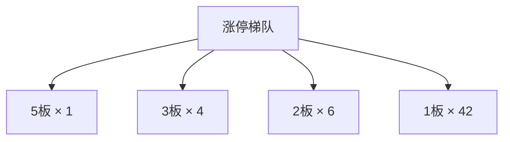
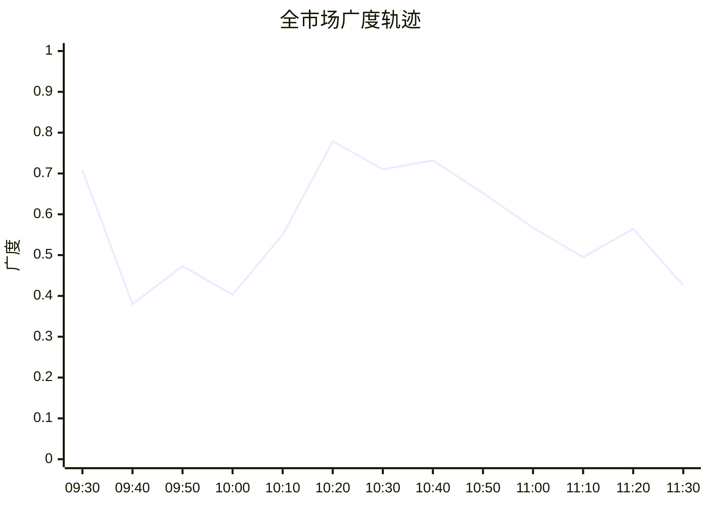
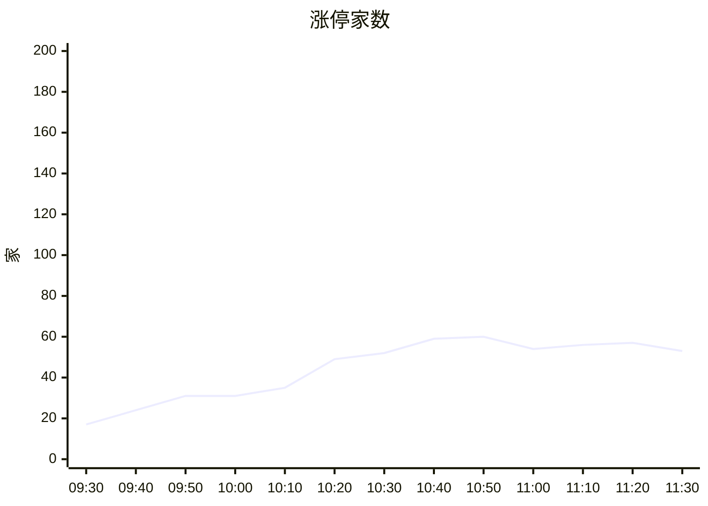
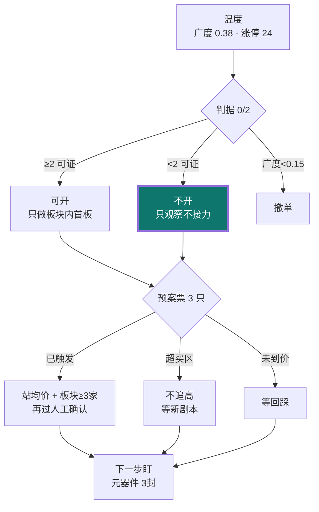
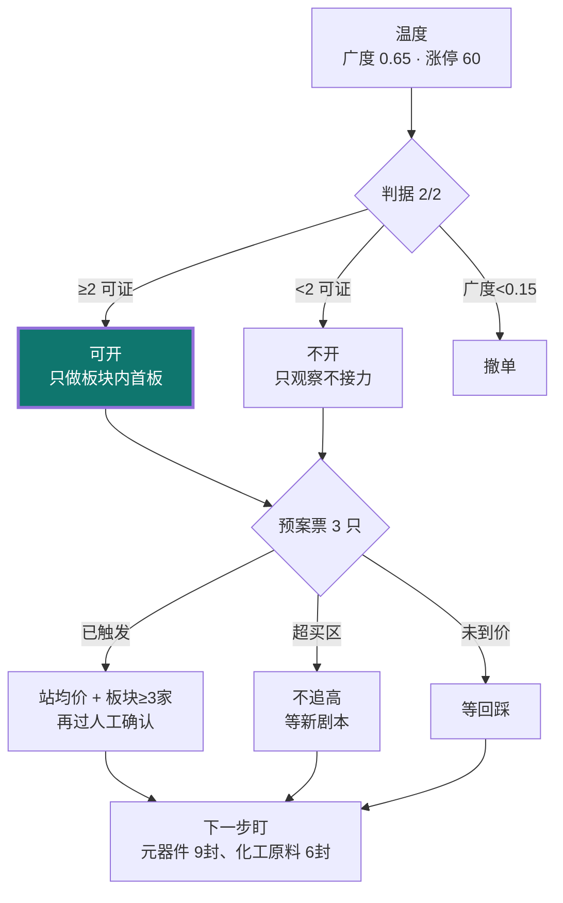
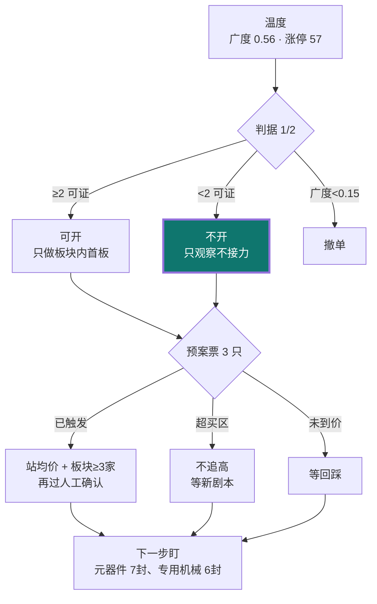

# 20261126 盘中总览（截至 11:30）

> **结论**：全市场涨2379/跌2939（广度0.43）；涨停53/跌停7。 钱在：无 ≥3 家涨停的概念；零星涨停：IC载板(1)、气凝胶(1)、磁悬浮压缩机(2)、房屋养老金概念(1)、锂矿(2)。 退潮（上涨广度最低）：国潮消费(上涨广度0.22)、磁悬浮压缩机(上涨广度0.33)、华为甄选与支付(上涨广度0.33)。 梯队：5板×1、3板×4、2板×6、1板×42，最高5板。 预案：超买区 青山纸业；未到价 天孚通信；已触发 山西汾酒；无预案价 特一药业、亨迪药业、合富中国、新华制药、人民同泰、康芝药业、杭州解百、国芳集团、银座股份、百亚股份、泸州老窖、古井贡酒、海天味业、胜宏科技、新易盛、沪电股份、源杰科技、剑桥科技、中芯国际、工业富联。 较上一轮：广度回落。

### 盘前路径对照

> 盘前情景树首选：大概率路径 = 低开高走（V 反 / 二次探底后拉起）（38.5%）；仓位上限 10.0%；确认信号：09:45 广度 ≥0.30 且高于 09:30

> 当前落在：**偏弱（广度 0.15–0.45）**（广度 0.43，涨停 53）

### 概念扩散

> 口径：涨停密度 = 涨停数/有效成分数；排序用密度，不用涨停家数（大板块天然涨停多）。

| 概念 | 涨停 | 有效成分 | 涨停密度 | 上涨广度 | 中位涨幅 | 相对全市场 | 成交(亿) |
|---|---|---|---|---|---|---|---|
| IC载板 ⬦ | 1 | 8 | 0.125 | 0.88 | +3.72% | +3.89% | 106 |
| 气凝胶 ⬦ | 1 | 8 | 0.125 | 0.62 | +0.10% | +0.27% | 6 |
| 磁悬浮压缩机 ⬦ | 2 | 21 | 0.095 | 0.33 | -0.39% | -0.22% | 53 |
| 房屋养老金概念 ⬦ | 1 | 12 | 0.083 | 0.75 | +0.30% | +0.48% | 6 |
| 锂矿 ⬦ | 2 | 29 | 0.069 | 0.76 | +0.98% | +1.15% | 71 |
| 版权 ⬦ | 1 | 15 | 0.067 | 0.53 | +0.29% | +0.46% | 30 |
| 化肥 ⬦ | 2 | 34 | 0.059 | 0.85 | +1.20% | +1.37% | 64 |
| 国潮消费 ⬦ | 1 | 18 | 0.056 | 0.22 | -0.83% | -0.65% | 17 |
| 中吉乌铁路概念 ⬦ | 1 | 19 | 0.053 | 0.58 | +0.21% | +0.39% | 17 |
| 冰雪旅游概念 ⬦ | 2 | 39 | 0.051 | 0.46 | +0.00% | +0.17% | 83 |
| 韧性城市概念 ⬦ | 1 | 20 | 0.050 | 0.65 | +0.23% | +0.40% | 16 |
| 6G ⬦ | 2 | 42 | 0.048 | 0.81 | +1.29% | +1.46% | 137 |
| 华为甄选与支付 ⬦ | 1 | 21 | 0.048 | 0.33 | -0.80% | -0.63% | 23 |
| 农药 ⬦ | 1 | 21 | 0.048 | 0.76 | +0.47% | +0.64% | 12 |
| 离境退税概念 ⬦ | 2 | 45 | 0.044 | 0.38 | -0.39% | -0.22% | 67 |

> ⬦ = 涨停 <3 只，零星个例，不构成扩散（不计入「钱在」判定）。

### 涨停梯队

| 身位 | 家数 |
|---|---|
| 5板 | 1 |
| 3板 | 4 |
| 2板 | 6 |
| 1板 | 42 |

| 最高板个股 | 板数 |
|---|---|
| 克来机电 | 5 |
| 利君股份 | 3 |
| 金牛化工 | 3 |
| 全筑股份 | 3 |
| 天圣制药 | 3 |
| 宏达高科 | 2 |



### 预案池对照

| 票 | 池 | 板块 | 现价 | 涨幅 | 触发价 | 买区 | 风险位 | 判定 |
|---|---|---|---|---|---|---|---|---|
| 山西汾酒 `600809.SH` | execution_pool | 守正·存量资金聚拢①白酒（板块 10日 +1 | 131.11 | -1.42% | 131.57 | [130.65, 132.62] | 128.45 | **已触发** |
| 青山纸业 `600103.SH` | execution_pool | 守正·存量资金聚拢②造纸（板块 5日 +6. | 4.07 | 7.67% | 3.70 | [3.60, 3.72] | 3.53 | **超买区** |
| 天孚通信 `300394.SZ` | execution_pool | 守正之外·退潮期试错档③深跌光模块（单票当日 | 130.67 | -0.15% | 131.43 | [130.51, 132.48] | 125.03 | **未到价** |
| 特一药业 `002728.SZ` | watch_pool | 医药链·OTC（R2 擦线主线｜价格锚） | 8.42 | 0.84% | — | — | 7.87 | **无预案价** |
| 亨迪药业 `301211.SZ` | watch_pool | 医药链·布洛芬原料（20cm 弹性） | 10.96 | -1.35% | — | — | 10.30 | **无预案价** |
| 合富中国 `603122.SH` | watch_pool | 医药链·医药流通（首板） | 9.42 | -6.64% | — | — | 9.40 | **无预案价** |
| 新华制药 `000756.SZ` | watch_pool | 医药链·解热镇痛（首板） | 11.69 | -3.87% | — | — | 11.70 | **无预案价** |
| 人民同泰 `600829.SH` | watch_pool | 医药链·医药商业（首板） | 7.96 | -5.13% | — | — | 7.85 | **无预案价** |
| 康芝药业 `300086.SZ` | watch_pool | 医药链·20cm（首板） | 5.09 | 4.95% | — | — | 4.58 | **无预案价** |
| 杭州解百 `600814.SH` | watch_pool | 百货·北高峰玄学（龙一 3 板） | 9.00 | 7.78% | — | — | 7.97 | **无预案价** |
| 国芳集团 `601086.SH` | watch_pool | 百货·龙二（首板容量票） | 11.16 | 3.81% | — | — | 9.96 | **无预案价** |
| 银座股份 `600858.SH` | watch_pool | 百货·银座（次线备份） | 4.33 | 2.85% | — | — | 4.11 | **无预案价** |
| 百亚股份 `003006.SZ` | watch_pool | 造纸·个护（资金 20 日 +66.84 亿 | 19.21 | 0.31% | — | — | 19.17 | **无预案价** |
| 泸州老窖 `000568.SZ` | watch_pool | 白酒·泸州老窖（第三腿） | 78.29 | -1.94% | — | — | 78.54 | **无预案价** |
| 古井贡酒 `000596.SZ` | watch_pool | 白酒·古井贡酒（pullback 态） | 104.78 | -0.64% | — | — | 104.61 | **无预案价** |
| 海天味业 `603288.SH` | watch_pool | 食品·海天味业 | 35.62 | -1.60% | — | — | 35.47 | **无预案价** |
| 胜宏科技 `300476.SZ` | watch_pool | AI 硬件·PCB（深跌反弹） | 123.36 | 1.54% | — | — | 115.91 | **无预案价** |
| 新易盛 `300502.SZ` | watch_pool | AI 硬件·光模块（5 日 +42.19 亿 | 183.86 | 1.41% | — | — | 173.54 | **无预案价** |
| 沪电股份 `002463.SZ` | watch_pool | AI 硬件·PCB（昨日执行池腿） | 81.43 | 2.44% | — | — | 80.03 | **无预案价** |
| 源杰科技 `688498.SH` | watch_pool | AI 硬件·光芯片（R4 订单正面） | 587.00 | 2.80% | — | — | 548.33 | **无预案价** |
| 剑桥科技 `603083.SH` | watch_pool | AI 硬件·光模块（5 日资金为负） | 96.09 | 0.09% | — | — | 94.16 | **无预案价** |
| 中芯国际 `688981.SH` | watch_pool | AI 硬件·晶圆（昨日价格锚） | 116.51 | -4.50% | — | — | 116.33 | **无预案价** |
| 工业富联 `601138.SH` | watch_pool | AI 硬件·服务器（5 日 +20.15 亿 | 40.93 | 3.33% | — | — | 38.48 | **无预案价** |

### 全天广度轨迹

| 时点 | 涨 | 跌 | 广度 | 涨停 | 跌停 | 成交(亿) | 有效样本 |
|---|---|---|---|---|---|---|---|
| 0930 | 3961 | 1262 | 0.709 | 17 | 5 | 534 | 5572 |
| 0940 | 2121 | 3084 | 0.380 | 24 | 7 | 2229 | 5578 |
| 0950 | 2644 | 2604 | 0.473 | 31 | 7 | 3251 | 5578 |
| 1000 | 2253 | 2985 | 0.403 | 31 | 7 | 3982 | 5578 |
| 1010 | 3072 | 2228 | 0.550 | 35 | 7 | 4644 | 5578 |
| 1020 | 4354 | 1070 | 0.779 | 49 | 7 | 5503 | 5578 |
| 1030 | 3968 | 1423 | 0.710 | 52 | 6 | 6058 | 5578 |
| 1040 | 4088 | 1350 | 0.732 | 59 | 6 | 6510 | 5578 |
| 1050 | 3640 | 1730 | 0.652 | 60 | 5 | 6885 | 5578 |
| 1100 | 3169 | 2174 | 0.567 | 54 | 6 | 7242 | 5578 |
| 1110 | 2767 | 2532 | 0.495 | 56 | 6 | 7502 | 5578 |
| 1120 | 3149 | 2178 | 0.564 | 57 | 7 | 7741 | 5578 |
| 1130 | 2379 | 2939 | 0.426 | 53 | 7 | 8017 | 5578 |





### 观察建议（仅研究）

- **环境**：广度 0.43、涨停 53、跌停 7。
- **方向**：无 ≥3 家涨停概念。
- **预案**：已触发 1 只、超买区 1 只、未到价 1 只、无预案价 20 只。买区已错过的票不追高，要参与需等新剧本。
- **定性**：偏弱（广度 0.15–0.45）。

---
### 09:30 盯盘卡

**温度** 广度 **0.71** · 涨停 **17** · 炸板 **5** · 跌停 **5** · 成交 **534.0 亿**
**判据** 广度>0.55 ✅ · 涨停≥60 ❌ · 昨涨停红盘率>60% ⏳未采 → **1/2 可证**


> **当前落点**：判据不足 → 不开，只观察｜判据 1/2｜预案 3 只｜钱在：暂无 ≥3 家涨停的板块

**连板梯队** 最高 **3** 板（利君股份 3板、天圣制药 3板、*ST瑞茂  2板）｜ 1板 11家 / 2板 4家 / 3板 2家
**主线（按行业涨停数）** 专用机械 **2**家 均+1.06% ｜ 造纸 **2**家 均+0.97% ｜ 航空 **1**家 均+2.80% ｜ 小金属 **1**家 均+2.04% ｜ 旅游服务 **1**家 均+0.97%
**板块分时** 商业航天 +1.90% ｜ 军工 +1.46% ｜ AI算力 +0.98% ｜ 券商 +0.66% ｜ 半导体 +0.65% ｜ 光通信 +0.59% ｜ 医药 +0.53% ｜ 白酒 +0.23%
**进攻位（距涨停≤3%）** 科达制造 +8.56%（差1.35%，专用机械，量比33.1，换手0.2%） ｜ 特一药业 +7.66%（差2.22%，中成药，量比288.9，换手3.4%） ｜ *ST春天  +7.57%（差2.26%，医疗保健，量比38.7，换手0.1%） ｜ 骏亚科技 +7.50%（差2.33%，元器件，量比23.2，换手0.9%） ｜ *ST华幸  +6.80%（差2.73%，园区开发，量比44.7，换手0.8%）
**风险（炸板）** 杭州解百 高+10.06%→收+6.83% ｜ 特一药业 高+10.06%→收+7.66% ｜ 东尼电子 高+10.01%→收+4.24% ｜ 克来机电 高+10.00%→收+5.70%
**资金（行业成交额）** 半导体 56亿 ｜ 元器件 55亿 ｜ 电气设备 26亿 ｜ 专用机械 22亿
**资金（个股成交额）** 中际旭创 7亿 ｜ 宁德时代 7亿 ｜ 新易盛 7亿 ｜ 天孚通信 5亿 ｜ 中京电子 5亿

**我的池子**

| 票 | 仓位 | 现价 | 触发 | 距触发 | 距止损 | 状态 | 现在做什么 |
|---|---|---|---|---|---|---|---|
| 山西汾酒 | 4.0% | 133.31 | 131.57↑ | -1.31% | 3.6% | ★ 已触发 | 等板块确认+人工确认 |
| 青山纸业 | 3.0% | 3.75 | 3.7↑ | -1.33% | 5.9% | ★ 已触发 | 等板块确认+人工确认 |
| 天孚通信 | 2.0% | 130.55 | 131.43↑ | 0.67% | 4.2% | 等触发 | 盯 131.43 |

**观察池** 强：特一药业 +7.66%、杭州解百 +6.83%、康芝药业 +4.12% ｜ 弱：合富中国 -7.53%、国芳集团 -3.72%

**全市场机会** 无（无「板块≥3家涨停 + 距涨停≥0.5% + 未摸板」的票）

**盘中快讯**（最近 20 分钟，14 条命中 / 共 114 条）

- `09:30` 【商业航天板块高开，西部材料、上海沪工涨停】商业航天板块高开，西部材料、上海沪工、利君股份、顺灏股份涨停，信维通信涨超15%，天力复合、电科蓝天等跟涨。（新浪财经-快讯） · `688818.SH` · 商业航天
- `09:30` 商业航天板块高开，西部材料、上海沪工涨停（同花顺-快讯） · `603131.SH` · 卫星互联网
- `09:29` 【阿尔及利亚南部发生交通事故致12人死亡】阿尔及利亚民防部门25日发布声明说，该国南部塔曼拉塞特省当天发生一起道路交通事故，造成12人死亡、15人受伤。（新浪财经-快讯）
- `09:28` 【A股卫星互联网板块高开，《新一代通信网建设实施方案》印发】A股卫星互联网板块高开，信维通信涨超15％，上海沪工竞价涨停，盛洋科技涨超9％，电科蓝天、乾照光电、通宇通讯、中国卫…（新浪财经-快讯） · `688818.SH` · 商业航天
- `09:28` 商业航天板块高开 顺灏股份、西部材料竞价涨停（东方财富-快讯） · `002565.SZ` · 电子烟
- `09:26` 1700+意向订单，希迪智驾宝马展携手8家矿山客户集体签约（格隆汇-事件）

**结论** ⚪ 窗口已过 —— 今日不再开新仓，只做记录与止损管理
**下一档盯** 山西汾酒 已到 133.31 ｜ 青山纸业 已到 3.75 ｜ 天孚通信 130.55 → 131.43（需涨 0.67%）


---
### 09:40 盯盘卡

**温度** 广度 **0.38**（-0.33） · 涨停 **24**（+7） · 炸板 **16** · 跌停 **7**（+2） · 成交 **2228.8 亿**（+1695）
**判据** 广度>0.55 ❌ · 涨停≥60 ❌ · 昨涨停红盘率>60% ⏳未采 → **0/2 可证**



> **当前落点**：判据不足 → 不开，只观察｜判据 0/2｜预案 3 只｜钱在：元器件 3封

**连板梯队** 最高 **3** 板（天圣制药 3板、利君股份 3板、宏达高科 2板）｜ 1板 20家 / 2板 2家 / 3板 2家
**主线（按行业涨停数）** 元器件 **3**家 均-0.06% ｜ 渔业 **2**家 均+5.18% ｜ 造纸 **2**家 均+0.68% ｜ 化工原料 **2**家 均+0.21% ｜ 专用机械 **2**家 均-0.00%
**板块分时** 医药 +0.53% ｜ 券商 +0.22% ｜ 军工 +0.22% ｜ 商业航天 +0.13% ｜ 白酒 +0.00% ｜ AI算力 -0.33% ｜ 光通信 -0.50% ｜ 半导体 -1.57%
**进攻位（距涨停≤3%）** 中央商场 +9.22%（差0.65%，百货，量比42.4，换手8.1%） ｜ 城市传媒 +9.06%（差0.85%，出版业，量比30.9，换手4.8%） ｜ *ST华幸  +8.74%（差0.89%，园区开发，量比10.7，换手1.9%） ｜ 科达制造 +8.90%（差1.03%，专用机械，量比21.2，换手1.2%） ｜ 克来机电 +8.12%（差1.74%，汽车配件，量比230.2，换手14.3%）
**风险（炸板）** 安达维尔 高+20.00%→收+11.98% ｜ 杭州解百 高+10.06%→收+7.54% ｜ 特一药业 高+10.06%→收+4.07% ｜ 金牛化工 高+10.04%→收+6.31%
**资金（行业成交额）** 元器件 233亿 ｜ 专用机械 90亿 ｜ 化工原料 83亿 ｜ 小金属 42亿
**资金（个股成交额）** 中际旭创 28亿 ｜ 新易盛 27亿 ｜ 宁德时代 20亿 ｜ 天孚通信 18亿 ｜ 九阳股份 17亿
**新晋涨停（vs 上一条）** 12 家：东方海洋(渔业)、东方新能(新型电力)、东晶电子(元器件)、骏亚科技(元器件)、中毅达  (化工原料)、中水渔业(渔业)、杭齿前进(机械基件)、信邦智能(专用机械)

**我的池子**

| 票 | 仓位 | 现价 | 触发 | 距触发 | 距止损 | 状态 | 现在做什么 |
|---|---|---|---|---|---|---|---|
| 山西汾酒 | 4.0% | 133.0 | 131.57↑ | -1.08% | 3.4% | ★ 已触发 | 等板块确认+人工确认 |
| 青山纸业 | 3.0% | 3.88 | 3.7↑ | -4.64% | 9.0% | ★ 已触发 | 等板块确认+人工确认 |
| 天孚通信 | 2.0% | 128.5 | 131.43↑ | 2.28% | 2.7% | 等触发 | 盯 131.43 |

**观察池** 强：康芝药业 +12.37%、杭州解百 +7.54%、特一药业 +4.07% ｜ 弱：合富中国 -7.43%、人民同泰 -4.29%

**全市场机会** 无（无「板块≥3家涨停 + 距涨停≥0.5% + 未摸板」的票）

**盘中快讯**（最近 20 分钟，24 条命中 / 共 140 条）

- `09:39` 【百济神州与诺华拓展泰菲乐®和迈吉宁®在中国的商业化合作】百济神州11月26日宣布，与诺华就双靶向联合治疗药物泰菲乐®（甲磺酸达拉非尼胶囊）和迈吉宁®（曲美替尼片）达成新的商业…（新浪财经-快讯） · `688235.SH` · 出海
- `09:39` 【通用设备板块盘初走强，杭齿前进涨停】通用设备板块盘初走强，杭齿前进涨停，优机股份涨超13%，创远信科、飞沃科技、*ST海华、埃科光电、上海沪工等跟涨。（新浪财经-快讯） · `920961.BJ` · 车路云一体化
- `09:39` 【西宁经济技术开发区投资控股集团有限公司原党委书记、董事长李峰被双开】青海纪检监察官微11月26日通报，据西宁市纪委监委消息：经中共西宁市委批准，西宁市纪委监委对西宁经济技术开…（新浪财经-快讯）
- `09:38` 【化学原料板块异动走高，中毅达涨停】化学原料板块异动走高，中毅达涨停，善水科技、金牛化工、江天化学跟涨。（新浪财经-快讯） · `600722.SH`
- `09:38` 化学原料板块异动走高，中毅达涨停（同花顺-快讯） · `600610.SH` · 化肥
- `09:37` 【养殖业板块短线拉升，中水渔业涨停】养殖业板块短线拉升，中水渔业涨停，好当家、国联水产、开山生物跟涨。（新浪财经-快讯） · `600467.SH` · 预制菜

**结论** 🟡 窗口内但判据不足 —— 不主动开仓，等触发线自己走到位
**下一档盯** 山西汾酒 已到 133.0 ｜ 青山纸业 已到 3.88 ｜ 天孚通信 128.5 → 131.43（需涨 2.28%）


---
### 09:50 盯盘卡

**温度** 广度 **0.47**（+0.09） · 涨停 **31**（+7） · 炸板 **16** · 跌停 **7**（+0） · 成交 **3251.0 亿**（+1022）
**判据** 广度>0.55 ❌ · 涨停≥60 ❌ · 昨涨停红盘率>60% ⏳未采 → **0/2 可证**


> **当前落点**：判据不足 → 不开，只观察｜判据 0/2｜预案 3 只｜钱在：元器件 3封、专用机械 3封

**连板梯队** 最高 **3** 板（利君股份 3板、天圣制药 3板、证通电子 2板）｜ 1板 24家 / 2板 5家 / 3板 2家
**主线（按行业涨停数）** 元器件 **3**家 均+0.67% ｜ 专用机械 **3**家 均+0.33% ｜ 渔业 **2**家 均+4.72% ｜ 百货 **2**家 均+1.38% ｜ 造纸 **2**家 均+1.06%
**板块分时** 军工 +0.34% ｜ AI算力 +0.33% ｜ 券商 +0.00% ｜ 医药 +0.00% ｜ 商业航天 +0.00% ｜ 光通信 -0.17% ｜ 半导体 -0.52% ｜ 白酒 -0.69%
**进攻位（距涨停≤3%）** 北化股份 +9.11%（差0.80%，化工原料，量比6.8，换手1.9%） ｜ *ST华幸  +8.74%（差0.89%，园区开发，量比5.9，换手2.1%） ｜ 科达制造 +8.64%（差1.27%，专用机械，量比13.2，换手1.5%） ｜ 克来机电 +8.60%（差1.29%，汽车配件，量比137.0，换手17.0%） ｜ 新华百货 +7.50%（差2.33%，百货，量比6.7，换手3.0%）
**风险（炸板）** 安达维尔 高+20.00%→收+11.74% ｜ 杭州解百 高+10.06%→收+7.31% ｜ 特一药业 高+10.06%→收+5.15% ｜ 金牛化工 高+10.04%→收+6.46%
**资金（行业成交额）** 元器件 355亿 ｜ 电气设备 150亿 ｜ 专用机械 131亿 ｜ 小金属 60亿
**资金（个股成交额）** 中际旭创 48亿 ｜ 新易盛 40亿 ｜ 宁德时代 28亿 ｜ 天孚通信 28亿 ｜ 华胜天成 24亿
**新晋涨停（vs 上一条）** 10 家：常山北明(软件服务)、金 螳 螂(装修装饰)、证通电子(IT设备)、中央商场(百货)、善水科技(染料涂料)、顺钠股份(电气设备)、城市传媒(出版业)、闽东电力(水力发电)

**我的池子**

| 票 | 仓位 | 现价 | 触发 | 距触发 | 距止损 | 状态 | 现在做什么 |
|---|---|---|---|---|---|---|---|
| 山西汾酒 | 4.0% | 132.1 | 131.57↑ | -0.40% | 2.8% | ★ 已触发 | 等板块确认+人工确认 |
| 青山纸业 | 3.0% | 4.02 | 3.7↑ | -7.96% | 12.2% | ★ 已触发 | 等板块确认+人工确认 |
| 天孚通信 | 2.0% | 131.1 | 131.43↑ | 0.25% | 4.6% | 等触发 | 盯 131.43 |

**观察池** 强：康芝药业 +10.31%、杭州解百 +7.31%、亨迪药业 +5.40% ｜ 弱：合富中国 -7.14%、人民同泰 -4.05%

**全市场机会** 无（无「板块≥3家涨停 + 距涨停≥0.5% + 未摸板」的票）

**盘中快讯**（最近 20 分钟，22 条命中 / 共 115 条）

- `09:49` 【绿色电力概念震荡反弹，闽东电力直线涨停】绿色电力概念震荡反弹，闽东电力直线涨停，立新能源、粤电力Ａ、金开新能、九洲集团、华电辽能、银星能源等跟涨。（新浪财经-快讯） · `600821.SH` · 电力
- `09:48` 【华为算力概念局部异动 常山北明直线涨停】早盘华为算力概念局部异动，常山北明直线涨停，盛合晶微涨超10%，华丰科技、润和软件、拓维信息、中贝通信、高新发展冲高。（新浪财经-快讯） · `688820.SH` · 先进封装
- `09:48` 华为算力概念局部异动 常山北明直线涨停（东方财富-快讯） · `000158.SZ` · 华为鸿蒙
- `09:47` 覆盖九大领域 中英明确未来五年教育合作重点（东方财富-快讯）
- `09:47` 美国联邦航空管理局对迈阿密机场发布地面停飞令。（新浪财经-快讯）
- `09:45` 【全国已建设应急广播平台2369个 部署终端超310万个】11月26日，由国家广播电视总局主办的应急广播服务防汛救灾（2026年）专项行动总结会在陕西西安召开。今年6月1日至9…（新浪财经-快讯）

**结论** 🟡 窗口内但判据不足 —— 不主动开仓，等触发线自己走到位
**下一档盯** 山西汾酒 已到 132.1 ｜ 青山纸业 已到 4.02 ｜ 天孚通信 131.1 → 131.43（需涨 0.25%）

---
### 10:00 盯盘卡

**温度** 广度 **0.40**（-0.07） · 涨停 **31**（+0） · 炸板 **21** · 跌停 **7**（+0） · 成交 **3982.2 亿**（+731）
**判据** 广度>0.55 ❌ · 涨停≥60 ❌ · 昨涨停红盘率>60% ⏳未采 → **0/2 可证**


> **当前落点**：判据不足 → 不开，只观察｜判据 0/2｜预案 3 只｜钱在：化工原料 3封、元器件 3封

**连板梯队** 最高 **3** 板（利君股份 3板、金牛化工 3板、天圣制药 3板）｜ 1板 23家 / 2板 5家 / 3板 3家
**主线（按行业涨停数）** 化工原料 **3**家 均+0.68% ｜ 元器件 **3**家 均+0.39% ｜ 专用机械 **3**家 均-0.13% ｜ 农药化肥 **2**家 均+2.16% ｜ 造纸 **2**家 均+0.93%
**板块分时** 医药 +0.53% ｜ AI算力 +0.33% ｜ 军工 +0.11% ｜ 券商 +0.00% ｜ 光通信 -0.17% ｜ 白酒 -0.46% ｜ 商业航天 -0.63% ｜ 半导体 -0.65%
**进攻位（距涨停≤3%）** 东易日盛 +9.70%（差0.26%，装修装饰，量比15.5，换手6.4%） ｜ 东方海洋 +9.22%（差0.63%，渔业，量比6.6，换手28.4%） ｜ 信邦智能 +18.93%（差0.90%，专用机械，量比26.9，换手3.0%） ｜ 冰山冷热 +8.71%（差1.19%，机械基件，量比3.8，换手17.8%） ｜ 赤天化   +8.36%（差1.43%，农药化肥，量比14.7，换手14.3%）
**风险（炸板）** 安达维尔 高+20.00%→收+11.05% ｜ 信邦智能 高+19.99%→收+18.93% ｜ 东方新能 高+10.14%→收+5.99% ｜ 中嘉博创 高+10.14%→收+8.17%
**资金（行业成交额）** 半导体 517亿 ｜ 元器件 444亿 ｜ 专用机械 158亿 ｜ 化工原料 144亿
**资金（个股成交额）** 中际旭创 59亿 ｜ 新易盛 50亿 ｜ 宁德时代 41亿 ｜ 天孚通信 32亿 ｜ 寒武纪   26亿
**新晋涨停（vs 上一条）** 5 家：金牛化工(化工原料)、科达制造(专用机械)、大港股份(半导体)、金正大(农药化肥)、金三江(化工原料)

**我的池子**

| 票 | 仓位 | 现价 | 触发 | 距触发 | 距止损 | 状态 | 现在做什么 |
|---|---|---|---|---|---|---|---|
| 山西汾酒 | 4.0% | 132.2 | 131.57↑ | -0.48% | 2.8% | ★ 已触发 | 等板块确认+人工确认 |
| 青山纸业 | 3.0% | 3.92 | 3.7↑ | -5.61% | 9.9% | ★ 已触发 | 等板块确认+人工确认 |
| 天孚通信 | 2.0% | 129.48 | 131.43↑ | 1.51% | 3.4% | 等触发 | 盯 131.43 |

**观察池** 强：康芝药业 +5.98%、特一药业 +3.95%、杭州解百 +3.95% ｜ 弱：合富中国 -7.43%、人民同泰 -5.24%

**全市场机会** 观察，不接力
> 口径：距涨停 ≥0.5%（还有空间）· 未摸板 · 非 ST · 所属行业当日 ≥3 家涨停。候选池 near_limit 共 10 只。

| 票 | 板块（概念优先） | 现价 | 涨幅 | 距涨停 | 量比 | 换手 | 板块封板 |
|---|---|---|---|---|---|---|---|
| 赤天化   `600227.SH` | 化肥 | 3.50 | +8.36% | 1.43% | 14.7 | 14.3% | 3 家 |
| 北化股份 `002246.SZ` | 化工原料(行业) | 19.72 | +8.23% | 1.62% | 5.1 | 2.1% | 3 家 |

**盘中快讯**（最近 20 分钟，13 条命中 / 共 84 条）

- `09:57` 【蚂蚁国际与工行上海市分行签署《战略合作谅解备忘录》】近日，蚂蚁国际与工商银行上海市分行成功签署《战略合作谅解备忘录》（以下简称“备忘录”）。根据备忘录，双方将在依法合规的前提…（新浪财经-快讯） · `920670.BJ`
- `09:57` 蚂蚁国际与工行上海市分行签署《战略合作谅解备忘录》（东方财富-快讯）
- `09:54` 【化学原料板块异动走高 善水科技20%涨停】化学原料板块异动走高，中毅达涨停，善水科技20%涨停，金牛化工、华融化学跟涨。（新浪财经-快讯） · `600722.SH`
- `09:52` 先进封装概念异动拉升 三佳科技、快克智能双双涨停（东方财富-快讯） · `603203.SH` · AI硬件
- `09:50` 电力板块表现活跃 闽东电力涨停（东方财富-快讯） · `000993.SZ` · 电力
- `09:49` 【绿色电力概念震荡反弹，闽东电力直线涨停】绿色电力概念震荡反弹，闽东电力直线涨停，立新能源、粤电力Ａ、金开新能、九洲集团、华电辽能、银星能源等跟涨。（新浪财经-快讯） · `600821.SH` · 电力

**结论** 🟡 窗口内但判据不足 —— 不主动开仓，等触发线自己走到位
**下一档盯** 山西汾酒 已到 132.2 ｜ 青山纸业 已到 3.92 ｜ 天孚通信 129.48 → 131.43（需涨 1.51%）


### 10:05 盘中总结（10:00 快照 vs 09:50）

- **广度二次回落**：0.4733 → 0.4033（-0.07），上涨 2644→2253 家、下跌 2604→2985 家；涨停 31 持平、跌停 7 持平，但炸板 16→21（炸板率 34.0%→40.4%），10 分钟内新晋涨停 5 家、掉队 5 家，跌幅>5% 由 75→89 家；成交 3251→3982 亿（+731 亿）。放量而广度掉头＝增量资金没接住抛压。结构上化工原料（均 +0.68%、红盘率 0.68）、农药化肥（+2.16%/0.93）在吸钱，专用机械由 +0.33% 转 -0.13%、生物制药 -1.59%（红盘率 0.07）在失血。
- **预案池**：执行池 3 只——青山纸业 3.92（+3.7%，10 分钟前 +6.35%）仍在买区上沿 3.72 之上，P1 竞价 3.83 已按 far_above 判弃，今日不接；山西汾酒 132.2（-0.6%）在买区 [130.65,132.62] 内、站上确认价 131.57，但 gate(a) 白酒Ⅲ 当日主力净额在快照里缺失（sector_flow 为空），板块确认缺一项；天孚通信 129.48（-1.06%）已跌破买区下沿 130.51，未触发先失效。
- **观察池**：早盘强势腿集体回吐——康芝药业 10.31%→5.98%、杭州解百 7.31%→3.95%、特一药业 5.15%→3.95%、亨迪药业 5.40%→3.51%，均为跳水式回落；弱侧合富中国 -7.43%、人民同泰 -5.24% 继续弱，新华制药 -0.08%→-2.63% 盘中翻脸。
- **结合预案**：预案定调「崩溃退潮型（T-1 广度 0.1051、三口径炸板 ≥35%）只做均价线承接，不做打板、不做突破、不接高位老龙」。盘面正在按这个剧本走：涨停 31 家靠少数题材硬撑、炸板率抬到 40.4%、情绪接力腿（康芝/解百）冲高回落、容量腿天孚破位；唯一价格口径达标的是汾酒（涨停家数 31 ≥25、炸板率 40.4% <45%），但板块资金一项无数据、trading_authorized=false，按纪律不动。
- **一句话结论**：广度二次回落＋情绪腿集体退潮，预案「零成交」是纪律执行不是踏空——只剩汾酒一个待确认观察点，10:30 前板块净额补不上就不做。

---
### 10:10 盯盘卡

**温度** 广度 **0.55**（+0.15） · 涨停 **35**（+4） · 炸板 **24** · 跌停 **7**（+0） · 成交 **4644.5 亿**（+662）
**判据** 广度>0.55 ✅ · 涨停≥60 ❌ · 昨涨停红盘率>60% ⏳未采 → **1/2 可证**


> **当前落点**：判据不足 → 不开，只观察｜判据 1/2｜预案 3 只｜钱在：元器件 6封、化工原料 3封

**连板梯队** 最高 **3** 板（天圣制药 3板、利君股份 3板、金牛化工 3板）｜ 1板 28家 / 2板 4家 / 3板 3家
**主线（按行业涨停数）** 元器件 **6**家 均+1.46% ｜ 化工原料 **3**家 均+1.05% ｜ 农药化肥 **2**家 均+2.21% ｜ 造纸 **2**家 均+1.29% ｜ 装修装饰 **2**家 均+1.24%
**板块分时** AI算力 +0.81% ｜ 光通信 +0.33% ｜ 医药 +0.27% ｜ 券商 +0.22% ｜ 军工 +0.22% ｜ 半导体 -0.13% ｜ 商业航天 -0.25% ｜ 白酒 -0.69%
**进攻位（距涨停≤3%）** 信邦智能 +19.78%（差0.18%，专用机械，量比23.5，换手3.5%） ｜ 东方海洋 +9.68%（差0.21%，渔业，量比5.4，换手30.9%） ｜ 金禄电子 +19.28%（差0.60%，元器件，量比5.6，换手10.7%） ｜ 北化股份 +9.22%（差0.70%，化工原料，量比4.3，换手2.4%） ｜ 科达制造 +9.08%（差0.87%，专用机械，量比10.1，换手2.2%）
**风险（炸板）** 安达维尔 高+20.00%→收+10.12% ｜ 信邦智能 高+19.99%→收+19.78% ｜ 东方新能 高+10.14%→收+6.91% ｜ 中嘉博创 高+10.14%→收+7.04%
**资金（行业成交额）** 半导体 599亿 ｜ 元器件 530亿 ｜ 专用机械 182亿 ｜ 化工原料 166亿
**资金（个股成交额）** 中际旭创 67亿 ｜ 新易盛 55亿 ｜ 宁德时代 50亿 ｜ 寒武纪   38亿 ｜ 天孚通信 35亿
**新晋涨停（vs 上一条）** 7 家：金健米业(农业综合)、奥士康(元器件)、金百泽(元器件)、贤丰控股(元器件)、东易日盛(装修装饰)、楚天龙(通信设备)、拓山重工(工程机械)

**我的池子**

| 票 | 仓位 | 现价 | 触发 | 距触发 | 距止损 | 状态 | 现在做什么 |
|---|---|---|---|---|---|---|---|
| 山西汾酒 | 4.0% | 131.31 | 131.57↑ | 0.20% | 2.2% | 等触发 | 盯 131.57 |
| 青山纸业 | 3.0% | 3.99 | 3.7↑ | -7.27% | 11.5% | ★ 已触发 | 等板块确认+人工确认 |
| 天孚通信 | 2.0% | 131.19 | 131.43↑ | 0.18% | 4.7% | 等触发 | 盯 131.43 |

**观察池** 强：杭州解百 +5.87%、沪电股份 +5.70%、康芝药业 +5.15% ｜ 弱：合富中国 -6.05%、人民同泰 -3.81%

**全市场机会** 观察，不接力
> 口径：距涨停 ≥0.5%（还有空间）· 未摸板 · 非 ST · 所属行业当日 ≥3 家涨停。候选池 near_limit 共 12 只。

| 票 | 板块（概念优先） | 现价 | 涨幅 | 距涨停 | 量比 | 换手 | 板块封板 |
|---|---|---|---|---|---|---|---|
| 金禄电子 `301282.SZ` | 元器件(行业) | 34.95 | +19.28% | 0.60% | 5.6 | 10.7% | 6 家 |
| 崇达技术 `002815.SZ` | 元器件(行业) | 15.10 | +8.87% | 1.06% | 3.2 | 8.0% | 6 家 |
| 北化股份 `002246.SZ` | 化工原料(行业) | 19.90 | +9.22% | 0.70% | 4.3 | 2.4% | 3 家 |
| 赤天化   `600227.SH` | 化肥 | 3.47 | +7.43% | 2.31% | 12.2 | 15.8% | 3 家 |

**盘中快讯**（最近 20 分钟，21 条命中 / 共 100 条）

- `10:10` 元件板块再度拉升，金百泽20cm涨停（同花顺-快讯） · `301041.SZ` · AI低代码概念
- `10:10` 【AIVC企业华源智因完成超亿元天使轮融资】11月26日，致力于重塑AIVC（AI虚拟细胞）行业新范式的华源智因宣布完成超亿元天使轮融资。本轮由华盖资本领投，华方资本、华映资本…（新浪财经-快讯）
- `10:10` 【八部门：创新发展数字贸易 促进数字金融、在线教育、远程医疗、微短剧等业态创新发展】商务部等8部门印发《服务贸易发展“十五五”规划》，其中提到，建设国家数字贸易示范区，做强做优…（新浪财经-快讯）
- `10:09` 【PCB概念持续走高 金百泽20cm涨停】PCB概念盘中持续走高，金百泽20cm涨停，此前骏亚科技、贤丰控股涨停，金禄电子、满坤科技涨超13%，奥士康、威尔高、逸豪新材、一博科…（新浪财经-快讯） · `603386.SH`
- `10:09` 【哈工大团队研发新型二维膜助力锂资源提取回收】锂是新能源产业的关键原料。从盐湖卤水中高效提取锂资源，对保障产业链供应链安全具有重要意义。记者26日从哈尔滨工业大学获悉，该校环境…（新浪财经-快讯）
- `10:07` 【移动支付板块短线拉升，楚天龙涨停】移动支付板块短线拉升，楚天龙涨停，证通电子此前封板，恒宝股份、翠微股份、金一文化、东信和平、华峰超纤等跟涨。（新浪财经-快讯） · `603123.SH` · 超聚变

**结论** 🟡 窗口内但判据不足 —— 不主动开仓，等触发线自己走到位
**下一档盯** 青山纸业 已到 3.99 ｜ 天孚通信 131.19 → 131.43（需涨 0.18%） ｜ 山西汾酒 131.31 → 131.57（需涨 0.20%）


---
### 10:20 盯盘卡

**温度** 广度 **0.78**（+0.23） · 涨停 **49**（+14） · 炸板 **20** · 跌停 **7**（+0） · 成交 **5503.2 亿**（+859）
**判据** 广度>0.55 ✅ · 涨停≥60 ❌ · 昨涨停红盘率>60% ⏳未采 → **1/2 可证**


> **当前落点**：判据不足 → 不开，只观察｜判据 1/2｜预案 3 只｜钱在：元器件 9封、化工原料 5封

**连板梯队** 最高 **3** 板（天圣制药 3板、金牛化工 3板、全筑股份 3板）｜ 1板 40家 / 2板 5家 / 3板 4家
**主线（按行业涨停数）** 元器件 **9**家 均+2.75% ｜ 化工原料 **5**家 均+1.99% ｜ 专用机械 **5**家 均+1.63% ｜ 装修装饰 **3**家 均+2.31% ｜ 半导体 **3**家 均+2.26%
**板块分时** AI算力 +1.79% ｜ 光通信 +1.34% ｜ 半导体 +1.31% ｜ 医药 +1.07% ｜ 军工 +0.90% ｜ 商业航天 +0.51% ｜ 券商 +0.22% ｜ 白酒 -0.46%
**进攻位（距涨停≤3%）** 中央商场 +8.87%（差0.98%，百货，量比13.7，换手13.0%） ｜ *ST海华  +8.96%（差1.03%，运输设备，量比5.0，换手1.5%） ｜ 烽火通信 +8.68%（差1.21%，通信设备，量比4.8，换手3.1%） ｜ *ST春天  +8.65%（差1.24%，医疗保健，量比6.7，换手1.3%） ｜ 招金黄金 +8.33%（差1.52%，黄金，量比3.7，换手3.7%）
**风险（炸板）** 安达维尔 高+20.00%→收+9.42% ｜ 东方新能 高+10.14%→收+6.91% ｜ 中嘉博创 高+10.14%→收+7.32% ｜ 杭州解百 高+10.06%→收+4.31%
**资金（行业成交额）** 半导体 721亿 ｜ 元器件 653亿 ｜ 专用机械 217亿 ｜ 化工原料 193亿
**资金（个股成交额）** 中际旭创 86亿 ｜ 新易盛 71亿 ｜ 宁德时代 56亿 ｜ 寒武纪   47亿 ｜ 天孚通信 43亿
**新晋涨停（vs 上一条）** 14 家：东方海洋(渔业)、盛合晶微(半导体)、青山纸业(造纸)、崇达技术(元器件)、西部材料(小金属)、全筑股份(装修装饰)、金禄电子(元器件)、科达制造(专用机械)

**我的池子**

| 票 | 仓位 | 现价 | 触发 | 距触发 | 距止损 | 状态 | 现在做什么 |
|---|---|---|---|---|---|---|---|
| 山西汾酒 | 4.0% | 131.49 | 131.57↑ | 0.06% | 2.3% | 等触发 | 盯 131.57 |
| 青山纸业 | 3.0% | 4.16 | 3.7↑ | -11.06% | 15.1% | ★ 已触发 | 等板块确认+人工确认 |
| 天孚通信 | 2.0% | 133.29 | 131.43↑ | -1.40% | 6.2% | ★ 已触发 | 等板块确认+人工确认 |

**观察池** 强：康芝药业 +8.04%、沪电股份 +5.99%、胜宏科技 +5.69% ｜ 弱：合富中国 -5.55%、人民同泰 -3.58%

**全市场机会** 观察，不接力
> 口径：距涨停 ≥0.5%（还有空间）· 未摸板 · 非 ST · 所属行业当日 ≥3 家涨停。候选池 near_limit 共 12 只。

| 票 | 板块（概念优先） | 现价 | 涨幅 | 距涨停 | 量比 | 换手 | 板块封板 |
|---|---|---|---|---|---|---|---|
| 广合科技 `001389.SZ` | 元器件(行业) | 85.66 | +7.75% | 2.09% | 2.5 | 3.3% | 9 家 |
| 岳阳林纸 `600963.SH` | 造纸(行业) | 3.43 | +8.20% | 1.75% | 2.3 | 1.9% | 3 家 |
| 深南电路 `002916.SZ` | 先进封装 | 212.26 | +7.77% | 2.07% | 1.7 | 1.1% | 3 家 |
| 美盈森 `002303.SZ` | 造纸(行业) | 3.88 | +7.48% | 2.32% | 2.8 | 3.0% | 3 家 |

**盘中快讯**（最近 20 分钟，26 条命中 / 共 132 条）

- `10:19` 【小金属概念板块走高，盛达资源涨停】小金属概念板块走高，盛达资源涨停，金杨精密、兴业银锡、东方钽业、章源钨业、洛阳钼业等纷纷走高。（新浪财经-快讯） · `603993.SH` · 黄金白银
- `10:19` 小金属概念板块走高，盛达资源涨停（同花顺-快讯） · `000603.SZ` · 黄金白银
- `10:18` 【商务部等8部门：拓宽人民币跨境支付系统（CIPS）网络广度和深度】商务部等8部门印发《服务贸易发展“十五五”规划》，其中提出，支持金融保险服务出口。做好金融服务产业链供应链合…（新浪财经-快讯）
- `10:17` 【化肥概念震荡走高 泸天化、金正大涨停】化肥概念震荡走高，泸天化、金正大涨停，川金诺、赤天化、红四方跟涨。（新浪财经-快讯） · `603395.SH` · 化肥
- `10:16` 沪深两市成交额突破5000亿元 较上一日此时缩量超100亿元（东方财富-快讯）
- `10:13` 【美国ITC发布对移动电子设备的337部分终裁】据中国贸易救济信息网消息，2026年11月24日，美国国际贸易委员会（ITC）发布公告称，对特定移动电子设备（Certain M…（新浪财经-快讯）

**结论** 🟡 窗口内但判据不足 —— 不主动开仓，等触发线自己走到位
**下一档盯** 天孚通信 已到 133.29 ｜ 青山纸业 已到 4.16 ｜ 山西汾酒 131.49 → 131.57（需涨 0.06%）

---
### 10:30 盯盘卡

**温度** 广度 **0.71**（-0.07） · 涨停 **52**（+3） · 炸板 **19** · 跌停 **6**（-1） · 成交 **6057.8 亿**（+555）
**判据** 广度>0.55 ✅ · 涨停≥60 ❌ · 昨涨停红盘率>60% ⏳未采 → **1/2 可证**


> **当前落点**：判据不足 → 不开，只观察｜判据 1/2｜预案 3 只｜钱在：元器件 9封、化工原料 5封

**连板梯队** 最高 **3** 板（利君股份 3板、全筑股份 3板、天圣制药 3板）｜ 1板 41家 / 2板 7家 / 3板 4家
**主线（按行业涨停数）** 元器件 **9**家 均+2.16% ｜ 化工原料 **5**家 均+1.66% ｜ 专用机械 **5**家 均+1.20% ｜ 渔业 **3**家 均+6.27% ｜ 造纸 **3**家 均+2.04%
**板块分时** AI算力 +1.22% ｜ 光通信 +0.84% ｜ 军工 +0.67% ｜ 商业航天 +0.63% ｜ 医药 +0.53% ｜ 半导体 +0.39% ｜ 券商 +0.00% ｜ 白酒 -0.46%
**进攻位（距涨停≤3%）** *ST海华  +8.96%（差1.03%，运输设备，量比4.4，换手1.6%） ｜ 上海港湾 +8.72%（差1.18%，建筑工程，量比6.8，换手5.0%） ｜ 江顺科技 +8.39%（差1.48%，专用机械，量比4.1，换手9.4%） ｜ 冰山冷热 +8.30%（差1.57%，机械基件，量比2.4，换手22.7%） ｜ 岳阳林纸 +7.89%（差2.05%，造纸，量比2.1，换手2.1%）
**风险（炸板）** 安达维尔 高+20.00%→收+10.12% ｜ 东方新能 高+10.14%→收+6.91% ｜ 中嘉博创 高+10.14%→收+5.92% ｜ 杭州解百 高+10.06%→收+4.55%
**资金（行业成交额）** 半导体 803亿 ｜ 元器件 721亿 ｜ 专用机械 240亿 ｜ 化工原料 208亿
**资金（个股成交额）** 中际旭创 106亿 ｜ 新易盛 83亿 ｜ 宁德时代 61亿 ｜ 寒武纪   52亿 ｜ 天孚通信 47亿
**新晋涨停（vs 上一条）** 3 家：好当家  (渔业)、中央商场(百货)、华阳国际(建筑工程)

**我的池子**

| 票 | 仓位 | 现价 | 触发 | 距触发 | 距止损 | 状态 | 现在做什么 |
|---|---|---|---|---|---|---|---|
| 山西汾酒 | 4.0% | 131.7 | 131.57↑ | -0.10% | 2.5% | ★ 已触发 | 等板块确认+人工确认 |
| 青山纸业 | 3.0% | 4.16 | 3.7↑ | -11.06% | 15.1% | ★ 已触发 | 等板块确认+人工确认 |
| 天孚通信 | 2.0% | 131.94 | 131.43↑ | -0.39% | 5.2% | ★ 已触发 | 等板块确认+人工确认 |

**观察池** 强：康芝药业 +6.39%、沪电股份 +4.92%、杭州解百 +4.55% ｜ 弱：合富中国 -5.85%、人民同泰 -4.77%

**全市场机会** 观察，不接力
> 口径：距涨停 ≥0.5%（还有空间）· 未摸板 · 非 ST · 所属行业当日 ≥3 家涨停。候选池 near_limit 共 11 只。

| 票 | 板块（概念优先） | 现价 | 涨幅 | 距涨停 | 量比 | 换手 | 板块封板 |
|---|---|---|---|---|---|---|---|
| 江顺科技 `001400.SZ` | 专用机械(行业) | 77.50 | +8.39% | 1.48% | 4.1 | 9.4% | 5 家 |
| 岳阳林纸 `600963.SH` | 造纸(行业) | 3.42 | +7.89% | 2.05% | 2.1 | 2.1% | 3 家 |

**盘中快讯**（最近 20 分钟，17 条命中 / 共 138 条）

- `10:29` 【18家重点平台企业完成算法协商 覆盖新就业形态劳动者逾2500万人】从全国总工会2026年第四季度新闻发布会上了解到，截至11月10日，网络货运、网约车、网约配送、快递4个行…（新浪财经-快讯）
- `10:23` 贵金属概念震荡拉升 盛达资源涨停（东方财富-快讯） · `000603.SZ` · 黄金白银
- `10:23` 【先进封装概念再度拉升 盛合晶微20cm涨停】先进封装概念盘中再度拉升，盛合晶微20cm涨停，此前三佳科技、快克智能涨停，伟测科技、华海诚科、甬矽电子、芯碁微装、耐科装备等跟涨。（新浪财经-快讯） · `688820.SH` · 先进封装
- `10:23` 先进封装概念再度拉升 盛合晶微20cm涨停（东方财富-快讯） · `688820.SH` · 先进封装
- `10:22` 【贵金属概念震荡拉升 盛达资源涨停】贵金属概念震荡拉升，盛达资源涨停，招金黄金、晓程科技、兴业银锡、赤峰黄金、湖南白银跟涨。（新浪财经-快讯） · `600988.SH` · 黄金白银
- `10:22` 摩根士丹利：业绩支撑联想集团估值倍数逐步向戴尔靠拢 重申"增持"评级（格隆汇-事件）

**结论** 🟡 窗口内但判据不足 —— 不主动开仓，等触发线自己走到位
**下一档盯** 天孚通信 已到 131.94 ｜ 山西汾酒 已到 131.7 ｜ 青山纸业 已到 4.16


---
### 10:40 盯盘卡

**温度** 广度 **0.73**（+0.02） · 涨停 **59**（+7） · 炸板 **18** · 跌停 **6**（+0） · 成交 **6509.9 亿**（+452）
**判据** 广度>0.55 ✅ · 涨停≥60 ❌ · 昨涨停红盘率>60% ⏳未采 → **1/2 可证**


> **当前落点**：判据不足 → 不开，只观察｜判据 1/2｜预案 3 只｜钱在：元器件 9封、专用机械 6封

**连板梯队** 最高 **3** 板（全筑股份 3板、利君股份 3板、金牛化工 3板）｜ 1板 48家 / 2板 7家 / 3板 4家
**主线（按行业涨停数）** 元器件 **9**家 均+1.87% ｜ 专用机械 **6**家 均+1.15% ｜ 化工原料 **5**家 均+1.74% ｜ 渔业 **3**家 均+6.41% ｜ 造纸 **3**家 均+2.23%
**板块分时** AI算力 +1.06% ｜ 医药 +0.80% ｜ 军工 +0.79% ｜ 商业航天 +0.51% ｜ 光通信 +0.50% ｜ 半导体 +0.13% ｜ 券商 +0.00% ｜ 白酒 -0.46%
**进攻位（距涨停≤3%）** 冰山冷热 +9.12%（差0.81%，机械基件，量比2.2，换手23.9%） ｜ 华建集团 +9.00%（差0.93%，建筑工程，量比2.2，换手1.4%） ｜ 华软科技 +8.89%（差1.13%，化工原料，量比2.0，换手5.8%） ｜ 岳阳林纸 +8.83%（差1.16%，造纸，量比2.0，换手2.3%） ｜ 金新农 +8.18%（差1.66%，饲料，量比6.2，换手24.0%）
**风险（炸板）** 安达维尔 高+20.00%→收+9.42% ｜ 东方新能 高+10.14%→收+6.45% ｜ 杭州解百 高+10.06%→收+5.51% ｜ 特一药业 高+10.06%→收+1.92%
**资金（行业成交额）** 半导体 853亿 ｜ 元器件 773亿 ｜ 通信设备 549亿 ｜ 专用机械 258亿
**资金（个股成交额）** 中际旭创 113亿 ｜ 新易盛 88亿 ｜ 宁德时代 65亿 ｜ 寒武纪   54亿 ｜ 东山精密 51亿
**新晋涨停（vs 上一条）** 7 家：雪人集团(专用机械)、中嘉博创(通信设备)、招金黄金(黄金)、上海港湾(建筑工程)、普利特(塑料)、金一文化(服饰)、*ST海华 (运输设备)

**我的池子**

| 票 | 仓位 | 现价 | 触发 | 距触发 | 距止损 | 状态 | 现在做什么 |
|---|---|---|---|---|---|---|---|
| 山西汾酒 | 4.0% | 131.6 | 131.57↑ | -0.02% | 2.4% | ★ 已触发 | 等板块确认+人工确认 |
| 青山纸业 | 3.0% | 4.16 | 3.7↑ | -11.06% | 15.1% | ★ 已触发 | 等板块确认+人工确认 |
| 天孚通信 | 2.0% | 131.55 | 131.43↑ | -0.09% | 5.0% | ★ 已触发 | 等板块确认+人工确认 |

**观察池** 强：康芝药业 +6.80%、杭州解百 +5.51%、银座股份 +4.28% ｜ 弱：合富中国 -5.75%、人民同泰 -4.77%

**全市场机会** 观察，不接力
> 口径：距涨停 ≥0.5%（还有空间）· 未摸板 · 非 ST · 所属行业当日 ≥3 家涨停。候选池 near_limit 共 12 只。

| 票 | 板块（概念优先） | 现价 | 涨幅 | 距涨停 | 量比 | 换手 | 板块封板 |
|---|---|---|---|---|---|---|---|
| 华软科技 `002453.SZ` | 化工原料(行业) | 4.41 | +8.89% | 1.13% | 2.0 | 5.8% | 5 家 |
| 岳阳林纸 `600963.SH` | 造纸(行业) | 3.45 | +8.83% | 1.16% | 2.0 | 2.3% | 3 家 |
| 赤峰黄金 `600988.SH` | 黄金白银 | 36.22 | +7.61% | 2.24% | 2.0 | 1.8% | 3 家 |
| 兴业银锡 `000426.SZ` | 黄金白银 | 19.06 | +7.26% | 2.57% | 2.3 | 2.4% | 3 家 |

**盘中快讯**（最近 20 分钟，23 条命中 / 共 147 条）

- `10:40` 纽约期金突破3630美元/盎司，日内涨1.83%。（新浪财经-快讯）
- `10:40` 【主力资金：中际旭创净买入超12亿】截至目前，今日主力资金净流入116.69亿；净流入融资融券、转融券标的、TMT等板块，其中融资融券板块净流入103.58亿；净流出昨日涨停、…（新浪财经-快讯） · `688820.SH` · 先进封装
- `10:37` 【贵金属板块再度拉升，招金黄金涨停】贵金属板块再度拉升，招金黄金涨停，晓程科技涨超10%，兴业银锡、赤峰黄金、西部黄金、湖南黄金等跟涨。（新浪财经-快讯） · `601069.SH` · 黄金白银
- `10:37` 【我国加快推动污泥处理利用领域国际标准化工作】从国家标准委了解到，我国深度参与国际标准化组织（ISO）污泥处理利用标准化工作，近期推动多项国际标准立项、研制和发布，为污泥处理提…（新浪财经-快讯）
- `10:37` 贵金属板块再度拉升，招金黄金涨停（同花顺-快讯） · `000506.SZ` · 黄金白银
- `10:36` 【自然指数：中国城市首次包揽全球科研城市前三】最新发布的英国《自然》杂志增刊《2026自然指数-科研城市》显示，北京在2025年蝉联全球科研城市榜首，上海、南京分列第二、第三位…（新浪财经-快讯）

**结论** 🟡 窗口内但判据不足 —— 不主动开仓，等触发线自己走到位
**下一档盯** 天孚通信 已到 131.55 ｜ 山西汾酒 已到 131.6 ｜ 青山纸业 已到 4.16


---
### 10:50 盯盘卡

**温度** 广度 **0.65**（-0.08） · 涨停 **60**（+1） · 炸板 **20** · 跌停 **5**（-1） · 成交 **6884.9 亿**（+375）
**判据** 广度>0.55 ✅ · 涨停≥60 ✅ · 昨涨停红盘率>60% ⏳未采 → **2/2 可证**



> **当前落点**：判据齐 → 可开（只做板块内首板）｜判据 2/2｜预案 3 只｜钱在：元器件 9封、化工原料 6封

**连板梯队** 最高 **3** 板（全筑股份 3板、天圣制药 3板、金牛化工 3板）｜ 1板 49家 / 2板 7家 / 3板 4家
**主线（按行业涨停数）** 元器件 **9**家 均+1.59% ｜ 化工原料 **6**家 均+1.46% ｜ 专用机械 **6**家 均+0.90% ｜ 装修装饰 **3**家 均+1.85% ｜ 造纸 **3**家 均+1.80%
**板块分时** AI算力 +0.73% ｜ 军工 +0.67% ｜ 光通信 +0.59% ｜ 医药 +0.53% ｜ 商业航天 +0.51% ｜ 券商 +0.00% ｜ 半导体 -0.13% ｜ 白酒 -0.69%
**进攻位（距涨停≤3%）** 东方海洋 +9.68%（差0.21%，渔业，量比3.1，换手35.8%） ｜ *ST海华  +9.33%（差0.68%，运输设备，量比4.5，换手2.1%） ｜ 冰山冷热 +8.91%（差1.00%，机械基件，量比1.9，换手24.4%） ｜ 旋极信息 +18.33%（差1.41%，软件服务，量比2.4，换手14.6%） ｜ 华胜天成 +8.37%（差1.49%，软件服务，量比2.1，换手21.3%）
**风险（炸板）** 安达维尔 高+20.00%→收+9.19% ｜ 东方新能 高+10.14%→收+5.53% ｜ *ST海华  高+10.07%→收+9.33% ｜ 杭州解百 高+10.06%→收+4.31%
**资金（行业成交额）** 半导体 892亿 ｜ 元器件 815亿 ｜ 通信设备 584亿 ｜ 专用机械 271亿
**资金（个股成交额）** 中际旭创 119亿 ｜ 新易盛 93亿 ｜ 宁德时代 69亿 ｜ 寒武纪   56亿 ｜ 东山精密 54亿
**新晋涨停（vs 上一条）** 3 家：大胜达  (广告包装)、华建集团(建筑工程)、华软科技(化工原料)

**我的池子**

| 票 | 仓位 | 现价 | 触发 | 距触发 | 距止损 | 状态 | 现在做什么 |
|---|---|---|---|---|---|---|---|
| 山西汾酒 | 4.0% | 131.39 | 131.57↑ | 0.14% | 2.2% | 等触发 | 盯 131.57 |
| 青山纸业 | 3.0% | 4.16 | 3.7↑ | -11.06% | 15.1% | ★ 已触发 | 等板块确认+人工确认 |
| 天孚通信 | 2.0% | 130.09 | 131.43↑ | 1.03% | 3.9% | 等触发 | 盯 131.43 |

**观察池** 强：康芝药业 +5.98%、杭州解百 +4.31%、工业富联 +3.56% ｜ 弱：合富中国 -6.34%、人民同泰 -5.13%

**全市场机会** 可开（板块内首板，仍需人工确认）
> 口径：距涨停 ≥0.5%（还有空间）· 未摸板 · 非 ST · 所属行业当日 ≥3 家涨停。候选池 near_limit 共 12 只。

| 票 | 板块（概念优先） | 现价 | 涨幅 | 距涨停 | 量比 | 换手 | 板块封板 |
|---|---|---|---|---|---|---|---|
| 江顺科技 `001400.SZ` | 专用机械(行业) | 77.03 | +7.73% | 2.10% | 3.5 | 10.7% | 6 家 |
| 岳阳林纸 `600963.SH` | 造纸(行业) | 3.43 | +8.20% | 1.75% | 1.8 | 2.5% | 3 家 |

**盘中快讯**（最近 20 分钟，22 条命中 / 共 139 条）

- `10:49` 光刻胶概念异动拉升 普利特直线涨停（东方财富-快讯） · `002324.SZ` · 6G
- `10:49` 【光刻胶概念异动拉升 普利特直线涨停】光刻胶概念盘中异动拉升，普利特直线涨停，联合化学、百傲化学、华软科技、中巨芯、雅克科技、华融化学、佳先股份等跟涨。（新浪财经-快讯） · `920489.BJ` · 国产芯片概念
- `10:47` 【前三季度我国农产品与食材流通规模同比增长2.17%】从中国物流与采购联合会了解到，今年以来，农产品与食材供应链行业运行保持温和增长，结构深入调整，供应链服务市场成为流通环节中…（新浪财经-快讯） · `000061.SZ` · 汇金证金持股
- `10:40` 复旦大学教授范益波：本土半导体生态建设要打破技术突破与应用落地鸿沟（东方财富-快讯）
- `10:40` 纽约期金突破3630美元/盎司，日内涨1.83%。（新浪财经-快讯）
- `10:40` 【主力资金：中际旭创净买入超12亿】截至目前，今日主力资金净流入116.69亿；净流入融资融券、转融券标的、TMT等板块，其中融资融券板块净流入103.58亿；净流出昨日涨停、…（新浪财经-快讯） · `688820.SH` · 先进封装

**结论** 🟢 判据齐、窗口内 —— 有票触发就按预案执行（仍需人工确认）
**下一档盯** 青山纸业 已到 4.16 ｜ 山西汾酒 131.39 → 131.57（需涨 0.14%） ｜ 天孚通信 130.09 → 131.43（需涨 1.03%）

---
### 11:00 盯盘卡

**温度** 广度 **0.57**（-0.08） · 涨停 **54**（-6） · 炸板 **27** · 跌停 **6**（+1） · 成交 **7242.1 亿**（+357）
**判据** 广度>0.55 ✅ · 涨停≥60 ❌ · 昨涨停红盘率>60% ⏳未采 → **1/2 可证**


> **当前落点**：判据不足 → 不开，只观察｜判据 1/2｜预案 3 只｜钱在：化工原料 6封、元器件 6封

**连板梯队** 最高 **3** 板（天圣制药 3板、利君股份 3板、金牛化工 3板）｜ 1板 44家 / 2板 6家 / 3板 4家
**主线（按行业涨停数）** 化工原料 **6**家 均+1.14% ｜ 元器件 **6**家 均+1.10% ｜ 专用机械 **6**家 均+0.58% ｜ 装修装饰 **3**家 均+1.74% ｜ 建筑工程 **3**家 均+0.64%
**板块分时** 军工 +0.56% ｜ 医药 +0.53% ｜ AI算力 +0.49% ｜ 商业航天 +0.38% ｜ 光通信 +0.25% ｜ 券商 +0.00% ｜ 半导体 -0.52% ｜ 白酒 -0.69%
**进攻位（距涨停≤3%）** 东方海洋 +9.45%（差0.42%，渔业，量比2.8，换手36.6%） ｜ 龙版传媒 +9.24%（差0.69%，出版业，量比2.2，换手9.0%） ｜ 青山纸业 +8.99%（差0.97%，造纸，量比3.5，换手29.2%） ｜ 冰山冷热 +8.30%（差1.57%，机械基件，量比1.7，换手24.8%） ｜ 德龙汇能 +8.28%（差1.57%，供气供热，量比5.4，换手6.8%）
**风险（炸板）** 金禄电子 高+20.00%→收+14.16% ｜ 安达维尔 高+20.00%→收+9.42% ｜ 盛合晶微 高+20.00%→收+16.92% ｜ 东方新能 高+10.14%→收+5.53%
**资金（行业成交额）** 元器件 859亿 ｜ 专用机械 284亿 ｜ 化工原料 246亿 ｜ 百货 57亿
**资金（个股成交额）** 中际旭创 125亿 ｜ 新易盛 97亿 ｜ 宁德时代 72亿 ｜ 寒武纪   58亿 ｜ 东山精密 56亿
**新晋涨停（vs 上一条）** 1 家：大业股份(钢加工)

**我的池子**

| 票 | 仓位 | 现价 | 触发 | 距触发 | 距止损 | 状态 | 现在做什么 |
|---|---|---|---|---|---|---|---|
| 山西汾酒 | 4.0% | 131.58 | 131.57↑ | -0.01% | 2.4% | ★ 已触发 | 等板块确认+人工确认 |
| 青山纸业 | 3.0% | 4.12 | 3.7↑ | -10.19% | 14.3% | ★ 已触发 | 等板块确认+人工确认 |
| 天孚通信 | 2.0% | 129.95 | 131.43↑ | 1.14% | 3.8% | 等触发 | 盯 131.43 |

**观察池** 强：杭州解百 +5.87%、康芝药业 +5.57%、工业富联 +3.58% ｜ 弱：合富中国 -6.94%、人民同泰 -5.24%

**全市场机会** 观察，不接力
> 口径：距涨停 ≥0.5%（还有空间）· 未摸板 · 非 ST · 所属行业当日 ≥3 家涨停。候选池 near_limit 共 12 只。

| 票 | 板块（概念优先） | 现价 | 涨幅 | 距涨停 | 量比 | 换手 | 板块封板 |
|---|---|---|---|---|---|---|---|
| 江顺科技 `001400.SZ` | 专用机械(行业) | 77.25 | +8.04% | 1.81% | 3.2 | 10.9% | 6 家 |

**盘中快讯**（最近 20 分钟，5 条命中 / 共 105 条）

- `10:53` 【我国科研人员助力宇宙中性氢21厘米信号直接探测】近日，国际MeerKLASS（MeerKAT 大天区巡天）合作团队借助南非MeerKAT射电望远镜，首次在宇宙学尺度上直接捕捉…（新浪财经-快讯）
- `10:51` 【郑州五部门出台实施意见 完善商品住房销售制度】11月25日，郑州市住房保障和房地产管理局等五部门印发《关于郑州市贯彻落实〈关于完善商品住房销售制度的通知〉的实施意见》（简称《…（新浪财经-快讯）
- `10:49` 光刻胶概念异动拉升 普利特直线涨停（东方财富-快讯） · `002324.SZ` · 6G
- `10:49` 【光刻胶概念异动拉升 普利特直线涨停】光刻胶概念盘中异动拉升，普利特直线涨停，联合化学、百傲化学、华软科技、中巨芯、雅克科技、华融化学、佳先股份等跟涨。（新浪财经-快讯） · `920489.BJ` · 国产芯片概念
- `10:47` 【前三季度我国农产品与食材流通规模同比增长2.17%】从中国物流与采购联合会了解到，今年以来，农产品与食材供应链行业运行保持温和增长，结构深入调整，供应链服务市场成为流通环节中…（新浪财经-快讯） · `000061.SZ` · 汇金证金持股

**结论** 🟡 窗口内但判据不足 —— 不主动开仓，等触发线自己走到位
**下一档盯** 山西汾酒 已到 131.58 ｜ 青山纸业 已到 4.12 ｜ 天孚通信 129.95 → 131.43（需涨 1.14%）


### 11:05 盘中总结（11:00 快照 vs 10:50）

- **① 广度/涨跌停**：广度 0.6516 → 0.5673（-0.084），涨 3640→3169 家、跌 1730→2174 家；涨停 60→54（-6）、跌停 5→6（+1）、炸板 20→27（炸板率 25.0%→33.3%），跌幅 >5% 69→77 家，10 分钟成交 6884.9→7242.1 亿（+357.2 亿）。放量而广度掉头＝增量没接住抛压；三条吸钱线同时降速（元器件 +1.59%→+1.10%、化工原料 +1.46%→+1.14%、专用机械 +0.90%→+0.58%），2 板梯队 7→6 家，赚钱效应在收窄而不是扩散。
- **② 预案池**：青山纸业 4.16 涨停 → 4.12（+8.99%）**炸板**，仍高悬在买区上沿 3.72 之上 +10.8%，预案「关4 多次开板不给打板/接力买点、只做 3.60-3.72 回踩承接」＋P1 竞价 3.83 判 far_above 弃单 → 弃得对，这一炸就是「不接烂板」的现场验证；山西汾酒 131.39→131.58（-1.07%）刚站上确认价 131.57（+0.01 元），在买区 [130.65,132.62] 内，但白酒板块 -1.00% 仍是冷板块、sector_flow 为空 → 价格达标、板块不达标；天孚通信 130.09→129.95（-0.70%）仍在买区下沿 130.51 下方，距触发 131.43 差 1.13%，未触发先失效。观察池：杭州解百 4.31%→5.87%（触板回落，仍在炸板名单）是唯一走强腿，康芝 5.98%→5.57% 回吐、亨迪 0.09%→-0.18%、百亚 0.42%→-0.05% 翻绿；弱侧合富 -6.34%→-6.94%、人民同泰 -5.13%→-5.24% 继续失血；光模块腿 沪电 2.26%→1.81%、新易盛 1.59%→1.21% 同步回落。
- **③ 结合预案**：预案定调「崩溃退潮型 / cap 10% / 只做均价线承接，不做打板、不做突破、不接高位老龙」，三只票全部需人工确认（trading_authorized=false）。盘面完全按剧本走：预案最想承接的造纸线自己先泄气（造纸 +1.80%→+1.53%、青山炸板），汾酒是唯一价格达标但板块确认缺失的观察点 → 零成交是纪律执行，不是踏空。
- **④ 一句话结论**：广度 10 分钟掉 0.084＋炸板率升到 33%＋预案唯一强势腿青山炸板，承接窗口正在关闭；11:30 前白酒板块净额补不上就当日本轮收工，午后只看青山能否回封、汾酒能否带白酒翻红。

---
### 11:10 盯盘卡

**温度** 广度 **0.50**（-0.07） · 涨停 **56**（+2） · 炸板 **26** · 跌停 **6**（+0） · 成交 **7502.1 亿**（+260）
**判据** 广度>0.55 ❌ · 涨停≥60 ❌ · 昨涨停红盘率>60% ⏳未采 → **0/2 可证**


> **当前落点**：判据不足 → 不开，只观察｜判据 0/2｜预案 3 只｜钱在：元器件 7封、化工原料 6封

**连板梯队** 最高 **5** 板（克来机电 5板、全筑股份 3板、金牛化工 3板）｜ 1板 45家 / 2板 6家 / 3板 4家 / 5板 1家
**主线（按行业涨停数）** 元器件 **7**家 均+0.88% ｜ 化工原料 **6**家 均+0.97% ｜ 专用机械 **6**家 均+0.39% ｜ 装修装饰 **3**家 均+1.56% ｜ 建筑工程 **3**家 均+0.43%
**板块分时** 医药 +0.80% ｜ AI算力 +0.33% ｜ 军工 +0.22% ｜ 商业航天 -0.13% ｜ 光通信 -0.17% ｜ 券商 -0.22% ｜ 半导体 -0.52% ｜ 白酒 -0.69%
**进攻位（距涨停≤3%）** 青山纸业 +9.26%（差0.73%，造纸，量比3.2，换手29.6%） ｜ 东方海洋 +8.76%（差1.06%，渔业，量比2.6，换手37.3%） ｜ *ST海华  +8.58%（差1.37%，运输设备，量比3.8，换手2.2%） ｜ 冰山冷热 +7.89%（差1.95%，机械基件，量比1.6，换手25.1%） ｜ 金麒麟   +7.83%（差2.01%，汽车配件，量比4.5，换手5.4%）
**风险（炸板）** 金禄电子 高+20.00%→收+14.57% ｜ 安达维尔 高+20.00%→收+8.02% ｜ 盛合晶微 高+20.00%→收+14.12% ｜ 东方新能 高+10.14%→收+5.99%
**资金（行业成交额）** 元器件 887亿 ｜ 专用机械 293亿 ｜ 化工原料 254亿 ｜ 建筑工程 59亿
**资金（个股成交额）** 中际旭创 129亿 ｜ 新易盛 101亿 ｜ 宁德时代 74亿 ｜ 寒武纪   59亿 ｜ 东山精密 58亿
**新晋涨停（vs 上一条）** 2 家：崇达技术(元器件)、克来机电(汽车配件)

**我的池子**

| 票 | 仓位 | 现价 | 触发 | 距触发 | 距止损 | 状态 | 现在做什么 |
|---|---|---|---|---|---|---|---|
| 山西汾酒 | 4.0% | 131.69 | 131.57↑ | -0.09% | 2.5% | ★ 已触发 | 等板块确认+人工确认 |
| 青山纸业 | 3.0% | 4.13 | 3.7↑ | -10.41% | 14.5% | ★ 已触发 | 等板块确认+人工确认 |
| 天孚通信 | 2.0% | 129.78 | 131.43↑ | 1.27% | 3.7% | 未触发·窗口已过 | 今日不再开仓 |

**观察池** 强：康芝药业 +4.95%、杭州解百 +4.07%、工业富联 +3.53% ｜ 弱：合富中国 -6.64%、人民同泰 -5.24%

**全市场机会** 观察，不接力
> 口径：距涨停 ≥0.5%（还有空间）· 未摸板 · 非 ST · 所属行业当日 ≥3 家涨停。候选池 near_limit 共 11 只。

| 票 | 板块（概念优先） | 现价 | 涨幅 | 距涨停 | 量比 | 换手 | 板块封板 |
|---|---|---|---|---|---|---|---|
| 江顺科技 `001400.SZ` | 专用机械(行业) | 77.00 | +7.69% | 2.14% | 2.9 | 11.2% | 6 家 |

**盘中快讯**（最近 20 分钟，6 条命中 / 共 100 条）

- `11:10` 【机器人概念局部回暖 大业股份4天2板】人形机器人概念盘中局部回暖，大业股份走出4天2板，克来机电回封涨停走出5连板，金杨精密涨超15%，长联科技、申昊科技、金田股份、福达股份…（新浪财经-快讯） · `603960.SH` · 新质生产力
- `11:03` 【机构：中国高阶智驾进入规模化普及阶段，2030年L2+渗透率预计近七成】11月26日，界面新闻获悉，CIC灼识近日发布《2026中国高阶智能驾驶行业蓝皮书》。报告指出，中国智…（新浪财经-快讯）
- `11:00` 【我国牵头提出的基因组信息学数据通用要求国际标准成功立项】我国牵头提出的国际标准提案《基因组信息学 肽组学数据的数据元通用要求》近日在国际标准化组织（ISO）正式获批立项，中国…（新浪财经-快讯）
- `10:57` 【郑州五部门出台实施意见 完善商品住房销售制度】财联社11月26日电，郑州市住房保障和房地产管理局等五部门11月25日印发《关于郑州市贯彻落实〈关于完善商品住房销售制度的通知〉…（凤凰网-快讯）
- `10:53` 【我国科研人员助力宇宙中性氢21厘米信号直接探测】近日，国际MeerKLASS（MeerKAT 大天区巡天）合作团队借助南非MeerKAT射电望远镜，首次在宇宙学尺度上直接捕捉…（新浪财经-快讯）
- `10:51` 【郑州五部门出台实施意见 完善商品住房销售制度】11月25日，郑州市住房保障和房地产管理局等五部门印发《关于郑州市贯彻落实〈关于完善商品住房销售制度的通知〉的实施意见》（简称《…（新浪财经-快讯）

**结论** ⚪ 窗口已过 —— 今日不再开新仓，只做记录与止损管理
**下一档盯** 山西汾酒 已到 131.69 ｜ 青山纸业 已到 4.13


---
### 11:20 盯盘卡

**温度** 广度 **0.56**（+0.07） · 涨停 **57**（+1） · 炸板 **29** · 跌停 **7**（+1） · 成交 **7740.7 亿**（+239）
**判据** 广度>0.55 ✅ · 涨停≥60 ❌ · 昨涨停红盘率>60% ⏳未采 → **1/2 可证**



> **当前落点**：判据不足 → 不开，只观察｜判据 1/2｜预案 3 只｜钱在：元器件 7封、专用机械 6封

**连板梯队** 最高 **5** 板（克来机电 5板、金牛化工 3板、利君股份 3板）｜ 1板 46家 / 2板 6家 / 3板 4家 / 5板 1家
**主线（按行业涨停数）** 元器件 **7**家 均+1.07% ｜ 专用机械 **6**家 均+0.62% ｜ 化工原料 **5**家 均+1.05% ｜ 装修装饰 **3**家 均+1.71% ｜ 建筑工程 **3**家 均+0.63%
**板块分时** 医药 +1.07% ｜ AI算力 +0.41% ｜ 军工 +0.22% ｜ 券商 +0.00% ｜ 光通信 -0.08% ｜ 商业航天 -0.13% ｜ 白酒 -0.46% ｜ 半导体 -0.52%
**进攻位（距涨停≤3%）** *ST海华  +9.33%（差0.68%，运输设备，量比3.5，换手2.3%） ｜ 东方海洋 +8.99%（差0.85%，渔业，量比2.4，换手38.1%） ｜ 冰山冷热 +8.98%（差0.94%，机械基件，量比1.5，换手25.7%） ｜ 北化股份 +8.73%（差1.16%，化工原料，量比2.6，换手3.9%） ｜ *ST发展 +8.21%（差1.38%，区域地产，量比3.5，换手4.4%）
**风险（炸板）** 金禄电子 高+20.00%→收+14.44% ｜ 安达维尔 高+20.00%→收+7.79% ｜ 盛合晶微 高+20.00%→收+14.39% ｜ 东方新能 高+10.14%→收+5.99%
**资金（行业成交额）** 元器件 909亿 ｜ 专用机械 302亿 ｜ 化工原料 262亿 ｜ 塑料 64亿
**资金（个股成交额）** 中际旭创 132亿 ｜ 新易盛 103亿 ｜ 宁德时代 77亿 ｜ 寒武纪   60亿 ｜ 东山精密 59亿
**新晋涨停（vs 上一条）** 3 家：襄阳轴承(汽车配件)、鹿山新材(塑料)、神驰机电(电气设备)

**我的池子**

| 票 | 仓位 | 现价 | 触发 | 距触发 | 距止损 | 状态 | 现在做什么 |
|---|---|---|---|---|---|---|---|
| 山西汾酒 | 4.0% | 131.28 | 131.57↑ | 0.22% | 2.2% | 等触发 | 盯 131.57 |
| 青山纸业 | 3.0% | 4.08 | 3.7↑ | -9.31% | 13.5% | ★ 已触发 | 等板块确认+人工确认 |
| 天孚通信 | 2.0% | 130.29 | 131.43↑ | 0.87% | 4.0% | 未触发·窗口已过 | 今日不再开仓 |

**观察池** 强：康芝药业 +5.57%、杭州解百 +5.15%、国芳集团 +3.91% ｜ 弱：合富中国 -6.34%、人民同泰 -4.65%

**全市场机会** 观察，不接力
> 口径：距涨停 ≥0.5%（还有空间）· 未摸板 · 非 ST · 所属行业当日 ≥3 家涨停。候选池 near_limit 共 12 只。

| 票 | 板块（概念优先） | 现价 | 涨幅 | 距涨停 | 量比 | 换手 | 板块封板 |
|---|---|---|---|---|---|---|---|
| 江顺科技 `001400.SZ` | 专用机械(行业) | 76.87 | +7.51% | 2.32% | 2.7 | 11.3% | 6 家 |
| 赤天化   `600227.SH` | 化肥 | 3.47 | +7.43% | 2.31% | 5.5 | 19.4% | 3 家 |

**盘中快讯**（最近 20 分钟，13 条命中 / 共 84 条）

- `11:20` 【蔡磊回应病情：去年已进入终末期，希望大家关注渐冻症本身 】11月26日上午消息，今日蔡磊发布朋友圈，回应病情相关情况。他表示，家人因为我的病情而经常情绪失控，我很理解，也很抱…（新浪财经-快讯）
- `11:19` 【《出口中国能力发展报告》国际研讨会举行】《出口中国能力发展报告》国际研讨会25日在瑞士日内瓦万国宫举办。中国国际贸易谈判代表兼商务部副部长李成钢、联合国贸易和发展会议代理秘书…（新浪财经-快讯）
- `11:15` 【铠侠与英伟达合作探索扩展有效高带宽内存容量】铠侠美国公司今日宣布与英伟达展开合作，通过 NVIDIA SCADA 软件充分发挥 Kioxia 固态硬盘（SSD）的性能，旨在将…（新浪财经-快讯）
- `11:15` 【北京北斗产业发展指数居17省份首位】2025年，我国卫星导航产业（北斗产业）总体产值达6290亿元，同比增长9.24%。日前，北斗时空产业发展论坛在怀柔科学城召开。会上发布的…（新浪财经-快讯）
- `11:13` 【北京氢能产业加速从“政策输血”转向“市场造血”】到2030年，北京累计推广燃料电池汽车将突破万辆，建成加氢站超40座，实现绿色化工、热电联供等场景规模化应用，全市氢能产业链规…（新浪财经-快讯）
- `11:12` 财联社11月26日电，铠侠与英伟达合作，通过固态硬盘扩展有效高带宽内存容量。（凤凰网-快讯）

**结论** ⚪ 窗口已过 —— 今日不再开新仓，只做记录与止损管理
**下一档盯** 青山纸业 已到 4.08 ｜ 山西汾酒 131.28 → 131.57（需涨 0.22%）

---
### 11:30 盯盘卡

**温度** 广度 **0.43**（-0.14） · 涨停 **53**（-4） · 炸板 **34** · 跌停 **7**（+0） · 成交 **8016.9 亿**（+276）
**判据** 广度>0.55 ❌ · 涨停≥60 ❌ · 昨涨停红盘率>60% ⏳未采 → **0/2 可证**


> **当前落点**：判据不足 → 不开，只观察｜判据 0/2｜预案 3 只｜钱在：元器件 7封、专用机械 6封

**连板梯队** 最高 **5** 板（克来机电 5板、利君股份 3板、金牛化工 3板）｜ 1板 42家 / 2板 6家 / 3板 4家 / 5板 1家
**主线（按行业涨停数）** 元器件 **7**家 均+0.67% ｜ 专用机械 **6**家 均+0.16% ｜ 化工原料 **4**家 均+0.61% ｜ 装修装饰 **3**家 均+1.30% ｜ 建筑工程 **3**家 均+0.24%
**板块分时** 医药 +0.80% ｜ AI算力 +0.08% ｜ 军工 -0.11% ｜ 券商 -0.44% ｜ 光通信 -0.50% ｜ 商业航天 -0.63% ｜ 半导体 -0.65% ｜ 白酒 -0.69%
**进攻位（距涨停≤3%）** 东方海洋 +9.45%（差0.42%，渔业，量比2.2，换手38.5%） ｜ *ST海华  +9.33%（差0.68%，运输设备，量比3.3，换手2.3%） ｜ 北化股份 +8.73%（差1.16%，化工原料，量比2.6，换手4.2%） ｜ 西部材料 +8.57%（差1.31%，小金属，量比2.9，换手10.3%） ｜ 中毅达   +8.31%（差1.53%，化工原料，量比3.2，换手4.2%）
**风险（炸板）** 金禄电子 高+20.00%→收+14.98% ｜ 安达维尔 高+20.00%→收+7.67% ｜ 盛合晶微 高+20.00%→收+14.47% ｜ 东方新能 高+10.14%→收+5.99%
**资金（行业成交额）** 元器件 934亿 ｜ 专用机械 312亿 ｜ 化工原料 271亿 ｜ 塑料 68亿
**资金（个股成交额）** 中际旭创 134亿 ｜ 新易盛 105亿 ｜ 宁德时代 79亿 ｜ 寒武纪   62亿 ｜ 东山精密 60亿
**新晋涨停（vs 上一条）** 1 家：冰山冷热(机械基件)

**我的池子**

| 票 | 仓位 | 现价 | 触发 | 距触发 | 距止损 | 状态 | 现在做什么 |
|---|---|---|---|---|---|---|---|
| 山西汾酒 | 4.0% | 131.11 | 131.57↑ | 0.35% | 2.0% | 等触发 | 盯 131.57 |
| 青山纸业 | 3.0% | 4.07 | 3.7↑ | -9.09% | 13.3% | ★ 已触发 | 等板块确认+人工确认 |
| 天孚通信 | 2.0% | 130.67 | 131.43↑ | 0.58% | 4.3% | 未触发·窗口已过 | 今日不再开仓 |

**观察池** 强：杭州解百 +7.78%、康芝药业 +4.95%、国芳集团 +3.81% ｜ 弱：合富中国 -6.64%、人民同泰 -5.13%

**全市场机会** 无（无「板块≥3家涨停 + 距涨停≥0.5% + 未摸板」的票）

**盘中快讯**（最近 20 分钟，10 条命中 / 共 84 条）

- `11:29` 【中国信通院发布国星宇航“星算”计划最新测试数据】中国信通院测试结果显示，“星算”计划已打通在轨大模型全量训练闭环，在热控、连续训练时长等关键工程指标上实现大幅突破。（新浪财经-快讯）
- `11:20` 【蔡磊回应病情：去年已进入终末期，希望大家关注渐冻症本身 】11月26日上午消息，今日蔡磊发布朋友圈，回应病情相关情况。他表示，家人因为我的病情而经常情绪失控，我很理解，也很抱…（新浪财经-快讯）
- `11:19` 【《出口中国能力发展报告》国际研讨会举行】《出口中国能力发展报告》国际研讨会25日在瑞士日内瓦万国宫举办。中国国际贸易谈判代表兼商务部副部长李成钢、联合国贸易和发展会议代理秘书…（新浪财经-快讯）
- `11:15` 【铠侠与英伟达合作探索扩展有效高带宽内存容量】铠侠美国公司今日宣布与英伟达展开合作，通过 NVIDIA SCADA 软件充分发挥 Kioxia 固态硬盘（SSD）的性能，旨在将…（新浪财经-快讯）
- `11:15` 【北京北斗产业发展指数居17省份首位】2025年，我国卫星导航产业（北斗产业）总体产值达6290亿元，同比增长9.24%。日前，北斗时空产业发展论坛在怀柔科学城召开。会上发布的…（新浪财经-快讯）
- `11:13` 【北京氢能产业加速从“政策输血”转向“市场造血”】到2030年，北京累计推广燃料电池汽车将突破万辆，建成加氢站超40座，实现绿色化工、热电联供等场景规模化应用，全市氢能产业链规…（新浪财经-快讯）

**结论** ⚪ 窗口已过 —— 今日不再开新仓，只做记录与止损管理
**下一档盯** 青山纸业 已到 4.07 ｜ 山西汾酒 131.11 → 131.57（需涨 0.35%）


---
### 11:40 盯盘卡

**温度** 广度 **0.43**（+0.00） · 涨停 **53**（+0） · 炸板 **34** · 跌停 **7**（+0） · 成交 **8016.9 亿**（+0）
**判据** 广度>0.55 ❌ · 涨停≥60 ❌ · 昨涨停红盘率>60% ⏳未采 → **0/2 可证**


> **当前落点**：判据不足 → 不开，只观察｜判据 0/2｜预案 3 只｜钱在：元器件 7封、专用机械 6封

**连板梯队** 最高 **5** 板（克来机电 5板、全筑股份 3板、金牛化工 3板）｜ 1板 42家 / 2板 6家 / 3板 4家 / 5板 1家
**主线（按行业涨停数）** 元器件 **7**家 均+0.67% ｜ 专用机械 **6**家 均+0.16% ｜ 化工原料 **4**家 均+0.61% ｜ 装修装饰 **3**家 均+1.30% ｜ 建筑工程 **3**家 均+0.24%
**板块分时** 医药 +0.80% ｜ AI算力 +0.08% ｜ 军工 -0.11% ｜ 券商 -0.44% ｜ 光通信 -0.50% ｜ 商业航天 -0.63% ｜ 半导体 -0.65% ｜ 白酒 -0.69%
**进攻位（距涨停≤3%）** 东方海洋 +9.45%（差0.42%，渔业，量比2.2，换手38.5%） ｜ *ST海华  +9.33%（差0.68%，运输设备，量比3.3，换手2.3%） ｜ 北化股份 +8.73%（差1.16%，化工原料，量比2.6，换手4.2%） ｜ 西部材料 +8.57%（差1.31%，小金属，量比2.9，换手10.3%） ｜ 中毅达   +8.31%（差1.53%，化工原料，量比3.2，换手4.2%）
**风险（炸板）** 金禄电子 高+20.00%→收+14.98% ｜ 安达维尔 高+20.00%→收+7.67% ｜ 盛合晶微 高+20.00%→收+14.47% ｜ 东方新能 高+10.14%→收+5.99%
**资金（行业成交额）** 元器件 934亿 ｜ 专用机械 312亿 ｜ 化工原料 271亿 ｜ 塑料 68亿
**资金（个股成交额）** 中际旭创 134亿 ｜ 新易盛 105亿 ｜ 宁德时代 79亿 ｜ 寒武纪   62亿 ｜ 东山精密 60亿

**我的池子**

| 票 | 仓位 | 现价 | 触发 | 距触发 | 距止损 | 状态 | 现在做什么 |
|---|---|---|---|---|---|---|---|
| 山西汾酒 | 4.0% | 131.11 | 131.57↑ | 0.35% | 2.0% | 等触发 | 盯 131.57 |
| 青山纸业 | 3.0% | 4.07 | 3.7↑ | -9.09% | 13.3% | ★ 已触发 | 等板块确认+人工确认 |
| 天孚通信 | 2.0% | 130.67 | 131.43↑ | 0.58% | 4.3% | 未触发·窗口已过 | 今日不再开仓 |

**观察池** 强：杭州解百 +7.78%、康芝药业 +4.95%、国芳集团 +3.81% ｜ 弱：合富中国 -6.64%、人民同泰 -5.13%

**全市场机会** 无（无「板块≥3家涨停 + 距涨停≥0.5% + 未摸板」的票）

**盘中快讯**（最近 20 分钟，7 条命中 / 共 95 条）

- `11:35` 【商务部新闻发言人就欧方将玉沙集团有限公司移出欧盟涉俄出口管制制裁清单事答记者问】问：2026年11月26日，欧方发布公告，将玉沙集团有限公司移出欧盟涉俄出口管制制裁清单，请问…（新浪财经-快讯）
- `11:33` 贵阳市人民政府与贝壳集团签署战略合作框架协议（东方财富-快讯）
- `11:32` 【贵阳市人民政府与贝壳集团签署战略合作框架协议】11月25日，贵阳市人民政府与贝壳集团签署战略合作框架协议。贵阳市委副书记、市长王宏，贝壳集团党委书记、执行总裁左东华讲话并见证…（新浪财经-快讯）
- `11:31` 【午评：沪指震荡半日跌0.03%，贵金属、元件板块表现活跃】A股三大指数早盘涨跌不一，截至午盘，上证指数跌0.03%，深证成指涨0.15%，创业板指涨0.06%，北证50涨0.…（新浪财经-快讯） · `603885.SH` · 离境退税概念
- `11:30` 中国信通院发布国星宇航“星算”计划最新测试数据（东方财富-快讯）
- `11:30` 重要突破！我科研团队在国际上率先完成金属粉末燃料加力涡喷发动机原理样机试车（东方财富-快讯）

**结论** ⚪ 窗口已过 —— 今日不再开新仓，只做记录与止损管理
**下一档盯** 青山纸业 已到 4.07 ｜ 山西汾酒 131.11 → 131.57（需涨 0.35%）


---
### 11:50 盯盘卡

**温度** 广度 **0.43**（+0.00） · 涨停 **53**（+0） · 炸板 **34** · 跌停 **7**（+0） · 成交 **8016.9 亿**（+0）
**判据** 广度>0.55 ❌ · 涨停≥60 ❌ · 昨涨停红盘率>60% ⏳未采 → **0/2 可证**


> **当前落点**：判据不足 → 不开，只观察｜判据 0/2｜预案 3 只｜钱在：元器件 7封、专用机械 6封

**连板梯队** 最高 **5** 板（克来机电 5板、全筑股份 3板、天圣制药 3板）｜ 1板 42家 / 2板 6家 / 3板 4家 / 5板 1家
**主线（按行业涨停数）** 元器件 **7**家 均+0.67% ｜ 专用机械 **6**家 均+0.16% ｜ 化工原料 **4**家 均+0.61% ｜ 装修装饰 **3**家 均+1.30% ｜ 建筑工程 **3**家 均+0.24%
**板块分时** 医药 +0.80% ｜ AI算力 +0.08% ｜ 军工 -0.11% ｜ 券商 -0.44% ｜ 光通信 -0.50% ｜ 商业航天 -0.63% ｜ 半导体 -0.65% ｜ 白酒 -0.69%
**进攻位（距涨停≤3%）** 东方海洋 +9.45%（差0.42%，渔业，量比2.2，换手38.5%） ｜ *ST海华  +9.33%（差0.68%，运输设备，量比3.3，换手2.3%） ｜ 北化股份 +8.73%（差1.16%，化工原料，量比2.6，换手4.2%） ｜ 西部材料 +8.57%（差1.31%，小金属，量比2.9，换手10.3%） ｜ 中毅达   +8.31%（差1.53%，化工原料，量比3.2，换手4.2%）
**风险（炸板）** 金禄电子 高+20.00%→收+14.98% ｜ 安达维尔 高+20.00%→收+7.67% ｜ 盛合晶微 高+20.00%→收+14.47% ｜ 东方新能 高+10.14%→收+5.99%
**资金（行业成交额）** 元器件 934亿 ｜ 专用机械 312亿 ｜ 化工原料 271亿 ｜ 塑料 68亿
**资金（个股成交额）** 中际旭创 134亿 ｜ 新易盛 105亿 ｜ 宁德时代 79亿 ｜ 寒武纪   62亿 ｜ 东山精密 60亿

**我的池子**

| 票 | 仓位 | 现价 | 触发 | 距触发 | 距止损 | 状态 | 现在做什么 |
|---|---|---|---|---|---|---|---|
| 山西汾酒 | 4.0% | 131.11 | 131.57↑ | 0.35% | 2.0% | 等触发 | 盯 131.57 |
| 青山纸业 | 3.0% | 4.07 | 3.7↑ | -9.09% | 13.3% | ★ 已触发 | 等板块确认+人工确认 |
| 天孚通信 | 2.0% | 130.67 | 131.43↑ | 0.58% | 4.3% | 未触发·窗口已过 | 今日不再开仓 |

**观察池** 强：杭州解百 +7.78%、康芝药业 +4.95%、国芳集团 +3.81% ｜ 弱：合富中国 -6.64%、人民同泰 -5.13%

**全市场机会** 无（无「板块≥3家涨停 + 距涨停≥0.5% + 未摸板」的票）

**盘中快讯**（最近 20 分钟，15 条命中 / 共 84 条）

- `11:49` 【通则康威：光通信业务主要是PON光猫等宽带接入终端，暂未与“易中天”合作】11月26日，通则康威在互动平台表示，公司光通信业务主要是PON光猫等宽带接入终端，依托现有海外运营…（新浪财经-快讯） · `301718.SZ`
- `11:49` 【封单超240万！9天6板牛股跌停，公司回应：芯片订单不及预期】11月26日，此前9天6板的华东重机（002685.SZ）开盘即告一字跌停。截至9时35分，股价报8.09元/股…（新浪财经-快讯） · `002685.SZ` · 工业母机
- `11:48` 美银：服务器潜在订单稳健 重申联想集团"买入"评级（格隆汇-事件）
- `11:47` GPT-5发布会上的华人研究员王若宸离开OpenAI，被曝加盟腾讯混元（格隆汇-快讯）
- `11:42` 通则康威：光通信业务主要是PON光猫等宽带接入终端 暂未与“易中天”合作（格隆汇-快讯） · `301718.SZ`
- `11:42` 华为、长鑫放大招！中国芯片论文首次突破100篇：3D堆叠和HBM成焦点（格隆汇-快讯）

**结论** ⚪ 窗口已过 —— 今日不再开新仓，只做记录与止损管理
**下一档盯** 青山纸业 已到 4.07 ｜ 山西汾酒 131.11 → 131.57（需涨 0.35%）


---
### 12:00 盯盘卡

**温度** 广度 **0.43**（+0.00） · 涨停 **53**（+0） · 炸板 **34** · 跌停 **7**（+0） · 成交 **8016.9 亿**（+0）
**判据** 广度>0.55 ❌ · 涨停≥60 ❌ · 昨涨停红盘率>60% ⏳未采 → **0/2 可证**


> **当前落点**：判据不足 → 不开，只观察｜判据 0/2｜预案 3 只｜钱在：元器件 7封、专用机械 6封

**连板梯队** 最高 **5** 板（克来机电 5板、全筑股份 3板、利君股份 3板）｜ 1板 42家 / 2板 6家 / 3板 4家 / 5板 1家
**主线（按行业涨停数）** 元器件 **7**家 均+0.67% ｜ 专用机械 **6**家 均+0.16% ｜ 化工原料 **4**家 均+0.61% ｜ 装修装饰 **3**家 均+1.30% ｜ 建筑工程 **3**家 均+0.24%
**板块分时** 医药 +0.80% ｜ AI算力 +0.08% ｜ 军工 -0.11% ｜ 券商 -0.44% ｜ 光通信 -0.50% ｜ 商业航天 -0.63% ｜ 半导体 -0.65% ｜ 白酒 -0.69%
**进攻位（距涨停≤3%）** 东方海洋 +9.45%（差0.42%，渔业，量比2.2，换手38.5%） ｜ *ST海华  +9.33%（差0.68%，运输设备，量比3.3，换手2.3%） ｜ 北化股份 +8.73%（差1.16%，化工原料，量比2.6，换手4.2%） ｜ 西部材料 +8.57%（差1.31%，小金属，量比2.9，换手10.3%） ｜ 中毅达   +8.31%（差1.53%，化工原料，量比3.2，换手4.2%）
**风险（炸板）** 金禄电子 高+20.00%→收+14.98% ｜ 安达维尔 高+20.00%→收+7.67% ｜ 盛合晶微 高+20.00%→收+14.47% ｜ 东方新能 高+10.14%→收+5.99%
**资金（行业成交额）** 元器件 934亿 ｜ 专用机械 312亿 ｜ 化工原料 271亿 ｜ 塑料 68亿
**资金（个股成交额）** 中际旭创 134亿 ｜ 新易盛 105亿 ｜ 宁德时代 79亿 ｜ 寒武纪   62亿 ｜ 东山精密 60亿

**我的池子**

| 票 | 仓位 | 现价 | 触发 | 距触发 | 距止损 | 状态 | 现在做什么 |
|---|---|---|---|---|---|---|---|
| 山西汾酒 | 4.0% | 131.11 | 131.57↑ | 0.35% | 2.0% | 等触发 | 盯 131.57 |
| 青山纸业 | 3.0% | 4.07 | 3.7↑ | -9.09% | 13.3% | ★ 已触发 | 等板块确认+人工确认 |
| 天孚通信 | 2.0% | 130.67 | 131.43↑ | 0.58% | 4.3% | 未触发·窗口已过 | 今日不再开仓 |

**观察池** 强：杭州解百 +7.78%、康芝药业 +4.95%、国芳集团 +3.81% ｜ 弱：合富中国 -6.64%、人民同泰 -5.13%

**全市场机会** 无（无「板块≥3家涨停 + 距涨停≥0.5% + 未摸板」的票）

**盘中快讯**（最近 20 分钟，13 条命中 / 共 65 条）

- `11:58` 华民股份(300345.SZ)：与华川半导体在技术研发、产品配套、国内外市场渠道拓展等方面展开了密切合作（格隆汇-事件） · `300345.SZ` · 光伏
- `11:57` 【华菱线缆：重组相关事项将于12月2日上会】华菱线缆(001208.SZ)发布公告，公司拟发行可转换公司债券购买吴根红、江源持有的安徽三竹智能科技股份有限公司(现已变更为“安徽…（新浪财经-快讯） · `001208.SZ` · 可控核聚变
- `11:57` 豪鹏科技(001283.SZ)：大疆是公司长期合作的战略客户之一（格隆汇-事件） · `001283.SZ` · 智能驾驶系统
- `11:56` 【浙江省政府新闻办将于11月26日15时举行第八届浙江国际智慧交通产业博览会新闻发布会】浙江省交通运输厅党组书记、厅长蔡洪，省经信厅党组副书记、副厅长王忠民，省交通运输厅副厅长…（新浪财经-快讯）
- `11:49` 【通则康威：光通信业务主要是PON光猫等宽带接入终端，暂未与“易中天”合作】11月26日，通则康威在互动平台表示，公司光通信业务主要是PON光猫等宽带接入终端，依托现有海外运营…（新浪财经-快讯） · `301718.SZ`
- `11:49` 【封单超240万！9天6板牛股跌停，公司回应：芯片订单不及预期】11月26日，此前9天6板的华东重机（002685.SZ）开盘即告一字跌停。截至9时35分，股价报8.09元/股…（新浪财经-快讯） · `002685.SZ` · 工业母机

**结论** ⚪ 窗口已过 —— 今日不再开新仓，只做记录与止损管理
**下一档盯** 青山纸业 已到 4.07 ｜ 山西汾酒 131.11 → 131.57（需涨 0.35%）


---

### 12:05 盘中总结（12:00 快照 vs 11:50）

- **① 广度/涨跌停**：12:00 与 11:50 快照在广度、涨跌停、成交额、预案池上逐项相同（广度 0.4259｜涨 2379 / 跌 2939 / 平 260｜涨>5% 135、跌>5% 88｜涨停 53 / 跌停 7 / 炸板 34｜成交 8016.9 亿，有效样本 5578/5586）——11:30 已收盘，这是午休静止快照，无新增信息（仅连板梯队同分排序有并列抖动）。真正的变化发生在收盘前 10 分钟（11:20→11:30）：广度 0.5637→0.4259（-0.138），涨跌家数由 3149:2178 翻成 2379:2939，涨停 57→53、炸板 29→34。全天路径是 10:20 广度峰值 0.78 → 收盘 0.43 的单边衰减，尾盘半小时情绪腿集中熄火。
- **② 预案池**：执行池 3 只无一只触发成交——汾酒 131.11（-1.42%，距止损 2.0%）：11:20 起失守 T-1 均价线 131.31，且低于当日均价 132.10（-0.75%），闸门(b) 自关；青山纸业 4.07（+7.67%）盘中最高封板 4.16 已炸板，早间被 P1 按 far_above（>3.82）弃单，现价高出买区上沿 3.72 达 9.4%，预案写明「绝不接二次冲高」→ 不追；天孚通信 130.67（-0.15%）虽在买区 [130.51,132.48] 内，但距触发 131.43 差 0.58%，且 time_window 09:35–11:00 已过。观察池强腿：杭州解百 +7.78%、康芝药业 +4.95%、国芳集团 +3.81%、银座股份 +2.85%；弱腿：合富中国 -6.64%、人民同泰 -5.13%、中芯国际 -4.50%（跌幅扩大）、新华制药 -3.87%。光模块腿小幅回暖（工业富联 +3.33%、源杰科技 +2.80%、沪电股份 +2.44%、新易盛 +1.41%），白酒腿继续冷（汾酒 -1.42%、泸州老窖 -1.94%、古井贡酒 -0.64%）。
- **③ 结合预案**：预案定调「崩溃退潮型、仓位上限 10%，只做均价线承接，不打板、不突破、不接高位老龙」，三只执行票全部 auto_trade=false + 需人工确认，落点就是零成交。盘面已部分否定预案的方向假设：白酒Ⅲ 红盘率 0.05、0 涨停，而钱在回流 AI 硬件（元器件 7 家涨停、中际旭创 +3.95% / 134 亿成交 / 当日主力净流入 13.42 亿全场第一｜P2 12:02 午盘修订口径）。但预案给的换腿闸门三条（执行池≥2 票竞价不及预期 / 白酒+造纸同时转负且 10:00 前跌>2% / 10:00 涨停<25 家且炸板率>45%）均不成立 → 按纪律不换腿、不新开（P2 13 条全部 flag_for_user，0 promote）。
- **④ 一句话结论**：上午定格在「广度 0.43、涨停 53、炸板 34」的衰减末端，执行池零成交是纪律执行不是踏空；午后不新开，只盯汾酒能否站回 131.31 且白酒板块资金转正，AI 硬件回流记作明日 R1/R2 的输入、不在今日追。

---
### 12:10 盯盘卡

**温度** 广度 **0.43**（+0.00） · 涨停 **53**（+0） · 炸板 **34** · 跌停 **7**（+0） · 成交 **8016.9 亿**（+0）
**判据** 广度>0.55 ❌ · 涨停≥60 ❌ · 昨涨停红盘率>60% ⏳未采 → **0/2 可证**


> **当前落点**：判据不足 → 不开，只观察｜判据 0/2｜预案 3 只｜钱在：元器件 7封、专用机械 6封

**连板梯队** 最高 **5** 板（克来机电 5板、利君股份 3板、全筑股份 3板）｜ 1板 42家 / 2板 6家 / 3板 4家 / 5板 1家
**主线（按行业涨停数）** 元器件 **7**家 均+0.67% ｜ 专用机械 **6**家 均+0.16% ｜ 化工原料 **4**家 均+0.61% ｜ 装修装饰 **3**家 均+1.30% ｜ 建筑工程 **3**家 均+0.24%
**板块分时** 医药 +0.80% ｜ AI算力 +0.08% ｜ 军工 -0.11% ｜ 券商 -0.44% ｜ 光通信 -0.50% ｜ 商业航天 -0.63% ｜ 半导体 -0.65% ｜ 白酒 -0.69%
**进攻位（距涨停≤3%）** 东方海洋 +9.45%（差0.42%，渔业，量比2.2，换手38.5%） ｜ *ST海华  +9.33%（差0.68%，运输设备，量比3.3，换手2.3%） ｜ 北化股份 +8.73%（差1.16%，化工原料，量比2.6，换手4.2%） ｜ 西部材料 +8.57%（差1.31%，小金属，量比2.9，换手10.3%） ｜ 中毅达   +8.31%（差1.53%，化工原料，量比3.2，换手4.2%）
**风险（炸板）** 金禄电子 高+20.00%→收+14.98% ｜ 安达维尔 高+20.00%→收+7.67% ｜ 盛合晶微 高+20.00%→收+14.47% ｜ 东方新能 高+10.14%→收+5.99%
**资金（行业成交额）** 元器件 934亿 ｜ 专用机械 312亿 ｜ 化工原料 271亿 ｜ 塑料 68亿
**资金（个股成交额）** 中际旭创 134亿 ｜ 新易盛 105亿 ｜ 宁德时代 79亿 ｜ 寒武纪   62亿 ｜ 东山精密 60亿

**我的池子**

| 票 | 仓位 | 现价 | 触发 | 距触发 | 距止损 | 状态 | 现在做什么 |
|---|---|---|---|---|---|---|---|
| 山西汾酒 | 4.0% | 131.11 | 131.57↑ | 0.35% | 2.0% | 等触发 | 盯 131.57 |
| 青山纸业 | 3.0% | 4.07 | 3.7↑ | -9.09% | 13.3% | ★ 已触发 | 等板块确认+人工确认 |
| 天孚通信 | 2.0% | 130.67 | 131.43↑ | 0.58% | 4.3% | 未触发·窗口已过 | 今日不再开仓 |

**观察池** 强：杭州解百 +7.78%、康芝药业 +4.95%、国芳集团 +3.81% ｜ 弱：合富中国 -6.64%、人民同泰 -5.13%

**全市场机会** 无（无「板块≥3家涨停 + 距涨停≥0.5% + 未摸板」的票）

**盘中快讯**（最近 20 分钟，13 条命中 / 共 71 条）

- `12:08` 【铠侠将与英伟达合作扩展GPU内存容量】铠侠已与英伟达展开合作，利用这家日本公司的数据存储设备扩大图形处理器(GPU)可访问的数据量。这家日本芯片制造商周四表示，此次合作展示了…（新浪财经-快讯）
- `12:08` 	通则康威(301718.SZ)：目前暂无与“易中天”的合作（格隆汇-事件） · `301718.SZ`
- `12:07` 铠侠将与英伟达合作扩大GPU显存容量。（新浪财经-快讯）
- `12:06` 【在黄仁勋回归之前曾与特朗普交谈？马斯克回应：没错】X平台用户发布内容称，埃隆·马斯克在推动黄仁勋重返英伟达CEO职位中发挥了关键作用，在黄仁勋回归前与特朗普进行了交谈。马斯克…（新浪财经-快讯）
- `12:05` 日本KDDI和X就数据分析数据使用合作达成一致。（新浪财经-快讯）
- `12:04` KDDI株式会社：与 X 公司签署关于数据利用的全面合作协议。（新浪财经-快讯）

**结论** ⚪ 窗口已过 —— 今日不再开新仓，只做记录与止损管理
**下一档盯** 青山纸业 已到 4.07 ｜ 山西汾酒 131.11 → 131.57（需涨 0.35%）


---
### 12:20 盯盘卡

**温度** 广度 **0.43**（+0.00） · 涨停 **53**（+0） · 炸板 **34** · 跌停 **7**（+0） · 成交 **8016.9 亿**（+0）
**判据** 广度>0.55 ❌ · 涨停≥60 ❌ · 昨涨停红盘率>60% ⏳未采 → **0/2 可证**

```mermaid
flowchart TD
    T["温度<br/>广度 0.43 · 涨停 53"] --> D{"判据 0/2"}
    D -->|"≥2 可证"| OK["可开<br/>只做板块内首板"]
    D -->|"<2 可证"| NO["不开<br/>只观察不接力"]
    D -->|"广度<0.15"| CUT["撤单"]
    OK --> P{"预案票 3 只"}
    NO --> P
    P -->|"已触发"| P1["站均价 + 板块≥3家<br/>再过人工确认"]
    P -->|"超买区"| P2["不追高<br/>等新剧本"]
    P -->|"未到价"| P3["等回踩"]
    P1 --> N["下一步盯<br/>元器件 7封、专用机械 6封"]
    P2 --> N
    P3 --> N
    class NO cur
    classDef cur fill:#0f766e,color:#fff,stroke-width:3px
```

> **当前落点**：判据不足 → 不开，只观察｜判据 0/2｜预案 3 只｜钱在：元器件 7封、专用机械 6封

**连板梯队** 最高 **5** 板（克来机电 5板、金牛化工 3板、全筑股份 3板）｜ 1板 42家 / 2板 6家 / 3板 4家 / 5板 1家
**主线（按行业涨停数）** 元器件 **7**家 均+0.67% ｜ 专用机械 **6**家 均+0.16% ｜ 化工原料 **4**家 均+0.61% ｜ 装修装饰 **3**家 均+1.30% ｜ 建筑工程 **3**家 均+0.24%
**板块分时** 医药 +0.80% ｜ AI算力 +0.08% ｜ 军工 -0.11% ｜ 券商 -0.44% ｜ 光通信 -0.50% ｜ 商业航天 -0.63% ｜ 半导体 -0.65% ｜ 白酒 -0.69%
**进攻位（距涨停≤3%）** 东方海洋 +9.45%（差0.42%，渔业，量比2.2，换手38.5%） ｜ *ST海华  +9.33%（差0.68%，运输设备，量比3.3，换手2.3%） ｜ 北化股份 +8.73%（差1.16%，化工原料，量比2.6，换手4.2%） ｜ 西部材料 +8.57%（差1.31%，小金属，量比2.9，换手10.3%） ｜ 中毅达   +8.31%（差1.53%，化工原料，量比3.2，换手4.2%）
**风险（炸板）** 金禄电子 高+20.00%→收+14.98% ｜ 安达维尔 高+20.00%→收+7.67% ｜ 盛合晶微 高+20.00%→收+14.47% ｜ 东方新能 高+10.14%→收+5.99%
**资金（行业成交额）** 元器件 934亿 ｜ 专用机械 312亿 ｜ 化工原料 271亿 ｜ 塑料 68亿
**资金（个股成交额）** 中际旭创 134亿 ｜ 新易盛 105亿 ｜ 宁德时代 79亿 ｜ 寒武纪   62亿 ｜ 东山精密 60亿

**我的池子**

| 票 | 仓位 | 现价 | 触发 | 距触发 | 距止损 | 状态 | 现在做什么 |
|---|---|---|---|---|---|---|---|
| 山西汾酒 | 4.0% | 131.11 | 131.57↑ | 0.35% | 2.0% | 等触发 | 盯 131.57 |
| 青山纸业 | 3.0% | 4.07 | 3.7↑ | -9.09% | 13.3% | ★ 已触发 | 等板块确认+人工确认 |
| 天孚通信 | 2.0% | 130.67 | 131.43↑ | 0.58% | 4.3% | 未触发·窗口已过 | 今日不再开仓 |

**观察池** 强：杭州解百 +7.78%、康芝药业 +4.95%、国芳集团 +3.81% ｜ 弱：合富中国 -6.64%、人民同泰 -5.13%

**全市场机会** 无（无「板块≥3家涨停 + 距涨停≥0.5% + 未摸板」的票）

**盘中快讯**（最近 20 分钟，12 条命中 / 共 72 条）

- `12:18` 【国金证券：全球储能需求拓新局 盈利兑现见真章】国金证券发布研报称，全球大储增长趋势明确，重点看好海外出货占比高、具备全球渠道布局、垂直一体化制造能力及良好可融资性的头部储能系…（新浪财经-快讯） · `600109.SH` · 破净整理
- `12:18` 【前苹果空间智能首席科学家权龙再创业，成立Envision AI】11月26日，界面新闻记者获悉，香港科技大学首个计算机视觉实验室创始人、前苹果空间智能方向首席科学家权龙宣布二…（新浪财经-快讯）
- `12:10` 【广发证券：成本催生吨价回暖 重视啤酒表观成长性】广发证券发布研报称，格局稳、空间足，是啤酒行业多次成功应对成本上行的前提。重视吨价复苏带来的表观成长性，吨价复苏，有望抬升行业…（新浪财经-快讯） · `000776.SZ` · 光刻机概念
- `12:08` 【铠侠将与英伟达合作扩展GPU内存容量】铠侠已与英伟达展开合作，利用这家日本公司的数据存储设备扩大图形处理器(GPU)可访问的数据量。这家日本芯片制造商周四表示，此次合作展示了…（新浪财经-快讯）
- `12:08` 	通则康威(301718.SZ)：目前暂无与“易中天”的合作（格隆汇-事件） · `301718.SZ`
- `12:07` 铠侠将与英伟达合作扩大GPU显存容量。（新浪财经-快讯）

**结论** ⚪ 窗口已过 —— 今日不再开新仓，只做记录与止损管理
**下一档盯** 青山纸业 已到 4.07 ｜ 山西汾酒 131.11 → 131.57（需涨 0.35%）

