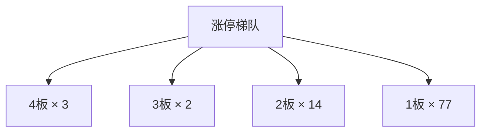
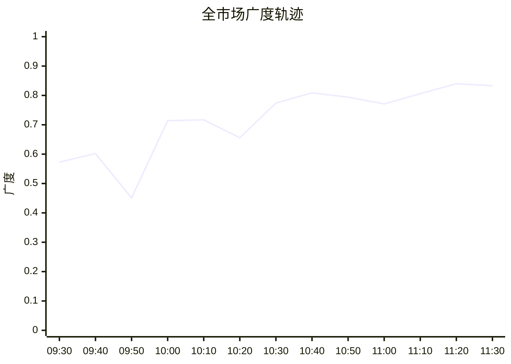
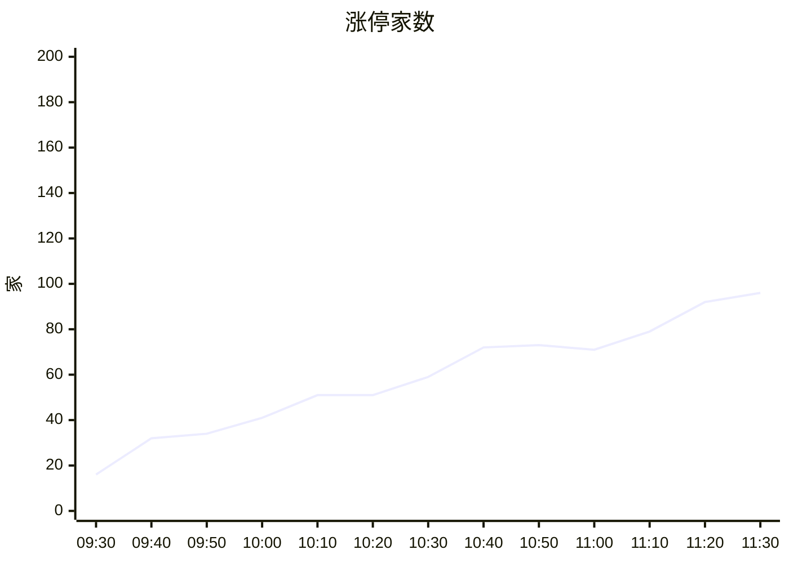
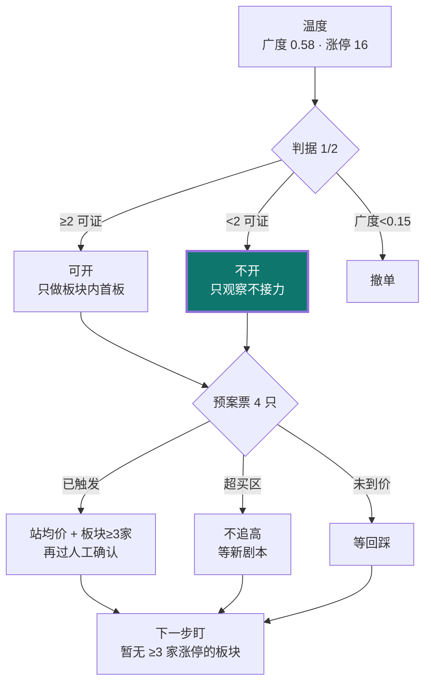
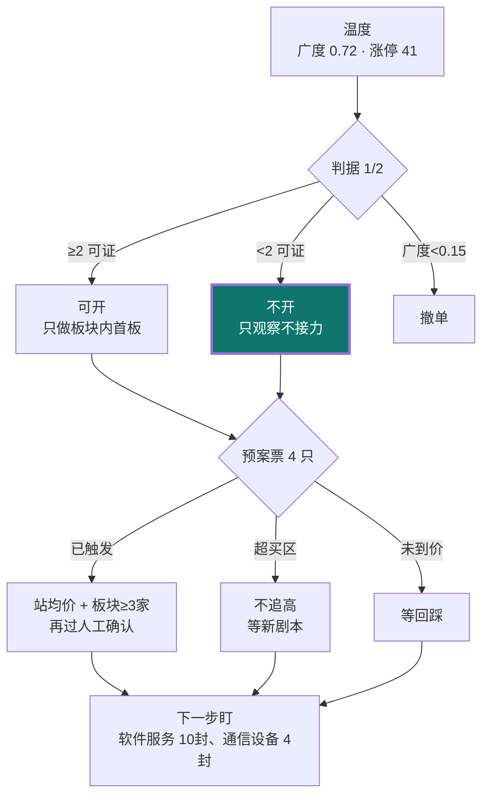
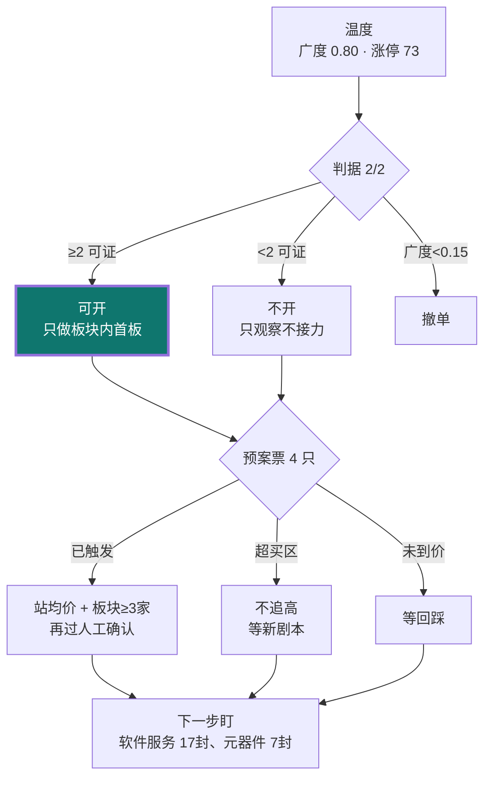
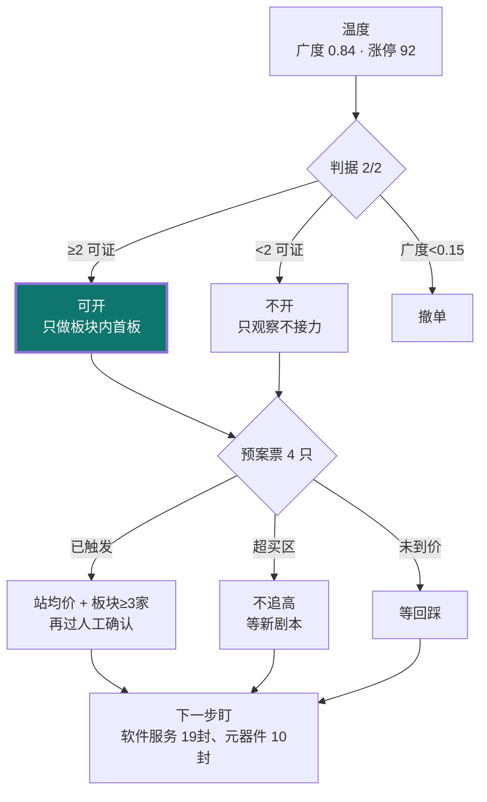

# 20261127 盘中总览（截至 11:30）

> **结论**：全市场涨4653/跌827（广度0.83）；涨停96/跌停0。 钱在：华为昇腾(涨停15/成分60，密度0.250)、超聚变(涨停4/成分18，密度0.222)、大厂算力梳理(涨停13/成分72，密度0.181)；零星涨停：IC载板(2)、甲骨文概念(2)、扇出型封装(1)。 退潮（上涨广度最低）：智谱AI概念(上涨广度0.92)、数字政务(上涨广度0.94)、DeepSeek概念(上涨广度0.95)。 梯队：4板×3、3板×2、2板×14、1板×77，最高4板。 预案：超买区 中际旭创、华丰科技、胜宏科技、东山精密、新易盛、天孚通信、常山北明；未到价 泸天化、襄阳轴承、中国卫星、工商银行；已触发 沪电股份、景旺电子、工业富联、紫金矿业；无预案价 崇达技术、骏亚科技、金牛化工、岳阳林纸、顺灏股份、雪人集团、泰嘉股份、大业股份、鹿山新材。 较上一轮：广度持平。

### 盘前路径对照

> 未生成 market_scenarios.json（跑 scripts/plan/build_market_scenarios.py）

### 概念扩散

> 口径：涨停密度 = 涨停数/有效成分数；排序用密度，不用涨停家数（大板块天然涨停多）。

| 概念 | 涨停 | 有效成分 | 涨停密度 | 上涨广度 | 中位涨幅 | 相对全市场 | 成交(亿) |
|---|---|---|---|---|---|---|---|
| 华为昇腾 | 15 | 60 | 0.250 | 0.98 | +8.52% | +6.27% | 443 |
| IC载板 ⬦ | 2 | 8 | 0.250 | 1.00 | +5.65% | +3.40% | 130 |
| 超聚变 | 4 | 18 | 0.222 | 1.00 | +5.96% | +3.71% | 118 |
| 大厂算力梳理 | 13 | 72 | 0.181 | 0.99 | +6.82% | +4.57% | 456 |
| 算力租赁概念 | 11 | 65 | 0.169 | 0.97 | +6.20% | +3.95% | 299 |
| 华为海思概念 | 8 | 52 | 0.154 | 1.00 | +6.30% | +4.05% | 416 |
| 词元概念 | 18 | 119 | 0.151 | 1.00 | +5.95% | +3.70% | 462 |
| 云计算 | 13 | 87 | 0.149 | 0.97 | +5.78% | +3.53% | 318 |
| 数字政务 | 10 | 68 | 0.147 | 0.94 | +6.24% | +3.99% | 258 |
| DeepSeek概念 | 12 | 82 | 0.146 | 0.95 | +5.62% | +3.37% | 426 |
| 甲骨文概念 ⬦ | 2 | 14 | 0.143 | 1.00 | +6.54% | +4.28% | 65 |
| AI低代码概念 | 3 | 23 | 0.130 | 1.00 | +6.17% | +3.92% | 34 |
| 智谱AI概念 | 5 | 39 | 0.128 | 0.92 | +5.39% | +3.14% | 121 |
| 扇出型封装 ⬦ | 1 | 8 | 0.125 | 1.00 | +5.96% | +3.71% | 80 |
| 先进封装 | 7 | 57 | 0.123 | 0.98 | +6.65% | +4.40% | 497 |

> ⬦ = 涨停 <3 只，零星个例，不构成扩散（不计入「钱在」判定）。

### 涨停梯队

| 身位 | 家数 |
|---|---|
| 4板 | 3 |
| 3板 | 2 |
| 2板 | 14 |
| 1板 | 77 |

| 最高板个股 | 板数 |
|---|---|
| 天圣制药 | 4 |
| 利君股份 | 4 |
| 全筑股份 | 4 |
| 宏达高科 | 3 |
| 证通电子 | 3 |
| 中电鑫龙 | 2 |



### 预案池对照

| 票 | 池 | 板块 | 现价 | 涨幅 | 触发价 | 买区 | 风险位 | 判定 |
|---|---|---|---|---|---|---|---|---|
| 中际旭创 `300308.SZ` | execution_pool | 光互连回流·CPO/PCB/通信设备（守正· | 466.58 | 8.46% | 426.74 | [423.76, 430.15] | 396.87 | **超买区** |
| 华丰科技 `688629.SH` | execution_pool | 同轴·太空算力/6G（通信设备，与主线共用筹 | 107.22 | 15.91% | 90.55 | [89.92, 91.27] | 83.31 | **超买区** |
| 胜宏科技 `300476.SZ` | execution_pool | 光互连回流·PCB 容量中军（守正方向内） | 127.41 | 3.00% | 125.24 | [124.37, 126.24] | 116.47 | **超买区** |
| 泸天化 `000912.SZ` | execution_pool | 化工/化肥·低位硬首板（守正矛盾：确定性集中 | 3.16 | -3.36% | 3.41 | [3.39, 3.46] | 3.23 | **未到价** |
| 崇达技术 `002815.SZ` | watch_pool | 光互连·PCB 情绪龙二 | 16.05 | 5.18% | — | — | 14.57 | **无预案价** |
| 骏亚科技 `603386.SH` | watch_pool | 光互连·PCB 情绪龙一 | 15.97 | 9.99% | — | — | 13.86 | **无预案价** |
| 金牛化工 `600722.SH` | watch_pool | 化工/化肥·龙一（3 板） | 15.04 | 3.94% | — | — | 13.81 | **无预案价** |
| 东山精密 `002384.SZ` | watch_pool | 光互连·PCB 容量龙二 | 77.88 | 7.39% | 73.94 | [73.57, 75.42] | 70.24 | **超买区** |
| 襄阳轴承 `000678.SZ` | watch_pool | 妖·羊年（yáng 族）+ 轴承链 | 21.87 | -0.41% | 22.07 | [21.96, 22.51] | 20.97 | **未到价** |
| 岳阳林纸 `600963.SH` | watch_pool | 妖·羊年（阳）+ 造纸 | 3.44 | -1.43% | — | — | 3.33 | **无预案价** |
| 顺灏股份 `002565.SZ` | watch_pool | 妖/低位首板·R4 真封板 | 8.72 | 3.44% | — | — | 8.05 | **无预案价** |
| 雪人集团 `002639.SZ` | watch_pool | 低位首板·R4 真封板 | 12.33 | -2.30% | — | — | 12.05 | **无预案价** |
| 泰嘉股份 `002843.SZ` | watch_pool | 低位首板·R4 真封板 | 15.57 | 10.04% | — | — | 13.51 | **无预案价** |
| 大业股份 `603278.SH` | watch_pool | 低位首板·R4 真封板 | 12.19 | 1.75% | — | — | 11.44 | **无预案价** |
| 鹿山新材 `603051.SH` | watch_pool | 低位首板·R4 真封板 | 23.96 | 10.01% | — | — | 20.80 | **无预案价** |
| 沪电股份 `002463.SZ` | watch_pool | 光互连·PCB 容量 | 85.85 | 5.87% | 84.48 | [84.06, 86.17] | 80.26 | **已触发** |
| 新易盛 `300502.SZ` | watch_pool | 光互连·CPO 容量 | 206.80 | 9.40% | 189.98 | [189.03, 193.78] | 180.48 | **超买区** |
| 天孚通信 `300394.SZ` | watch_pool | 光互连·CPO 容量 | 140.51 | 4.87% | 134.66 | [133.99, 137.35] | 127.93 | **超买区** |
| 景旺电子 `603228.SH` | watch_pool | 光互连·PCB 容量 | 62.07 | 5.81% | 60.85 | [60.55, 62.07] | 57.81 | **已触发** |
| 工业富联 `601138.SH` | watch_pool | AI 算力硬件/服务器 ODM | 41.79 | 1.93% | 41.51 | [41.30, 42.34] | 39.43 | **已触发** |
| 中国卫星 `600118.SH` | watch_pool | 太空算力/商业航天 | 46.59 | 0.11% | 48.63 | [48.39, 49.60] | 46.20 | **未到价** |
| 常山北明 `000158.SZ` | watch_pool | 国产算力/昇腾链·龙一 | 15.27 | 10.01% | 13.95 | [13.88, 14.23] | 13.25 | **超买区** |
| 紫金矿业 `601899.SH` | watch_pool | 资源/铜金（B 计划·对手盘） | 24.11 | 1.52% | 24.08 | [23.96, 24.56] | 22.88 | **已触发** |
| 工商银行 `601398.SH` | watch_pool | 银行/防守（B 计划·对手盘） | 9.11 | -1.30% | 9.28 | [9.23, 9.47] | 8.82 | **未到价** |

### 全天广度轨迹

| 时点 | 涨 | 跌 | 广度 | 涨停 | 跌停 | 成交(亿) | 有效样本 |
|---|---|---|---|---|---|---|---|
| 0930 | 3202 | 1857 | 0.573 | 16 | 2 | 454 | 5553 |
| 0940 | 3362 | 1878 | 0.602 | 32 | 1 | 2080 | 5576 |
| 0950 | 2517 | 2788 | 0.451 | 34 | 7 | 3164 | 5576 |
| 1000 | 3990 | 1398 | 0.714 | 41 | 2 | 4045 | 5576 |
| 1010 | 4005 | 1377 | 0.717 | 51 | 2 | 4758 | 5576 |
| 1020 | 3667 | 1685 | 0.656 | 51 | 1 | 5342 | 5576 |
| 1030 | 4326 | 1102 | 0.774 | 59 | 1 | 5868 | 5576 |
| 1040 | 4517 | 925 | 0.809 | 72 | 2 | 6634 | 5576 |
| 1050 | 4437 | 1028 | 0.794 | 73 | 2 | 7193 | 5576 |
| 1100 | 4309 | 1104 | 0.771 | 71 | 1 | 7674 | 5576 |
| 1110 | 4501 | 951 | 0.806 | 79 | 1 | 8113 | 5576 |
| 1120 | 4693 | 784 | 0.840 | 92 | 1 | 8794 | 5576 |
| 1130 | 4653 | 827 | 0.833 | 96 | 0 | 9269 | 5576 |





### 观察建议（仅研究）

- **环境**：广度 0.83、涨停 96、跌停 0。
- **方向**：华为昇腾(涨停15/成分60)、超聚变(涨停4/成分18)、大厂算力梳理(涨停13/成分72)。
- **预案**：超买区 7 只、未到价 4 只、无预案价 9 只、已触发 4 只。买区已错过的票不追高，要参与需等新剧本。
- **定性**：走强（广度 ≥0.75）。

---
### 09:30 盯盘卡

**温度** 广度 **0.58** · 涨停 **16** · 炸板 **5** · 跌停 **2** · 成交 **454.1 亿**
**判据** 广度>0.55 ✅ · 涨停≥60 ❌ · 昨涨停红盘率>60% ⏳未采 → **1/2 可证**



> **当前落点**：判据不足 → 不开，只观察｜判据 1/2｜预案 4 只｜钱在：暂无 ≥3 家涨停的板块

**连板梯队** 最高 **4** 板（全筑股份 4板、利君股份 4板、中央商场 3板）｜ 1板 5家 / 2板 6家 / 3板 3家 / 4板 2家
**主线（按行业涨停数）** 出版业 **2**家 均+1.75% ｜ 软件服务 **2**家 均+1.27% ｜ 仓储物流 **2**家 均+0.83% ｜ 商品城 **1**家 均+2.59% ｜ 装修装饰 **1**家 均+1.19%
**板块分时** 光通信 +1.59% ｜ 半导体 +1.33% ｜ AI算力 +1.14% ｜ 军工 +0.34% ｜ 券商 +0.22% ｜ 商业航天 +0.13% ｜ 白酒 +0.00% ｜ 医药 -0.27%
**进攻位（距涨停≤3%）** 中电鑫龙 +9.65%（差0.39%，电气设备，量比129.6，换手2.7%） ｜ 天圣制药 +9.48%（差0.47%，医药商业，量比1222.6，换手18.3%） ｜ 镇洋发展 +8.98%（差0.94%，化工原料，量比373.5，换手0.9%） ｜ 骏亚科技 +8.13%（差1.72%，元器件，量比89.1，换手3.5%） ｜ 安邦护卫 +8.14%（差1.72%，仓储物流，量比68.5，换手1.1%）
**风险（炸板）** 中电鑫龙 高+10.07%→收+9.65% ｜ 镇洋发展 高+10.00%→收+8.98% ｜ 骏亚科技 高+9.99%→收+8.13% ｜ 天圣制药 高+9.99%→收+9.48%
**资金（行业成交额）** 元器件 50亿 ｜ 通信设备 36亿 ｜ 软件服务 31亿 ｜ IT设备 7亿
**资金（个股成交额）** 中际旭创 7亿 ｜ 新易盛 7亿 ｜ 九阳股份 4亿 ｜ 华胜天成 4亿 ｜ 拓维信息 4亿

**我的池子**

| 票 | 仓位 | 现价 | 触发 | 距触发 | 距止损 | 状态 | 现在做什么 |
|---|---|---|---|---|---|---|---|
| 中际旭创 | — | 438.0 | 426.74↑ | -2.57% | 9.4% | ★ 已触发 | 等板块确认+人工确认 |
| 华丰科技 | — | 95.2 | 90.55↑ | -4.88% | 12.5% | ★ 已触发 | 等板块确认+人工确认 |
| 胜宏科技 | — | 123.59 | 125.24↑ | 1.34% | 5.8% | 等触发 | 盯 125.24 |
| 泸天化 | — | 3.25 | 3.41↑ | 4.92% | 0.6% | 等触发 | 盯 3.41 |

**观察池** 强：鹿山新材 +10.01%、常山北明 +10.01%、骏亚科技 +8.13% ｜ 弱：中国卫星 -2.17%、岳阳林纸 -1.15%

**全市场机会** 观察，不接力
> 口径：距涨停 ≥0.5%（还有空间）· 未摸板 · 非 ST · 所属行业当日 ≥3 家涨停。候选池 near_limit 共 8 只。

| 票 | 板块（概念优先） | 现价 | 涨幅 | 距涨停 | 量比 | 换手 | 板块封板 |
|---|---|---|---|---|---|---|---|
| 大位科技 `600589.SH` | 词元概念 | 5.80 | +7.61% | 2.24% | 20.0 | 0.3% | 3 家 |

**盘中快讯**（最近 20 分钟，19 条命中 / 共 108 条）

- `09:29` 【文化传媒板块局部活跃，新华传媒、城市传媒涨停】文化传媒板块局部活跃，新华传媒、城市传媒涨停，内蒙新华、三人行、华媒控股纷纷高开。（新浪财经-快讯） · `605168.SH` · 大模型概念
- `09:29` 文化传媒板块局部活跃，新华传媒、城市传媒涨停（同花顺-快讯） · `600825.SH` · 版权
- `09:27` 算力概念高开，证通电子、宏川智慧竞价涨停，全筑股份涨超8%，顺灏股份、润和软件、中电鑫龙等个股跟涨。（新浪财经-快讯） · `603030.SH` · 光刻机概念
- `09:25` “苏妈”晒感恩节烤火鸡，致谢全球员工与合作伙伴（格隆汇-快讯）
- `09:21` 央行今日进行7940亿元人民币隔夜逆回购操作（东方财富-快讯）
- `09:21` 央行：11月27日开展了7940亿元隔夜逆回购操作（同花顺-快讯）

**结论** 🟡 窗口内但判据不足 —— 不主动开仓，等触发线自己走到位
**下一档盯** 中际旭创 已到 438.0 ｜ 华丰科技 已到 95.2 ｜ 胜宏科技 123.59 → 125.24（需涨 1.34%）


---
### 09:40 盯盘卡

**温度** 广度 **0.60**（+0.03） · 涨停 **32**（+16） · 炸板 **10** · 跌停 **1**（-1） · 成交 **2080.1 亿**（+1626）
**判据** 广度>0.55 ✅ · 涨停≥60 ❌ · 昨涨停红盘率>60% ⏳未采 → **1/2 可证**


> **当前落点**：判据不足 → 不开，只观察｜判据 1/2｜预案 4 只｜钱在：软件服务 7封、元器件 3封

**连板梯队** 最高 **4** 板（利君股份 4板、全筑股份 4板、证通电子 3板）｜ 1板 19家 / 2板 10家 / 3板 1家 / 4板 2家
**主线（按行业涨停数）** 软件服务 **7**家 均+2.73% ｜ 元器件 **3**家 均+1.13% ｜ 仓储物流 **3**家 均+0.62% ｜ 通信设备 **2**家 均+1.75% ｜ 塑料 **2**家 均+0.60%
**板块分时** 光通信 +3.01% ｜ 半导体 +2.26% ｜ AI算力 +1.63% ｜ 军工 +0.79% ｜ 商业航天 +0.77% ｜ 券商 +0.44% ｜ 医药 +0.27% ｜ 白酒 +0.23%
**进攻位（距涨停≤3%）** 润和软件 +19.96%（差0.03%，软件服务，量比35.5，换手3.4%） ｜ 宁波建工 +9.79%（差0.27%，建筑工程，量比36.8，换手2.2%） ｜ 华胜天成 +8.58%（差1.31%，软件服务，量比8.2，换手10.5%） ｜ 新里程 +8.29%（差1.53%，医疗保健，量比24.6，换手1.8%） ｜ 格林达   +8.09%（差1.77%，化工原料，量比6.4，换手3.0%）
**风险（炸板）** 润和软件 高+19.99%→收+19.96% ｜ 浙江华业 高+19.94%→收+13.90% ｜ 宁波建工 高+10.09%→收+9.79% ｜ 城市传媒 高+10.08%→收-1.18%
**资金（行业成交额）** 半导体 266亿 ｜ 元器件 236亿 ｜ 通信设备 184亿 ｜ 软件服务 167亿
**资金（个股成交额）** 新易盛 35亿 ｜ 中际旭创 34亿 ｜ 华胜天成 23亿 ｜ 天孚通信 20亿 ｜ 东山精密 19亿
**新晋涨停（vs 上一条）** 18 家：拓维信息(软件服务)、中电鑫龙(电气设备)、中贝通信(通信设备)、深圳华强(元器件)、天源迪科(软件服务)、三佳科技(半导体)、奥瑞德  (元器件)、国风新材(塑料)

**我的池子**

| 票 | 仓位 | 现价 | 触发 | 距触发 | 距止损 | 状态 | 现在做什么 |
|---|---|---|---|---|---|---|---|
| 中际旭创 | — | 439.88 | 426.74↑ | -2.99% | 9.8% | ★ 已触发 | 等板块确认+人工确认 |
| 华丰科技 | — | 98.3 | 90.55↑ | -7.88% | 15.2% | ★ 已触发 | 等板块确认+人工确认 |
| 胜宏科技 | — | 122.0 | 125.24↑ | 2.66% | 4.5% | 等触发 | 盯 125.24 |
| 泸天化 | — | 3.18 | 3.41↑ | 7.23% | -1.6% | 等触发 | 盯 3.41 |

**观察池** 强：鹿山新材 +10.01%、常山北明 +10.01%、骏亚科技 +7.99% ｜ 弱：雪人集团 -3.01%、中国卫星 -2.23%

**全市场机会** 观察，不接力
> 口径：距涨停 ≥0.5%（还有空间）· 未摸板 · 非 ST · 所属行业当日 ≥3 家涨停。候选池 near_limit 共 12 只。

| 票 | 板块（概念优先） | 现价 | 涨幅 | 距涨停 | 量比 | 换手 | 板块封板 |
|---|---|---|---|---|---|---|---|
| 华胜天成 `600410.SH` | 词元概念 | 20.63 | +8.58% | 1.31% | 8.2 | 10.5% | 10 家 |
| 神州数码 `000034.SZ` | DeepSeek概念 | 20.89 | +7.62% | 2.20% | 11.9 | 1.6% | 7 家 |

**盘中快讯**（最近 20 分钟，27 条命中 / 共 141 条）

- `09:40` 【伊朗外长：两名意大利人科威特身亡事件疑点重重】伊朗外交部长阿拉格齐26日表示，当天发生的两名意大利公民在科威特身亡事件疑点重重，看起来像是“预先炮制好的战争配方”。阿拉格齐在…（新浪财经-快讯）
- `09:40` 【光刻胶板块短线拉升，国风新材涨停】光刻胶板块短线拉升，国风新材涨停，兴业股份、格林达、怡达股份、西陇科学、高盟新材等纷纷走高。（新浪财经-快讯） · `603931.SH` · 半导体材料
- `09:40` 【荷兰官员：反对美国立法加强半导体制造设备出口管制】荷兰外贸与发展合作大臣舍尔茨玛26日表示，美国国会正在审议的《硬件技术管制多边协调法案》损害荷兰主权和国家利益。如果该法案获…（新浪财经-快讯）
- `09:40` 光刻胶板块短线拉升，国风新材涨停（同花顺-快讯） · `000859.SZ` · AI硬件
- `09:39` 【网络安全板块走强 天源迪科、天亿马20%涨停】网络安全板块走强，天源迪科、天亿马20%涨停，浙大网新、中电鑫龙等涨停。（新浪财经-快讯） · `600797.SH` · 摩尔线程概念
- `09:38` 【零售板块局部活跃，海宁皮城涨停】零售板块局部活跃，海宁皮城涨停，中央商场、珠免集团、新世界、御银股份、香江控股、轻纺城跟涨。（新浪财经-快讯） · `600790.SH` · 地方国资

**结论** 🟡 窗口内但判据不足 —— 不主动开仓，等触发线自己走到位
**下一档盯** 中际旭创 已到 439.88 ｜ 华丰科技 已到 98.3 ｜ 胜宏科技 122.0 → 125.24（需涨 2.66%）


---
### 09:50 盯盘卡

**温度** 广度 **0.45**（-0.15） · 涨停 **34**（+2） · 炸板 **14** · 跌停 **7**（+6） · 成交 **3164.5 亿**（+1084）
**判据** 广度>0.55 ❌ · 涨停≥60 ❌ · 昨涨停红盘率>60% ⏳未采 → **0/2 可证**


> **当前落点**：判据不足 → 不开，只观察｜判据 0/2｜预案 4 只｜钱在：软件服务 8封、元器件 4封

**连板梯队** 最高 **4** 板（全筑股份 4板、利君股份 4板、证通电子 3板）｜ 1板 19家 / 2板 12家 / 3板 1家 / 4板 2家
**主线（按行业涨停数）** 软件服务 **8**家 均+1.92% ｜ 元器件 **4**家 均+1.04% ｜ 通信设备 **3**家 均+1.60% ｜ 仓储物流 **3**家 均+0.02% ｜ 塑料 **2**家 均+0.30%
**板块分时** 光通信 +2.09% ｜ 半导体 +1.86% ｜ AI算力 +1.22% ｜ 商业航天 +1.16% ｜ 军工 +0.79% ｜ 券商 +0.44% ｜ 白酒 -0.23% ｜ 医药 -0.27%
**进攻位（距涨停≤3%）** 天创股份 +9.96%（差0.07%，服饰，量比13.4，换手3.7%） ｜ *ST南置 +9.70%（差0.55%，区域地产，量比17.5，换手1.2%） ｜ 中央商场 +8.71%（差1.19%，百货，量比23.5，换手13.0%） ｜ 宏达高科 +8.61%（差1.29%，纺织，量比33.8，换手17.7%） ｜ 宁波建工 +8.31%（差1.64%，建筑工程，量比29.1，换手3.5%）
**风险（炸板）** 润和软件 高+19.99%→收+15.74% ｜ 浙江华业 高+19.94%→收+11.39% ｜ *ST南置 高+10.30%→收+9.70% ｜ 宁波建工 高+10.09%→收+8.31%
**资金（行业成交额）** 半导体 425亿 ｜ 元器件 362亿 ｜ 通信设备 282亿 ｜ 软件服务 232亿
**资金（个股成交额）** 中际旭创 51亿 ｜ 新易盛 50亿 ｜ 天孚通信 31亿 ｜ 华胜天成 30亿 ｜ 东山精密 26亿
**新晋涨停（vs 上一条）** 4 家：荣联科技(软件服务)、骏亚科技(元器件)、楚天龙(通信设备)、新筑股份(运输设备)

**我的池子**

| 票 | 仓位 | 现价 | 触发 | 距触发 | 距止损 | 状态 | 现在做什么 |
|---|---|---|---|---|---|---|---|
| 中际旭创 | — | 437.63 | 426.74↑ | -2.49% | 9.3% | ★ 已触发 | 等板块确认+人工确认 |
| 华丰科技 | — | 99.73 | 90.55↑ | -9.20% | 16.5% | ★ 已触发 | 等板块确认+人工确认 |
| 胜宏科技 | — | 121.8 | 125.24↑ | 2.82% | 4.4% | 等触发 | 盯 125.24 |
| 泸天化 | — | 3.1 | 3.41↑ | 10.00% | -4.2% | 等触发 | 盯 3.41 |

**观察池** 强：鹿山新材 +10.01%、常山北明 +10.01%、骏亚科技 +9.99% ｜ 弱：雪人集团 -5.07%、襄阳轴承 -4.05%

**全市场机会** 观察，不接力
> 口径：距涨停 ≥0.5%（还有空间）· 未摸板 · 非 ST · 所属行业当日 ≥3 家涨停。候选池 near_limit 共 12 只。

| 票 | 板块（概念优先） | 现价 | 涨幅 | 距涨停 | 量比 | 换手 | 板块封板 |
|---|---|---|---|---|---|---|---|
| 神州数码 `000034.SZ` | DeepSeek概念 | 20.80 | +7.16% | 2.64% | 8.4 | 2.2% | 6 家 |

**盘中快讯**（最近 20 分钟，25 条命中 / 共 155 条）

- `09:50` 现货黄金突破3580美元/盎司，日内涨0.40%。（新浪财经-快讯）
- `09:50` 【世界黄金协会：中国投资者黄金配置可采用双层策略】11月26日，世界黄金协会发布《中国不同经济周期下的黄金配置比例》报告。报告指出，中国投资者黄金配置可采用双层策略：一、战略性…（新浪财经-快讯）
- `09:47` 纽约期金突破3610美元/盎司，日内涨1.27%。（新浪财经-快讯）
- `09:42` 【MLCC概念走强，国风新材、深圳华强双双涨停】MLCC概念走强，国风新材、深圳华强双双涨停，多浦乐、杰普特、利和兴、力源信息、有研粉材、风华高科等跟涨。（新浪财经-快讯） · `688456.SH` · AI硬件
- `09:42` SpaceX太空数据中心星座获批 云计算50ETF东方红（562110）标的指数今日开盘上涨（东方财富-快讯）
- `09:40` 【伊朗外长：两名意大利人科威特身亡事件疑点重重】伊朗外交部长阿拉格齐26日表示，当天发生的两名意大利公民在科威特身亡事件疑点重重，看起来像是“预先炮制好的战争配方”。阿拉格齐在…（新浪财经-快讯）

**结论** 🟡 窗口内但判据不足 —— 不主动开仓，等触发线自己走到位
**下一档盯** 中际旭创 已到 437.63 ｜ 华丰科技 已到 99.73 ｜ 胜宏科技 121.8 → 125.24（需涨 2.82%）

---
### 10:00 盯盘卡

**温度** 广度 **0.72**（+0.26） · 涨停 **41**（+7） · 炸板 **19** · 跌停 **2**（-5） · 成交 **4045.1 亿**（+881）
**判据** 广度>0.55 ✅ · 涨停≥60 ❌ · 昨涨停红盘率>60% ⏳未采 → **1/2 可证**



> **当前落点**：判据不足 → 不开，只观察｜判据 1/2｜预案 4 只｜钱在：软件服务 10封、通信设备 4封

**连板梯队** 最高 **4** 板（利君股份 4板、全筑股份 4板、证通电子 3板）｜ 1板 27家 / 2板 11家 / 3板 1家 / 4板 2家
**主线（按行业涨停数）** 软件服务 **10**家 均+3.74% ｜ 通信设备 **4**家 均+2.56% ｜ 元器件 **3**家 均+1.93% ｜ 汽车配件 **3**家 均+1.59% ｜ 仓储物流 **3**家 均+0.83%
**板块分时** 光通信 +3.26% ｜ 半导体 +2.26% ｜ 商业航天 +1.93% ｜ AI算力 +1.71% ｜ 军工 +1.25% ｜ 券商 +0.44% ｜ 白酒 -0.23% ｜ 医药 -0.27%
**进攻位（距涨停≤3%）** *ST海华  +9.79%（差0.32%，运输设备，量比6.0，换手1.4%） ｜ 神州数码 +9.43%（差0.52%，软件服务，量比7.7，换手3.0%） ｜ *ST南置 +9.70%（差0.55%，区域地产，量比13.5，换手1.4%） ｜ *ST和科 +9.38%（差0.56%，专用机械，量比7.3，换手2.4%） ｜ 时空科技 +9.19%（差0.73%，装修装饰，量比5.1，换手1.6%）
**风险（炸板）** 宁波方正 高+20.00%→收+12.60% ｜ 浙江华业 高+19.94%→收+11.88% ｜ *ST南置 高+10.30%→收+9.70% ｜ *ST海华  高+10.14%→收+9.79%
**资金（行业成交额）** 半导体 533亿 ｜ 元器件 461亿 ｜ 通信设备 345亿 ｜ 软件服务 298亿
**资金（个股成交额）** 新易盛 61亿 ｜ 中际旭创 60亿 ｜ 天孚通信 38亿 ｜ 华胜天成 35亿 ｜ 东山精密 32亿
**新晋涨停（vs 上一条）** 10 家：润和软件(软件服务)、光洋股份(汽车配件)、汇洲智能(机床制造)、模塑科技(汽车配件)、成飞集成(汽车配件)、天创股份(服饰)、爱仕达(家用电器)、捷荣技术(元器件)

**我的池子**

| 票 | 仓位 | 现价 | 触发 | 距触发 | 距止损 | 状态 | 现在做什么 |
|---|---|---|---|---|---|---|---|
| 中际旭创 | — | 438.78 | 426.74↑ | -2.74% | 9.6% | ★ 已触发 | 等板块确认+人工确认 |
| 华丰科技 | — | 98.99 | 90.55↑ | -8.53% | 15.8% | ★ 已触发 | 等板块确认+人工确认 |
| 胜宏科技 | — | 121.6 | 125.24↑ | 2.99% | 4.2% | 等触发 | 盯 125.24 |
| 泸天化 | — | 3.13 | 3.41↑ | 8.95% | -3.2% | 等触发 | 盯 3.41 |

**观察池** 强：鹿山新材 +10.01%、常山北明 +10.01%、骏亚科技 +9.99% ｜ 弱：雪人集团 -4.12%、中国卫星 -0.95%

**全市场机会** 观察，不接力
> 口径：距涨停 ≥0.5%（还有空间）· 未摸板 · 非 ST · 所属行业当日 ≥3 家涨停。候选池 near_limit 共 12 只。

| 票 | 板块（概念优先） | 现价 | 涨幅 | 距涨停 | 量比 | 换手 | 板块封板 |
|---|---|---|---|---|---|---|---|
| 神州数码 `000034.SZ` | 大厂算力梳理 | 21.24 | +9.43% | 0.52% | 7.7 | 3.0% | 6 家 |
| 新坐标   `603040.SH` | 汽车配件(行业) | 34.87 | +7.62% | 2.21% | 3.0 | 1.1% | 3 家 |

**盘中快讯**（最近 20 分钟，17 条命中 / 共 131 条）

- `10:00` 新加坡副总理：正与美国合作获取高端芯片。（新浪财经-快讯）
- `10:00` 【A股阿里云板块异动拉升】常山北明触及涨停，润和软件、先进数通、神州数码、中亦科技、南兴股份、中科金财跟涨。（新浪财经-快讯） · `301208.SZ` · 长鑫存储概念
- `10:00` 【A股ERP概念板块异动拉升】云鼎科技、常山北明触及涨停，润和软件、软通动力、杰恩股份、神州信息、赛意信息跟涨。（新浪财经-快讯） · `301236.SZ` · 华为鸿蒙
- `09:59` 纽约期金突破3620美元/盎司，日内涨1.57%。（新浪财经-快讯）
- `09:58` 人形机器人概念震荡走高 光洋股份、爱仕达双双涨停（东方财富-快讯） · `300024.SZ` · 人形机器人
- `09:58` 现货黄金突破3590美元/盎司，日内涨0.67%。（新浪财经-快讯）

**结论** 🟡 窗口内但判据不足 —— 不主动开仓，等触发线自己走到位
**下一档盯** 中际旭创 已到 438.78 ｜ 华丰科技 已到 98.99 ｜ 胜宏科技 121.6 → 125.24（需涨 2.99%）


### 10:05 盘中总结（10:00 快照 vs 09:50）

- **广度 V 型反转**：0.6019（09:40）→ 0.4506（09:50）→ **0.7143（10:00，+0.26）**；上涨 2517→3990 家、下跌 2788→1398 家；跌停 7→2（东方海洋/万向德农/长华集团/ST节能/金新农 5 只打开跌停）；涨停 34→41（新晋 10 家、掉队 3 家），但炸板 14→19（炸板率 31.7%），封板质量没跟上涨停数量；成交 3164→4045 亿（+881 亿）。
- **钱在两条腿**：封板密度最高是软件服务 8封→10封、均涨 +1.92%→+3.74%、红盘率 0.95（新晋 10 家里润和软件/汉鑫科技/鼎信通讯 属算力软件链；概念榜 大厂算力梳理 6封/72、词元概念 9封/119、华为昇腾 5封/60）；容量腿仍是预案点名的光互连——光通信 ETF +3.26% 居 8 只 ETF 首位、通信设备均 +2.56%、元器件成交额 461 亿全场第一但只 3 封。用涨停家数跨市值档比这两个方向是口径错误（大票天生封不住板），真实分工是「软件服务当情绪腿、光互连当容量腿」。
- **预案池**：执行池 4 只价格一个都没进买区——中际旭创 438.78（买区上沿 430.15，超买 +2.0%，不追）、华丰科技 98.99（+7.02%，买区上沿 91.27，现价已高出 8.5%，只在回踩 91.27 附近才 armed）、胜宏科技 121.6（买区下沿 124.37，未到价，还差 2.3%）、泸天化 3.13（买区下沿 3.39，-4.28% 反向走弱）。观察池 3 只维持封板：常山北明 10.01%、鹿山新材 10.01%、骏亚科技 9.99%；修复腿集体翻红——大业股份 -3.51%→+1.92%、襄阳轴承 -4.05%→-0.09%、金牛化工 -0.48%→+0.76%；弱侧雪人集团 -5.07%→-4.12%、中国卫星 -1.8%→-0.95% 仍在负值。
- **结合预案**：预案定调「高位震荡·修复段第 2 日、仓位上限 0.45、只做光互连右侧回踩（vwap_pullback）+ 三判据 + 板块资金转正 + 人工确认」。盘面广度 0.71 已过、涨停 41 仍不到 60 → **判据 1/2**；`sector_flow` 为空，板块资金转正这一条无法验证（是数据缺口，不是净流出）。价格条件全不成立 → 不动手是预案本来要的结果（价格没来＝机会成本），不是踏空。分歧点：预案押的 4 只全在光互连容量腿，今日封板热点却在算力软件；11:00 闸门若通信设备封板仍停在 4 家而软件服务继续扩散，说明方向偏了，才轮到 B 计划（紫金 23.7 / 工行）说话。
- **一句话结论**：广度 V 修复、跌停 7→2 是恐慌释放，但涨停 41<60 且炸板升到 19，封板质量没跟上 → 🟡 窗口内判据不足，10 分钟内不追任何已封板票，等 11:00 闸门复核广度/涨停/板块资金三件。

---

---
### 10:10 盯盘卡

**温度** 广度 **0.72**（+0.00） · 涨停 **51**（+10） · 炸板 **20** · 跌停 **2**（+0） · 成交 **4758.1 亿**（+713）
**判据** 广度>0.55 ✅ · 涨停≥60 ❌ · 昨涨停红盘率>60% ⏳未采 → **1/2 可证**


> **当前落点**：判据不足 → 不开，只观察｜判据 1/2｜预案 4 只｜钱在：软件服务 12封、通信设备 4封

**连板梯队** 最高 **4** 板（利君股份 4板、全筑股份 4板、证通电子 3板）｜ 1板 36家 / 2板 12家 / 3板 1家 / 4板 2家
**主线（按行业涨停数）** 软件服务 **12**家 均+4.16% ｜ 通信设备 **4**家 均+2.54% ｜ 元器件 **4**家 均+1.93% ｜ 汽车配件 **4**家 均+1.21% ｜ 仓储物流 **3**家 均+0.87%
**板块分时** 光通信 +3.93% ｜ 半导体 +2.12% ｜ 商业航天 +1.80% ｜ AI算力 +1.71% ｜ 军工 +1.25% ｜ 券商 +0.44% ｜ 医药 -0.27% ｜ 白酒 -0.47%
**进攻位（距涨停≤3%）** *ST海华  +9.79%（差0.32%，运输设备，量比5.5，换手1.7%） ｜ 法本信息 +19.48%（差0.45%，软件服务，量比15.8，换手5.6%） ｜ 中科金财 +9.51%（差0.47%，软件服务，量比8.4，换手2.6%） ｜ 宁波建工 +9.50%（差0.54%，建筑工程，量比19.3，换手4.7%） ｜ 华胜天成 +8.53%（差1.36%，软件服务，量比3.4，换手17.8%）
**风险（炸板）** 法本信息 高+20.02%→收+19.48% ｜ 宁波方正 高+20.00%→收+9.88% ｜ 浙江华业 高+19.94%→收+11.28% ｜ *ST海华  高+10.14%→收+9.79%
**资金（行业成交额）** 元器件 534亿 ｜ 通信设备 399亿 ｜ 软件服务 350亿 ｜ 汽车配件 172亿
**资金（个股成交额）** 中际旭创 71亿 ｜ 新易盛 71亿 ｜ 天孚通信 44亿 ｜ 华胜天成 39亿 ｜ 东山精密 37亿
**新晋涨停（vs 上一条）** 10 家：神州数码(软件服务)、国风新材(塑料)、大胜达  (广告包装)、秋田微(元器件)、恒为科技(IT设备)、远东传动(汽车配件)、太极股份(软件服务)、时空科技(装修装饰)

**我的池子**

| 票 | 仓位 | 现价 | 触发 | 距触发 | 距止损 | 状态 | 现在做什么 |
|---|---|---|---|---|---|---|---|
| 中际旭创 | — | 435.19 | 426.74↑ | -1.94% | 8.8% | ★ 已触发 | 等板块确认+人工确认 |
| 华丰科技 | — | 99.18 | 90.55↑ | -8.70% | 16.0% | ★ 已触发 | 等板块确认+人工确认 |
| 胜宏科技 | — | 120.77 | 125.24↑ | 3.70% | 3.6% | 等触发 | 盯 125.24 |
| 泸天化 | — | 3.18 | 3.41↑ | 7.23% | -1.6% | 等触发 | 盯 3.41 |

**观察池** 强：鹿山新材 +10.01%、常山北明 +10.01%、骏亚科技 +9.99% ｜ 弱：雪人集团 -3.88%、中国卫星 -0.92%

**全市场机会** 观察，不接力
> 口径：距涨停 ≥0.5%（还有空间）· 未摸板 · 非 ST · 所属行业当日 ≥3 家涨停。候选池 near_limit 共 12 只。

| 票 | 板块（概念优先） | 现价 | 涨幅 | 距涨停 | 量比 | 换手 | 板块封板 |
|---|---|---|---|---|---|---|---|
| 中国软件 `600536.SH` | 软件服务(行业) | 27.62 | +8.31% | 1.56% | 5.5 | 1.2% | 12 家 |
| 华胜天成 `600410.SH` | 词元概念 | 20.62 | +8.53% | 1.36% | 3.4 | 17.8% | 9 家 |
| 南威软件 `603636.SH` | 词元概念 | 7.08 | +8.26% | 1.55% | 4.2 | 4.0% | 9 家 |
| 直真科技 `003007.SZ` | 词元概念 | 31.29 | +7.86% | 1.98% | 2.4 | 3.2% | 9 家 |
| 佳力图   `603912.SH` | 算力租赁概念 | 6.07 | +8.01% | 1.81% | 4.7 | 1.9% | 5 家 |

**盘中快讯**（最近 20 分钟，24 条命中 / 共 134 条）

- `10:07` 【通信设备板块活跃 楚天龙涨停】通信设备板块活跃，楚天龙涨停，鼎信通讯、万马科技、菲菱科思跟涨。（新浪财经-快讯） · `603421.SH` · 国产芯片概念
- `10:06` 现货白银突破43美元/盎司，日内涨3.71%。（新浪财经-快讯）
- `10:05` 现货黄金突破3610美元/盎司，日内涨1.27%。（新浪财经-快讯）
- `10:05` 纽约期金突破3640美元/盎司，日内涨2.14%。（新浪财经-快讯）
- `10:05` 【我国首次明晰划定非常规水用水领域】从水利部了解到，近日国家标准《非常规水利用量统计规范》发布，将于2027年5月1日起实施。该规范首次明晰划定了农业、工业、生活、生态四大非常…（新浪财经-快讯）
- `10:04` 【游戏板块直线拉升，凯撒文化涨停】游戏板块直线拉升，凯撒文化涨停，大晟文化、中青宝、宝通科技、游族网络、浙数文化等纷纷走高。（新浪财经-快讯） · `600892.SH` · 短剧产业

**结论** 🟡 窗口内但判据不足 —— 不主动开仓，等触发线自己走到位
**下一档盯** 中际旭创 已到 435.19 ｜ 华丰科技 已到 99.18 ｜ 胜宏科技 120.77 → 125.24（需涨 3.70%）


---
### 10:20 盯盘卡

**温度** 广度 **0.66**（-0.06） · 涨停 **51**（+0） · 炸板 **22** · 跌停 **1**（-1） · 成交 **5342.0 亿**（+584）
**判据** 广度>0.55 ✅ · 涨停≥60 ❌ · 昨涨停红盘率>60% ⏳未采 → **1/2 可证**


> **当前落点**：判据不足 → 不开，只观察｜判据 1/2｜预案 4 只｜钱在：软件服务 14封、通信设备 4封

**连板梯队** 最高 **4** 板（全筑股份 4板、利君股份 4板、证通电子 3板）｜ 1板 36家 / 2板 12家 / 3板 1家 / 4板 2家
**主线（按行业涨停数）** 软件服务 **14**家 均+3.75% ｜ 通信设备 **4**家 均+2.38% ｜ 元器件 **4**家 均+1.88% ｜ 仓储物流 **3**家 均+0.62% ｜ IT设备 **2**家 均+2.33%
**板块分时** 光通信 +3.43% ｜ 半导体 +1.86% ｜ 商业航天 +1.67% ｜ AI算力 +1.63% ｜ 军工 +1.14% ｜ 券商 +0.44% ｜ 医药 -0.27% ｜ 白酒 -0.47%
**进攻位（距涨停≤3%）** *ST海华  +9.79%（差0.32%，运输设备，量比4.6，换手1.8%） ｜ 宏达高科 +8.81%（差1.10%，纺织，量比17.5，换手22.9%） ｜ 中央商场 +8.39%（差1.49%，百货，量比12.1，换手16.7%） ｜ 阿科力   +8.38%（差1.50%，化工原料，量比7.2，换手3.2%） ｜ 光洋股份 +8.17%（差1.71%，汽车配件，量比5.3，换手13.6%）
**风险（炸板）** 宁波方正 高+20.00%→收+8.62% ｜ 浙江华业 高+19.94%→收+11.24% ｜ *ST海华  高+10.14%→收+9.79% ｜ 宁波建工 高+10.09%→收+7.72%
**资金（行业成交额）** 元器件 596亿 ｜ 通信设备 440亿 ｜ 软件服务 394亿 ｜ 家用电器 112亿
**资金（个股成交额）** 中际旭创 77亿 ｜ 新易盛 76亿 ｜ 华胜天成 49亿 ｜ 天孚通信 47亿 ｜ 东山精密 41亿
**新晋涨停（vs 上一条）** 3 家：华胜天成(软件服务)、海立股份(家用电器)、法本信息(软件服务)

**我的池子**

| 票 | 仓位 | 现价 | 触发 | 距触发 | 距止损 | 状态 | 现在做什么 |
|---|---|---|---|---|---|---|---|
| 中际旭创 | — | 437.6 | 426.74↑ | -2.48% | 9.3% | ★ 已触发 | 等板块确认+人工确认 |
| 华丰科技 | — | 99.02 | 90.55↑ | -8.55% | 15.9% | ★ 已触发 | 等板块确认+人工确认 |
| 胜宏科技 | — | 121.12 | 125.24↑ | 3.40% | 3.8% | 等触发 | 盯 125.24 |
| 泸天化 | — | 3.15 | 3.41↑ | 8.25% | -2.5% | 等触发 | 盯 3.41 |

**观察池** 强：鹿山新材 +10.01%、常山北明 +10.01%、骏亚科技 +9.99% ｜ 弱：雪人集团 -4.68%、中国卫星 -1.14%

**全市场机会** 观察，不接力
> 口径：距涨停 ≥0.5%（还有空间）· 未摸板 · 非 ST · 所属行业当日 ≥3 家涨停。候选池 near_limit 共 12 只。

| 票 | 板块（概念优先） | 现价 | 涨幅 | 距涨停 | 量比 | 换手 | 板块封板 |
|---|---|---|---|---|---|---|---|
| 川润股份 `002272.SZ` | 大厂算力梳理 | 10.51 | +7.46% | 2.38% | 3.8 | 6.2% | 9 家 |
| 中国软件 `600536.SH` | AI智能体概念 | 27.46 | +7.69% | 2.15% | 5.4 | 1.4% | 4 家 |

**盘中快讯**（最近 20 分钟，33 条命中 / 共 142 条）

- `10:20` 新西兰总理拉克森：强大稳定的政府将要求我们与机遇合作。（新浪财经-快讯）
- `10:19` 【光刻机板块持续走高，海立股份涨停】光刻机板块持续走高，海立股份涨停，腾景科技涨超10%，芯碁微装、高凯技术、波长光电、炬光科技、路维光电跟涨。（新浪财经-快讯） · `688835.SH` · 半导体设备
- `10:19` 光刻机板块持续走高，海立股份涨停（同花顺-快讯） · `600619.SH` · 光刻机概念
- `10:19` 【华为已注册多枚“星驰”“华为星驰”商标】天眼查知识产权信息显示，华为技术有限公司于2020年至2022年成功注册多枚“星驰”“华为星驰”商标，国际分类涉及科学仪器、网站服务。…（新浪财经-快讯）
- `10:17` 【普京：俄需更新2036年前人工智能国家战略】俄罗斯总统普京26日在莫斯科表示，为争取在人工智能（AI）研发方面获得领先地位，俄需更新相关国家战略；在支持开发俄自主AI模型方面…（新浪财经-快讯）
- `10:17` 小米AI眼镜2代或将于12月中旬上市发布（同花顺-快讯）

**结论** 🟡 窗口内但判据不足 —— 不主动开仓，等触发线自己走到位
**下一档盯** 中际旭创 已到 437.6 ｜ 华丰科技 已到 99.02 ｜ 胜宏科技 121.12 → 125.24（需涨 3.40%）

---
### 10:30 盯盘卡

**温度** 广度 **0.78**（+0.12） · 涨停 **59**（+8） · 炸板 **19** · 跌停 **1**（+0） · 成交 **5867.8 亿**（+526）
**判据** 广度>0.55 ✅ · 涨停≥60 ❌ · 昨涨停红盘率>60% ⏳未采 → **1/2 可证**


> **当前落点**：判据不足 → 不开，只观察｜判据 1/2｜预案 4 只｜钱在：软件服务 14封、元器件 5封

**连板梯队** 最高 **4** 板（天圣制药 4板、全筑股份 4板、利君股份 4板）｜ 1板 42家 / 2板 12家 / 3板 2家 / 4板 3家
**主线（按行业涨停数）** 软件服务 **14**家 均+4.34% ｜ 元器件 **5**家 均+3.10% ｜ 通信设备 **4**家 均+3.49% ｜ 汽车配件 **4**家 均+1.69% ｜ 仓储物流 **3**家 均+1.08%
**板块分时** 光通信 +3.93% ｜ 半导体 +3.05% ｜ 商业航天 +2.45% ｜ AI算力 +2.44% ｜ 军工 +1.70% ｜ 券商 +0.44% ｜ 医药 +0.00% ｜ 白酒 -0.47%
**进攻位（距涨停≤3%）** *ST海华  +9.79%（差0.32%，运输设备，量比4.5，换手2.1%） ｜ 万里石 +9.49%（差0.48%，其他建材，量比2.6，换手1.6%） ｜ 中央商场 +9.35%（差0.59%，百货，量比10.4，换手17.2%） ｜ 香江控股 +9.51%（差0.60%，全国地产，量比3.0，换手2.0%） ｜ 慧博云通 +19.16%（差0.70%，软件服务，量比4.7，换手6.9%）
**风险（炸板）** 宁波方正 高+20.00%→收+9.76% ｜ 浙江华业 高+19.94%→收+11.35% ｜ *ST海华  高+10.14%→收+9.79% ｜ 宁波建工 高+10.09%→收+8.31%
**资金（行业成交额）** 元器件 662亿 ｜ 通信设备 483亿 ｜ 软件服务 417亿 ｜ 汽车配件 212亿
**资金（个股成交额）** 中际旭创 83亿 ｜ 新易盛 81亿 ｜ 华胜天成 52亿 ｜ 天孚通信 49亿 ｜ 东山精密 44亿
**新晋涨停（vs 上一条）** 8 家：光洋股份(汽车配件)、天圣制药(医药商业)、意华股份(元器件)、宏达高科(纺织)、川润股份(机械基件)、北特科技(汽车配件)、华懋科技(汽车配件)、阿科力  (化工原料)

**我的池子**

| 票 | 仓位 | 现价 | 触发 | 距触发 | 距止损 | 状态 | 现在做什么 |
|---|---|---|---|---|---|---|---|
| 中际旭创 | — | 444.68 | 426.74↑ | -4.03% | 10.8% | ★ 已触发 | 等板块确认+人工确认 |
| 华丰科技 | — | 100.75 | 90.55↑ | -10.12% | 17.3% | ★ 已触发 | 等板块确认+人工确认 |
| 胜宏科技 | — | 123.48 | 125.24↑ | 1.43% | 5.7% | 等触发 | 盯 125.24 |
| 泸天化 | — | 3.16 | 3.41↑ | 7.91% | -2.2% | 等触发 | 盯 3.41 |

**观察池** 强：鹿山新材 +10.01%、常山北明 +10.01%、骏亚科技 +9.99% ｜ 弱：雪人集团 -3.80%、襄阳轴承 -0.68%

**全市场机会** 观察，不接力
> 口径：距涨停 ≥0.5%（还有空间）· 未摸板 · 非 ST · 所属行业当日 ≥3 家涨停。候选池 near_limit 共 12 只。

| 票 | 板块（概念优先） | 现价 | 涨幅 | 距涨停 | 量比 | 换手 | 板块封板 |
|---|---|---|---|---|---|---|---|
| 香江控股 `600162.SH` | 算力租赁概念 | 3.34 | +9.51% | 0.60% | 3.0 | 2.0% | 6 家 |
| 慧博云通 `301316.SZ` | 华为海思概念 | 38.38 | +19.16% | 0.70% | 4.7 | 6.9% | 6 家 |
| 腾景科技 `688195.SH` | 元器件(行业) | 101.07 | +18.52% | 1.26% | 3.4 | 4.4% | 5 家 |
| 华立股份 `603038.SH` | 华为鸿蒙 | 10.73 | +8.17% | 1.68% | 2.3 | 2.4% | 4 家 |

**盘中快讯**（最近 20 分钟，28 条命中 / 共 112 条）

- `10:30` 【四大核心维度完成技术升级 信息无障碍国家标准修订发布】市场监管总局修订发布《信息技术 互联网内容无障碍可访问性技术要求与测试方法》国家标准，该标准将于2027年2月1日起正式…（新浪财经-快讯）
- `10:25` 【化学制药板块短线拉升，天圣制药涨停】化学制药板块短线拉升，天圣制药涨停，冀衡医药、莱美药业、一品红、灵康药业、汇宇制药等跟涨。（新浪财经-快讯） · `688553.SH` · 创新药进度整理
- `10:25` 化学制药板块短线拉升，天圣制药涨停（同花顺-快讯）
- `10:25` 【网传新版九年级教材有多处错误？全国教育辟谣平台：均为盗版】近期，部分自媒体在抖音、小红书、微信等平台发布“新版九年级下册《道德与法治》教材封面人物有六根手指、正文存在错字别字…（新浪财经-快讯）
- `10:24` 【全新红旗H9今日正式上市 32.98万元起】中国一汽红旗品牌全新红旗H9正式上市，指导价32.98万元起。新车集红旗豪华底蕴与华为乾崑前沿智能于一身，以国车安全、东方气度、时…（新浪财经-快讯）
- `10:22` 【小鹏机器人广州车展登台演讲：希望卖车方面自己可以像人类一样好】11月27日，在2026广州车展上，何小鹏邀请小鹏高阶通用人形机器人IRON以“发布会发言人”身份登台演讲。演讲…（新浪财经-快讯） · `300024.SZ` · 人形机器人

**结论** 🟡 窗口内但判据不足 —— 不主动开仓，等触发线自己走到位
**下一档盯** 中际旭创 已到 444.68 ｜ 华丰科技 已到 100.75 ｜ 胜宏科技 123.48 → 125.24（需涨 1.43%）


---
### 10:40 盯盘卡

**温度** 广度 **0.81**（+0.03） · 涨停 **72**（+13） · 炸板 **18** · 跌停 **2**（+1） · 成交 **6633.8 亿**（+766）
**判据** 广度>0.55 ✅ · 涨停≥60 ✅ · 昨涨停红盘率>60% ⏳未采 → **2/2 可证**


> **当前落点**：判据齐 → 可开（只做板块内首板）｜判据 2/2｜预案 4 只｜钱在：软件服务 16封、元器件 6封

**连板梯队** 最高 **4** 板（利君股份 4板、全筑股份 4板、天圣制药 4板）｜ 1板 55家 / 2板 12家 / 3板 2家 / 4板 3家
**主线（按行业涨停数）** 软件服务 **16**家 均+4.78% ｜ 元器件 **6**家 均+3.45% ｜ 通信设备 **4**家 均+3.85% ｜ 汽车配件 **4**家 均+1.95% ｜ 半导体 **3**家 均+4.53%
**板块分时** 光通信 +4.18% ｜ 半导体 +3.72% ｜ AI算力 +3.01% ｜ 商业航天 +2.32% ｜ 军工 +1.82% ｜ 券商 +0.67% ｜ 医药 -0.27% ｜ 白酒 -0.47%
**进攻位（距涨停≤3%）** *ST高科  +8.62%（差1.27%，文教休闲，量比3.4，换手1.1%） ｜ 海量数据 +8.54%（差1.34%，软件服务，量比2.6，换手3.4%） ｜ 宏盛股份 +8.42%（差1.46%，专用机械，量比3.1，换手2.6%） ｜ 今创集团 +8.45%（差1.46%，运输设备，量比5.7，换手1.4%） ｜ 中国软件 +8.24%（差1.63%，软件服务，量比4.5，换手1.7%）
**风险（炸板）** 宁波方正 高+20.00%→收+9.15% ｜ 浙江华业 高+19.94%→收+10.01% ｜ 宁波建工 高+10.09%→收+8.01% ｜ 远东传动 高+10.09%→收+7.71%
**资金（行业成交额）** 半导体 902亿 ｜ 元器件 764亿 ｜ 通信设备 566亿 ｜ 软件服务 444亿
**资金（个股成交额）** 中际旭创 99亿 ｜ 新易盛 97亿 ｜ 东山精密 56亿 ｜ 天孚通信 54亿 ｜ 华胜天成 53亿
**新晋涨停（vs 上一条）** 13 家：慧博云通(软件服务)、腾景科技(元器件)、华海诚科(半导体)、金海通  (半导体)、九州一轨(运输设备)、香江控股(全国地产)、国盛证券(证券)、直真科技(软件服务)

**我的池子**

| 票 | 仓位 | 现价 | 触发 | 距触发 | 距止损 | 状态 | 现在做什么 |
|---|---|---|---|---|---|---|---|
| 中际旭创 | — | 447.07 | 426.74↑ | -4.55% | 11.2% | ★ 已触发 | 等板块确认+人工确认 |
| 华丰科技 | — | 102.05 | 90.55↑ | -11.27% | 18.4% | ★ 已触发 | 等板块确认+人工确认 |
| 胜宏科技 | — | 124.33 | 125.24↑ | 0.73% | 6.3% | 等触发 | 盯 125.24 |
| 泸天化 | — | 3.16 | 3.41↑ | 7.91% | -2.2% | 等触发 | 盯 3.41 |

**观察池** 强：鹿山新材 +10.01%、常山北明 +10.01%、骏亚科技 +9.99% ｜ 弱：雪人集团 -3.33%、襄阳轴承 -1.28%

**全市场机会** 可开（板块内首板，仍需人工确认）
> 口径：距涨停 ≥0.5%（还有空间）· 未摸板 · 非 ST · 所属行业当日 ≥3 家涨停。候选池 near_limit 共 12 只。

| 票 | 板块（概念优先） | 现价 | 涨幅 | 距涨停 | 量比 | 换手 | 板块封板 |
|---|---|---|---|---|---|---|---|
| 海量数据 `603138.SH` | 软件服务(行业) | 12.71 | +8.54% | 1.34% | 2.6 | 3.4% | 16 家 |
| 中国软件 `600536.SH` | 软件服务(行业) | 27.60 | +8.24% | 1.63% | 4.5 | 1.7% | 16 家 |
| 莲花控股 `600186.SH` | 词元概念 | 9.44 | +8.01% | 1.80% | 2.7 | 9.7% | 12 家 |
| 兴森科技 `002436.SZ` | 元器件(行业) | 25.94 | +8.04% | 1.81% | 2.1 | 4.1% | 6 家 |
| 今创集团 `603680.SH` | 运输设备(行业) | 10.27 | +8.45% | 1.46% | 5.7 | 1.4% | 3 家 |

**盘中快讯**（最近 20 分钟，22 条命中 / 共 131 条）

- `10:40` 【主力资金：华胜天成净买入超8亿】截至目前，今日主力资金净流入109.56亿；净流入TMT、芯片概念、融资融券等板块，其中TMT板块净流入132.66亿；净流出大消费、昨日涨停…（新浪财经-快讯） · `600722.SH`
- `10:37` 【小米汽车携最新交付成绩与技术成果亮相广州车展】11月27日，2026年广州国际车展启幕。小米汽车副总裁李肖爽透露，9月开启交付的小米澎程系列表现强劲，累计交付量已突破6万台。…（新浪财经-快讯）
- `10:35` 【CPO概念震荡反弹 腾景科技触及20cm涨停】CPO概念盘中震荡反弹，腾景科技触及20cm涨停，华懋科技封涨停，中石科技、杰普特、炬光科技、东田微、源杰科技、长芯博创涨幅靠前。（新浪财经-快讯） · `688498.SH` · 激光雷达
- `10:35` CPO概念震荡反弹 腾景科技触及20cm涨停（东方财富-快讯） · `688195.SH` · 光刻机概念
- `10:34` 半导体设备板块再度拉升 金海通涨停（东方财富-快讯） · `603061.SH` · 半导体设备
- `10:34` 【半导体设备板块再度拉升，金海通涨停】半导体设备板块再度拉升，金海通涨停，长川科技、京仪装备、强一股份涨超10%，恒运昌、中科飞测、微导纳米、超纯应材、富创精密等跟涨。（新浪财经-快讯） · `301717.SZ` · 半导体设备

**结论** 🟢 判据齐、窗口内 —— 有票触发就按预案执行（仍需人工确认）
**下一档盯** 中际旭创 已到 447.07 ｜ 华丰科技 已到 102.05 ｜ 胜宏科技 124.33 → 125.24（需涨 0.73%）


---
### 10:50 盯盘卡

**温度** 广度 **0.80**（-0.01） · 涨停 **73**（+1） · 炸板 **20** · 跌停 **2**（+0） · 成交 **7193.2 亿**（+559）
**判据** 广度>0.55 ✅ · 涨停≥60 ✅ · 昨涨停红盘率>60% ⏳未采 → **2/2 可证**



> **当前落点**：判据齐 → 可开（只做板块内首板）｜判据 2/2｜预案 4 只｜钱在：软件服务 17封、元器件 7封

**连板梯队** 最高 **4** 板（全筑股份 4板、利君股份 4板、天圣制药 4板）｜ 1板 55家 / 2板 13家 / 3板 2家 / 4板 3家
**主线（按行业涨停数）** 软件服务 **17**家 均+4.78% ｜ 元器件 **7**家 均+3.53% ｜ 半导体 **4**家 均+4.84% ｜ 通信设备 **4**家 均+3.92% ｜ 汽车配件 **4**家 均+1.93%
**板块分时** 光通信 +4.27% ｜ 半导体 +4.12% ｜ AI算力 +3.09% ｜ 商业航天 +2.32% ｜ 军工 +1.82% ｜ 券商 +0.67% ｜ 医药 +0.00% ｜ 白酒 -0.47%
**进攻位（距涨停≤3%）** 模塑科技 +8.75%（差1.16%，汽车配件，量比2.9，换手7.9%） ｜ 宏盛股份 +8.55%（差1.33%，专用机械，量比2.8，换手2.8%） ｜ 兴森科技 +8.45%（差1.42%，元器件，量比2.1，换手4.7%） ｜ *ST高科  +8.28%（差1.59%，文教休闲，量比3.0，换手1.1%） ｜ 大港股份 +8.29%（差1.59%，半导体，量比4.2，换手15.9%）
**风险（炸板）** 宁波方正 高+20.00%→收+9.39% ｜ 浙江华业 高+19.94%→收+10.15% ｜ 宁波建工 高+10.09%→收+8.31% ｜ 远东传动 高+10.09%→收+7.34%
**资金（行业成交额）** 半导体 1009亿 ｜ 元器件 834亿 ｜ 通信设备 612亿 ｜ 软件服务 466亿
**资金（个股成交额）** 中际旭创 107亿 ｜ 新易盛 104亿 ｜ 东山精密 62亿 ｜ 天孚通信 57亿 ｜ 华胜天成 53亿
**新晋涨停（vs 上一条）** 3 家：康强电子(半导体)、东晶电子(元器件)、海量数据(软件服务)

**我的池子**

| 票 | 仓位 | 现价 | 触发 | 距触发 | 距止损 | 状态 | 现在做什么 |
|---|---|---|---|---|---|---|---|
| 中际旭创 | — | 449.07 | 426.74↑ | -4.97% | 11.6% | ★ 已触发 | 等板块确认+人工确认 |
| 华丰科技 | — | 103.8 | 90.55↑ | -12.76% | 19.7% | ★ 已触发 | 等板块确认+人工确认 |
| 胜宏科技 | — | 125.0 | 125.24↑ | 0.19% | 6.8% | 等触发 | 盯 125.24 |
| 泸天化 | — | 3.15 | 3.41↑ | 8.25% | -2.5% | 等触发 | 盯 3.41 |

**观察池** 强：鹿山新材 +10.01%、常山北明 +10.01%、骏亚科技 +9.99% ｜ 弱：雪人集团 -3.41%、襄阳轴承 -2.14%

**全市场机会** 可开（板块内首板，仍需人工确认）
> 口径：距涨停 ≥0.5%（还有空间）· 未摸板 · 非 ST · 所属行业当日 ≥3 家涨停。候选池 near_limit 共 12 只。

| 票 | 板块（概念优先） | 现价 | 涨幅 | 距涨停 | 量比 | 换手 | 板块封板 |
|---|---|---|---|---|---|---|---|
| 中国软件 `600536.SH` | 软件服务(行业) | 27.57 | +8.12% | 1.74% | 4.1 | 1.8% | 17 家 |
| 兴森科技 `002436.SZ` | 元器件(行业) | 26.04 | +8.45% | 1.42% | 2.1 | 4.7% | 7 家 |
| 飞龙股份 `002536.SZ` | 汽车配件(行业) | 23.95 | +7.88% | 1.96% | 1.8 | 3.8% | 4 家 |
| 今创集团 `603680.SH` | 运输设备(行业) | 10.25 | +8.24% | 1.66% | 5.5 | 1.5% | 3 家 |

**盘中快讯**（最近 20 分钟，18 条命中 / 共 127 条）

- `10:47` 【长安汽车：天枢领航正申报第二批L3级专用正式号牌、L4级测试牌照】长安汽车在2026广州车展上宣布，天枢领航Ultra 2.0正式发布，并将在2027年1月中旬进行OTA。目…（新浪财经-快讯） · `000625.SZ` · 一体化压铸
- `10:46` 先进封装概念反复走强 华海诚科20cm涨停（东方财富-快讯） · `688535.SH` · HBM存储
- `10:44` 【山下有松创始人晒与LVMH老板合照，回应“收购传闻”：行业同行朋友交流】山下有松创始人付崧在社交媒体发布与奢侈品路威酩轩集团（LVMH）董事长兼首席执行官阿尔诺的合照，并配文…（新浪财经-快讯）
- `10:42` 南方基金旗下低费率创业板软件ETF南方(158072)标的指数涨超5%，《服务贸易发展“十五五”规划》发布，稳妥有序推动AI服务出海（格隆汇-快讯）
- `10:42` 证券板块持续走强 国盛证券触及涨停（东方财富-快讯） · `002670.SZ` · 大金融
- `10:41` 【证券板块持续走强，国盛证券涨停】证券板块持续走强，国盛证券涨停，光大证券、湘财股份、锦龙股份、华创云信、中金公司、天风证券等跟涨。（新浪财经-快讯） · `601995.SH` · 关税战概念

**结论** 🟢 判据齐、窗口内 —— 有票触发就按预案执行（仍需人工确认）
**下一档盯** 中际旭创 已到 449.07 ｜ 华丰科技 已到 103.8 ｜ 胜宏科技 125.0 → 125.24（需涨 0.19%）

---
### 11:00 盯盘卡

**温度** 广度 **0.77**（-0.02） · 涨停 **71**（-2） · 炸板 **29** · 跌停 **1**（-1） · 成交 **7673.5 亿**（+480）
**判据** 广度>0.55 ✅ · 涨停≥60 ✅ · 昨涨停红盘率>60% ⏳未采 → **2/2 可证**


> **当前落点**：判据齐 → 可开（只做板块内首板）｜判据 2/2｜预案 4 只｜钱在：软件服务 15封、元器件 7封

**连板梯队** 最高 **4** 板（全筑股份 4板、利君股份 4板、天圣制药 4板）｜ 1板 53家 / 2板 13家 / 3板 2家 / 4板 3家
**主线（按行业涨停数）** 软件服务 **15**家 均+4.61% ｜ 元器件 **7**家 均+3.11% ｜ 半导体 **4**家 均+4.29% ｜ 通信设备 **4**家 均+3.62% ｜ 汽车配件 **4**家 均+1.55%
**板块分时** 光通信 +4.18% ｜ 半导体 +3.72% ｜ AI算力 +2.52% ｜ 商业航天 +2.06% ｜ 军工 +1.70% ｜ 券商 +0.44% ｜ 医药 +0.00% ｜ 白酒 -0.47%
**进攻位（距涨停≤3%）** 今创集团 +9.50%（差0.48%，运输设备，量比6.1，换手1.9%） ｜ 中国软件 +9.25%（差0.68%，软件服务，量比4.2，换手2.0%） ｜ 高新发展 +9.11%（差0.82%，建筑工程，量比2.5，换手7.1%） ｜ 新疆火炬 +8.77%（差1.13%，供气供热，量比3.1，换手2.7%） ｜ 慧博云通 +18.57%（差1.20%，软件服务，量比4.2，换手9.2%）
**风险（炸板）** 宁波方正 高+20.00%→收+9.51% ｜ 京仪装备 高+20.00%→收+16.55% ｜ 慧博云通 高+19.99%→收+18.57% ｜ 浙江华业 高+19.94%→收+10.04%
**资金（行业成交额）** 半导体 1089亿 ｜ 元器件 900亿 ｜ 通信设备 656亿 ｜ 软件服务 484亿
**资金（个股成交额）** 中际旭创 117亿 ｜ 新易盛 112亿 ｜ 东山精密 67亿 ｜ 天孚通信 60亿 ｜ 华胜天成 53亿
**新晋涨停（vs 上一条）** 1 家：宏盛股份(专用机械)

**我的池子**

| 票 | 仓位 | 现价 | 触发 | 距触发 | 距止损 | 状态 | 现在做什么 |
|---|---|---|---|---|---|---|---|
| 中际旭创 | — | 447.46 | 426.74↑ | -4.63% | 11.3% | ★ 已触发 | 等板块确认+人工确认 |
| 华丰科技 | — | 103.0 | 90.55↑ | -12.09% | 19.1% | ★ 已触发 | 等板块确认+人工确认 |
| 胜宏科技 | — | 123.91 | 125.24↑ | 1.07% | 6.0% | 等触发 | 盯 125.24 |
| 泸天化 | — | 3.14 | 3.41↑ | 8.60% | -2.9% | 等触发 | 盯 3.41 |

**观察池** 强：鹿山新材 +10.01%、常山北明 +10.01%、骏亚科技 +9.99% ｜ 弱：雪人集团 -3.72%、襄阳轴承 -2.32%

**全市场机会** 可开（板块内首板，仍需人工确认）
> 口径：距涨停 ≥0.5%（还有空间）· 未摸板 · 非 ST · 所属行业当日 ≥3 家涨停。候选池 near_limit 共 12 只。

| 票 | 板块（概念优先） | 现价 | 涨幅 | 距涨停 | 量比 | 换手 | 板块封板 |
|---|---|---|---|---|---|---|---|
| 南兴股份 `002757.SZ` | 词元概念 | 14.54 | +8.67% | 1.24% | 3.3 | 4.6% | 12 家 |

**盘中快讯**（最近 20 分钟，10 条命中 / 共 87 条）

- `10:58` 贝斯特材(03707.HK)开启招股：从声学突破到多赛道平台，国产替代浪潮下的产业“隐形冠军”（格隆汇-事件） · `300580.SZ` · 工业母机
- `10:58` 【义乌海关出台促进跨境贸易便利化16条举措】据义乌发布，近日，义乌海关出台《义乌海关支持义乌高质量发展促进跨境贸易便利化的若干措施》，16条措施涵盖优化贸易结构、提升通关效能、…（新浪财经-快讯）
- `10:55` 【野村：理想汽车第三季毛利率胜预期，维持目标价20美元】野村发表研报指，理想汽车第三季业绩收入同比升5%、环比升12%，略高于公司指引并胜于市场预期；受到产品组合改善带动，估计…（新浪财经-快讯）
- `10:52` 【外交部部长助理刘彬会见亚美尼亚驻华大使格沃尔克扬】2026年11月26日，外交部部长助理刘彬会见亚美尼亚驻华大使格沃尔克扬。刘彬表示，在两国领导人战略引领下，中国和亚美尼亚关…（新浪财经-快讯）
- `10:47` 【长安汽车：天枢领航正申报第二批L3级专用正式号牌、L4级测试牌照】长安汽车在2026广州车展上宣布，天枢领航Ultra 2.0正式发布，并将在2027年1月中旬进行OTA。目…（新浪财经-快讯） · `000625.SZ` · 一体化压铸
- `10:46` 先进封装概念反复走强 华海诚科20cm涨停（东方财富-快讯） · `688535.SH` · HBM存储

**结论** 🟢 判据齐、窗口内 —— 有票触发就按预案执行（仍需人工确认）
**下一档盯** 中际旭创 已到 447.46 ｜ 华丰科技 已到 103.0 ｜ 胜宏科技 123.91 → 125.24（需涨 1.07%）


### 11:05 盘中总结（11:00 快照 vs 10:50）

- **广度见顶回落**：0.8086（10:40 高点）→ 0.7943（10:50）→ **0.7714（11:00，-0.023）**；上涨 4437→4309 家、涨超 5% 562→469 家（-93），下跌 1028→1104 家。涨停 73→71（掉队 慧博云通、海量数据、\*ST南置，新晋宏盛股份 1 家），**炸板 20→29（炸板率 21.9%→29.0%）**，跌停 2→1（仅青岛食品）。成交 7193→7674 亿（+480），放量而广度回落＝高位换手在派发，不是增量进场。
- **预案池全线走弱**：执行池 4 只无一走强——华丰科技 +12.22%→+11.35%（池内最强但冲高回落）、中际旭创 +4.39%→+4.02%、胜宏科技 +1.05%→+0.17%（回平，距买区下沿 124.37 只需 0.37%）、泸天化 -3.67%→-3.98%（离突破位 3.41 反向 7.9%）。观察池 3 只封板票未开（鹿山新材 +10.01%、常山北明 +10.01%、骏亚科技 +9.99%），金牛化工 +3.80%→+5.46% 走强；雪人集团 -3.41%→-3.72%、襄阳轴承 -2.14%→-2.32% 继续弱。
- **预案对照**：预案定调「高位震荡·修复段第 2 日、仓位上限 0.45、只做光互连右侧回踩（vwap_pullback）+ 三判据 + 人工确认」。11:00 闸门复核：广度 0.77 > 0.55 ✅、涨停 71 ≥ 60 ✅（昨涨停红盘率仍未采，属数据缺口不计入通过）；价格一条没成立——中际旭创 447.46、华丰科技 103.0 都高于 entry_rules 的 max_acceptable_ask（434.4 / 93.1），按「高开 >2% 不追」是**不可买**，不是「已触发」；胜宏还差 1.07%、泸天化反向 8.6%。方向也没被确认：通信设备封板停在 4 家（10:40 起未增）、均涨 3.92%→3.62%（容量：半导体 1089 亿、元器件 900 亿、通信设备 656 亿仍在放大——换手不是拉升）；情绪腿软件服务 17→15 封、均涨 4.78→4.61 同步退。预案押的容量腿没被资金确认，热点在软件服务/半导体。
- **B 计划只一条触线**：炸板率 29.0% 越过 seesaw B 的 25% 阈值，但另两条不成立——主线板块封板 ≥4 家（不是 ≤1 家）、银行红盘率 0（不是 ≥70%），PCB/元器件 d1 资金因 sector_flow 为空无法验证（数据缺口，不是净流出）。→ B 进观察，不启动。
- **一句话结论**：🟡 判据齐而结构在退（炸板 20→29、高位票回落、预案指向的通信设备 4 封不动），11:00 不追任何已封板票、不加仓，等 13:30 闸门看通信设备能否重上 6+ 封，否则今日维持空手。

---

---
### 11:10 盯盘卡

**温度** 广度 **0.81**（+0.03） · 涨停 **79**（+8） · 炸板 **23** · 跌停 **1**（+0） · 成交 **8113.3 亿**（+440）
**判据** 广度>0.55 ✅ · 涨停≥60 ✅ · 昨涨停红盘率>60% ⏳未采 → **2/2 可证**


> **当前落点**：判据齐 → 可开（只做板块内首板）｜判据 2/2｜预案 4 只｜钱在：软件服务 18封、元器件 8封

**连板梯队** 最高 **4** 板（全筑股份 4板、利君股份 4板、天圣制药 4板）｜ 1板 61家 / 2板 13家 / 3板 2家 / 4板 3家
**主线（按行业涨停数）** 软件服务 **18**家 均+5.23% ｜ 元器件 **8**家 均+4.03% ｜ 半导体 **5**家 均+5.61% ｜ 通信设备 **4**家 均+4.38% ｜ 运输设备 **4**家 均+2.80%
**板块分时** 半导体 +5.05% ｜ 光通信 +4.85% ｜ AI算力 +3.66% ｜ 商业航天 +2.32% ｜ 军工 +2.04% ｜ 券商 +0.44% ｜ 白酒 -0.47% ｜ 医药 -0.53%
**进攻位（距涨停≤3%）** 信通电子 +9.49%（差0.48%，电气设备，量比2.1，换手3.4%） ｜ 胜蓝股份 +18.86%（差0.96%，元器件，量比2.2，换手3.7%） ｜ 高新发展 +8.84%（差1.07%，建筑工程，量比2.4，换手7.5%） ｜ *ST南置 +9.09%（差1.11%，区域地产，量比5.8，换手1.9%） ｜ 飞龙股份 +8.65%（差1.24%，汽车配件，量比1.7，换手4.4%）
**风险（炸板）** 宁波方正 高+20.00%→收+10.12% ｜ 浙江华业 高+19.94%→收+10.08% ｜ *ST南置 高+10.30%→收+9.09% ｜ 宁波建工 高+10.09%→收+8.31%
**资金（行业成交额）** 半导体 1172亿 ｜ 元器件 956亿 ｜ 通信设备 704亿 ｜ 软件服务 503亿
**资金（个股成交额）** 中际旭创 128亿 ｜ 新易盛 123亿 ｜ 东山精密 72亿 ｜ 天孚通信 63亿 ｜ 寒武纪   56亿
**新晋涨停（vs 上一条）** 8 家：兴森科技(元器件)、慧博云通(软件服务)、精测电子(电器仪表)、京仪装备(半导体)、中国软件(软件服务)、海量数据(软件服务)、今创集团(运输设备)、新疆火炬(供气供热)

**我的池子**

| 票 | 仓位 | 现价 | 触发 | 距触发 | 距止损 | 状态 | 现在做什么 |
|---|---|---|---|---|---|---|---|
| 中际旭创 | — | 456.31 | 426.74↑ | -6.48% | 13.0% | ★ 已触发 | 等板块确认+人工确认 |
| 华丰科技 | — | 104.95 | 90.55↑ | -13.72% | 20.6% | ★ 已触发 | 等板块确认+人工确认 |
| 胜宏科技 | — | 125.93 | 125.24↑ | -0.55% | 7.5% | ★ 已触发 | 等板块确认+人工确认 |
| 泸天化 | — | 3.15 | 3.41↑ | 8.25% | -2.5% | 等触发 | 盯 3.41 |

**观察池** 强：鹿山新材 +10.01%、常山北明 +10.01%、骏亚科技 +9.99% ｜ 弱：雪人集团 -2.54%、工商银行 -1.30%

**全市场机会** 可开（板块内首板，仍需人工确认）
> 口径：距涨停 ≥0.5%（还有空间）· 未摸板 · 非 ST · 所属行业当日 ≥3 家涨停。候选池 near_limit 共 12 只。

| 票 | 板块（概念优先） | 现价 | 涨幅 | 距涨停 | 量比 | 换手 | 板块封板 |
|---|---|---|---|---|---|---|---|
| 胜蓝股份 `300843.SZ` | 元器件(行业) | 90.69 | +18.86% | 0.96% | 2.2 | 3.7% | 8 家 |
| 航天电器 `002025.SZ` | 元器件(行业) | 54.42 | +8.32% | 1.54% | 1.9 | 1.8% | 8 家 |
| 灿芯股份 `688691.SH` | 半导体(行业) | 58.82 | +18.35% | 1.39% | 1.6 | 15.2% | 5 家 |
| 飞龙股份 `002536.SZ` | 汽车配件(行业) | 24.12 | +8.65% | 1.24% | 1.7 | 4.4% | 4 家 |

**盘中快讯**（最近 20 分钟，12 条命中 / 共 91 条）

- `11:10` 【中国—丹麦经贸联委会第25次会议在丹麦哥本哈根召开】11月26日下午，商务部副部长兼中华人民共和国国际贸易谈判副代表凌激与丹麦外交部常务国务秘书叶普在丹麦哥本哈根共同主持召开…（新浪财经-快讯）
- `11:06` 【生态环境部：累计排查国土面积约267.7万平方公里，清理固体废物2亿吨】从生态环境部27日在北京举行的新闻发布会上获悉，‌生态环境部表示，固体废物环境违法犯罪打击整治取得实效…（新浪财经-快讯）
- `11:05` 【生态环境部：违法行为日益隐蔽化 推动数智赋能破解环境执法难题】生态环境部今天（27日）上午举行11月例行新闻发布会。有关负责人介绍，近年来，生态环境部推动数智赋能，持续提升用…（新浪财经-快讯）
- `11:05` 【《生态质量评价标准（试行）》发布】生态环境部近日发布《生态质量评价标准（试行）》，将于12月1日正式实施。标准整合优化了以往多份技术文件，紧扣提升生态系统多样性、稳定性、持续…（新浪财经-快讯）
- `11:04` 《生态质量评价标准（试行）》发布（同花顺-快讯）
- `11:04` 【消费电子板块走高，捷荣技术涨停】消费电子板块走高，捷荣技术涨停，胜蓝股份、朗特智能涨超10%，瀛通通讯、科森科技、海能实业、凯旺科技、昀冢科技等跟涨。（新浪财经-快讯） · `688260.SH` · AI硬件

**结论** 🟢 判据齐、窗口内 —— 有票触发就按预案执行（仍需人工确认）
**下一档盯** 中际旭创 已到 456.31 ｜ 华丰科技 已到 104.95 ｜ 胜宏科技 已到 125.93


---
### 11:20 盯盘卡

**温度** 广度 **0.84**（+0.03） · 涨停 **92**（+13） · 炸板 **22** · 跌停 **1**（+0） · 成交 **8793.5 亿**（+680）
**判据** 广度>0.55 ✅ · 涨停≥60 ✅ · 昨涨停红盘率>60% ⏳未采 → **2/2 可证**



> **当前落点**：判据齐 → 可开（只做板块内首板）｜判据 2/2｜预案 4 只｜钱在：软件服务 19封、元器件 10封

**连板梯队** 最高 **4** 板（全筑股份 4板、天圣制药 4板、利君股份 4板）｜ 1板 73家 / 2板 14家 / 3板 2家 / 4板 3家
**主线（按行业涨停数）** 软件服务 **19**家 均+5.98% ｜ 元器件 **10**家 均+4.81% ｜ 半导体 **6**家 均+6.38% ｜ 汽车配件 **6**家 均+2.97% ｜ 通信设备 **4**家 均+5.11%
**板块分时** 半导体 +5.84% ｜ 光通信 +5.69% ｜ AI算力 +4.72% ｜ 商业航天 +2.83% ｜ 军工 +2.50% ｜ 券商 +0.67% ｜ 医药 +0.00% ｜ 白酒 -0.70%
**进攻位（距涨停≤3%）** 芯碁微装 +19.90%（差0.08%，专用机械，量比1.9，换手5.7%） ｜ 旭升集团 +9.83%（差0.18%，汽车配件，量比2.1，换手3.4%） ｜ 法狮龙   +9.42%（差0.53%，其他建材，量比1.7，换手1.7%） ｜ 莲花控股 +9.15%（差0.73%，食品，量比1.9，换手10.9%） ｜ 浙江荣泰 +9.13%（差0.80%，汽车配件，量比1.7，换手2.6%）
**风险（炸板）** 宁波方正 高+20.00%→收+11.34% ｜ 浙江华业 高+19.94%→收+10.22% ｜ 芯碁微装 高+19.92%→收+19.90% ｜ *ST南置 高+10.30%→收+8.48%
**资金（行业成交额）** 半导体 1287亿 ｜ 元器件 1046亿 ｜ 通信设备 780亿 ｜ 软件服务 531亿
**资金（个股成交额）** 中际旭创 146亿 ｜ 新易盛 138亿 ｜ 东山精密 79亿 ｜ 天孚通信 70亿 ｜ 寒武纪   65亿
**新晋涨停（vs 上一条）** 13 家：深南电路(元器件)、模塑科技(汽车配件)、卡莱特(IT设备)、灿芯股份(半导体)、飞龙股份(汽车配件)、高新发展(建筑工程)、奥瑞德  (元器件)、泰嘉股份(钢加工)

**我的池子**

| 票 | 仓位 | 现价 | 触发 | 距触发 | 距止损 | 状态 | 现在做什么 |
|---|---|---|---|---|---|---|---|
| 中际旭创 | — | 464.71 | 426.74↑ | -8.17% | 14.6% | ★ 已触发 | 等板块确认+人工确认 |
| 华丰科技 | — | 106.7 | 90.55↑ | -15.14% | 21.9% | ★ 已触发 | 等板块确认+人工确认 |
| 胜宏科技 | — | 127.8 | 125.24↑ | -2.00% | 8.9% | ★ 已触发 | 等板块确认+人工确认 |
| 泸天化 | — | 3.16 | 3.41↑ | 7.91% | -2.2% | 等触发 | 盯 3.41 |

**观察池** 强：泰嘉股份 +10.04%、鹿山新材 +10.01%、常山北明 +10.01% ｜ 弱：雪人集团 -2.06%、工商银行 -1.41%

**全市场机会** 可开（板块内首板，仍需人工确认）
> 口径：距涨停 ≥0.5%（还有空间）· 未摸板 · 非 ST · 所属行业当日 ≥3 家涨停。候选池 near_limit 共 12 只。

| 票 | 板块（概念优先） | 现价 | 涨幅 | 距涨停 | 量比 | 换手 | 板块封板 |
|---|---|---|---|---|---|---|---|
| 皖通科技 `002331.SZ` | 软件服务(行业) | 6.36 | +8.72% | 1.26% | 2.1 | 3.0% | 19 家 |
| 莲花控股 `600186.SH` | 词元概念 | 9.54 | +9.15% | 0.73% | 1.9 | 10.9% | 15 家 |
| 福晶科技 `002222.SZ` | 元器件(行业) | 47.05 | +9.06% | 0.85% | 1.7 | 3.9% | 10 家 |
| 航天电器 `002025.SZ` | 元器件(行业) | 54.77 | +9.02% | 0.89% | 1.8 | 1.9% | 10 家 |
| 胜蓝股份 `300843.SZ` | 元器件(行业) | 90.54 | +18.66% | 1.13% | 2.0 | 3.9% | 10 家 |

**盘中快讯**（最近 20 分钟，23 条命中 / 共 113 条）

- `11:18` 【“十四五”时期长江经济带11省市有效专利年均增速达19.3%】记者今天（27日）从国家知识产权局在重庆举行的“知识产权助力长江经济带高质量发展”专题发布会上了解到，国家知识产…（新浪财经-快讯）
- `11:18` “十四五”时期长江经济带11省市有效专利年均增速达19.3%（同花顺-快讯）
- `11:17` 小米澎程累计交付破6万台，HAD辅助驾驶新版本发布（华尔街-快讯）
- `11:16` 半导体设备板块持续走强 京仪装备涨停（东方财富-快讯） · `688652.SH` · 半导体设备
- `11:15` 腾讯混元发布3D大模型Hy3D 3.6（格隆汇-快讯）
- `11:14` 预告：中国贸促会11月例行新闻发布会将于30日上午10：00线上直播（格隆汇-快讯）

**结论** 🟢 判据齐、窗口内 —— 有票触发就按预案执行（仍需人工确认）
**下一档盯** 中际旭创 已到 464.71 ｜ 华丰科技 已到 106.7 ｜ 胜宏科技 已到 127.8

---
### 11:30 盯盘卡

**温度** 广度 **0.83**（-0.01） · 涨停 **96**（+4） · 炸板 **23** · 跌停 **0**（-1） · 成交 **9269.2 亿**（+476）
**判据** 广度>0.55 ✅ · 涨停≥60 ✅ · 昨涨停红盘率>60% ⏳未采 → **2/2 可证**


> **当前落点**：判据齐 → 可开（只做板块内首板）｜判据 2/2｜预案 4 只｜钱在：软件服务 19封、元器件 10封

**连板梯队** 最高 **4** 板（天圣制药 4板、利君股份 4板、全筑股份 4板）｜ 1板 77家 / 2板 14家 / 3板 2家 / 4板 3家
**主线（按行业涨停数）** 软件服务 **19**家 均+5.82% ｜ 元器件 **10**家 均+4.76% ｜ 汽车配件 **7**家 均+2.79% ｜ 半导体 **6**家 均+6.21% ｜ 通信设备 **5**家 均+5.15%
**板块分时** 半导体 +5.71% ｜ 光通信 +5.52% ｜ AI算力 +4.80% ｜ 商业航天 +2.83% ｜ 军工 +2.50% ｜ 券商 +0.89% ｜ 医药 -0.27% ｜ 白酒 -0.70%
**进攻位（距涨停≤3%）** 移远通信 +9.89%（差0.11%，通信设备，量比1.5，换手4.1%） ｜ 福晶科技 +9.64%（差0.32%，元器件，量比1.7，换手4.1%） ｜ 法狮龙   +9.52%（差0.44%，其他建材，量比1.6，换手1.8%） ｜ 胜蓝股份 +19.17%（差0.69%，元器件，量比2.0，换手4.1%） ｜ 博敏电子 +8.96%（差0.96%，元器件，量比1.8，换手7.5%）
**风险（炸板）** 宁波方正 高+20.00%→收+10.69% ｜ 芯碁微装 高+20.00%→收+18.49% ｜ 浙江华业 高+19.94%→收+10.79% ｜ 胜蓝股份 高+19.93%→收+19.17%
**资金（行业成交额）** 半导体 1364亿 ｜ 元器件 1110亿 ｜ 通信设备 837亿 ｜ 软件服务 546亿
**资金（个股成交额）** 中际旭创 157亿 ｜ 新易盛 149亿 ｜ 东山精密 85亿 ｜ 天孚通信 74亿 ｜ 寒武纪   70亿
**新晋涨停（vs 上一条）** 4 家：莲花控股(食品)、润建股份(通信设备)、旭升集团(汽车配件)、宁波建工(建筑工程)

**我的池子**

| 票 | 仓位 | 现价 | 触发 | 距触发 | 距止损 | 状态 | 现在做什么 |
|---|---|---|---|---|---|---|---|
| 中际旭创 | — | 466.58 | 426.74↑ | -8.54% | 14.9% | ★ 已触发 | 等板块确认+人工确认 |
| 华丰科技 | — | 107.22 | 90.55↑ | -15.55% | 22.3% | ★ 已触发 | 等板块确认+人工确认 |
| 胜宏科技 | — | 127.41 | 125.24↑ | -1.70% | 8.6% | ★ 已触发 | 等板块确认+人工确认 |
| 泸天化 | — | 3.16 | 3.41↑ | 7.91% | -2.2% | 等触发 | 盯 3.41 |

**观察池** 强：泰嘉股份 +10.04%、鹿山新材 +10.01%、常山北明 +10.01% ｜ 弱：雪人集团 -2.30%、岳阳林纸 -1.43%

**全市场机会** 可开（板块内首板，仍需人工确认）
> 口径：距涨停 ≥0.5%（还有空间）· 未摸板 · 非 ST · 所属行业当日 ≥3 家涨停。候选池 near_limit 共 12 只。

| 票 | 板块（概念优先） | 现价 | 涨幅 | 距涨停 | 量比 | 换手 | 板块封板 |
|---|---|---|---|---|---|---|---|
| 皖通科技 `002331.SZ` | 软件服务(行业) | 6.35 | +8.55% | 1.42% | 2.0 | 3.1% | 19 家 |
| 博敏电子 `603936.SH` | 华为昇腾 | 12.52 | +8.96% | 0.96% | 1.8 | 7.5% | 15 家 |
| 盛视科技 `002990.SZ` | 华为昇腾 | 31.04 | +8.61% | 1.29% | 1.8 | 4.9% | 15 家 |
| 航天电器 `002025.SZ` | 元器件(行业) | 54.66 | +8.80% | 1.10% | 1.7 | 2.0% | 10 家 |
| 德科立   `688205.SH` | 通信设备(行业) | 86.55 | +18.56% | 1.21% | 2.4 | 6.8% | 5 家 |

**盘中快讯**（最近 20 分钟，17 条命中 / 共 101 条）

- `11:23` 【香港特区法律适应化修改工作完成】香港特区政府今日（27日）在宪报刊登《2026年成文法（杂项规定）条例》和修订法院规则的附属法例，即《2026年高等法院规则（修订）（第3号）…（新浪财经-快讯）
- `11:18` 【“十四五”时期长江经济带11省市有效专利年均增速达19.3%】记者今天（27日）从国家知识产权局在重庆举行的“知识产权助力长江经济带高质量发展”专题发布会上了解到，国家知识产…（新浪财经-快讯）
- `11:18` “十四五”时期长江经济带11省市有效专利年均增速达19.3%（同花顺-快讯）
- `11:17` 小米澎程累计交付破6万台，HAD辅助驾驶新版本发布（华尔街-快讯）
- `11:16` 半导体设备板块持续走强 京仪装备涨停（东方财富-快讯） · `688652.SH` · 半导体设备
- `11:15` 【芯片产业链持续走高 十只半导体ETF涨超7%】财联社11月27日电，芯片产业链日内持续走高，科创半导体设备ETF华泰柏瑞（588710）涨超9%，半导体设备ETF广发（560…（凤凰网-快讯） · `688809.SH` · 半导体设备

**结论** 🟢 判据齐、窗口内 —— 有票触发就按预案执行（仍需人工确认）
**下一档盯** 中际旭创 已到 466.58 ｜ 华丰科技 已到 107.22 ｜ 胜宏科技 已到 127.41


---
### 11:40 盯盘卡

**温度** 广度 **0.83**（+0.00） · 涨停 **96**（+0） · 炸板 **23** · 跌停 **0**（+0） · 成交 **9269.2 亿**（+0）
**判据** 广度>0.55 ✅ · 涨停≥60 ✅ · 昨涨停红盘率>60% ⏳未采 → **2/2 可证**


> **当前落点**：判据齐 → 可开（只做板块内首板）｜判据 2/2｜预案 4 只｜钱在：软件服务 19封、元器件 10封

**连板梯队** 最高 **4** 板（全筑股份 4板、天圣制药 4板、利君股份 4板）｜ 1板 77家 / 2板 14家 / 3板 2家 / 4板 3家
**主线（按行业涨停数）** 软件服务 **19**家 均+5.82% ｜ 元器件 **10**家 均+4.76% ｜ 汽车配件 **7**家 均+2.79% ｜ 半导体 **6**家 均+6.21% ｜ 通信设备 **5**家 均+5.15%
**板块分时** 半导体 +5.71% ｜ 光通信 +5.52% ｜ AI算力 +4.80% ｜ 商业航天 +2.83% ｜ 军工 +2.50% ｜ 券商 +0.89% ｜ 医药 -0.27% ｜ 白酒 -0.70%
**进攻位（距涨停≤3%）** 移远通信 +9.89%（差0.11%，通信设备，量比1.5，换手4.1%） ｜ 福晶科技 +9.64%（差0.32%，元器件，量比1.7，换手4.1%） ｜ 法狮龙   +9.52%（差0.44%，其他建材，量比1.6，换手1.8%） ｜ 胜蓝股份 +19.17%（差0.69%，元器件，量比2.0，换手4.1%） ｜ 博敏电子 +8.96%（差0.96%，元器件，量比1.8，换手7.5%）
**风险（炸板）** 宁波方正 高+20.00%→收+10.69% ｜ 芯碁微装 高+20.00%→收+18.49% ｜ 浙江华业 高+19.94%→收+10.79% ｜ 胜蓝股份 高+19.93%→收+19.17%
**资金（行业成交额）** 半导体 1364亿 ｜ 元器件 1110亿 ｜ 通信设备 837亿 ｜ 软件服务 546亿
**资金（个股成交额）** 中际旭创 157亿 ｜ 新易盛 149亿 ｜ 东山精密 85亿 ｜ 天孚通信 74亿 ｜ 寒武纪   70亿

**我的池子**

| 票 | 仓位 | 现价 | 触发 | 距触发 | 距止损 | 状态 | 现在做什么 |
|---|---|---|---|---|---|---|---|
| 中际旭创 | — | 466.58 | 426.74↑ | -8.54% | 14.9% | ★ 已触发 | 等板块确认+人工确认 |
| 华丰科技 | — | 107.22 | 90.55↑ | -15.55% | 22.3% | ★ 已触发 | 等板块确认+人工确认 |
| 胜宏科技 | — | 127.41 | 125.24↑ | -1.70% | 8.6% | ★ 已触发 | 等板块确认+人工确认 |
| 泸天化 | — | 3.16 | 3.41↑ | 7.91% | -2.2% | 等触发 | 盯 3.41 |

**观察池** 强：泰嘉股份 +10.04%、鹿山新材 +10.01%、常山北明 +10.01% ｜ 弱：雪人集团 -2.30%、岳阳林纸 -1.43%

**全市场机会** 可开（板块内首板，仍需人工确认）
> 口径：距涨停 ≥0.5%（还有空间）· 未摸板 · 非 ST · 所属行业当日 ≥3 家涨停。候选池 near_limit 共 12 只。

| 票 | 板块（概念优先） | 现价 | 涨幅 | 距涨停 | 量比 | 换手 | 板块封板 |
|---|---|---|---|---|---|---|---|
| 皖通科技 `002331.SZ` | 软件服务(行业) | 6.35 | +8.55% | 1.42% | 2.0 | 3.1% | 19 家 |
| 博敏电子 `603936.SH` | 华为昇腾 | 12.52 | +8.96% | 0.96% | 1.8 | 7.5% | 15 家 |
| 盛视科技 `002990.SZ` | 华为昇腾 | 31.04 | +8.61% | 1.29% | 1.8 | 4.9% | 15 家 |
| 航天电器 `002025.SZ` | 元器件(行业) | 54.66 | +8.80% | 1.10% | 1.7 | 2.0% | 10 家 |
| 德科立   `688205.SH` | 通信设备(行业) | 86.55 | +18.56% | 1.21% | 2.4 | 6.8% | 5 家 |

**盘中快讯**（最近 20 分钟，11 条命中 / 共 94 条）

- `11:39` 《网络视听领域版权保护行业自律公约》发布（同花顺-快讯）
- `11:37` 【《网络视听领域版权保护行业自律公约》发布】国家广播电视总局指导中国网络视听节目服务协会制定了《网络视听领域版权保护行业自律公约》。《自律公约》以《中华人民共和国著作权法》《互…（新浪财经-快讯）
- `11:37` 午间涨跌停股分析：96只涨停股、0只跌停股，华为昇腾概念走强，润和软件、卡莱特等涨停（东方财富-快讯） · `301391.SZ` · 国产芯片概念
- `11:36` 【本末科技：与包头稀土研究院就高性能磁材联合开发达成深度合作共识】11月26日，本末科技与包头稀土研究院就“直驱赛道与稀土磁材产业合作”举行专题会议，双方围绕高性能稀土磁体等关…（新浪财经-快讯）
- `11:35` 本末科技：与包头稀土研究院就高性能磁材联合开发达成深度合作共识（东方财富-快讯）
- `11:34` 再现涨停潮！京仪装备、金海通、康强电子集体封板，长川科技大涨16%，半导体设备ETF招商（561980）标的指数涨超7%！（格隆汇-快讯） · `688652.SH` · 半导体设备

**结论** 🟢 判据齐、窗口内 —— 有票触发就按预案执行（仍需人工确认）
**下一档盯** 中际旭创 已到 466.58 ｜ 华丰科技 已到 107.22 ｜ 胜宏科技 已到 127.41


---
### 11:50 盯盘卡

**温度** 广度 **0.83**（+0.00） · 涨停 **96**（+0） · 炸板 **23** · 跌停 **0**（+0） · 成交 **9269.2 亿**（+0）
**判据** 广度>0.55 ✅ · 涨停≥60 ✅ · 昨涨停红盘率>60% ⏳未采 → **2/2 可证**


> **当前落点**：判据齐 → 可开（只做板块内首板）｜判据 2/2｜预案 4 只｜钱在：软件服务 19封、元器件 10封

**连板梯队** 最高 **4** 板（利君股份 4板、全筑股份 4板、天圣制药 4板）｜ 1板 77家 / 2板 14家 / 3板 2家 / 4板 3家
**主线（按行业涨停数）** 软件服务 **19**家 均+5.82% ｜ 元器件 **10**家 均+4.76% ｜ 汽车配件 **7**家 均+2.79% ｜ 半导体 **6**家 均+6.21% ｜ 通信设备 **5**家 均+5.15%
**板块分时** 半导体 +5.71% ｜ 光通信 +5.52% ｜ AI算力 +4.80% ｜ 商业航天 +2.83% ｜ 军工 +2.50% ｜ 券商 +0.89% ｜ 医药 -0.27% ｜ 白酒 -0.70%
**进攻位（距涨停≤3%）** 移远通信 +9.89%（差0.11%，通信设备，量比1.5，换手4.1%） ｜ 福晶科技 +9.64%（差0.32%，元器件，量比1.7，换手4.1%） ｜ 法狮龙   +9.52%（差0.44%，其他建材，量比1.6，换手1.8%） ｜ 胜蓝股份 +19.17%（差0.69%，元器件，量比2.0，换手4.1%） ｜ 博敏电子 +8.96%（差0.96%，元器件，量比1.8，换手7.5%）
**风险（炸板）** 宁波方正 高+20.00%→收+10.69% ｜ 芯碁微装 高+20.00%→收+18.49% ｜ 浙江华业 高+19.94%→收+10.79% ｜ 胜蓝股份 高+19.93%→收+19.17%
**资金（行业成交额）** 半导体 1364亿 ｜ 元器件 1110亿 ｜ 通信设备 837亿 ｜ 软件服务 546亿
**资金（个股成交额）** 中际旭创 157亿 ｜ 新易盛 149亿 ｜ 东山精密 85亿 ｜ 天孚通信 74亿 ｜ 寒武纪   70亿

**我的池子**

| 票 | 仓位 | 现价 | 触发 | 距触发 | 距止损 | 状态 | 现在做什么 |
|---|---|---|---|---|---|---|---|
| 中际旭创 | — | 466.58 | 426.74↑ | -8.54% | 14.9% | ★ 已触发 | 等板块确认+人工确认 |
| 华丰科技 | — | 107.22 | 90.55↑ | -15.55% | 22.3% | ★ 已触发 | 等板块确认+人工确认 |
| 胜宏科技 | — | 127.41 | 125.24↑ | -1.70% | 8.6% | ★ 已触发 | 等板块确认+人工确认 |
| 泸天化 | — | 3.16 | 3.41↑ | 7.91% | -2.2% | 等触发 | 盯 3.41 |

**观察池** 强：泰嘉股份 +10.04%、鹿山新材 +10.01%、常山北明 +10.01% ｜ 弱：雪人集团 -2.30%、岳阳林纸 -1.43%

**全市场机会** 可开（板块内首板，仍需人工确认）
> 口径：距涨停 ≥0.5%（还有空间）· 未摸板 · 非 ST · 所属行业当日 ≥3 家涨停。候选池 near_limit 共 12 只。

| 票 | 板块（概念优先） | 现价 | 涨幅 | 距涨停 | 量比 | 换手 | 板块封板 |
|---|---|---|---|---|---|---|---|
| 皖通科技 `002331.SZ` | 软件服务(行业) | 6.35 | +8.55% | 1.42% | 2.0 | 3.1% | 19 家 |
| 博敏电子 `603936.SH` | 华为昇腾 | 12.52 | +8.96% | 0.96% | 1.8 | 7.5% | 15 家 |
| 盛视科技 `002990.SZ` | 华为昇腾 | 31.04 | +8.61% | 1.29% | 1.8 | 4.9% | 15 家 |
| 航天电器 `002025.SZ` | 元器件(行业) | 54.66 | +8.80% | 1.10% | 1.7 | 2.0% | 10 家 |
| 德科立   `688205.SH` | 通信设备(行业) | 86.55 | +18.56% | 1.21% | 2.4 | 6.8% | 5 家 |

**盘中快讯**（最近 20 分钟，18 条命中 / 共 95 条）

- `11:49` 【摩根资产管理和贝莱德竞标管理新加坡公共养老基金旗下新投资项目】在对新加坡7010亿新元（5430亿美元）公共养老基金部分资金的管理权角逐中，摩根资产管理、贝莱德和Endowu…（新浪财经-快讯）
- `11:48` 【机构：双十一期间华为是主要手机厂商中唯一实现同比增长的品牌】据counterpoint，双十一期间，中国智能手机销量同比下降 17%。尽管各大电商平台推出促销优惠，但折扣力度…（新浪财经-快讯）
- `11:48` 粤万年青：子公司万星智算与百度智能云签署战略合作协议（格隆汇-快讯） · `301111.SZ` · 病毒防治
- `11:45` 【粤万年青：子公司万星智算与百度智能云签署战略合作协议】据粤万年青消息，近日，公司子公司万星智算（汕头）云计算科技有限公司（简称“万星智算”）与百度智能云签署战略合作协议。双方…（新浪财经-快讯） · `301111.SZ` · 病毒防治
- `11:44` 【11月27日午间涨停分析】创业板指高开高走半日涨超3%，科创50涨逾4%，华为算力等科技自主可控概念全线爆发。利君股份、全筑股份、天圣制药4连板，一图看懂>>（新浪财经-快讯） · `603030.SH` · 光刻机概念
- `11:42` 11月27日午间涨停分析（东方财富-快讯）

**结论** 🟢 判据齐、窗口内 —— 有票触发就按预案执行（仍需人工确认）
**下一档盯** 中际旭创 已到 466.58 ｜ 华丰科技 已到 107.22 ｜ 胜宏科技 已到 127.41


---
### 12:00 盯盘卡

**温度** 广度 **0.83**（+0.00） · 涨停 **96**（+0） · 炸板 **23** · 跌停 **0**（+0） · 成交 **9269.2 亿**（+0）
**判据** 广度>0.55 ✅ · 涨停≥60 ✅ · 昨涨停红盘率>60% ⏳未采 → **2/2 可证**


> **当前落点**：判据齐 → 可开（只做板块内首板）｜判据 2/2｜预案 4 只｜钱在：软件服务 19封、元器件 10封

**连板梯队** 最高 **4** 板（全筑股份 4板、天圣制药 4板、利君股份 4板）｜ 1板 77家 / 2板 14家 / 3板 2家 / 4板 3家
**主线（按行业涨停数）** 软件服务 **19**家 均+5.82% ｜ 元器件 **10**家 均+4.76% ｜ 汽车配件 **7**家 均+2.79% ｜ 半导体 **6**家 均+6.21% ｜ 通信设备 **5**家 均+5.15%
**板块分时** 半导体 +5.71% ｜ 光通信 +5.52% ｜ AI算力 +4.80% ｜ 商业航天 +2.83% ｜ 军工 +2.50% ｜ 券商 +0.89% ｜ 医药 -0.27% ｜ 白酒 -0.70%
**进攻位（距涨停≤3%）** 移远通信 +9.89%（差0.11%，通信设备，量比1.5，换手4.1%） ｜ 福晶科技 +9.64%（差0.32%，元器件，量比1.7，换手4.1%） ｜ 法狮龙   +9.52%（差0.44%，其他建材，量比1.6，换手1.8%） ｜ 胜蓝股份 +19.17%（差0.69%，元器件，量比2.0，换手4.1%） ｜ 博敏电子 +8.96%（差0.96%，元器件，量比1.8，换手7.5%）
**风险（炸板）** 宁波方正 高+20.00%→收+10.69% ｜ 芯碁微装 高+20.00%→收+18.49% ｜ 浙江华业 高+19.94%→收+10.79% ｜ 胜蓝股份 高+19.93%→收+19.17%
**资金（行业成交额）** 半导体 1364亿 ｜ 元器件 1110亿 ｜ 通信设备 837亿 ｜ 软件服务 546亿
**资金（个股成交额）** 中际旭创 157亿 ｜ 新易盛 149亿 ｜ 东山精密 85亿 ｜ 天孚通信 74亿 ｜ 寒武纪   70亿

**我的池子**

| 票 | 仓位 | 现价 | 触发 | 距触发 | 距止损 | 状态 | 现在做什么 |
|---|---|---|---|---|---|---|---|
| 中际旭创 | — | 466.58 | 426.74↑ | -8.54% | 14.9% | ★ 已触发 | 等板块确认+人工确认 |
| 华丰科技 | — | 107.22 | 90.55↑ | -15.55% | 22.3% | ★ 已触发 | 等板块确认+人工确认 |
| 胜宏科技 | — | 127.41 | 125.24↑ | -1.70% | 8.6% | ★ 已触发 | 等板块确认+人工确认 |
| 泸天化 | — | 3.16 | 3.41↑ | 7.91% | -2.2% | 等触发 | 盯 3.41 |

**观察池** 强：泰嘉股份 +10.04%、鹿山新材 +10.01%、常山北明 +10.01% ｜ 弱：雪人集团 -2.30%、岳阳林纸 -1.43%

**全市场机会** 可开（板块内首板，仍需人工确认）
> 口径：距涨停 ≥0.5%（还有空间）· 未摸板 · 非 ST · 所属行业当日 ≥3 家涨停。候选池 near_limit 共 12 只。

| 票 | 板块（概念优先） | 现价 | 涨幅 | 距涨停 | 量比 | 换手 | 板块封板 |
|---|---|---|---|---|---|---|---|
| 皖通科技 `002331.SZ` | 软件服务(行业) | 6.35 | +8.55% | 1.42% | 2.0 | 3.1% | 19 家 |
| 博敏电子 `603936.SH` | 华为昇腾 | 12.52 | +8.96% | 0.96% | 1.8 | 7.5% | 15 家 |
| 盛视科技 `002990.SZ` | 华为昇腾 | 31.04 | +8.61% | 1.29% | 1.8 | 4.9% | 15 家 |
| 航天电器 `002025.SZ` | 元器件(行业) | 54.66 | +8.80% | 1.10% | 1.7 | 2.0% | 10 家 |
| 德科立   `688205.SH` | 通信设备(行业) | 86.55 | +18.56% | 1.21% | 2.4 | 6.8% | 5 家 |

**盘中快讯**（最近 20 分钟，20 条命中 / 共 83 条）

- `12:00` 方邦股份：可剥离铜箔产品9月以来订单量逐月有所提升（同花顺-快讯） · `688020.SH` · AI硬件
- `12:00` 【方邦股份：可剥离铜箔产品9月以来订单量逐月有所提升】方邦股份(688020)在11月27日举行的2026年第三季度业绩说明会上表示，公司可剥离铜箔产品目前通过了部分客户及终端…（新浪财经-快讯） · `688020.SH` · AI硬件
- `11:58` 【普京：俄罗斯不能再陷入“别人按下按钮就能让一切系统停止运行”的处境】综合塔斯社等媒体报道，俄罗斯总统普京26日称，俄罗斯不能再陷入“别人按下按钮就能让一切系统停止运行”的处境…（新浪财经-快讯）
- `11:55` 【华大基因与港仔机器人达成战略合作】据华大基因消息，11月26日，华大基因与港仔机器人达成战略合作，双方将共建“数智基因”机器人康养中心，同步落地覆盖全生命周期的数智化健康管理…（新浪财经-快讯） · `300676.SZ` · 生育概念
- `11:54` 【普华永道：海湾国家2027年经济复苏可期，各国各业冷暖不一】普华永道中东公司近期发布了对于该地区的经济观察报告，指出尽管地缘政治冲突造成的经济冲击巨大，但海湾合作委员会（GC…（新浪财经-快讯）
- `11:54` 【风险偏好回升，铜价自11个月低点反弹】随着市场风险偏好回暖，铜价跟随亚洲科技股从11个月低点进一步反弹。伦敦金属交易所铜价最高上涨4.4%，突破每吨12300美元，有望创下1…（新浪财经-快讯）

**结论** 🟢 判据齐、窗口内 —— 有票触发就按预案执行（仍需人工确认）
**下一档盯** 中际旭创 已到 466.58 ｜ 华丰科技 已到 107.22 ｜ 胜宏科技 已到 127.41


---
### 12:05 盘中总结（12:00 快照 vs 11:50）

- **午休定格，上午的账已结清**：12:00 与 11:50 快照数值完全一致（广度 0.8330 / 涨停 96 / 跌停 0 / 炸板 23 / 成交 9269.2 亿，仅涨停梯队 top 列表排序抖动），午休期间无新信息。真正的变化在 11:20→11:30 收盘那一段：广度 0.8401→**0.8330**（-0.01）、涨超 5% 1003→**934**（-69 家）、涨停 92→**96**（+4）、跌停 1→**0**、炸板 22→23、成交 8793→9269 亿（+476）——**涨停增而涨 5% 家数减**＝尾盘抢封、钱在收口，不是全面走强。半天结构：涨 4653 / 跌 827，1 板 77 / 2 板 14 / 3 板 2 / 4 板 3（最高 4 板：全筑股份、天圣制药、利君股份），行业封板 软件服务 19、元器件 10、半导体 6、通信设备 4→5、汽车配件 6→7。
- **预案池：3 只不动手、1 只曾有窗口**。执行池——中际旭创 466.58（+8.46%，高出买区上沿 430.15 约 8.5%，全天 low 430.69 未进买区）与华丰科技 107.22（+15.91%，已越过止盈 105.03，买区上沿 91.27 要跌 14.9% 才够得着）＝**踏空（价格没来）**；泸天化 3.16（-3.36%，high 3.39 未破触发 3.41、已击穿止损 3.23）＝**纪律挡住亏损**；胜宏科技 127.41（+3.0%）11:10 采样 125.93 曾同时落在买区 [124.37,126.24] 且站回触发 125.24，是本池唯一合格窗口（收盘较该点 +1.18%）。观察池封板 4 只（骏亚 +9.99、泰嘉 +10.04、鹿山 +10.01、常山北明 +10.01），弱侧雪人集团 -2.30、岳阳林纸 -1.43、襄阳轴承 -0.41（早盘触板 23.31 后炸板回落）。
- **预案对照：判据齐、价格没来、方向半确认**。D1 定调「高位震荡·修复段第 2 日、仓位上限 0.45、只做光互连右侧回踩（vwap_pullback）+ 三判据 + 人工确认」。上午判据 2/2 可证（广度 0.83 > 0.55 ✅、涨停 96 ≥ 60 ✅；昨涨停红盘率仍未采，属数据缺口不计入）；但价格腿 4 只里 3 只不成立，且方向确认不干净——通信设备尾盘 4→5 封、元器件均涨 4.76% 但成交额放大到 1110 亿（换手不是拉升），情绪腿软件服务 19 封仍是市场老大。P2（11:50）中午结论：D1 四条守正出奇证伪条件 0 条成立、B 计划 3 条触发条件全不成立 → **不换腿**；但 D1「无主线（轮动结构）」前提被上午证伪（通信服务 L2 16 家涨停、华为昇腾 15 家、大厂算力梳理 13 家）→ 只留次日重定价证据，13:00 不 reload（首周 observe-only）。
- **一句话结论**：🟡 半天收在「广度 0.83、涨停 96、跌停 0」的科技扩散日，但预案押的容量腿是踏空不是走强、涨停数与涨 5% 家数背离说明钱在收口——下午执行池只剩胜宏一只在窗口内（须回 125.24 附近），其余三只按纪律不动手；若胜宏不回，今日实质空手，这是价格没来，不是踏空该补。

---

---
### 12:10 盯盘卡

**温度** 广度 **0.83**（+0.00） · 涨停 **96**（+0） · 炸板 **23** · 跌停 **0**（+0） · 成交 **9269.2 亿**（+0）
**判据** 广度>0.55 ✅ · 涨停≥60 ✅ · 昨涨停红盘率>60% ⏳未采 → **2/2 可证**


> **当前落点**：判据齐 → 可开（只做板块内首板）｜判据 2/2｜预案 4 只｜钱在：软件服务 19封、元器件 10封

**连板梯队** 最高 **4** 板（全筑股份 4板、天圣制药 4板、利君股份 4板）｜ 1板 77家 / 2板 14家 / 3板 2家 / 4板 3家
**主线（按行业涨停数）** 软件服务 **19**家 均+5.82% ｜ 元器件 **10**家 均+4.76% ｜ 汽车配件 **7**家 均+2.79% ｜ 半导体 **6**家 均+6.21% ｜ 通信设备 **5**家 均+5.15%
**板块分时** 半导体 +5.71% ｜ 光通信 +5.52% ｜ AI算力 +4.80% ｜ 商业航天 +2.83% ｜ 军工 +2.50% ｜ 券商 +0.89% ｜ 医药 -0.27% ｜ 白酒 -0.70%
**进攻位（距涨停≤3%）** 移远通信 +9.89%（差0.11%，通信设备，量比1.5，换手4.1%） ｜ 福晶科技 +9.64%（差0.32%，元器件，量比1.7，换手4.1%） ｜ 法狮龙   +9.52%（差0.44%，其他建材，量比1.6，换手1.8%） ｜ 胜蓝股份 +19.17%（差0.69%，元器件，量比2.0，换手4.1%） ｜ 博敏电子 +8.96%（差0.96%，元器件，量比1.8，换手7.5%）
**风险（炸板）** 宁波方正 高+20.00%→收+10.69% ｜ 芯碁微装 高+20.00%→收+18.49% ｜ 浙江华业 高+19.94%→收+10.79% ｜ 胜蓝股份 高+19.93%→收+19.17%
**资金（行业成交额）** 半导体 1364亿 ｜ 元器件 1110亿 ｜ 通信设备 837亿 ｜ 软件服务 546亿
**资金（个股成交额）** 中际旭创 157亿 ｜ 新易盛 149亿 ｜ 东山精密 85亿 ｜ 天孚通信 74亿 ｜ 寒武纪   70亿

**我的池子**

| 票 | 仓位 | 现价 | 触发 | 距触发 | 距止损 | 状态 | 现在做什么 |
|---|---|---|---|---|---|---|---|
| 中际旭创 | — | 466.58 | 426.74↑ | -8.54% | 14.9% | ★ 已触发 | 等板块确认+人工确认 |
| 华丰科技 | — | 107.22 | 90.55↑ | -15.55% | 22.3% | ★ 已触发 | 等板块确认+人工确认 |
| 胜宏科技 | — | 127.41 | 125.24↑ | -1.70% | 8.6% | ★ 已触发 | 等板块确认+人工确认 |
| 泸天化 | — | 3.16 | 3.41↑ | 7.91% | -2.2% | 等触发 | 盯 3.41 |

**观察池** 强：泰嘉股份 +10.04%、鹿山新材 +10.01%、常山北明 +10.01% ｜ 弱：雪人集团 -2.30%、岳阳林纸 -1.43%

**全市场机会** 可开（板块内首板，仍需人工确认）
> 口径：距涨停 ≥0.5%（还有空间）· 未摸板 · 非 ST · 所属行业当日 ≥3 家涨停。候选池 near_limit 共 12 只。

| 票 | 板块（概念优先） | 现价 | 涨幅 | 距涨停 | 量比 | 换手 | 板块封板 |
|---|---|---|---|---|---|---|---|
| 皖通科技 `002331.SZ` | 软件服务(行业) | 6.35 | +8.55% | 1.42% | 2.0 | 3.1% | 19 家 |
| 博敏电子 `603936.SH` | 华为昇腾 | 12.52 | +8.96% | 0.96% | 1.8 | 7.5% | 15 家 |
| 盛视科技 `002990.SZ` | 华为昇腾 | 31.04 | +8.61% | 1.29% | 1.8 | 4.9% | 15 家 |
| 航天电器 `002025.SZ` | 元器件(行业) | 54.66 | +8.80% | 1.10% | 1.7 | 2.0% | 10 家 |
| 德科立   `688205.SH` | 通信设备(行业) | 86.55 | +18.56% | 1.21% | 2.4 | 6.8% | 5 家 |

**盘中快讯**（最近 20 分钟，15 条命中 / 共 88 条）

- `12:08` 【淡水河谷与徐工集团签署谅解备忘录】11月24日，淡水河谷和徐工集团签署谅解备忘录。双方将加强在矿山设备与技术开发领域的合作，合作重点包括：基于淡水河谷运营需求共同确定解决方案…（新浪财经-快讯）
- `12:07` 蜜雪集团：拟回购最多380万股H股，占已发行H股的2.52%。（新浪财经-快讯）
- `12:03` 方邦股份：可剥离铜箔产品9月以来订单量逐月有所提升（格隆汇-快讯） · `688020.SH` · AI硬件
- `12:02` 【彩讯股份与万格智元达成战略合作 加速端云协同AI规模化落地】据彩讯股份消息，近日，彩讯股份与万格智元（北京）智能科技有限公司（简称“万格智元”）正式签署战略合作协议。双方将围…（新浪财经-快讯） · `300634.SZ` · 华为鸿蒙
- `12:02` 彩讯股份与万格智元达成战略合作 加速端云协同AI规模化落地（东方财富-快讯） · `300634.SZ` · 华为鸿蒙
- `12:00` 【方邦股份：可剥离铜箔产品9月以来订单量逐月有所提升】方邦股份(688020)在11月27日举行的2026年第三季度业绩说明会上表示，公司可剥离铜箔产品目前通过了部分客户及终端…（新浪财经-快讯） · `688020.SH` · AI硬件

**结论** 🟢 判据齐、窗口内 —— 有票触发就按预案执行（仍需人工确认）
**下一档盯** 中际旭创 已到 466.58 ｜ 华丰科技 已到 107.22 ｜ 胜宏科技 已到 127.41


---
### 12:20 盯盘卡

**温度** 广度 **0.83**（+0.00） · 涨停 **96**（+0） · 炸板 **23** · 跌停 **0**（+0） · 成交 **9269.2 亿**（+0）
**判据** 广度>0.55 ✅ · 涨停≥60 ✅ · 昨涨停红盘率>60% ⏳未采 → **2/2 可证**

```mermaid
flowchart TD
    T["温度<br/>广度 0.83 · 涨停 96"] --> D{"判据 2/2"}
    D -->|"≥2 可证"| OK["可开<br/>只做板块内首板"]
    D -->|"<2 可证"| NO["不开<br/>只观察不接力"]
    D -->|"广度<0.15"| CUT["撤单"]
    OK --> P{"预案票 4 只"}
    NO --> P
    P -->|"已触发"| P1["站均价 + 板块≥3家<br/>再过人工确认"]
    P -->|"超买区"| P2["不追高<br/>等新剧本"]
    P -->|"未到价"| P3["等回踩"]
    P1 --> N["下一步盯<br/>软件服务 19封、元器件 10封"]
    P2 --> N
    P3 --> N
    class OK cur
    classDef cur fill:#0f766e,color:#fff,stroke-width:3px
```

> **当前落点**：判据齐 → 可开（只做板块内首板）｜判据 2/2｜预案 4 只｜钱在：软件服务 19封、元器件 10封

**连板梯队** 最高 **4** 板（全筑股份 4板、天圣制药 4板、利君股份 4板）｜ 1板 77家 / 2板 14家 / 3板 2家 / 4板 3家
**主线（按行业涨停数）** 软件服务 **19**家 均+5.82% ｜ 元器件 **10**家 均+4.76% ｜ 汽车配件 **7**家 均+2.79% ｜ 半导体 **6**家 均+6.21% ｜ 通信设备 **5**家 均+5.15%
**板块分时** 半导体 +5.71% ｜ 光通信 +5.52% ｜ AI算力 +4.80% ｜ 商业航天 +2.83% ｜ 军工 +2.50% ｜ 券商 +0.89% ｜ 医药 -0.27% ｜ 白酒 -0.70%
**进攻位（距涨停≤3%）** 移远通信 +9.89%（差0.11%，通信设备，量比1.5，换手4.1%） ｜ 福晶科技 +9.64%（差0.32%，元器件，量比1.7，换手4.1%） ｜ 法狮龙   +9.52%（差0.44%，其他建材，量比1.6，换手1.8%） ｜ 胜蓝股份 +19.17%（差0.69%，元器件，量比2.0，换手4.1%） ｜ 博敏电子 +8.96%（差0.96%，元器件，量比1.8，换手7.5%）
**风险（炸板）** 宁波方正 高+20.00%→收+10.69% ｜ 芯碁微装 高+20.00%→收+18.49% ｜ 浙江华业 高+19.94%→收+10.79% ｜ 胜蓝股份 高+19.93%→收+19.17%
**资金（行业成交额）** 半导体 1364亿 ｜ 元器件 1110亿 ｜ 通信设备 837亿 ｜ 软件服务 546亿
**资金（个股成交额）** 中际旭创 157亿 ｜ 新易盛 149亿 ｜ 东山精密 85亿 ｜ 天孚通信 74亿 ｜ 寒武纪   70亿

**我的池子**

| 票 | 仓位 | 现价 | 触发 | 距触发 | 距止损 | 状态 | 现在做什么 |
|---|---|---|---|---|---|---|---|
| 中际旭创 | — | 466.58 | 426.74↑ | -8.54% | 14.9% | ★ 已触发 | 等板块确认+人工确认 |
| 华丰科技 | — | 107.22 | 90.55↑ | -15.55% | 22.3% | ★ 已触发 | 等板块确认+人工确认 |
| 胜宏科技 | — | 127.41 | 125.24↑ | -1.70% | 8.6% | ★ 已触发 | 等板块确认+人工确认 |
| 泸天化 | — | 3.16 | 3.41↑ | 7.91% | -2.2% | 等触发 | 盯 3.41 |

**观察池** 强：泰嘉股份 +10.04%、鹿山新材 +10.01%、常山北明 +10.01% ｜ 弱：雪人集团 -2.30%、岳阳林纸 -1.43%

**全市场机会** 可开（板块内首板，仍需人工确认）
> 口径：距涨停 ≥0.5%（还有空间）· 未摸板 · 非 ST · 所属行业当日 ≥3 家涨停。候选池 near_limit 共 12 只。

| 票 | 板块（概念优先） | 现价 | 涨幅 | 距涨停 | 量比 | 换手 | 板块封板 |
|---|---|---|---|---|---|---|---|
| 皖通科技 `002331.SZ` | 软件服务(行业) | 6.35 | +8.55% | 1.42% | 2.0 | 3.1% | 19 家 |
| 博敏电子 `603936.SH` | 华为昇腾 | 12.52 | +8.96% | 0.96% | 1.8 | 7.5% | 15 家 |
| 盛视科技 `002990.SZ` | 华为昇腾 | 31.04 | +8.61% | 1.29% | 1.8 | 4.9% | 15 家 |
| 航天电器 `002025.SZ` | 元器件(行业) | 54.66 | +8.80% | 1.10% | 1.7 | 2.0% | 10 家 |
| 德科立   `688205.SH` | 通信设备(行业) | 86.55 | +18.56% | 1.21% | 2.4 | 6.8% | 5 家 |

**盘中快讯**（最近 20 分钟，9 条命中 / 共 83 条）

- `12:19` 【午报】科创50半日涨超4%，全市场近百股涨停，国产算力概念集体爆发（财联社-头条）
- `12:16` 蜜雪集团：拟回购最多近380万股H股 占已发行H股的2.52%（格隆汇-快讯）
- `12:13` 蜜雪集团(02097.HK)：拟回购H股及根据H股奖励计划购入股份  总数不超379.62万股H股（格隆汇-事件）
- `12:09` 【淡水河谷与徐工集团签署谅解备忘录】财联社11月27日电，淡水河谷和徐工集团24日签署谅解备忘录。双方将加强在矿山设备与技术开发领域的合作，合作重点包括：基于淡水河谷运营需求共…（凤凰网-快讯）
- `12:08` 【淡水河谷与徐工集团签署谅解备忘录】11月24日，淡水河谷和徐工集团签署谅解备忘录。双方将加强在矿山设备与技术开发领域的合作，合作重点包括：基于淡水河谷运营需求共同确定解决方案…（新浪财经-快讯）
- `12:07` 蜜雪集团：拟回购最多380万股H股，占已发行H股的2.52%。（新浪财经-快讯）

**结论** 🟢 判据齐、窗口内 —— 有票触发就按预案执行（仍需人工确认）
**下一档盯** 中际旭创 已到 466.58 ｜ 华丰科技 已到 107.22 ｜ 胜宏科技 已到 127.41

