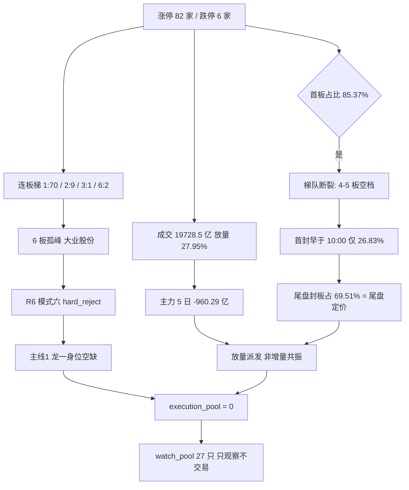

# 2026年10月26日（周一） · **主决策 / D1 盘前预案**

> 🚫 **当日禁新仓（no_trade）**：执行池 0 只，有效新仓预算 **0.00**。仓位上限 0.60 只是理论天花板，不是可买额度。
> **数据源新鲜度**: partial ｜ **降级状态**: true（emotion_cycle 前态偏移 + attention_signals 缺失）
> **置信度**: 0.65（R6 仅 0.45，情绪周期修正后 0.45）

## 一句话结论

物理AI 是今天唯一有真身位的主线，但它的龙一 300296 已在 5 日 +62.67% 的新高上被卖方一致覆盖、13:43 才尾盘封板、10/29 三季报 H1 净利 -59.7% 待验；人形机器人的龙一大业股份被 R6 判霸榜出货硬否决。放量 27.95% 而主力 5 日净流出 960 亿 = 派发不是增量，**今天不开仓，27 只进观察池**。

## 一、不交易条件清单（先看这段）

| 代码 | 状态 | 含义 |
|---|---|---|
| `R6_HARD_REJECT_LEADER` | 🔴 命中 | 主线1 龙一 603278 大业股份被 R6 模式六硬否决，龙一空缺不得递补龙二/杂毛 |
| `RR_FAIL` | 🔴 命中 | R2 收盘口径 10 只候选 RR 全部 < 2（引擎 5 只判 fail）→ 关2 拒绝开仓 |
| `EVENT_WINDOW_Q3` | 🔴 命中 | Step 0.55：10/27 奥普特、10/29 利亚德、10/31 大业三季报 → 高位票买点后置 |
| `EMOTION_HIGH_CHOP_LOW_CONF` | 🔴 命中 | 情绪周期修正为 high_chop conf 0.45，不构成主升做多授权 |
| `BREADTH_NO_ESCALATION` | 🔴 命中 | 首板占 85.37%、4–5 板空档、早于 10:00 首封仅 26.83% → 无梯队 |
| `NO_POSITION_BUDGET` | 🔴 命中 | 有效新仓预算 0.00；竞价位已过，当日无买点 |
| `R1_FAIL` / `R6_HARD_REJECT_OVERFLOW` / `R7_STALE` / `GLOBAL_SEVERITY_3` / `EMOTION_EXTREME_GREED` | ⚪ 未命中 | R1 conf 0.72、hard_reject 1/10、R7 conf 0.74、severity 2、主线数 1 |

**六条同时命中，任一单独成立即足够禁新仓。** 这不是「胆小」，是纪律第 ③ 与第 ⑦ 条：周期不对就减维，合力不足（无跟风赚钱效应）就不封。

## 二、市场结构：放量派发，不是增量共振

| 指标 | 数值 | 读法 |
|---|---|---|
| 涨停 / 跌停 / 炸板 | 82 / 6 / 12 | 涨停不少，但赚钱效应集中在首板 |
| 炸板率 | 12.77%（10/22 为 41.07%） | 恐慌已退，不等于转强 |
| 连板梯 | {1:70, 2:9, 3:1, 6:2} | 2 板骤减到 9 家 = 接力断档 |
| 首板占比 | 85.37% | 高度全靠 6 板孤峰撑 |
| 空档 | 4–5 板 0 家 | 无中间梯队 → 断板即无承接 |
| 首封时点累计 | 09:30 4.88% / 10:00 26.83% / 11:30 34.15% / 14:00 69.51% | 七成板在 14:00 之后封 → 尾盘定价 |
| 溢价（`premium_open`） | 均值 +0.29% / 中位 **-0.87%** | 昨日涨停股今日**开盘**相对前收：一半以上是低开，接力资金在跑 |
| 两市成交 | 19728.5 亿（前日 15418.6，+27.95%） | 放量 |
| 主力资金 | 5 日 -960.29 亿 / 10 日 -2461.6 亿 | 放量 + 主力净流出 = 派发 |
| 北向 | 5 日 +120.27 亿（5/5 正） | 唯一多头证据，但量级对不上 960 亿的流出 |

**大资金意图**：北向在买、主力在卖、成交放大——这是**换手不是加仓**。真正的增量资金进场会伴随「2 板家数扩张 + 早盘首封占比抬升」，而今天两者都是反的（2 板只 9 家、早盘首封 26.83%）。
**为什么走强**：物理AI 靠周末卖方集中覆盖 + 智元数据集/英伟达生态四重催化点火，属「一致性接力」，不是「首次发现」。
**逻辑够不够硬**：催化硬（产业级），但定价已充分（6/6 群 + 4 家公众号 + MLOps 热榜新进第 5）→ 逻辑硬 ≠ 买点好。

## 三、情绪周期：引擎判 main_up 是错的，实际是 high_chop

引擎 `emotion_cycle.json` 输出 `main_up / conf 0.45`。**这是状态机跳级，不是市场真的在主升。**

- 盘前回退时 `compute_cycle_metrics` 把 `prev_date` 连续退了一天，状态机读到的「昨日阶段」是 **20261021 的 high_chop**；
- 而 10-22 收盘的真实阶段是 **main_down**（`data/research/20261023/emotion_cycle.json`，`metrics_date=20261022`，`phase=main_down`，`conf=0.88`）；
- 用正确前态重算，`main_down → main_up` 属**非法跳级**，状态机把它修正为 **high_chop / conf 0.45**。

**最终口径：high_chop（高位震荡），置信度 0.45。** 该修正方向上**收紧**（不是放宽），与 no_trade 结论一致。**不据此放宽任何仓位**：即便按引擎的 main_up 口径，RR 与事件窗口两道闸门依然全数不放行。

## 四、主线判定：一条真线，一条高潮线

| 主线 | 分数 | 阶段 | 板块涨停 | 龙一 | 结论 |
|---|---|---|---|---|---|
| 物理AI / 数据采集 | 88 | mid_up | 29 家 | 300296 利亚德 | 唯一有真身位，但龙一位置+财报窗口不允许今天买 |
| 人形机器人 / 本体·减速器 | 75 | **climax** | 43 家 | 603278 大业股份 | 龙一被 R6 硬否决，整条线只作温度计 |
| 次线：传媒/AI应用 | 59 | — | — | 002354 天娱数科 | 单点游资，板块 5 日 -59.32 亿无跟风 |
| 次线：存储/数字芯片 | 56 | — | — | 001309 德明利 | 资金先行、叙事退位，属下跌通道反弹 |
| 次线：丝杠/精密传动 | 51 | — | — | — | 未成线，仅观察 |

主线数 = 1（R2 口径），因此 `main_lines_cap_multiplier = 1.0`。

## 五、执行池：0 只

**不是没票，是没一个买点。**

R2 十条候选全部 `execution_eligible=false`。关1（核心判定）10 只**全部通过**（core/leader，leading_score 0.80–0.95，除襄阳轴承 neutral 外都是 resonance），但后三道闸门把它们逐一拦下：

| 票 | 关1 结果 | 拦截关 | 拦截理由 |
|---|---|---|---|
| 300296 利亚德 | core 0.95 | Step 0.55 事件窗口 | 5 日 +62.67% 高位 + 13:43 首封 + 10/29 三季报 H1 -59.7%，买点后置 |
| 301313 凡拓数创 | core 0.90 | 关2 盈亏比 | 收盘口径 RR 1.39；龙虎榜 3 日净卖 -0.62 亿；PB 分位 99.9% |
| 688836 宇树科技 | leader | 关4 板型 | 14:15 一次性拉板（尾盘板）+ 次新 n=1 无股性样本，RR 不可量化 |
| 603278 大业股份 | leader | **R6 hard_reject** | 模式六霸榜出货（R3 霸榜 3 日 + R7 派发双命中）；不得递补 |
| 002747 埃斯顿 | core | 关4 板型 | 14:38 尾盘投机板（14:30+）；股性次日仅 +1.59% → 隔夜溢价不足 |
| 688686 奥普特 | core | 关4 板型 | 14:42 尾盘投机板 + 封单 0.46 亿偏薄（基本面最干净，保留等 10/27 财报） |
| 003021 兆威机电 | core | 关4 板型 | 开板 5 次 + 2 板中位段（R1 明令 2–3 板不接） |
| 002421 达实智能 | core | 关4 板型 | 开板 3 次 → 回封板（多次开板），不碰 |
| 000678 襄阳轴承 | neutral | 关4 板型 | 开板 10 次 + 封单/成交比 0.030 全链最低 |
| 605488 福莱新材 | core | 关7 禁止清单 | 命中 `mid_laggard`，股性次日 +1.06% 覆盖不了 +48.97% 的位置 |

**为什么不能只用「利亚德是龙一」就买**：A 股 T+1，每笔买入都是押注次日有人接力。5 日 +62.67% + 尾盘封板 + 三天后出 H1 净利 -59.7% 的财报，这是**先手兑现区**不是接力区。R2 自己算的收盘口径 RR 只有 1.04（低吸口径 2.06），低于关2 的 1.8 底线。

## 六、观察池 27 只（逐票理由码 + 预期方向 + 价位）

> 价位由 `price_levels.derive()`（`src/plan/price_levels.py`）以 20261023 前复权收盘为基准算出，`price_src=price_levels.derive`。**观察票不给买点承诺**：`entry_rules` 全部为空、`auto_trade_enabled=false`、预算 0.00。

| # | 代码 | 名称 | 题材 | 角色 | 分 | 理由码 | 预期方向 | 买区 | 触发 | 止损 | 止盈 | RR |
|---|---|---|---|---|---|---|---|---|---|---|---|---|
| 1 | 300296.SZ | 利亚德 | 物理AI | leader | 72 | `sector_over_heated` | sideways_or_down | 6.73–7.10 | 7.10 | 6.53 | 8.24 | 2.00  |
| 2 | 301313.SZ | 凡拓数创 | 物理AI | elastic_core | 68 | `distribution_alert` | down | 56.52–59.60 | 59.60 | 54.83 | 69.14 | 2.00  |
| 3 | 002747.SZ | 埃斯顿 | 物理AI | core_midcap | 61 | `technical_not_ready` | sideways | 26.85–28.30 | 28.30 | 26.88 | 30.26 | 1.38  |
| 4 | 688686.SH | 奥普特 | 物理AI | core_midcap | 61 | `technical_not_ready` | sideways_or_down | 140.94–148.60 | 148.60 | 136.71 | 172.38 | 2.00  |
| 5 | 603341.SH | 龙旗科技 | 物理AI | core_midcap | 61 | `sector_over_heated` | sideways | 40.61–42.82 | 42.82 | 40.68 | 47.10 | 2.00  |
| 6 | 603278.SH | 大业股份 | 人形机器人 | leader | 82 | `distribution_alert` | down | 14.68–15.48 | 15.48 | 14.71 | 17.02 | 2.00  |
| 7 | 688836.SH | 宇树科技 | 人形机器人 | leader | 68 | `valuation_stretch` | sideways | 617.76–630.24 | 617.76 | 579.82 | 731.08 | 2.00  |
| 8 | 003021.SZ | 兆威机电 | 人形机器人 | elastic_core | 67 | `sector_over_heated` | sideways_or_down | 84.39–88.98 | 88.98 | 84.53 | 97.88 | 2.00  |
| 9 | 300307.SZ | 慈星股份 | 机器人 | watch_elastic | 61 | `sector_over_heated` | sideways | 8.22–8.67 | 8.67 | 7.98 | 10.05 | 2.00  |
| 10 | 002354.SZ | 天娱数科 | 传媒 | watch_elastic | 61 | `capital_short` | sideways | 7.42–7.80 | 7.42 | 7.41 | 8.58 | 2.00  |
| 11 | 002343.SZ | 慈文传媒 | 传媒 | watch_elastic | 61 | `sector_over_heated` | sideways_or_down | 10.02–10.56 | 10.56 | 10.03 | 11.62 | 2.00  |
| 12 | 600825.SH | 新华传媒 | 传媒 | watch_elastic | 61 | `sector_over_heated` | sideways_or_down | 13.97–14.72 | 14.72 | 13.98 | 16.20 | 2.00  |
| 13 | 603466.SH | 风语筑 | 传媒 | watch | 55 | `capital_short` | down | 13.51–14.25 | 14.25 | 13.54 | 15.14 | 1.25  |
| 14 | 001309.SZ | 德明利 | 存储 | core_largecap | 61 | `technical_not_ready` | sideways | 366.44–377.60 | 366.44 | 358.72 | 415.36 | 2.00  |
| 15 | 688825.SH | 长鑫科技 | 存储 | core_largecap | 61 | `technical_not_ready` | sideways | 42.42–43.28 | 42.42 | 39.82 | 50.20 | 2.00  |
| 16 | 002185.SZ | 华天科技 | 存储 | core_midcap | 61 | `technical_not_ready` | sideways | 14.89–15.70 | 15.70 | 14.91 | 17.28 | 2.00  |
| 17 | 301660.SZ | 粤芯半导体 | 存储 | watch_elastic | 61 | `technical_not_ready` | sideways | 33.30–33.98 | 33.30 | 31.26 | 39.42 | 2.00  |
| 18 | 300100.SZ | 双林股份 | 丝杠 | watch | 57 | `event_uncertain` | sideways | 19.54–20.60 | 20.60 | 19.10 | 22.85 | 1.50  |
| 19 | 300660.SZ | 江苏雷利 | 丝杠 | watch | 61 | `event_uncertain` | sideways | 23.76–25.06 | 25.06 | 23.06 | 29.06 | 2.00  |
| 20 | 002724.SZ | 海洋王 | 高位情绪 | watch_elastic | 61 | `sector_over_heated` | sideways_or_down | 11.34–11.96 | 11.96 | 11.36 | 13.16 | 2.00  |
| 21 | 002241.SZ | 歌尔股份 | AI硬件 | watch_elastic | 61 | `capital_short` | sideways | 21.26–22.42 | 22.42 | 21.30 | 24.66 | 2.00  |
| 22 | 300308.SZ | 中际旭创 | 光模块 | watch | 54 | `capital_short` | down | 836.46–861.94 | 836.46 | 792.98 | 939.00 | 1.12  |
| 23 | 603528.SH | 多伦科技 | AI应用 | watch_elastic | 61 | `sector_over_heated` | sideways | 7.49–7.90 | 7.90 | 7.50 | 8.70 | 2.00  |
| 24 | 603859.SH | 能科科技 | AI应用 | watch | 61 | `sector_over_heated` | sideways | 40.08–42.25 | 42.25 | 40.14 | 46.47 | 2.00  |
| 25 | 002474.SZ | 榕基软件 | 信创 | watch | 61 | `technical_not_ready` | sideways | 6.54–6.90 | 6.90 | 6.55 | 7.60 | 2.00  |
| 26 | 000530.SZ | 冰山冷热 | 高度股 | watch_elastic | 61 | `sector_over_heated` | sideways_or_down | 8.77–9.24 | 9.24 | 8.78 | 10.16 | 2.00  |
| 27 | 300369.SZ | 绿盟科技 | 网络安全 | watch | 61 | `event_uncertain` | sideways | 10.77–11.36 | 11.36 | 10.45 | 13.18 | 2.00  |

**逐票方向依据**（`expected_direction` 的推导，P2 午盘与 E1 复盘按此对账）：

- **利亚德 300296.SZ** — R3 crowded=true+周末卖方集中覆盖，认知差抹平；20cm 二板首封 13:43、R1 首封<10:00 仅 26.8%；10/29 三季报 H1 净利 -59.7% 待验
- **凡拓数创 301313.SZ** — 3 日龙虎榜净卖 -0.62 亿、股东户数 +180%、10/23 严重异常波动公告、PB 分位 99.9%；5 日 +89% 属加速末端
- **埃斯顿 002747.SZ** — 14:38 尾盘投机板、均线仍空头排列、商誉 29.75% 逼近红线；距 60 日高 -27% 是链内唯一低位但溢价弱
- **奥普特 688686.SH** — 14:42 尾盘投机板、换手仅 4.2% 承接薄、PE 分位 84.3%；但机构席位 +0.94 亿、股东户数 -10.65%、毛利 58.6% 是链内最干净
- **龙旗科技 603341.SH** — R3/R4 点名数采中军、5 日 +35.69%；无 R5 画像、无板型数据，样本身位未核
- **大业股份 603278.SH** — R6 模式六 hard_reject：R3 霸榜 3 日告警 + R7 五日主力净流出与派发双命中；38 日龙虎榜净卖 -1.03 亿、机构 0 行、10/31 首亏三季报
- **宇树科技 688836.SH** — 主力 5 日 +10.05 亿、机构席位 +4.01 亿、封单 4.04 亿全链最强；但 PE 432/PB 87.6、流通仅 7.4%、14:15 尾盘一次性拉板
- **兆威机电 003021.SZ** — 开板 5 次、2-3 板中位段（R1 明令不接）、净利 -34.1%；资金 5/5 净流入是唯一正面
- **慈星股份 300307.SZ** — 20cm 涨停 + 5 日 +37.75% + 龙虎榜净买 1.59 亿，机器人贴身弹性；无 R5 画像与板型数据
- **天娱数科 002354.SZ** — 东财人气第 1、龙虎榜净买 4.89 亿（全市场最大）、09:37:12 最早封板、封单 3.27 亿；但传媒板块 5 日 -59.32 亿，Q2 象限单点游资
- **慈文传媒 002343.SZ** — 10 日 6 板、20 日 +96.22%、收盘即 60 日新高，纯高度股
- **新华传媒 600825.SH** — 20 日 +200.59%、5 日仅 +0.13% 已滞涨，attention 连续 3 日在榜
- **风语筑 603466.SH** — 10/23 龙虎榜净卖 -1.27 亿、引擎 RR 1.25 RR_FAIL、距 60 日高 -2.97%
- **德明利 001309.SZ** — 5 日 +21.84% 但 20 日 -37.41%、距 60 日高 -48.35%，MA50 远在上方；R4 E003 同比 +32400% 但环比仅 +2.2%
- **长鑫科技 688825.SH** — 5 日 -4.82%、20 日 -22.23%、距 60 日高 -30.66%；R7 降级为 secondary
- **华天科技 002185.SZ** — 5 日 +15.4%、20 日 -3.92%；封测配套，R7 只列降级
- **粤芯半导体 301660.SZ** — 20cm 涨停 + 龙虎榜净买 1.95 亿，5 日 -3.05%、距 60 日高 -25.24%
- **双林股份 300100.SZ** — R4 E002 财联社前瞻点名，5 日 +16.45%；但主力 5 日 -0.15 亿、引擎 RR 1.5 RR_FAIL
- **江苏雷利 300660.SZ** — R4 E002 点名，主力 5 日 +0.25 亿（金额微小）、5 日 +19.64%
- **海洋王 002724.SZ** — 10 日 6 板、同花顺热股 13→2（周末升 11 位）、R6 M9 判高位触板赌博（extreme_tail_risk）
- **歌尔股份 002241.SZ** — 10/23 龙虎榜净买 4.51 亿（第 2）、5 日 +15.96%，AI 硬件海外映射
- **中际旭创 300308.SZ** — 5 日主力 -14.70 亿、融资余额 15 日 -24.4%、距 60 日高 -46.21%、引擎 RR 1.12 RR_FAIL
- **多伦科技 603528.SH** — 5 日 +24.66%、10 日 3 板、attention 周末新进第 13
- **能科科技 603859.SH** — 5 日 +23.43%、距 60 日高 -3.2%、attention 周末新进第 12
- **榕基软件 002474.SZ** — 5 日 +12.5%、流通 38.2 亿（20-50 亿谨慎区）、attention 周末新进第 18
- **冰山冷热 000530.SZ** — 10 日 5 板、20 日 +87.97%、R7 龙虎榜净卖榜在列
- **绿盟科技 300369.SZ** — R4 E007 PHP 漏洞+海外网安催化，20cm 涨停 + 龙虎榜净买 1.66 亿；但 R2 网络安全仅 42 分丢弃

## 七、重点观察票思维链

### 1. 利亚德 300296.SZ（物理AI 龙一 · 观察）
**买入理由** 唯一同时过完关1（core 0.95、共振 0.84、板块内第 1）与关7（禁止清单 0 命中）的龙一，主力 5 日 +11.96 亿、封单 2.22 亿、龙虎榜 +1.76 亿、东财人气 10→2，是全市场最硬的合力票。
**风险点** 5 日 +62.67%、20 日 +50.31%、收盘即 60 日新高；首封 13:43 是尾盘封板；10/29 三季报 H1 净利 -59.7%；R3 认知差已被 6/6 群 + 4 家公众号抹平，买的是「还有人接力」不是「发现」。
**止损条件** 破 6.53（买区上沿 7.10 × (1-8%)，与 MA10×0.99 取高），或竞价直接低于 6.73 且 15 分钟不收复。
**可验证假设** 若 10/27 竞价溢价 > +3% 且板块仍有 ≥3 家涨停 → 说明一致预期尚未见顶；若竞价 ≤ -3% 或板块涨停家数掉到 5 家以下 → 高位派发确认，整条线降为温度计。

### 2. 凡拓数创 301313.SZ（高度锚 · 观察）
**买入理由** 链内唯一 5 日 3 次 20cm 的高度锚（东财 physical AI lead_stock hot 1178 全市场第 1），股性次日中位 +11.11%（n=4）。
**风险点** 龙虎榜当日 -0.15 亿、3 日 -0.62 亿净卖；13:24 首封 + 39.3% 换手 = 尾盘抢筹非承接；股东户数 +180%；10/23 严重异常波动公告；PB 分位 99.9%；流通 48.4 亿落 20–50 亿谨慎区。
**止损条件** 破 55.3（RR 引擎基准），或连续两日收在 5 日均线下。
**可验证假设** 高度票的存亡看「断板日是否有资金接」。若 10/27 高开后炸板且尾盘不封 → 高度锚失效，物理AI 主线只剩利亚德单腿，主线降半档。

### 3. 宇树科技 688836.SH（人形机器人总龙 · 观察）
**买入理由** 资金最硬：主力 5 日 +10.05 亿（链内第 1）、封单 4.04 亿（0 开板，全链最大）、龙虎榜 +2.11 亿、成交 47.70 亿；距 60 日高 -43.27% 是链内唯一「不是新高」的龙头，修复空间是唯一真预期差。
**风险点** PE 432 / PB 87.6；流通仅 7.4% + 次新股解禁未知；14:15 一次性拉板（尾盘板）；近一年涨停样本 n=1 且次日 -18.7% → RR 无法量化。
**止损条件** 破 570（买区下沿外 5%）即走；不设加仓档。
**可验证假设** 若 10/27 平开高走且 30 分钟内不破均线 → 说明不是一次性拉板，可重新评估；若低开破 570 而封单资金不回 → 确认次新筹码松动。

### 4. 大业股份 603278.SH（R6 硬否决 · 观察）
**买入理由** 6 板高度 top1、16 天 8 板、0 次开板、股性次日 +9.99%（n=24 胜率 0.71）——纸面最强。
**风险点** R6 模式六 hard_reject 三重命中：R3 人形机器人连续 3 日霸榜高置信告警、R7 五日主力净流出与派发双命中、38 日龙虎榜净卖 -1.03 亿且机构 0 行；主营胎圈钢丝非机器人主业；4–5 板空档使 6 板成孤峰；10/31 首亏三季报。
**止损条件** 不适用——不进任何仓位。作为高度锚，断板日即为情绪温度骤降信号。
**可验证假设** 若 10/27 该票一字或换手板承接住 → R6 的派发判断被打脸，需在 E1 记一次反证偏差；若断板且跌停 → 模式六判对，全市场降档。

### 5. 天娱数科 002354.SZ（传媒单点 · 观察）
**买入理由** 东财人气第 1、龙虎榜净买 4.89 亿（全市场最大）、09:37:12 全市场最早封板、封单 3.27 亿——单点资金强度极强。
**风险点** 传媒板块 5 日 -59.32 亿，无跟风赚钱效应；Q2 象限单点游资，无板块合力；封板最早但板块不认，属「独舞」。
**止损条件** 破 4.05（引擎止损），或板块涨停家数连续两日 < 3。
**可验证假设** 单一游资独舞的票，次日要么一字（资金锁仓）要么闷杀（无接力）。若 10/27 竞价溢价 > +5% 且传媒出现 ≥3 家涨停 → 板块被单点带动成立，可升观察级；否则只做负面样本。

### 6. 德明利 001309.SZ（存储低位 · 观察）
**买入理由** 5 日 +21.84%，存储线上资金先行、叙事退位（R4 E003 净利同比 +32400%），是 Q3 象限里唯一有资金切入的低位方向。
**风险点** 20 日 -37.41%、距 60 日高 -48.35%，MA50 远在上方 = 下跌通道反弹；E003 环比仅 +2.2%，同比高增是低基数；R7 只列降级。
**止损条件** 破 116.6（引擎止损），且反弹不站上 MA50 前不加仓。
**可验证假设** 下跌通道里的第一次放量反弹，若能连续 3 日站稳 20 日线 → 右侧成立；若次日即吞没 → 属超跌反抽，不算主线。

## 八、B 计划：跷跷板 / 对手盘

预案不能只写「买什么」，还得写「这些票不行时钱去哪」。

| 方向 | 触发条件 | 候选（含价位） |
|---|---|---|
| 主线内部高低切（物理AI 高位→低位容量） | 利亚德/凡拓/宇树竞价集体低开或被闷杀 | 002747 埃斯顿 买区 26.85–28.30 / 止损 26.88（需站上 20 日线 + 板块仍 ≥3 家涨停） |
| 次线接力（传媒/AI应用 59 分） | 物理AI 资金撤离且传媒出现 ≥3 家涨停潮 | 002354 天娱数科 7.42–7.80 / 603528 多伦科技 | 300307 慈星股份（板块无跟风不参与） |
| 事件驱动（存储 56 分 + 网安 R4 E007） | 存储/网安二次确认：板块 ≥3 家涨停 + 主力转正 | 001309 德明利 366.44–377.60 / 688825 长鑫科技 | 002185 华天科技 | 300369 绿盟科技 |

**反向提示**：若三个方向同时走弱（无板块涨停潮、炸板率上 25%、主力延续净流出），说明是**全市场降档而非跷跷板**——此时不做任何 B 计划，等 `retreat_reversal_detection_v1` 右侧确认（广度 ≥0.55 + 昨涨停红盘率 ≥0.6）再谈。B 计划里的票**必须在今日预案内已点名**，触发后才按纪律执行，不许盘中临时起意（铁律 8）。

## 九、竞价四档预期（**仅作 10/27 复盘与研究锚**）

⏰ 本机时间已晚于 09:25 集合竞价，**当日无法回溯执行**。以下四档只用于 10/27 复盘对账，验证「预案的预期定义」是否与市场一致。

| 票 | 基准（10/23 收） | 低于预期 | 符合预期 | 超预期 | 过度高开 |
|---|---|---|---|---|---|
| 利亚德 | 7.32 | < 6.73 → 放弃（除非低开 15 分钟翻红） | 6.73–7.10 → 按买区承接 | 7.10–7.28 → 只做半路确认 | > 7.61（+4%）→ 不追 |
| 凡拓数创 | 61.44 | < 57.75（-6%）→ 放弃 | 57.75–62.05 | 62.05–64.51 | > 64.51 → 不追 |
| 宇树科技 | 624.00 | < 581（-7%）→ 放弃 | 581–636 | 636–655 | > 655 → 不追 |
| 大业股份 | 15.96 | 不适用（硬否决） | 观察 | 观察 | 观察 |

**三档判定规则**：20cm 票按 1.2x 系数放宽；每档动作已枚举为 `skip_or_weak_to_strong` / `execute_plan` / `over_expected_confirm` / `skip`，P1 竞价数据一到即可机械对照，不靠临场判断。

## 十、引擎缺陷与口径披露（不改引擎，照实写）

1. **`board_pattern.py` 时段标签过粗**：把 13:30–14:30 统一标为「尾盘封板(14:00-14:30)」。利亚德首封 **13:43:06** 因此被标成尾盘封板。原始证据 `first_seal=134306` 已完整保留在 `tactical_signals.evidence` 里，人工复核不受影响。但 R1 的「首封早于 10:00 仅 26.83%」是**市场级**统计，不受该 bug 影响。
2. **R6 条数口径不一致**：`overall_conclusion` 记 **7 条** strong_suggest，而 `counter_arguments` 数组实际是 **12 条**（前一会话口径 8 条）。本轮**按 8 条处理**（只取有具体 ts_code 或板块指向的实质条目），差异不改变结论——R6 只用于压仓位与逐票降级，不作为「不参与」的依据。
3. **`attention_signals.json` 不存在**：只有 `attention_weekend.json`（`attention_weekend_v1`）。因此 Step 3 人气维度里的 `persistent/surge/cross_platform` 三档无法按原口径计算，本周只用周末榜单（`weekend_persistent`）作替代，已在 `meta.data_gaps` 记录。
4. **情绪周期状态机前态偏移**：见第三节。引擎 `main_up/0.45` → 修正 `high_chop/0.45`，方向为收紧。
5. **QMT 实时持仓未查询**：本轮按用户要求收窄为只写两份文件、不重跑外部调用，因此 `t1_candidates.stop_loss_only` 留空。**这是数据缺口，不是「没有持仓风险」**——若有持仓，止损档需人工或下一轮补。
6. **`mainline_lifecycle.json` 的 `lines` 为空**（骨架未填充），主线阶段判定改用 R2 的 `stage` 字段（物理AI mid_up / 人形机器人 climax）。

## 十一、数据源审计

| 源 | 状态 | 抓取时间 | 记录数 | 备注 |
|---|---|---|---|---|
| research_summary_v1 | ✅ ok | 10/26 06:00 | 1 | orchestrator_status=partial, severity=2 |
| R1_style | ✅ ok | — | 1 | 连板情绪型, conf 0.72, 情绪分 69 |
| R2_main_sectors | ✅ ok | — | 10 候选 / 2 主线 | conf 0.71，全部 execution_eligible=false |
| R3_sentiment | ✅ ok | — | — | conf 0.65，霸榜告警 3 日 |
| R4_news | ✅ ok | — | — | conf 0.72，E002/E003/E007 用于次线 |
| R5_stock_profiles | ✅ ok | — | 30 | conf 0.75 |
| R6_devil_advocate | ⚠️ 口径瑕疵 | — | 1 hard_reject / 12 counter | conf 0.45；条数口径见缺陷 2 |
| R7_capital_flow | ✅ ok | — | 12 研究候选 | conf 0.74；执行候选 0，研究候选全部降级 |
| emotion_cycle | ⚠️ stale | — | 1 | 前态偏移，已修正 |
| attention_signals | ❌ 缺失 | — | — | 只有 attention_weekend |
| QMT 持仓 | ⏱️ 未调用 | — | — | 范围收窄 |
| 规则引擎（scratch） | ✅ ok | 10/26 11:17 | 10/30/30 | core_judge / tactical / watch_levels |

## 十二、不确定性 / 反证

- **我可能错在哪**：若 10/27 物理AI 出现「龙一断板但低位补涨接力」的经典高低切，今天的空仓就是错过一整段。对冲方式是观察池已备好 002747 与次线三条方向的**具体价位**，触发即按预案执行，不是空白等待。
- **最硬的反面证据**：北向 5 日 5/5 净流入 +120.27 亿。若 10/27 主力资金转正，则「派发」判断被推翻，需在 E1 记一次方向偏差。
- **置信度为什么只有 0.65**：R6 自身 0.45、情绪周期修正后 0.45、attention 维度缺失、QMT 持仓未知。四个不确定源叠加，不宜给高置信。
- **错题本对账**：`error_case_001_main_line_rotation`（主线遗漏）→ 已交叉 R1 情绪分 + 板块涨停家数复核；`error_case_002_r6_blanket_bearcase`（R6 无差别看空）→ 今天的「不参与」理由是 RR 与事件窗口，不是 R6 看空；`error_case_20260831_003`（P2 午盘强判）→ 观察池对 688836/300296 明确留「午后催化」不确定项。

## 十三、与其他 R/D/E 的关系

- **依赖**：R1–R7（同日 artifact）、`emotion_cycle.json`、`mainline_lifecycle.json`、`attention_weekend.json`、`_r7_data/`（index_daily / limit_list_d / daily_basic）、`data/user_preferences.yaml`
- **被消费**：P1 `auction_amendment_v1`（本日无执行票，只需核对观察池竞价方向）、P2 `midday_amendment_v1`、E1 `daily_review_v1`（27 只观察池全量追踪）
- **本文件覆盖**：`data/plans/20261026/watchlist_plan.json` 原 10:50 python fallback 版本（已备份 `.bak`）

## Sub-Agent 元数据

- skill: `main_decision_v1@1.10`
- artifact: `data/plans/20261026/watchlist_plan.json`
- decision_source: `llm`（非 fallback、非 rule_v1）
- mode: `dry_run`（`autonomous_trading_enabled=false`, `requires_user_confirmation=true`）
- 引擎: `core_judge.py` / `board_pattern.py` / `dragon_switch.py` / `forbidden_filter.py` / `price_levels.py`（结果来自同日 scratch，本轮未重跑）
- 仓位上限: 0.60（R1 0.65 − R7 0.05 × 主线 1.0）｜ 有效新仓预算: **0.00**
