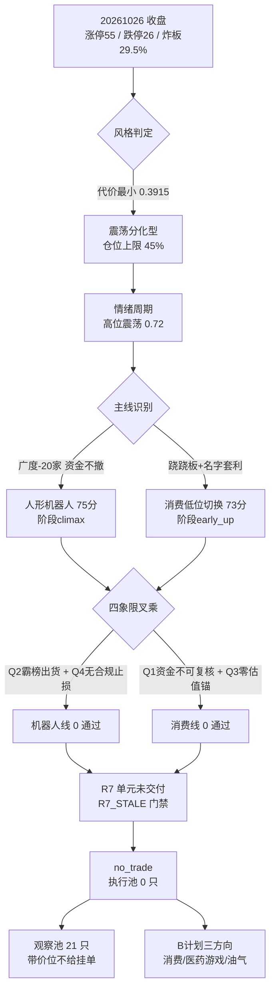

# 2026年10月27日 · **主决策 / D1 盘前预案**

> **数据源新鲜度**: partial（R4 / R7 两单元未交付）
> **降级状态**: true
> **置信度**: 0.45（0.80 × 0.7 × 0.8 = 0.448，clamp 后 0.45）
> **决策**: `no_trade` —— 执行池 0 只，观察池 21 只，新仓预算 0.00

## 一句话结论

震荡分化 + 高位震荡：宽度还在、高度已废，机器人线「共识仍在、方向已转」，消费线是名字套利的 1–3 日载体；
R7 资金单元本次未交付、四象限 × 两主线叉乘 8 格 0 通过 → **今天不买**，21 只观察票全部带数字价位但不给竞价挂单价。

## 先说时序，不藏

这份预案是 09:10 开始组装、09:17 落盘的，**晚于 08:00 主路径时点，但仍在 09:25 竞价收盘前 8 分钟**。错题本 `error_case_20261026_003`
记的正是「D1 缺席竞价窗口」——今天没重犯到 11 点以后，但也谈不上守时。对今天的影响有限：结论是 `no_trade`（只禁买、不给买点），
晚交付不产生买入风险；真正的损失是**观察池与竞价的比对窗口被压到不足 5 分钟**，P1 的校准价值大幅缩水。这一条写进 `meta.plan_timing_audit`。

## 一、市场温度：只定温度，不定打法

| 指标 | 数值 | 读数 |
|---|---|---|
| 涨停 / 跌停 / 炸板 | 55 / 26 / 23 | 炸板率 **29.49%**（前日 12.77%），分歧明显放大 |
| 连板天梯 | 1板40 / 2板8 / 3板6 / 4板1 | 最高 **4 板**（前日 6 板），高度塌陷、首板占 72.7% |
| 昨日涨停溢价 | 开盘 +3.04%（中位 +2.54%）、收盘 +2.66% | 溢价仍正、红盘率 67.1%，赚钱效应未崩 |
| 广度 | 涨 2082 / 跌 2991 / 平 144，中位 **-0.49%** | 涨跌比 0.70，涨停晋级率 **15/82 = 18.3%** |
| 成交额 | 16,087 亿（前日 19,559 亿，**-17.75%**） | 缩量，反弹维持不住 |
| 主力资金 | 单日 -278.67 亿，5 日 **-1,126.66 亿**，同期小单 +298.20 亿 | 散户在接机构的货 |
| 两融 | 24,318 亿，5 日 -571 亿（-2.29%） | 杠杆在退，高度股反包多为一次性脉冲 |
| 指数 | 上证 +0.19% / 创业板 **-1.71%** / 科创50 **-2.23%** | 权重护盘，赚钱效应与指数背离 |

情绪周期预计算给 **高位震荡**（confidence 0.72），动作是「落袋为安 / 控制仓位；龙头不死可做低位补涨；不搏穿越」。
R1 给的仓位上限是 **45%**，这是硬约束；今天在此基础上再乘 `no_trade` 门禁，**有效预算 0.00**。

冲突硬指标必须单列（错题本 `error_case_20261022_004` 的要求）：全市场中位 -0.49%、涨跌比 0.70、晋级率 18.3% 三项都指向风险，
但上海九百 4 板、万向钱潮 2 板封单 1.42 亿同时存在。**两只票的局部活口，不能用来给全市场定性**，也不能因为守住 no_trade
就抹掉「今天确实有局部赚钱效应」这个事实。

## 二、主线：两条线，两种病

R1 的代理口径判 1 条主线（概念涨停 ≥20 家的只有 1 个），R2 五维判 2 条（人形机器人 75 / 消费 73）。口径不同，不是矛盾；
**R1 的 45% 仓位上限仍然是硬约束，R2 不给仓位数字**。

### 人形机器人 / 减速器（75 分，阶段：高潮）

广度在腰斩：机器人概念 23 家涨停（前日 43，-20）、人形机器人 14 家（前日 26，-12）。但钱没走——人形机器人概念当日主力
+26.32 亿、5 日 +105.72 亿（概念榜第 1），减速器 5 日 +41.81 亿。结构上发生了**定价权迁移**：前龙头大业股份 6/7 断板
（当日 +8.08%、开板 11 次、换手 38%），身位股华阳智能封单只剩 146 万、襄阳轴承龙虎榜净卖 0.46 亿，
而容量中军万向钱潮 2 板封单 1.42 亿、主力 +5.90 亿（净占比 23.51%，全场涨停股第 1）接过定价权。

- **大资金意图**：机构与容量资金在「高度塌陷」时买容量而不买身位，是因为炸板率 29.5% + 杠杆 5 日 -2.29% 的环境下，
  连板高度不再是稀缺品，**能承接大额资金的流通盘才是**。对手盘是把身位股当接力筹码的游资——他们在 3 板、4 板位置卖，
  换到 422 亿流通盘的票上做波段。这是「换载体」不是「加仓感」。
- **为什么走强**：位置（万向 20 日 100% 分位、MA20 正偏离 +19.4%）+ 催化（智元 G2 Max 上产线、美湖谐波关节认证，
  R4 E002 net 0.74，但已在 10-23/10-26 两连板中定价）+ 筹码（万向龙虎榜 +3.74 亿、机构席位 +1.63 亿，股东户数环比 -5.04%）
  三维里，**催化已定价、位置已极端，唯一还硬的是筹码**。
- **逻辑够不够硬**：三个独立源（R2 资金、R5 画像、R6 模式六审计）都确认「个股 5 日资金为正」，但同一个 R3 给出
  `distribution_alert=true` + 连续 4 日霸榜 + 热度 -28%。**硬的是 5 日资金，软的是 20 日趋势（-231.38 亿）**。
  证伪路径很短：今天若板块涨停家数继续缩到 15 家以下，R1 已明写「唯一主线熄火」。

### 消费 / 低位切换（73 分，阶段：early_up）

9 家涨停，但结构是「横向铺开不是向上打开」：休闲食品 3 家、白酒 1 家、乳业 1 家、饲料 1 家（百洋 12 天 8 板）、
一般零售 1 家（上海九百 4 板）。资金在票间切不在板块加仓——百洋 +1.58 亿、皇台 +1.51 亿、阳光 +1.34 亿净流入，
而龙一上海九百主力净卖 0.58 亿、链内换手核心九阳股份净卖 3.10 亿。

- **大资金意图**：这条线的钱是**从科技硬件搬过来的跷跷板钱**，不是产业定价钱。电子 -146.16 亿、元件 -66.3 亿、PCB -50.9 亿，
  同一天乳业/白酒/免税店新进概念榜前 20 —— 钱没消失，只是换了容器。买家是游资，不是机构；承接的是名字套利。
- **为什么走强**：位置（上海九百 4 板、20 日 100% 分位、5 日 +42.29%）+ 催化（**没有产业催化**，R4 八条事件无一条消费/零售，
  叙事维只给 8 分）+ 筹码（封单 0.07→0.45→1.09→1.36 亿逐日增厚，但主力当日净卖）。
  三维里两项是负的，靠的是「情绪载体」这一个属性。
- **逻辑够不够硬**：不够硬，且 R3 自评保质期 1–3 日。它的硬度来自**唯一性**（全场唯一 4 板）而非基本面；
  证伪路径也最短：断板即整线作废，不给二次反弹假设。

## 三、四象限叉乘：8 格 0 通过

R6 给了 24 条反证（hard_reject 0 / strong_suggest 14 / soft 10）。**空 hard_reject 不等于审核通过**——R6 原文就这么写的。
把它的四象限按「两主线 × 四象限」展开叉乘，才是 D1 自己的判断：

| 象限 | 人形机器人 | 消费 / 低位切换 |
|---|---|---|
| **Q1 资金** | 🟡 有条件：概念 5 日 +105.72 亿但 20 日 -231.38 亿；万向当日 +5.90 亿 | 🔴 否决：43 行业横截面无法复核食品饮料/商贸零售；龙一主力 -0.58 亿、九阳 -3.10 亿 |
| **Q2 情绪** | 🔴 否决：4 日霸榜、热度 -28%、板块 -0.79%、群聊一致「冲高卖」（14 条观点 12 条隐含卖出） | 🟡 有条件：4 板唯一性 + 封单 1.36 亿，但已开板 1 次、名字套利保质期 1–3 日 |
| **Q3 基本面/估值** | 🟡 有条件：万向 Q3 营收 -14.16%、存贷双高；绿的 PE 380x、户数 +87.6% | 🔴 否决：百洋 H1 亏 8,253.64 万、CFO 连续 3 期为负、PB 三年 100% 分位；上海九百 PE 104 vs 行业 21 |
| **Q4 结构** | 🔴 否决：4 票 20 日位置 100/100/100/71.5；万向结构位 -12.67% 超出 -5~-10% 硬区间 | 🔴 否决：上海九百结构位 -16.61%/-27.36%，封单 1.36 亿与主力 -0.58 亿背离 |

机器人线：**0 通过 / 2 有条件 / 2 否决**；消费线：**0 通过 / 1 有条件 / 3 否决**。
叉乘的结论与 `R7_STALE` 门禁是同向的两条独立证据——**不是用门禁掩盖判断，而是判断本身就是「今天不买」**。
这也是 R6 那句「第一否决面 = Q4 结构承载 × Q2 情绪质量，不是估值」的落地：估值贵只决定「能不能拿」，结构没位子决定「能不能挂单」。

## 四、今日不开仓：八条禁开仓条件，两条激活

| 条件 | 状态 | 依据 |
|---|:--:|---|
| R7 资金单元不可用 | 🔴 **激活** | `units.R7.status=failed`，`contract_failures.R7='unit not delivered by this run'` |
| 四象限叉乘 0 通过 | 🔴 **激活** | 上表 8 格 0 通过 |
| R1 置信度 < 0.4 | 🟢 不激活 | R1 confidence 0.49 |
| R6 hard_reject 溢出 | 🟢 不激活 | hard_reject 0 条（但空集≠通过） |
| 数据设施 severity ≥ 3 | 🟢 不激活 | fetch_global_severity = 2 |
| 贪婪/狂热且无主线 | 🟢 不激活 | high_chop，2 条主线 |
| 用户假日标记 | 🟢 不激活 | 无 |
| R4 消息单元缺省 | 🟢 不激活 | 按降级表只忽略维度，不单独阻塞；今日阻塞项是 R7 与叉乘 |

**关于「R7 文件明明在盘上」**：`R7_capital_flow_20261027.json` 确实存在（06:09 落盘），但本次 run 没有把它登记为交付物
（`artifacts` 里没有 R7、`contract_checks_passed=false`）。按用户口径「失败或缺研究不视为通过，不读同日旧文件冒充本次研究」，
D1 不消费它，也不把它的结论写进这份预案。R6 引用了 R7 的数字（它自己的证据链），那是 R6 的判断，不由我代它背书。

## 五、观察池 21 只：全部带数字价位，全部不给挂单

价位由确定性引擎（`src/plan/price_levels.py`）算出，不是拍脑袋：均线/牛熊线回踩或强势票分歧回踩定买区，
止损取「买入价 -5%/-8%、熊线、MA10」三者最高，止盈取 2R 或前高，RR < 1.8 直接判 `RR_FAIL`（不可买）。
**今日 `entry_rules` 全部留空**——no_trade 下不生成可执行买点，价位只作研究与次日复用。

| 票 | 代码 | 角色 | 风格 | 现价 | 买区 | 触发 | 止损 | 止盈 | RR | 方向 / 基准 |
|---|---|---|:--:|---|---|---|---|---|---:|---|
| 万向钱潮 | 000559.SZ | 龙一（容量核心） | 成长 | 12.71 | 11.69–12.33 | 12.33 | 11.71 | 13.57 | 2.00 | down / open_to_close |
| 绿的谐波 | 688017.SH | 龙二（中军） | 成长 | 293.00 | 269.56–284.21 | 284.21 | 261.47 | 318.80 | 1.52 🚫 | down / open_to_close |
| 襄阳轴承 | 000678.SZ | 身位股 3 板 | 成长 | 14.55 | 13.39–14.11 | 14.11 | 13.40 | 15.53 | 2.00 | down / open_to_close |
| 模塑科技 | 000700.SZ | 龙三 2 板 | 成长 | 13.07 | 12.02–12.68 | 12.68 | 12.05 | 13.94 | 2.00 | down / open_to_close |
| 华阳智能 | 301502.SZ | 否决·留痕 | 成长 | 77.76 | 71.54–75.43 | 75.43 | 69.40 | 87.49 | 2.00 | down / open_to_close |
| 上海九百 | 600838.SH | 龙一 4 板 | 价值 | 12.10 | 11.13–11.74 | 11.74 | 11.15 | 12.92 | 2.00 | down / open_to_close |
| 百洋股份 | 002696.SZ | 龙二 8/12 板 | 价值 | 11.28 | 10.38–10.94 | 10.94 | 10.39 | 11.57 | 1.15 🚫 | down / open_to_close |
| 东百集团 | 600693.SH | 衰竭反抽 | 价值 | 9.02 | 9.51–9.90 | 9.51 | 9.40 | 10.90 | 2.00 | flat / open_to_close |
| 阳光乳业 | 001318.SZ | 乳业首板 | 价值 | 12.10 | 11.96–12.20 | 11.96 | 11.59 | 13.42 | 2.00 | flat / open_to_close |
| 皇台酒业 | 000995.SZ | 白酒首板 | 价值 | 13.37 | 12.94–13.33 | 12.94 | 12.66 | 14.67 | 2.00 | flat / open_to_close |
| 药明康德 | 603259.SH | CXO 容量 | 成长 | 146.00 | 149.99–159.06 | 149.99 | 151.11 ⚠️ | 169.20 | 1.28 🚫 | flat / close_vs_preclose |
| 塞力医疗 | 603716.SH | 医药商业涨停 | 成长 | 16.06 | 14.78–15.58 | 15.58 | 14.80 | 17.14 | 2.00 | up / close_vs_preclose |
| 莱美药业 | 300006.SZ | 铁死亡抗癌 | 成长 | 8.85 | 8.25–8.50 | 8.25 | 7.82 | 9.76 | 1.85 | up / close_vs_preclose |
| 近岸蛋白 | 688137.SH | 20cm 大涨 | 成长 | 121.00 | 93.51–95.40 | 93.51 | 87.77 | 110.66 | 2.00 | flat / close_vs_preclose |
| 多伦科技 | 603528.SH | 3 板缩量一字 | 成长 | 8.95 | 8.23–8.68 | 8.68 | 8.25 | 9.54 | 2.00 | down / open_to_close |
| 海量数据 | 603138.SH | 4 天 3 板 | 成长 | 17.00 | 15.64–16.49 | 16.49 | 15.67 | 18.13 | 2.00 | down / open_to_close |
| 中国石油 | 601857.SH | 油气防守 | 周期 | 13.38 | 12.58–12.96 | 12.58 | 12.31 | 14.26 | 2.00 | up / close_vs_preclose |
| 中国海油 | 600938.SH | 油气容量 | 周期 | 35.16 | 33.34–34.01 | 33.34 | 32.31 | 36.14 | 1.25 🚫 | up / close_vs_preclose |
| 中海油服 | 601808.SH | 油服弹性 | 周期 | 13.49 | 12.33–12.58 | 12.33 | 11.95 | 13.60 | 1.62 🚫 | up / close_vs_preclose |
| 九阳股份 | 002242.SZ | 换手核心 | 价值 | 21.52 | 19.80–20.87 | 20.87 | 19.83 | 22.62 | 1.68 🚫 | flat / close_vs_preclose |
| 电魂网络 | 603258.SH | 游戏涨停 | 成长 | 15.30 | 13.59–13.87 | 13.59 | 13.18 | 15.25 | 2.00 | up / close_vs_preclose |

🚫 = 引擎判 `RR_FAIL`（RR < 1.8），该票当日及次日**不可开仓**，与 no_trade 叠加。
⚠️ 药明康德的引擎止损 151.11 高于触发价 149.99（均线在价格上方导致），**该买点无效**，D1 保留原值并标记
`stop_above_trigger`，不擅自改数（`meta.node_invalid_count = 1`；东百集团买区在现价上方 5.4% 属提示级，单列不计入）。
风格配比：成长 12 / 非成长 9 = 57.1% / 42.9%，满足「任一风格 ≤ 85%」（错题本 `error_case_20261026_002` 的硬约束）。

### 首推观察：万向钱潮（000559.SZ）思维链

- **买入理由**：① 板块定价权迁移的落点——主力当日 +5.90 亿（净占比 23.51%，全场涨停股第 1）、5 日 +9.36 亿、4/5 日为正，
  龙虎榜单日 +3.74 亿（机构席位 +1.63 亿）；② 容量与带动性同时成立：流通 422.9 亿，同板块汽零 6 家涨停最多，
  大业断板后资金找新载体，替代关系清晰。
- **风险点**：① 20 日区间 100% 分位、MA20 正偏离 +19.39%，周线 60 周均线 13.59 就是头顶压力；
  ② 基本面不是加分项——Q3 营收 -14.16%、存贷双高（货币 28.9% / 短借 22.8% 总资产），α 有一半押在无时间表的重组上。
- **止损条件**：跌到 11.71（买区上沿 12.33 的 -5%）无条件走；结构位（5 日线 11.10 / 10 日线 10.38）对应 -12.7%/-18.3%，
  超出 -5~-10% 硬区间，**只能按固定百分比止损并同步压低仓位**，不能按结构位挂单。
- **可验证假设**：今日 10:00 前若机器人概念涨停家数 ≥15 家、且万向低开不破 5 日线 11.10 后半小时内放量翻红 →
  「容量接棒」成立；若开盘 30 分钟内即跌破 11.10 或板块涨停缩到 15 家以下 → 主线熄火，观察池整线重排。

### 第二观察：上海九百（600838.SH）思维链

- **买入理由**：① 全场唯一 4 板，辨识度最高，封单 0.07→0.45→1.09→1.36 亿四日逐日增厚；
  ② 低位切换的资金容器（电子 -146 亿同一天消费新进概念榜前 20），低位属性 + 名字套利在游资群有明确方法论支撑。
- **风险点**：① 主力当日净卖 0.58 亿（-13.89%），封单厚度与主力方向背离——封单是接力盘不是主力；
  ② 零估值锚：PE 104.06x / PS 51.70x，公司自己披露 97.28x vs 零售业 21.22x；第 5 板即触发二次异动监管关注。
- **止损条件**：11.15（买区上沿 11.74 的 -5%）即走；断板当日整线作废，不留二次反弹假设。
- **可验证假设**：竞价封单若较 1.36 亿再增厚且主力资金转正 → 5 板成立可观察；若竞价封单腰斩或 9:35 前开板 → 消费线当日作废。

## 六、B 计划：预案票不及预期时钱会去哪

A 股存量博弈，钱不消失只会搬家。三条方向已在盘前点名，触发后按纪律执行，不临时起意：

| 方向 | 强度 | 候选 | 触发 |
|---|:--:|---|---|
| 科技硬件 → 消费/名字套利 | strong（R3 跷跷板） | 上海九百 / 百洋股份 / 九阳股份（只观察） | 机器人概念竞价集体低开 + 消费首板 10 点前接力 |
| 机器人断板 → 医药 + 游戏 | medium | 塞力医疗 / 莱美药业 / 药明康德 / 电魂网络 | 机器人龙头断板 + 医药或游戏出现 ≥2 家涨停 |
| 全市场缩量 → 油气防守 | 次线 57 分，叙事 0.78 最强 | 中国石油 / 中国海油 / 中海油服 | 指数同步下跌 + 中小盘跌停扩散 |

**反向提示**：三条方向同时走弱（消费首板不接力 + 医药无涨停 + 油气回落）→ 全市场降档，当日不新增任何仓位。
B 计划候选同样不带挂单价，触发后仍需过一次当日门禁——它是「预案内备选」，不是「计划外开仓」。

## 七、不确定性 / 反证（自我批判）

1. **R7 缺席让「不买」这件事的可证伪性变弱**。我的核心依据之一是资金维度失效，但讽刺的是：资金维度本身没有数据。
   如果 R7 正常交付且显示「局部资金确认」，叉乘里 Q1 可能有格子变成通过。这条不能靠推理补上，只能等重跑。
2. **今天可能是「高位震荡里的强势整理」而非「退潮」**。溢价 +3.04% 仍为正、红盘率 67.1%、涨停 55 家，都不支持崩盘叙事。
   如果我判错，代价是错过万向钱潮这类容量核心的首日接力（历史上打板通道胜率 64%）。
   我接受这个代价的理由只有一个：**Q4 结构位无处挂止损**——没有止损位置的票，赚了是运气，亏了是必然失控。
3. **消费线的否决依赖 R3（confidence 0.56，WeFlow 停服）**。如果今天消费反而加速（4 板后 5 板 + 板块扩散），
   那说明「名字套利保质期 1–3 日」这个先验错，需要 E1 记误判。
4. **事件日历不完整**。R4 未交付 → 未来 3 个交易日的美联储/宏观数据/公司事件我没有扫描；我只处理了 R2 转述的在途地缘冲击
   （中东互袭、布油 115.81 美元），并据此把买点全部后置。这意味着若有未知事件今日落地，这份预案不覆盖。
5. **持仓状态不可得**（`agentqmt_qmt=down`）。若账户里还有昨日规则版预案涉及的标的（杰克科技/福莱新材/多伦科技），
   本报告无法给持仓侧止损，`t1_candidates.stop_loss` 为空是数据缺口不是结论。

## 八、数据源审计

| 源 | 日期 | 状态 | 备注 |
|---|---|:--:|---|
| tushare/limit_list_d·limit_step·limit_cpt_list | 2026-10-26 | 🟢 | 104 行逐票（涨停 55 / 跌停 26 / 炸板 23）、天梯 40/8/6/1 |
| tushare/daily_basic·moneyflow_dc·top_list | 2026-10-26 | 🟢 | 5,570 行流通市值、行业 9,920 行 + 概念 10,180 行、龙虎榜 89 行 |
| tushare/主力资金与两融 | 2026-10-26 | 🟡 | 两融为 2026-10-23（T+1 滞后），未含 2026-10-26 |
| tushare/北向 moneyflow_hsgt | 2026-10-26 | 🔴 | 口径为成交额非净流入，方向不可用 |
| tushare/daily·fina·cyq（R5 画像） | 2026-10-26 | 🟢 | 10 票 × 138 根日 K、六维证据、缠论 10/10 |
| chart_vision 快照 | 2026-10-27 | 🟢 | 22/22 命中，date 校验通过 |
| 群聊文本（7 群 · 匿名） | 2026-10-26 | 🟢 | 1,111 条，L2 共振来源 |
| 公众号 RSS（13 个有效 feed） | 2026-10-27 | 🟢 | 81 篇，核心 8/9 |
| WeFlow 情绪源 | 2026-10-27 | 🔴 | 永久下线（HTTP 错误），情绪只剩 L1+L2 |
| R7 资金单元（MCP 统合） | — | 🔴 | 未交付，D1 不消费 |
| R4 消息单元（事件日历） | — | 🔴 | 未交付，消息维度整体缺省 |
| agentqmt_qmt（持仓） | 2026-10-27 | 🔴 | DOWN，持仓状态不可得 |
| 跨资产（DXY/原油/铜/金/离岸人民币） | 2026-10-27 | 🔴 | 全缺，宏观 regime 三档无法建立 |
| kb/research.db stock_tech_daily | 2026-10-26 | 🟢 | 439,783 行，价位引擎技术位来源 |

## 九、与其他 R/D/E 的关系

- **依赖**：R1（风格 + 45% 上限）、R2（两条主线 + 龙头/次线候选）、R3（情绪 36 + 次日弱修复 0.15 + 跷跷板）、
  R5（10 票六维画像 + α/风险档）、R6（24 条反证 + 四象限 + 模式六审计）、`emotion_cycle.json`（高位震荡 0.72）。
- **缺省**：R4、R7（本次未交付，明确不消费盘上旧文件）。
- **被消费**：execute（读 `watchlist_plan.json`，本日 `no_trade=true` + 执行池空 → 不应有任何买入）、
  P1 竞价校准（只剩数分钟窗口，且无买点可校准，主要看观察池方向兑现）、P2 午盘修订、
  E1 复盘（`expected_direction` + `evaluation_basis` 已逐票给出，可算方向命中率）。
- **重评条件**：R7 与 R4 重跑 + `build_research_summary.py` 重建（`contract_checks_passed=true`）后，D1 重评并可能解除 `no_trade`；
  在此之前任何下游不得把观察池当买入名单。

## 十、Sub-Agent 元数据

- skill: `main_decision_v1@1.9`（D1 主决策，fresh context LLM 决策；未调用 `d1_algorithm.py` / `main_decision.py` 规则路径）
- artifact: `data/plans/20261027/watchlist_plan.json`
- 价位引擎: `src/plan/price_levels.py::derive`（21 票全量计算，`price_src=engine`）
- 决策来源: `decision_source=llm`，`mode=dry_run`，`no_trade=true`，`new_position_budget=0.00`
- 验收: pydantic `WatchlistPlan` 通过 · `check_d1_plan_completeness.py 20261027` 通过（3/3 字段）
- 未交付项（越权即阻塞，已按用户口径报告）：`20261027_价位推导.md`、点位表版、`data/plans/20261027/plan.md` 均超出本次交付白名单，未写。
