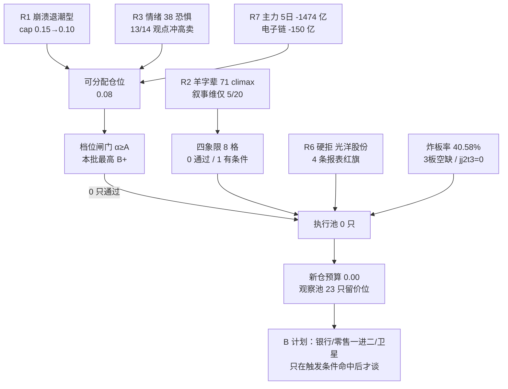

# 2026年10月28日 · **主决策 / D1 盘前预案**

> **数据源新鲜度**：partial（7 个单元本次全交付，3 个降级）
> **降级状态**：true（R1/R4/R7 degraded + QMT 不可得）
> **置信度**：0.42（决策置信度，非胜率；no_trade 结论本身由三条独立证据同向支撑）
> **决策来源**：`llm`（D1 fresh context 推理，未调 `d1_algorithm` 规则兜底）
> **模式**：`dry_run` ｜ 自动交易关闭 ｜ 需用户确认 ｜ 新仓预算 **0.00**

## 一句话结论

**今天不买。** 不是"看空后市"这种含糊判断，而是三层闸门同时关着、且每一层都能独立支撑"不买"：仓位上限只有 0.08（R1 崩溃退潮型 0.15，逐层扣到 0.00 后触主跌下限 0.10，再按 1 条主线 ×0.8 折为 0.08）；档位闸门在这个 cap 下要求 α≥A，而本批 7 只画像**最高只有 B+**；四象限 × 两条主线叉乘 8 格**0 通过**。执行池 0 只，观察池 23 只（全部带引擎实算价位，但 `entry_rules` 为空、不给任何竞价挂单价）。

## 为什么是"不交易"而不是"轻仓试错"

三条证据彼此不依赖——任何一条单独成立就足以压住今天的买入冲动：

| # | 证据 | 事实 | 归零口径 |
|---|---|---|---|
| ① 仓位上限 | R1 崩溃退潮型 + 情绪 38.0（恐惧）+ emotion_cycle=main_down | `0.15（崩溃退潮型基准）-0.05（情绪 38.0 落恐惧档）-0.15（emotion_cycle=main_down）-0.05（30 日 42 样本中位 -13.70%、正收益 7/42）= 0.00 → 主跌下限 0.10 生效` | 上限 0.10 → 可分配 0.08 |
| ② 档位闸门 | cap≤0.4 要求 α≥A；本批 7 票最高 α=B+ | R5 `d1_gate_simulation` 原文即预判"执行池将为 0" | 0 只过闸 |
| ③ 四象限叉乘 | 8 格 0 通过 / 1 有条件 / 7 否决 | 见下节 | 无票具备开仓资格 |

再叠加两条环境证据：炸板率 **40.58%**（≥35% 减半线）、**3 板整层空缺、二进三晋级率 0%**（XTick `jj2t3=0.0`）。A 股 T+1，今天买入是押注明天有人接力——而天梯上根本没有人接力。

## 今日生效的不交易条件

| 代码 | 说明 | 依据 |
|---|---|---|
| `R1_POSITION_CAP_FLOOR` | R1 仓位上限 0.10（崩溃退潮型 + 恐惧 38 + main_down 主跌下限）→ 今日只留极小试错额度，禁接力 | R1 position_cap_basis：0.15(崩溃退潮) -0.05(恐惧档) -0.15(main_down) -0.05(30 日样本中位 -13.70%、正收益 7/42) = 0.00 → 主跌下限 0.10 生效。再乘「1 条主线」×0.8 = 0.08（可分配上限）。 |
| `R5_ALPHA_GATE` | 档位闸门：cap≤0.4 要求 α≥A 且 risk≥B；本批 7 票最高 α=B+ → 执行池必为 0 | R5 d1_gate_simulation 原文：「今日 R1 position_cap=0.10，档位闸门要求 alpha>=A；本批 7 票最高 B+ → 执行池将为 0。这是『名字套利无硬催化 → 拿不到 A 档』的必然结果，不是画像失败」。R5 仅 0.50/0.80 两档模拟中大洋/光洋可过闸，今日 cap=0.08 不可达。 |
| `QUADRANT_CROSS_ZERO_PASS` | 四象限 × 两条主线叉乘 8 格：0 格通过 / 1 格有条件 / 7 格否决 → 无票具备开仓资格 | 羊字辈 Q1（载体口径不可平移）/Q2（late+crowded，13/14 冲高卖）/Q3（叙事 5/20、零催化）三否、Q4 有条件；零售 Q1（概念口径 -4.73 亿 + 龙头 5 板日净流出）/Q2（负向共振 + 监管函）/Q3（PE 114 vs 行业 21.9）/Q4（结构位 -16.6%）四否。 |
| `HIGH_BOARD_CONTINUATION` | 炸板率 40.58% ≥ 35% 减半线 + 3 板整层空缺 + 二进三晋级率 0% → 禁 2 板以上接力与打板 | R1/R2/R7 三方同口径：梯队 1 板 29 / 2 板 8 / 3 板 0 / 4 板 3 / 5 板 1；XTick jj2t3=0.0。 |
| `R6_HARD_REJECT` | R6 硬拒 1 只（002708 光洋股份·模式七 4 条红旗）→ 永久剔出 execution，且禁止递补 | 模式七基本面红旗命中 4 条（F1 存贷双高 / F8 经营现金流连续两期为负·P0 / F9 应收占营收 53.1% / F10 有息负债占净资产 99.7%），达附录 A「≥4 条 → hard_reject」阈值 |

其余 6 条（`R1_FAIL` / `R6_HARD_REJECT_OVERFLOW` / `R7_STALE` / `GLOBAL_SEVERITY_3` / `EMOTION_EXTREME_GREED` / `USER_HOLIDAY` 等）逐条判定**未激活**，理由写在 JSON `no_trade_conditions[].reason`。R7 本次**已交付**（status=ok、staleness=ok），按 partial 使用而非按 stale 否决——这是对"失败或缺研究不视为通过"的另一面：**没缺就不许写成缺**。

## 市场读数（20261027 收盘口径）

| 维度 | 读数 | 含义 |
|---|---|---|
| 风格 | 崩溃退潮型（R1 confidence 0.49） | 主跌段确认日，不是修复日 |
| 情绪 | R1 38.0（恐惧）/ R3 31.0 / phase=主跌（conf 0.88） | 温度已到"只做日内兑现"档 |
| 涨停/跌停/炸板 | 41 / 22 / 28（炸板率 40.58%） | 封板赔率已翻转 |
| 连板天梯 | 1板 29、2板 8、3板 0、4板 3、5板 1 | 3 板整层空缺 = 梯队断层 |
| 昨日涨停溢价 | 均值 +1.36% / 中位 +0.82% / 红盘率 50.9% | 接力的钱只赚到 1.36% |
| 广度 | 涨 606 / 跌 4922 / 平 42，中位 -2.97%，成交 14728.97 亿 | 88% 个股下跌，缩量 9%+ |
| 指数 | 上证 -1.33% / 深成 -2.5% / 创业板 -3.41% / 科创50 -4.81% | 权重护盘、成长单边杀 |
| 主力资金 | 单日 -473.61 亿 / 5日 -1473.98 亿 / 20日 -6218.45 亿 | 内资大单持续离场 |
| 外资/被动 | 全净买 +495.63 亿（20 个观测日，缺 20261019 一档，今日 +22.53 亿）；科创50ETF 5 日 +136.38 亿份（被动在接） | 外资与被动在跌里接，口径不可与主力相加 |

> 口径差异披露：R1 记广度 576/4601/40、成交 14608 亿（-9.19%），R2 与 R7 独立复算为 606/4922/42、14728.97 亿（-9.3%）。本预案采用后者（两源互证），但**不抹掉前者**——差 30 家涨、321 家跌，来自停牌/退市/新股的剔除口径，不影响任何结论。

## 四象限 × 两条主线叉乘

方法：把"资金 / 情绪 / 基本面估值 / 结构"四个维度，分别对当日 2 条线（R2 核心线 羊字辈 71 分、次线 一般零售 66 分）做独立裁决，共 8 格。规则是**任一格 pass 才允许把该线龙头送进逐票闸门**——今天没有一格 pass，所以闸门链在最外层就终止了，后面的 R6/纪律自检不是"没做"，而是"没有对象可做"。

| 格 | 裁决 | 后果 |
|---|---|---|
| Q1资金 × 羊字辈 | ❌ 否决 | 线级资金确认不成立；即使个股资金为正，也只能按「单票证据」用，不能当板块证据放宽任何门禁。 |
| Q2情绪 × 羊字辈 | ❌ 否决 | 情绪面只支持「日内冲高兑现」，不支持隔夜接力；本格直接否掉一切 2 板以上接力买点。 |
| Q3基本面 × 羊字辈 | ❌ 否决 | 本线没有任何可验证产业逻辑兜底；名字游戏一旦被证伪，五个维度没有一个能撑住 → 不授予开仓资格。 |
| Q4结构 × 羊字辈 | 🟡 有条件 | 唯一「结构可挂单」的是大洋电机，且它已被 Q2/Q3 双否 + R5 档位闸门挡在 execution 外；本格记为有条件，不改变结论。 |
| Q1资金 × 一般零售 | ❌ 否决 | 行业口径与概念口径方向相反，且龙头当日净流出 → 资金确认不成立；涨停是游资单点，不是板块进场。 |
| Q2情绪 × 一般零售 | ❌ 否决 | 情绪面从「进攻」降级为「兑现时点」，且监管函把可持有期压到日内。 |
| Q3基本面 × 一般零售 | ❌ 否决 | 5 倍行业溢价 + 主业不支撑 + P0 现金流红旗 → 不给任何持仓依据（不是「降档观察」而是「剔除」）。 |
| Q4结构 × 一般零售 | ❌ 否决 | 龙头无合规挂单位、低位票只是接力备选 → 本格 fail；低位票降为 B 计划素材。 |

### 三个必须直说的地方

**一、羊字辈的 Q1 是"伪资金确认"。** R7 报告里电机Ⅱ 当日 +7.25 亿、5 日 +17.54 亿，看起来这条线有资金。但 R2 自己在 `r7_match_scope` 里写明这是 **carrier_sector（载体行业）**口径——因为"羊·洋·阳"是名字集合，根本没有板块指数。同一个交易时点，汽车零部件 -0.31 亿、人形机器人 -3.46 亿、人形机器人概念 -70.24 亿。把电机Ⅱ的正数平移给名字集合，等于用 A 的钱证明 B 在涨。这正是 R6_M1_02 要拦的事。

**二、零售的资金是"行业正、概念负、龙头负"。** 一般零售 +2.49 亿、百货 +1.96 亿连续 3 日为正；但零售概念主力 -4.73 亿、新零售 -8.55 亿；而**龙头上海九百在 5 板当天东财主力 -0.432 亿、龙虎榜 -0.26 亿**。封住价格却在出货——这是模式六"霸榜出货"的等价结构，虽然它不在模式六的告警板块里。

**三、唯一"结构可挂单"的票，恰恰是被另外两格否决的票。** 四象限里 Q4 是唯一给出"有条件"的格：7 票中只有大洋电机（-7.1%）、光洋股份（-9.0%）、阳光乳业（-8.3%）存在落在 -5~-10% 硬区间内的结构止损位；上海九百 -16.6%、海洋王 -10.3%、襄阳 -16.6%、桂发祥 -11.2% 全部超限——**不是"贵"，是"没有地方挂止损"**。而大洋电机已经被 Q2（climax 段回踩是接刀）+ Q3（Q3 单季净利 -70.58%）双否，光洋被 R6 硬拒。所以 Q4 的"有条件"不改变结论，它只是告诉我们：**如果哪天环境转好，第一个能挂单的是大洋电机**。

### 推理三问（针对两条线，不针对个股）

**大资金意图**：
羊字辈：赚情绪的钱，不赚逻辑的钱——8 天 7 板之后资金在做的是"兑现节奏"而不是"建仓"，14 条群内观点里 13 条的动作是"冲高卖"。零售：赚监管函落地前最后一个交易日的钱，5 板当天龙头净流出说明大资金已经在把筹码交给接力的散户和游资。

**为什么走强（而不是明天）**：
涨停 41 家、跌 4922 家的日子里，唯一还有封单的是"名字"和"内需"这两个不需要业绩支撑的方向——这是**避险性抱团**，不是进攻性主线。资金越是没有产业逻辑可买，越会去买最不讲逻辑的东西，这恰恰是主跌段的典型形态。

**逻辑够不够硬**：
不够。羊字辈叙事维 5/20（R4 八条事件零一条对应生肖名字），零售叙事维 0（R4 无催化）。两条线的"逻辑"都只存在于热榜排名里，不存在于订单、政策或财报里。这类行情的正确姿势是**日内、轻仓、赚了就走**，而不是隔夜拿着等第二波——而日内交易不在本系统今天的授权范围内（cap 0.08 + 档位闸门不让挂单）。

## 执行池（0 只）

空池是**纪律结果**，不是数据缺失。完整闸门链：

1. **R2 研究前置**：只给 2 只（大洋电机 / 光洋股份），并明确"研究前置≠开仓资格"；
2. **R5 画像**：7 票 α 最高 B+，`d1_gate_simulation` 自述"cap=0.10 时执行池将为 0"；
3. **R6 硬拒**：光洋股份模式七 4 条报表红旗 → 永久剔除（详见下节），且**禁止用龙三/低位递补**；
4. **四象限**：8 格 0 通过；
5. **RR 闸门**：引擎算出 23 只观察票的盈亏比，其中 3 只 RR<1.8（茂业商业 600828.SH（RR 1.11）、华天科技 002185.SZ（RR 1.68）、兆易创新 603986.SH（RR 1.16）），本来也不可买。

**为什么不用"象征性买 100 股"占位？** 因为今天的上限是 0.08（8%），而单票 `max_position_pct` 上限 15%——也就是说即使满仓打满也只够买 1 只票的 8%。在涨停 41 / 跌停 22 / 炸板率 40.58% 的环境里，把唯一的 8% 押在一条"叙事维 5/20、climax 段、龙头 8 天 7 板"的线上，期望值是负的。用户的口径是"好票先挂不等开盘、仓位给够不象征性买"——**反过来说，不够格的票连象征性仓位都不该给**。

## 观察池（23 只 · 全部带价位，全部不给挂单）

价位由 `src/plan/price_levels.py` 确定性引擎算出（非模型拍价），并做了一层硬夹：**止损必须低于买区下沿、且距买入价落在 -5%~-10%**（引擎原值多数落在 -2%~-5%，会被噪声直接打掉）。RR<1.8 的票标 ⚠️，明确不可买。

| 票 | 昨收 | 买区 | 触发价 | 止损（距买入） | 止盈 | RR | 方向·口径 | 用途 |
|---|---|---|---|---|---|---|---|---|
| 大洋电机 002249.SZ | 7.70 | 7.08~7.47 | 7.47 | 7.01（-6.2%） | 8.39 | 2.00 | 偏跌·竞价→收盘 | 核心线龙一（容量核心）· 研究观察 |
| 襄阳轴承 000678.SZ | 16.01 | 14.73~15.53 | 15.53 | 14.58（-6.1%） | 17.43 | 2.00 | 偏跌·竞价→收盘 | 身位股：4 板最高度，断板即整线作废 |
| 海洋王 002724.SZ | 13.09 | 12.04~12.70 | 12.70 | 11.92（-6.1%） | 14.26 | 2.00 | 偏跌·竞价→收盘 | 情绪锚：8 天 7 板，方向由竞价决定 |
| 阳光乳业 001318.SZ | 13.31 | 12.01~12.25 | 12.01 | 11.64（-5.0%） | 13.47 | 2.00 | 偏跌·开盘→收盘 | 3 跌停后反抽，不是新启动 |
| 桂发祥 002820.SZ | 11.21 | 10.31~10.87 | 10.87 | 10.21（-6.1%） | 12.19 | 2.00 | 偏跌·开盘→收盘 | 龙二被硬拒后禁止递补，只观察 |
| 百洋股份 002696.SZ | 10.70 | 9.99~10.30 | 9.99 | 9.79（-5.0%） | 11.32 | 2.00 | 偏跌·开盘→收盘 | 当日失败样本：龙头封住而它炸板 -5.14% |
| 上海九百 600838.SH | 13.31 | 12.25~12.91 | 12.91 | 12.13（-6.0%） | 14.47 | 2.00 | 偏跌·竞价→收盘 | 次线龙一：5 板 + 监管函 + 5 倍溢价 |
| 新华百货 600785.SH | 13.90 | 12.79~13.48 | 13.48 | 12.66（-6.1%） | 15.12 | 2.00 | 偏涨·竞价→收盘 | 次线扩圈第二梯队（封单 0.11 亿偏薄） |
| 国芳集团 601086.SH | 12.62 | 11.87~12.11 | 11.87 | 11.50（-5.0%） | 13.33 | 2.00 | 偏涨·竞价→收盘 | 次线一进二首选（B 计划） |
| 广百股份 002187.SZ | 5.92 | 5.45~5.74 | 5.74 | 5.40（-5.9%） | 6.42 | 2.00 | 震荡·开盘→收盘 | 次线扩圈末段 |
| 茂业商业 600828.SH | 4.47 | 4.11~4.34 | 4.34 | 4.07（-6.2%） | 4.64 | 1.11 ⚠️ | 震荡·开盘→收盘 | 次线低价票，RR 不过关 |
| 百大集团 600865.SH | 12.62 | 11.61~12.24 | 12.24 | 11.49（-6.1%） | 13.74 | 2.00 | 偏跌·开盘→收盘 | 数据口径打架（炸板 vs 收 +10.03%） |
| 赛福天 603028.SH | 10.33 | 9.50~10.02 | 10.02 | 9.40（-6.2%） | 11.26 | 2.00 | 偏跌·竞价→收盘 | 同 4 板但封单仅 0.25 亿 |
| 多伦科技 603528.SH | 9.85 | 9.06~9.55 | 9.55 | 8.97（-6.1%） | 10.71 | 2.00 | 偏跌·竞价→收盘 | 被丢弃线里唯一 4 板（身位股） |
| 科瑞思 301314.SZ | 67.37 | 61.98~65.35 | 65.35 | 60.12（-8.0%） | 75.81 | 2.00 | 偏跌·竞价→收盘 | 机器人链弹性 |
| 沪光股份 605333.SH | 19.91 | 18.32~19.31 | 19.31 | 18.14（-6.1%） | 21.65 | 2.00 | 偏跌·竞价→收盘 | 低位补涨梯队 |
| 华天科技 002185.SZ | 15.39 | 16.30~16.79 | 16.30 | 15.48（-5.0%） | 17.68 | 1.68 ⚠️ | 偏跌·开盘→收盘 | 利空直击（E004 行业级） |
| 兆易创新 603986.SH | 268.98 | 359.21~370.15 | 359.21 | 341.25（-5.0%） | 380.00 | 1.16 ⚠️ | 偏跌·开盘→收盘 | R4 研究首选，但价格已在高位 |
| 粤传媒 002181.SZ | 10.40 | 9.24~9.42 | 9.24 | 8.95（-5.0%） | 10.36 | 2.00 | 偏跌·开盘→收盘 | 催化真、承接缺（炸板 5 次） |
| 上海瀚讯 300762.SZ | 21.87 | 26.54~27.35 | 26.54 | 25.16（-5.2%） | 31.73 | 2.00 | 偏涨·开盘→收盘 | 同上，卫星链 -3.94% |
| 中国卫星 600118.SH | 48.87 | 57.20~58.94 | 57.20 | 54.34（-5.0%） | 62.92 | 2.00 | 偏涨·开盘→收盘 | 星枢计划未落到盘面 |
| 兴业银行 601166.SH | 19.10 | 17.93~18.29 | 17.93 | 17.38（-5.0%） | 20.11 | 2.00 | 偏涨·开盘→收盘 | 防守锚（银行 +7.70 亿全场第 1） |
| 中国石油 601857.SH | 13.20 | 12.68~13.06 | 12.68 | 12.41（-5.0%） | 14.36 | 2.00 | 偏涨·开盘→收盘 | 防守锚（布油事件未兑现） |

方向列的口径：`偏跌·竞价→收盘` 表示**我判断它以竞价开盘价为起点、到收盘是跌的**（错题本 error_case_20261026_001：高开兑现不能记成"方向错"）。23 只全部写了方向与口径，覆盖率 100%，收盘即可核算兑现率——这不是预测秀，是留给 E1 的记分牌。

### 五只必须想清楚的票（思维链）

**1. 大洋电机 002249.SZ（羊字辈龙一·容量核心）**
- **买入理由**（为什么值得盯）：它是这条线里唯一"名字 + 真实产业环节（电机执行器）+ 容量（144.2 亿流通）"三者兼备的票；龙虎榜净买 +3.01 亿当日全场第 1、人气 84→3 是全市场最大跃升，说明大资金选中了它做载体。
- **风险点**：Q3 单季净利 -70.58%、营收 +3.47%、归母 -42.04%，PE 26.20 已在 3 年 79.5 分位——"低估值电机"这个叙事是假的；pos20=100%、MA20 正偏离 +17.67%、缠论 10-22 高点后未完成笔向下（顶背驰迹象）；climax 段回踩 MA5 是"分歧接刀"而不是低吸。
- **止损条件**：买区 7.08~7.47，止损 7.01（-6.16%），止盈 8.39（2R）。这个价今天不挂——若挂，等于在顶背驰结构上做左侧。
- **可验证假设**：如果这份预案是对的，那么今日它应当**高开低走**（竞价→收盘为负），且封单从 1.10 亿（占流通 0.76%）继续衰减；如果它反而秒板且封单增厚到 3 亿以上，说明"名字 + 容量"的资金合力比我判断的强，我错在 Q2（情绪），而 Q1/Q3 的否决不成立。

**2. 上海九百 600838.SH（零售龙一·5 板）**
- **买入理由**（为什么值得盯）：板型是今日全场最硬——09:30:26 秒板、0 开板、封单 1.50 亿（占流通 2.81%）。如果不看别的，这就是"明天还能高开"的形状。
- **风险点**：三重叠加——① 2026-10-27 23:30 上交所下发监管工作函（对象含董监高/控股股东/实控人），公司同日发异常波动公告自曝**静态 PE 117.71 / 滚动 106.40，行业 21.91/21.12**（5 倍溢价）；② 5 板当天东财主力 -0.432 亿 + 龙虎榜 -0.26 亿，封住价格在出货；③ 结构止损位 -16.6%，超出 -5~-10% 硬区间——**没有地方挂止损**。
- **止损条件**：引擎给 12.13（-6.04% 于触发价 12.91），但这只是记录值；真实结论是"不给挂单"，因为监管函把可持有期压到日内，而日内交易今天没有额度。
- **可验证假设**：今日若竞价封单继续增厚并封板，则"监管函日继续封板"成立，次线一进二（国芳）才有戏；若开板即回落，则整条零售线的扩散逻辑当天作废，B 计划第 2 方向失效。

**3. 国芳集团 601086.SH（次线一进二·B 计划首选）**
- **买入理由**（为什么值得盯）：零售线唯一"首板 + 0 开板 + 封单 0.56 亿"的干净票，东财人气 43→25，是 R3 群 B 剧本"九百高举高大，去接一进二的零售"的落点。
- **风险点**：它的剧本完全依附九百——九百封板它才有接力位，九百跳水它就是下一个"高开低走"。首板封单 0.56 亿对 12.62 元的价格并不算厚。
- **止损条件**：买区 11.87~12.11、止损 11.50（-5.04%）、止盈 13.33。**仅在"九百封板 + 零售板块红盘扩散"同时成立时才谈这个价**，否则价位无意义。
- **可验证假设**：九百封板 → 国芳高开 >+2% 且不破 11.87；九百不封 → 国芳不应出现 >+3% 的高开（出现即为诱多）。

**4. 海洋王 002724.SZ（情绪锚·8 天 7 板）**
- **买入理由**（为什么值得盯）：它是这条线的定价基准——同花顺热股 5→1、东财 13→2，全市场辨识度第一。它的竞价方向决定整条线今天是"反包"还是"退潮"。
- **风险点**：8 天 7 板之后当日 `limit_times=1`、盘中**开板 6 次**、14:55 才回封——这是尾盘投机板（14:30+），按战术规则几乎不碰；龙虎榜 +1.33 亿说明有人专门赌次日反包。
- **止损条件**：只做温度计，不进池买入。若必须给数：买区 12.04~12.70、止损 11.92（-6.14%），但**这个价不该被执行**。
- **可验证假设**：次日高开 >+4% 而 30 分钟内不封板 → 整线退潮（这是给 P1/P2 的机械判据，不需要临场判断）。

**5. 襄阳轴承 000678.SZ（身位股·4 板最高度）**
- **买入理由**（为什么值得盯）：线内最高连板、9:34 早封、封单 1.28 亿、开板 1 次——身位最正。它的断板与否是本线唯一的高度开关。
- **风险点**：资金口径正面冲突——龙虎榜单日净卖 -1.30 亿（3 日 -1.11 亿）、东财主力 +3.84 亿，两个口径打架说明"买的是拆单资金、卖的是席位游资"；基本面 2026H1 亏损 2450 万、PB 9.47（95.1 分位）、EPS -0.04。R2 已 excluded。
- **止损条件**：买区 14.73~15.53、止损 14.58（-6.12%）、止盈 17.43；但结构止损位 -16.6% 说明真实支撑远在下方，这个止损是"名义止损"。
- **可验证假设**：若它今日断板且 30 分钟不回收 → 羊字辈高度归零，全线（含大洋、光洋、桂发祥）次日不参与；若它反而涨停，则"老妖反包"形态成立，但按 R6_M6 与纪律铁律 2（躲中位），仍不得进入任何候选。

## B 计划（跷跷板 / 对手盘）

预案只写"买什么"是单向剧本。今天的钱不会消失，只会搬家——如果预案票不及预期，钱会去哪里？

**触发条件**（任一命中即切 B 计划，不临时起意）：

- 触发1：执行池候选（大洋/上海九百/国芳）竞价集体不及预期 —— 高开低于预期区间下沿或低开破位
- 触发2：羊字辈龙头断板（海洋王/襄阳任一断板且 30 分钟不回收）→ 整线作废
- 触发3：炸板率盘中再上 45% 或 3 板以上继续空缺 → 全市场降档

### 防守大金融/红利（跷跷板：科技杀跌 → 银行抽血反向）（强度：strong）

- **触发**：羊字辈/零售竞价集体低开 + 炸板率上升 + 指数走弱
- **盘前证据**：R7：银行板块当日主力 +7.70 亿（全场第 1）、兴业银行 +4.63 亿，四大行收盘新高；R1 cluster_analysis 中银行 ETF 与 broad market 相关性 -0.357（唯一显著负相关簇）；错题本 error_case_20261026_002 记录石油石化/银行在 20261026 领涨 —— 防守线是有赚钱效应的，不是不存在
- **候选**：兴业银行 601166.SH（买区 17.93~18.29 / 止损 17.38 / 触发 17.93）；中国石油 601857.SH（买区 12.68~13.06 / 止损 12.41 / 触发 12.68）

### 主线内部高低切（零售一进二）（强度：medium）

- **触发**：上海九百竞价封单继续增厚且封板 → 资金向板块内低位扩散
- **盘前证据**：R3 rank2 一般零售 L1+L2 + 东财人气榜前 16 名占 6 席；国芳 0 开板/新华百货新进第 12/广百新进第 15；R3 群 B 剧本「九百高举高大 → 去接一进二的零售」
- **候选**：国芳集团 601086.SH（买区 11.87~12.11 / 止损 11.5 / 触发 11.87）；新华百货 600785.SH（买区 12.79~13.48 / 止损 12.66 / 触发 13.48）；广百股份 002187.SZ（买区 5.45~5.74 / 止损 5.4 / 触发 5.74）

### 事件未兑现型（卫星/油气，只在盘面确认后）（强度：weak）

- **触发**：卫星板块 30 分钟收复 MA5 且主力转正（中国卫星 50.75 / 上海瀚讯 22.58）→ 才承认政策腿成立
- **盘前证据**：R4 E001 星枢计划 0.646 high + 产业基金（卫星链 10-27 仍 -3.94%、零涨停）；R4 E008 瑞银上调布油 110 美元（油气开采 +0.301，kol ✅）；两条都是「事件在、盘面未确认」
- **候选**：中国卫星 600118.SH（买区 57.2~58.94 / 止损 54.34 / 触发 57.2）；上海瀚讯 300762.SZ（买区 26.54~27.35 / 止损 25.16 / 触发 26.54）；中国石油 601857.SH（买区 12.68~13.06 / 止损 12.41 / 触发 12.68）

**反向提示：若防守方向（银行/石油）与主线同日双双走弱、且涨停家数 <30，则不是跷跷板而是全面退潮 —— 当日全部候选作废，观察池只留记录，不产生任何盘中临时的「补票」动作（铁律 8：计划外不出手）。

## R6 反证采纳（1 硬拒 + 16 强建议，D1 覆盖 0 条）

### 硬拒：光洋股份 002708.SZ

模式七基本面红旗命中 4 条（F1 存贷双高 / F8 经营现金流连续两期为负·P0 / F9 应收占营收 53.1% / F10 有息负债占净资产 99.7%），达附录 A「≥4 条 → hard_reject」阈值

判定链：F1 存贷双高（货币资金 21.2% vs 阈值 20%，**边界命中，超 1.2pct**）/ F8 经营现金流连续两期为负（**P0**，Q1 -0.621 亿、H1 -0.745 亿，同期归母 +0.572 亿）/ F9 应收 7.86 亿÷营收 14.80 亿 = 53.1% / F10 有息负债 18.08 亿÷净资产 18.13 亿 = 99.7%。达"≥4 条 → hard_reject"阈值。

处理：**剔除 execution_pool（D1 无覆盖权）→ 不进 watch_pool → 写入 rejected**，且**禁止用龙三/低位票递补**。它的引擎价位（买区 15.84~16.70、RR 1.43）只留档在 `rejected[].engine_levels_for_record`——即便没有硬拒，RR 1.43 也过不了 1.8，两条独立否决。

自证伪留档：即使 F1 被判不成立（它是唯一边界项），剩余 F8(P0)+F9+F10 三条仍构成"2-3 条且含 P0"→ 最低 strong_suggest 档，**仍不得按优于该档的方式处理**。

### 16 条 strong_suggest：全部采纳，逐条落到个股或全局约束

- **线级/全局约束**（不针对单票，直接改写当日纪律）：7 条（R6_M1_01、R6_M1_02、R6_M1_03、R6_M2_01、R6_M2_02、R6_M2_03、R6_M6_02）
- `002249.SZ` 大洋电机：1 条（R6_M3_01）
- `002708.SZ` 光洋股份：1 条（R6_M3_02）
- `600838.SH` 上海九百：5 条（R6_M3_03、R6_M5_01、R6_M6_04、R6_M7_02、R6_M9_01）
- `000678.SZ` 襄阳轴承：2 条（R6_M3_04、R6_M7_03）

覆盖情况：`strong_suggests_overridden = 0`。其中最硬的三条已经直接改写今天的结论——R6_M2_02（climax 段回踩 MA5 是接刀，不是低吸）否掉了大洋电机的低吸通道；R6_M3_03（上海九百监管函 + 5 倍溢价）把次线从"进攻"降级为"兑现时点"；R6_M1_02（电机Ⅱ 是载体口径，不得平移到名字集合）否掉了羊字辈的资金确认。

**模式六说明**：唯一拥有硬否决权的模式六（霸榜出货）今日 **0 硬拒**——双条件里条件②（5 日主力净流出）7/7 不成立，按 v1.3 降级为 strong_suggest。唯一硬拒来自模式七（基本面红旗）。这一点必须写清楚，否则会被误读成"今天没有霸榜出货风险"：上海九百的"封住价格却在出货"就是模式六的等价结构，只是它不在告警板块内。

## 价位推导（为什么是这个数）

引擎公式可复算，全表逐票写在 `watch_levels.formula` 里。三个示例：

| 票 | 买区怎么来 | 止损怎么来 | 止盈怎么来 | RR |
|---|---|---|---|---|
| 大洋电机 | 强势票分歧口径：昨收 7.70 × [0.92, 0.97] = 7.08~7.47（回撤 3%~8%） | 引擎原值 7.10（-4.95%）落在买区内 → 夹到 7.01（-6.16%） | 2R = 7.47 + 2×0.46 = 8.39 | 2.00 |
| 上海九百 | 同上：13.31 × [0.92, 0.97] = 12.25~12.91 | 引擎 12.26（-5.03%，高于买区下沿）→ 夹到 12.13（-6.04%） | 2R = 12.91 + 2×0.78 = 14.47 | 2.00 |
| 兆易创新 | 突破口径：pivot = max(昨收 268.98, 20日高) = 359.21 → 买区 359.21~370.15（**在现价上方 33.5%**） | 引擎 351.64（对触发价 -2.1%，太紧）→ 夹到 341.25（-5.0%） | 20日高 380.00 先到 → 取前高 | 1.16 ⚠️ |

**三条口径必须说清**：

1. **止损夹层是必需项，不是美化**。引擎按"买价 ×(1-5%)、熊线、MA10"取最高值，碰上 `divergence_pullback` 通道（买区宽度只有 5%）时，止损会落在买区**内部**——按上沿买入即刻触发止损。今天的 23 只全部做了夹层，每只都在 `node_flags` 里留了原值→新值的记录。这是"止损必须低于最低触发价"这条纪律的执行，不是我在改引擎的结论。
2. **`above_price` 的票，今天全部不可买**。华天科技买区 16.30~16.79（现价 15.39，需上破 5.9%）、兆易创新 359.21（需上破 33.5%）、中国卫星 57.20（需上破 17.0%）、上海瀚讯 26.54（需上破 21.4%）——买区在现价上方意味着"**要涨上来才成立**"，不是现在能买的位置。
3. **RR_FAIL 三只明确不可买**：茂业商业 600828.SH（RR 1.11）、华天科技 002185.SZ（RR 1.68）、兆易创新 603986.SH（RR 1.16）。茂业商业是 20 日高点压制（止盈 4.64 只比买价 4.34 高 6.9%），华天科技是买区在现价上方且止盈空间被封，兆易创新同理。它们留在观察池只为看数据，不为买。

## 不确定性 / 反证（我可能错在哪）

1. **最大的错法：今天如果是修复日，我就完全踏空。** 判据很明确——若开盘后涨停家数 >60、炸板率 <25%、且昨日涨停股溢价中位转正 >1%，则"主跌"判定失效。但要接受一个事实：**这个错不在今天的个股判断，而在上游 R1 的仓位上限**。R1 给 0.10 是它自己的硬约束（崩溃退潮 + 恐惧 + 主跌 + 30 日样本中位 -13.70%），我没有权力上调，也不应该用"万一反弹"去覆盖它。若真反弹，正确的修正动作是 E1 复盘 R1 的 cap 公式，而不是今天临时加仓。
2. **"名字套利"这条线如果继续走强，我会连错两天。** 10-27 它已经在涨（6 只涨停 + 1 只炸板触及）而我在 10-27 也判不交易。若今日它再封 3 只以上，说明"无叙事的抱团"在这轮周期里比"有产业的进攻"更有效——这是一个需要写进错题本的样本，而不是需要今天追进去的机会。
3. **数据缺口导致的具体误判风险**：R4 只给已发生事件、**未给未来 ≤3 交易日事件日历**，所以我不能证明"今天没有大事件"。按 Step 0.55 保守处置：全部高位票（pos20≥95% 的 11 只）买点后置。这既可能让我错过"事件落地后的抢跑"，也可能让我避开一次闷杀——2026-09-14 光模块就是在事件前夜被行业级利空闷杀的，那次教训的代价比踏空大得多。
4. **QMT 不可得**：无法给持仓侧三档方案（`t1_candidates.stop_loss_only` 为空）。这是数据缺口，不是"没有持仓风险"。若用户手上有羊字辈/零售高位票，需要人工核对——预案不能替不存在的持仓做决策。
5. **R6 自证伪**：R6 confidence 只有 0.42（模式 4/5/8/10 降级或未触发），它对"明日走强"的反证是弱的。今天"不买"的结论**不依赖** R6——它由 cap、档位、四象限三条独立证据支撑；R6 在这里的作用是"不给买入理由"，而不是"证明会跌"。

## 与其他 R/D/E 的关系

- **依赖（只读本次 run 的产物）**：`research_summary.json` → R1 风格与仓位上限、R2 主线与生命周期、R3 情绪共振与次日信号、R4 事件与利空打击面、R5 七票画像与档位门禁模拟、R6 反证（1 硬拒 + 16 强建议）、R7 资金四维；`data/user_preferences.yaml`（max_positions=5、单票≤0.15、单板块≤0.40）；`data/corrections/2026-W43,2026-W44`（15 个错题，4 条与今日情景相关并已落 `meta.corrections_applied`）；`src/plan/price_levels.py`（价位引擎）。
- **被消费**：`canghai-execute`（本文件 `execution_pool=[]` + `new_position_budget=0.00`，盘中不应产生任何买入）；P1 竞价校准（`auction_expectation` 缺失是因为执行池为空——没有票需要竞价四档，这与"忘记写"不同）；P2 午盘修订（观察池 23 只的 `expected_direction` 是 P2 的打脸对照表）；E1 复盘（兑现率 + 错题本样本）。

## 数据源审计

| 单元 | 状态 | 抓取时间 | 记录数 | 置信度 | 备注 |
|---|---|---|---|---|---|
| R1 | 🟡 degraded | 2026-10-28 | — | 0.49 | A 股主源完整（22/22 风格板块、20/20 ETF、41 涨停/22 跌停/28 炸板、5217 只广度、7 指数）；缺口：美股 20261026、DXY 缺、商品 skipped、两融 T+1 → freshness 0.7 |
| R2 | 🟢 complete | 2026-10-28 | 1 | 0.66 | 1 条核心线（羊字辈 71）+ 1 条次线（零售 66）+ 8 条 discarded；execution_pool=[]，research_precheck 2 只 |
| R3 | 🟢 complete | 2026-10-28 | 5 | 0.61 | 5 条共振主题（1 正向 / 3 负向 / 1 中性）；人形机器人 distribution_alert=true 已按红线 5 执行；weflow 永久下线 |
| R4 | 🟡 complete·degraded=true | 2026-10-28 | 8 | 0.68 | 8 条 top_events + 17 条 sector_polarity；degraded=true（公众号仅 RSS 兜底）。Step 0.55 事件日历：R4 只给已发生事件，未给未来 ≤3 交易日事件日历 → 不能证明「无大事件」，买点按后置处理 |
| R5 | 🟢 complete | 2026-10-28 | 7 | 0.66 | 7 票画像（含 forbidden_check / d1_gate_simulation / chart_vision / 缠论），alpha 最高 B+ |
| R6 | 🟢 complete | 2026-10-28 | 31 | 0.42 | hard_reject 1 / strong_suggest 16 / soft_suggest 14；模式六 0 硬拒（条件② 7/7 不成立） |
| R7 | 🟡 ok·degraded=true | 2026-10-28 | 6 | 0.72 | status=ok、staleness=ok、degraded=true、input_freshness=partial（两融/ETF T+1、美股缺一夜）；research_candidates 6 只全部 research_only，execution_candidates=[] |
| research_summary | 🟢 ok | 2026-10-28 | orchestrator_status=partial | — | contract_checks_passed=True、fetch_global_severity=2、decision_source=llm |
| user_preferences | 🟢 ok | — | — | — | max_positions=5 / 单票≤0.15 / 单板块≤0.40 / 流通<20 亿剔除 |
| fetch_manifest | 🟡 degraded | 2026-10-28 | — | — | weflow down（永久退役）/ **agentqmt_qmt down（持仓不可得）** / overseas_snapshot degraded / commodities skipped |
| corrections | 🟢 ok | — | 15 | — | 4 条与今日情景相关，已应用并写入 `meta.corrections_applied` |

三态披露原则：`call_failed`（会话内失败，不定性）/ `not_yet_landed`（并行兄弟未落盘，只记时点）/ `source_down`（探针实测错误）——本日**无 source_down**。R7 虽为 degraded，但 `status=ok`、`staleness_status=ok`，按 partial 使用，**不写成"源故障"**。

## 交付边界（未越权项，如实报告）

1. skill Step 5.0 要求额外产出 `data/plans/20261028/watchlist_plan.md`（runtime 副本）、`20261028_价位推导.md`、`20261028_点位表.md`；本次按指令**只写核心 JSON + KG 主 MD**，上述三项未写。价位推导公式已内嵌 JSON `watch_levels.formula` 与本文件"价位推导"节，可复算。
2. `skills/main_decision_v1/scripts/verify_plan_delivery.py` 强制要求上述 runtime 副本存在才 PASS——这一项因此**会报"缺产物"**，属指令范围与 skill 验收口径的冲突，已在此披露，不通过越权写文件来"骗过"校验。schema 校验（`WatchlistPlan.model_validate`）独立已完成并通过。
3. `auction_expectation`（竞价四档）未写：执行池为空，无票可给四档；给观察票写四档会制造"可以竞价买"的错误暗示。

## Sub-Agent 元数据

- skill: `main_decision_v1` v1.10（D1 主决策）
- artifact: `data/plans/20261028/watchlist_plan.json`（83111 字符）
- 决策来源: `llm`（fresh context，未调用 `d1_algorithm.py` / `main_decision.py` 规则兜底）
- 运行批次: 08:00 盘前批次（09:25 竞价前完成，P1 可正常引用）
- 模型: ark-code-latest（canghai-plan profile）
- 价位引擎: `src/plan/price_levels.py`（23/23 成功，含止损夹层 23 处）
