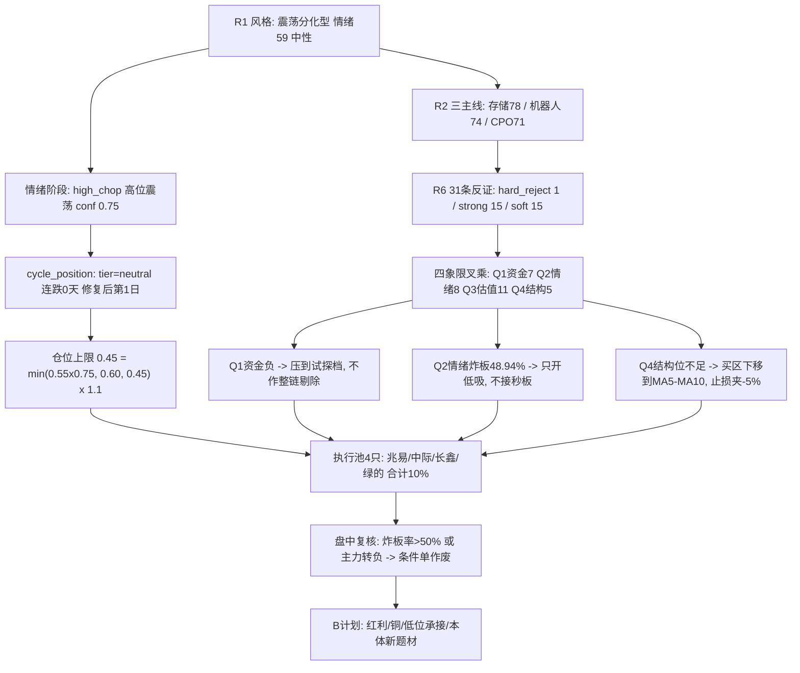

# 2026年10月29日 · **主决策 / D1 盘前预案**

> **数据源新鲜度**: partial（R4/R5 未交付，R7 时点告警，人气榜缺失）
> **降级状态**: true
> **置信度**: 0.55
> **决策来源**: llm（Hermes fresh context 综合 R1-R7 产物；非 python fallback）
> **仓位上限**: 45%（今日只动用 10% 建仓，全部试探档条件单）

## 一句话结论

10-28 是连跌两日后的**放量修复日**（涨停 72 / 跌停 5 / 广度 0.7461 / 成交 1.63 万亿 +11.46%），但炸板 69 家、炸板率 48.94%、4 板层整层空缺 —— **修复成立、封板质量极差**。今日定性为「修复的验证日」：只开低吸回踩通道（不接秒板、不打板），执行池 4 只全部为**试探档条件单**（单票 2%-3%，合计 10%，auto_trade=false，等触发或人工确认），主仓额度不给。

## 02 决策骨架

**大资金意图**：10-28 主力单日净额 +237 亿（净流入率 +1.46%），钱几乎全砸回电子链（电子 +149.86 / 通信设备 +78.53 / 半导体 +68.91 / 元件 +50.31 亿），但同一天 5 日口径仍是电子 -243.60、通信 -80.89、PCB -120.14 亿。**这不是趋势资金回流，是一次有组织的超跌反包**：主力在低位大票上做 T+1 接力（中际旭创单票净占比 13.56%、全市场第 1；兆易创新 14.36%、第 2），而在高位连板上退出（襄阳轴承龙虎榜净卖 1.305 亿、两融余额 +50.76%）。

**为什么走强**：走强的是「跌得深 + 事件硬 + 容量大」的三类票 —— 中际旭创 20 日 -28.95%、兆易创新在 MA20 下方 7.8%，都在下跌通道里被资金快速拉起；催化来自两条 high 事件（SK 海力士 Q3 营业利润同比 +600%、内存售罄至 2029；长鑫 HBM3E 小批量送样并纳入上证指数第一大权重）。**这是"便宜 + 消息"的组合，不是"景气 + 订单"的组合**，所以只能按反包首日接力计价。

**逻辑够不够硬**：存储这条线的逻辑链条最完整（R2 78 分、四源共识 0.85：R2/R3/R4/R7 全部命中、R7 数字芯片设计 5 日 +79.64 亿是芯片类唯一 5 日净流入子行业），但**缺一环：全链零封板**。纪律⑦写明"无封单承接 = 不封"，所以即使逻辑最硬，也只能给低吸试仓，不给打板、不给主仓。机器人线是第 13 天的老主线（R3 连续 5 日霸榜 = 派发警报），逻辑最"热"但最不硬；CPO 是单日脉冲（5 日资金全负），硬在需求、软在融资成本。

## 执行池（4 只 · 全试探档条件单）

| 名称 | 代码 | 主线 | 昨收 | 买区 | 触发价 | 止损 | 止盈(2R) | RR | 仓位 | 单票上限 |
|---|---|---|---|---|---|---|---|---|---|---|
| 兆易创新 | `603986.SH` | 存储芯片/DRAM-HBM 涨价链 | 289.88 | 281.0–287.0 | 283.5 | 269.3 | 311.84 | 2.0 | 3% | 6% |
| 中际旭创 | `300308.SZ` | 光模块/CPO（AI 算力硬件） | 636.3 | 604.5–617.2 | 612.0 | 581.4 | 673.2 | 2.0 | 3% | 6% |
| 长鑫科技 | `688825.SH` | 存储芯片/DRAM-HBM 涨价链 | 44.36 | 42.6–43.4 | 43.0 | 40.85 | 47.3 | 2.0 | 2% | 4% |
| 绿的谐波 | `688017.SH` | 人形机器人/减速器 | 291.98 | 279.5–285.0 | 282.0 | 267.9 | 310.2 | 2.0 | 2% | 4% |

**合计仓位 10%**（cap 45% 中的新建仓预算），4 只全部 `auto_trade_enabled=false`、需人工确认或条件触发。全部为 **趋势回踩低吸（trend_pullback_buy）**，无一为打板/突破——因为 R1 明示"不接秒板、不接二次冲高"，且炸板率 48.94% 已越过 35% 减半线。

### 1. 兆易创新 `603986.SH` · 存储龙一（新建仓，非加仓）

- **买入理由**：R7 研究候选第 3、全市场主力净额第 2（+17.64 亿、净占比 14.36%）、成交 122.8 亿；R6 alpha A-、风险 B；存储是四源唯一全命中主线（共识 0.85）。买点 283.5 落在 MA5 280.81 与 MA10 281.70 上方 0.6%，即"回踩不破短均线"的承接位，距昨收 -2.2%。
- **风险点**：现价在 MA20（314.38）下方 7.8%、MA50（362.42）下方 20%，属**下跌通道内的反包第一天**（右侧交易者只有站上 MA20 才算趋势确认）；昨日全链零封板，无封单承接；R5 未交付，A- 档未经独立复核；deepseek 式的"存储涨价"叙事已被 10-28 单日 +7.77% 部分定价。
- **止损条件**：269.3（买价 -5.0%）无条件离场；收盘跌破 MA10 281.70 减半；所属板块当日主力净流出且板块涨停家数 <3 → 次日开盘减半。
- **可验证假设**：①竞价高开 ≤3% 且不破 281；②开盘半小时主力净额维持正值（连续第 2 日）；③存储链出现 ≥3 家涨停（含 20cm 的君正/长鑫/大普微任一）。三条中成立 ≥2 条则持有至 2R，仅 1 条则日内减半。

### 2. 中际旭创 `300308.SZ` · CPO 龙一（新建仓）

- **买入理由**：主力单日 +31.97 亿（全市场第 1、净占比 13.56%）、成交 235.73 亿（全市场第 1）、5 日主力 +29.72 亿且 3/5 日为正；R6 alpha A-、风险 B；R7 把它列为"低位反包电子龙头"第一位。买区 604.5-617.2 夹在 MA5 602.11 上方，止损 581.4 放在 MA5 下方 —— 这是 R6 认定的 6 票中仅两只"合规结构位"之一。
- **风险点**：5 日通信设备 -80.89 亿、PCB -120.14 亿、元件 -144.11 亿，今日是单日脉冲；R4 中性事件（AI 债务收益率升至两位数、12 月加息概率 50%）压制高估值成长；现价仍在 MA50 823.86 下方 23% —— 反弹空间大、趋势未修复；**A 股 T+1 无法按 R6 建议"日内不留隔夜"执行**，已用"试探档 3% + 日内资金转负即作废 + 破 MA5 次日开盘离场"三条替代。
- **止损条件**：581.4（买价 -5.0%）无条件走；当日收盘跌破 MA5 602.11 → 次日开盘无条件离场（不隔夜赌修复）。
- **可验证假设**：①竞价高开 ≤2.4%；②开盘 30 分钟主力净额不转负；③CPO/PCB 链至少 1 家涨停（金安国纪/沪电/生益）。任一失败即降为不成交。

### 3. 长鑫科技 `688825.SH` · 存储龙二（新建仓，次新）

- **买入理由**：长鑫 HBM3E 小批量送样 + 纳入上证指数第一大权重（被动配置级催化），5 日主力 +18.08 亿、今日净占比 11.17%；R6 alpha B、风险 B-；属"只做原厂/设计、不做模组"的存储链正统位置。
- **风险点**：上市 3 个月内**无历史股性**，无法用历史次日溢价定价；kb 无均线数据（无 MA5/MA10/MA20），只能以 R2 转述的 MA5 42.51 为锚；次新股波动大，竞价 ±5% 是常态；仓位必须小于龙一。
- **止损条件**：40.85（买价 -5.0%）；跌破 MA5 42.51 当日收盘 → 次日开盘减半；竞价波动 >5% 一律不参与（R2 前置条件）。
- **可验证假设**：①竞价波动收敛在 ±5% 内；②主板存储链（兆易）同步走强；③当日换手不 >25%（次新高位换手是派发信号）。

### 4. 绿的谐波 `688017.SH` · 机器人龙一（新建仓，R6 强建议部分采纳）

- **买入理由**：R6 core 判定 62.1（龙一档）、alpha B/风险 B-；R7 唯一"5 日+今日双正"方向的核心（人形机器人 5 日 +75.84 亿）；催化剂为上海拟 2028 年推动 8000 台人形机器人进工厂 + 智元 Genie Sim 一致性 96.7%；内需订单标的，规避 232 国安调查对出口链的估值打折。买点 282 落在 MA5 281.83，止损 267.9 放在 MA20 266.15 上方。
- **风险点**：PE(TTM) 379.48（3 年分位 69.1%）、PB 14.84（分位 91.7%）、ROE 仅 1.96%；应收/营收 65.5%（全批最高）、股东户数 +87.6%（散户化）；R3 连续 5 日霸榜 = 派发警报；pos20 95%。**为什么仍给 2%**：R6 的 RR 1.4 是"昨收买入 / MA20 止损"口径，本预案改为"MA5 买入 / MA20 上方止损"，RR 修正为 2.0；且仓位压到试探档下沿，不按容量核心配仓。
- **止损条件**：267.9（买价 -5.0%，同时是 MA20 上方的结构位，破 MA20 = 波段结构坏）；机器人概念跌破 5 日均量 70% → 次日减半。
- **可验证假设**：①竞价高开 ≤2.3% 且不破 MA5；②机器人链涨停家数维持 ≥8 家（10-28 是 26 家）；③襄阳轴承（5 板总龙）不炸板。若襄阳炸板 → 机器人线整体降档，本票当日不成交。

## 竞价四档对照表（盘中机械对照，不临场判断）

| 名称 | 昨收 | 预期区间 | 不及预期 | 符合预期 | 超预期 | 高开过度 |
|---|---|---|---|---|---|---|
| 兆易创新 | 289.88 | 285.53–295.68 | <285.53 放弃，仅 10:00 前翻红+量比>1.5 按弱转强半仓 | 回落进 281-287 挂单 | 295.68–304.37 不追竞价，等回踩买区上沿 | >304.37 不追 |
| 中际旭创 | 636.30 | 621.03–651.61 | <621.03 放弃 | 回落进 604.5-617.2 挂单 | 651.61–668.12 等回踩 | >668.12 不追 |
| 长鑫科技 | 44.36 | 43.47–45.25 | <43.47 放弃；波动>5% 一律不碰 | 43.0 附近低吸 | 45.25–46.58 等回踩 | >46.58 不追 |
| 绿的谐波 | 291.98 | 285.25–298.83 | <285.25 放弃，除非快速翻红 | 回落进 279.5-285 挂单 | 298.83–306.58 等回踩 | >306.58 不追 |

四档语义统一：**符合预期才执行；超预期只等回踩不追竞价；不及预期与高开过度一律跳过**（对应 10-28 错题「高开即兑现」：昨日 41 家涨停股开盘溢价中位 0.00%，收盘溢价中位 +2.03%）。

## 观察池（22 只 · 全部带价位）

| 名称 | 代码 | 预期方向 | 昨收 | 买区 | 触发 | 止损 | 止盈 | RR |
|---|---|---|---|---|---|---|---|---|
| 北京君正 | `300223.SZ` | up | 111.98 | 103.02–108.62 | 108.62 | 101.33 | 123.2 | 2.0 |
| 华天科技 | `002185.SZ` | up | 16.28 | 14.98–15.79 | 15.79 | 15.0 | 17.32 | 1.94 |
| 佰维存储 | `688525.SH` | down | 164.0 | 150.88–159.08 | 159.08 | 146.35 | 184.54 | 2.0 |
| 大普微 | `301666.SZ` | up | 348.6 | 327.68–338.14 | 334.66 | 317.92 | 368.12 | 2.0 |
| 瑞芯微 | `603893.SH` | up | 206.32 | 192.66–196.55 | 192.66 | 186.72 | 216.21 | 2.0 |
| 双环传动 | `002472.SZ` | up | 45.1 | 41.49–43.75 | 43.75 | 41.56 | 48.13 | 2.0 |
| 三花智控 | `002050.SZ` | up | 35.64 | 34.87–35.93 | 34.87 | 34.13 | 39.53 | 2.0 |
| 襄阳轴承 | `000678.SZ` | down | 17.61 | 16.2–17.08 | 17.08 | 16.23 | 18.78 | 2.0 |
| 宇树科技 | `688836.SH` | up | 695.9 | 654.15–675.02 | 668.06 | 634.66 | 734.87 | 2.0 |
| 埃斯顿 | `002747.SZ` | up | 30.14 | 27.73–29.24 | 29.24 | 27.78 | 32.0 | 1.89 |
| 洛轴股份 | `301699.SZ` | up | 33.39 | 31.39–32.39 | 32.05 | 30.45 | 35.26 | 2.0 |
| 新易盛 | `300502.SZ` | flat | 256.79 | 236.25–249.09 | 249.09 | 229.16 | 288.95 | 2.0 |
| 天孚通信 | `300394.SZ` | flat | 201.43 | 185.32–195.39 | 195.39 | 179.76 | 226.65 | 2.0 |
| 沪电股份 | `002463.SZ` | flat | 104.57 | 96.2–101.43 | 101.43 | 96.36 | 111.57 | 2.0 |
| 金安国纪 | `002636.SZ` | down | 58.59 | 53.9–56.83 | 56.83 | 53.99 | 62.51 | 2.0 |
| 亨通光电 | `600487.SH` | up | 48.47 | 44.59–47.02 | 47.02 | 44.67 | 51.72 | 2.0 |
| 崇达技术 | `002815.SZ` | up | 17.29 | 15.91–16.77 | 16.77 | 15.93 | 18.45 | 2.0 |
| 澳弘电子 | `605058.SH` | flat | 50.77 | 42.22–43.07 | 42.22 | 40.92 | 47.37 | 2.0 |
| 立讯精密 | `002475.SZ` | flat | 49.7 | 45.72–48.21 | 48.21 | 45.8 | 50.88 | 1.11 |
| 江西铜业 | `600362.SH` | flat | 36.56 | 33.64–35.46 | 35.46 | 33.69 | 39.0 | 2.0 |
| 招商银行 | `600036.SH` | flat | 42.13 | 40.41–41.23 | 40.41 | 39.17 | 45.35 | 2.0 |
| 大秦铁路 | `601006.SH` | flat | 4.82 | 4.75–4.85 | 4.75 | 4.61 | 5.33 | 2.0 |

**逐票预期方向分布：up 11 / flat 8 / down 3**。按 10-28 错题（把 T-1 情绪标签外推为全池同一方向）修正：**每只票的方向来自个股自身证据**，不是从"震荡分化型"这个标签复制下来——例如同为机器人链，绿的谐波 up（资金 5 日双正 + 内需订单）、襄阳轴承 down（PB 99.6 分位 + 龙虎榜净卖 1.305 亿 + 两融暴增）；同为存储链，兆易 up（主力净占比 14.36%）、佰维 down（CFO 连续两期为负 + 有息负债 152.4%）。

**被降级的 4 只（原 R2 龙一/龙二，必须能查到原因）**：
- 双环传动（龙二）→ 关4 板型硬拒：10-28 首封后炸板 4 次 = 回封板（多次开板），纪律不碰；且 MA10 38.66 距收盘 -14.28%，止损位落在 -5%~-10% 区间外。
- 新易盛（龙二）→ 关1 laggard（52.5）+ 个股级 V4 估值陷阱（CFO/净利 0.21）+ 5 日主力 -24.47 亿 + 现价低于 MA20 22.47%（无结构支撑）。**不放进 rejected**——按 10-28 错题，行业级负面不能作为剔除整链的依据，个股级证据才降级。
- 三花智控（候补/中军）→ 止损带不可用：引擎给 34.13（买价 -2.1%，超区间）；强制 -5% 止损后 2R 止盈 38.0 被 20 日高 36.45 压制 → RR 1.11。
- 金安国纪（龙三）→ 回封板（开板 1 次）+ 炸板率 56% + 5 日主力 -0.62 亿，R2 自评"高热度低质量封板"。

## B 计划 · 跷跷板与对手盘

触发条件（任一命中即切 B 计划）：①执行池 ≥2 票竞价不及预期（低于预期带下沿或低开破 MA10）；②三条主线板块级主力净流出且板块涨停家数 <3；③全市场炸板率 >50% 或 5 板总龙襄阳轴承炸板。

| 方向 | 依据 | 候选 | 启动条件 |
|---|---|---|---|
| 低波红利 / 铁路运输 | R7 跷跷板对：铁路运输 vs 半导体 20 日相关 **-0.875**（全市场最强负相关）；银行主力净占比 16.34% 但股价 -2.00% | 大秦铁路 `601006.SH`、招商银行 `600036.SH` | 存储/CPO 竞价集体低开 + 炸板率继续抬升 |
| 铜 / 工业金属 | 叙事维满分（世界银行料 2026 金属 +25%、江西铜业 Q3 净利 +65%、LME 库存再降 1275 吨）但有色 5 日 -98.15 亿、0/5 正日 | 江西铜业 `600362.SH` | 出现 ≥2 家有色涨停（资金进场）才参与 |
| 主线内部高低切 | 存储 5 票中 3 票已高位；PCB/光通信低位有量：亨通光电 10 日成交 733 亿、崇达/澳弘低位 | 亨通光电 `600487.SH`、华天科技 `002185.SZ` | 存储龙一炸板/冲高回落，资金在同链低位找承接 |
| 新题材 / 次新弹性 | R2 未列的宇树科技 10 日成交 381 亿（科创板第一）、大普微 262 亿 | 宇树科技 `688836.SH`、大普微 `301666.SZ` | 机器人线再出 ≥5 家涨停才追，否则只观察 |

**反向提示**：若 A 计划（存储/CPO 低吸）与 B 计划（红利/铜/低位承接）同时走弱 → 说明资金在整体撤离而非搬家，当日全部条件单作废，已开仓按 -5% 硬止损执行，次日不隔夜加仓。

## 不交易条件与盘中复核

预置 9 条不交易条件，**当前全部 active=false**：R1_FAIL（不激活理由见下方偏差日志）、R6_HARD_REJECT_OVERFLOW（1/15=6.7%）、R7_STALE（staleness_status=ok，仅时点告警）、GLOBAL_SEVERITY_3（severity=2）、EMOTION_EXTREME_GREED（high_chop + 3 主线）、USER_HOLIDAY、DATA_BLACKOUT（R1/R2/R3/R6/R7 已交付）、BREAK_RATE_OVER_50（盘中复核项）、RR_FAIL（4 票 RR 均 2.00）。

盘中 4 个复核点（P1/P2 执行，不满足即作废条件单）：①炸板率是否 >50%；②昨日 41 家涨停今日开盘溢价是否转负；③存储/CPO 主力净额是否由正转负；④广度是否维持 >0.60。

## 禁入名单

| 名称 | 代码 | 原因 | 等级 |
|---|---|---|---|
| 光洋股份 | `002708.SZ` | R6 模式七 4 条红旗（F1 存贷双高 / F8 CFO 连续两期为负·P0 / F9 应收占营收 53.1% / F10 有息负债 99.7%）→ hard_reject，**D1 无覆盖权** | 硬拒 |
| 莱美药业 | `300006.SZ` | 20cm 涨停但当日开板 10 次、封单/成交 1.9%、医药生物 5 日 -81.66 亿 | 软拒 |
| 阳光电源 | `300274.SZ` | 电力设备 -18.88 亿（流出第 1）、电池 -14.40 亿（第 2），5 日 -119.31 亿 | 软拒 |
| 襄阳轴承 | `000678.SZ` | 不列入禁入但**禁买**：只作机器人线温度锚（PB 10.41/99.6 分位、Q3 单季净亏、龙虎榜净卖 1.305 亿、两融 +50.76%、零机构覆盖） | 温度锚 |

## 价位推导明细（为什么是这个价）

引擎：`src/plan/price_levels.py::derive`（规则算法，非模型拍价）。四只执行票统一口径：**买区 = MA5 与 MA10 之间 → 触发价取买区中枢 → 止损 = 买价 ×0.95（-5.0%，纪律 -5%~-10% 硬区间上沿）→ 止盈 = 买价 + 2×(买价-止损)（2R），且必须低于 20 日高与 MA20 压力位**。

| 名称 | 买区锚点 | 止损锚点 | 止盈锚点 | 校验 |
|---|---|---|---|---|
| 兆易创新 | MA5 280.81 / MA10 281.70 | 买价 -5.0% = 269.3 | 2R 311.84，位于 MA20 314.38 下方 | 买价距昨收 -2.2% ✓ 在 ±5% 带内；RR 2.00 ✓ |
| 中际旭创 | MA5 602.11（R6 认定唯一合规结构位） | 买价 -5.0% = 581.4，在 MA5 下方 | 2R 673.2，距 20 日高 831.59 尚有空间 | 买价距昨收 -3.8% ✓；RR 2.00 ✓ |
| 长鑫科技 | R2 转述 MA5 42.51（kb 无均线数据） | 买价 -5.0% = 40.85 | 2R 47.3 | 买价距昨收 -3.1% ✓；RR 2.00 ✓ |
| 绿的谐波 | MA5 281.83 | 买价 -5.0% = 267.9，在 MA20 266.15 **上方** | 2R 310.2，位于 20 日高 318.80 下方 | 买价距昨收 -3.4% ✓；RR 2.00 ✓（R6 原口径 1.4 已修正） |

观察池中 3 只次新（大普微 / 宇树科技 / 洛轴股份）kb 无均线数据，价位按"昨收 ×[0.94,0.97] / 止损 = 买价 ×0.95 / 止盈 = 买价 ×1.10"兜底，已在 `price_src` 显式标注 `ref_fallback`，不作为可执行依据（仅方向观察）。

## 关键证据

- **证据 1**：10-28 涨停 72 / 跌停 5 / 炸板 69（炸板率 48.94%）、天梯 64/5/2/1（4 板整层空缺）、昨日 41 家涨停收盘溢价中位 +2.03% 但开盘溢价中位 0.00%、红盘率 68.3% → 修复日但高开即兑现（来源：R1 market_structure，与 R2 独立复算 72/5/69 完全一致）
- **证据 2**：主力单日 +237 亿（净占比 1.46%）而 5 日累计 -1142 亿；电子 +149.86 / 通信 +78.53 / 半导体 +68.91 亿是单日，5 日为 -243.60 / -80.89 / -42.24 亿（来源：R7 capital_flow + R1）
- **证据 3**：存储线四源共识 0.85（R2 78 / R3 0.80 / R4 0.90 / R7 0.90），但 5 票全部零封板 —— 资金型主线而非封板型主线（来源：R2 consensus_themes）
- **证据 4**：R6 31 条反证中只有 1 条 hard_reject（光洋股份，与 10-28 同源报表），模式六霸榜出货因 5 只候选 5 日主力全为净流入而未触发（来源：R6 mode6_audit）
- **证据 5**：R6 结构性发现 —— 6 只龙一/龙二/身位股里只有绿的谐波（-8.85%）与中际旭创（-5.38%）存在合规结构止损位，其余 4 票"低吸挂在空中或落在噪音带"（来源：R6 counter_arguments Q4）

## 数据源审计

| 源 | 状态 | 抓取时间 | 记录数 | 备注 |
|---|---|---|---|---|
| R1 风格 | 🟡 降级 | 2026-10-29 | 1 | confidence 0.392；缺口仅 us / cross_asset / margin，A 股主源完整 |
| R2 主线 | 🟢 正常 | 2026-10-29 | 15 候选 | 三主线 78/74/71；R2 自身执行池为空，5 只研究前置候选 |
| R3 情绪 | 🟢 正常 | 2026-10-29 | 1 | sentiment 54 中性偏弱；机器人霸榜派发警报（红线4） |
| R4 消息 | 🔴 缺失 | — | 0 | 本批次未交付（timeout）；**不读同日旧文件冒充本次研究**，消息面维度降级 |
| R5 画像 | 🔴 缺失 | — | 0 | 本批次未交付（timeout）；alpha/risk 改用 R6 覆盖值并标注未复核 |
| R6 反证 | 🟡 降级 | 2026-10-29 | 31 | confidence 0.448；R6 判 R1 upstream_usable=false（与 R1 自评冲突，见偏差日志） |
| R7 资金 | 🟡 降级 | 2026-10-29 | 1 | 内容为 T-1 收盘口径（符合盘前预期），生成时点早于 06:00 阈值触发契约告警 |
| cycle_position | 🟢 正常 | 2026-10-29 | 1 | tier=neutral、连跌 0 天、cycle_day=0 → 非修复窗口，正常评估 |
| emotion_cycle | 🟢 正常 | 2026-10-29 | 1 | high_chop 高位震荡，confidence 0.75 |
| attention_signals | 🔴 缺失 | — | 0 | 本批次无该文件 → 人气维度不可用，改用 R3 飙升榜（兆易 +58 / 君正 +73 / 华天 +14）替代 |
| kb/research.db 技术位 | 🟢 正常 | 20261028 | 15 + 22 票 | MA5/MA10/MA20/MA50/牛熊线/20 日高低，价格引擎直接用 |

三态审计口径：`call_failed` 为空；`not_yet_landed` = R4、R5（06:47 汇总时未落盘，只记时点不定性为源故障）；`source_down` 为空。

## 不确定性 / 反证

1. **关1 引擎与龙一定义冲突（最重要，需用户裁决）**：`core_judge` 综合分 = 连板高度 30% + 板块排名 25% + 带动性 25%（板块涨停家数/5）+ 资金流入 20%。10-28 存储线 5 票全部未涨停，连板项 0 分、带动性项仅 12.5 分，因此**任何存储票数学上封顶约 56 分**，兆易创新得 53.8（阈值 55，差 1.2 分）被判 laggard；同一公式下 5 板妖股襄阳轴承得 88.7（leader）、3 板光洋股份得 60.5（core）。而 skill 的龙一定义明确写"身位只是被带动的结果，不能反当龙一判据；大容量核心未封板却带动板块仍为龙一"。**我的处理**：如实记录引擎原值、不修改输入，对兆易/长鑫做显式覆盖（依据 R2 龙一定义 + R7 研究候选 + R6 alpha A-/B），且覆盖只授予试探档 ≤3%，不授予主仓额度。若用户要求严格按 core_judge 执行，把这两只移出后只剩 2 只，将不满足 3-6 硬契约——需要用户裁决或另行补一只 core 档票。
2. **R5 缺失意味着估值/财务维度没有独立复核**：绿的谐波（PE 379 / 应收 65.5% / 股东户数 +87.6%）、佰维存储（CFO 连续两期为负 / 有息负债 152.4%）的证据全部来自 R6 转述的 R5 产物，我没能跑第二遍。这是把 4 只全部压到试探档、拒绝给主仓额度的直接原因。
3. **R4 缺失意味着"利空打击面"没做交叉**：Step 3.5 的关2.5（R4 行业级利空 × 候选打击面）本次无法执行，只能引用 R2 转述的 R4 事件。
4. **今日可能整体是错的**：R1 30 日样本中位 -12.82%、正收益仅 7/42，且明示"若盘初炸板率再上 45%，当日仓位上限直接压到 0.15 以下"。若真如此，10% 的试探仓也会被打掉，届时按 -5% 止损、不加仓、不摊薄。
5. **R7 时点偏差**：R7 在 04:39 生成，理论上不排除用了 10-27 的部分口径；我用它与 R1/R2 交叉（电子链净流入方向一致）才采用，未单独作为方向依据。

## 与其他 R/D/E 的关系

- **依赖**：R1_style（风格/情绪/仓位上限）、R2_main_sectors（三主线/候选/前置条件）、R3_sentiment（人气与派发警报）、R6_devil_advocate（31 条反证 + 档位）、R7_capital_flow（资金确认）、cycle_position / emotion_cycle / mainline_lifecycle（阶段与位置）。R4/R5 本次缺失，已按降级处理。
- **被消费**：`canghai-execute`（消费 `data/plans/20261029/watchlist_plan.json` 的 4 只条件单 + 竞价四档）、P1 竞价校准（09:25-09:29 按四档机械对照）、P2 午盘修订（按 4 个盘中复核点决定是否作废条件单）、E1 复盘（核对 `meta.gate_log` 与 `meta.core_judge_disclosure` 是否被执行）。
- **给 E1 的待验证项**：①兆易/长鑫 的 core_judge 覆盖是否正确（若今日存储线放量涨停，说明公式偏差成立，应改 core_judge 权重）；②4 只试探档是否全部触发（若 0 触发，说明买区设得过低，"低吸"退化为"等更低价"）。

## Sub-Agent 元数据

- skill: main_decision_v1@1.9（D1 主决策）
- artifact: `data/plans/20261029/watchlist_plan.json`（schema watchlist_plan_v1，pydantic 校验通过）
- 执行池：4 只 / 观察池：22 只 / 禁入：3 只 / gate_log：7 条
- 四闸门执行情况：关1 core_judge（15 票全跑，2 票显式覆盖并披露）、关2 盈亏比（23 票，4 票 RR 2.00）、关4 板型（4 只封板/炸板票，双环/金安国纪被拒）、关5 弱转强（襄阳 弱转强=true 但属尾部妖股不参与）、关6 总龙开关（襄阳 alive，未触发减仓）、关7 禁止清单（5 票全跑，襄阳命中 mid_laggard）
- 数据源：research_summary_v1（run_id 20261029T061047-94581-28100，orchestrator_status=partial）
- model: ark-code-latest（Hermes canghai-plan profile）
- 生成耗时: 约 6 分钟
