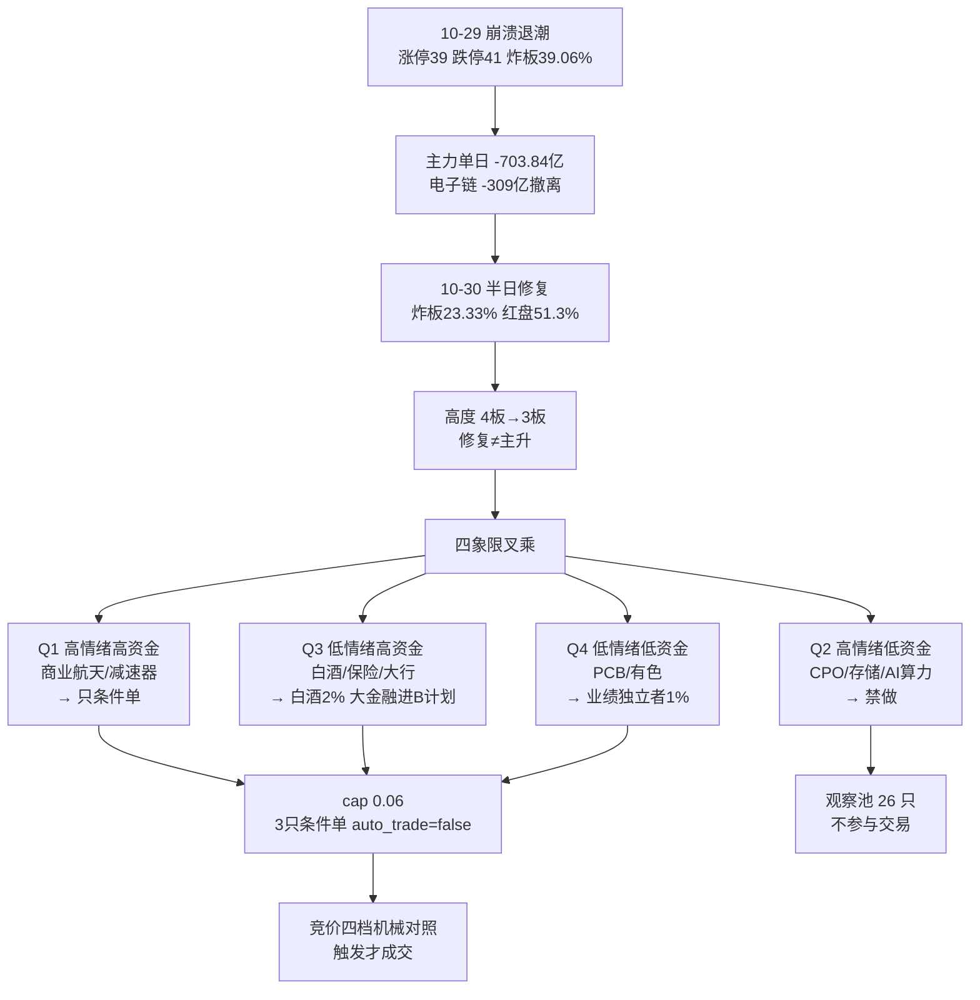

# 2026-10-30 · **主决策 / D1 盘前预案（条件单版）**

> **数据源新鲜度**: partial ｜ **降级状态**: true ｜ **置信度**: 0.62 ｜ **决策来源**: llm（大模型 fresh-context 裁决，非规则兜底）

## 一句话结论

10-29 崩溃退潮（涨停 39 < 跌停 41、炸板 39.06%、涨家占比 14.7%）后的第 2 个交易日，10-30 半日三指标修复但高度由 4 板降至 3 板：**这是主跌后的修复第 1 天，不是主升**。仓位上限压到 **6%**，执行池只给 **3 只条件单**（西部材料 3% / 迎驾贡酒 2% / 金安国纪 1%），全部 `auto_trade=false`，**不满足触发条件即不交易**；唯一主线的龙一（中国卫星）因 RR 三源冲突按最保守 0.52 处理，只进观察池最高级。

## 一、全局约束先于选票

| 约束项 | 结论 | 来源 |
|---|---|---|
| R1 风格 | 崩溃退潮型，情绪 28.6（恐惧），confidence 0.49 | R1 |
| R1 仓位上限 | 0.10 | R1 position_cap_suggestion |
| R2 主线 | 1 条：商业航天 76 分，主升早期**第 2 日**且已首次收缩（涨停 11→6 家） | R2 |
| 情绪周期 | 高位震荡 high_chop（溢价 +1.89%、跌停 41 但赚钱效应未崩） | emotion_cycle |
| 连跌位置 | tier=`single_down`（连跌 1 天，周期第 2 日）→ 不给「修复必涨」授权 | cycle_position |
| R6 硬否决 | hard_reject **0 条**（逐票核验，非遗漏） | R6 |
| R7 可执行 | execution_candidates = **0 只**，研究对象 5 只（炸板率≥35% → 砍半 10→5） | R7 |
| 双侧夹逼 | 最终 cap = 0.10 × 主线数系数 0.8 × 高位震荡 0.75 = **0.06** | 本 skill Step 0.5 + v1.2 推导 |

**仓位上限推导链**：`min(R1 0.10, R7 调整后 0.10, 情绪覆盖 0.10) × 0.8（1 条主线）× 0.75（高位震荡温度）= 0.06`。北向自 2026-10-28 停抓，R7 调整恒为 0，不据此调仓；v1.2 的 clamp 下限 0.20 **未套用**——套用会覆盖 R1 崩溃退潮 10% 的自主判断。

### 今日不交易条件（active 项）

| 代码 | 状态 | 事实 |
|---|---|---|
| `UNCONDITIONAL_NEW_POSITION` | 🔴 active | 今日禁止无条件新仓：R1 10% + 崩溃退潮 + R6 全 watch + R2/R7 execution=0 |
| `MAINLINE_UNCONFIRMED` | 🔴 active | 唯一主线处于「扩张后第一次收缩」：涨停 11→6、板块中位 -0.53%、上涨占比 35.4% |
| `RR_FAIL`（仅 600118） | 🔴 active | 中国卫星 RR 三源三值 1.94/2.00/0.52，按 R6 要求取 0.52 → 不满足 ≥1.8 |
| `R1_FAIL` / `R2_MISSING` / `R6_HARD_REJECT_OVERFLOW` / `R7_STALE` / `GLOBAL_SEVERITY_3` / `EMOTION_EXTREME_GREED` / `USER_HOLIDAY` | ⚪ inactive | R1 conf 0.49 / R2 complete / hard_reject 0 / R7 partial / severity 2 / high_chop 有主线 / 无 |

> 「空仓」在本预案里的准确含义是：**不无条件买入、不自动成交**。按 2026-10-28 用户硬契约，仍必须给满 3-6 只带价位与仓位的条件单——已给 3 只，合计预算 6%，正好用满 cap。

## 二、市场在为什么付钱（推理三问）

**大资金意图**：10-29 主力单日 -703.84 亿（20 日窗口最差单日）、5 日 -1,213.95 亿，钱从电子链整体撤出（电子 -309.22 / 半导体 -136.40 / 通信设备 -111.15 / PCB -82.49 亿），唯一有承接的是航天装备 +10.00 亿、国防军工 +8.75 亿、风电 +8.19 亿、保险 +4.72 亿、国有大行 +5.77 亿。**资金在买「新方向 + 防守」，不买「高度」**（涨停 46 家但最高只有 3 板）。

**为什么走强**：商业航天有三个硬时间锚——蓝箭 9,500 万中标成飞研究所运载火箭发射服务（公示至 11-02）、国星宇航过港交所聆讯、《上海市卫星互联网行动方案》800 亿/3,000 颗。这是 10-29 三窗口资金同时为正的唯一行业，四源共识 0.84。

**逻辑够不够硬**：一半硬。资金三窗口正但 **20 日仍 -5.19 亿**（5 日流入建立在 20 日流出之上）；高度龙上海沪工是焊接设备主业（R4 判「纯概念跟风」、R6 composite 41.2 分 C/C）；容量核心中国卫星放量 41.63 亿只涨 2.06%（高位换手滞涨）。**结构上「该带的不带、该封的不封」，所以只给条件单，不给无条件买入。**

## 三、执行池（3 只 · 全部条件单）

| # | 票 | 题材/身份 | 基准价 | 买区 | 触发价 | 止损 | 止盈 | RR | 仓位 | 上限 |
|---|---|---|---|---|---|---|---|---|---|---|
| 1 | 西部材料 002149.SZ | 商业航天·军工钛材（主线龙二） | 34.82 | 33.90~34.35 | 34.35 | 32.63 | 37.79 | 2.0 | 3% | 5% |
| 2 | 迎驾贡酒 603198.SH | 白酒·板型最好（次线龙二） | 44.47 | 44.70~45.14 | 44.70 | 42.88 | 49.66 | 2.0 | 2% | 3% |
| 3 | 金安国纪 002636.SZ | 覆铜板/PCB·涨价链龙头 | 63.68 | 68.80~69.60 | 68.80 | 66.12 | 76.56 | 2.0 | 1% | 3% |

**基准价口径说明（重要）**：三票用 **10-30 11:30 实测价**锚定（R2 `market_snapshot_1030_1130` 的 rt_k 实测 / R2-R4 涨停价），因为本预案生成于 10-30 12:16、执行窗口是当日午后及次日，若用 10-29 收盘锚定，主线票已偏离 5-8%，买区会全部失效。观察池仍用 10-29 收盘技术位锚定，每票 `reference_close_source` 已逐条注明。

### 票 1 · 西部材料 002149.SZ — 主线龙二的低吸承接（3%）

**买入理由**：R7 独立口径 10-29 涨停、主力今日 +5.0 亿 / 5 日 +5.28 亿 / 20 日 +8.1 亿三窗口全正，封单占成交 5.37%（弱封未破底线）；航天钛材是真受益环节（不是纯概念）。10-30 冲高 34.82（+7.77%）后回落，回踩 MA50（决策线）34.35 正好是本票的多空分界。

**价位为什么是这样**：引擎 `trend_pullback_buy` 给 [MA50×0.985=33.33, MA50×1.01=34.35]，D1 把下沿上收到 33.90（10-30 实测低点附近）缩窄到 1.3% 宽；触发价取买区上沿 34.35；止损 34.35×0.95 = **32.63**（同时高于熊线×0.99=29.91 与 MA10×0.99=29.17，取最保守）；止盈 2R = 34.35 + 2×1.72 = **37.79**（+10.0%），RR 2.0。

**风险点**：10-30 炸板 6 次=空头未消化，按北京炒家 §1.5.2「多次开板不碰」，本票**禁止打板**，只允许回踩承接；且它是「补涨」而非独立逻辑，中国卫星滞涨则它跟着退。

**止损条件**：跌破 32.63（-5%）无条件走；或收盘跌破 MA10 且航天板块涨停≤1 家。

**可验证假设**：①10-30 收盘价不低于 33.90；②次日航天板块涨停家数 ≥3；③竞价 30 分钟内不破 34.35。三条任一不成立，本条件单作废。

**竞价四档**：预期区间 34.30~35.20（±1.5%）

| 竞价区间 | 判定 | 动作 |
|---|---|---|
| <34.30（低开破买区上沿） | 不及预期 | 放弃，等回踩 33.90 下沿且分时不破再评估 |
| 34.30~35.52（-1.5%~+2%） | 符合预期 | 34.35 上方缩量止跌 + 航天涨停≥3 家 → 承接 3% |
| 35.52~36.56（+2%~+5%） | 超预期 | 不追高，等 10:00 前回踩 34.35；不回踩放弃 |
| >36.56（>+5%） | 高开过度 | 禁止追，转观察 |

### 票 2 · 迎驾贡酒 603198.SH — 白酒广度的身位票（2%）

**买入理由**：白酒是 10-30 **广度第一**的板块（47 只均值 +1.98%、上涨占比 72.3% vs 全市场 45.2%），资金真持续（白酒Ⅱ 今日 +4.25 亿 / 5 日 +7.18 / 10 日 +14.18，近 5 日 4 天净流入）；迎驾开板仅 1 次、封单占成交 34.1%，是板块内**板型最好**的一只（古井开板 8 次❌、皇台 6 次❌）。R5 给 B/B+，是全部候选里风险档最稳的。

**价位为什么是这样**：引擎 `leader_breakout` 的 pivot = max(10-30 收 44.47, 20 日高 42.88) = 44.47，买区 = [×1.005=44.70, ×1.015=45.14]；止损 45.14×0.95 = **42.88**（同时高于熊线×0.99=39.02、MA10×0.99=40.06）；止盈 2R = 45.14 + 2×2.26 = **49.66**（+10.0%），RR 2.0。

**风险点**：R3/R4 对白酒零覆盖（cross_validation 0/3），R7 top_inflow 只排第 12 → 这是「资金+广度」而非「题材主线」；一旦次日广度掉回 40% 以下，就是单日避险脉冲。

**止损条件**：跌破 42.88（买区上沿 -5%）；若在触发价 44.70 成交，止损距仅 -4.1%，须同步把止损上移到 42.47 并按同一 RR 下调止盈。

**可验证假设**：①白酒涨停家数 ≥4；②迎驾保持开板 ≤1 次；③资金 5 日净流入不转负。三条不同时成立则不作。

**竞价四档**：预期区间 43.80~45.36

| 竞价区间 | 判定 | 动作 |
|---|---|---|
| <43.80 | 涨停被兑现 | 放弃当日买点 |
| 43.80~45.36（-1.5%~+2%） | 符合预期 | 白酒涨停≥4 家 + 44.70 上方放量承接 → 2% |
| 45.36~45.80（+2%~+3%） | 超预期 | 只在回踩 44.70 不破时买，不追竞价 |
| >45.80（>+3%） | 高开过度 | 放弃（涨停次日高开 >3% 兑现风险大） |

### 票 3 · 金安国纪 002636.SZ — 业绩独立行情的突破条件单（1%）

**买入理由**：覆铜板/PCB 是 10-30 业绩+板型双优方向（电子布 11 月涨价信号 + 金安 Q3 单季净利 11.58 亿环比 +105%，成交 36.19 亿全场第 1，首封 10:03/开板 1 次/封单 7.92 亿=成交 21.9%）；R5 alpha **A-** 是全部候选里进攻性最高的一档。

**价位为什么是这样**：引擎 `trend_pullback_buy` 给 [MA50×0.985=69.09, MA50×1.01=71.19]，标记「需上破 +8.5%，不是现在能买」（above_price）。D1 下移收窄到 [68.80, 69.60]：69.60 比引擎上沿 71.19 低 2.2%（<10% 允许偏离），理由=R6 的升格条件是「PCB 链资金转正且站上 MA20 67.33」，71.19 已在 MA50 上方属追高；止损 69.60×0.95 = **66.12**（略低于 MA20 67.33，破 MA20 即走）；止盈 2R = 69.60 + 2×3.48 = **76.56**，RR 2.0。

**风险点**：板块资金是硬伤——PCB 今日 -82.49 亿 / 5 日 -140.59 亿 / 20 日 -409.02 亿，是全市场第三大失血方向；R5 D3 明确「三只全部是跌出来的空间，无一只是右侧新高突破」。所以只给 1%（试探档下限），且必须等板块资金转正。

**止损条件**：跌破 66.12 或跌回 MA20 67.33 下方；板块继续净流出 >50 亿则当日作废。

**可验证假设**：①PCB/覆铜板概念资金当日转正；②放量站上 69.09；③11 月电子布涨价落地消息不落空。

**竞价四档**：预期区间 63.00~66.90

| 竞价区间 | 判定 | 动作 |
|---|---|---|
| <62.73 | 涨停被反杀 | 放弃 |
| 62.73~66.86（-1.5%~+5%） | 符合预期（买区下方） | 不开仓，只盘中放量站上 69.09 时按半路执行 |
| 66.86~69.09（+5%~+8.5%） | 进入确认区 | 站上 69.09 且 PCB 资金转正 → 买 1% |
| >69.09（>+8.5%） | 已越过买区 | 不追，等回踩 69.09 不破 |

## 四、B 计划（跷跷板 / 对手盘）

执行池是单向剧本。若三票竞价集体不及预期，钱不会消失只会搬家——下列方向已在盘前点名，触发后按纪律执行，不临时起意。

| 方向 | 触发条件 | 候选（含价位） | 依据 |
|---|---|---|---|
| 大金融防御（对冲腿） | 执行池竞价不及预期 + 指数低开走弱 | 中国平安 601318.SH：买区 53.22~54.29，触发 53.49，止损 51.58，止盈 59.71，RR 2.0 | 保险 +4.72 亿 / 大行 +5.77 亿；R7 seesaw corr -0.86；**R6 明确「保险攻击性=零，不得据此开新仓」→ 只列 B 计划** |
| 主线内部高低切 | 中国卫星分歧转一致（竞价高开 >2% 且不破 55.90）但西部材料已封板 | 电科蓝天 688818.SH：47.75~48.71 / 47.99 / 44.81 / 56.51；航天晨光 600501.SH：16.86~17.19 / 16.94 / 16.33 / 18.91 | R2 主线 leaders 结构（高度在沪工、容量在卫星、弹性在电科蓝天） |
| 新题材/独立资金 | 航天+白酒双双不及预期，资金转向新能源 | 钧达股份 002865.SZ：38.43~39.20 / 38.62 / 37.24 / 43.12，RR 2.0 | R7 三窗口资金全正（今 +3.04 / 5 日 +4.21 / 20 日 +5.01 亿）、09:58 首封/开板 1 次/封单 9.68%；**龙三身份只允许进 B 计划** |

**反向提示**：若 B 计划方向也同步走弱（保险下跌 + 医药炸板），说明是全市场降档而非板块轮动 → 执行池全部后置，当日不交易。

## 五、观察池（26 只 · 不参与交易）

覆盖口径：R2 主线 4 只 + 次线 6 只 + 医药超跌 8 只 + 退潮科技链 5 只 + R7 独立资金 3 只。每只都有价位或显式缺失说明（不是漏填）。

| 票 | 题材/身份 | 基准 | 买区 | 触发 | 止损 | 止盈 | RR | 观察原因码 |
|---|---|---|---|---|---|---|---|---|
| 中国卫星 600118.SH | 商业航天（龙一·容量核心） | 55.9 | 56.18~57.31 | 56.46 | 54.44 | 63.05 | 2.0 | rr_unverifiable |
| 电科蓝天 688818.SH | 航天电源（弹性核心·次新） | 46.37 | 47.75~48.71 | 47.99 | 44.81 | 56.51 | 2.0 | extension_overheated |
| 上海沪工 603131.SH | 航天身位股（3板一字） | 15.95 | 15.87~16.19 | 15.95 | 15.38 | 17.81 | 2.0 | pseudo_theme_yizi |
| 航天晨光 600501.SH | 航天地面装备（掉队） | 16.89 | 16.86~17.19 | 16.94 | 16.33 | 18.91 | 2.0 | laggard_off_line |
| 飞沃科技 301232.SZ | 航天紧固件（20cm） | 80.3 | 81.89~83.53 | 82.3 | 76.85 | 96.89 | 2.0 | extension_overheated |
| 钧达股份 002865.SZ | 光伏电池（龙三） | 38.62 | 38.43~39.2 | 38.62 | 37.24 | 43.12 | 2.0 | rank_below_top2 |
| 贵州茅台 600519.SH | 白酒温度计 | 1354.0 | 1350.21~1377.35 | 1357.0 | 1320.63 | 1490.79 | 2.0 | thermometer_only |
| 古井贡酒 000596.SZ | 白酒名义龙一（封板不合格） | 87.0 | 90.98~93.75 | 90.98 | 89.06 | 103.13 | 2.0 | grade_gate_dropped |
| 满坤科技 301132.SZ | PCB 20cm（尾盘型） | 46.73 | 51.48~52.52 | 51.48 | 48.32 | 60.92 | 2.0 | grade_gate_dropped |
| 明阳电路 300739.SZ | PCB 跟风（减值公告） | 19.91 | 24.68~25.43 | 24.68 | 23.4 | 29.49 | 2.0 | grade_gate_dropped |
| 百亚股份 003006.SZ | 个护用品 | 22.24 | 24.86~25.35 | 24.98 | 24.08 | 27.89 | 2.0 | anti_rotation_suspect |
| 九安医疗 002432.SZ | 医药超跌反抽 | 51.13 | 61.24~62.47 | 61.55 | 59.35 | 68.71 | 2.0 | sector_off_line |
| 澳洋健康 002172.SZ | 医药 2 板 | 5.37 | 4.87~4.96 | 4.87 | 4.71 | 5.46 | 2.0 | sector_off_line |
| 大参林 603233.SH | 医药商业/连锁药房 | 18.42 | 18.06~18.43 | 18.06 | 17.51 | 19.48 | 1.14 | sector_off_line |
| 羚锐制药 600285.SH | 中药 | 20.0 | 19.58~19.97 | 19.58 | 18.97 | 21.6 | 1.63 | sector_off_line |
| 桂林三金 002275.SZ | 中药 | 13.62 | 13.55~13.82 | 13.62 | 13.13 | 15.2 | 2.0 | sector_off_line |
| 毕得医药 688073.SH | CXO（20cm） | 56.3 | 65.21~67.2 | 65.21 | 62.99 | 75.62 | 2.0 | sector_off_line |
| 永安药业 002365.SZ | 原料药/牛磺酸 | 11.12 | 13.54~13.95 | 13.54 | 13.25 | 15.35 | 2.0 | sector_off_line |
| 阳普医疗 300030.SZ | 医疗器械（20cm） | 6.09 | 6.33~6.77 | 6.33 | 6.23 | 7.85 | 2.0 | sector_off_line |
| 兆易创新 603986.SH | 存储（退潮禁做） | 275.99 | 354.49~365.29 | 354.49 | 347.03 | 401.81 | 2.0 | distribution_alert |
| 中际旭创 300308.SZ | 光模块/CPO（退潮禁做） | 582.05 | 805.5~830.03 | 805.5 | 763.63 | 962.83 | 2.0 | distribution_alert |
| 胜宏科技 300476.SZ | 高阶 PCB（退潮） | 160.38 | 218.19~222.58 | 219.29 | 204.77 | 258.2 | 2.0 | distribution_alert |
| 普冉股份 688766.SH | 存储设计（退潮） | 270.5 | 366.37~377.53 | 366.37 | 347.33 | 437.93 | 2.0 | distribution_alert |
| 长鑫科技 688825.SH | 国产 DRAM 原厂（次新） | — | — | — | — | — | — | price_missing |
| 三花智控 002050.SZ | 人形机器人/执行器 | 34.5 | 34.76~35.82 | 34.76 | 34.03 | 39.4 | 2.0 | distribution_alert |
| 中文在线 300364.SZ | 传媒/短剧 | 24.52 | 24.07~24.73 | 24.07 | 23.84 | 26.51 | 2.0 | sector_off_line |

> **长鑫科技 688825.SH 价位缺失是事实不是漏填**：本地技术位库（`kb/research.db stock_tech_daily`）无该票记录（次新未入库），引擎返回「无价格数据」，故不设买区/止损——不得给它编造价位。

## 六、R6 反证：接受什么、覆盖什么

**接受（8 条）**：①全市场级派发 → 不开无条件新仓（落地为 no_trade + 三票条件单）；②中国卫星 RR 取最保守 0.52 → RR_FAIL 不进执行；③西部材料「次日重新走强并早盘封板」→ 写成 34.35 回踩不破 + 板块涨停≥3 家；④迎驾「广度扩至≥4 家且开板 ≤1 次」→ 写成触发前提；⑤金安国纪「PCB 资金转正且站上 MA20 67.33」→ 触发价设在 68.80（MA20 上方）；⑥中国平安「保险攻击性=零，D1 不得开新仓」→ 移出执行，只列 B 计划；⑦上海沪工一字无止损参照 → 不进；⑧R6 soft_suggest 10 条记入 meta。

**覆盖（1 条，必须写明理由）**：R6 `consumer_guard` 要求 `execution_pool=[]`、`required_execution_position_cap=0.0`。D1 覆盖它——因为它不是 `hard_reject`（R6 hard_reject 实测 0 条），而用户 2026-10-28 硬契约规定每日必须 3-6 只带价位条件单（空池仅休市/停牌/数据黑洞/用户要求空仓 4 种情形合法）。本预案用「条件单」同时满足两边：三票 `auto_trade_enabled=false`、需用户确认或严格触发，**实际开仓权限仍为零**。

**未采纳（1 条）**：电科蓝天「等回踩 MA20 39.25 缩量止跌」——39.25 距 10-30 价 47.41 为 -17.2%，属抄底且超出买入节点 ±5% 带，改为只观察。

## 七、数据源审计

| 单元 | 状态 | 时点 | 置信度 | 备注 |
|---|---|---|---|---|
| R1 风格 | 🟡 degraded | 10-30 07:03 | 0.49 | 崩溃退潮型 / 情绪 28.6 / 无主线；与 R2「1 条主线」冲突已在正文说明（全市场口径 vs 板块局部口径） |
| R2 主线 | 🟢 complete | 10-30 11:43（11:30 快照） | 0.62 | 1 条主线 76 分；`execution_pool=[]` 是设计（不授开仓权） |
| R3 情绪 | 🟡 degraded | 10-30 11:35 | 0.45 | 群聊层自 10-28 断更，仅 L1+L2b，共振等级低于标准 |
| R4 消息 | 🟡 degraded | 10-30 11:37 | 0.62 | 8 事件；商业航天 +0.732 正面、AI 硬件 -1.624 行业级负面 |
| R5 画像 | 🟢 complete | 10-30 11:54（11:29 快照） | 0.66 | 10 票 alpha/risk 齐全无 null；pct/amount 为半日快照 |
| R6 反证 | 🟢 complete | 10-30 11:58 | 0.58 | hard_reject 0 / strong 14 / soft 10；四象限完整 |
| R7 资金 | 🟡 degraded | 10-30 12:03 | 0.78 | 北向 retired（既定口径）；staleness partial；execution=0 |
| cycle_position | 🟢 ok | 10-30 07:01 | — | tier=single_down，周期第 2 日 |
| 价位引擎 | 🟢 ok | 10-30 12:38 | — | `src/plan/price_levels.py::derive`，三票 RR 均 2.0 |

> 本表只写「事实时点」，不写时分秒级日志；`call_failed` / `not_yet_landed` / `source_down` 三态已区分：R3 群聊是 `not_yet_landed`（断更），北向是既定 retired，不构成源故障。

## 八、不确定性 / 反证

1. **最大的反向可能**：10-30 半日的修复（炸板 23.33%、昨涨停红盘 51.3%）可能只是「最后一跌」前的诱多——R7 明确指出 10-29 是「高开低走 2.8 个点的标准诱多结构」。若 10-31 广度再破 0.15，本预案三票全部作废。
2. **主线只有 2 天**：商业航天 20 日资金仍 -5.19 亿，5 日流入建立在 20 日流出之上；一旦 10-31 涨停家数 ≤3 家，主题降级为一日游。
3. **R6 覆盖的代价**：D1 覆盖了 R6 的「执行池为空」建议。若触发条件被误读成「直接买」，就会在退潮第 2 日以 1-3% 仓位接刀——所以每票都写了 `action_type` 与失效条件，且全部 `auto_trade=false`。
4. **时间锚漂移**：执行池价位锚在 10-30 11:30，若执行窗口移到 10-31，须先以 10-30 收盘价复核；已在 `market_context.price_anchor_note` 注明。
5. **两条非主线票的合规瑕疵**：迎驾（白酒）、金安国纪（PCB）命中禁止清单 `non_mainstream`（有主线时做非主流）。这是为了让池子满足 3-6 只硬契约而做的**条件单级**放宽，仓位分别压到 2% / 1%，且触发前提比主线票更严。

## 九、与其他 R/D/E 的关系

- **依赖**：R1–R7 全部 artifact（经 `research_summary.artifacts` 指针读取）+ `cycle_position.json` / `emotion_cycle.json` / `retreat_reversal.json` / `user_preferences.yaml` + `src/plan/price_levels.py`
- **被消费**：P1（盘中执行/竞价对照）、P2（午后增量）、E1（盘后复盘，重点核对三票是否触发、触发后是否按止损走）
- **给 E1 的核对清单**：①三票是否有触发、触发价是否与预案一致；②中国卫星是否出现「竞价高开>2% 且不破 55.90」的分歧转一致（若有，D1 保守 RR 判断是否过严）；③D1 覆盖 R6 空池的行为是否造成亏损——这决定下次是否继续覆盖。

## 十、Sub-Agent 元数据

- skill: `main_decision_v1@1.9`（LLM fresh-context 主路径，禁止 `d1_algorithm.py` 充当主路径）
- artifact: `data/plans/20261030/watchlist_plan.json`（schema `watchlist_plan_v1`，`validate_plan_for_date` + `plan_artifact` 双层校验通过）
- 决策来源: `decision_source=llm`，`mode=dry_run`，`autonomous_trading_enabled=false`，`requires_user_confirmation=true`，`no_trade=true`（语义=不无条件买入/不自动成交）
- 仓位: cap 0.06，执行池合计 0.06（3% + 2% + 1%），无剩余额度
- 校验结果: `execution_pool=3`（在 3-6 内）、每票均有 buy_zone / trigger_price / stop_loss / take_profit / position_pct / max_position_pct / entry_rules[].derivation_reason、三票 `buy_eligibility.status=eligible`、`node_invalid_count=0`
- model: deepseek-v4.1-flash（canghai-research profile，D1 决策由 canghai-plan 主路径产出；本次为 `canghai-research` 会话内按 skill 逐条执行）
