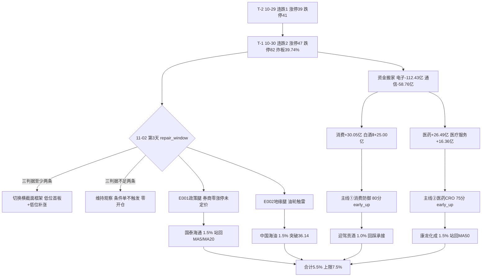

# 2026-11-02 · **主决策 / D1 盘前预案**

> **数据源新鲜度**: partial（R1/R3/R7 degraded，主产物全部当日落盘）
> **降级状态**: true（R3 缺 L3、R7 data_quality=partial、mainline_lifecycle 空骨架）
> **置信度**: 0.55 —— 方向（修复窗口只做低位）置信 0.8，个股层置信 0.4

---

## 一句话结论

今天是**连跌 2 天后的第 3 天（repair_window）**，但 R1 的三条修复阈值（昨涨停溢价 > +1%、涨家占比 ≥ 60%、涨停 ≥ 60）**一条都没达到** → 只给**条件单**：`no_trade=true` / `decision_status=conditional_only`，仓位上限 **7.5%**，执行池 **4 只合计 5.5%**，全部 `auto_trade_enabled=false`，必须 09:30-10:00 三判据（广度 > 0.55、昨涨停红盘率 > 60%、板块级涨停潮 ≥ 3）**至少两条成立**才启动。

三条腿：**低位补涨（康龙化成 1.5%）+ 主线②龙二回踩（迎驾贡酒 1.0%）+ 两条新题材（国泰海通 E001 政策 1.5% / 中国海油 E002 地缘 1.5%）**。零情绪票、零打板、零追高。

---

## 一、今天是什么日子：第 3 天 · 修复窗口，不是主升

| 指标 | T-1（10-30） | 读数含义 |
|---|---|---|
| 涨停 / 跌停 | 47 / 82 | 跌停远超涨停，连板大面继续杀 |
| 炸板率 | 39.74% | 连续两日 ≥ 35%，分歧未收敛 |
| 广度（涨家占比） | 16.03% | 893 涨 / 5571 只，中位 -3.13% |
| 昨涨停收盘溢价 | -0.28% | 隔日赚钱效应为负 |
| 主力净额 | -396.66 亿（5 日 -1618.95） | 全市场失血，仅白酒/医药两个方向进水 |
| 连跌天数 | 2 | `tier=repair_window`，第 3 天 |

情绪周期判 **capitulation（补跌，conf 0.9）**：这是「跌停 82 家 ≥ 80」的直接结论，不是模型口风。修复窗口的语义是**「可以准备做」不是「可以做」**——`cycle_position.json` 的同口径历史样本只有 1 例（20261027 连跌 2 天 → 20261028 广度 0.7461、涨停 72），样本说明里自己写了「不是概率模型，不构成开仓许可」。

**我刻意没有做的一件事**：没有把「连跌 2 天 → 第 3 天必修复」当成方向。错题本 `error_case_20261029_001`（high，recurrence=true）就是同一条路——上次把 T-1 的情绪标签当 T 日横截面方向，结果次日反向。今天改成：判据在盘中，不在预案里。

---

## 二、两张牌桌：四象限 × 两条主线

R2 今天给出 2 条主线，但两条的成立原因不是产业催化，而是**「科技崩了、钱搬家」**：

| 主线 | 分 | 资金证据 | 催化 | 我的定性 |
|---|---|---|---|---|
| ① 消费防御：白酒/休闲食品/乳品 | 80 | 食品饮料 +30.05 亿、白酒Ⅱ +25.00 亿（20 日唯一仍正流入的成规模行业） | R4 **零正面**，PMI 49.3/49.7 双降还是负面 | **资金迁移型**，不是催化驱动型 |
| ② 医药 / CRO / 医疗服务 | 75 | 医药生物 +26.49 亿、医疗服务 +16.36 亿（5 日 +34.90 亿 5/5 正）、医疗研发外包 5 日 +28.86 亿 | R4 **零覆盖** | **资金迁移型**，第二落点 |

四象限（R6 口径 + 我的落点）：

| 象限 | 成员 | 结论 | 今日动作 |
|---|---|---|---|
| 🟡 Q1 高情绪高资金 | 白酒/食品/乳品、医药/CRO | 接力成本最高，两条线都只有 1 日龄 | 只做其中**位置最低 + 未涨停**的补涨票（康龙 51.6% 分位），迎驾只做 -3% 回踩 |
| 🔴 Q2 高情绪低资金 | 商业航天（霸榜第 1 但指数 -4.00%）、名字套利 | 热度是派发的燃料 | 上海沪工/中国卫星全进观察，不进执行 |
| 🟡 Q3 低情绪高资金 | PCB（金安国纪个股 +8.18 亿 / 板块 5 日 -154.5 亿）、CRO 真龙头 | 资金孤岛，无板块效应 | 只取有板块效应的康龙；金安国纪被 E008 行业级负面剔除 |
| 🟢 Q4 低情绪低资金 | 券商/大金融（叙事 +0.74 最硬、资金 pos 0/5）、存储、银行红利 | **券商是唯一有「今日级增量催化」的预期差** | 券商给条件单；存储被 E008 剔除；银行列 B 计划 |

**大资金意图**：10-30 的钱不是「看好消费基本面」而是「从电子搬出来」。电子 -112.43 亿、通信 -58.76 亿、半导体 -56.14 亿（5 日电子 -568.32 亿），搬进白酒 +25.00 亿、医疗服务 +16.36 亿。**这是一次调仓，不是一次建仓**——调仓的特点是只有 1-2 天,一旦科技反抽它就结束。

**为什么走强**：白酒的 +5.15%（12 个交易日最大单日）由深股通 +5.62 亿、机构专用 +2.86 亿买泸州老窖涨停直接印证（全场唯一「外资+机构」双买的白酒涨停）；医药的强度只到子板块级（医疗服务/CRO 5/5 正），行业指数当日仍 -0.61%。

**逻辑够不够硬**：**不够硬，够紧**。够紧=资金连续性可验证、位置可验证、止损位可算；不够硬=两条线都没有产业催化，白酒 Q3 高端单季塌方（泸州 -57.0%、五粮液 -48.3%），唯一正增长是区域酒迎驾 +8.6%。所以只能做「低位/回踩 + 小仓 + 条件触发」，不能做「主升给仓」。

---

## 三、执行池（4 只 · 全部条件单 · 合计 5.5%）

| # | 标的 | 主题/腿 | 昨收 | 买区 | 触发价 | 止损 | 止盈 | RR | 仓位 | 单票上限 | 触发前提（一句话） |
|---|---|---|---|---|---|---|---|---|---|---|---|
| 1 | **康龙化成** 300759.SZ | 医药CRO·低位补涨 | 41.37 | 42.90–43.40 | 42.90（MA50） | 39.93（-8.0%） | 50.34 | 2.0 | **1.5%** | 3.0% | 站回 MA50 且 CRO 板块 10:00 前资金转正 |
| 2 | **迎驾贡酒** 603198.SH | 白酒·主线①龙二 | 44.47 | 40.91–43.14 | 43.14（-3% 回踩） | 40.70（-5.7%） | 48.02 | 2.0 | **1.0%** | 3.0% | 回踩 43.14 不破 + 白酒系涨停 ≥3 家 |
| 3 | **国泰海通** 601211.SH | 券商·E001 切换新题材 | 15.86 | 16.10–16.52 | 16.10（MA5） | 15.36（-7.0%） | 18.84 | 2.0 | **1.5%** | 3.0% | 券商 ≥2 家涨 3% 或指数 +1.5% 后站回 MA5 |
| 4 | **中国海油** 600938.SH | 油气·E002 地缘 | 35.97 | 35.96–36.68 | 36.14（20 日高） | 34.84（-5.0%） | 40.36 | 2.0 | **1.5%** | 3.0% | 站上 36.14 且伊朗未宣布重开海峡 |

**预算**：5.5% ≤ 上限 7.5%（R1 cap 0.10 × 跷跷板 0.75），余量 2.0%。β 分解：避险迁移腿（康龙+迎驾）2.5%（上限 3.0%）、政策腿 1.5%、地缘腿 1.5% —— 直接对应错题本 `error_case_20261029_003`「四只票共用一个 β」。

### 竞价四档（09:25 机械对照，不临场判断）

| 标的 | 不及预期 | 预期内（按预案） | 超预期 | 高开过度 |
|---|---|---|---|---|
| 康龙化成 | < 40.75 放弃 | 40.75–42.20 按买区承接 | 42.20–43.44 等回踩再买 | > 43.44 不追 |
| 迎驾贡酒 | < 43.80 放弃 | 43.80–45.36 回踩 43.14 才买 | 45.36–46.69 等回踩 | > 46.69 不追 |
| 国泰海通 | < 15.62 放弃 | 15.62–16.18 站回 16.10 买 | 16.18–16.65 等回踩 | > 16.65 不追 |
| 中国海油 | < 35.43 放弃 | 35.43–36.69 突破 36.14 买 | 36.69–37.77 等回踩 36.68 | > 37.77 不追 |

### 逐票思维链

**① 康龙化成 300759.SZ（1.5%）**

- **买入理由**：R7 的 5 只研究候选里，唯一「5 日 5/5 全正」的方向就在它身上——CRO 概念 5 日 +34.42 亿、医疗研发外包 5 日 +28.86 亿且 5/5 正、个股主力 5 日 +4.74 亿、5 日涨幅 +11.09%。而它 10-30 只涨 3.43%、没涨停 → **资金到了但价格没兑现**，这才是修复窗口要的「低位补涨」。位置：30 日区间 51.6%、距 20 日高 -11.75%、现价 41.37 仍在 MA50=42.90 之下，买点=站回决策线的右侧确认，不是追高。
- **风险点**：① R5 **没有覆盖这只票**（不在 R2 10 只画像池），alpha=B/risk=B 是契约缺省值不是实测 —— 这是本票最大的信息缺口；② CRO 的弱势是「小票吸走弹性」（万邦 20cm、百花妖锚），一旦小票炸板，大票补涨会先被打掉；③ 医药生物 10 日 -91.74 亿、20 日 -149.57 亿，中期资金仍在撤，今日只是第一轮回补。
- **止损条件**：跌破 **39.93**（买区上沿 × 0.92，20cm 票 1.2x）无条件清；同时「收盘跌破 MA20 40.17 + 板块资金转负」也清。止损距 -8.0%，落在 -5~-10% 硬区间。
- **可验证假设**：若 10:00 前 CRO 概念资金仍为正、且康龙站上 42.90 后能守住分时均价 → 假设「低位大票补涨成立」；反之如果站上 42.90 后 30 分钟内跌回 → 说明只是均线假突破，**不追第二次**。

**② 迎驾贡酒 603198.SH（1.0%）**

- **买入理由**：两条主线里档位最高的一只（R5 alpha **B+** / risk **B**，全批唯一 B+/B 组合），也是白酒里唯一 Q3 正增长的区域酒（+8.6%，对照泸州 -57.0%、五粮液 -48.3%）。板型是白酒涨停里唯一的「点火型」：**09:44 早封**、封单 0.76 亿、开板 1 次（其余都是 13:27 之后晚封）。
- **风险点**：① 它是 **30 日新高**（区间位置 100%）、距 MA20 +12.2% —— 严格说不属于「低位」，所以只给 -3% 回踩、不给打板；② 融券余额 5 日 **+94.2%**，是明确空头下注；③ 板块 β 依赖单一子板块：食品饮料 +30.05 亿里白酒贡献 25.00 亿（83%），白酒一转弱「消费防御」就成空壳；④ 龙一泸州封单仅占流通 0.01%（纸封），次日开板概率高，会压板块情绪。
- **止损条件**：跌破 **40.70**（低于买区下沿 40.91，且是买价 -5.7%）清仓。**注意**：引擎原值 40.98 高于买区下沿 40.91，会导致「买 40.91 立刻触发止损」，已按 skill 硬规则下修至 40.70。
- **可验证假设**：若次日白酒系涨停 ≥3 家且迎驾守住 43.14 → 主线①从「1 日龄反抽」升级为「2 日龄延续」，可考虑加仓；若白酒只剩老窖一只红 → 判一次性调仓，**清仓不恋战**。

**③ 国泰海通 601211.SH（1.5%）**

- **买入理由**：E20261102_001（**high 正面**，当日落地）—— 一行一局一会今日开会研究资本市场工具，国新、诚通各获千亿级回购增持贷款额度。R4 板块极性券商 **+0.74 为全表最高**，而券商板块 10-30 **零涨停、5 日资金 pos 0/5** → **全市场都没在这条线上定价**。R6 自己把它列为「低情绪低资金的预期差，不是主线」。位置：15.86 位于 MA5/MA10/MA20/MA50 全部之下，20 日低点 15.59 上方仅 1.7%。
- **风险点**：① 政策是「工具落地」不是「业绩改善」，若只高开 1% 后阴跌，就是消息脉冲；② R4 同日给了银行 +0.518、红利破净央企 +0.518，**资金可能先买银行而不是券商**（券商 β 大、弹性大，但防守日资金更爱大行）；③ 20 日高 17.20 就在 +4.1% 处，止盈 18.84 需要突破前高 10% —— RR 2.0 是机械 2R，**兑现难度不低**。
- **止损条件**：跌破 **15.36**（买价 -7.0%，同时破 20 日低 15.59）清仓；若 17.20 放量受阻且券商无第二只涨停 → **先减半**，不等止损。
- **可验证假设**：09:30-10:00 券商出现 ≥2 家涨 3%（或板块指数 +1.5%）→ 假设「政策被定价」成立，按预案买；若只是国泰海通一家涨、其余不动 → **放弃，不买**（单票不成板块 = 无合力，纪律⑦）。

**④ 中国海油 600938.SH（1.5%）**

- **买入理由**：E20261102_002（**high 正面**）霍尔木兹两艘油轮触雷，R4 油气开采 +0.62。资金已经动了但价格没动：石油石化今日主力 **+5.51 亿**、5 日 +12.26 亿，炼油化工 5 日 +11.34 亿且今日仍 +3.14 亿（R7 跷跷板反转表 direction_reversal_5d=true），而板块指数当日 **-1.06%** → 「钱进、价未动」。现价 35.97 贴 20 日高 36.14（+0.5%），站上即启动。
- **风险点**：① **事件可反转**——同一份 R4 里伊朗称「条件满足两天内可重开」，这是本票唯一的结构性风险，不是估值风险；② 突破口径要求 +0.5%，若竞价直接高开 3% 以上，等于「用高开替代突破」，追进去就是接盘；③ 石油石化今日板块指数仍是负的，说明市场对地缘的定价很克制，突破可能是假突破。
- **止损条件**：跌破 **34.84**（买价 -5.0%）清；**特殊条款**：伊朗官方宣布海峡恢复通航 → **无条件清仓，不等止损价**（已写进 exit_rules，priority=0）。
- **可验证假设**：若站上 36.14 后 30 分钟不回落、且石油石化板块资金当日仍为正 → 假设「事件+资金同向」成立；若站上即回落破 35.96 → 假突破，当日不再做第二次。

---

## 四、B 计划（跷跷板 / 对手盘）

**触发条件**（任一）：① 执行池 ≥2 票竞价低于预期区间下沿；② 09:30-10:00 三判据不足两条；③ 消费/医药两条主线资金由正转负。

| 方向 | 逻辑（用的是哪条上游证据） | 候选 | 启用条件 |
|---|---|---|---|
| **大金融/银行** | E001 同样利好银行 +0.518 / 红利破净央企 +0.518；R7 银行 5 日 +16.35 亿、股份制银行Ⅲ 5 日 +9.5 亿且今日 +1.27 亿；银行↔软件开发 20 日 corr **-0.708** 且方向反转确认 | 招商银行 600036.SH | 消费+医药双弱、且**券商也没发动**（券商不弱就用券商，不双押） |
| **主线内部高低切** | 白酒Ⅱ +25.00 亿 vs 休闲食品 +2.8 亿 / 乳品 +1.8 亿；CRO 大票未发动而小票吸走弹性 | 五粮液 000858.SZ、药明康德 603259.SH | 执行池龙二（迎驾/康龙）走弱但板块指数不破 MA20 |
| **油运/航运** | E002（high）油轮触雷，石油石化 +5.51 亿 / 5 日 +12.26 亿，R4 油运航运 +0.434 | 招商轮船 601872.SH、中远海特 600428.SH | 伊朗未宣布重开 + 中国海油突破后回落不破 35.96 |

**反向提示**：若三条腿同时走弱 → 当日余下时段**不再开任何新仓**，已触发仓按 -5% 硬止损执行，**不补不摊**。

---

## 五、观察池（17 只 · 只做监测，不构成买入授权）

| 标的 | 主题 | 昨收 | 买区（引擎） | 止损 | 不进执行的原因 |
|---|---|---|---|---|---|
| 泸州老窖 000568.SZ | 白酒①龙一 | 77.07 | 70.90–74.76 | 71.02 | 13:27 晚封 + 封单占流通 0.01%（纸封）+ pos20=100 高位 + R7 体检 **RR=0** |
| 五粮液 000858.SZ | 白酒①候补 | 74.70 | 70.77–72.20 | 68.59 | CFO/净利 0.005 + 单季 -48.3% → RR 1.14 < 1.8 |
| 贵州茅台 600519.SH | 白酒①候补 | 1392.05 | 1284.74–1310.69 | 1245.16 | 日振幅 1.77% 无弹性 + 融券 5 日 **+175.7%** → RR 1.26 |
| 九安医疗 002432.SZ | 医药②龙一 | 56.24 | 51.74–54.55 | 51.82 | 低 PE 陷阱 V1（净利率 646% 来自投资收益、短借 60.26 亿 > 货币 20.18 亿）+ R6 F8/F6 双红旗 + RR 1.75 |
| 万邦医药 301520.SZ | 医药②龙二 | 60.06 | 55.26–58.26 | 54.09 | PE 1436 / Q3 净利 -98.3% / 换手 43.5%；结构止损需 -14%，超硬区间 |
| 药明康德 603259.SH | CRO 容量核心 | 142.01 | 153.81–158.50 | 150.57 | 空头排列（MA5 斜率 -1.75%）+ 套牢 84.5% + 主力与大宗背离 |
| 上海沪工 603131.SH | 商业航天 3 板 | 17.55 | 16.15–17.02 | 16.17 | 3 板一字但概念指数 -4.00%、国防军工 -26.65 亿 → 资金不认 |
| 中国卫星 600118.SH | 商业航天 E005 | 55.91 | 56.50–58.22 | 55.31 | 叙事最硬、资金不跟，等板块资金转正 |
| 招商轮船 601872.SH | 油运 E002 次选 | 17.71 | 18.90–19.48 | 18.51 | 需上破 +6.7% 才成立，当日不可执行（且不与海油双押） |
| 中信证券 600030.SH | 券商 E001 次选 | 24.30 | 26.20–27.00 | 25.65 | 需上破 +7.8%，当日不可执行（券商腿只留一只） |
| 百亚股份 003006.SZ | 个护 | 22.98 | 18.60–18.98 | 18.03 | PE 98.2 高控盘 + 止损距 -3.79% 窄于 -5% |
| 金安国纪 002636.SZ | PCB | 63.68 | 58.59–61.77 | 58.68 | 命中 E008 **行业级负面** + 元件 5 日 -154.5 亿 + 机构净卖 -0.68 亿 |
| 中远海特 600428.SH | 航运 | 11.47 | 11.73–11.97 | 11.37 | 同一 artifact 内「+0.7%」与「+10.05% 涨停」自相矛盾，口径未核 |
| 创新医疗 002173.SZ | 脑机接口 E006 | 17.22 | 18.21–18.57 | 17.64 | medium 级事件、R2 未评分、无资金确认 |
| 三博脑科 301293.SZ | 脑机接口 E006 | 49.74 | 52.34–53.39 | 49.12 | 同上，且 20cm 波动放大 |
| 长鑫科技 688825.SH | 存储 E004 | 无 | 无（缺 T-1 收盘价） | — | 命中 E008「存储高位」+ 板块 -5.38% + 5 日主力 -2.41 亿；**无价格数据，不给价位** |
| 亨通光电 600487.SH | 光模块 | 42.42 | 52.98–54.05 | 51.35 | E008 明确覆盖光模块/CPO + 5 日主力 -20.65 亿；买区需上破 +25%（回 20 日高） |

---

## 六、禁入名单

| 标的 | 代码 | 理由 |
|---|---|---|
| 青岛食品 | 001219.SZ | 5 板 + 换手 47.8% + 量比 7.62 + **涨停日主力 -0.20 亿** = 天量派发；股东户数 +11.9% |
| 澳洋健康 | 002172.SZ | 3 板日主力 -0.93 亿（净占比 -7.23%）+ 龙虎榜席位 -0.65 亿 + 换手 44.76%；负债率 89.3% / PB 21.2 / 质押 11.5% |
| 通威股份 | 600438.SH | R4 首板候选但光伏主材 -0.31%、事件为重组定价调整、非今日主线 |

---

## 七、R6 反证：采纳 / 覆盖

**hard_reject = 0**：`research_summary.hard_rejects=[]`，R6 内部模式六逐票双条件核验 7 只、触发对象 0 —— 这是核验结论不是遗漏，因此**无需从执行池剔除任何票**。

**采纳（6 条个股级 strong_suggest）**：九安医疗 → 降级；澳洋健康 / 青岛食品 → 禁入；万邦医药 / 百花医药 → 降级；药明康德 → 降级。

**覆盖（2 条，写明理由）**：

1. `R6-SA-consumption-line`「消费线只能按资金迁移型处理，不得给主升待遇」→ **采纳约束、不采纳「因此不参与」**：迎驾以 1.0% 试探档 + 回踩 3% + 禁打板执行，本身就是「非主升待遇」。
2. `R6-SA-broker`「券商是未定价预期差，盘前不能当主线」→ **采纳「不当主线」**（只给 1.5% 条件单 + 板块级确认），**不采纳「完全不参与」**：E001 是当日唯一 high 级增量催化，属修复窗口的「切换新题材」腿。

---

## 八、引擎缺陷与 override 披露（不藏）

我跑了四道门禁（`data/research/20261102/_work/d1_gates.json`），结果和我的决定**不一致**，逐条说明：

| 门禁 | 引擎输出 | 我的处理 | 理由 |
|---|---|---|---|
| 关1 core_judge | 4 只全部 **laggard/watch**（综合分 43–50） | 以 R2 role / R7 rank / R4 首推认定身份，走**试探档** | 引擎把「连板高度」计入 **30% 权重**，非涨停条件单在该项恒为 0 → 理论上限 50 < core 阈值 55。这与「低位补涨/切换新题材」通道**结构性冲突**（同 2026-09-30 事故：越是修复行情，执行池越必空）。这是引擎缺陷，已列 E1 演化项 |
| 关2 risk_reward | RR=2.0 通过硬线，但 `grade_check=拒绝` | 按 RR ≥ 1.8 判**通过** | 「拒绝」只因 position=0.10×0.3(主跌)×0.5(非核心)=1.5% < 2% 阈值，是**仓位阈值**不是 RR 失败；1.5% 正好落在试探档 0.01–0.03 |
| 关4 board_pattern | 迎驾=回封板（1 次开板）/午前秒板，「空头削弱」 | 取消打板通道，只留 -3% 回踩 | 硬否决条件是 open_times ≥ 2；1 次未触发硬否决，但仍按「宁可少做」处理。另：引擎 time_window 把 13:30–14:30 统一标为「尾盘封板」，泸州 13:27 被误标，原始 first_seal=132736 已保留备核 |
| 关7 forbidden_filter | 4 只全部命中 `buy_after_fade`（主跌期开仓） | 保留命中记录，改为**条件单** | 该规则针对「无条件开新仓」；本预案 `no_trade=true` / `conditional_only`，买入须先过三判据再触发个股条件。叠加用户 2026-10-28 硬契约（执行池必须 3–6 只条件单，仅四种原因可空池） |

**我没有做的事**：没有为了凑数把 5 板青岛食品、3 板澳洋健康这种「身位最高、结构最坏」的票塞进执行池，也没有因为 R5 零票过档就交空池。

---

## 九、数据源审计

| 单元 | 状态 | 落盘 | 置信 | 说明 |
|---|---|---|---|---|
| R1 风格 | 🟡 degraded | 11-02 09:16 | 0.49 | 崩溃退潮型 / 情绪 31.3 / cap 0.10 可用；商品序列与 DXY 缺失 |
| R2 主线 | 🟢 complete | 11-02 09:36 | 0.68 | 2 条主线（消费 80 / 医药 75）；execution_pool=[] 是纪律结论 |
| R3 情绪 | 🟡 degraded | 11-02 09:29 | 0.50 | WeFlow 永久下线（retired，非本次 source_down），L3 结构性缺失 |
| R4 消息 | 🟢 complete | 11-02 09:25 | 0.62 | 8 条事件（high 4 / medium 4）；E008 为行业级负面，已做打击面交叉 |
| R5 画像 | 🟢 complete | 11-02 09:44 | 0.66 | 10 只；cap 0.10 下零票过 A 档（最高 B+），属纪律结果 |
| R6 反证 | 🟢 complete | 11-02 09:49 | 0.45 | 28 条（hard 0 / strong 13 / soft 15）；模式 4/8/10 degraded 已标注未核 |
| R7 资金 | 🟡 degraded | 11-02 09:19 | 0.84 | data_quality=partial；北向 retired stub 不参与判断 |
| cycle_position | 🟢 ok | 11-02 09:14 | — | repair_window / 连跌 2 天 / 样本仅 1 例（非概率模型） |
| mainline_lifecycle | 🔴 空骨架 | 11-02 09:15 | — | lines=[]，生命周期改由 R2 stage + cycle_position 承担，未据此放宽 |

**三态口径**：本次无 `call_failed` 未处置项；`mainline_lifecycle` 属 `not_yet_landed`（空骨架，只记时点不定性数据源故障）；R3 的 WeFlow 是**渠道级永久下线**（source retired），不是本次调用失败。

---

## 十、不确定性 / 自我批判

1. **最大的不确定是「今天到底会不会修复」**。R1 的三条修复阈值一条未达，`cycle_position` 的历史样本只有 1 例。我把全部仓位压成条件单，就是为了让「我不知道」这件事不花钱。
2. **康龙化成的 alpha/risk 是契约缺省 B，不是实测**。R5 只画像了 R2 的 10 只，它不在其中。我用了它，但仓位给了四只里和另外两只并列的最小档 1.5%，并且明确写了这个缺口。
3. **迎驾「高位」与「修复窗口不接高位老龙」有张力**。我的处理是：它是**首板**、不是老龙，且只做 -3% 回踩、仓位压到 1.0%。如果用户认为 30 日新高一律不碰，这只应该直接删掉——这是可以一分钟内改的决策。
4. **券商 RR 2.0 的兑现难度偏高**。止盈 18.84 需要突破 20 日高 17.20 再涨 10%。机械 2R 是对纪律的服从，不是对空间的判断；所以额外加了「17.20 受阻先减半」。
5. **空池与否的边界**：R2/R5/R7 三家当天都给「0 可执行」，若只看上游，今天应该空仓。我不空仓的唯一理由是用户 2026-10-28 的硬契约（必须给 3–6 只条件单）与 repair_window 打法。这是**用户口径优先于单元结论**的选择，不是我发现了好票。

---

## 十一、与其他 R/D/E 的关系

- **依赖**：`research_summary.json`、R1–R7 全部主产物、`cycle_position.json`、`emotion_cycle.json`、`attention_weekend.json`、`data/user_preferences.yaml`、`kb/research.db`（技术位）、`src/plan/price_levels.py`（价位引擎）
- **被消费**：`canghai-execute`（watchlist_plan.json + P1/P2 amendment）、`E1 复盘`（核验 `meta.d1_override` 与 `beta_buckets` 是否被执行）、用户（本报告）

## Sub-Agent 元数据

- **skill**: main_decision_v1 v1.9（LLM fresh context 主路径）
- **artifact**: `data/plans/20261102/watchlist_plan.json`
- **引擎实跑记录**: `data/research/20261102/_work/d1_gates.json`（core_judge / risk_reward / forbidden_filter / board_pattern）
- **校验**: pydantic ✅ · `load_plan.validate_plan_for_date` ✅ · `enforce_execution_pool_contract` ✅ · `check_d1_completeness` ✅（0 error）· 节点合理性 4/4 ✅
- **decision_source**: `llm`
- **mode**: `dry_run` · `autonomous_trading_enabled=false` · `requires_user_confirmation=true`
- **model**: deepseek-v4.1-flash（canghai-plan profile）
