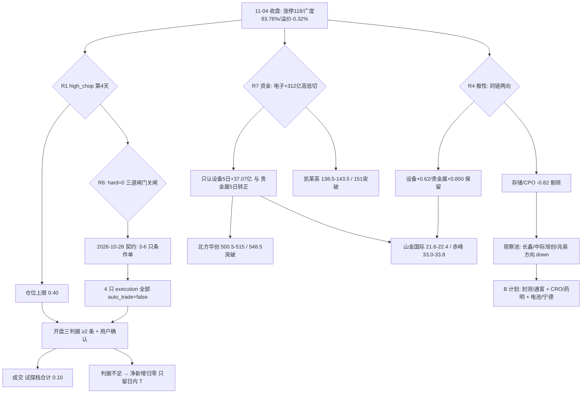

# 2026-11-05 · 主决策 / D1 盘前预案

> 数据源新鲜度: partial ｜ 降级状态: degraded ｜ 决策来源: **LLM（main_decision_v1）** ｜ 模式: dry_run / conditional_only
> 全票 **auto_trade_enabled=false**：给票、给价位、给触发前提；成交需「开盘三判据 ≥2 条成立 + 用户确认」。

## 一句话结论

**修复段第 4 天（强修复次日）**：指数级修复（涨停 118、广度 83.76%、中位 +1.88%）与打板亏钱（昨日涨停溢价 -0.32%、红盘率 37.5%）并存；资金单日高低切（电子 +312.63 亿只补 20 日失血 26.6%），唯一 5 日真金是**半导体设备**（+37.07 亿）、唯一内外共振是**贵金属**（R4 +0.850 最高，但薄封+事件映射）。两条主线都是 formation 第 1 天、龙一在 MA20 下方 → **不授予趋势仓，只给 4 只反抽承接条件单**（北方华创/山金国际/赤峰黄金/凯莱英），仓位上限 0.40，试探档合计 0.10。

## 四象限叉乘（R1-R7 交叉结论）

| 象限 | 结论 | 证据来源 |
|---|---|---|
| 资金面 Q1 | 电子 d1 +312.63 亿只补 20 日 -1176.61 亿的 26.6%、全市场 d1 +500.28 亿补 d20 -4685.50 亿的 10.7% → **单日高低切，不是趋势建仓**；半导体设备 5 日 +37.07 亿为电子链唯一正子行业；贵金属 5 日由四连负转正 +4.45 亿；超大单 +474 亿 vs 大单 -392 亿 = 被动托举指纹（杠杆未回场） | R7 / R6_M1_01/M2_04 / R2 validation |
| 情绪面 Q2 | 高位震荡第 4 天（conf 0.72）、情绪 64.1 贪婪下沿；涨停 118 但 40.7% 在 14:30 后封、昨日涨停溢价 -0.32%、红盘率 37.5%、再涨停 12 只 → **广度极强 ≠ 赚钱效应强**，打板/接力降级；强修复次日同构样本 2/2 回吐（n=2 只作风险背景） | R1 / R3 / R6_M1_04/M4_01 |
| 基本面估值 Q3 | 龙一估值与位置不利：北方华创 PE 67.4@84.5 分位 + 净利 +5.1%（V2）、套牢 77.5%；设备链涨停打进 62-78% 套牢区（模式八局部 high）；山东黄金 4 旗复核后仅 1 条实质成立（R5 flag 编码误用已披露） | R6_M3_01/M7_01/M8_01 / R5 |
| 结构 Q4 | 两条主线 formation 第 1 天、无连板梯队（最高身位 1 板）、7 只主线龙头 5 只在 MA20 下方 → 深跌反抽不是趋势反转；R2 stage_action「首板试探」与 R1「打板降级」冲突 → 以 R1 为准（只做低吸承接）；R2 exec=[] / R5 passed=0 / R7 exec=[] 三道闸门关闸，但 2026-10-28 契约要求 3-6 只条件单（auto_trade=false） | R6_M2_02/M2_03/M6_01 |

**主决策**：主线可交易性成立但只到「反抽承接」档位——执行池给 4 只条件单，全部以「开盘三判据 ≥2 条 + 板块资金复核 + 用户确认」为成交前提；存储/CPO（5 日 -76/-296 亿 + 美光 -7%）与高位题材（E008 立案）明确剔除。

## 执行池（4 只 · 全部条件单 · 试探档合计 0.10 / cap 0.40）

| 票 | 角色 | 通道 | 买区 | 触发 | 止损 | 止盈 | RR | 仓位建议 |
|---|---|---|---|---|---|---|---|---|
| 北方华创 002371.SZ | 半导体设备龙一 | 低吸承接 | 500.5~515.0 | 515.0 | 479.0 (-7%) | 587.0 | 2.0 | 0.03 / max 0.05 |
| 北方华创（次通道） | — | 突破确认 | 546.0~552.0 | 548.5 | 522.5 (-5%) | 610.0 | 2.4 | 同上（二选一） |
| 山金国际 000975.SZ | 贵金属龙一 | 低吸承接 | 21.6~22.4 | 22.4 | 21.06 (-6%) | 25.03 | 2.0 | 0.03 / max 0.05 |
| 赤峰黄金 600988.SH | 贵金属龙二 | 低吸承接 | 33.0~33.8 | 33.8 | 31.4 (-7%) | 38.54 | 2.0 | 0.02 / max 0.04 |
| 凯莱英 002821.SZ | CRO 次线龙二 | 低吸承接 | 138.5~143.5 | 143.5 | 133.5 (-7%) | 163.5 | 2.0 | 0.02 / max 0.04 |
| 凯莱英（次通道） | — | 突破确认 | 150.0~154.0 | 151.0 | 143.45 (-5%) | 166.1 | 2.0 | 同上（二选一） |

**成交门禁（meta.execution_gate · 修错题 20261102_001）**：①竞价广度 ≥0.55（T-1 实测 0.8376）②昨日涨停红盘率 ≥60%（T-1 实测 37.5%，须验证修复延续）③半导体+贵金属+机器人三方向合计竞价封单 ≥3 只 >1 亿。**前三条至少两条成立才允许成交**；只成立一条 → 只执行对应那只票；一条都不成立 → 四只全作废、只留存量日内 T。**采样窗口 09:30-10:00 滚动、首次达标即通知、最晚确认 10:00**（覆盖执行窗口，不重演判据死锁）。另：半导体设备主力 10:00 与 13:30 复核，任一时点转负 = 反抽证伪、主线降观察（R7/R6_M1_02 口径）。

### 首推票思维链：北方华创（半导体设备主线龙一）
- **买入理由**：设备链唯一「容量 + 5 日真金」双确认的带动性龙一——主力 +8.12 亿（净占比 12.94%）、5 日 +16.27 亿且 4/5 天为正（设备子行业 5 日 +37.07 亿 = 电子链唯一正流入）、3895 亿容量 + 13:47 封板 3.56 亿 / 0 开板；R4 E003 正面（设备指数 +15.22%、长鑫回购上限提至 50 亿）。
- **风险点**：收盘 535.50 仍在 MA20 548.17 下方（-2.3%）、77.5% 筹码套牢、PE 67.4@84.5 分位对净利 +5.1%（R6_M3_01）；隔夜 SOX -3.70%/阿斯麦 -4.60% 外盘否定（R6_M10_01）→ 高开就是给隔夜盘抬轿；无连板梯队，次日无 2 板即一日游（R2 生命周期风险）。
- **止损条件**：低吸通道 479.0（-7%，低于买区下沿且落在识图 500 支撑下方）；突破通道 522.5（-5%）；R6_M8_01 套牢结构 → 低开 >3% 视为筹码转弱，不补仓不摊薄。
- **可验证假设**：若 9:45 前设备子板块仍有 ≥3 家涨幅 >5% 且北方华创不破 510 → 「设备是电子链唯一 5 日真建仓方向」成立；若开盘即翻绿且板块无承接 → 证伪（sector_switch_exit 全清）。

### 三问（对半导体设备/材料主线）
- **大资金意图**：不是全链条建仓，是**从电子/半导体/CPO 高位失血板块里的结构性切仓**——d1 +312.63 亿只补 20 日失血 26.6%，且只认设备（5 日 +37.07 亿）与材料（磷化铟事件），存储/CPO（20 日 -1003.29 亿）是被 R4/R7 双重否定的派发区；买错分支=买反方向。
- **为什么走强**：四维同源但分量不同——R7 资金第 1/2、19 家涨停封单 29.28 亿板块第一、R3 共振第 1（L1+L2b，KOL 层连续 6 日 0 条）、R4 E003 正面；但 19 家全为首板（0 连板）、40.7% 涨停在 14:30 后封 → 只有广度没有高度，是「深跌反抽第 1 根阳线」不是「趋势启动」。
- **逻辑够不够硬**：够到「反抽承接」但不够到「追一致」——R6_M1_01 把四源共振打折到 0.6-0.7 读，R6_M2_03 把 formation 第 1 天定性为深跌结构内修复；只能给试探档 + 硬止损 + 站上 MA20 才转趋势（R6_M3_01 前置条件）。

## 观察池（24 只 · 全部带 expected_direction）

主线/次线核心（含 R6 拦截降级）：拓荆科技↑(设备龙二·14:33 尾盘投机板·late_speculation)、云南锗业↑(材料分支·PE276·事件驱动)、华峰测控↑(低位机构净买·资金弱)、中科飞测→(亏损+尾盘板·四重不利)、山东黄金↓(派发·机构净卖+大宗折价+融券激增)、盛达资源→(白银弹性·5 日资金负)、晓程科技→(20cm 小容量·2 红旗)、药明康德↑(CRO 龙一·14:05 封·联动指标)、宇树科技→(机器人总龙·钱没跟)、索辰科技↑(机器人 20cm·机构净买)、冰山冷热↓(3 板身位·死亡换手)、永臻股份↑(光伏 2 板·容量过小)、宁德时代↑(电池 5 日全市场第 1·未参与反抽)、中芯国际→(代工新高·RR1.6 不合格)、长鑫科技↓(存储总龙·单日脉冲+美光 -7%)、中微公司↑(设备低位·5 日 +13.38 亿·R7 资金注脚)、兆易创新↓(存储设计反抽·外部压制)、扬子新材↑(妖·羊年活口·watch_elastic 轻仓观察)、中际旭创↓(CPO 派发·热度-资金背离)、阳光电源↑(光伏储能承接·B 计划)、祥源文旅→(羊年未兑现·无板)、襄阳轴承↓(霸榜后派发续报)、七匹狼↓(人气-价格背离·狼族证伪)、通富微电↑(封测容量·净流入率全场最高·B 计划承接)。

## R6 反证采纳 / 覆盖

- **hard_rejects = 0**（三重复核：法定触发面 0 + R3/R7 双清单零交集 + 模式七阈值复核）。空 hard_rejects 不代表 10 只过关——今日真正的约束是三道闸门关闸（R2 exec=[] / R5 passed=0 / R7 exec=[]）。
- **采纳（写入票级约束）**：R6_M1_01 四源共振打折 0.6-0.7；R6_M1_02 资金只认设备 5 日真金；R6_M1_03 唯一事实源=R5 画像 10 只（R7 池只作资金注脚，中微/长鑫/中芯/兆易只进观察）；R6_M2_02 R1 打板降级覆盖 R2 首板试探；R6_M2_03 只给反抽仓；R6_M2_04 被动托举 → 加仓节奏放慢；R6_M3_01 北方华创站上 MA20 548.17 才转趋势；R6_M3_02 云南锗业不进执行；R6_M3_03 山东黄金视同不进；R6_M5_01 派发族 ×0.5 权重；R6_M5_02 薄封判据强化（贵金属只做低吸、高开>5% 放弃、赤峰减半仓）；R6_M8_01 套牢区分批留 T；R6_M10_01 高开 >3% 不追。
- **覆盖（1 条，写理由）**：R6_M6_01「空执行池是硬约束」→ 被用户 2026-10-28 硬契约覆盖：必须给 3-6 只条件单（auto_trade=false + 三判据 + 用户确认），候选源按 R6_M1_03 约束（只取 R2 龙一/龙二 ∩ R5 画像 ∩ forbidden 全过）。
- **禁止清单命中**：执行池 4 只全部 0 命中（R2 forbidden_scan 程序验证）；被拦 6 只（拓荆/中科飞测/云南锗业/盛达/山东黄金/药明 late_speculation 或 mid_laggard）全部降观察，无一只进执行。

## B 计划（跷跷板 · 预案内备选，不临时起意）

| 方向 | 触发 | 候选 |
|---|---|---|
| 半导体内部高低切（设备 → 封测/材料低位） | 设备高开 >3% 兑现或竞价不及预期 + 封测承接 | 通富微电（封 3.80 亿+净流入率 13.81% 全场最高）/ 中微公司（低位弹性） |
| CRO/创新药（5 日 +32.16 亿防守承接） | 科技主线竞价集体低开 + 医疗研发外包续正 | 药明康德（站上 150）/ 凯莱英（执行池联动） |
| 电池/储能（宁德 5 日全市场第 1） | 电子/半导体 10:00 后主力转负 + 电池续正 | 宁德时代（回踩 240-245）/ 阳光电源（站上 MA20） |

反向提示：B 计划方向同步走弱（封测/CRO/电池全数主力转负）→ 全市场降档，执行池全部后置/空仓，只留存量日内 T。

## 仓位上限推导

min(R1 最终 0.55, emotion high_chop 0.55×0.75=0.4125) × main_lines_mult 1.0（2 条主线）= **0.40**（保守取整）。
R1 口径：0.70(主线进攻) -0.05(高位震荡·打板不赚钱) -0.05(强修复次日 2/2 回吐) -0.05(隔夜费半 -3.13%) = 0.55。情绪联动 64.1<80 不触发贪婪上限；R6 无全市场级 M5/M1 命中 → market_wide_factor=1.0。试探档合计 0.10 ≤ 0.40，新增预算 0.10 ≤ cap×0.5。

## 妖股赛道（四季度跨年妖 · 2027 春节 = 羊年）

玄学 11-03 见顶：11-04 同族涨停 13→2 家，4 板高标阳光照明 -9.90%（主力 -1.43 亿）/东方海洋 -4.09%（-3.44 亿）/七匹狼 -9.97%（-4.20 亿）合计主力 -9.07 亿 → **高标派发 → 全族退潮确认**。唯一活口扬子新材（2 板 + 封 0.64 亿/0 开板 + 主力净占比 21.9%）只保留 watch_elastic 轻仓观察（只做竞价弱转强/打板确认、破板即走、不加仓）；不进 execution——退潮期不硬做（纪律）+ E008 三家立案高位题材监管收紧 + R2 明确只给轻仓观察。未兑现方向（鲜/祥/美/善/羚）11-04 全部无涨停，无扩散资金证据，不给候选。

## 数据源审计

| 源 | 状态 | 抓取时间 | 置信度 | 备注 |
|---|---|---|---|---|
| R1 风格 | 🟡 degraded | 06:46 | 0.39 | 主线扩散型/cap 0.55/high_chop 第 4 天；wechat 5 群 0 条 + fx/商品缺失 |
| R2 主线 | 🟢 ok | 07:07 | 0.72 | 2 主线（设备材料 83 / 贵金属 81）formation 第 1 天；exec=[] 为纪律结果非缺失 |
| R3 情绪 | 🟡 degraded | 06:54 | 0.52 | 弱修复 60.6；L2 群聊连续 6 日 0 条 + WeFlow 永久下线 |
| R4 消息 | 🟢 ok | 06:55 | 0.70 | 8 事件；贵金属 +0.850 最高、设备 +0.62、半导体/存储/CPO -0.82/-0.574（同链两向）；无未来 3 日大事件 |
| R5 画像 | 🟡 degraded | 07:31 | 0.72 | 10/10 画像；d1_gate passed=0；flag 编码/阈值误用（R6_M7_01 已复核） |
| R6 反证 | 🟢 ok | 07:36 | 0.42 | hard=0；strong 16/soft 7；模式五校准派发族 ×0.5 |
| R7 资金 | 🟡 degraded | 04:52 | 0.82 | **契约失败**（<06:00 应标 unavailable）；数据日 11-04 trading_gap=0 新鲜可用，仅方向确认；vibe-trading 掉线缺第二源 |
| emotion_cycle / cycle_position | 🟢 ok | 06:03/06:41 | 0.72 | high_chop；tier=neutral（连跌 0 天，非 repair_window 非 continued_down） |
| attention_signals | 🔴 missing | — | — | 人气维度缺（R3 hotlist + R2 榜位代理） |
| chart_vision | 🟢 ok | 07:16 | — | 20 只识图快照盘前生成；与 D1 价位一致（北方华创 512-520 低吸/548-564 压力），与引擎 MA50 口径冲突 → review_required 人工复核 |

## 不确定性 / 反证

- 开盘三判据当前仅广度（0.8376）确定达标、红盘率 37.5% 未达 → 今日**大概率部分条件单不成交**，这是纪律输出不是失败；最晚确认 10:00，超过即不再开仓。
- R7 契约失败仅标签层（staleness 应为 unavailable）：数据为 T-1 收盘口径 trading_gap=0，按方向确认使用；不激活 R7_STALE 禁交易。
- R6 派发/位置族 1/4 命中偏误（错题 20261104_003）→ 对北方华创/山金/赤峰的位置类 strong_suggest 按 0.5 权重，只作止损纪律不剔除；**hard 级不折价**（今日无 hard）。
- 引擎 MA50 基准买区在现价上方（北方华创 +14.7% 等）→ 属 trend_pullback 趋势口径，深跌反抽第 2 天不适用；D1 按 R2 MA5 承接带 + R6 前置条件给出反抽承接价，偏离 >10% 已在 derivation_reason 说明依据（含识图结构位确认）。
- 强修复次日 2/2 回吐（n=2）→ 不押「修复延续」，仓位上限 0.40 + 全部条件单；若 10:00 判据不足两条 → 净新增归零。
- 贵金属驱动是中期选举一次性事件 + 薄封（11 家 9.20 亿、开板 18 次）→ 只做低吸、高开 >5% 放弃、事件落地后金价不续涨即映射失效。

## 错题本注入（Step 0.4）

- 20261104_002 R4 板级负面不当整条剔除 → 对冲门：设备当日 +42.47 亿>20 亿 + E003 正面 → 负面作废保留设备主线；存储/CPO 5 日失血 + MU -7% → 剔除（已修）
- 20261104_003 R6 位置类连续两日误杀 → 派发族 ×0.5 权重，北方华创/山金/赤峰保留试探档（已修）
- 20261102_001 判据窗口死锁 → 采样 09:30-10:00 滚动 + 最晚确认 10:00（已修）
- 20261102_002 / 20261103_001 全深回踩自动弃权 + 买区不可成交 → 北方华创/凯莱英双通道（低吸 + 突破确认）、买区贴近 MA5 可成交（已修）
- 20261104_001 跌停家数判 main_down 陷阱 → cycle_position tier=neutral + high_chop 第 4 天定位，未判空仓日（已修）
- 20261104_004 当日主线只观察不执行 → 半导体设备龙一 + 贵金属龙一/龙二全进执行池（已修）
- 20261102_004 watch 无方向 → expected_direction 24/24（已修）

## 与其他 R/D/E 的关系

- 依赖: R1-R7 artifacts + emotion_cycle + cycle_position + mainline_lifecycle + user_preferences + 错题本 + observation_tracking(20261104)
- 被消费: P1(auction_amendment_v1) / P2(midday_amendment_v1) / execute(canghai-execute)

## 交付与阻塞说明

- 核心契约 `data/plans/20261105/watchlist_plan.json` 已落盘并通过：pydantic（exec=4 / watch=24）、`trading/load_plan.py::validate_plan_for_date`（20261029 起 3-6 只硬契约 OK）、全局 buy gate=eligible、无 active no_trade、watch expected_direction 24/24、执行票全部带 buy_zone/trigger/stop/take/position/max_position/derivation_reason。
- 价位引擎 `src/plan/price_levels.py` 已通过 `apply_to_plan()` 内存 enrichment 生成 engine_levels + buy_eligibility + vision_evidence（不写盘，规避 CLI 落 `chzl_kg/…_价位推导.md` 的白名单冲突）。
- 3 只执行票（北方华创/山金/赤峰）识图冲突标注 review_required=true（冲突对象是引擎 MA50 基准价，非 D1 价；D1 价与识图结构位一致）→ 交由 P1/execute 人工复核，不改价。
- **阻塞项（如实报告）**：skill Step 5.0 要求的 `render_plan_tables.py`（点位表版）与 `render_markdown.py`（散文版）输出路径在 `chzl_kg/投研交易/盘前预案/`，超出本次交付白名单（禁止写 chzl_kg/）→ 未执行，交由 `scripts/research/publish_unit_md.py` 发布本报告；`apply_price_levels.py` CLI 的价位推导 md 同理未落盘。
- 早前 07:45 同一日旧 plan（decision_source=llm）已按本次 fresh 决策覆盖，未作为研究输入（见 meta.decision_lineage.excluded）。

