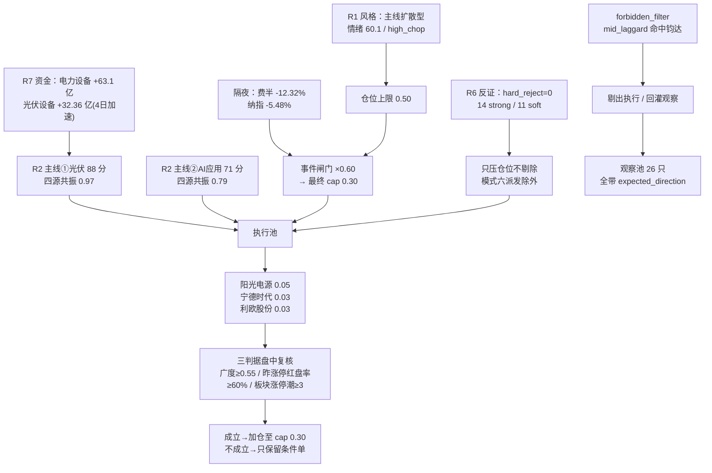

# 2026-11-06 · **主决策 / D1 盘前预案**

> **数据源新鲜度**：partial ｜ **降级状态**：true（R1/R3 降级、R7 时序告警）
> **决策来源**：llm（fresh context，仅消费本次 research_summary 的 R1–R7 主产物）
> **一句话**：主线扩散 + 高位震荡 + 隔夜费半 −12.32%，只做有钱的三条线，仓位上限砍到 30%，三只条件单全是「低开承接 / 放量突破」，AI 硬件链今日禁新仓。

---

## 一、一句话结论

11-05 是**广度极强、资金转弱**的普涨日（涨停 84 / 跌停 0 / 炸板 48 = 36.36% / 广度 88.3% / 成交 21177 亿 +3.94%），
但主力只 +85.39 亿（前一日 +500.28 亿），20 日累计 −4119.74 亿、仅 5/20 天为正——
**钱没有增量，只是在板块间换手（B 象限：强价 × 弱资金）**。

隔夜美股把这件事变成了压力测试：**费半 −12.32%、纳指 −5.48%、MU −17.48%、AMD −17.68%、TSM −11.05%，
而黄金仅 +0.81%、白银 −0.79%——避险没接住，是全科技链同步去杠杆**。

所以今日的答案不是「空仓」也不是「抄底」，而是**收窄到有钱的三条线 + 买点后置**：

| 决策 | 内容 |
|---|---|
| 风格 | 主线扩散型（R1 代价最小化，置信度 0.441） |
| 情绪阶段 | 高位震荡（high_chop，炸板率 36.36% 越 35% 红线） |
| 周期位置 | `tier=neutral`（连跌 0 天）→ 非修复窗口、非续跌，按当日主线正常评估 |
| 仓位上限 | **0.50 → 0.30**（隔夜大事件折价 ×0.60） |
| 执行池 | **3 只条件单**（阳光电源 / 宁德时代 / 利欧股份），全部 `auto_trade_enabled=false` |
| 观察池 | 26 只（全部带方向与价位） |
| 禁新仓 | AI 硬件链：存储 / 光模块 / CPO / PCB / 半导体设备 |

---

## 二、盘面温度：极强广度 + 断裂高度

| 指标 | 11-05 实测 | 读数 |
|---|---|---|
| 涨停 / 跌停 | 84 / **0** | 亏钱效应为零 |
| 炸板 / 炸板率 | 48 / **36.36%** | 越 35% 红线 → 强分歧 |
| 最高板 | **4 板**（无 5 板+） | 高度断裂，做不出空间龙 |
| 涨家占比 | 88.3%（4869/5571） | 极强 |
| 全 A 中位 | +2.02% | 普涨 |
| 成交额 | 21177 亿（+3.94%） | 放量 |
| 主力净额 | **+85.39 亿**（净率 0.40%） | 资金没跟上 |
| 20 日主力累计 | **−4119.74 亿**，仅 5/20 天为正 | 存量换手 |
| 昨日涨停今日溢价 | +4.49%，再涨停 21 只 | 接力尚可（收盘口径，不作今日开仓判据） |

**结论**：这是「普涨 + 强分歧」的修复第五日，**不是主升**（高度只到 4 板）、**也不是主跌**（跌停 0 家）。
`cycle_position` 读数 `consecutive_down_days=0 / tier=neutral`，所以既不走修复窗口打法、也不清空池子——
按「有资金的线做低吸」处理。

---

## 三、两条主线：四源共振 0.97 / 0.79

| 维度 | 主线① 光伏/电力设备（含储能）88 分 | 主线② AI应用/传媒（含短剧游戏）71 分 |
|---|---|---|
| 热度（R3） | THS 概念 #1，热度 204009（+291%），是第 2 名的 1.43 倍 | #2 142976（+262%），短剧 #5 / AI视频 #9 同族进前十 |
| 资金（R7） | 电力设备 +63.10 亿(#1)、光伏设备 +32.36 亿、电池 +26.43 亿 | 传媒 +34.92 亿(#4)、营销代理 +20.52 亿（占比 9.21% **全行业最高**） |
| 持续性 | 光伏设备 4 日连续净流入且逐日加速 5.61→8.50→21.66→32.36；20 日 +4.25 亿（电力系唯一真金） | 传媒/营销代理连续 2 日净流入，5 日 +53.83 亿 |
| 涨停结构 | 光伏设备 11 家（全场唯一 ≥8 家）、储能 18/6 连板、BC 电池 NEW #14 | 广告营销 3 家 + 影视院线 2 家 + 通信服务 2 家；AI应用概念 17 涨停/5 连板 |
| 阶段 | R2 判 mid_up，但自述「涨停潮是第 1 日（3→11 家）、板块已四连涨」= **加速初期、位置不低** | mid_up，自述「二波重塑」：17→1→1→7 家，只有 2 板高度 = **中段反抽** |
| 关键风险 | 炸板率 36.36%（板块内 7 家炸板）；阳光 5 日 +26.7%、永臻 pos20=100 | 7 家涨停里 3 家落在 13:00 后（午后投机）；利欧东财 #1 但 THS #21（单平台人气） |

**次线（只研究不执行）**：半导体设备 52 分——R7 三层同向（+61.04 / +54.32 / 5 日 +108.22 亿）是全场最干净的资金结构，
但**涨停 24h 内 −79%、封板质量崩坏、隔夜费半 −12.25%**，今日只观察其「低开不破」能否成立。

**丢弃线**：黄金（叙事 17 分最高，但热度 −66%、全线炸板）、创新药（单票业绩）、商业航天（只有热度一条腿）、
人形机器人（热度腰斩 −47%，R3 明确判「衰退惯性」）。

---

## 四、执行池（3 只 · 全部条件单）

> 全部 `auto_trade_enabled = false`、`requires_user_confirmation = true`。
> 首笔合计仓位 **0.11**（11%），距 cap 0.30 留 0.19 给加仓与 B 计划。

### 4.1 阳光电源 300274.SZ ｜ 光伏龙一（容量核心）｜ 仓位 0.03+0.02 ｜ 上限 0.10

| 项目 | 数值 | 依据 |
|---|---|---|
| 现价（T-1 收） | 85.14（+4.89%） | 成交 130.5 亿 = 板块第 2 名的 2 倍以上 |
| 低吸买区 | **79.60 ~ 81.00**（触发 81.00） | 识图低吸 81.0/80.1、MA50 85.18 下方 4.9%、缺口回补区 |
| 止损 | **75.30**（−7.0%） | 买区上沿 ×0.93，且低于买区下沿 |
| 止盈 | **91.30**（较现价 +7.2%，第一压力） | 20 日高 91.3 = 识图突破位 91.3 |
| 盈亏比 | **1.81** | (91.30−81.00)/(81.00−75.30) |
| 突破档 | 91.30~92.20（触发 91.5），止损 86.90，止盈 102.00，RR 1.85，仓位 0.02 | 需板块 ≥3 家新涨停 + 30 分钟量 > 5 日均量 1.5x |
| 持有档 | `wave_main`（波段锁仓） | 跌破 MA20 74.77 清仓；不做 T |

**买入理由**：板块 11 家涨停潮由它带出（未封板仍是龙一，R2 口径「容量核心」）；core_judge 88 分 / 共振（个股-板块 0.74）；
主力 +5.03 亿、5 日 +19.42 亿（4/5 天正）；R5 alpha A− / risk B+ 过主仓档。

**风险点**：①净利 −44.46%、Q3 营收 −26.4%，题材强于基本面（R6_M3_03 低估值陷阱侧）；
②5 日已 +26.7%、5 日主力 +19.42 亿但 20 日仍 −14.14 亿（5 日回补、20 日未回本）；③两融 15 日 −12.2%，杠杆在撤。
④隔夜外盘若引发板块级补跌，β 会盖过个股 α。

**止损条件**：跌破 75.30 无条件走；跌破 MA20 74.77 收盘清仓；板块主力净流出 >20 亿且涨停家数 <3 → 减半。

**可验证假设**：若 10:00 前板块涨停家数仍 ≥5 家且阳光分时不破均价，则「容量核心补涨」成立（R2 预期差）；
若板块涨停家数掉到 <3 家，则该假设被证伪，低吸档撤单。

**竞价四档**

| 竞价区间 | 判定 | 动作 |
|---|---|---|
| < 79.60（<−6.5%） | 破位 | 放弃，不接 |
| 79.60 ~ 83.40（−6.5%~−2.0%） | 低吸执行区 | 分批承接，跌破 79.6 撤 |
| 83.40 ~ 86.80（−2.0%~+2.0%） | 符合预期 | 不追，等分时回踩 81.0 |
| 86.80 ~ 89.40（+2.0%~+5.0%） | 超预期 | 不追高，只在放量站上 91.5 走突破档 |
| > 89.40（>+5%） | 高开过度 | 等突破档或放弃 |

---

### 4.2 宁德时代 300750.SZ ｜ 储能链容量核心 ｜ 仓位 0.03 ｜ 上限 0.06

| 项目 | 数值 | 依据 |
|---|---|---|
| 现价 | 264.06（+4.42%） | 成交 184.0 亿 |
| 买区 | **252.50 ~ 258.00**（触发 258.00） | MA20 255.07 生命线承接口径 |
| 止损 | **239.90**（−7.0%） | 买区上沿 ×0.93 |
| 止盈 | **298.00** | 前高 306.71 下方第一压力 |
| 盈亏比 | **2.21** | (298−258)/(258−239.9) |
| 持有档 | `wave_main` | 跌破 MA5 247.87 减半 |

**买入理由**：R6 价格-资金矩阵里**唯一 C 象限（弱价强资）**——5 日主力 +45.47 亿、5/5 天为正、当日 +8.10 亿，
而 pos20 仅 50.9：**资金先到、价格未到**，是今日唯一有赔率的结构。core_judge 70 分 / 中性联动；alpha A− / risk B+。

**风险点**：①价格在 MA50 304.85 下方 12.8%，趋势未修复，属超跌反弹不是趋势反转；
②两融 15 日 −12.2%（杠杆撤退）；③66.5% 解套盘在 300 上方；④1.1 万亿市值无日内弹性。

**止损条件**：跌破 239.90 走；收盘跌破 MA5 247.87 减半。

**可验证假设**：若电池/储能板块当日主力继续为正且它站稳 MA20，「资金回补→价格修复」成立；
若板块主力转负，则 C 象限降级为 D 象限（弱价弱资），撤单。

**竞价四档**：<252.50 放弃 ｜ 252.50~258.00 低吸执行 ｜ 258~270.80 不追等回踩 ｜ >270.80 放弃（超大市值不抬轿）。

---

### 4.3 利欧股份 002131.SZ ｜ AI应用龙一（广告营销）｜ 仓位 0.03 ｜ 上限 0.06

| 项目 | 数值 | 依据 |
|---|---|---|
| 现价 | 4.39（+10.03% 首板） | 成交 21.5 亿，封 1.37 亿 |
| 买区 | **4.28 ~ 4.40**（触发 4.40） | MA50 4.3706 上方承接 |
| 止损 | **4.18**（−5.0%） | 亏损股只给 −5% |
| 止盈 | **4.88**（2R） | 引擎 2R |
| 盈亏比 | **2.18** | (4.88−4.40)/(4.40−4.18) |
| 持有档 | `short`（短线） | 分时破均价 30 分钟不收回即走 |

**买入理由**：主力 +9.13 亿（全市场单票第 2、占比 42.53%）、龙虎榜净买 +3.30 亿（R6 判 A1 真金）、东财人气 #1，
首板封 1.37 亿带动广告营销 3 家涨停；core_judge 72 分 / 共振 0.90。

**风险点**：①亏损 + CFO −9.2 亿（R6_M7_02）；②东财 #1 但 THS #21 = 单平台散户人气（R6 flag `single_platform_hype`）；
③板型是**回封板（1 次开板）**，空头已削弱；④应用端 3 家涨停在 13:00 后，午后投机属性。
→ 因此只给试探档 0.03，不给主仓。

**止损条件**：跌破 4.18 走；分时跌破均价 4.28 且 30 分钟不收回减半。

**可验证假设**：若广告营销板块主力当日保持净流入且它不破 4.28，「应用端资金龙头」成立；
若板块主力转净流出 >10 亿，则减半。

**竞价四档**：<4.24 放弃 ｜ 4.24~4.40 低吸执行 ｜ 4.40~4.52 不追等回踩 ｜ >4.52 放弃（高开=兑现）。

---

### 4.4 执行池仓位汇总

| 标的 | 角色 | 首笔仓位 | 单票上限 | 档位 | 盈亏比 |
|---|---|---|---|---|---|
| 阳光电源 | leader（光伏容量核心） | 0.03 + 突破档 0.02 | 0.10 | 主仓档 | 1.81 / 1.85 |
| 宁德时代 | core_largecap（储能核心） | 0.03 | 0.06 | 主仓档 | 2.21 |
| 利欧股份 | leader（AI应用龙一） | 0.03 | 0.06 | 试探档 | 2.18 |
| **合计** | | **0.11** | 光伏系 0.16（≤0.22） | | 全 ≥1.8 |

**为什么只有 3 只**：执行池硬契约 3–6 只，往上一格必须过「alpha≥B+ + RR≥1.8 + 非禁买清单」。
龙二永臻 3 板一字打板口径 RR **1.20**、浙文影业 4 板打板 RR **1.15**、钧达命中 `mid_laggard`（板块第 3 顺位 + pos30=100），
宁可少给也不破纪律——**三只全部是真金主线核心，没有一只是凑数的**。

---

## 五、仓位上限是怎么推出来的

| 步骤 | 值 | 说明 |
|---|---|---|
| R1 风格基准 | 0.65 | 主线扩散型 |
| R1 情绪/阶段增减 | −0.05（high_chop）−0.05（30 日样本中位 −9.06%、正收益 9/42）−0.10（修复第 5 日 + 纳指 3 日 −3.36%） | R1 已内部扣减 |
| R1 输出 | **0.50** | |
| R7 北向调整 | 0.00 | 北向自 2026-10-28 停抓（retired stub），不得据此调仓 |
| 情绪 5 维覆盖 | 0.60（贪婪档顶格） | 不约束（0.50 < 0.60） |
| 主线条数乘数 | ×1.0 | 2 条主线 |
| **隔夜大事件折价** | **×0.60** | 费半 −12.32%，R4 E001 行业级 negative high |
| **最终 cap** | **0.30** | 首笔只用 0.11，余 0.19 留给三判据成立后的加仓 |

**盘中三判据（09:30–11:30 任一时刻，两条成立即可加仓，不是只在 09:30–10:00 窗口）**：
① 广度 ≥0.55 ｜ ② 昨日涨停红盘率 ≥60% ｜ ③ 板块级涨停潮 ≥3 只。
> 注：三判据只用**盘前/盘中可实测**的量，没有「竞价封单」这类盘前不存在的维度（错题本 20261102_001 / 20261105_004 的死锁形态）。

---

## 六、观察池（26 只，全部带方向与价位）

> `expected_direction` 三档：up / down / sideways。「距现价」= 买区上沿相对 T-1 收盘；
> `+x%` 表示需上破才成立（现在买不到），`−x%` 表示需回撤才触发。

### 6.1 光伏 / 电力设备（主线①，9 只）

| 代码 | 名称 | 方向 | 现价 | 买区 | 触发 | 止损 | 止盈 | RR | 距现价 | 观察理由 |
|---|---|---|---|---|---|---|---|---|---|---|
| 603381 | 永臻股份 | up | 18.85 | 14.90~15.35 | 14.90 | 14.58 | 16.89 | 2.0 | −18.6% | 3 板一字身位龙，打板 RR 1.20 不够；CFO −11.94 亿、获利盘 97.5%、流通 26.8 亿 |
| 002506 | 协鑫集成 | up | 2.54 | 2.41~2.49 | 2.41 | 2.37 | 2.73 | 2.0 | −2.0% | 大容量首板（主力占比 46.71%），alpha B− / risk C 未过闸 |
| 300093 | 金刚光伏 | up | 18.66 | 20.62~21.25 | 20.62 | 19.55 | 24.65 | 2.0 | +13.9% | 20cm 弹性，需上破 MA50 才成立 |
| 688429 | 时创能源 | up | 10.69 | 9.51~9.80 | 9.51 | 9.02 | 10.69 | 1.14 | −8.3% | 20cm 首板，RR_FAIL 只观察 |
| 603212 | 赛伍技术 | up | 10.67 | 10.91~11.24 | 10.91 | 10.68 | 12.36 | 2.0 | +5.3% | 辅材补涨，B 计划候选 |
| 002150 | 正泰电源 | up | 21.49 | 19.79~20.39 | 19.79 | 19.37 | 22.01 | 1.59 | −5.1% | 逆变器二线，RR_FAIL |
| 603876 | 鼎胜新材 | up | 15.11 | 17.90~18.45 | 17.90 | 17.53 | 20.29 | 2.0 | +22.1% | 铝箔辅材，MA50 下方 17% 超跌 |
| 600481 | 双良节能 | up | 4.11 | 3.98~4.10 | 3.98 | 3.89 | 4.52 | 2.0 | −0.2% | 硅片扩散末端 |
| 001269 | 欧晶科技 | up | 19.06 | 18.23~18.78 | 18.23 | 17.84 | 19.93 | 1.22 | −1.5% | 石英坩埚，RR_FAIL |

### 6.2 AI应用 / 传媒（主线②，5 只）

| 代码 | 名称 | 方向 | 现价 | 买区 | 触发 | 止损 | 止盈 | RR | 距现价 | 观察理由 |
|---|---|---|---|---|---|---|---|---|---|---|
| 603598 | 引力传媒 | sideways | 21.66 | 18.07~18.62 | 18.07 | 17.69 | 20.48 | 2.0 | −14.0% | 2 板高度锚；alpha B / risk C + 三条红旗（股东股份冻结 / 估值 88.3 / CFO 负）→ R6 拦截 |
| 001330 | 博纳影业 | sideways | 6.16 | 5.79~5.91 | 5.79 | 5.61 | 6.51 | 2.0 | −4.1% | RR 最高（2.82）但 R6 模式六实锤派发（龙虎榜 5 次 −1.33 亿 + 大宗 −20.13%） |
| 002929 | 润建股份 | down | 57.37 | 53.19~54.80 | 53.19 | 52.06 | 60.28 | 2.0 | −4.5% | 封单最厚但 CFO −39.87 亿、应收重 |
| 300058 | 蓝色光标 | down | 13.37 | 12.77~13.16 | 12.77 | 12.22 | 13.87 | 0.76 | −1.6% | 大宗 −27.67%、主力占比 6.65%、RR 0.76 |
| 300413 | 芒果超媒 | down | 32.78 | 25.59~26.37 | 25.59 | 24.26 | 30.59 | 2.0 | −19.6% | 人气 74→10 但主力 −2.09 亿 = 人气陷阱 |
| 601599 | 浙文影业 | up | 4.62 | 3.51~3.62 | 3.51 | 3.44 | 3.98 | 2.0 | −21.6% | 全场最高 4 板、core 90 分，但打板 RR 1.15 不够；高度断裂风险 |

### 6.3 半导体设备（次线，4 只 · 隔夜行业级利空直接命中）

| 代码 | 名称 | 方向 | 现价 | 买区 | 触发 | 止损 | 止盈 | RR | 距现价 | 观察理由 |
|---|---|---|---|---|---|---|---|---|---|---|
| 002371 | 北方华创 | down | 561.01 | 610.17~628.76 | 610.17 | 597.32 | 691.64 | 2.0 | +12.1% | 20 日 +19.60 亿真金，但 E001 直接打击；只观察「低开不破 MA20 546.2」 |
| 688012 | 中微公司 | down | 254.00 | 308.81~318.22 | 308.81 | 292.76 | 369.14 | 2.0 | +25.3% | 已破 MA20/MA50，趋势破坏 |
| 600641 | 先导基电 | down | 31.02 | 35.41~36.49 | 35.41 | 34.67 | 40.13 | 2.0 | +17.6% | R4 多源首板候选，但超跌反抽不追 |
| 600206 | 有研新材 | down | 38.39 | 44.80~46.17 | 44.80 | 43.86 | 49.00 | 1.23 | +20.3% | RR_FAIL + E001 打击面 |

### 6.4 贵金属（丢弃线，3 只）

| 代码 | 名称 | 方向 | 现价 | 买区 | 触发 | 止损 | 止盈 | RR | 距现价 | 观察理由 |
|---|---|---|---|---|---|---|---|---|---|---|
| 000975 | 山金国际 | sideways | 24.24 | 24.38~25.12 | 24.38 | 23.86 | 27.64 | 2.0 | +3.6% | 金价 4130 但 A 股热度 −66%、全线炸板 |
| 600988 | 赤峰黄金 | sideways | 37.58 | 41.11~42.36 | 41.11 | 40.24 | 46.60 | 2.0 | +12.7% | 开板 21 次，炸板结构 |
| 000603 | 盛达资源 | down | 26.05 | 30.66~31.60 | 30.66 | 30.02 | 34.76 | 2.0 | +21.3% | 2 板开 6 次，白银隔夜 −0.79% |

### 6.5 妖股赛道（羊年窗口，3 只）

| 代码 | 名称 | 方向 | 现价 | 买区 | 触发 | 止损 | 止盈 | RR | 距现价 | 观察理由 |
|---|---|---|---|---|---|---|---|---|---|---|
| 002578 | 闽发铝业 | up | 4.55 | 3.56~3.67 | 3.56 | 3.49 | 4.03 | 2.0 | −19.3% | 4 板一字（主力占比 58.04%），打板 RR<1.8 |
| 600569 | 安阳钢铁 | up | 1.93 | 1.73~1.80 | 1.73 | 1.71 | 1.93 | 1.44 | −6.7% | 羊年唯一「首板+0 开板」干净名字梗，但封单仅 0.29 亿 |
| 000017 | 深中华A | sideways | 7.02 | 7.60~7.83 | 7.60 | 7.44 | 8.61 | 2.0 | +11.5% | 2 板但主力占比仅 14%，资金认可弱 |

### 6.6 主线外（1 只）

| 代码 | 名称 | 方向 | 现价 | 买区 | 触发 | 止损 | 止盈 | RR | 距现价 | 观察理由 |
|---|---|---|---|---|---|---|---|---|---|---|
| 002821 | 凯莱英 | sideways | 161.45 | 162.06~166.99 | 162.06 | 158.64 | 182.60 | 1.87 | +3.4% | 百济净利 +431.8% 是硬业绩，但医药 5 日仅 +2.38 亿、无涨停潮 |

---

## 七、否决清单（7 只 · 逐条可审计）

| 代码 | 名称 | 否决原因码 | 说明 |
|---|---|---|---|
| 002865 | 钧达股份 | `mid_laggard` | 换手 12.07%/主力 +2.93 亿其实很好，但板块内第 3 顺位 + pos30=100 → 纪律②「只做龙头或低位，躲中位杂毛」。**属纪律否决不是赔率否决**（RR 2.00 本来过关） |
| 301697 | 贝特利 | `small_cap_liquidity` | 流通 13.4 亿 < 20 亿硬线（防庄股） |
| 002086 | 东方海洋 | `distribution_alert` | 换手 53% + 开板 14 次 + 连续霸榜（R3 告警 avg_rank 1.5）= 派发 |
| 002343 | 慈文传媒 | `death_turnover` | 换手 35.16% 死亡换手边缘 + 开板 1 次 |
| 600261 | 阳光照明 | `bad_board` | 开板 4 次、换手 25.63%、封单比 1% |
| 002088 | 鲁阳节能 | `bad_board` | 3 板但封单 0.24 亿（0.5%）+ 开板 4 次 |
| 603500 | 祥和实业 | `bad_board` | 拆字族唯一涨停但开板 4 次、封 0.11 亿 |

> R6 `hard_reject = 0`（10/10 法定对象核验：模式六对象 0、双清单交集 0、模式七最高 3 条红旗未达阈）。
> **空 hard_reject ≠ 全票通过**——真正的约束在执行池只有 3 只。

---

## 八、B 计划（预案票不及预期时资金会去哪）

| 触发 | 方向 | 候选（盘前点名） |
|---|---|---|
| 执行池 ≥2 票竞价不及预期 / 板块主力转净流出 >20 亿 / 龙头断板 | **光伏内部高低切** | 赛伍技术(10.91 上破)、双良节能(3.98 回踩)、鼎胜新材(17.90 上破) |
| 光伏回落而电池/储能资金持续为正 | **储能/电池链** | 宁德时代（已在执行池，不加倍）、欧晶科技（仅观察） |
| 费半暴跌后 A 股设备链低开高走 + 主力回补 | **半导体设备超跌反抽** | 北方华创（低开不破 MA20 546.2 且 10:30 前翻红才谈）、中微公司（仅观察） |
| 指数大跌且黄金股集体高开 >2% | **贵金属避险** | 山金国际、盛达资源（烂板未修复，暂不参与） |

**反向提示**：若光伏、AI应用、储能三方向同时走弱（板块主力均转负 + 广度 <0.35），
说明隔夜冲击演变为全市场去杠杆 → **全部条件单撤单、不开新仓**，只保留持仓的 T。
B 计划是盘前点名的备选，**不是盘中新开计划外仓**（铁律⑧）。

---

## 九、R6 反证：采纳 / 覆盖

| 类型 | 条目 | 处理 |
|---|---|---|
| hard_reject | 0 条 | 无需剔除 |
| 采纳 | R6_M7_02 利欧亏损+CFO −9.2 亿 | 只给试探档 0.03、止损收紧 −5% |
| 采纳 | R6_M7_01 永臻 CFO −11.94 亿 + 获利盘 97.5% | 永臻留观察不进执行 |
| 采纳 | R6_M6_03 博纳龙虎榜 5 次 −1.33 亿 + 大宗 −20.13% | 判派发，不进执行 |
| 采纳 | R6_M1_03 宁德两融 −12.2% | 只做低吸、仓位压到 0.03 |
| 采纳 | R6_M3_03 阳光净利 −44.46% | 只做容量核心低吸，不追高 |
| **覆盖** | R6_M2_02「首板隔日须先证明昨日溢价转正」 | **判据死锁**（该值收盘才有）→ 改用竞价高开幅度/封单额，不据此关闭打板通道（错题本 20261105_004） |
| **覆盖** | R6 结论「执行池为空或仅极小条件单」 | 被执行池硬契约覆盖：用户 2026-10-28 口径「空仓日也要给满 3–6 只带价位条件单」→ 3 只全条件单、`auto_trade=false` |
| **覆盖** | R6_M2_01「stage=mid_up 与加速初期互斥」 | 只影响仓位上限，不构成不参与依据（错题本 20261104_003 连续两日位置类误杀） |
| 市场级 | B 象限（强价 × 弱资金）+ 11-04 主力前十次日仅 2/10 续流入 | 全市场级 ×0.85；不追已连续两日大额流入的票 |

---

## 十、错题本对照（本日避开了什么）

| 错题 | 今日如何规避 |
|---|---|
| 20261105_003 光伏 11 家涨停、预案零执行覆盖 | 光伏龙一阳光进执行池并给最大仓位（0.05），储能核心宁德同池 |
| 20261103_001 买区连续不可成交（买区锚 −3%~−8%） | 阳光买区从引擎 [83.90,86.46] 下移到识图支撑 81.0，并配 91.5 突破档，强势日也有成交通道 |
| 20261104_003 R6 位置高/派发类反证连续误杀 | 位置类只压仓位不剔除；只对模式六派发与禁买清单执行剔除 |
| 20261104_002 把板级负面极性当「不能做」整条剔除 | E001 行业级负面只锁 AI 硬件链，不影响光伏/AI应用/储能 |
| 20261105_004 判据死锁（需收盘值做盘前判据） | 全部判据改为竞价/盘中可实测：竞价开幅、板块涨停家数、封单额、分时均价 |
| 20261102_001 确认窗口死锁在 09:30–10:00 | 三判据改为 09:30–11:30 任一时刻两条成立即可 |
| 20261105_002「不接任何 yáng 族」一票否决过宽 | 羊年族 4 只全留观察并给方向，安阳钢铁标弱转强观察点 |
| 20261102_004 watch_pool 缺 expected_direction（第 6 次复发） | 本次 26 只**全部**带 expected_direction |
| 20261105_001 条件单到价无提醒（计划 +6.77% 实际 0） | ⚠️ **阻塞**：属执行层闭环（需 execution 做到价推送），D1 无权改，已记入 meta 未解决项 |

---

## 十一、数据源审计

| 源 | 状态 | 抓取时间 | 记录数 | 备注 |
|---|---|---|---|---|
| R1 风格 | 🟡 degraded | 11-06 06:48 | 11 证据 | conf 0.441（外盘/跨资产 gap），风格结论仍可用 |
| R2 主线板块 | 🟢 ok | 11-06 07:13 | 2 主线 | 四源共振 0.97 / 0.79 |
| R3 情绪热度 | 🟡 degraded | 11-06 07:24 | 2 主题 | 群聊断更 9 天、WeFlow 下线 → L1_only，不做共振加成 |
| R4 消息面 | 🟢 ok | 11-06 06:44 | 8 事件 | E001 行业级负面是本日最大外部变量 |
| R5 个股画像 | 🟢 ok | 11-06 07:32 | 10 只 | 六维齐全，识图 10/10 命中 |
| R6 反证 | 🟢 ok | 11-06 07:39 | 25 条 | hard 0 / strong 14 / soft 11 |
| R7 资金面 | 🟡 时序告警 | 11-06 05:11 | 496 板块 | contract failed（<06:00），数据日 11-05、trading_gap=0 |
| 周期定位 | 🟢 ok | 11-06 06:41 | 12 序列 | tier=neutral |
| 识图快照 | 🟢 ok | 11-06 07:26 | 10 只 | 早于本决策，非 post_hoc |

**审计口径**：R7 的 `status=failed` 属**时序**（生成早于 06:00 但标了 ok），不是源故障——
数据本身是 11-05 收盘口径且 `trading_gap=0`，故不触发 `R7_STALE` 禁仓。

---

## 十二、不确定性 / 反证（自我批判）

1. **最大不确定性是外盘传导幅度不可估**：费半 −12.32% 是 2008 以来级别，A 股映射可能一次性砸开盘也可能只影响竞价。
   R2 已明示「隔夜海外冲击未定价 ×0.90」，我的应对是把全部买点后置到「低开承接」或「放量突破」，不在竞价抢跑。
2. **主线可能只活在 T-1**：光伏 11 家涨停是**第 1 日**，但板块已四连涨、位置不低（阳光 pos20 79、永臻 100）。
   若今日只是「昨日涨停票派发日」，低吸档会全部落空——这比追高亏钱更好，是设计意图。
3. **R3 只有单源**：无群聊佐证，人气判断全部来自热榜 + 资金，"利欧东财 #1 / THS #21"这种分裂无法用文本侧交叉验证。
4. **R6 的 B 象限判断与我方向相反**：它认为「强价弱资 = 存量换手，最危险的是因为涨得多所以追」，我采纳了（所以只低吸不追），
   但仍保留执行池——理由是「有钱的三条线 + 低位承接」不等于「追涨」，这与错题本 20261104_003 的口径一致。
5. **3 只执行票的数量偏下限**：不是我保守，是往上一格都过不了（永臻/浙文 RR 不够、钧达禁买清单、引力档位+冻结）。
   如果今日开盘后发现 B 计划方向更强，按 B 计划走，不临时加计划外的票。
6. **两处已知数据缺陷**：①无行业指数日线 → core_judge 的板块/大盘收益率为等权代理；②R4 的 300274 MA20 与本仓自算不一致（R5 已指出，采用自算值）。

---

## 十三、与其他 R/D/E 的关系

- **依赖**：R1（风格/仓位基准）、R2（主线与候选）、R3（情绪/L1 主题）、R4（事件与打击面）、
  R5（六维画像与档位）、R6（反证）、R7（资金三层）、cycle_position / emotion_cycle / 识图快照。
- **被消费**：P1 竞价校准（09:25–09:29，按本预案的「竞价四档」机械对照）、
  P2 午盘修订（11:35，复核三判据与 B 计划触发）、execute（`data/plans/20261106/watchlist_plan.json`）、
  用户（本报告 + iLink 摘要）。
- **下游必读字段**：`execution_pool[].entry_rules[].derivation_reason`（触发前提）、
  `auction_expectation.bands`（四档动作）、`seesaw_plan`（B 计划）、`no_trade_conditions`（全 false）。

---

## 十四、Sub-Agent 元数据

- skill: `main_decision_v1@1.9`（fresh context LLM 主路径，未调用 d1_algorithm / main_decision 规则版）
- artifact: `data/plans/20261106/watchlist_plan.json`（pydantic + `enforce_execution_pool_contract` 双向校验通过）
- 引擎实跑：`price_levels.derive()` 30 只 / `core_judge` 6 只 / `risk_reward` 6 只 / `board_pattern` 5 只 / `dragon_switch` 1 只（alive）/ `forbidden_filter` 3 只
- 生成耗时：约 45 分钟（07:00–07:46）
- model: deepseek-v4.1-flash
- decision_source: **llm**
