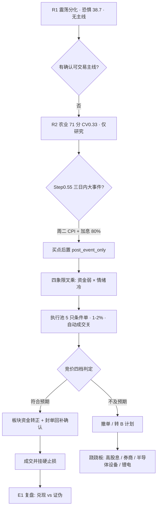

# 2026年11月9日 · **主决策 / D1 盘前预案**

> **数据源新鲜度**: partial（R3 降级 / R7 contract 时点语义 failed / 识图缺 2 只）
> **降级状态**: true（status=degraded）
> **置信度**: 0.62
> **决策来源**: `decision_source=llm`（fresh-context LLM；非 Python 规则兜底）

## 一句话结论

**今日是「无确认主线 + 恐惧 38.7 + CPI 前夜」的三重不预判日：不抢跑，只给 5 只带价位的「事件落地后才触发」条件单（合计 8%），自动成交关闭。**

## 详细分析

**① 市场结构：一天吐回两天的回补。** 11-06 主力单日 **-528.52 亿**，把 11-04/11-05 两日合计 +597.81 亿回补抹掉 88%；20 日累计 -4465.82 亿、20 日只有 5 天为正。涨停 84→**32** 腰斩（-61.9%），跌停 15、炸板率 30.43%、广度 758/5573=**13.6%**、中位 -1.87%、成交额 -21.73%。这是典型的「反抽结束、进入缩圈」结构，不是修复日。

**② 情绪与周期：高位震荡第 2 天（单日杀跌的次日）。** emotion_cycle=`high_chop`（置信 0.65），R1 情绪 **38.7 恐惧**，R3 共振调整后 **34.2**。cycle_position 判定 `tier=single_down`（连跌 1 天），**不是 repair_window、也不是 continued_down**——按原节奏观察承接，盘初继续杀就等尾盘试错，不追日内首波反弹。

**③ 主线：一条都没有被双源确认。** 农业/种业 71 分是唯一过线，但 CV 仅 0.33（<0.34）、R4 零农业事件、生猪/大豆期货与涨价叙事背离 → 只能研究观察。短剧/传媒 64 分处 mid_up，但传媒行业 d1 **-24.42 亿**吐回 5 日 +62 亿的四成；国产算力/运营商 55 分、特高压 51 分都是「叙事硬、资金未到」的 formation；机器人 42 分已 fade（概念榜 #2→#4→#8）。光伏（10 家涨停最多但霸榜第 1 转跌 -1.79%）与券商（政策最硬但证券 d1 -10.30 亿、零涨停）被当作**伪主线丢弃**。

**④ 资金：唯一正结构是半导体设备缩圈，但被事件压制。** 半导体设备 d1 +7.40 / d5 **+118.34** / d20 +35.67 亿，是全市场唯一「20 日正 + 单日正」的细分；但 E001 英伟达 CEO 治理调查（行业级，落在光模块/CPO/AI 硬件/半导体/存储/PCB）与 E004 非农超预期（12 月加息概率 80%）同时压制高估值成长。防御端公用事业/电力/银行单日 +9.59/+9.40/+8.53 亿，但 20 日分别 -147/-136/-70 亿 = **单日防御脉冲，不是趋势切换**。

**⑤ 决策：四象限叉乘指向「不预判、只确认」。** 资金弱 × 情绪冷 = 今日主象限；基本面 10 只候选无一只提供估值安全垫；结构上板型/通道错配（万向 4 次开板、红太阳 13:39 首封、大东方开板 2 次）。叠加 Step 0.55：**周二（11/10）CPI 定生死** → 新增买入全部后置（post_event_only），连条件单都不在今日抢跑。

## 执行池（5 只 · 仓位建议合计 8% · 全部条件单）

| # | 名称 | 代码 | 题材 | 通道 | 买区 | 触发价 | 止损 | 止盈 | RR | 仓位 | 自动成交 |
|---|---|---|---|---|---|---|---|---|---|---|---|
| 1 | 中国移动 | 600941.SH | 国产算力/运营商（移动云） | 低吸+突破 | 101.6–103.0 | 101.6 | 97.85 | 113.3 | 2.0 | 2% | ❌ 关 |
| 2 | 平高电气 | 600312.SH | 特高压/电网（六张网） | 突破/竞价 | 21.97–22.41 | 22.08 | 20.95 | 25.33 | 2.0 | 2% | ❌ 关 |
| 3 | 特变电工 | 600089.SH | 特高压/电网（六张网） | 突破/竞价 | 19.28–19.58 | 19.28 | 18.6 | 21.54 | 2.0 | 2% | ❌ 关 |
| 4 | 日出东方 | 603366.SH | 妖·羊年（东方系+日出） | 突破/竞价 | 8.94–9.13 | 8.99 | 8.54 | 10.31 | 2.0 | 1% | ❌ 关 |
| 5 | 东方新能 | 002310.SZ | 妖·羊年（东方系） | 突破/竞价 | 2.31–2.35 | 2.32 | 2.23 | 2.59 | 2.0 | 1% | ❌ 关 |

**仓位建议**：8.0% 总仓（cap 20%），单票 1-2%，全部 `auto_trade_enabled=false` + `requires_user_confirmation=true`。**触发前提**：CPI 落地（11/10）+ 各自确认条件，两缺一不买。单板块上限 40%、单票上限 5% 未触顶。

### 1. 中国移动 600941.SH（国产算力/运营商 · core_largecap · 2%）

- **买入理由**：R4 E20261109_006 high（2027 算力投资超 1000 亿 + 智谱 GLM 接入移动云，4 源、21 次命中，R4 首板候选唯一「多源 direct + 可交易」）；运营商 d1 +4.05 / d5 +8.64 亿资金双正；5 日 +1.33% 不拥挤。
- **风险点**：PE 自身历史 93 分位、两融 15 日 -236%；E004 加息压制成长股；容量核心在退潮日是流动性出口（错题本 20261106_003）→ 只给 2%。
- **止损条件**：收盘破 **97.85**（MA50 97.69 下方）清仓；盘中先破 MA20 **100.87** 减半。
- **可验证假设**：若 11/10 高开后 30 分钟不破 101.60，且运营商/算力资金为正 → 低吸档成立；若放量站上 **104.35**（20 日高/箱体上沿）→ 突破档成立。

| 竞价区间 | 判定 | 动作 |
|---|---|---|
| < 101.42（-2%） | 不及预期 | 撤单；除非 15 分钟内放量翻红站回 102.3 |
| 101.42–105.56（-2%~+2%） | 符合预期 | 按 buy_zone 承接（低吸 101.6–103.0） |
| 105.56–108.7（+2%~+5%） | 超预期 | 只在放量站上 104.35 后跟，不追高 |
| > 108.7（+5%） | 过度 | 不追，等回踩 |

### 2. 平高电气 600312.SH（特高压/电网 · leader · 2%）

- **买入理由**：R4 E20261109_007 high（国网一交两直 591 亿核准、十五五核准开工高峰）+ 财联社「明日主题前瞻」正文点名；PE 21.57 / 31.6 分位是全批最便宜；识图：日/周/60 分/15 分全多头，突破位 22.08 与 D1 完全一致。
- **风险点**：特高压概念 d1 -17.67 / d5 -17.28 亿、11-06 零涨停 = 「叙事到、钱没到」；R6_M3_06 soft 明示禁止提前埋伏。
- **止损条件**：收盘破 **20.95**（识图止损、MA20 21.01 下方）清仓；盘中破 21.00 先减半。
- **可验证假设**：放量收盘站上 22.08 + 特高压概念单日主力转正 ≥+5 亿 → 突破成立；若只有价格没有资金 → 不买。

| 竞价区间 | 判定 | 动作 |
|---|---|---|
| < 21.32（-2%） | 不及预期 | 放弃（突破型条件单，低开即失效） |
| 21.32–22.20（-2%~+2%） | 符合预期 | 不抢，等放量站上 22.08 |
| 22.20–22.85（+2%~+5%） | 超预期 | 只在 22.08 上方放量 + 资金转正时于 21.97–22.41 承接 |
| > 22.85（+5%） | 过度 | 不追，等回踩 22 附近 |

### 3. 特变电工 600089.SH（特高压/电网 · core_midcap · 2%）

- **买入理由**：R2 次线 leaders_hint + R5 alpha B / risk B+；国网核准传导、周线超跌反弹 +8.9%；识图确认突破位 19.16–19.28。
- **风险点**：周 K 仍空头排列（20 周线 19.28 / 60 周线 22.66 压制）；R5 明示「资金不认→禁止提前埋伏」；与平高同线，**只执行先触发的一只**。
- **止损条件**：收盘破 **18.60**（买区上沿 -5%）清仓；破 MA50 **18.25** 减半。
- **可验证假设**：放量站上 19.28（周 20 线）并守住 30 分钟 + 电网设备资金转正 → 成立；只在 19.16 上方磨蹭 → 不买。

| 竞价区间 | 判定 | 动作 |
|---|---|---|
| < 18.54（-2%） | 不及预期 | 放弃 |
| 18.54–19.30（-2%~+2%） | 符合预期 | 等突破 19.28 确认 |
| 19.30–19.87（+2%~+5%） | 超预期 | 放量站稳 19.28 后于 19.28–19.58 承接 |
| > 19.87（+5%） | 过度 | 不追 |

### 4. 日出东方 603366.SH（妖·羊年东方系 · leader · 1%）

- **买入理由**：R2 yaogu_track 首推——东方系 6 家涨停里首封最早（09:45:14）、**0 开板**、封单 **1.93 亿**（族内最厚）、主力 +1.56 亿（净率 31.96%）、free 换手 17.56%，族内唯一「零开板+厚封单+主力净买三成」。
- **风险点**：R3 光伏概念霸榜告警未解除（日出东方归在光伏概念）、R5 未画像、识图未覆盖 → **三项缺口**，故只给 1%；R6_M6_02 strong_suggest 已显式覆盖并写理由。
- **止损条件**：收盘破 **8.54** 或炸板 30 分钟不回封 → 清仓；破 8.30 减半。
- **可验证假设**：竞价 +1%~+4%、东方系同族至少 1 只红盘、封单回补 ≥0.8 亿 → 梗延续；若同族断板 ≥2 只 → 直接放弃。

| 竞价区间 | 判定 | 动作 |
|---|---|---|
| < 8.81（-2%） | 不及预期 | 撤单（首板次日低开=分歧） |
| 8.81–9.17（-2%~+2%） | 符合预期 | 只在 ≥+1%（9.08）且封单回补时打板确认 |
| 9.17–9.35（+2%~+4%） | 超预期 | 封单 ≥0.8 亿才跟 |
| > 9.35（>+4%） | 过度 | 不追（一字板不抢，等开板分歧） |

### 5. 东方新能 002310.SZ（妖·羊年东方系 · core · 1%）

- **买入理由**：东方系最惜售——09:48:45 首封、0 开板、封单 1.21 亿、free 换手仅 **4.24%**、主力 +1.32 亿（净率 **47.45%** 族内最高）；低价 2.32 元、流通 102 亿。
- **风险点**：价格低、盘子大，弹性一般；无 R5 画像、无识图；与日出东方同族，两只合计上限 2%。
- **止损条件**：收盘破 **2.23** 或炸板不回封 → 清仓；破 MA20 **2.10** 减半。
- **可验证假设**：竞价 ≥+1% 且 ≤+3%、封单回补 ≥0.6 亿 → 惜售延续；若同族断板 → 退潮，不参与。

| 竞价区间 | 判定 | 动作 |
|---|---|---|
| < 2.27（-2%） | 不及预期 | 撤单 |
| 2.27–2.37（-2%~+2%） | 符合预期 | 只在 ≥+1%（2.34）且封单回补时竞价确认 |
| 2.37–2.41（+2%~+4%） | 超预期 | 封单 ≥0.6 亿才跟 |
| > 2.41（>+4%） | 过度 | 不追 |

## 不可买 / RR_FAIL 清单（不进执行池）

| 标的 | 原因 | 处置 |
|---|---|---|
| 红太阳 000525.SZ | RR **0.80<1**、首封 13:39（late_speculation）、农化 d20 -44.5 亿 | 观察，不做孤票接棒 |
| 新赛股份 600540.SH | 顺位 3 命中 **mid_laggard**、负债 86.8% | 观察，不用低位替补 |
| 农发种业 600313.SH | R2 名称错配（登海应为 002041）、未涨停、净利 -32.6% | 研究载体，禁按名称下单 |
| 万向德农 600371.SH | 4 次开板=回封板、free 换手 46.3%、龙虎榜 3 日 -1.01 亿、R6 明示不作买入依据 | 观察最高级：只做竞价≤+3% 弱转强 |
| 润建股份 002929.SZ | 距 MA20 +23.6%、PE 235、算力 d20 -609 亿、E001 行业级 | 观察，高开>4% 放弃 |
| 浙文影业 601599.SH | 5 板 climax + 微短剧治理新规 + PB 96.6 分位 | 只作传媒温度计 |
| 上海电影 601595.SH | PB 98 分位、位置 100%、业绩下滑；机构净买=高位接棒 | 观察，≤+2.5% 弱转强才看 |
| 大东方 600327.SH | 开板 2 次（回封板）、封单仅 0.39 亿 | 观察，炸板即走 |

## 观察池（25 只 · 带价位 · 不进执行）

| 代码 | 名称 | 角色 | 观察理由 | 买区/触发 | 止损 | 备注 |
|---|---|---|---|---|---|---|
| 600371.SH | 万向德农 | watch_elastic | R2 农业龙一（71分线，CV 0.33），2/3板首封09:36但开板4次+free换手46.3%+龙虎榜3日-1 | 12.41–12.78 | 12.14 | 引擎 |
| 000525.SZ | 红太阳 | watch | 3/6板+首封13:39（late_speculation）+RR 0.80<1（距20日高仅-5.3%）+农化制品 | 5.27–5.38 | 5.11 | 引擎 |
| 600540.SH | 新赛股份 | watch | 候补位顺位3命中 mid_laggard + 2025续亏1.48亿/负债86.8% → 不因 RR 2.73 递补 | 4.38–4.46 | 4.15 | 识图 |
| 600313.SH | 农发种业 | watch | R2 名称错配已更正（600313=农发种业，非登海种业） | 6.59–6.8 | 6.46 | 突破监控 |
| 601599.SH | 浙文影业 | watch_elastic | 5/5板全市场并列最高身位 + 微短剧治理新规（高位遇新利空）+ PB 96.6 分位 | 4.67–4.93 | 4.44 | 引擎 |
| 601595.SH | 上海电影 | watch_elastic | 传媒次线首板+机构净买1.19亿，但 PB 98 分位/业绩下滑/位置100% → 机构净买≠价值背书 | 35.58–36.3 | 34.48 | 引擎 |
| 002929.SZ | 润建股份 | watch_elastic | 个股资金最强（+6.35/+12.82亿、R5 资金质量第一）但算力概念 d20 -609亿、PE 235、距 MA | 58.06–61.22 | 55.16 | 引擎 |
| 600327.SH | 大东方 | watch_elastic | 东方系主力净额最大(+1.67亿)+龙虎榜+1.08亿，2/4板接力 | 4.89–4.98 | 4.73 | 引擎 |
| 002889.SZ | 东方嘉盛 | watch_elastic | 东方系第6家涨停（确认梗广度），换手32%偏高=中位质量 → 候补，只在族整体延续时 1% 以内参与（不进执行）。 | 17.22–17.57 | 16.69 | 突破监控 |
| 600261.SH | 阳光照明 | watch | 12天7板+10日+56.5%高位，但主力净额仅+0.07亿（净率0.52%）=散户接力无主力 → 情绪股不是资金股 | 5.37–5.48 | 5.21 | 引擎 |
| 688585.SH | 上纬新材 | watch | 启元机器人1万台下线（R4 high）+14天翻倍（5日+11.8%）→ 高位+机器人L1三日降温（#2→#4→#8 | 192.03–195.89 | 180.22 | 引擎 |
| 300607.SZ | 拓斯达 | watch | Star 全尺寸人形首秀，但 5日主力 -0.75亿、机器人概念 d1 -116.3亿 → 产业消息未转成资金，观察 | 31.32–32.28 | 30.67 | 突破监控 |
| 600801.SH | 华新建材 | watch | 16.42亿美元收购巴西 CSN Cimentos（R4 high/3源），但 5日+28.3%、无R5画像 → 高 | 23.34–24.05 | 22.85 | 引擎 |
| 300750.SZ | 宁德时代 | watch | 外资一周持续买入+5日主力+30.45亿，但周线空头排列+E004 加息压制/成长股承压 → 反弹非反转，观察（识图 | 249.48–254.52 | 241.79 | 识图 |
| 688048.SH | 长光华芯 | watch | 回购提议3000-6000万，但 E001 半导体行业级利空 + 5日主力-0.52亿 + -5.59% → 只观察 | 127.22–129.78 | 116.15 | 识图 |
| 601969.SH | 海南矿业 | watch | 布谷尼锂矿全年发运超12万吨+三季报预增77-124%，价格 8.19 低位 | 8.84–9.11 | 8.65 | 突破监控 |
| 002074.SZ | 国轩高科 | watch | 大众中国转让5.3%股权23.17亿获批 | 26.03–26.82 | 25.48 | 引擎 |
| 002371.SZ | 北方华创 | watch | R7 半导体设备龙头：5日主力+23.8亿/20日+17.16亿、5日+17%、距20日高-8.9% | 607.16–625.65 | 594.37 | 突破监控 |
| 688981.SH | 中芯国际 | watch | R7 制造龙头：5日+19.23亿、距20日高-2.6%、pos20 84.6% → 高位缩圈票，只观察回踩。 | 112.07–115.49 | 106.25 | 引擎 |
| 688012.SH | 中微公司 | watch | R7 龙二：5日+32.98亿（最强）但20日 -18.3%、距20日高-21% → 超跌反弹结构，观察能否站回 M | 239.58–244.42 | 232.2 | 识图 |
| 688347.SH | 华虹宏力 | watch | 5日+31.15%（10日高位）+PE 255 → 不追高，观察。 | 159.27–167.93 | 156.51 | 引擎 |
| 300059.SZ | 东方财富 | watch_elastic | 国常会首提稳市+26家券商700亿互换便利（R4 high/4源），但证券 d1 -10.30/d20 -156.3 | 18.21–18.71 | 17.77 | 引擎 |
| 300118.SZ | 东方日升 | watch | 光伏霸榜第1转跌-1.79%=出货警报（R3）+热股新进第6 → 只作退潮温度计，不新进。 | 10.64–10.85 | 9.98 | 引擎 |
| 603381.SH | 永臻股份 | watch | 4/4板但光伏概念霸榜转跌 + 流通29.5亿/两融+44.3% 杠杆博弈 → 只观察，不参与。 | 20.64–21.05 | 20.0 | 引擎 |
| 688361.SH | 中科飞测 | watch | R7 watch_reserve：RR2=1.8 不达 2 → 观察不执行。 | 311.77–321.26 | 305.2 | 突破监控 |

## B 计划（跷跷板 / 对手盘）

**触发条件（任一）**：执行池 ≥2 票竞价不及预期；特高压/电网资金净流出 ≥-20 亿且无承接；东方系同族断板 ≥2 只；盘中广度 <0.30 或炸板率 >40%。

| 方向 | 触发 | 候选（含价位） | 依据 |
|---|---|---|---|
| 防守/高股息（公用事业·电力·银行） | 科技主线竞价集体低开 + 炸板率上升 + 公用事业/银行资金单日继续为正 | 长江电力 28.53–29.1 / 止损 27.64；交通银行 7.66–7.82 / 止损 7.43 | R7 单日流入 公用事业 +9.59 / 电力 +9.40 / 银行 +8.53 亿，但 d20 分别 -147.03 / -136.04  |
| 券商/政策底（国常会稳市） | 券商高开 + 放量且证券板块单日主力转正（政策底→资金底确认） | 东方财富 18.4–18.9 / 止损 17.7；中信证券 25.18–26.7 / 止损 23.92 | R4 E20261109_005 high（4源，6家券商已首批买入、26家申请700亿）；R2 因「证券 d1 -10.30 亿、零涨停」 |
| 半导体设备缩圈回补 | 半导体设备资金连续净流入 + 费半修复延续，且个股不破 MA10 | 北方华创 515.2–543.2 / 止损 489.44；中微公司 233.68–246.38 / 止损 231.75；中芯国际 112.07–115.49 / 止损 106.25 | R7 半导体设备 d1 +7.40 / d5 +118.34 / d20 +35.67 亿（唯一 20 日正+单日正的细分）；错题本 202 |
| 低位资源/锂电（切换新题材一日游） | 主线全灭 + 锂电资金维持净流入 + 美元/加息预期回落 | 海南矿业 8.84–9.11 / 止损 8.65；国轩高科 26.03–26.82 / 止损 25.48 | R7 锂电池 d5 +28.02 亿 vs 公用事业 d5 -26.17（跷跷板）；R4 国轩高科股权获批、海南矿业锂矿发运 |

> **反向提示**：若 B 计划方向也同步走弱（公用事业/券商/半导体设备/锂电全部资金转负）→ 全市场降档，执行池全部后置、空仓等 CPI 落地；不临时起意开计划外仓。

## 禁入名单（10 只）

| 标的 | 原因代码 |
|---|---|
| 东方海洋 002086.SZ | distribution_alert：热榜连续2日第1（霸榜个股级警报）+主力净流出0.68亿+free换手42.6%+2次开板=霸榜出货 |
| 鲁阳节能 002088.SZ | late_speculation_board：5/6板但14:27首封（尾盘投机板红线）+6次开板+封单0.04亿+主力-0.27亿=烂板 |
| 中际旭创 300308.SZ | event_bearish_industry：E001 英伟达治理调查行业级利空+光模块5日主力-35.34亿+周五-9%级杀跌（R4 标禁买） |
| 东山精密 002384.SZ | event_bearish_industry：E001 落点+人气34→3伴随-10.00%跌停=典型出货 |
| 新易盛 300502.SZ | event_bearish_industry：E001 落点+热榜26→9伴随-7.28%=人气高位派发 |
| 深南电路 002916.SZ | event_bearish_industry：E001 PCB 落点+5日主力-8.98亿+5日-14.2%；高分红不救趋势 |
| 科大讯飞 002230.SZ | event_bearish_sector：E003 Anthropic 估值被砍/AI应用估值承压（R4 观察负面） |
| 拓荆科技 688072.SH | rr_fail：R7 watch_reserve RR1=0.3，远低于 1.8 |
| 君正股份 300223.SZ | high_turnover：换手10.9%高位+E001 半导体映射+5日-4.02% |
| 富奥股份 000030.SZ | non_mainstream：实控人变更但非主线、无板块效应、单源 |

## 四象限叉乘 + 错题本

| 象限 | 今日读数 | 结论 |
|---|---|---|
| Q1 资金 | 单日 -528.52 亿吐回两日 +597.81 亿；20 日仅 5 天正；唯一正结构=半导体设备（d5+118.34/d20+35.67） | 不追普涨，只做缩圈 |
| Q2 情绪 | 恐惧 38.7（R3 34.2）/涨停 32（前 84）/炸板 30.43%/溢价 -0.06% | 不预判方向 |
| Q3 基本面估值 | 10 只候选无估值安全垫（万向 PE654/PB92.9；上影 PB98；浙文 PB96.6；润建 PE235） | 只能情绪仓+硬止损 |
| Q4 结构 | 板型/通道错配（万向 4 开板、红太阳 13:39、大东方 2 开板）；高位票位置 100% | 拒绝中位/回封板 |

**叉乘**：资金弱×情绪冷 = 今日主象限 → **不抢跑、只确认**；资金强×情绪冷（半导体设备）→ 只回踩不追高；资金弱×情绪暖、资金强×情绪暖均缺席。

**错题本 6 条全部规避**：
1. `error_case_20261106_002` 玄学名字族遗漏 → 东方新能 + 日出东方进执行池（各 1%），东方系 5 只全在观察池；多日高度口径已用（阳光 12 天 7 板记高位）。
2. `error_case_20261106_003` 观察池/执行池错配 → RR 门槛只决定仓位档，红太阳/新赛/拓荆等 RR_FAIL 票全部留在观察池并带条件；执行池不全是容量核心（含妖股与低位政策票）。
3. `error_case_20261106_004` 事件面方向误判 → E001 只作风险提示，北方华创/中微/中芯留在观察而非判跌，方向交给本地资金。
4. `error_case_20261105_004` 判据自我死锁 → 全部触发判据为竞价后/盘中可测（价格、成交额、板块主力净流入、同族红盘、封单），不含盘前不存在的量。
5. `error_case_20261105_005` / `20261106_001` P1 断档 → 5 只条件单写死 buy_zone/max_premium，P1 只需四档对照。
6. 主线第一天参与原则 → 农业龙一 万向德农 进观察最高级并给完整价位，不为凑数递补龙二/杂毛。

## 数据源审计

| 源 | 状态 | 置信度 | 说明 |
|---|---|---|---|
| R1 风格 | ✅ ok | 0.525 | 22/22 板块 + 20/20 ETF，11-06 收盘全量；外盘/两融 freshness 0.75 |
| R2 主线 | ✅ ok | 0.62 | 唯一 71 分线 CV 0.33；open_permission=false；7 条 note |
| R3 情绪 | ⚠️ degraded | 0.55 | WeFlow 永久下线 + 7 群 0 条 → 仅 L1+L2b |
| R4 消息 | ✅ ok | 0.66 | 8 事件/14 首板；mcp_qmt/xtick down、hithink unavailable 已披露 |
| R5 画像 | ✅ ok | 0.66 | 10/10 画像 + 识图 10/10 + 缠论 10/10；R2 名称错配 1 处 |
| R6 反证 | ✅ ok | 0.39 | hard_reject=0（逐票双条件核验）；strong 16 / soft 14；低置信因 5 处上游互斥 |
| R7 资金 | ⚠️ contract failed | 0.87 | 数据完整（11-06 全量 3366 只）；contract 判 04:40<06:00 与 staleness=ok 冲突，只作证据 |
| 周期位置 | ✅ ok | — | tier=single_down（连跌 1 天），样本 n=2 仅背景 |
| 识图 | ✅ ok / 部分缺口 | — | 07:39:30 盘前有效，26 只；执行票 3/5 有图、2 只缺口 |

## 不确定性 / 反证

- **R6 置信度仅 0.39**：不是数据缺失，而是 5 处上游口径互斥（农业 vs R4 零事件、R4 vs R7 券商资金、R7 半导体池 vs R2 农业线）。R6 的结论是「三腿同时软 + 无估值安全垫」，不是「必跌」。
- **R7 contract failed**：数据是 11-06 收盘全量（3366 只/行业/概念/龙虎榜/ETF），失败点是 generated_at 04:40 早于 06:00 与 staleness=ok 的规则冲突 → 只降级为证据参考，未据此调仓。
- **识图冲突 2 只**（中国移动/平高）：冲突对象是引擎 MA50/均线基准价，D1 价与识图结构位一致（平高 22.08、移动 102.3/104.35）；D1 保留自己的纪律止损，已标 review_required 交 P1/execute 复核。
- **引擎 core_grade 与 D1 不一致**：5 只引擎分 laggard/watch（0 涨停板块的 leading_score 结构性为 0），D1 以 R2 身位 + R5 alpha/risk + R4 官方催化校正为 leader/core；引擎原始值保留在 `core_judge.engine_grade/engine_score`，未隐藏。
- **CPI 是最硬的未知**：若 11/10 CPI 超预期 → 成长股/高估值再杀，条件单自动失效；若低于预期 → 才允许按触发价执行。
- **名字族是情绪不是价值**：日出东方/东方新能各 1%，同族断板即退，不恋战。

## 与其他 R/D/E 的关系

- **依赖**：`research_summary.json`（R1–R7）、`cycle_position.json`、`emotion_cycle.json`、`chart_vision_snapshot.json`、`user_preferences.yaml`
- **被消费**：execute（读取 watchlist_plan + P1/P2 amendment）、P1（09:25 竞价校准四档）、P2（午盘修订）、E1（复盘兑现/证伪）

## Sub-Agent 元数据

- skill: `main_decision_v1@1.9`
- artifact: `data/plans/20261109/watchlist_plan.json`（决策契约）
- 生成耗时: 本会话单轮组装（引擎 enrich + 校验）
- model: deepseek-v4.1-flash
- 契约校验: pydantic `WatchlistPlan` OK / `validate_plan_for_date` OK（exec=5，watch=25）/ decision_source=llm
- 越权阻塞（如实报告）: skill Step5.0 的 `render_plan_tables.py`、`render_markdown.py`、价位推导 md 输出路径均在 `chzl_kg/`，超出本 profile 白名单 → 未执行；由 `publish_unit_md.py` 发布本报告。