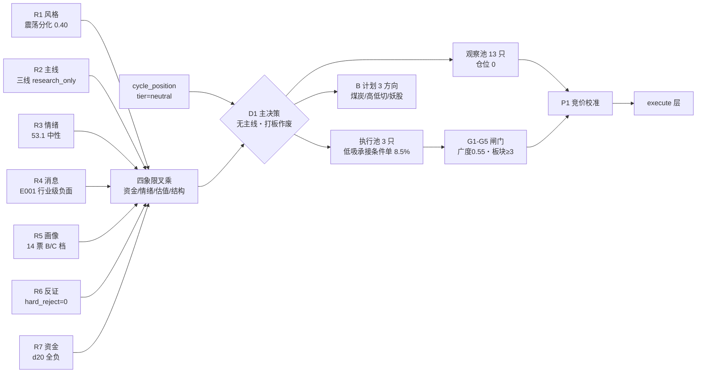

# 2026年11月10日 · **主决策 / D1 盘前预案**

> **数据源新鲜度**: partial（R3/R4/R7 degraded，R7 触发 contract 冲突）
> **降级状态**: degraded（research_summary.orchestrator_status=partial、contract_checks_passed=false）
> **置信度**: 0.55 ｜ **决策来源**: llm（fresh context，仅消费本轮 artifacts）
> **仓位上限**: 0.40 ｜ **今日新建额度**: 8.5%（3 只条件单）｜ **执行池 3 / 观察池 13**

## 一句话结论

**震荡分化·高位分歧日，R1 判无主线、炸板率 44.90% 越 35% 红线——今天不打板、不追高，只做三只低位核心（超声电子 / 奥士康 / 信维通信）的低吸承接条件单，合计 8.5%，条件不成立就空仓。**

---

## 一、今日全局约束

| 项目 | 取值 | 依据 |
|---|---|---|
| 市场阶段 | 高位震荡（high_chop） | emotion_cycle：炸板率 44.9%≥25% 且涨停 54≥40 → 涨停多但分歧大 |
| 周期位置 | `tier=neutral`、连跌 0 天、cycle_day 0 | cycle_position：非杀跌序列，**不适用 repair_window 强制修复打法** |
| 风格 | 震荡分化型（代价 0.5769 最小） | R1 五分法 |
| 情绪分 | R1 55.1 / R3 53.1 → **取更保守 53.1 作温度锚** | R6_M1 提示同日双源差 2.0 分 |
| 主线 | R2 三条线全部 `research_only`；R1 main_lines_count=0 → **按无主线口径** | R1 为风格裁决者，R2 只回答“今天是不是主线” |
| 仓位上限 | 0.40（= min(R1 0.40, 情绪 0.40) × 1.0） | 0.55 基准 −0.05（high_chop）−0.05（30 日样本中位 −11.88%）−0.05（修复段第 2 日） |
| 通道 | 只开 `trend_pullback_buy`（低位承接/回踩） | 炸板率 44.90%>35% → **打板/追高/半路通道全部作废** |
| 执行模式 | `dry_run`、`autonomous_trading_enabled=false`、逐票 `auto_trade_enabled=false` | 研究未就绪（partial）+ 三重反证 |

**执行闸门（任一不成立则对应票不成交）**

| 闸门 | 规则 | 不成立时 |
|---|---|---|
| G1 大盘广度 | 09:30-10:00 全市场广度 ≥0.55（T-1 仅 0.4023） | 三只条件单一律不触发，当日空仓 |
| G2 板块合力 | PCB/元件 板块涨停 ≥3 家且行业主力净额为正；商业航天 ≥2 家 | 对应票作废 |
| G3 竞价分档 | 按每票四档机械判定（09:25 P1 校准） | far_above 一律 skip |
| G4 破位即走 | 收盘跌破买区下沿/MA10 即走，不加仓不摊低 | 按 exit_rules 执行 |
| G5 不留隔日 | T+1 10:30 前不创当日新高 → 全走（R6「只做日内」前置） | 按 exit_if_no_new_high 执行 |

---

## 二、执行池（3 只 · 全部为条件单，未触条件不成交）

| # | 票 | 角色 | 买区 | 触发 | 止损 | 止盈 | RR | 仓位 | 触发前提（摘要） |
|---|---|---|---|---|---|---|---|---|---|
| 1 | **000823.SZ 超声电子** | 龙一（PCB） | 17.15-17.60 | 17.15 | 16.35（−7.1%） | 20.10 | 2.0 | 3% | 低开 −1%~−4% 且分时不破 MA5 17.24、行业资金转正、板块涨停≥3 |
| 2 | **002913.SZ 奥士康** | 龙二（PCB） | 56.20-57.30 | 56.20 | 53.70（−6.3%） | 64.50 | 2.0 | 2% | 回踩 MA10 56.86 不破、元件资金为正、板块涨停≥3 |
| 3 | **300136.SZ 信维通信** | 龙二（商业航天/20cm） | 44.80-45.35 | 44.80 | 43.08（−5.0%） | 50.76 | 2.38 | 2% | 竞价 −3%~+1% 后回踩承接、站上均价线、商业航天涨停≥2 |

**竞价四档（09:25 机械对照，P1 校准后执行）**

| 票 | 基准 | 不及预期 | 预期内 | 超预期 | 高开过度 |
|---|---|---|---|---|---|
| 超声电子 | 17.86 | <17.59：只在 17.15-17.60 止跌放量后小仓，破 16.80 放弃 | 17.59-18.22：按买区承接 | 18.22-18.75：等回踩 17.60 内，不回踩放弃 | >18.75：不追、当日作废 |
| 奥士康 | 58.42 | <57.54：56.20-57.30 放量才买，破 56.00 放弃 | 57.54-59.59：按买区执行 | 59.59-61.34：等回踩 57.30 内 | >61.34：作废 |
| 信维通信 | 47.70 | <46.84：44.80-45.35 承接且快速翻红才买 | 46.84-48.84：开盘价高于买区不追，等回踩承接 | 48.84-50.07：等回踩 45.35 内 | >50.07：作废（20cm 兑现风险最大） |

### 首推票思维链 · 超声电子（000823.SZ）

- **买入理由**：机构龙虎榜净买 **3.21 亿＝全场第 1**（10 席位明细），DC 主力今日 +5.67 亿、5 日 +4.54 亿（=流通 4.27%）、20 日 +6.06 亿；位置是 20 日 −11.98%、距 20 日高 −30.96% 的**深跌低位分支**，昨日 1106 −7.5% → 1109 反包涨停（1 次开板、封单 1.52 亿、换手 20.4%）。这是“低位 + 真金 + 板块效应”三项同时成立，而不是概念补涨。
- **大资金意图**：元件/印制电路板是全市场唯一净流入方向（电子 +93.39 / 元件 +38.42 / 印制电路板 +37.63 亿），机构在低位反包首板一次性进 3.21 亿，指向“做修复段的低位补涨”，不是做一日游。
- **为什么走强**：PCB Q3 行业净利同比 +196%、环比 +75.56%、产能利用率 90%+、电子布紧缺至 2027-06＝**产业定价级催化**；个股自身 10-13 业绩预告预增 90.78%~102%。逻辑硬度：**够硬（业绩+供需双硬）**。
- **风险点**：① 融券 15 日 **+78.62%**＝空头在加；② 获利盘 **96.7%**、90% 成本区 16.2-17.6（收盘已在上沿）＝上方无套牢承接、兑现压力大；③ 30 日 8 次涨停＝末端加速结构（R6 标 extreme_tail_risk）；④ R4 E001 英伟达治理风暴把“PCB”列入**行业级负面**打击面（隔夜美股 AI 硬件开盘 −7%）。
- **止损条件**：跌破 **16.35**（−7.1% 距买价）无条件走；日内失守买区下沿 17.15 减 60%；T+1 10:30 前不创当日新高即全走。
- **可验证假设**：① 09:45 元件/印制电路板行业主力净额为正；② 板块内涨停 ≥3 家；③ 分时在 17.15 上方止跌。三条同时成立才买——**这是对“反抽脉冲 vs 趋势反转”的判定**，不是对题材信仰的判定。

### 其余两票要点

- **奥士康**：0 开板 + 封单 1.37 亿 + 换手 7.82%（缩量封板＝卖压枯竭），20 日 −30.6% 低位，龙虎榜机构净 +1.28 亿、11-04 回购 + 专项贷款承诺＝公司自身托底。反向：上方 52.1% 套牢盘（均成本 66.7）是硬压制，主力今日仅 +0.96 亿（净额率 21.94% 但绝对额小）。
- **信维通信**：单票主力 +6.26 亿＝全场最大流入，20 日仅 +0.82% 低位，20cm 弹性、双线（星间激光 + 卫星互联网）交汇。反向：昨日炸板 1 次未封、融资 15 日 −25.3% 且融券 +22.0%＝杠杆双撤。**引擎分歧口径 RR 只有 1.66（RR_FAIL）**，D1 把买区下移到 44.80-45.35、止盈不超前高 50.76 后 RR 2.38——两套口径都落盘在 `risk_reward.engine_bracket_note` 与 `meta.engine_rr_conflicts`，不做豁免。

---

## 三、观察池（13 只 · 只观察，仓位一律 0）

| 票 | 线/角色 | 买区 | 止损 | 止盈 | RR | 为什么只观察 |
|---|---|---|---|---|---|---|
| 600118.SH 中国卫星 | 商业航天 龙一 | 54.60-55.40 | 52.63 | 60.50 | 1.84 | 炸板 2 次 + 大宗 25 笔均折价 −7.63% + 融券 +41% + PE 643 → R5/R6 一致判不进；只作强弱温度计 |
| 002149.SZ 西部材料 | 商业航天 唯一封住 | 41.30-42.13 | 40.02 | 46.35 | 2.0 | 20 日 +34.3% 高位、PE 226；MA5 回踩需 −12.5%＝低吸通道无效 |
| 688568.SH 中科星图 | 商业航天·应用端 | 29.99-30.82 | 29.28 | 33.65 | 1.84 | C 档 + Q3 亏 4.91 亿 + 应收/营收 230.7% + CFO −7.1 亿 |
| 600487.SH 亨通光电 | 6G 低位分支 | 43.20-43.90 | 41.70 | 48.28 | 2.0 | 收盘 42.21 低于 MA10 43.63/MA20 46.56，C 档；需站回 MA10 才成立 |
| 002639.SZ 雪人集团 | 冰雪 龙一（人气锚） | 15.00-15.20 | 14.44 | 16.72 | 2.0 | 4 次开板 + 封单仅 0.69 亿＝无承接，R6 明确不得进执行池 |
| 000530.SZ 冰山冷热 | 冰雪 龙二 | 9.05-9.30 | 8.84 | 10.22 | 1.98 | 20 日 +83.69%、PE 247、三分位 100%、30 日 9 次涨停＝极贵×高位 |
| 601188.SH 龙江交通 | 冰雪 身位股(2 板) | 4.00-4.10 | 3.89 | 4.50 | 1.95 | 只可打板而打板通道作废；DC 主力仅 +0.19 亿 |
| 301010.SZ 晶雪节能 | 冰雪 弹性(20cm) | 24.60-24.90 | 23.65 | 27.38 | 1.99 | 换手 58.09% 逼近死亡换手 + 封单 0.32 亿极薄 + 风险 C |
| 600593.SH 大连圣亚 | 冰雪 消费端低位 | 42.60-43.00 | 40.85 | 47.30 | 2.0 | 跨源共识 0.33<0.34 契约强制降级；主力仅 +0.23 亿 |
| 002463.SZ 沪电股份 | PCB 中军 | 86.00-87.50 | 83.13 | 96.24 | 2.0 | 业绩最硬但收盘低于 MA10 86.67/MA20 98.89，需上破 +13.5% 才成立 |
| 600183.SH 生益科技 | PCB 材料端 | 83.00-84.50 | 80.27 | 92.94 | 2.0 | R4 首选 vs R5 C 档分歧；MA5/10/20 全在上方，需上破 +19.6% |
| 002172.SZ 澳洋健康 | 妖·羊年同音族(洋) | 5.73-5.90 | 5.61 | 6.48 | 1.97 | 2 次开板 + 换手 35.8% + 主业与梗无关联＝纯情绪，无席位确认不参与 |
| 603703.SH 盛洋科技 | 妖·羊族 × 光学元器件 | 10.85-11.00 | 10.45 | 12.10 | 2.0 | 族内最强（封单 1.13 亿）但打板通道作废，只等开板后弱转强 |

> 观察池票价位由 D1 按“买价 ±5% 现价内 / 止损 −5~−10% / 止盈 2R”夹逼后写入 `watch_levels`，沪电/生益两票买区在现价上方 13%+/19%+，**标注“需上破才成立，不是现在能买”**。

---

## 四、妖股赛道（四季度跨年妖 · 2027 春节＝羊年）

- **梗逻辑**：今日最强是“洋”同音族——澳洋健康、光洋股份、盛洋科技同日涨停＝同音族扩散第一次确认；拆字族（祥＝羊部件）由祥明智能 20cm 补位。
- **赚钱效应证据**：yáng 族涨停 5 只（含 1 只 20cm）；10cm 合格档 2 只；**但龙虎榜无羊族票上榜**＝梗已扩散、缺席位级确认。
- **监管切换**：`regulatory_switch_triggered=false`（无关注函/特停命中羊族）。
- **参与方式**：全部进 `watch_elastic`、仓位 0。按 Step 3.7，妖股进执行池只能用打板/竞价确认，而今日**打板通道作废** → 只等开板换手后的弱转强，不追板、不低吸。
- **高标反馈**：东方系高标已转派发（东方海洋机构净卖 2.51 亿）→ 纯名字梗高位今日不可接，资金只认低位新梗。

---

## 五、B 计划（跷跷板 / 对手盘，触发才用，不临时起意）

触发条件（任一命中即切 B 计划）：执行池 ≥2 票竞价不及预期（低开破买区下沿）｜三线任一板块资金净流出且无承接（09:45 行业净额为负）｜龙头断板/炸板率盘中 >25%。

| 方向 | 依据 | 触发 | 候选与价位 |
|---|---|---|---|
| 防御轮动·煤炭燃气（寒潮冬储） | R2 次线 52 分 + R4 E007 medium（煤炭 ETF +3.42%、冬储补库）+ 煤炭行业 +3.47% 涨幅第 1 | 科技三线集体低开、10:00 前无回封、煤炭/燃气涨停≥3 家 | 云煤能源 600792 买区 3.95-4.10 / 止损 3.90 / 止盈 4.50；胜通能源 001331 买区 30.60-31.00 / 止损 29.45 / 止盈 34.10；郑州煤电 600121 **无 kb 日线→只记录不参与** |
| 科技内部高低切（成品 PCB→覆铜板） | R2 PCB tradeability_rank 1 + R4 E002 电子布紧缺至 2027-06 | 超声/奥士康买区不成立但元件资金继续为正、低位分支出现新涨停 | 生益科技 83.00-84.50（需站回 MA10 83.70）；沪电股份 86.00-87.50（需上破 +13.5%） |
| 妖股羊族·独立情绪线 | R2 yaogu_track：洋族 5 只涨停、盛洋封单 1.13 亿、澳洋人气飙升 45→17 | 主线三线全部不及预期 + 盛洋/澳洋 09:45 前封死 | 盛洋科技 10.85-11.00 / 止损 10.45 / 止盈 12.10；澳洋健康 5.73-5.90 / 止损 5.61 / 止盈 6.48 |

**反向提示**：若煤炭/妖股两个方向也同步走弱（涨停家数均 <3、板块净额转负）→ 全市场降档，执行池条件单一律不触发，**当日空仓只做观察**。

---

## 六、数据源审计

| 源 | 状态 | 日期 | 记录数 | 备注 |
|---|---|---|---|---|
| R1 风格 | 🟢 ok | 11-09 收盘 | 1 | complete 0.525，freshness=partial（缺 cross_asset / margin） |
| R2 主线 | 🟢 ok | 11-09 收盘 | 3 线 + 次线 2 | complete 0.600，三线全部 research_only |
| R3 情绪 | 🟡 degraded | 11-09 收盘 | 5 主题 | WeFlow 下线 + 7 个群窗口内 0 条消息，L1 仅剩 T-1 榜单 |
| R4 消息 | 🟡 degraded | 11-10 盘前 | 8 事件 | 当时只到 06:50 快照；微信腿 0 条，其余四腿齐 |
| R5 画像 | 🟢 ok | 11-10 盘前 | 14 票 | 14/14 画像、0 失败；全部 research_only_no_entry_permission |
| R6 反证 | 🟢 ok | 11-10 盘前 | 40 条 | hard_reject **0** / strong_suggest 26 / soft 14 |
| R7 资金 | 🔴 contract_warn | 11-09 收盘（04:38 快照） | 13 候选 | generated_at 早于 06:00 而 staleness=ok → `contract_checks_passed=false`；资金维只作背景 |
| cycle_position | 🟢 ok | 11-10 盘前 | 12 个交易日序列 | tier=neutral、连跌 0 天 |
| emotion_cycle | 🟢 ok | 11-10 盘前 | 1 | high_chop，溢价已重算 +4.06%（`_data_complete=true`，非占位值） |
| attention_signals | ⚪ missing | — | — | 未产出 → 人气维改用 R3 hotlist + R2 人气字段 |
| kb/research.db 日线 | 🟢 ok | 11-09 收盘 | 258 个交易日 | T-1 收盘价齐全；仅 600121.SH 缺日线 |

**关键披露**：`research_summary.contract_checks_passed=false`，唯一失败项是 R7 的“04:38 生成 vs 06:00 门槛”冲突。该冲突只降低资金维置信度（R6 亦判 R7 upstream_usable=True），故**不写成全局禁买**，只把资金维降为背景证据；同时本轮 `production_ready=false` / `reassessment_required=true`。

---

## 七、四象限叉乘 + R6 反证采纳

| 象限 | 条数 | R6 的核心判断 | D1 处置 |
|---|---|---|---|
| Q1 资金 | 8 strong | 板块级“单日正”全是 20 日负背景下的反抽脉冲（商业航天 d20 −355 亿、元件 −340.6 亿、印制电路板 −256.6 亿；全市场 d20 −3980.75 亿、6/20 天为正；11-09 +128.82 亿由超大单 +130.88 贡献，中单/小单 −133.24 亿离场） | 采纳为背景：三线全部 research_only，仓位只用 8.5%，不给板块级配置 |
| Q2 情绪 | 11（8 strong/3 soft） | 炸板 44.9%（前日 30.4%）、封单中位比 0.1516、再涨停仅 9/54=16.7%、3/4/5 板为零；R1 无主线 vs R2 三主线相反 | 采纳：打板通道作废、候选砍半、只保留低吸承接；主线数不当进攻许可 |
| Q3 基本面估值 | 16（8 strong/8 soft） | 中国卫星 PE 643、冰山三分位 100、雪人亏损 PB 88.7、中科星图应收 230.7%；全批最高 2 条红旗，无 ≥4 | 采纳：高位极贵票全部移出执行池；进执行池三票均为低位、非极贵分位 |
| Q4 结构 | 5（3 soft） | 三线名义独立、实际共享同一批科技硬件筹码；生益/沪电 5 日主力 −12.73/−12.42 亿与 R4“研究首选”冲突 | 采纳：合并敞口（PCB 2 票合计 5%、商业航天 1 票 2%），不按三个板块分别给额度 |

- **hard_rejects = 0**：模式六法定对象 0（R2 执行池空）、R3 三条告警与 14 只候选零交集；模式七最高 2 条红旗、无 ≥4 条、无 F12/ST 双轴 → **无票被硬拒剔除**（不是遗漏，是双条件核验结论）。
- **strong_suggest 覆盖（3 条，已逐条写理由）**：000823 超声电子（R6 要求“只做日内、不留隔日”→ 落为 `exit_if_no_new_high`），002913 奥士康（soft，压到 2% 且禁打板），300136 信维通信（soft，压到 2% + 弱转强双条件）。
- **全市场级降仓**：R6 M1 数据源冲突命中 → `market_wide_factor=0.7`，已在 8.5% 新建预算上再压。
- **主线参与闭环**：三条线龙一/龙二均进池（超声/信维进 execution；中国卫星、雪人进 watch 最高观察级），未递补杂毛（红线 5）。

---

## 八、错题本注入（近期 6 条，逐条回应）

| case | 今日是否避开 | 做法 |
|---|---|---|
| 20261109_001 溢价占位致误判 | ✅ 避开 | emotion_cycle 溢价已为重算值 +4.06% 且 `_data_complete=true`，不再用 −0.5% 占位；仓位不压到 floor，取 R1 0.40 |
| 20261109_002 龙头涨板块不涨=个票行情 | ✅ 覆盖 | 三线全部标 research_only、单票 ≤3% 试错、不给板块级配置；资金只看 d1 正而 d20 全负 → 按反抽脉冲 |
| 20261109_003 07:30 新催化未进预案 | ⚠️ 部分 | 本轮无 07:00-08:20 财联社/新浪快讯增量（只到 R4 06:50 快照）→ 标 `news_delta_partial`，不外推新催化 |
| 20261109_004 观察池买区触及但仓位 0 | ✅ 改进 | 观察池票分档：大连圣亚/盛洋给买区但不给仓（共识/RR 不足）；中国卫星 RR 1.84 但 R5/R6 双否 → 设 0 并写明理由 |
| 20261109_005 玄学族选票偏、执行池全是一字 | ✅ 避开 | 只选可买二线（澳洋 2 开板/盛洋 1 开板），一字板不入池；但打板通道作废 → 两票只作 watch_elastic |
| 20261109_006 P1 竞价超窗 | ➖ 非 D1 职责 | 只在预案标注“09:25 前必须完成竞价校准”，不越权 |

---

## 九、不确定性 / 反证（自我批判）

- **三条主线全部是“单日资金正 + 20 日深度失血”的反抽脉冲**：商业航天 d20 −355.06 亿、元件 −340.61 亿、印制电路板 −256.64 亿；全市场 d20 −3980.75 亿。这是今天最大的结构性风险，8.5% 的额度就是为它留的余量。
- **R4 E001 行业级负面直接打 PCB**：三只执行票里两只在打击面内。按关 2.5 本该默认剔出，本计划把它们降为“竞价反证成立才执行”的条件单，**未给无条件买入**；若 09:45 行业资金仍为负，两票作废。
- **R7 contract 冲突**：资金维的时效校验未通过，资金证据只作背景、不作买入依据——这也意味着 F1（资金）维度的置信度低于表面读数。
- **数据缺口**：attention_signals 缺失（人气维降级）；R3 KOL 全缺（群聊维不可用）；R3 无 `next_day_signal` 字段；妖股素材包涨停池/龙虎榜段为空（已由 R2 自查替代）；600121.SH 无日线 → 无法定价。
- **无持仓快照**：`data/runtime` 无 20261110 持仓/风险快照 → 全部按“新建仓（未持仓）”处理，**持仓侧（若有存量）由用户自行核对**，本预案不对存量持仓给出减仓指令。
- **样本统计意义不足**：cycle_position 的 2 个“连跌 2 日→次日修复”样本（n=2）只作风险背景，未据此决定通道与仓位。
- **引擎 vs D1 价位分歧**：超声（引擎 MA50 口径 19.60-20.19 vs D1 MA5 口径 17.15-17.60，偏离 −12.8%）、奥士康（−21.3%）均在 `derivation_reason` 写明理由；信维引擎 RR 1.66 FAIL 与 D1 RR 2.38 两套口径并存，未做豁免。

---

## 十、与上下游的关系

- **依赖（本轮 artifacts，全部来自 research_summary.artifacts）**：R1_style / R2_main_sectors / R3_sentiment / R4_news / R5_stock_profiles / R6_devil_advocate / R7_capital_flow + cycle_position / emotion_cycle / mainline_lifecycle。
- **被消费**：P1 竞价校准（auction_amendment）→ P2 午盘修订（midday_amendment）→ execute（watchlist_plan + 两份 amendment）。
- **契约**：`watchlist_plan_v1`；执行池 3 只（3-6 硬契约下限）、每只带 buy_zone/trigger/stop/take/position_pct/max_position_pct/derivation_reason；`trading/load_plan.py` 的 `enforce_execution_pool_contract` 已通过。

---

## Sub-Agent 元数据

- **skill**: main_decision_v1（v1.9）
- **profile**: canghai-plan（D1 主决策）
- **决策来源**: llm（fresh context，仅消费本轮 artifacts，未携带 R1-R7 中间推理）
- **artifact**: `data/plans/20261110/watchlist_plan.json`
- **人读报告**: `data/research/20261110/_body_D1.md`（由 publish_unit_md.py 发布到 chzl_kg）
- **决策用时**: 约 12 分钟（08:01 起，08:12 落盘 JSON）
- **model**: deepseek-v4.1-flash
- **未写出的产物（按用户 2026-10-28 交付口径）**: `chzl_kg/` 下任何文件、`_价位推导.md`、点位表/散文版附加 md 一律不写，交由管线发布。
