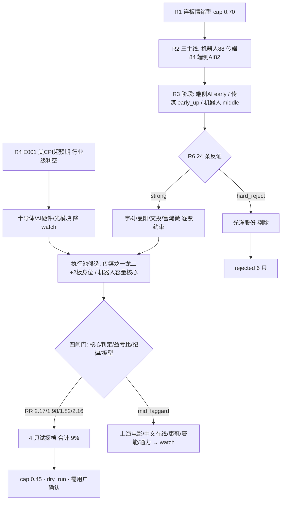

# 2026-11-11 · **主决策 / D1 盘前预案**

> **数据源新鲜度**: partial · **降级状态**: true · **置信度**: 0.62 · **决策来源**: llm（非规则兜底）

## 一句话结论

T-1 是**修复确认日**（涨停 93 / 跌停 0 / 炸板率 16.96% / 昨涨停溢价 +4.91% / 广度 76.67%），今日是修复段第 3 天的**承接待验日**；隔夜美核心 CPI 超预期（加息概率 95.6%）把半导体/AI 硬件/光模块打成行业级利空，故**执行池只留下游内容（传媒）+ 机器人容量核心的低开承接**，4 只全部试探档（合计 9% 预算），仓位上限压到 45%。

## 一、行情类型判定与仓位上限推导

| 项 | 读数 | 判定 |
|---|---|---|
| T-1 涨停/跌停/炸板 | 93 / 0 / 19（炸板率 16.96%） | 修复确认（非杀跌结构） |
| T-1 昨涨停溢价 / 红盘率 | +4.91% / 88.9%（19 只再涨停） | 接力赚钱效应恢复 |
| T-1 广度 / 中位涨幅 | 0.7667 / +1.31% | 普涨，非结构性上涨 |
| T-1 主力 | +173.37 亿（5 日 +371.48，20 日 -3716.99） | 短钱回流，中期仍失血 |
| cycle_position | tier=neutral / 连跌 0 天 | 非修复窗口、非连跌，按当日温度正常评估 |
| 隔夜 | 纳指 -0.74%、费半 -0.35%；美核心 CPI +0.3% 超预期 → 加息概率 95.6%、黄金 -3% | 成长估值逆风（已落地，非待落地事件） |

**仓位上限 = min(0.70, 0.70, 0.70) × 1.0 × 0.65 = 0.45**
（R1 连板情绪型 0.70；情绪 71.9 落 60–80 档跟随 R1；3 条主线但 d20 全线失血故不给 1.1 加成；×0.65 是隔夜加息冲击 +「只给日内/一日反抽额度」的折扣）

**预算**：新开仓 0.09（4 只试探档），上限 0.45 是天花板不是目标——R5 15/15 的 `d1_stance` 全部非「进」，今日**没有任何 alpha=A 且 risk≤B 的票**，故全部按试探档（0.01–0.03，`auto_trade_enabled=false`，需触发或确认才成交）。

## 二、执行池（4 只，全部条件单）

| 票 | 线/身份 | 通道 | 买区 | 触发价 | 止损 | 止盈 | RR | 仓位 |
|---|---|---|---|---|---|---|---|---|
| 掌阅科技 603533.SH | 传媒龙一·144 亿容量 | 核心低吸（VWAP 站回） | 31.75–32.41 | 32.15 | 30.54（-5.0%） | 35.65 | 2.17 | 3% |
| 慈文传媒 002343.SZ | 传媒龙二·44 亿弹性 | 打板（1 进 2） | 10.20–10.26 | 10.26 | 9.74（-5.1%） | 11.29 | 1.98 | 2% |
| 文投控股 600715.SH | 传媒 2 板身位 | 打板（2 进 3） | 3.10–3.14 | 3.14 | 2.97（-5.4%） | 3.45 | 1.82 | 2% |
| 宇树科技 688836.SH | 机器人龙一·229 亿容量 | 低开承接 | 713–730 | 730 | 693.5（-5.0%） | 809 | 2.16 | 2% |

### 每票四行人话

**1) 掌阅科技 603533.SH**
- **买**：竞价 -1.5%~+2%（31.90–33.45）→ 先打 1.2% 底仓；站回分时 VWAP 32.15 且不破 31.75 → 补到 3%。竞价 >34.44 直接放弃。
- **盘中确认**：传媒板块红盘率 >50% 且影视音像涨停 ≥3 家；个股不破分时均价线。
- **怎么卖**：止损 30.54（-5.0%）；2R 35.65 减半；T+1 10:30 不创新高减半；影视音像涨停掉到 3 家以下清仓。
- **何时放弃**：竞价 >+5% 作废；开盘 30 分钟后价格仍在 VWAP 上方 2% 以上不追；单票上限 3%。

**2) 慈文传媒 002343.SZ**
- **买**：只在 09:25–09:45 首次封死 10.26（今日涨停价）且封单 ≥1 亿时排板 2%；不扫单。
- **盘中确认**：影视音像涨停 ≥3 家；09:45 后仍封死且封单不减半；全天开板 0 次。
- **怎么卖**：止损 9.74（-5.1%）；11.29（下一涨停价）减半；T+1 10:30 不创新高清仓；跌回 9.33 视为封板证伪。
- **何时放弃**：09:45 前未封 → 当日作废；开板 1 次即放弃；封单 <1 亿不参与。

**3) 文投控股 600715.SH**
- **买**：09:25–09:45 首次封死 3.14 且封单 ≥1 亿时排板 2%；竞价直接摸涨停（一字）不追，等开板回封。
- **盘中确认**：影视音像涨停 ≥3 家；封单不减半；开板 0 次。
- **怎么卖**：止损 2.97（-5.4%）；3.45 减半；T+1 10:30 不创新高清仓（首亏 -541%，无基本面承接）。
- **何时放弃**：09:45 前未封作废；开板 1 次放弃；封单 <1 亿不参与。

**4) 宇树科技 688836.SH**
- **买**：竞价 ≤738（低开 ≥3%）才有资格；713–730 区间有承接再买 2%，成交价 ≤730，破 713 不买。平开/高开直接作废。
- **盘中确认**：机器人概念红盘率 >50% 且涨停 ≥10 家；分时不破 713。
- **怎么卖**：止损 693.5（-5.0%）；前高 809 减半；分时破 713 且 15 分钟未收回即清。
- **何时放弃**：平开/高开作废；破 713 放弃；PE 549x（98.1 分位）不加重仓，上限 2%。

### 竞价四档（09:25 一到按表执行，不临场判断）

| 票 | 不及预期 | 预期内 | 超预期 | 高开过度 |
|---|---|---|---|---|
| 掌阅 32.80 | <31.90 放弃（除非 15 分钟内翻红站回 32.09） | 31.90–33.45 → 底仓 1.2% 后补至 3% | 33.45–34.44 → 等回踩 32.15 站回再买 | >34.44 作废 |
| 慈文 9.33 | <9.15 不打板 | 9.15–9.51 → 09:45 前首封 10.26+封单 1 亿再排 | 9.51–9.80 → 只排不打 | >9.80 放弃 |
| 文投 2.85 | <2.80 放弃 | 2.80–2.92 → 09:45 前首封 3.14+封单 1 亿再排 | 2.92–2.99 → 只排板 | >2.99 不追（含一字） |
| 宇树 761.01 | **≤738（低开）才买**：713–730 有承接 + 板块红盘率>50% | 738–776 平开 → **作废** | 776–799 → 不追 | >799 作废 |

## 三、B 计划（跷跷板 / 对手盘）

**语义**：B 计划由下面三条风险条件触发，**不是执行池没成交的替补**——不触发＝价格没来（机会成本，正常）；B 启动＝方向判断错了（风险事件，要换腿）。

**触发**：①执行池 ≥2 票竞价不及预期（掌阅开盘 <31.90 且 15 分钟未站回 32.09 / 慈文文投 09:45 前未封板）②传媒主力净额转负或影视音像涨停 <3 家 ③龙头断板、盘中炸板率 >25%。

| 方向 | 触发 | 候选 | 买区 | 止损 | 仓位 | 能否下单 |
|---|---|---|---|---|---|---|
| 容量腿切换（20 日仍为正） | 传媒全线不及预期但电子/消费电子主力仍为正 | 立讯精密 002475 | 47.55–50.13 | 47.62 | 2% | 能（条件单） |
| 同上 | 同上 | 信维通信 300136 | 50.07–50.82 | 46.75 | 1% | 能（条件单） |
| 逆势新题材（平头哥分拆/RISC-V） | 主线下杀但叙事被二次点名 | 芯原股份 688521 | 101.88–107.42 | 98.83 | 1% | 能（条件单） |
| 妖股羊年 yáng 族 | 主线全弱 + 妖股族出现新低位首板 ≥3 只 | 襄阳轴承 000678 | 18.37–18.64 | 17.71 | 1% | 能（仅日内） |

**反向提示**：若 B 计划方向也同步走弱（电子/半导体主力转负且妖股族涨停 <3 家）→ 全市场降档，执行池全部后置、当日空仓，不追任何方向。

## 四、预期差

⚠️ 本日 `expectation_gap.json` 产出为 **no_input**（文章 86 篇 / 股票名录 0 只），**预期差号今天没有讲话**——「被点名但没反应 / 被点名且已反应」两栏不可用，本段不以其他材料替代，仅记录缺口。

可用的替代读数（来自 R4 事件面，不作为预期差清单）：E004 阿里分拆平头哥（high，RISC-V 链）是今日**唯一未被盘面充分定价**的正面催化（半导体行业 194 只仅 2 家涨停、宽度未打开）；E008 AI 短剧出海（medium）已在传媒 +46.88 亿的盘面上被定价。

## 五、观察池（20 只，引擎价位）

| 票 | 线 | 买区 | 触发 | 止损 | 止盈 | RR | 观察理由码 | 预期 |
|---|---|---|---|---|---|---|---|---|
| 瑞芯微 603893 | 端侧AI 龙一 | 214.54–226.20 | 226.20 | 214.89 | 248.82 | 2.00 | r4_industry_headwind | 横 |
| 富瀚微 300613 | 端侧AI 龙二 | 73.62–77.62 | 77.62 | 71.41 | 90.04 | 2.00 | r4_industry_headwind | 涨 |
| 康冠科技 001308 | 端侧AI 候补 | 22.25–23.46 | 23.46 | 22.29 | 25.80 | 2.00 | grade_gate_dropped | 横 |
| 阳光照明 600261 | 妖·羊年/端侧AI | 5.38–5.67 | 5.67 | 5.39 | 6.23 | 2.00 | attention_cold | 横 |
| 上海电影 601595 | 传媒容量核心 | 39.16–41.29 | 41.29 | 39.23 | 45.41 | 2.00 | grade_gate_dropped | 涨 |
| 中文在线 300364 | 传媒龙三 | 28.35–28.77 | 28.55 | 26.47 | 33.37 | 2.00 | grade_gate_dropped | 涨 |
| 华智数媒 300426 | 传媒弹性 | 10.55–11.13 | 11.13 | 10.24 | 12.91 | 2.00 | late_speculation | 横 |
| 襄阳轴承 000678 | 妖·羊年/机器人龙二 | 18.37–18.64 | 18.50 | 17.71 | 20.44 | 1.94 | high_position | 涨 |
| 豪能股份 603809 | 机器人低位首板 | 8.79–9.26 | 9.26 | 8.80 | 10.18 | 2.00 | grade_gate_dropped | 涨 |
| 通力科技 301255 | 机器人 20cm 弹性 | 21.39–21.71 | 21.54 | 19.97 | 25.19 | 2.00 | grade_gate_dropped | 横 |
| 新易盛 300502 | CPO 龙二 | 169.10–178.29 | 178.29 | 164.03 | 206.81 | 2.00 | r3_theme_negative | 跌 |
| 中际旭创 300308 | CPO 总龙 | 433.32–456.87 | 456.87 | 420.32 | 529.97 | 2.00 | r3_theme_negative | 跌 |
| 立讯精密 002475 | 消费电子权重 | 47.55–50.13 | 50.13 | 47.62 | 55.15 | 2.00 | theme_follow | 涨 |
| 沪电股份 002463 | PCB 龙头 | 74.80–78.86 | 78.86 | 74.92 | 86.74 | 2.00 | r3_theme_negative | 跌 |
| 信维通信 300136 | 消费电子射频 | 50.07–50.82 | 50.42 | 46.75 | 58.96 | 2.00 | theme_follow | 涨 |
| 生益科技 600183 | PCB 覆铜板 | 65.26–68.80 | 68.80 | 65.36 | 75.68 | 2.00 | r3_theme_negative | 跌 |
| 寒武纪 688256 | AI 算力芯片 | 770.96–812.86 | 812.86 | 747.83 | 942.92 | 2.00 | macro_headwind | 跌 |
| 工业富联 601138 | AI 服务器 | 39.73–41.88 | 41.88 | 39.79 | 46.06 | 2.00 | macro_headwind | 跌 |
| 芯原股份 688521 | 半导体国产化 | 101.88–107.42 | 107.42 | 98.83 | 124.60 | 2.00 | r4_catalyst_unpriced | 涨 |
| 盛洋科技 603703 | 妖·羊年/商业航天 2 板 | 11.23–11.84 | 11.84 | 11.25 | 13.02 | 2.00 | high_position | 横 |

## 六、禁入名单（6 只）

| 票 | 原因码 | 依据 |
|---|---|---|
| 光洋股份 002708 | r6_hard_reject | 模式七基本面红旗 4 条（F8 P0 + F10 120.9% + F9 43.3% + F3）；**不得**以 2 板身位/封单 2.65 亿递补 |
| 中国卫星 600118 | distribution_alert | 商业航天霸榜派发（人气连 2 日 #1 而涨停 14→<5）+ 无 R5 筹码核验 |
| 闽发铝业 002578 | height_distribution | 7 板但主力 -2.47 亿、机构龙虎榜 -3.42 亿（高度板出货） |
| 中青宝 300052 | late_speculation | 首封 14:37 尾盘板 + 机构净买仅 0.11 亿 |
| 宁波华翔 002048 | bad_board_quality | 盘中 5 次开板、封单 0.10 亿＝烂板 |
| 雪人集团 002639 | theme_fading | 冰雪退潮 + 主力 -5.48 亿 + 机构净卖 1.54 亿 |

## 七、四象限反证叉乘（R6 共 24 条：1 hard_reject / 14 strong / 9 soft）

- **Q1 资金（3 条）**：R7 研究池继承 11-10 的 R2（15 只仅 4 只重叠）→ 今日个股级资金只 4 只可复核；三线 d20 全线失血（机器人 -369.91 / 电子 -643.93 / 传媒 -42.72 亿）→ **不建隔日趋势仓**，全部 short 持有。
- **Q2 情绪（6 条）**：R2（机器人 88 第一）与 R3（端侧AI early #1、机器人 middle）排序倒挂 → 本 plan **显式采用 R3 阶段优先**：传媒 early_up 给 3 只额度，机器人只给容量核心低开承接 1 只；代价写入 `strong_suggests_overridden`。
- **Q3 基本面估值（9 条）**：PE 分位 >98% 的 5 只（宇树 98.1/康冠 98.4/阳光 100…）全部不进主仓；宇树仅 2% 条件单；F8（成长故事与现金流脱节）作为线级特征默认检查项。
- **Q4 结构（6 条）**：昨日执行池 3 只**全部因高开越过买区零成交**（gap +6.33/+2.70/+2.66）→ 今日买区按行情类型分两套（VWAP 上移 + 打板 + 低开承接），并逐票写「不触发即作废」；模式六霸榜出货 0 硬拒是逐票双条件核验结论（①0/15、②2/15）。

## 八、错题本快回路（本次研究已注入）

| 错题 | 本次如何覆盖 |
|---|---|
| 20261110_001 买区与行情类型不匹配（修复确认日三票零成交） | 先判行情类型（T-1 广度 0.7667/涨停 93/溢价 +4.91% = 修复确认日）→ 低吸买区上移到开盘 30 分钟 VWAP 下方 1–2%（掌阅 31.75–32.41），并给 in_expected 先买 40% 底仓授权 |
| 20261110_002 用 T-1 炸板率当今日纪律前提（14 条被证伪） | T-1 炸板率仅 16.96% → 保留 2 条打板 + 1 条高开跟随通道，未做「一律不打板」规则 |
| 20261110_003 主线不在候选池（物理AI/AI漫剧/端侧AI） | R2 已把 AI 终端/具身智能/AI 内容变现升主线；执行池 4 只全部出自这三条线 |
| 20261110_004 watch_pool 缺方向字段（第 7 次） | 观察池 20/20 全部带 `watch_reason_code` + `expected_direction` |

## 九、决策流

## 十、数据源审计

| 源 | 状态 | 抓取时间（时点） | 记录数 | 备注 |
|---|---|---|---|---|
| R1 风格 | 🟡 degraded | 11-11 06:45 | — | confidence 0.472；风格/情绪/结构可用，未当高置信锚 |
| R2 主线 | 🟢 complete | 11-11 07:36 | 15 只 | 概念/行业两套口径分开算，未混算 |
| R3 情绪 | 🟡 degraded | 11-11 07:19 | 5 主题 | WeFlow 下线、KOL 0 条，公众号 L2b 代位 |
| R4 消息 | 🟡 degraded | 11-11 07:10 | 8 事件 | 群聊 0 条；四腿齐全，结论不依赖缺失腿 |
| R5 画像 | 🟢 complete | 11-11 08:02 | 15 只 | risk_grade 部分缺 → 按契约默认 B |
| R6 反证 | 🟢 complete | 11-11 08:22 | 24 条 | 1 hard_reject（模式七）|
| R7 资金 | 🟡 partial | 11-11 04:43 | 26 只 | 两融/ETF 取 11-09；美股 11-10 未落库 |
| T-1 日线/技术位 | 🟢 ok | kb/research.db | 5271 行 | 前复权收盘 20261110 |
| expectation_gap | 🔴 no_input | 11-11 08:23 | 0 只 | 股票名录 0 → 预期差段不可用，不替代 |

## 十一、不确定性 / 自我批判

1. **加息冲击的杀伤面可能被低估**：本 plan 只把「半导体/AI 硬件/光模块」当行业级利空，但若美债继续抛售，A 股成长股整体估值会二次压缩——传媒（亏损、PB 99% 分位）同样脆弱。故执行池全部 short + 试探档，任何票跌破止损不加仓。
2. **传媒线只有 1 天证据**（age_days=1，20 日资金 -42.72 亿）：今日若影视音像涨停回落到 3 家以下，整线按一日游处理，三只传媒条件单同时作废。
3. **文投控股 RR 仅 1.82**（10% 板空间有限，2R 取下一涨停价），是四只里最薄的一档；若竞价一字则当日无法参与，额度不顺延给第 3 顺位（601595/300364 属 mid_laggard）。
4. **机器人线处 climax_proximity**（34 家涨停为 1104 以来最高、单日翻倍 + 5 日龄）：宇树的低开承接是「主线核心低开」而非趋势仓，破 713 立即作废。
5. **本轮研究的两处结构性缺口**：expectation_gap no_input；R7 研究池继承昨日 R2（个股级资金只 4 只可复核）。两者都降低了「资金确认」的样本强度，故 cap 从 R1 的 0.70 压到 0.45。

## 十二、与其他 R/D/E 的关系

- **依赖**：R1 风格/仓位 · R2 主线与候选 · R3 阶段与负面对冲 · R4 事件与行业级利空 · R5 档位与画像 · R6 反证（唯一硬否决）· R7 资金与跷跷板 · kb 日线/技术位
- **被消费**：P1 竞价校准（09:25–09:29，按本文竞价四档机械对照）· P2 午盘修订（执行池 ≥2 票不及预期时切 B 计划）· execute（只认 4 只条件单，`auto_trade_enabled=false`）· E1 复盘（watch 20 只全部带 expected_direction，可算预期兑现率）

## 十三、Sub-Agent 元数据

- skill: main_decision_v1@1.9 · artifact: `data/plans/20261111/watchlist_plan.json`（pydantic + load_plan 契约校验通过，exec 4 只 / watch 20 只 / rejected 6 只）
- 闸门实跑：core_judge（14 只）· board_pattern（14 只）· forbidden_filter（14 只）· risk_reward（4 只）· dragon_switch（T-1 总龙 002578 alive）
- 价位引擎：`src/plan/price_levels.py::derive`（vwap_pullback / divergence_pullback / trend_pullback / leader_breakout 四口径 + 打板价手工校正）
- 模式：dry_run · autonomous_trading_enabled=false · requires_user_confirmation=true
- 生成耗时：约 11 分钟（08:24 起）· model: deepseek-v4.1-flash
