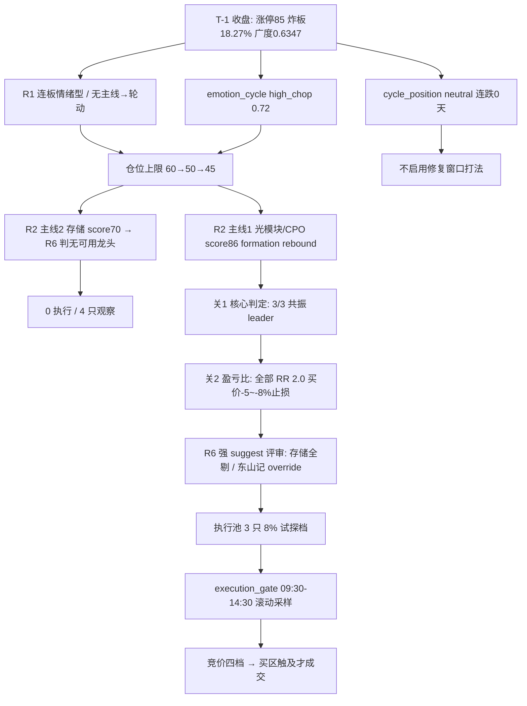

# 2026-11-12 · **主决策 / D1 盘前预案**

> **数据源新鲜度**: partial（七段 artifact 全为本轮产出；L2 话语层缺位）
> **降级状态**: degraded（R1 status=degraded 0.472；R3/R4 话语层缺失）
> **置信度**: 0.62
> **决策来源**: `decision_source=llm`（D1 大模型 fresh context，非规则版）

## 一句话结论

**连板情绪型 + 高位震荡（high_chop）+ 无主线（轮动结构）**：涨停 85/跌停 0/炸板 18.27%/广度 0.6347，钱从机器人·传媒切回光模块·CPO·PCB·存储。仓位上限 **45%**（R1 60% 经 high_chop 温度折扣 ×0.75），执行池 **3 只**全部为容量核心的 **VWAP 低吸条件单**（合计 **8%**，全部 `auto_trade=false` 需你确认）；R6 hard_reject=0，但 14 条强 suggest 把存储整条线压成「只研究」。

## 执行池（3 只 · 条件单，全部需你确认）

| 票 | 题材/身位 | 买区（引擎 VWAP 口径） | 触发 | 止损 | 止盈 | RR | 仓位 | 层 |
|---|---|---|---|---|---|---|---|---|
| **300308 中际旭创** | 光模块/CPO 龙一·容量总龙 | **511.62–519.33**（-4.3% vs 542） | 515.22 | **477.78**（买价 -8%） | 602.43（2R） | 2.0 | **3.0%** | rebound ≤3 天 |
| **300502 新易盛** | 光模块双龙之二·弹性核心 | **201.50–204.50**（-4.9% vs 215） | 202.90 | **188.14**（买价 -8%） | 237.22（2R） | 2.0 | **3.0%** | rebound ≤3 天 |
| **002384 东山精密** | PCB/元件 龙二·情绪第一顺位 | **88.05–89.37**（-2.9% vs 92.06） | 88.67 | **84.90**（买价 -5%） | 98.31（2R） | 2.0 | **2.0%** | rebound ≤3 天 |

**仓位建议**：执行池按空仓基准定量 8%（中际 3% + 新易盛 3% + 东山 2%）。现有台账（`holdings_20261111.json`：文投 2/3 + 锋龙 1/3）视为 **100% 满仓** → 合计 **108% 超配**，超配部分**只提示不缩量**，请你在两只持仓里选一只腾出 8% 现金。

### 每票四行（照此下单）

**中际旭创**
- **买**：买区 511.62–519.33，触发 515.22；竞价 低于 533.87 → 不接（翻红站回 514.19 才作弱转强，≤1.5%）｜533.87–552.84 → 按买区挂｜552.84–569.10 → 只等回踩或走分时 VWAP 档（1.5%）｜>569.10 → 作废
- **盘中确认**：CPO 涨停 ≥8 家；通信设备主力净额为正；站回 515.22 且守住 511.62
- **怎么卖**：477.78 清；602.43 减半；T+1 10:30 不创新高全走；破 511.62 十五分钟不回先减半
- **何时放弃**：竞价 >569.10 作废；09:30–10:30 未触及买区 → 当日不参与（不改价追）

**新易盛**
- **买**：买区 201.50–204.50，触发 202.90；低于 211.78 不接｜211.78–219.30 按买区挂｜219.30–225.75 等回踩或分时 VWAP 档（1.5%）｜>225.75 作废
- **盘中确认**：CPO 涨停 ≥8 家；5 日主力仍为正；站回 202.90
- **怎么卖**：188.14 清；237.22 减半；T+1 10:30 不创新高全走；破 201.50 先减半
- **何时放弃**：竞价 >225.75 作废；10:30 未触及 → 不参与；上限 3%

**东山精密**
- **买**：买区 88.05–89.37，触发 88.67；低于 90.68 不接｜90.68–93.90 按买区挂｜93.90–96.66 等回踩｜>96.66 作废
- **盘中确认**：PCB/元件涨停 ≥3 家或板块涨占比 ≥0.85；守住 88.05
- **怎么卖**：84.90 清（破 5 日线 85.31）；98.31 减半；T+1 10:30 不创新高全走
- **何时放弃**：竞价 >96.66 作废；10:00 未触及 → 不参与；上限 2%

### 竞价四档（09:27 机械对照）

| 票 | 不及预期（放弃/弱转强例外） | 预期内（按买区） | 超预期（只等回踩） | 过火（作废） |
|---|---|---|---|---|
| 中际旭创 | <533.87 | 533.87–552.84 | 552.84–569.10 | >569.10 |
| 新易盛 | <211.78 | 211.78–219.30 | 219.30–225.75 | >225.75 |
| 东山精密 | <90.68 | 90.68–93.90 | 93.90–96.66 | >96.66 |

## 为什么是这三只（推理链）

- **关1 核心判定**：三只均 `resonance`（个股-板块 20 日相关 0.93–0.97），中际/新易盛判 `leader`，东山判 `core`；无一只逆势抱团。
- **R6 打击面**：hard_reject=0（模式六双条件交集 0/9）。存储整条线被强 suggest 判「无可用龙头」→ 兆易/长鑫/佰维/澜起 **0 执行**；光迅 CFO 红旗直接拦截；沪电封板质量（开板 3 次）被关4 判回封板 → 只观察。
- **东山是唯一被 R6 点名「条件②命中（5 日净流出）」的票**。按关2.5 本应剔除，D1 记 override：R6 原文允许「D1 自行补齐目标价与止损后重新评级」→ 已补 84.90/98.31，压到 **2%**（同批最低）、只做一日、不锁仓。**你若不接受，可删东山，执行池降为 2 只（会触发 3 只下限告警）。**
- **为什么不给打板/突破**：三只全为 `core_capacity`（流通 ≥100 亿且成交 ≥10 亿），用户口径「core 只低吸、emo 只追涨」；且 20 日高点在现价 +27%~+37%，突破档数学不可达。
- **为什么必须加一档分时 VWAP**：错题 20261110_001/20261111_003——强势容量票在高开日不回踩 T-1 VWAP，单一回踩档会造成结构性零成交。

## B 计划（`seesaw_plan`）

> **语义**：B 计划由风险三条件触发，**不是执行池没成交的替补**。执行池不触发 = 价格没来（机会成本，正常）；B 启动 = 方向判断错了（风险事件，要换腿）。

| 方向 | 票 | 买区 | 触发 | 止损 | 仓位 | 能否下单 |
|---|---|---|---|---|---|---|
| 主线内部高低切（光模块→PCB） | 胜宏科技 300476 | 139.54–141.64 | 140.52 | 134.83 | 1% | ✅ |
| 主线内部高低切（光模块→PCB） | 深南电路 002916 | 218.23–221.52 | 219.77 | 210.44 | 1% | ✅ |
| 液冷/温控分支 | 英维克 002837 | 41.18–41.80 | 41.47 | 41.00 | 1% | ✅ |
| 妖股·东方系 4 板 | 大东方 600327 | — | — | — | 0 | ❌ 研究不下单（R6：不得给 4 板弱转强额度） |
| 妖股·羊年潜伏 | 三羊马 001317 | — | — | — | 0 | ❌ 研究不下单（羊族无同族涨停，无合力） |

**触发条件**：① 执行池 ≥2 票竞价不及预期；② CPO/PCB 板块主力净额转负且涨停 <3 家；③ 大东方/日出东方任一炸板或盘中炸板率 >25%。
**反向提示**：若 B 方向也同步走弱 → 全市场降档，执行池与 B 计划全部后置，只执行持仓止损。

## 观察池（21 只 · setup 池，不是「次优备选」）

| 票 | 角色 | 理由码 | 预期方向 | 买区（引擎） | 触发 | 层 |
|---|---|---|---|---|---|---|
| 沪电股份 002463 | core_midcap | board_reseal_rejected | sideways | 85.92–87.21 | 86.52 | rebound |
| 光迅科技 002281 | watch | r6_strong_suggest | down | 98.87–100.36 | 99.57 | rebound |
| 兆易创新 603986 | leader | r6_strong_suggest | down | 250.41–254.19 | 252.17 | rebound |
| 长鑫科技 688825 | core_largecap | r6_strong_suggest | down | 41.10–41.72 | 41.39 | rebound |
| 佰维存储 688525 | watch_elastic | r6_strong_suggest | down | 134.14–136.16 | 135.08 | rebound |
| 澜起科技 688008 | core_largecap | no_fund_confirmation | sideways | 157.96–160.34 | 159.07 | rebound |
| 天孚通信 300394 | elastic_core | theme_follow | up | 135.54–137.58 | 136.49 | rebound |
| 寒武纪 688256 | leader | theme_follow | up | 864.87–877.91 | 870.96 | rebound |
| 工业富联 601138 | core_largecap | theme_follow | up | 44.30–44.97 | 44.61 | rebound |
| 生益科技 600183 | watch | theme_follow | sideways | 73.05–74.15 | 73.57 | rebound |
| 剑桥科技 603083 | watch_elastic | theme_follow | up | 114.44–116.17 | 115.25 | rebound |
| 源杰科技 688498 | watch_elastic | high_position | sideways | 712.34–723.08 | 717.35 | rebound |
| 胜宏科技 300476 | core_midcap | theme_follow | up | 139.54–141.64 | 140.52 | rebound |
| 深南电路 002916 | core_largecap | theme_follow | up | 218.23–221.52 | 219.77 | rebound |
| 英维克 002837 | core_midcap | theme_follow | up | 41.18–41.80 | 41.47 | rebound |
| 宇树科技 688836 | leader | r3_theme_late | sideways | RR 0.73 → **不可下单** | — | trend |
| 襄阳轴承 000678 | watch_elastic | distribution_alert | down | 19.98–20.28 | 20.12 | trend |
| 大东方 600327 | watch_elastic | yaogu_record_only | sideways | 6.50–6.60 | 6.54 | trend |
| 日出东方 603366 | watch | yaogu_record_only | sideways | 缩量一字 → **无有效买点** | — | trend |
| 三羊马 001317 | watch | yaogu_no_consensus | sideways | 48.58–49.31 | 48.92 | rebound |
| 掌阅科技 603533 | watch_elastic | r3_theme_late | down | 31.49–31.97 | 31.71 | trend |

> 观察池票的价位为**突破/回踩触发**（只在触及后才成立），不是「跌回来才买」的替补名单。RR_FAIL（宇树 0.73）与一字板（日出东方）已显式标「不可下单」，不给假买点。

## 持仓处置（持仓侧风险，不能只写新仓）

| 票 | 权重 | 成本 | 第一线（减半） | 硬线（清） | 今日处置 |
|---|---|---|---|---|---|
| 文投控股 600715 | 2/3 | 3.14 | 破 T-1 均价 **3.113** | 破 T-1 最低 **2.88** | 只减不加：传媒次线 R3 late+派发（行业主力 -16.13 亿、单日反手）；09:30–10:00 传媒涨停 <3 家 → 直接减半 |
| 锋龙股份 002931 | 1/3 | 53.08 | 破 T-1 均价 **52.904** | 破 T-1 最低 **51.51** | 只减不加：公司已自证机器人业务占比低 + 机器人次线拦截；反弹即减，不补仓 |

组合风险：两只同时触及第一线 → **-0.35%**；同时清仓 → **-6.51%**（台账口径，数量待回填）。

## 不交易条件 / 执行闸门

| 条件 | 状态 |
|---|---|
| R1_FAIL（R1 confidence <0.4） | 未触发（0.472），但仍按 degraded 截断 cap |
| R6_HARD_REJECT_OVERFLOW | 未触发（0/9） |
| R7_STALE | 未触发（staleness=ok） |
| GLOBAL_SEVERITY_3 | 未触发（manifest severity 0） |
| EMOTION_EXTREME_GREED | 未触发（high_chop） |
| **R3_OPEN_PERMISSION_FALSE** | **命中但未设 active**（R3/R6/R7 均 open_permission=false）→ 约束已落在 `mode=dry_run` + `autonomous=false` + `requires_user_confirmation=true` + 三只 `auto_trade=false`；不设 active 是为了避免被下游读成「空仓/清空执行池」，它不等于不给票 |
| RR_FAIL | 未触发（执行池 3 只 RR 均 2.0） |

**执行闸门（09:30 起滚动采样，14:30 最后开仓）**
- 09:30–10:00 广度 <0.55 或 昨涨停红盘率 <0.60 → 新开仓全部作废
- CPO/PCB 板块主力净额转负 或 板块涨停 <3 家 → 三条全部作废
- 盘中炸板率 >25% 或 大东方/日出东方任一炸板 → 停止所有试探档
- 全部判据均可在采样时点实测（不写「竞价封单」这类盘前不存在的量）

## 数据源审计

| 源 | 状态 | 抓取时间 | 记录 | 备注 |
|---|---|---|---|---|
| R1 风格 | 🟡 degraded | 06:56 | 22 板块/20 ETF | 定量主源 11-11 收盘全量；外盘/跨资产缺口 → 0.472 |
| R2 主线 | 🟢 ok | 07:48 | 2 主线 + 9 leaders | 主线均 formation、layer=rebound |
| R3 情绪 | 🟡 degraded | 07:30 | 5 主题 | L1 双平台榜单全量；L2 群聊 0 条、WeFlow 404 |
| R4 消息 | 🟡 degraded | 06:45 | 8 事件 / 24 首板 | 官方 RSS 88 篇；wechat_cli 0 条 / news_major 标题级 |
| R5 画像 | 🟢 ok | 07:54 | 9/9 | 30+ 日 K、龙虎榜、大宗、两融齐全；话语层缺 |
| R6 反证 | 🟢 ok | 08:26 | 26 条（hard 0 / strong 14 / soft 12） | 四象限全覆盖，证据可回溯 |
| R7 资金 | 🟢 ok | 04:38 | 10 研究 + 10 观察 | 两融/ETF=11-10、美股=11-10 收盘 |
| cycle_position | 🟢 ok | 06:41 | 12 时段 | tier=neutral，连跌 0 天 |
| emotion_cycle | 🟢 ok | 06:02 | 1 | high_chop 0.72 |
| expectation_gap | 🔴 no_input | 08:30 | 91 篇 / 0 只 | 股票名录 0 → 预期差维度今日不参与 |

**引擎缺口（已处置）**：`data/raw/20261112` 缺 `daily_basic_*.json`，`apply_price_levels` 的角色判定退化为 MA50 回踩，给出「需上破 +25%~+62%」的不可达买区（中际 729.37 / 东山 147.48）。D1 改用 T-1 VWAP 口径显式覆盖通道，全部买区落在昨收 -3%~-6%，当日可触及；执行池 D1 原价不动。

## 不确定性 / 反证（自我批判）

1. **R1 与 R2 冲突**：R1 判「无主线（轮动，行业次日留存 16.0%）」，R2 给 2 条 formation 主线。D1 取更严口径——只做 1–3 日接力，不做波段主线；主线均 `layer=rebound`（距 60 日高 -27%~-58%），本就不是趋势启动。
2. **20 日资金两源符号相反**（新易盛 +46.71 vs -12.14、兆易 -1.87 vs +14.65）→ 20 日维度记 unknown，**不作加分**，只认 5 日。
3. **东山的两窗净流出是硬伤**：5 日 -5.61 亿 / 20 日 -33.32 亿，与 T-1 封单 6.57 亿形成「封单厚但资金未回补」的背离 → 只做 2% 一日试探，不锁仓。
4. **话语层缺位**：KOL 0 条、群聊 0 条、预期差 no_input → 今日判断几乎全由硬数据（涨停结构/资金/龙虎榜）支撑，对「情绪温度」的读数置信度低于常规日。
5. **R1 明确的三条降级触发器**：昨日涨停股开盘溢价转负、盘初炸板率再上 45%、广度落到 0.30 以下——任一出现即当日额度收回，只保留持仓止损。
6. **最大风险形态**：高开兑现（T-1 中际 +15.07%、新易盛 +16.97% 均为深调修复首日大涨，涨停潮全是首板 cons_nums=0，无连板高度可依托）。预案用「高开 >+5% 作废 + 只等回踩」硬挡。

## 与其他 R/D/E 的关系

- **依赖**：R1–R7 + cycle_position + emotion_cycle + expectation_gap + holdings_20261111 + 错题本（2026-W45/W46）
- **被消费**：P1 竞价校准（三只四档已在 JSON 内）、execute（`watchlist_plan.json` v1 契约，3 只均带 buy_zone/trigger/stop/take/position/derivation_reason）、E1 复盘（`meta.corrections_applied` 已列 7 条错题覆盖情况）

## Sub-Agent 元数据

- skill: main_decision_v1@1.9
- artifact: `data/plans/20261112/watchlist_plan.json`（`decision_source=llm`，`mode=dry_run`，`production_ready=true`）
- 生成耗时: ~55 分钟（含七段 artifact 交叉核验 + 价位引擎通道覆盖）
- model: deepseek-v4.1-flash（canghai-plan profile）
