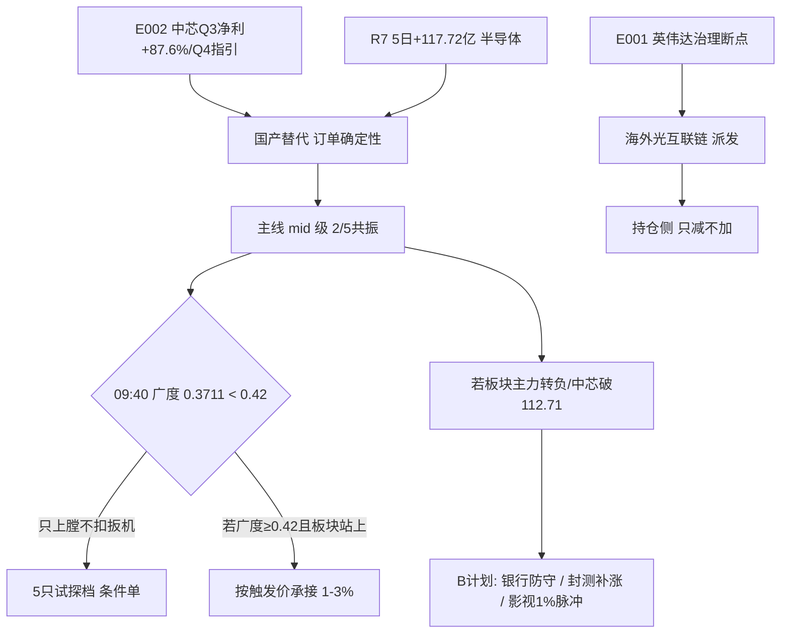

# 2026-11-13（五）· **D1 主决策 · 盘中条件单版**

> **数据源新鲜度**：partial（R5 缺、R1/R3/R4 degraded、09:40 快照仅覆盖 5 只旧观察票）
> **降级状态**：degraded（R5 未交付 → alpha/risk 缺省 B，只给试探档）
> **置信度**：0.62
> **⚠️ 时点**：本预案 10:02 落盘，**集合竞价（09:25）已过** → 买点全部改为「站回 T-1 均价线」的盘中条件单，不是竞价挂单。

## 一句话结论

英伟达 CEO 辞职（E001）把海外光互联链的「治理确定性」打掉，中芯 Q3 净利 +87.6% / Q4 指引 +4~6%（E002）把国产链的「订单确定性」抬起来 —— 钱已经在换腿（R7：通信设备 -68.14 亿 vs 半导体 5 日 **+117.72 亿**、20 日 +85.66 亿，全市场唯一 20 日累计为正的成长板块），但今日 09:40 广度只有 **0.3711**、影视涨停潮 5 家却无一条 R4 催化 → **可上膛、不可扣扳机**：仓位上限 36%，执行池 5 只全部 1–3% 试探档、`auto_trade_enabled=false`、过「两条门禁 + 站回触发价」才许下单。

## 守正出奇

### 正 — 当下最硬的逻辑（主线连续 1 日 · mid 级 2/5 共振）

| 项 | 判断 | 证据（含时点） |
|---|---|---|
| **主要矛盾** | 同一上游敞口该按「叙事」定价还是按「业绩」定价：海外链的治理确定性被 E001 一次性打掉，国产链的订单确定性被 E002 实证抬升 | E001 英伟达黄仁勋辞职（11-12 盘后，行业级负面）；E002 中芯营收 219.83 亿(+28.1%)、净利 28.47 亿(+87.6%)、毛利率环比 +4.6pct、Q4 指引环比 +4~6%（正面/high） |
| **谁在定义市场** | `mixed`：机构买半导体容量票（R7 d1 +23.53 / 5d +117.72 / 20d +85.66 亿），游资买影视低位首板（09:40 影视音像 +3.97%、涨占比 0.97、5 家涨停、87.2 亿） | 选票听机构的（逻辑硬+业绩实证），买点听游资的（只在站回均价线时点跟） |
| **主线与级别** | 半导体/国产算力（晶圆代工·封测·设备·存储）·**mid**（五共振 2/5：participant=hit、timing_cycle=hit、cn_us/primary_secondary/policy=na） | 不能按「强主线」给仓位：R2 自身 score 70.0 擦线，热度/涨停/共振三维合计仅 32/60 |
| **题材公平性** | `unclear`：国产替代是公开 3 年的长叙事，寒武纪 PE 146.76 / PB 40.46 是机构 3 年自留地；相对公平的是低位弹性票（摩尔线程次新、安集被 ETF 举牌） | 故：弹性票优先，容量票只做站回确认，不做趋势想象 |
| **最硬的核心观点** | 在 E001 未修复、E002 Q4 指引未证伪之前，国产链的资金承接持续强于光互联链 —— 判据不是谁涨得多（今日影视首板最多），而是谁有「5 日 +117.72 亿主力净流入 + 业绩实证」；影视涨停潮无催化，一日游概率高于接力 | 可证伪：① 半导体 10:00-10:30 主力净额转负且样本涨占比 <0.35；② 中芯跌破 112.71 且 3 日不回；③ 影视涨停 ≥3 家且次日仍 ≥3（主次换位）；④ E002 澄清/下修 |

| 正股 | 身位 | 为什么是它 | 持有依据（逻辑未变） | 个股证伪 | 最长持有 |
|---|---|---|---|---|---|
| 688981.SH 中芯国际 | 容量中军（layer=rotation → 今日只做价格锚，不给买点） | 全场唯一业绩实证：净利 +87.6%、毛利率 +4.6pct、Q4 指引环比 +4~6% | 它站住 114.9 之上，整条线的回踩买点才有意义 | 跌破 112.71 且 3 日不回 / Q4 指引下修 / 板块主力连续 2 日净流出且涨占比 <0.35 | 0（结构未修复，只观察） |
| 688795.SH 摩尔线程 | 弹性核心（rebound，h3） | 国产 GPU 第二心智锚：+8.33%、成交 33.25 亿、距 20 日高仅 -3.98%，线内唯一贴前高的弹性票 | rebound 第一波，持仓 ≤3 天，不创新高即走 | 跌破 351.53 / 跌破 T-1 VWAP 379.08 且分支主力转负 | 3 |
| 688019.SH 安集科技 | 材料龙二（rebound，h3） | 科创半导体 ETF 华夏增持至 5% 举牌线：全批唯一「买入方已公告」 | 举牌事实未变则作为材料线锚；V4（CFO/净利 0.45）→ 只做 3 天内短线 | 跌破 204.87 / 举牌方减持公告 / 材料线主力转负 | 3 |

### 奇 — 守正方向上的非常规入口

**奇点**：共识把今天当「退潮第 2 天、无主线、只配观察」（R1/R3/R7 一致口径）。我认同「不能重仓」，但不认同「不用上膛」——共识漏掉的是**钱的去向已经换了**：20 日口径下，全市场唯一累计正流入的成长板块是半导体（+85.66 亿），而它在涨停家数上是 0–2 家（「钱在、板没有」）。差异不在今天买多少，而在**要不要在今天把半导体回踩承接的子弹上膛**。

| 出奇标的 | 入口类型 | 触发（可实测） | 绑定守正 | 仓位 | 作废条件 |
|---|---|---|---|---|---|
| 002185.SZ 华天科技 | 分歧低吸 | 中微 <257.84 且 中芯 <112.71（设备端站不回）而封测分支仍红 → 回踩 15.07–15.30 | 半导体/国产算力·中芯产能外溢 | 0.01 | 封测板块涨占比 <0.4 或跌破 14.71 |
| 600715.SH 文投控股 | 事件催化 | 影视涨停 ≥3 家维持到 10:30 且它开板回踩 3.28–3.33 | 情绪脉冲（**守正之外**，仅 1% 对冲） | 0.01 | 涨停家数 <2 或开板不回封 |
| 600569.SH 安阳钢铁 | 首板接力 | 开板 ≤1 次且站回均价线，不接 T 字板 | 妖股赛道（羊年同音族，**守正之外**） | 0.01 | 开板 ≥2 次 / 换手 >15% / 破均价线 |

### 纪律 — 不换股

- `no_churn = true`：逻辑未变 → 执行池 5 只全部落在同一条守正方向或其相邻次线，**不因当日涨跌换票**。
- 换股三条件（须同时满足）：① 正股逻辑被证伪（上方 falsifiers 任一命中）；② 出现**更强**的同方向龙头且**有带动性证据**（板块涨停家数或主力净额同步放大，不是涨得更多就算）；③ 风险闸门强制（跌破 20 日线 / 广度 <0.30 / 个股 V4 升级为 P0）。
- 今日唯一换股是 T-1 光互联三只（中际旭创/新易盛/东山精密）→ 半导体，属**条件① 产业级证伪**（E001 + 主力 -26.50/-16.13/-13.84 亿），不是「昨天涨完了」。

## 执行池（5 只 · 合计仓位 10% · 全部条件单）

**仓位建议**：仓位上限 36%（R1 0.45 × 无主线系数 0.8）；本次新建仓预算 **10%** = 摩尔线程 3% + 安集 2% + 中微 2% + 澜起 2% + 内蒙一机 1%。剩余 26% 留给「门禁二次确认后加档」，须用户确认。

| # | 票 | 角色/层 | 买区 | 触发价 | 止损（距买价） | 止盈 | RR | 仓位 | 门禁 |
|---|---|---|---|---|---|---|---|---|---|
| 1 | 688795.SH 摩尔线程 | elastic_core / rebound·h3 | 376.43–382.10 | 379.08 | 351.53（**-8.0%**） | 443.24 | 2.0 | 3% | G2+G3 |
| 2 | 688019.SH 安集科技 | core_midcap / rebound·h3 | 219.38–222.68 | 220.92 | 204.87（**-8.0%**） | 258.30 | 2.0 | 2% | G2+G3（09:40 221.00 已站上） |
| 3 | 688012.SH 中微公司 | core_largecap / rebound·h3 | 256.04–259.90 | 257.84 | 246.91（**-5.0%**） | 285.88 | 2.0 | 2% | G2+G3 |
| 4 | 688008.SH 澜起科技 | core_midcap / rebound·h3 | 164.10–166.57 | 165.25 | 158.24（**-5.0%**） | 183.23 | 2.0 | 2% | G2+G3 |
| 5 | 600967.SH 内蒙一机 | elastic_core / trend·pullback h3 | 12.72–13.21 | 12.72 | 12.55（**-5.0%**） | 14.53 | 2.0 | 1% | G1+G3 |

**门禁（三条至少两条成立 + 价格触发才许下单；09:50–14:30 每 20 分钟滚动，14:30 后不再新开）**

| 门禁 | 条件 | 09:40 实测 | 状态 |
|---|---|---|---|
| G1 | 全市场涨占比 ≥ 0.42 | 0.3711 | ❌ 未成立 |
| G2 | 半导体样本涨占比 ≥0.55 或 细分涨停 ≥3 家 | 池内 5/5 红 = 1.00 | ✅ 成立 |
| G3 | 价格站回 T-1 均价线 VWAP×1.002（逐票触发价） | 安集 221.00 ≥ 220.92 | ✅ 部分成立 |

**逐票四行人话（照着下单即可）**

| 票 | 买 | 盘中确认 | 怎么卖 | 何时放弃 |
|---|---|---|---|---|
| 摩尔线程 | 回踩 376.43–382.10 且站回 379.08 | 半导体样本涨占比 ≥0.55；它不再跌破 379.08 | 351.53 止损；443.24 减半；破 376.43 走；h3 → 第 3 日不创新高走 | 高开 >5% / 跌破 376.43 不收回 |
| 安集科技 | 219.38–222.68 承接（已在区内） | 举牌票，成交额需维持 10 亿以上 | 204.87 止损；258.30 减半；破 219.38 走 | 跌破 204.87 / 材料线转绿 |
| 中微公司 | 站回 257.84 才买，不预埋 | 半导体设备分支主力净额为正 | 246.91 止损；285.88 减半 | 10:30 前不站回 257.84 → 今日取消 |
| 澜起科技 | 站回 165.25 才买 | HBM/存储分支维持红盘 | 158.24 止损；183.23 减半 | 存储概念掉出前 20 且未站回 |
| 内蒙一机 | 回踩 12.72–13.21 | 地面兵装涨占比 ≥0.83 维持 | 12.55 止损；14.53 减半；次日不创新高走 | 兵装转绿 / 跌破 12.55 |

**竞价四档（⚠️ 仅供复盘：竞价已于 09:25 结束）**

| 票 | 不及预期 | 预期内 | 超预期 | 高开过度 | 09:40 实际 |
|---|---|---|---|---|---|
| 摩尔线程（基准 380.22） | <374.52 | 374.52–387.82 | 387.82–399.23 | >399.23 | 无实时价 |
| 安集科技（214.80） | <211.58 | 211.58–219.10 | 219.10–225.54 | >225.54 | **221.00（+2.89%）→ 超预期档** |
| 中微公司（252.55） | <248.76 | 248.76–257.60 | 257.60–265.18 | >265.18 | 无实时价 |
| 澜起科技（162.89） | <160.45 | 160.45–166.15 | 166.15–171.03 | >171.03 | 无实时价 |
| 内蒙一机（13.15） | <12.95 | 12.95–13.41 | 13.41–13.81 | >13.81 | 无实时价 |

**为什么这 5 只，而不是龙一龙二**：R2 龙一寒武纪、龙二中芯的 60 日结构都是 `rotation`（寒武纪 r60 -10.8%、距 60 日高 -16.3%；中芯 r60 -10.9%），按 2026-11-11 三层规则 **rotation 不给买点**，且 R6 M1_04 明判「今日无执行资格」——两者只进观察池做价格锚。执行池取该线 rebound 层的核心（摩尔线程/安集/中微/澜起）＋兵装唯一 trend 结构的龙二，符合「龙一买不进就切同线替补，不启用杂毛递补」。

## 观察池（20 只 · setup 池，不是今天就要买）

| 票 | 题材 | 买区（引擎） | 触发 | 止损 | RR | 为什么只是观察 |
|---|---|---|---|---|---|---|
| 688256.SH 寒武纪 | 半导体·总龙 | 974.42–989.11 | 981.28 | 909.98 | 2.0 | layer=rotation + R6 M1_04/M3_01：MA60 1000.5 未过、按昨收 RR 0.37 → 无执行资格 |
| 688981.SH 中芯国际 | 晶圆代工·容量中军 | 111.03–112.71 | 111.81 | 105.89 | 2.0 | R6 M3_02 双条件：回踩 109.5 缩量 **+** 放量站上 114.9；09:40 114.34 未站上 |
| 002371.SZ 北方华创 | 半导体设备 | 565.24–573.76 | 569.22 | 545.07 | **1.44 FAIL** | 估值 85.8/82.3 分位 + 净利 +5.1% + 套牢 70.7% |
| 002156.SZ 通富微电 | 先进封装 | 48.80–49.54 | 49.15 | 47.06 | **1.79 FAIL** | 差 0.01 未过 1.8 线；09:40 48.71 需站回 49.15 |
| 688347.SH 华虹宏力 | 晶圆代工 | 174.72–177.36 | 175.95 | 163.17 | **0.84 FAIL** | 距 20 日高仅 -8.6%，赔率结构不足 |
| 600584.SH 长电科技 | 封测 | 55.61–56.45 | 56.00 | 53.63 | **1.61 FAIL** | 封测强度弱于设备 |
| 002185.SZ 华天科技 | 封测 | 15.07–15.30 | 15.18 | 14.71 | 2.0 | 出奇腿，只在设备端站不回时切 |
| 301660.SZ 粤芯半导体 | 次新首板 | 30.19–30.64 | 30.40 | 28.19 | 2.0 | layer=unknown（上市不足 60 日）→ 不给趋势买点 |
| 601606.SH 长城军工 | 兵装龙一 | 34.88–35.59 | 35.06 | 33.81 | 2.0 | 首封 13:52 尾盘板 + 开板 2 次（关4 板型硬拒）+ rotation |
| 600698.SH 湖南天雁 | 兵装龙三 | 6.98–7.23 | 6.98 | 6.93 | 2.0 | rotation，仅作兵装情绪温度计 |
| 603536.SH 惠发食品 | 预制菜龙一 | 12.97–13.24 | 13.04 | 12.58 | 2.0 | alpha C + PB 99.4 分位 + 涨停日主力 -0.24 亿 + 龙虎榜 -1.02 亿 |
| 600467.SH 好当家 | 预制菜龙二 | 2.38–2.41 | 2.39 | 2.29 | 2.0 | mid_laggard + 封单 0.44 亿过薄；09:40 已 2 板 |
| 600127.SH 金健米业 | 预制菜龙三 | 12.50–12.88 | 12.50 | 12.24 | 2.0 | rotation，距 20 日高 -29% |
| 300058.SZ 蓝色光标 | AI营销龙一 | 15.89–16.21 | 15.97 | 14.91 | 2.0 | alpha C + F8(P0) + 大宗折价 -22.89% + 换手 22.5% |
| 600715.SH 文投控股 | 影视龙一 | 3.43–3.50 / 开板回踩 3.28–3.33 | 3.45 / 3.33 | 3.32 / 3.15 | 2.0 | 今日 09:40 已涨停，打板买点无法满足 ±5% 节点带 → 今日不追 |
| 000802.SZ 北京文化 | 影视首板 | 4.02–4.08 | 4.05 | 3.88 | 2.0 | 已涨停，等回踩 4.02–4.08 |
| 603103.SH 横店影视 | 院线首板 | 17.80–18.07 | 17.93 | 17.17 | 2.0 | 已涨停，等回踩 |
| 600977.SH 中国电影 | 影视中军 | 15.53–15.77 | 15.64 | 15.31 | 2.0 | 容量中军，今日未涨停 |
| 601398.SH 工商银行 | 银行（对手盘） | 8.23–8.39 | 8.23 | 7.97 | **1.17 FAIL** | 只在科技线全绿时作防守替代 |
| 600036.SH 招商银行 | 银行（对手盘） | 42.22–42.85 | 42.51 | 40.71 | 2.0 | 日波动 <2%，无涨停基因，只做 ≤2 天 |

## B 计划（跷跷板 / 对手盘）

**语义**：B 计划由风险三条件触发，**不是执行池未成交的替补** —— 执行池不触发 = 价格没来（机会成本，正常）；B 启动 = 方向判断错了（风险事件，要换腿）。

**触发**：① 执行池 ≥2 票不及预期（半导体样本涨占比 <0.35 或龙头跌回 VWAP 下方）；② 半导体主力净额由 +23.53 亿转负且设备/制造同步转负；③ 全市场涨占比跌破 0.30。

| 方向 | 对手盘 | 票 | 买区 | 触发 | 仓位 | 能不能下单 |
|---|---|---|---|---|---|---|
| 银行（哑铃另一端，软件开发 vs 银行 corr -0.61） | ✅ 反向 | 601398.SH 工商银行 | 8.23–8.39 | 触发①+③ 同时成立，且大盘跌破 -1% | 2% | RR 1.17 <1.8 → **仅防守替代**，买入即认「今天做错方向」，隔日必走 |
| 银行 | ✅ 反向 | 600036.SH 招商银行 | 42.22–42.85 | 同上 | 2% | 可下单（RR 2.0），持有 ≤2 天 |
| 主线内部高低切（设备/材料 → 封测） | ❌ 未反向 | 002185.SZ 华天科技 | 15.07–15.30 | 设备端站不回 VWAP 而封测仍红 | 1% | 可下单 |
| 情绪脉冲·影视（半导体全绿时） | ✅ 反向 | 600715.SH 文投控股 | 回踩 3.28–3.33 | 半导体全绿且影视涨停 ≥3 维持到 10:30 | 1% | 可下单（仅开板回踩，不追板） |

**与用户判断的对撞**：若您前一晚判「科技量不够、钱回流投机线」，分歧点在半导体 20 日 +85.66 亿是「唯一累计正流入」这一事实。推翻阈值：半导体 10:00 成交额 ≤ 昨日同时点 0.9 倍 **且** 样本涨占比 <0.35（两条同时成立即认输，切 B）。

## R6 反证采纳

| 级别 | 条目 | 处置 |
|---|---|---|
| **hard_reject（不可覆盖）** | 002172.SZ 澳洋健康（模式七 F1/F3/F8/F10，含 2 条 P0） | 剔除 + 禁同族递补 |
| strong 采纳 | R6_M1_04 寒武纪/中芯「今日无执行资格」 | 两只均只进观察池 |
| strong 采纳 | R6_M3_01 寒武纪 / M3_02 中芯 / M3_03 通富·长城军工·惠发 / M3_04 北方华创 / M5_02 兆易·存储线 | 全部按建议降级（兆易进 rejected） |
| **strong 覆盖** | R6_M1_03「三只 RR 不到门槛」 | 见 `meta.d1_override`：R5 目标价锚昨收 → RR 恒 0 属伪赔率，改用引擎 2R 重算 RR=2.0 |
| **strong 覆盖** | R6_M1_05「北方华创/通富/安集按中位杂毛处理」 | 安集改按细分「材料龙二」位次 + E006 举牌硬事件，仓压 0.02、需站回确认 |
| soft 记录 | R6_M7_06 V4（安集/寒武纪 CFO/净利 0.45） | 写入执行票「中期瑕疵·只做 3 天内短线」 |
| 全市场系数 | M5+M1 命中 → 0.7；按 Step 2.5 情绪回暖日打折 | `market_wide_factor = 0.85`（炸板率 28% vs T-1 48.61%、广度 0.157→0.371） |

## 数据源审计

| 源 | 状态 | 抓取时间 | 记录数 | 用途 / 备注 |
|---|---|---|---|---|
| research_summary | ⚠️ partial | 09:39 | — | orchestrator_status=partial，contract_checks_passed=false |
| R1 风格 | ⚠️ degraded | 06:44 | — | 震荡分化/47.1/无主线/cap 0.45，conf 0.472 |
| R2 主线 | ✅ ok | 07:16 | 1+3 | 半导体 70.0 擦线；妖股赛道 3 候选 |
| R3 情绪 | ⚠️ degraded | 07:02 | 5 主题 | 44.6、open_permission=false、L2 KOL 0 条 |
| R4 消息 | ⚠️ degraded | 07:40 | 8 事件 | E001–E008，行业级利空打击面 |
| **R5 画像** | ❌ **not delivered** | — | 0 | `contract_failures: unit not delivered by this run` → **本预案不读取该文件**，alpha/risk 按契约缺省 B |
| R6 反证 | ✅ ok | 09:39 | 30 条 / 13 票 | hard_reject 1、strong 18、soft 11；模式六交集 0 |
| R7 资金 | ⚠️ degraded | 04:54 | 24 票 | pre-06am 闸门 triggered 但附 attestation、trading_gap=0 → 放行 |
| 09:40 快照 | ✅ ok | 09:40 | 5584 | 广度 0.3711、涨停 18/炸板 7、影视热；仅含 5 只旧观察票实时价 |
| 价位引擎 | ✅ ok | 09:58 | 25 票 | trend_layer + forbidden_filter + core_judge + risk_reward + dragon_switch 全跑 |

## 不确定性 / 反证（自曝）

1. **R5 缺失是本预案最大的结构性弱点**：alpha/risk 全按缺省 B，等于「所有票在估值/财务维度都没有被体检」——这是只给试探档的第二个理由（不只是情绪）。
2. **时点错配**：本预案 10:02 落盘，已错过 09:25 竞价与开盘 30 分钟；四个票（摩尔线程/中微/澜起/内蒙一机）09:40 快照未覆盖 → 买区是**条件价不是现价**，若开盘已远离买区则今日不成立。
3. **影视涨停潮可能是「错过的对的方向」**：5 家涨停/涨占比 0.97 是今天最真实的赚钱效应，我因「无 R4 催化 + 打板买点不满足 ±5% 节点带」只给 1% 观察腿。若明日影视仍 ≥3 家涨停，则今日应被记为错题（对应 falsifier ③）。
4. **寒武纪/中芯不进执行池，可能是过度守纪律**：它们 09:40 分别 +2.67%/+2.35%，是全市场资金最集中的两只。我按 layer=rotation + R6 M1_04 只给观察——若它们今日尾盘放量站上 MA60/114.9，这就是「纪律挡住 α」的样本，须在 E1 复盘里量化。
5. **E001 二次发酵无法排除**：英伟达盘后 -9%、盘前 -6%，A 股 11-12 已跌过一次；若今晚美股再杀，今日买入的半导体也可能被情绪外溢拖累（R7 明写「换手在缩圈中完成、接力失效信号」）。
6. **无持仓台账**：`data/runtime/holdings_20261113.json` 不存在 → 持仓侧只给方向（光互联三只只减不加、破 20 日线走），不给数量；若您实际持有，请自行核对是否超配。

## 与其他 R/D/E 的关系

- **依赖**：R1（风格/仓位）、R2（主线/次线/龙头/妖股）、R3（情绪/禁令）、R4（事件极性）、R6（反证/硬拒）、R7（资金/跷跷板）；R5 **未交付**（缺省 B）。
- **被消费**：execute（消费 watchlist_plan + 本日 P1/P2 amendment）、P2 午盘修订（本预案执行池即为午盘复核对象）、E1 复盘（`corrections_applied` + `d1_override` 供逐条核验）。

## Sub-Agent 元数据

- skill: `main_decision_v1@1.11`
- artifact: `data/plans/20261113/watchlist_plan.json`（107 KB，`validate_plan_for_date` 通过）
- 决策来源: `decision_source=llm`（非 python_fallback；已替换当日 08:55 的 `python_fallback` 空池版）
- 生成耗时: ≈ 92 分钟（含引擎/门禁实跑）
- model: deepseek-v4.1-flash
- 前置闸门实跑：`trend_layer.stock_layer` / `price_levels.derive` / `forbidden_filter.check_forbidden`（5 只全过）/ `core_judge.judge_core` / `risk_reward.judge_risk_reward` / `dragon_switch.judge_dragon_switch`（大东方 alive·寒武纪 alive）

> 本预案 `mode=dry_run`、`autonomous_trading_enabled=false`、`requires_user_confirmation=true`、`no_trade=true` —— 不做无条件买入；5 只均为条件单，须用户确认或门禁触发后才可下单。
