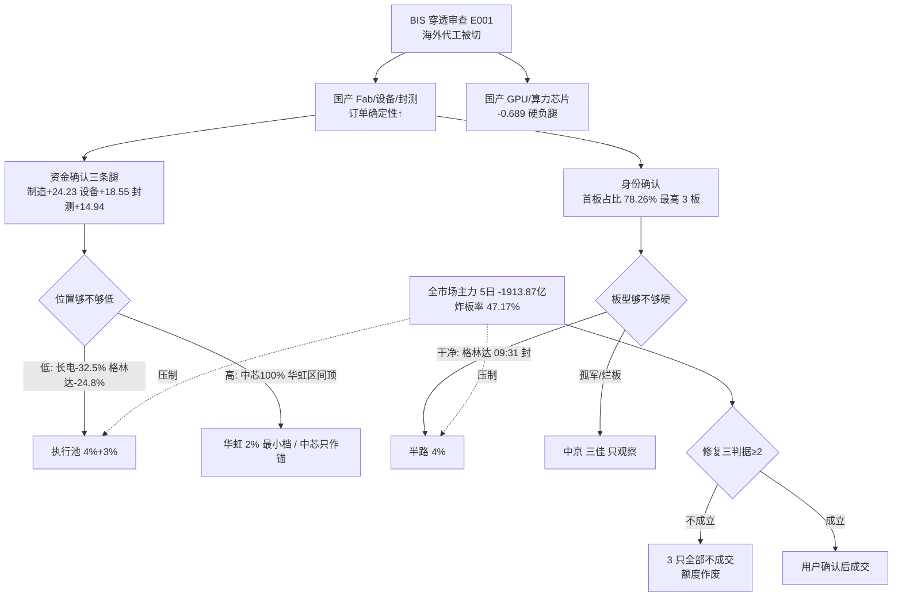

# 2026年11月20日 · **主决策 / D1 盘前预案**

> **数据源新鲜度**: partial ｜ **降级状态**: true（R1 文本层 / R3 共振层）｜ **置信度**: 0.47（R1 0.472，最低单元决定）
> **决策**: fresh-context LLM（decision_source=llm）｜ **模式**: dry_run（3 只全部条件单，auto_trade=false）

## 一句话结论

**温度是补跌第 7 天（连跌 6 天 · repair_window），仓位上限 0.10，只能做「低位补涨 / 首板隔日」的承接，不做趋势追涨。**
全市场 11-19 主力 -313.15 亿（5 日 -1913.87、20 日 -3929.82，20 日仅 8 日为正）、涨停 28 / 跌停 83 / 炸板率 47.17%（取严 51.06%）、昨涨停收盘溢价中位 -0.71%。唯一多源同向的方向是半导体自主可控里的**国产 Fab/设备/封测腿**（BIS 反身性受益端），但它只是「窄口抱团」（共振真等级 L1_only、板块指数仍负），级别 mid、持有 ≤3 天。执行池 3 只全部为条件单：格林达 4%、长电 3%、华虹 2%（合计 9%，利用率 0.90）；R6 hard_reject 1 只（九阳股份）已剔除。

## 守正出奇

### 正 — 当下最硬的逻辑（主线第 1 日 · 昨日 thesis 已切换）

- **主要矛盾**：BIS 穿透审查（11-16 新规；11-19 台积电三星暂停部分对华先进制程出货）把「靠海外代工做先进制程」这条路径切断，使**国产 Fab/设备/封测的订单确定性上升**；而全市场主力 5 日 -1913.87 亿、两融在撤（中芯融资 15 日 -16.84%、融券 +84.32%）——矛盾是**「环节确定性向上 vs 杠杆与总量资金向下」**，所以只允许承接型低吸，不允许趋势追涨。
- **谁在定义市场**：`mixed`。机构在定义「哪条腿有延续性」：只有集成电路制造（+24.23／5 日 +42.58／20 日 +56.48）、半导体设备（+18.55／+56.83／+144.54）、封测（+14.94／5 日 +4.85 转正）三条腿 5-20 日双正或转正；游资在定义身位：首板占比 78.26%、最高 3 板、2 板层只有 2 只。
- **主线与级别**：`半导体自主可控·国产 Fab/设备/封测（不含国产 GPU/算力芯片/CPO）`，级别 **mid**。五个共振 `timing_cycle hit`（题材出现在连跌 6 天后的第 7 天）+ `policy hit`（BIS 穿透审查 + 伯恩斯坦 WFE 2027 上调 39% + 无锡 50 亿先进封装产线）= **2/5**；`cn_us miss`（SOX -2.15%、费半 -2.41%、法巴预计 12/1/3 月加息）；`primary_secondary na`（无一级市场数据）；`participant na`（R3 共振真等级仅 L1_only、活跃席位 3 日 full_3d 仅 8 只 → 不许记 hit）。级别 mid ≠ 可持有：R2 给 layer=rotation、holding 0-3 天。
- **题材公平性**：`unclear`。容量核心那一段是别人的自留地（大基金持股概念 +31.33 亿、机构 11-17 已建仓，中芯/华虹 5 日主力 +16.32/+21.87 亿），散户进场只能接 30 日高位的 20cm 票；相对公平的只有深跌低位第二棒（长电 -32.5%、格林达 r60 -24.8%）。不公平段封住华虹的仓位（2%），不改变选股资格。
- **最硬的核心观点**：**未来 3 个交易日内，BIS 受益腿里「位置低 + 资金已转正」那一段（封测长电、材料格林达）会强于「位置 100% 的容量核心」（中芯、华虹）**——因为全市场 5 日资金 -1913.87 亿是存量再分配，存量只找没被抬过的低位筹码，不接力已到区间顶的票。
- **证伪条件（可实测）**：① 半导体细分口径涨停家数连续 2 日 <3 家（11-19 为 5 家）；② 集成电路封测 5 日主力由 +4.85 亿转负；③ 长电收盘跌破 52.45 且 2 日不收回，或格林达收盘跌破 27.07（MA10）；④ 全市场炸板率 ≥45% 且跌停家数 > 涨停家数。

**正股（逻辑未变则持有，不每天换票）**

| 票 | 身位 | 为什么是它 | 持有依据 | 个股证伪 | 最长持有 |
|---|---|---|---|---|---|
| 中芯国际 688981 | 龙一·**价格锚不给买点** | 国产代工唯一大容量载体（流通 2445.7 亿），主力 +11.52 亿全场第一；但位置 100%、RR 0.02 | 站住 119.27（T-1 均价线下沿）之上，整条 Fab 腿承接才成立 | 收盘破 119.27 次日不收回 / 制造腿 5 日资金转负 | 0 天 |
| 长电科技 600584 | 低位补涨核心 | 封测腿 5 日唯一转正（+4.85 亿）、距 60 日高 -32.5% 链内最低、单日主力净流入率 11.48% 全场最高 | 站住 VWAP 54.43 就继续持有 | 破 52.45 / 封测细分涨停归零 | 3 天 |
| 格林达 603931 | 首板隔日候选（**非龙一**，R6 已采纳） | 09:31 首封、1 次开板、封单占成交 47%、换手 3.12%（惜售）、risk 档 A、0 红旗（覆盖内） | 站住 VWAP 28.53 之上持有 | 破 27.12 / 电子化学品涨停归 0 且光刻胶跌出前 20 | 2 天 |

### 奇 — 守正方向上的非常规入口

**奇点**：市场共识是「BIS 利好半导体、买核心」，但**核心已经在 30 日区间顶、赔率归零**；真正没被抬过的是产业链末端的第一棒/第二棒。今日能验证的一棒标的（中京、三佳）都被 R6 红旗或容量门槛拦下 → **出奇标的今天只作研究观察，不授仓位**（硬凑出奇=回到散户心理）。

| 标的 | 入口 | 触发（可实测） | 绑定守正 | 仓位 | 作废条件 |
|---|---|---|---|---|---|
| 中京电子 002579 | 首板接力 | 三判据 ≥2 且竞价 ≥+1%；首封 ≤10:30、0 开板、封单 ≥0.8 亿（排板不扫） | 长电科技 600584（同一封测/先进封装腿） | 0%（研究观察） | 元件细分涨停 <3 家（孤军）/ 开盘溢价 <0 |
| 三佳科技 600520 | 首板接力 | 同上，且必须出现第二只半导体细分首板 | 本条主线 | 0%（研究观察） | 流通 35.1 亿 + 封单 0.57 亿 → 命中容量门槛，永久不进执行 |

### 纪律 — 不换股

- **逻辑未变不换股**：thesis 切换发生在 E001 事件当日（11-19，算力腿→Fab 腿），今日是**执行而非再切换**；不因「昨天算力涨得好」回头做算力腿，也不因「半导体今天最强」换掉正股。
- **换股三条件（须同时满足）**：① 正股 falsifiers 命中；② 出现更强同方向龙头且有带动性证据（板块涨停 ≥3 家 + 封单 ≥0.8 亿 + 首封 ≤10:30，不是「涨得更多」）；③ 风险闸门强制（破 20 日线 / 大盘系统性风险 / 基本面反转）。
- **连续性**：`bis_reflexivity_domestic_fab_20261120`，第 1 日，**changed_today=true**（理由为产业级出口管制事件对两条腿的反向作用，不是「昨天涨完了」）。

## 预期差

`expectation_gap.json` 本日为 `status=no_input`（194 字节，预期差号未产出）→ **今日不输出预期差条目，也不做扩写**（缺口已记入 plan `data_sources.data_gaps`）。替代口径：用 R6 反证的「被点名但市场没反应」清单（江化微尾盘板未被资金追、西陇爆量未封板、长鑫回购与资金背离）作盘前提示，见下文 R6 段。

## 执行池（3 只 · 全部条件单，不成交即视为未开仓）

> 按空仓基准定量：9%，cap 0.10，利用率 0.90（留 1% 给尾盘试错）。**三只都不自动成交**：需 09:30-11:00 修复三判据 ≥2 + 个股触发 + 用户确认。

| # | 票 | 题材 | 买区 | 触发 | 止损 | 止盈 | RR | 仓位 | 层/持有 |
|---|---|---|---|---|---|---|---|---|---|
| 1 | 格林达 603931 | 光刻胶材料·首板隔日 | 29.33–29.92 | 29.48 | 28.42（-5.0%） | 32.07（涨停价，31.00 减半） | 1.43 | 4% | rebound/2 日 |
| 2 | 长电科技 600584 | 封测·低位补涨 | 54.16–54.97 | 54.54 | 52.45（-4.6%） | 60.01（2R≈识图 60.5） | 2.00 | 3% | rebound/3 日 |
| 3 | 华虹宏力 688347 | 国产 Fab·回踩 MA60 | 195.80–198.00 | 197.60 | 182.20（-8.0%） | 228.00（周线 MA20 227.9） | 1.90 | 2% | rebound/3 日 |

**共同执行门槛（写在每只票 entry_rules.execution_gate）**：09:30-11:00 每 15 分钟滚动采样，**任两条成立**才成交 —— ① 开盘广度 >0.55；② 昨涨停红盘率 >60%；③ 板块级涨停家数 ≥3（半导体/元件/电子化学品分别计）。**11:00 后不再新开**。判据不成立 → 三只全部不成交，额度作废，当日只留存量 T。

### 1. 格林达 603931（4%）
- **买**：买区 29.33–29.92（+0.6%~+2.6% vs 昨收 29.15）；触发 29.48。竞价：低开 <-1.5%（<28.71）不接 / 预期内 -1.5%~+2%（28.71–29.73）站上 29.48 放量跟随 / 高开 +2%~+3.5%（29.73–30.17）只认触发后 / >+3.5%（>30.17）作废。
- **盘中确认**：半导体细分涨停 ≥3 家 或 板块涨占比 ≥0.85 且均涨 ≥+2% → 至少一条 + 个股分时不破当日均价线。
- **怎么卖**：止损 28.42；触及 31.00（识图压力区上沿）减半；剩余 32.07（涨停价）；T+1 10:30 不创新高全走；收盘跌破 28.53（T-1 均价线）走。
- **何时放弃**：竞价 >+3.5%；10:30 前未站上 29.48；仓位上限 4%。
- **买入理由**：BIS 材料腿第二棒（11-17 首板→11-19 二板），板型最干净（09:31 首封、1 次开板、封单占成交 47%、换手 3.12% 惜售），risk 档 A（本批唯一）、财务红旗 0（覆盖范围内）。
- **风险点**：① 回封板（1 次开板）说明空头已削弱，需排板不冲；② 电子化学品只有 2 家涨停，子链太窄；③ 隔夜 SOX -2.15%、AMD -8.51 是外部压制。
- **止损条件**：破 28.42 无条件，或收盘破 T-1 均价线 28.53。
- **可验证假设**：若它今日站上 29.48 后维持封板/不破均价线，则「材料第二棒接力」成立；若冲高回落收在均价线下，则材料腿一日游结束，长电/华虹也要降档。

### 2. 长电科技 600584（3%）
- **买**：买区 54.16–54.97（-2.4%~-0.9%）；站回 54.54 才算站住。竞价：<-1.5%（<54.64）等翻红 / 预期内 -1.5%~+2%（54.64–56.58）回踩买区挂单 / +2%~+3%（56.58–57.13）买区失效只在回踩 54.97 再评估 / >+3%（>57.13）作废。
- **盘中确认**：封测或半导体细分涨停 ≥3 家（或板块涨占比 ≥0.85 且均涨 ≥+2%）+ 站回 54.54 且不破当日均价线。
- **怎么卖**：止损 52.45；60.01 减半；剩余 62.7；T+1 10:30 不创新高走；收盘破 MA10 52.98 走。
- **何时放弃**：竞价 >+3%；或买区跌破 54.16 不接；仓位上限 3%。
- **买入理由**：修复窗口「低位补涨」标准形态——距 60 日高 -32.5%（链内最低）、封测 5 日主力由负转正（全链唯一）、单日主力净流入率 11.48% 全场最高。
- **风险点**：R6 指出 20 日主力仍 -3.23 亿、距 MA50 -7.8%（结构最弱）、融资 15 日 -28.35%（杠杆撤退最快）、PB 分位 87.9、商誉 12.8%。
- **止损条件**：破 52.45（-4.6%，比常规 -5% 更紧，是对「结构最弱」的补偿）。
- **可验证假设**：它若是真补涨，应该「跌不深、放量收回」；若跌破 VWAP 且量能萎缩，则封测腿是单日脉冲，整条线降级。

### 3. 华虹宏力 688347（2%）
- **买**：买区 195.80–198.00（-2.0%~-0.9%）；站回 197.60。竞价：<-2%（<195.86）不接 / 预期内 -2%~+3%（195.86–205.86）回踩买区 / +3%~+6%（205.86–211.85）不追等回踩 / >+6% 作废。
- **盘中确认**：半导体制造细分涨停 ≥3 家（或涨占比 ≥0.85 且均涨 ≥+2%）+ 站回 197.60 且不破 195.80。
- **怎么卖**：止损 182.20（20cm 票 -8.0%）；228.00 减半；收盘跌破日线 MA60 197.50 走；T+1 10:30 不创新高走。
- **何时放弃**：竞价 >+6%；或跌破 195.80（识图口径「短线转弱」）；仓位上限 2%。
- **买入理由**：本批综合分第 1（66.0）、5 日主力 +21.87 亿（占流通市值 2.68% 全场第 1）、回购、站上 MA60 → 国产 Fab 最强容量核心。
- **风险点**（R6 M3_01 三条全部成立）：距 MA20 +23.9%（本批最大乖离）、获利盘 92.5%、PB/PS 88-89 分位；股东户数 +11.93% = 散户涌入 + 浮盈者众 → 任何回调都可能是兑现起点。**这就是为什么只给 2% 且买点必须压在 MA60 下方。**
- **止损条件**：破 182.20，或收盘破 MA60 197.50。
- **可验证假设**：若它在 197.5 一带被承接并重新站上 205，则「容量核心回踩」成立；若高开直接冲 208 后回落，则今日没有低吸机会（作废，不追）。

## B 计划（跷跷板 / 对手盘）

**语义**：B 计划由风险三条件触发，**不是执行池没成交的替补**。执行池不触发 = 价格没来（机会成本，正常）；B 启动 = 方向判断错了（E001 受益腿被证伪，要换腿）。

| 方向 | 触发条件 | 标的 | 买区 / 触发 | 止损 / 止盈 | 仓位 | 能不能下单 |
|---|---|---|---|---|---|---|
| 消费防御大票（**真对手盘**） | 执行池 ≥2 只竞价不及预期 + 半导体 10:00 涨占比 <0.5 | 美的集团 000333 | 93.60–95.00 / 93.60 | 90.26 / 100.70（RR 1.20） | 2% | 可以（条件单） |
| 同上 | 同上 | 贵州茅台 600519 | — | — | 0% | **不可下单**（rr5 0.07，只记资金 +8.0 亿） |
| 设备腿接力（同方向高低切，非对手盘） | Fab 端走弱但设备 5 日资金仍正 | 北方华创 002371 | 561–570 / 567 | 541.00 / 606.00（RR 1.24） | 2% | 可以（条件单，不追 592 上方） |
| 算力/GPU 反向（**明确不做**） | 反证用：若执行池失败而 GPU 端涨停 ≥3 家 | 沐曦股份 688802 | — | — | 0% | **禁止做多** |

**反向提示**：若消费/大票腿与设备腿同时走弱，或全市场炸板率再上 45% 且跌停家数 > 涨停家数 → **全市场降档**：执行池全部不成交、当日只留存量 T、不做新开。

## 观察池（21 只 · setup 池，不预分配仓位）

观察池装的是「位置 + 筹码 + 资金三条齐、只差一个触发日」的票；价位写**上破确认**（confirm = 昨收 ×1.02），不是「跌回来才买」。命中触发后升入执行池，**额度从执行池临借**（N 只 ×8% 会撑爆总仓）。

| 票 | 题材/身份 | 观察理由（为什么不进执行） | 确认价（上破才成立） | 止损参考 |
|---|---|---|---|---|
| 中芯国际 688981 | 龙一·价格锚 | 位置 100%、RR 0.02、融券 15 日 +84.32% | 124.70 | 116.14 |
| 中京电子 002579 | 低位首板 | R6 三红旗（F3/F10/S1）+ 元件孤军 + 机构诱多 | 12.41 | 11.56 |
| 江化微 603078 | 材料名义龙一 | 13:06 尾盘板 + 席位净卖 -0.96 亿 + alpha C | 27.40 | 25.52 |
| 大港股份 002077 | 首板 | 2 次开板、封单 0.57 亿占成交 9.4% | 12.35 | 11.50 |
| 三佳科技 600520 | 首板 | 流通 35.1 亿（<50 亿警惕档）、封单 0.57 亿 | 22.61 | 21.06 |
| 蓝箭电子 301348 | 20cm 脉冲 | 情绪脉冲非板块核心、换手 19.41% | 22.09 | 20.58 |
| 长鑫科技 688825 | 存储 | 回购正腿 vs 5 日主力 -45.46 亿反腿 | 38.25 | 35.63 |
| 中微公司 688012 | 设备腿第二 | 5 日 +14.0 亿但今日未走强、R5 未覆盖 | 261.63 | 243.68 |
| 长川科技 300604 | 测试设备 | 资金有（+12.44 亿）赔率无（rr5 0.62） | 196.70 | 183.20 |
| 盛合晶微 688820 | 先进封装 | 次新股，MA 序列缺失、rr5 0.32 | 100.78 | 93.86 |
| 粤芯半导体 301660 | Fab 反例 | 5 日主力 -1.8 亿 → 若它继续弱，说明承接只在中芯/华虹 | 30.62 | 28.52 |
| 华天科技 002185 | 封测扩散位 | ths 新进 #44、未涨停 | 15.02 | 13.99 |
| 通富微电 002156 | 封测 | E002 受益但距 MA50 -14% 结构未修复 | 44.96 | 41.87 |
| 深南电路 002916 | PCB | PCB 母行业 5 日 -115.03 亿、rr5 低 | 215.46 | 200.68 |
| 沪电股份 002463 | PCB | 止损距 -11.50% 越界（R6 M5_04 口径） | 82.72 | 77.05 |
| 生益电子 688183 | PCB | rr5 0.0 无上行空间 | 75.87 | 70.66 |
| 景旺电子 603228 | PCB | rr5 4.1 但 5 日主力 -2.08 亿（背离） | 54.91 | 51.14 |
| 海立股份 600619 | 昨日涨停 | 纯游资（机构 0、港资 -0.02 亿） | 15.37 | 14.32 |
| 京蓝科技 000711 | 昨日涨停 | 龙虎榜净卖 -0.04 亿（诱多） | 3.91 | 3.64 |
| 华胜天成 600410 | 算力腿对照 | 人气前二但价格 -0.71%（关注度残值） | 17.03 | 15.87 |
| 西陇科学 002584 | 材料候补 | F8（P0）CFO 三期为负 + 换手 35.06% 爆量 + RR 1.10 | 8.38 | 7.81 |

## 禁入 / 否决名单（7 只）

| 票 | 原因 |
|---|---|
| 九阳股份 002242 | **R6 模式六 hard_reject（无覆盖权）**：R3 红线 4 霸榜派发（双榜 #1 连续 3 日、封单 2.23→0.64 亿衰减 71%、13 次开板、换手 23.74%）+ R7 5 日主力 -8.08 亿；11-19 的 +10.01% 反包不改变派发结构 |
| 襄阳轴承 000678 | 9 次开板 / 换手 32.73% / 机构与港资双卖（-0.46/-0.71 亿），游资单边接盘 |
| 真视通 002771 | 3 连板缩量一字（换手 2.36%）；算力题材 11-18 22 家→11-19 4 家崩塌，主跌期不接高位老龙 |
| 盛剑科技 603324 | 3 板身位最高但龙虎榜净卖 -0.13 亿 + 封单 0.28 亿占成交 11.7% → 出货形态 |
| 沐曦股份 688802 | E001 硬负腿：GPU 99.2% 依赖海外先进制程，11-19 -14.72%、5 日 -3.11 亿 |
| 寒武纪 688256 | 同属依赖海外流片的算力芯片设计端（R4 -0.482）；rr5 0.63 |
| 阳光照明 600261 | 名字辈套利末端：11-17 +10.04% → 11-18 -10.00% → 11-19 -9.94%（两连跌停） |

## R6 反证采纳与覆盖（32 条：hard 1 / strong 18 / soft 13）

**全部采纳（择要）**
- M1_01 不得引用「四源共识」→ 守正 resonance 记 participant=na、级别 mid。
- M1_02 资金维最多 8/20 → 只用制造/设备/封测三条腿，禁用「资金确认」整体叙事。
- M1_03 「5 日主力全正」= 相对强度不是转暖（两融在撤）→ 全池压到试错档、只做回踩承接。
- M1_04 RR 必须带口径、止损距落在 -5~-10% → 三票 RR 1.43/2.00/1.90，止损距 -5.0/-4.6/-8.0%。
- M1_06 线名拆两端 → 只做 Fab/设备/封测/材料，GPU/算力芯片/CPO 一律拦截。
- M2_02 该线无高度核心、可执行身位 0 只 → 执行池没有一只打板身位票。
- M3_01 华虹三条反对 → 2% 最小档 + 买点压到 MA60 + 不追 208 + 止损 -8%。
- M3_02 中芯只作温度锚 → 0 仓位、max_hold_days=0。
- M7_01 中京三红旗 + 孤军 + 诱多 → 只观察；F9 不再引用（M7_04 TTM 复算纠正）。
- M5_01 首板次日按 1 日脉冲 → 中京/三佳只给升池条件。

**覆盖（写进 `meta.d1_override`）**
- M2_03「执行名额 = 0」：与用户 2026-10-28 硬契约（必须 3-6 只条件单）冲突 → 覆盖为 3 只条件单；R6 的实质诉求（不得无条件成交）由 auto_trade=false + 三判据 + 11:00 截止完整保留。
- M2_01「R1 温度层决定默认零新开仓」：部分覆盖 —— 默认新开仓=0 由 execution_gate 保证，但池内必须给价格，否则用户拿到的是空白不是计划。
- 机械闸门 `forbidden_filter` 命中 `buy_after_fade`（主跌期开仓）与 `mid_laggard`（长电板块涨幅排名 3）：前者由条件单化解（判据不成立即不成交）；后者按「低位补涨」身份反驳并降仓到 3%。两条全部留痕。

## 四象限叉乘（R6 Q1 7 / Q2 8 / Q3 12 / Q4 5）

| 象限 | 净结论 | 落到预案 |
|---|---|---|
| Q1 资金 | **唯一绿灯，但只亮两条腿**：制造 +24.23（5 日 +42.58／20 日 +56.48）、设备 +18.55（+56.83/+144.54）、封测 +14.94（5 日 +4.85 转正）；母行业半导体 5 日 -96.28 亿、电子 -358.27 亿 | 长电（封测/低位）3%、华虹（制造/高位）2%、中芯（rr5 0.02）0 仓位只作锚、北方华创（设备）只进 B 计划 |
| Q2 情绪 | **几乎全红**：情绪 19.2 极恐、capitulation 第 7 天、炸板率 47.17%（取严 51.06%）、跌停 83:涨停 28、昨涨停溢价中位 -0.71% | 三只全 trial 档 + auto_trade=false + 三判据 ≥2 + 11:00 截止；首板（中京/三佳）出池，二板（格林达）只给半路不给低吸 |
| Q3 估值 | **今日没有安全票**：8 只中 5 只 PB 分位 ≥80（华虹 89.4／中芯 80.4／北方 87.1／长电 87.9／江化微 88.1） | 华虹 2% 且禁追 208；长电 3% 止损收紧 -4.6%；格林达（risk A）4% 封顶；西陇（F8）零仓位 |
| Q4 结构 | **只允许低吸与半路**：主线无高度核心（height_leader=null，盛剑被剔）、4/5 leader 非涨停 | 长电/华虹只做均价线/MA60 承接；格林达回封板 → 排板不冲；holding ≤3 天 |

**叉乘结论**：资金只亮两条腿、情绪全红、估值不给安全边际、结构只允许低吸 → 只能是「给 3 只条件单、仓位 2-4%、等三判据」，不追高、不打板、不碰高位身位。

## 数据源审计

| 源 | 状态 | 时点 | 记录 | 备注 |
|---|---|---|---|---|
| R1 风格 | 🟡 degraded | 11-20 06:12 | 7 指数 / 5573 只 | 文本层缺失；情绪 19.2、cap 0.10 |
| R2 主线 | 🟢 ok | 11-20 06:39 | 主线 1 + 次线 1 + 8 只候选（主线 5 / 次线 3） | execution_pool=[] / research_only；妖股空池 |
| R3 情绪 | 🟡 degraded | 11-20 07:05 | L2b 95 篇 / L2 0 条 | L2 断更 14 日 → 共振 L1_only；open_permission=false |
| R4 消息 | 🟢 ok | 11-20 07:35 | 10 事件 | E001 -0.689 / E002 +0.646 / E003 +39% / E008 加息 |
| R5 画像 | 🟢 ok | 11-20 06:51 | 8 只 | alpha B 3 / B- 3 / C 2；risk A 1 |
| R6 反证 | 🟢 ok | 11-20 07:04 | 32 条 | hard 1 / strong 18 / soft 13 |
| R7 资金 | 🟢 ok（取严） | 11-20 04:41 | 26 卡 / 23 观察 | pre_06am 触发→attestation + trading_gap=0 放行 |
| kb/research.db | 🟢 ok | 20261119 | 146.2 万行 | 日线/技术面到 T-1；指数序列缺 → 个股-大盘相关不可算 |
| 识图快照 | 🟢 ok | 11-20 06:43 | 10/10 | 参与盘前校验（非 post_hoc） |

## 不确定性 / 反证

1. **共振强度不够**：R3 共振真等级只到 L1_only（L2 真人层断更 14 日、L3 永久下线），题材级别按五共振只判 mid；「半导体最强」是结果，不是已确认的主升。
2. **容量核心位置最高**：中芯 30 日区间 100%、华虹距 MA20 +23.9%、获利盘 92.5% —— 本轮若只是超跌反抽，这三只就是最后一段的接盘位（这是把仓位压到 2-4% 的原因，不是选股逻辑错了）。
3. **外部压制明确**：SOX -2.15%、AMD -8.51%、法巴预计 12/1/3 月连续加息。若今日 A 股半导体高开低走，属外生叙事生效，不构成对 E001 正腿的证伪——但会触发 B 计划换腿。
4. **修复样本无统计意义**：cycle_position 同口径历史样本仅 4 个（next_breadth 0.20/0.24/0.24/0.12，全部 repaired=false）→ n<5，只作风险背景，**没有因此砍仓位或锁死通道**。
5. **数据缺口**：R5 只画像 8 只（池外 10 只只观察）；商品/DXY 缺 → 宏观三档坐标建不起来；两融/ETF 滞后 1 日；美股盘中值；无持仓台账（holdings_20261120.json 不存在）。
6. **口径冲突留痕**：涨停/跌停家数 R1（23/68）vs R7（28/83）不可加总，本文统一引用 R7 权威口径并单标取严炸板率 51.06%。
7. **失败的可能是「没买到」而非「判断错」**：买区全部写成可实现的缺口（+2.6% / -0.9% / -0.9%），若三判据不成立就是零成交，丢掉的是机会成本；若成立后仍然冲高回落，才是方向错误，要按 falsifiers 换腿。

## 与其他 R/D/E 的关系

- **依赖**：R1_style · R2_main_sectors · R3_sentiment · R4_news · R5_stock_profiles · R6_devil_advocate · R7_capital_flow · cycle_position · emotion_cycle · chart_vision_snapshot · kb/research.db（技术位）
- **被消费**：`canghai-execute`（watchlist_plan.json + P1/P2 amendment）· P1 竞价校准（auction_expectation 四档）· P2 午盘修订（execution_gate 滚动采样）· E1 复盘（decision_source / falsifiers / gate_log）

## Sub-Agent 元数据

- skill: main_decision_v1（v1.11，守正出奇）
- artifact: `data/plans/20261120/watchlist_plan.json`（125.7 KB，pydantic + `validate_plan_for_date` + `enforce_execution_pool_contract` 全过）
- 决策：fresh-context LLM（decision_source=llm）
- 执行池 3 / 观察池 21 / 否决 7；仓位 9% / cap 10% / 利用率 0.90；node_invalid_count=0
- 生成耗时: 单会话（06:00–07:34 之间读 7 份 artifact + 引擎价位 + 识图交叉 + 两次校验）
- model: deepseek-v4.1-flash
