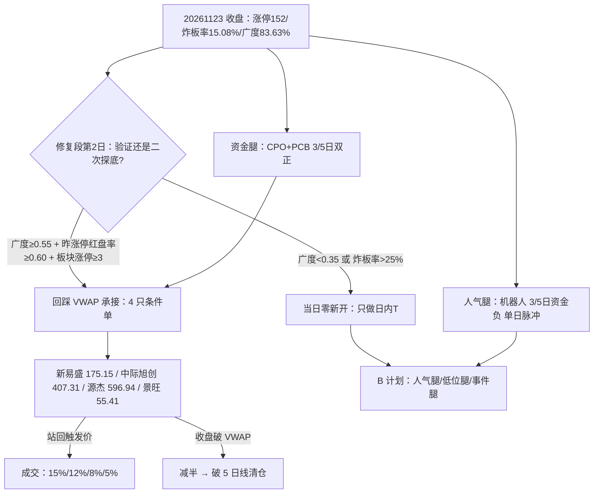

# 2026-11-24 · **主决策 / D1 盘前预案（条件单版）**

> **数据源新鲜度**: partial ｜ **降级状态**: degraded（R2 未交付）｜ **置信度**: 0.55 ｜ **决策来源**: llm
> **仓位上限**: 0.60（R1 硬顶 0.95 → D1 下调，留痕见 `meta.cap_adjustment`）｜ **执行池**: 4 只（合计 40%）｜ **观察池**: 20 只 ｜ **禁入**: 11 只
> **本版性质**: 全部为条件单 + `auto_trade_enabled=false` + 需用户确认；`production_ready=false` / `reassessment_required=true`（R2 未交付，研究不算完成）。

## 一句话结论

11-23 是放量修复日（涨停 152 / 炸板率 15.08% / 广度 83.63%），今日是**修复段第 2 日 = 验证/分歧日**：钱只去了两条腿（CPO +87.16 亿、元件/PCB +101.93 亿且 3 日与 5 日双正），人气去了另一条（机器人/AI 应用单日脉冲、3 日与 5 日资金为负）。所以今天只做**一条腿**：AI 硬件链的**回踩 T-1 均价线承接**，4 只条件单合计 40%，不追开盘价；机器人链进 B 计划，不做重仓接力。

## 守正出奇

### 正 —— 当下最硬的逻辑（第 2 日）

| 项 | 结论 |
|---|---|
| 主要矛盾 | **需求已被订单证明、筹码还没被资金证明**：PCB 订单 +56.1%、交期 16–20 周（E004）、CPO 单日 +87.16 亿且 3/5 日双正，分子是真的；但全市场主力 20 日 **-3903.35 亿**（仅 8 日为正）、链上核心 60 日中位 **-58%**、距 60 日高 -49%~-67%，分母（解套盘）也是真的。今天涨不涨由「解套盘愿不愿再等一天」决定，不由需求决定。 |
| 谁在定义市场 | `mixed`。单日定价权在大单（超大单 +265.96 亿接、小单 -47.00 亿抛），趋势定价权仍在空头（20 日 -3903 亿），高度由游资决定（首板占 89%、5 板仅 2 只）。三层钱做三件事。 |
| 主线与级别 | **AI 硬件链：CPO/光模块 + PCB/覆铜板/元件**，级别 `big`（五共振 3/5：cn_us hit、participant hit、timing_cycle hit；primary_secondary na、policy miss）。级别只决定「值得看」，不决定「能做趋势」——layer=rebound 仍限 ≤3 日。 |
| 题材公平性 | `unfair`：上方 49–67 个百分点解套盘，且机构 11-23 已前置埋伏（沪电机构专用席 30 日 +16.90 亿、CPO 超大单 +80.32 亿）→ 今天是接力先手，不是发现价值。降预期收益与仓位上限，不改选股资格。 |
| 最硬的核心观点 | AI 硬件链只有「**一次回踩承接**」级别的行情，不会有趋势级别：上涨上限由解套盘决定；能赚的钱来自分歧日缩量回踩 T-1 均价线的承接，不是追高开。 |

**核心观点的可实测证伪条件**

1. 09:35–10:00 通信设备/元件/印制电路板 细分口径涨停家数全部 <3 家，且板块内涨占比 <0.85（板块效应消失）。
2. 新易盛与中际旭创双双收盘跌破 T-1 均价线（175.15 / 407.31），10:00 前未收回。
3. CPO 概念或元件/PCB 当日主力净流出，且 5 日累计转负（R7 口径）。
4. 隔夜费半单日跌幅 >3% 且 A 股 AI 硬件高开低走（收在均价线下）。

**正股（不换股的锚）**

| 票 | 位置 | 为什么是它 | 持有依据 | 个股证伪条件 | 最长持有 |
|---|---|---|---|---|---|
| 300502 新易盛 | 龙一（CPO 总龙） | 单日 +22.94 亿 / 5 日 +35.90 亿 / 20 日 +33.61 亿，链内唯一三项全正；CPO +87.16 亿是全场第一腿 | CPO 5 日资金仍正且通信设备/元件 3/5 日双正 → 逻辑未变按第一波持有 | 收盘破 175.15 且 10:00 未收回 / CPO 5 日转负 / 费半跌 >3% 后高开低走 | 3 日 |
| 300308 中际旭创 | 龙二（容量核心） | 光模块龙二权重，E001 直接映射；11-23 +6.10% 落后龙一 3.8pp，属同链补涨位 | 龙一不破均价线、光模块 5 日资金仍正，接力位就在；龙一破即同步退出 | 龙一破 175.15 次日不修复 / 光模块 5 日转负 / 自身破 407.31 | 3 日 |
| 002463 沪电股份 | 容量中军（**价格锚，不进执行池**） | 机构专用席 30 日 +16.90 亿 ＝ 本批最实买盘；但 11-23 +2.96% 未封板、core_grade=laggard(48.1)、RR 0.84 | 它站上 MA20 84.11，PCB 低位票的回踩买点才有底盘；不进池＝不因它涨跌改今日仓位 | 机构席 30 日转净卖 / 收盘破 84.11 且 3 日不回 | 0（锚） |

### 奇 —— 守正方向上的非常规入口

**奇点**：市场把「AI 硬件暴力反弹」读成趋势启动，但 60 日结构与 20 日资金账本都说这是修复第一波。**钱不在涨停板里**——CPO/PCB 龙头 11-23 全部未封板；奇在「未封板的容量票 + 链上低位弹性票」，所以入口是回踩 VWAP 承接，不是打板（打板在这条线上今天拿不到票）。

| 票 | 入口类型 | 可实测触发 | 证据（时点） | 绑定守正 | 仓位 | 作废条件 |
|---|---|---|---|---|---|---|
| 688498 源杰科技 | 弹性奇标 | 回踩 596.94 区间 [593.96, 602.91]，站回 598.13；且 CPO 当日主力为正 | R7 11-23：单日 +3.93 亿（反手转正）、5 日 +3.80、20 日 +5.45；pos20 **16.5%**（20 日低位）、rr20 5.08 全批最好 | AI硬件链·CPO（正股 300502） | 8% | 破 5 日线 606.77 不接 / CPO 5 日转负 / 止损 542.62 |
| 603228 景旺电子 | 低位补涨 | 回踩 55.41 区间 [55.13, 55.96]，站回 55.52；且元件/PCB 当日主力为正 | R7 11-23：+6.84%、主力净率 **8.75%**（最高一档）、5 日 +6.65（3/5 正）、pos20 22.5% 低位；流通 558.61 亿 + 成交 33.91 亿 = 容量票非杂毛 | AI硬件链·PCB（正股 002463 沪电） | 5% | 破 5 日线 54.02 不接 / PCB 5 日转负 / 止损 50.37 |

### 纪律 —— 不换股

- `no_churn = true`：逻辑未变不换股。沪电即使连续两日跑输也不从锚位移除；新易盛/中际旭创的持有判断只看 CPO 资金与均价线，不看单日涨跌。
- **换股三条件（须同时满足其一，且不得因「昨天涨完了」换票）**：① 正股逻辑被证伪（`core_view_falsifiers` 或个股 falsifiers 命中）；② 出现更强同方向龙头**且有带动性证据**（板块内涨幅第一 + 板块涨停家数同步扩张，不是涨得更多就算）；③ 风险闸门强制（破 20 日线 / 系统性风险 / 基本面反转 / R6 hard_reject）。
- **连续性**：昨日（20261123 守正出奇轨）主线 = PCB 供给端材料（正股沪电）；今日换腿至 AI 硬件链（正股首位新易盛、沪电降为锚），理由为产业/事件级：E001（英伟达恢复黄仁勋职务，费半 +14.03%）把海外治理风险从「分叉」变「同向」，且 R7 单日 CPO +87.16 亿 > PCB +48.03 亿。
- `status = partial`：R2 未交付，本栏由 R5 画像 + R7 资金 + R4 事件 + R3 热度交叉重建；不构成对执行池的否决。

## 预期差

`expectation_gap.json` = `status: no_input`（文章 96 篇 / 股票名录 0 只）→ **今日不产出预期差结论**，不用常识补。可替代的客观事实只有两条，且已写进执行池推导：① 11-23 昨涨停**开盘**溢价均值仅 +1.95%（中位 +0.29%）、**收盘**溢价 +7.69%（中位 +9.99%）→ 先手是尾盘进场、开盘没有抢筹，故平开/小幅高开的回踩仍有预期差；② 同链内 11-23 涨幅差：新易盛 +9.92% / 中际旭创 +6.10% / 源杰 +4.63% / 景旺 +6.84% → 滞涨腿（源杰、旭创）是承接候选，领涨腿（新易盛）只在回踩时接。

## 四象限叉乘（R6 反证 × D1 裁决）

| 象限 | R6 条数 | 关键读数 | D1 裁决 |
|---|---|---|---|
| Q1 资金 | 4 | 钱只去两条腿（CPO/通信设备/元件/PCB 3 日与 5 日双正）；机器人概念单日 +93.62 亿但 3 日 -110.76 / 5 日 -224.16 | 执行池只放资金腿；机器人放 B 计划人气腿（research_only） |
| Q2 情绪 | 7 | 情绪 72/71 双读数一致、炸板率 15.08% 健康；但 R3 真等级只 L1_only（L2 断更） | 人气维度冷半边 → 仓位不做满（cap 0.95→0.60） |
| Q3 基本面估值 | 10 | 最硬一类是「极贵 × 龙头」（宇树、龙版 PE 三年 99% 分位）；而新易盛 PE 17.35 处 6.8% 分位、PEG<1 | 贵的只观察；估值不否决资金腿 |
| Q4 结构 | 8 | 全链 60 日中位 -58%、layer=rebound；R6_M1_01 指出 stage=early_up 与 rebound 互斥 | 全部按 rebound 执行：≤3 日、破 5 日线走，不给趋势仓位 |
| **交集** | — | — | 唯一可做形态 =「资金腿 + 回踩承接 + 3 日窗口 + 试仓到主仓档」；贵的人气腿、烂板身位股、5 日净流出票全部不进 |

## 数据源审计

| 单元 | 状态 | 抓取日 | 记录 | 备注 |
|---|---|---|---|---|
| R1 风格 | 🟢 ok | 2026-11-23 | — | 连板情绪型 / 情绪 72.0（贪婪）/ cap 0.95 / phase=main_up（修复段第 2 日） |
| R2 主线 | 🔴 missing | — | — | **unit not delivered by this run**；不读同日旧文件冒充（用户口径）→ 无 stage/layer 全文、无 execution_eligible |
| R3 情绪 | 🟡 degraded | 2026-11-23 | — | L2 真人层连续 18 日断更 + L3 下线 → 真等级 L1_only；open_permission=false（六条否决） |
| R4 消息 | 🟢 ok | 2026-11-23 | 8 事件 | E001 英伟达/费半正向、E008 SEC+出口管制（行业级负面）；群聊腿 0 条 |
| R5 画像 | 🟢 ok | 2026-11-23 | 15 票 | chart_vision 15/15、czsc 15/15；但 `forbidden_check.input_note` 是上一日残文（只认 hit_rules） |
| R6 反证 | 🟢 ok | 2026-11-23 | 29 条 | hard_reject **0** / strong_suggest 23 / soft 6；四象限 4/7/10/8 |
| R7 资金 | 🟡 合同失败·内容可用 | 2026-11-23 | — | generated_at 早于 06:00 但 staleness=ok（应 unavailable）；只取资金读数，不据其放行 |
| cycle_position | 🟢 ok | 2026-11-23 | 12 日 | tier=neutral / 连跌 0 天 → 今日为修复段第 2 个交易日 |
| expectation_gap | 🔴 no_input | 2026-11-23 | 0 只 | 文章 96 篇 / 名录 0 只 → 不产出预期差结论 |
| 持仓台账 | 🔴 missing | — | — | 无 `holdings_20261124.json` → 执行池按空仓基准定量 |

四道闸门**全部实跑**（非印象判断）：`forbidden_filter`（19 只）、`board_pattern`（涨停票）、`dragon_switch`（宇树科技 = `first_yin_rebound`：昨 -1.01% → 今 +20%，首阴反包，cap 不减档）、`core_judge`（19 只：执行池 4 只 grade=leader/leader/core/core，个股-板块 20 日相关 0.894–0.944）。

## 执行池（4 只 · 合计 40% · 全部条件单）

**准入门（G1–G3 至少两条 + G4 价格）**：G1 全市场广度 ≥0.55（09:35/10:00/10:30 三次采样）｜G2 昨涨停红盘率 ≥0.60（09:30 可测）｜G3 通信设备/元件/印制电路板 任一板块涨停 ≥3 家，或 板块涨占比 ≥0.85 且行业均值 ≥+2%（两套分类分开算）｜G4 该票站回 T-1 均价线。
**窗口**：09:35–10:30 早盘段（首次达标即触发）+ 13:15–14:00 午后段（仅在 13:00 后广度自 <0.35 快速翻上 0.55 且涨停家数倍增时启用）。10:30 为早盘段截止。竞价封单不写进判据（竞价阶段没有封单这个量，写了永远判不了）。

| 票 | 层/状态 | 买区 | 触发 | 止损（灾难/-10%） | 结构止损 | 止盈（2R） | RR | 仓位 | 档位 |
|---|---|---|---|---|---|---|---|---|---|
| 300502 新易盛 | rebound / h3 | **174.27–176.90** | 175.50 | **159.21** | 收盘破 175.15 减半 / 破 5 日线 166.33 清仓 | 212.28 | 2.0 | 15% | core |
| 300308 中际旭创 | rebound / h3 | **405.27–411.38** | 408.12 | **370.25** | 破 407.31 减半 / 破 5 日线 401.62 清仓 | 493.64 | 2.0 | 12% | core |
| 688498 源杰科技 | rebound / h3 | **593.96–602.91** | 598.13 | **542.62** | 破 596.94 减半 / 破 5 日线 606.77 清仓 | 723.49 | 2.0 | 8% | trial |
| 603228 景旺电子 | rebound / h3 | **55.13–55.96** | 55.52 | **50.37** | 破 55.41 减半 / 破 5 日线 54.02 清仓 | 67.14 | 2.0 | 5% | trial |

**止损为什么是 -10% 而不是 -5%/-8%**（错题本 `error_case_20261123_002`）：四只票 ATR20 = 9.46% / 8.84% / 10.41% / 8.39%，1.25×ATR 全部越过 -10% 硬线 → 按纪律取 -10% 灾难止损，同时另设**收盘口径结构止损**（破 VWAP 减半、破 5 日线清仓）。两套口径都写出来：引擎口径用盘中最低价，预案文字口径用收盘价——11-23 深南/沪电就是「收盘未破、盘中已扫」的两套结论。

**买区可达性**：买区上沿距昨收 -2.46% / -1.40% / -1.33% / -1.62%，均在当日可实现振幅内（不是挂在「昨收 -5%」的回踩单，那种在高开日必然零触发）。价位由 `src/plan/price_levels.py::derive(channel=vwap_pullback)` 确定性推导——默认 `trend_pullback_buy` 在本日全部退化（深跌后 MA50 新易盛 300.56 / 中际旭创 672.97 / 源杰 1131.16 远在现价上方，买区落在现价 +60%~+87% 的不可达位），故显式用 VWAP 通道。

### 每票四行人话

**300502 新易盛（首推）**
- **买**：竞价四档见下表；回踩 174.27–176.90 承接，站回 175.50 才算成立；不追开盘价（高开 >5% 只认回踩、>7% 当日不新增）。
- **盘中确认**：G1 广度 ≥0.55 / G2 昨涨停红盘率 ≥0.60 / G3 板块涨停 ≥3 家（或涨占比 ≥0.85 且行业均值 ≥+2%），三条至少两条 + 站回均价线 175.15。
- **怎么卖**：灾难止损 159.21；收盘破 175.15 减半；破 5 日线 166.33 清仓；2R 212.28 减半；最长 3 个交易日，第 3 日不创新高即走。
- **何时放弃**：竞价 >+5% 作废等回踩；触发后 30 分钟不站回均价线即撤；G1–G3 全不成立则全天不打。
- **买入理由**：CPO 总龙，链内唯一单日/5 日/20 日主力三项全正；CPO 概念 +87.16 亿为全场第一腿；PE 17.35 处 3 年 6.8% 分位、PEG<1。
- **风险点**：60 日 -56.20%、距 60 日高 -60.29%，上方全是解套盘；30 日龙虎榜 0 次（主力席位不可验）；R6 记 V4（CFO/净利 0.47）现金流转化弱；E008 出口管制为行业级负面敞口。
- **止损条件**：灾难 159.21（-10%）无条件；结构位 175.15 收盘破即减半。
- **可验证假设**：若 10:00 前 CPO 概念主力仍为正、元件板块涨停 ≥3 家且新易盛站回 175.15，则当日「回踩承接」剧本成立；反之若 10:00 前广度 <0.55 且新易盛跌破 175.15 未收回，本剧本作废。

**300308 中际旭创**：买 = 回踩 405.27–411.38、站回 408.12；确认 = 同 G1–G3 + 龙一不破 175.15；卖 = 灾难 370.25 / 破 407.31 减半 / 破 5 日线 401.62 清仓 / 2R 493.64；放弃 = 高开 >5% 或龙一已破均价线。

**688498 源杰科技**：买 = 回踩 593.96–602.91、站回 598.13；确认 = 同 G1–G3 + CPO 当日主力为正；卖 = 灾难 542.62 / 破 596.94 减半 / 破 5 日线 606.77 清仓 / 2R 723.49；放弃 = 高开 >5% 或光芯片无跟随（ATR 10.41%，波动最大的腿，仓位只给试错档）。

**603228 景旺电子**：买 = 回踩 55.13–55.96、站回 55.52；确认 = 同 G1–G3 + PCB/元件当日主力为正；卖 = 灾难 50.37 / 破 55.41 减半 / 破 5 日线 54.02 清仓 / 2R 67.14；放弃 = 高开 >4% 视为兑现盘（R3 playbook 高开 >4% 无承接即按一日反抽）。

### 竞价四档（09:27 数据一到，机械对照）

**300502 新易盛（昨收 181.36，20cm）**

| 竞价区间 | 判定 | 动作 |
|---|---|---|
| <-1.5%（<178.64） | 低开破位 | 不接；只有 09:30–10:00 快速翻红并站回 175.15、且板块红盘率 ≥0.85 才按弱转强**减半试仓** |
| -1.5%~+2%（178.64–184.99） | 预期内 | 按预案执行：回踩 174.27–176.90 承接，站回 175.50 成立 |
| +2%~+5%（184.99–190.43） | 超预期 | 不追开盘价；只在「回踩当日开盘价 -2% 且不破昨收 181.36」缩量时承接，**仓位减半** |
| >+5%（>190.43） | 过火 | 当日不新增（R3：>5% 只认回踩；>7% 视为给 11-23 抬轿） |

**300308 中际旭创（昨收 417.20）**：<411.17 破位不接｜411.17–425.54 预期内按 405.27–411.38 承接｜425.54–438.06 超预期仅回踩缩量接且减半｜>438.06 当日不新增。
**688498 源杰科技（昨收 611.03）**：<601.86 破位不接｜601.86–623.25 预期内按 593.96–602.91 承接｜623.25–641.58 超预期仅回踩缩量接｜>641.58 不新增。
**603228 景旺电子（昨收 56.88，10cm）**：<56.03 破位不接｜56.03–58.02 预期内按 55.13–55.96 承接｜58.02–59.72 超预期仅「回踩开盘 -2% 且不破 56.88」接、减半至 2.5%｜>59.72 当日不新增。

## B 计划（`seesaw_plan`）

**语义（先读这句）**：B 计划由**风险三条件**触发，**不是执行池未成交的替补**。执行池不触发＝价格没来（机会成本，正常）；B 启动＝方向判断错了（风险事件，要换腿）。把「没买到」当「该换腿」，就会在强势日追着跌板块买 B 票——这是最常见的自伤。

**触发三条件（任一）**：① 执行池 ≥2 票竞价不及预期（高开低于预期下沿或低开破位且 10:00 前未站回 VWAP）；② 主线资金反转（CPO 或元件/PCB 当日主力净流出且 5 日转负）；③ 总龙断板 / 全市场炸板率 >25%（11-23 口径 15.08%）。

| 方向 | 票 | 买区（触发） | 仓位 | 能否下单 | 依据 |
|---|---|---|---|---|---|
| **对手盘·人气腿**（机器人/AI 应用） | 688836 宇树科技 | 715.08（机器人概念红盘率 ≥0.85 且板块涨停 ≥8 家 + 缩量回踩 647.89 不破） | 0% | ❌ `research_only` | layer=rotation + R6 极贵 → 今日不可下单，只作温度计 |
| 同上 | 002472 双环传动 | 41.44（站回 37.42 均价线 + 板块涨停 ≥8 家） | 0% | ❌ `research_only` | layer=rotation + 14:00 尾盘板 |
| **主线内部高低切**（PCB 低位） | 002916 深南电路 | 219.13（放量上破 MA20 + PCB 涨停 ≥3 家） | 3% | ✅ | 5 日 +13.59 亿 / 20 日 +6.55 亿，11-23 -0.90% 未参与修复 |
| 同上 | 688183 生益电子 | 71.79（放量上破 + 元件红盘率 ≥0.85） | 3% | ✅ | 5 日 +6.29 亿且 5/5 全正 |
| **事件腿·钴**（E003 刚果金 11-30 暂停出口） | 603993 洛阳钼业 | 13.19（钴合约维持 +5% 以上 + 放量上破 MA20） | 3% | ✅（数据缺口：R7 未覆盖其 5 日资金） | 钴 2701 单日 +11.52%；R6 模式十 degraded |

**反向提示**：若 B 计划三条腿与执行池**同时**走弱 → 全市场降档，当日零新开、仓位回 0，不做任何「找一只抗跌的」动作。执行池全在 AI 硬件一条线（40% 已达单板块上限），故 B 计划第一腿必须是真对手盘（人气腿），不接受三条腿全在同方向内高低切。

## 观察池（20 只 · 不预分配额度，触发才借）

> 观察池是 **setup 池**：装「位置+筹码+资金三条齐、只差一个触发日」的票。带触发位的票可在触发时从执行池剩余额度借（单票 8%，cap 0.60 - 执行池 0.40 = 0.20 可用）；标 ❌ 的票**今日不可下单**（价位仅结构参考）。

| 票 | 层 | 触发（上破确认） | 买区 | 止损/止盈 | 能否下单 | 一句话 |
|---|---|---|---|---|---|---|
| 002463 沪电股份 | rebound | 84.11 | 83.69–85.37 | 81.10 / 95.61 | ✅ | 机构专用席 30 日 +16.90 亿（最实买盘），但 core_grade=laggard(48.1)、RR 0.84 → 只作 PCB 腿锚 |
| 002916 深南电路 | rebound | 219.13 | 218.03–222.42 | 211.30 / 249.11 | ✅ | PCB 低位，5 日 +13.59 亿，11-23 逆势 -0.90% 没跟上 |
| 688183 生益电子 | rebound | 71.79 | 71.43–72.87 | 69.23 / 81.61 | ✅ | 5 日 +6.29 亿且 5/5 全正（链内连续性最好） |
| 300604 长川科技 | rebound | 180.67 | 179.77–183.38 | 174.21 / 205.39 | ✅ | 半导体设备，rr5 2.53 是唯一技术面过闸，但当日主力 -2.06 亿 |
| 603083 剑桥科技 | rebound | 115.16 | 114.58–116.89 | 111.05 / 130.92 | ✅ | CPO 弹性，rr20 4.82，但 5 日 -0.71 亿略流出 |
| 603893 瑞芯微 | trend | 204.91 | 203.89–207.98 | 197.58 / 232.94 | ✅ | 端侧 AI，R5 RR 1.12 与关1 laggard → 观察 |
| 002371 北方华创 | rebound | 546.50 | 543.77–554.70 | 526.97 / 621.26 | ✅ | R6 记 RR5 3.59 唯一同向达标，但 R5 未画像 + 11-23 逆势收绿 |
| 688981 中芯国际 | rotation | 122.82 | 122.21–124.66 | — | ❌ | 国产算力容量核心，5 日 +21.40 亿；rotation 不给买点 |
| 688256 寒武纪 | rotation | 923.95 | 919.33–937.81 | — | ❌ | 5 日 +18.88 亿 + 智谱 GLM-5.4；rotation 不给买点 |
| 688836 宇树科技 | rotation | 715.08 | 711.50–725.81 | — | ❌ | 机器人链总龙（首阴反包）；R6 极贵 × 5 日资金 -0.66 亿 → 不给开仓 |
| 002472 双环传动 | rotation | 41.44 | 41.23–42.06 | — | ❌ | 机器人龙三，14:00 尾盘板（late_speculation） |
| 301313 凡拓数创 | trend | 71.70 | 71.34–72.78 | — | ❌ | R6 诱多 high + 亏损 + F9 → 只作情绪观察 |
| 002579 中京电子 | rebound | 14.88 | 14.81–15.10 | — | ❌ | PCB 3 连板身位股，6 次开板 + F10+F3+F4 |
| 000636 风华高科 | rebound | 31.39 | 31.23–31.86 | — | ❌ | 14:08 尾盘封板 + RR 1.07 |
| 605577 龙版传媒 | trend | 17.99 | 17.90–18.26 | — | ❌ | AI 漫剧龙二，PE 三年 99% 分位 + 主营不相关 |
| 601599 浙文影业 | rotation | 4.27 | 4.25–4.33 | — | ❌ | 漫剧候补，rotation + F8(P0) |
| 600206 有研新材 | rebound | 40.40 | 40.20–41.01 | — | ❌ | R6 高 PE + F8 + 无板型 → 开仓资格不成立 |
| 603993 洛阳钼业 | rebound | 13.19 | 13.12–13.39 | — | ❌ | 钴事件腿；R7 未覆盖其 5 日资金（数据缺口） |
| 600030 中信证券 | rotation | 25.51 | 25.38–25.89 | — | ❌ | 券商（E005 两融），rotation = B 计划对手盘温度计 |
| 300059 东方财富 | rotation | 18.81 | 18.72–19.09 | — | ❌ | 同上 |

**覆盖说明**：19 只原始候选 + 4 只执行 + 11 只禁入 = 34 只被逐个处置，无一只静默消失（技能 Step 3.5.7）。池子到 20 只未凑到 40 上限，原因是本日能过「资金 5 日为正 + 60 日结构有支撑」的对象确实只有这些，其余（天孚、超声、九阳、盛剑等）已被硬证据剔除。

## 禁入名单（11 只）

| 票 | 原因码 | 一句话 |
|---|---|---|
| 603324 盛剑科技 | `R6_EXTREME_TAIL_RISK` | 5 板孤军 + 高位触板 + R6 标 extreme_tail_risk「任何位置不追高」 |
| 002242 九阳股份 | `R6_DISTRIBUTION_TODAY` | R6 今日读数：任何档位不参与（**不承接** 11-20 的 hard_reject，当日重评） |
| 603799 华友钴业 | `STOCK_5D_OUTFLOW` | 个股 5 日主力 -1.71 亿；事件级利好不豁免个股资金 |
| 000156 华数传媒 | `STOCK_5D_OUTFLOW` | 5 日 -1.29 亿（rr5 2.33 也不进） |
| 000823 超声电子 | `DISTRIBUTION_TRAP` | 机构净卖 -0.35 亿而股价 +7.46%（诱多） |
| 601595 上海电影 | `CORE_GRADE_WATCH` | core_grade=watch(32.2) + 有效红旗 → 无地位 |
| 002771 真视通 | `R6_EXTREME_TAIL_RISK` | 5 板 + 反复开板 |
| 002685 华东重机 | `RR_FAIL` | RR 0.48 + 孤军 |
| 300394 天孚通信 | `E008_POLICY_EXPOSURE` | E008 明列光模块/CPO「不新开」；RR5 0.09、止损距 -14.10% |
| 300006 莱美药业 | `STOCK_5D_OUTFLOW` | 5 日 -5.08 亿 + 亏损股 20cm 冲高 |
| 002579 中京电子（打板通道） | `BOARD_PATTERN_REJECT` | 6 次开板（回封板）→ 打板通道拒绝（观察池身份保留） |

## 不确定性 / 反证（自曝）

1. **R2 未交付**是本次最大缺口：主线层级、`execution_eligible`、stage 全文全部缺失，本版主线由 R5/R7/R4/R3 重建 → `production_ready=false`、`reassessment_required=true`。若 R2 落地后与「rebound 只做 3 天」冲突，须按 R2 重评。
2. **R7 时点契约失败**（04:52 < 06:00 但 staleness=ok）：我取它的资金读数，但同时保留这条冲突。11-24 的资金可能已换方向，这正是 G1–G3 盘中复核存在的理由。
3. **源杰/景旺未体检**：未被 R5 画像、未被 R6 单独反证 → 只给试错档（8%/5%），用仓位与止损距离吸收风险，而不是用「没体检」当否决。
4. **踏空风险**：机器人链 11-23 红盘率 91.2%、涨停 68 家，若今日真接力，本执行池会踏空。这是纪律代价（layer=rotation 不给买点 + R6 估值否决），不是判断失误；同型风险已写进 B 计划人气腿，并标 `research_only` 以免用户在盘中追高。
5. **两融风控（E005）与钴出口暂停（E003）均在 11-30 生效**，≥4 个交易日后 → 不启用买点后置 `post_event_only`；E008（SEC/出口管制）无固定落地时点，按行业级负面敞口只作用于天孚。
6. **无持仓台账**：持仓侧（若有）的事件暴露与加减仓建议无法逐票给出，执行池按空仓基准定量 40%，超配只提示不缩量。

**错题本应用（Step 0.4，4 条全部命中本日情景）**

| 案例 | 今日如何避开/覆盖 |
|---|---|
| `error_case_20261123_001` 宽度判据温度失配 | 宽度读数一律带 `as_of`：机器人链 11-23 红盘率 91.2% 是修复日读数，不再用 11-20 的 4.1% 否掉它；机器人已进观察池 + B 计划人气腿。不进执行池的理由是 rotation 层 + R6 估值 + 3/5 日资金负，**不是宽度** |
| `error_case_20261123_002` 止损与振幅失配 | 止损按 ATR20 分档：1.25×ATR（9.46%/8.84%/10.41%/8.39%）全部越过 -10% 硬线 → 统一 -10% 灾难止损 + 收盘口径结构止损（破 VWAP 减半 / 破 5 日线清仓），口径两写 |
| `error_case_20261123_003` hard_reject 跨日继承 | 零跨日继承：九阳按今日 R6 读数处理，理由写明「不承接 11-20 hard_reject」；昨日 R6 兑现率 0.20 写入 M5_01 采纳项 |
| `error_case_20261123_004` 准入窗口与反转时点错配 | 窗口改两段：09:35–10:30 早盘段 + 13:15–14:00 午后段（仅当 13:00 后广度自 <0.35 快速翻上 0.55 且涨停家数倍增），并把 11-23「13:20 反转」写进 cutoff_note |

## 与其他单元的关系

- **依赖**：R1（风格/仓位上限）、R3（情绪/热度）、R4（事件/催化）、R5（六维画像）、R6（反证）、R7（资金）、`cycle_position` / `emotion_cycle`（温度）、`src/plan/price_levels.py`（价位引擎）、`src/research/{forbidden_filter,board_pattern,dragon_switch,core_judge}.py`（四道闸门）
- **被消费**：P1 竞价校准（09:25–09:29，消费 4 只的竞价四档）、execute（消费执行池 + `auto_trade_enabled=false`）、P2 午盘修订（消费 G 判据与 B 计划触发）、E1 复盘（消费 `decision_source=llm` / `meta.d1_override` / `corrections_applied`）
- **下游必读**：本 JSON 的 `production_ready=false` + `reassessment_required=true` → 未获用户确认前不得自动成交；`mode=dry_run`。

## Sub-Agent 元数据

- skill: main_decision_v1@1.11（LLM fresh context）
- artifact: `data/plans/20261124/watchlist_plan.json`（83 KB / pydantic + `load_plan.validate_plan_for_date` 双校验通过）
- 后处理: `scripts/plan/enforce_position_policy.py --date 20261124` → 7 处改动（观察池借额度补齐），写入 `meta.policy_enforced`
- 决策: execution 4 / watch 20 / rejected 11；`sum(position_pct)=0.40`，利用率 0.667（下限 0.60 ✅）；单板块 0.40（上限 0.40 ✅）；单笔风险 15%×10%=1.5%（上限 1.5% ✅）
- model: deepseek-v4.1-flash（canghai-plan profile）
