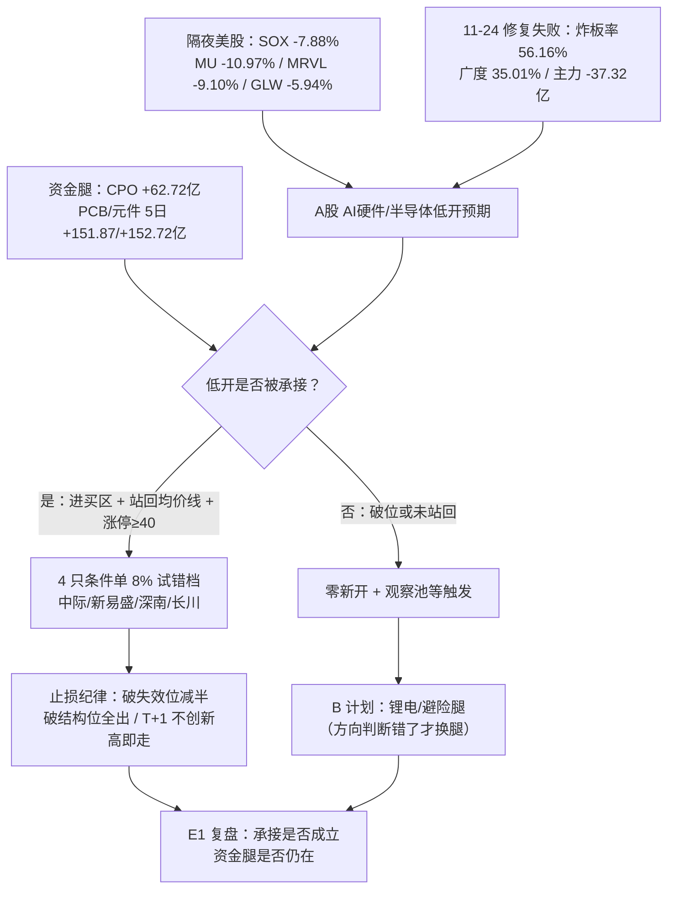

# 2026-11-25 · **D1 盘前预案（主决策）**

> **数据源新鲜度**: partial（R4 缺、R1/R3/R5 degraded）
> **降级状态**: true ｜ **仓位上限**: 48% ｜ **决策来源**: llm（fresh context，非规则版）
> **执行池 4 只全部为条件单**（`auto_trade_enabled=false`，触发或用户确认才成交）

## 一句话结论

**修复失败日 + 隔夜美股半导体单腿杀（SOX −7.88%/MU −10.97%），今日不追高、只做「低开被承接」的反弹第一波；仓位上限 48%，执行池 4 只全为 8% 试错档条件单，触发前提 = 进入买区且站回当日均价线 + 涨停家数 ≥40。**

11-24 实况：涨停 64 / 跌停 4 / 炸板 82（R7 stk_limit 权威口径，**炸板率 56.16%**），广度 35.01%、中位 −0.67%，成交 16548.6 亿（+6.58%）放量普跌，主力 −37.32 亿（摆动 −312.15）、20 日 −3467.06 亿（仅 8/20 日为正）。钱只去一处：**CPO 概念 +62.72 亿、PCB/元件 5 日 +151.87/+152.72 亿**——但权重票全线收在均价线下方（中际收盘位置 0.033、新易盛 0.000、沪电 0.048）= **资金在买、价格在卖**。

## 守正出奇

### 正 — 当下最硬的逻辑（主线连续第 3 日）

- **主要矛盾**：AI 算力上游的**需求侧**（CPO 概念 5 日 +146.82 亿、PCB/元件 5 日 +151.87/+152.72 亿，连续为正）与**交易侧兑现盘**（权重票全线低于 VWAP、炸板率 56.16%、广度 35.01%）正面相撞。今日定价的是「谁先认输」，不是「AI 逻辑对不对」。
- **谁在定义市场**：`mixed`。机构在半导体容量票真实承接（中芯收盘位置 0.801/高于 VWAP 0.9%、华虹 0.808/高于 VWAP 3.4%、沪电机构专用席 +16.90 亿全批第一）；游资在机器人小票做缩量一字（克来 3 板封单 3.35 亿/换手 0.59%、长华 0.88 亿）。两套体系同时在场，**没有人能定义市场**。
- **主线与级别**：`AI算力上游（半导体国产链·政策腿 / CPO-PCB·资金腿）` → **mid**。五个共振 hit 2 / miss 3：
  | 共振 | 判定 | 依据 |
  |---|---|---|
  | 一二级（primary_secondary） | **na** | 无一级市场数据，不编 |
  | 中美（cn_us） | **miss** | 隔夜 SOX −7.88%、MRVL −9.10%、GLW −5.94%，与 A 股方向相反 |
  | 参与者（participant） | **hit** | 机构与游资都在场 |
  | 时间周期（timing_cycle） | **miss** | 出现在广度 35% 的修复失败位，不是市场低位 |
  | 政策（policy） | **hit** | BIS 11-16 新规（取消中国设计公司海外流片豁免）+ 功率半导体涨价 |
- **题材公平性**：`unfair`。CPO/PCB 是机构早已重仓的环节，5 日百亿级流入恰好出现在 60 日 −42%~−62% 的深坑里（中际 r60 −55.78%、新易盛 −59.27%、源杰 −62.24%、深南 −42.08%）——散户在此接力=接机构的减法。**只降预期收益与仓位（8% 试错档），不改变选股资格。**
- **最硬的核心观点（可证伪）**：**钱还在但价格腿已失守，所以今日不做方向性做多——只在「低开 −1%~−5% 被承接 + 站回当日均价线 + 涨停家数 ≥40」下做 1-3 天反弹第一波；若 10:30 前中际/新易盛跌幅扩大超 3% 未站回均价线、或涨停跌破 40 家，则本日零新开、仓位压回 30% 以下。**
  - 证伪条件：①10:30 前中际/新易盛跌超 3% 且未站回均价线；②涨停家数 <40 或炸板率维持 ≥45%；③CPO 概念/PCB 当日主力转净流出；④半导体行业红盘率 <0.5。
- **正股**：
  | 正股 | 角色 | 为什么是它 | 持有依据 | 证伪条件 | 最长持有 |
  |---|---|---|---|---|---|
  | 中芯国际 688981 | 容量中军·价格锚 | 全场唯一当日 core strength 成立（0.801/高于 VWAP 0.9%、+4.04%），半导体 0 涨停却有真实承接 | 站住 125.39（T-1 VWAP）之上整条线才有意义 | 破 MA20 110.69；行业红盘率连 2 日 <0.5 | 0（rotation 层不给买点） |
  | 中际旭创 300308 | 龙一·交易腿 | CPO 心智锚第一 + 5 日主力 +50.60 亿全场第一（5/5 正）+ 20 日 −3.81 亿接近回正 | CPO 5 日资金仍正、20 日未转负 → 持有不换票 | 破 387.40；CPO 5 日转负；T+1 不创新高 | 3 天 |
  | 新易盛 300502 | 龙二·总龙 | 20 日主力 +40.47 亿全场唯一为正（钱还没走）、5 日 +43.02 亿（4/5） | 20 日资金仍正且站住 MA5 170 | 破 170；20 日资金转负 | 3 天 |

### 奇 — 守正方向上的非常规入口

**奇点**：共识是「隔夜 SOX −7.88%，光模块今天没戏」；差异在于**钱在 5 日维度连续净流入、价格在 60 日维度跌 42%-62%**——共识定价「今天会跌」，我们等「跌下来之后还有人买」。奇点只在**低开被承接**这一种形态下成立；形态不成立则奇点不存在。

| 出奇标的 | 入口 | 触发（可实测） | 证据（时点） | 绑定守正 | 仓位 | 作废条件 |
|---|---|---|---|---|---|---|
| 源杰科技 688498 | 分歧低吸 | 回踩 553-558（20 日低 553.73/周线低 555.54）且 15 分钟放量止跌（量比≥1.2） | 20261124 收盘：5 日 +8.31 亿、20 日 +12.75 亿（正）、20 日位置 14.0% 全池最低、止损 −7.60%、RR5 2.08/RR20 6.17 三项全过；识图 07:10 偏空 0.72、低吸位 553-555 | 中际旭创（同一 CPO 资金腿，光芯片环节） | 8%（触发才借） | 破 553.73 十分钟不收回 |
| 深南电路 002916 | 分歧低吸 | 低开进 199.0-203.5 且站回均价线 + PCB 红盘率 ≥0.5 | 20261124：5 日 +15.65 亿（5/5 正，全链最实）、20 日 +8.74 亿、融资 5 日 +37.52%、当日 −0.29% 缩量未破位 | 中际旭创（PCB/元件 同资金腿） | 8%（执行池） | 破 191.00 或 PCB 资金转净流出 |
| 长川科技 300604 | 事件催化 | 低开进 176-181 且半导体行业红盘率 ≥0.6、站回均价线 | R3 点名「半导体低位设备」唯一止损距合规（−8.15%）；R7 5 日 +8.99 亿、20 日 +17.16 亿、人气在榜 +3.28% | 中芯国际（政策腿·设备环节） | 8%（执行池） | 破 170.00 或行业红盘率 <0.5 |

> 妖股赛道（羊年谐音族：襄阳轴承/七匹狼/福莱新材/金牛化工）**今日不进执行池**——与守正混用会触发禁止清单 `mixed_template`；只留观察，给 09:27 竞价资格。

### 纪律 — 逻辑未变不换股

- `no_churn = true`。今日 4 条执行腿全部与昨日同一 thesis（`ai_hardware_chain_cpo_pcb_1124`，连续第 3 日）。
- **换股三条件（须同时满足）**：①正股逻辑被证伪（falsifiers 命中）；②出现更强同方向龙头**且有带动性证据**（板块涨停/红盘率由它带动，不是单纯涨得更多）；③风险闸门强制（破 20 日线 / 系统性风险 / 基本面反转 / R6 hard_reject）。
- 昨日的「换」发生在正股名单内部：沪电股份（昨日容量中军）因**顺位龙三触发 mid_laggard + 收盘位置 0.048 + RR 0.80** 被风险闸门移出，由中芯国际（唯一 core strength）接任价格锚——属闸门强制，非主观换票。

## 执行池（4 只 · 全部条件单）

> 仓位按**空仓基准**定量：执行池合计 32%，上限 48%（利用率 66.7% ≥ 60% 硬下限）。无持仓快照（`data/runtime/holdings_20261125.json` 不存在），若实际持有池内票请自行核对，**不自动缩量**。

| # | 票 | 买区 | 触发价 | 止损 | 止盈 | 仓位 | RR | 层/最长持有 | 自动执行 |
|---|---|---|---|---|---|---|---|---|---|
| 1 | 中际旭创 300308 | 403.00 – 410.00 | 410.00 | 387.40 | 445.00 | 8% | 1.55 | rebound/3 天 | ❌ 需确认 |
| 2 | 新易盛 300502 | 172.00 – 176.00 | 176.00 | 165.40 | 196.00 | 8% | 1.89 | rebound/3 天 | ❌ 需确认 |
| 3 | 深南电路 002916 | 199.00 – 203.50 | 203.50 | 191.00 | 223.98 | 8% | 1.64 | rebound/3 天 | ❌ 需确认 |
| 4 | 长川科技 300604 | 176.00 – 181.00 | 181.00 | 170.00 | 201.00 | 8% | 1.82 | rebound/3 天 | ❌ 需确认 |

**全局触发前提（四只共用）**：09:35-10:30 滚动复核（每 10 分钟一次，**10:30 后不再新开**）→ ①全市场涨停家数 ≥40 **或** 炸板率 <45%；②个股站回当日均价线（分时 VWAP）；③不破各自买区下沿 3%。①②成立才下单。

### 每票四行人话

**1. 中际旭创 300308（CPO 龙一 · 守正交易腿）**
- **买**：低开 −1%~−5%（417.0 → 403-410）进入买区且**站回当日均价线**才买；高开 >+2% 当日不新增。
- **盘中确认**：涨停家数 ≥40；CPO/PCB 板块红盘率 ≥0.5；它自己高于分时均价线。
- **怎么卖**：破 **400**（识图失效位）先减半 → 破 **387.40** 全出；触及 445 减半；**T+1 不创新高收盘前走**；最长 3 天。
- **何时放弃**：竞价高开 >+2%；或 10:30 前跌超 3% 未收回均价线；或涨停家数 <40。

| 竞价区间（基准 417.00） | 判定 | 动作 |
|---|---|---|
| < −5%（<396.3） | 低开超预期=恐慌盘 | 不接；只在站回均价线且涨停≥40 后按买区上沿试 |
| −5% ~ −1%（396.3-412.8） | 预期内（外盘压制的合理低开） | 按买区 403-410 承接，须站回均价线 |
| −1% ~ +2%（412.8-425.3） | 强于预期 | 只做买区内回踩，不高于 412 追 |
| > +2%（>425.3） | 高开过度=给昨日抬轿 | 当日不新增（R3 防守优先） |

**2. 新易盛 300502（CPO 总龙 · 20 日资金唯一为正）**
- **买**：低开 −2%~−4.4% 进 172-176 且站回均价线；高开 >+2% 不追。
- **盘中确认**：涨停 ≥40；CPO 板块红盘率 ≥0.5；**它先收强 = 整条线分离确认**。
- **怎么卖**：破 **170**（日 K MA5 生命线）减半 → 破 **165.40** 全出；触及 196（周 K MA5）减半；T+1 不创新高即走。
- **何时放弃**：直接破 170（存量撤退）；或高开 >+2%。

| 竞价区间（基准 180.01） | 判定 | 动作 |
|---|---|---|
| < −5%（<171.0） | 恐慌低开 | 不接，等站回均价线 |
| −5% ~ −1%（171.0-178.2） | 预期内 | 按买区 172-176 承接 |
| −1% ~ +2%（178.2-183.6） | 强于预期 | 只做回踩，不高于 178 追 |
| > +2%（>183.6） | 高开过度 | 当日不新增 |

**3. 深南电路 002916（PCB 龙头二 · 出奇弹性奇标）**
- **买**：低开 −1.9%~−4.1% 进 199-203.5 且站回均价线 + PCB 板块红盘率 ≥0.5。
- **盘中确认**：PCB/元件 涨停 ≥1 家或红盘率 ≥0.5；它站回 MA5 207.6 之上。
- **怎么卖**：破 191.00 全出；触及 223.98（5 日高）减半；T+1 不创新高即走。
- **何时放弃**：竞价高开 >+2%；PCB 资金转净流出；无识图校验（快照未覆盖）→ 以量价确认代替。

| 竞价区间（基准 207.50） | 判定 | 动作 |
|---|---|---|
| < −5%（<197.1） | 恐慌低开 | 不接 |
| −5% ~ −1%（197.1-205.4） | 预期内 | 按买区 199-203.5 承接 |
| −1% ~ +2%（205.4-211.7） | 强于预期 | 只做回踩 |
| > +2%（>211.7） | 高开过度 | 不新增 |

**4. 长川科技 300604（半导体设备 · 出奇事件催化）**
- **买**：低开 −1.5%~−4.2% 进 176-181（MA20 181.13 区间）且半导体行业红盘率 ≥0.6、站回均价线。
- **盘中确认**：半导体行业红盘率 ≥0.6（T-1 0.6684）；设备端先于容量票转红。
- **怎么卖**：破 170.00 全出；触及 201.00（5 日高）减半；T+1 不创新高即走。
- **何时放弃**：半导体行业涨停仍 0 且红盘率 <0.5；或竞价直接高开 >+2%。

| 竞价区间（基准 183.74） | 判定 | 动作 |
|---|---|---|
| < −5%（<174.6） | 恐慌低开 | 不接 |
| −5% ~ −1%（174.6-181.9） | 预期内 | 按买区 176-181 承接 |
| −1% ~ +2%（181.9-187.4） | 强于预期 | 只做回踩 |
| > +2%（>187.4） | 高开过度 | 不新增 |

### 每票思维链（为什么 / 风险 / 止损 / 可验证假设）

**中际旭创**
- *买入理由*：CPO 龙一 + 5 日资金全场第一（+50.60 亿、5/5 正）+ 20 日 −3.81 亿接近回正；60 日 −55.78% 属 rebound 层第一波，赔率来自深坑反弹。
- *风险点*：T-1 收在全天最低附近（位置 0.033），是板块内最大一笔兑现盘；R6_M1_05 指出「资金维不等于价格承接」；隔夜外盘 GLW/MRVL 崩。
- *止损条件*：破 400 减半（识图失效位）、破 387.40（买价 −5.5%，20 日低 377.96 上方）全出。
- *可验证假设*：若今日低开 −2%~−4% 后站回均价线且涨停家数回到 40 家以上，则「资金腿仍在」成立，1-3 日内应能回到 445；若 10:30 前未站回均价线，假设作废。

**新易盛**
- *买入理由*：20 日主力 +40.47 亿是全场唯一为正的核心票（钱没走），5 日 +43.02 亿（4/5 正）；周 K MA5 196 是明确目标位。
- *风险点*：T-1 收在全天最低（180.01），资金由 +22.94 亿衰减到 +1.87 亿；R7 判止损距 −15.56% 越界（本预案收到 −6.0%）。
- *止损条件*：破 170 减半、破 165.40 全出。
- *可验证假设*：若低开不破 170，说明存量资金仍托底（预期差向上）；若直接破 170 则存量撤退，当日不参与。

**深南电路**
- *买入理由*：PCB 龙头二，5 日主力 +15.65 亿（5/5 正全链最实）、融资 5 日 +37.52%（全池杠杆加得最猛），且 T-1 是缩量整理（−0.29%）而非放量下跌。
- *风险点*：R5 本轮未覆盖它（alpha/risk 按契约缺省 B/B）；无识图快照；PCB 涨停仅 1 家（宽度弱）。
- *止损条件*：破 191.00（买价 −6.1%，5 日低 184.96 上方）全出。
- *可验证假设*：若 PCB 板块红盘率 ≥0.5 且它站回 MA5 207.6，则「钱进价不跌」成立，1-3 日内看 223.98；若板块资金转流出，假设作废。

**长川科技**
- *买入理由*：R3 唯一点名的「半导体低位设备」且止损距合规（−8.15%）；20 日 +17.16 亿为正、人气在榜；政策腿（BIS 11-16 新规）。
- *风险点*：半导体行业 T-1 **0 涨停**（情绪腿为零）、概念资金 3/5/20 日全负；位置 55.6% 属中位（不是低位）。
- *止损条件*：破 170.00 全出。
- *可验证假设*：若设备端先于容量票转红且行业红盘率 ≥0.6，则政策腿被重新定价；若行业涨停仍 0 且资金转流出，假设作废。

## B 计划（对手盘 / 跷跷板）

> **B 计划由风险三条件触发，不是执行池未成交的替补**：执行池不触发 = 价格没来（机会成本，正常）；B 启动 = **方向判断错了**（风险事件，要换腿）。

**触发条件（任一）**：①执行池 ≥2 票竞价低开超 −5% 且 10:00 前未站回均价线；②CPO/PCB 当日主力转净流出；③全市场涨停 <40 或炸板率 ≥45%。

| 方向 | 票 | 买区 | 触发 | 止损/止盈 | 仓位 | 能否下单 |
|---|---|---|---|---|---|---|
| 新能源·锂电（真对手盘） | 宁德时代 300750 | 225.10 – 228.51 | 科技硬件竞价崩 + 站回 229.74（T-1 VWAP） | 217.14 / 242.66 | 5% | ✅ 可下单（RR 1.24，方向对冲） |
| 避险腿·银行 | 工商银行 601398 | 9.13 – 9.27 | 科技崩 + 上证破 T-1 低 + 银行红盘率 ≥0.6 | 8.81 / 9.50 | 3% | ✅ 可下单（RR 0.50，只作对冲） |
| 避险腿·公用 | 长江电力 600900 | 31.32 – 31.80 | 同上 | 30.22 / 32.59 | 3% | ✅ 可下单（RR 0.50，只作对冲） |
| 跷跷板·白酒 | 贵州茅台 600519 | 1445.40 – 1467.30（不可下单） | 半导体转净流出 + 白酒 III 红盘率 ≥0.6 | — | 0% | ❌ 本方向今日不可下单（research_only：白酒 5 日 −5.67 亿，资金未进） |

**反向提示**：若避险腿与锂电腿同步走弱 → 不是风格切换而是全市场降档，此时执行池全部作废、当日零新开，不做任何 B 腿。

## 观察池（26 只，setup 池：给突破/承接触发，不预分配额度）

额度策略：`borrow_on_trigger` — 触发时才从执行池未用额度（48% − 32% = **16%**）临借，单票 8%，同日合计不超过 16%。

| 票 | 层/角色 | 触发（可实测） | 买区 / 止损 / 止盈 | 为什么在这 |
|---|---|---|---|---|
| 源杰科技 688498 ★ | rebound/弹性 | 回踩 553-558 + 15 分钟放量止跌 | 553-558 / 528 / 621 | **升执行优先级最高**：RR5 2.08、止损 −7.60%、20 日位置 14% 全池最低；合理买点在 −6.9% 越 ±5% 节点带 → 只能观察 |
| 沪电股份 002463 | rebound/容量 | 回踩 83.35（MA20）缩量止跌 | 82.0-83.35 / 78 / 90.70 | 机构席 +16.90 亿全批第一，但收盘位置 0.048、RR 0.80、顺位龙三 → mid_laggard |
| 中京电子 002579 | rotation/身位 | **一字不低吸**：竞价砸开二次回封（封单 >1 亿）才观察 | 无有效买点 | 4 板全市场最高标，但 RR5=0、距 MA20 +31%、获利盘 86.3%、risk=C |
| 拓普集团 601689 | trend/near_high | 回踩 50.3-51.0 缩量止跌 | 50.3-51.0 / 47.80 / 56.30 | 机器人线唯一趋势完好的容量核心，但距 MA20 +13.63%、RR 0.74 |
| 三花智控 002050 | rotation | 站回 VWAP 34.70 + 板块红盘率 ≥0.6 | 无（温度计） | 机器人线心智锚，rotation 层不给买点 |
| 中芯国际 688981 | rotation/价格锚 | 站住 125.39（T-1 VWAP） | 无（价格锚） | 全场唯一 core strength 成立，但 rotation 层 + 距 20 日高仅 +1.06% |
| 胜宏科技 300476 | rebound/弹性 | 上破 135.47 且量比 ≥1.2 | 134.80-136.82 / 127.34 / 151.73 | PCB 弹性，收盘位置 0.096、20 日 −37.61 亿 |
| 生益科技 600183 | rebound | 上破 67.16 且机构席转净买 | 66.83-67.83 / 63.13 / 75.22 | 位置 10.5% 极低但 RR5 1.06、机构席 −41.32 亿（背离） |
| 克来机电 603960 | rotation/3 板 | 缩量一字，只观察开板换手 | 无 | distribution_alert、净利为负、换手 0.59% 无承接 |
| 华虹宏力 688347 | rotation | 回踩 202-206 承接 | 202-206 / 190 / 214 | 当日最强容量（+10.36%/0.808 位置），但获利盘 97.2%、PE 308.99 |
| 鸣志电器 603728 | trend/pullback | 上破 54.12 且机器人红盘率 ≥0.6 | 53.85-54.66 / 50.87 / 60.62 | 链内收盘位置最好（0.617），但 5 日主力 +0.09 亿≈0、PE 196.8 |
| 长华集团 605018 | rotation/3 板 | 一字 + 封单薄，不给档位 | 无 | 封单仅克来 1/4、PE 100% 分位、净利 −96.95% |
| 寒武纪 688256 | rotation | 不追 970 前高 | 998-1013 / 942.81 / 1123 | 20 日资金 +51.34 亿最猛，但位置 77.7%、行业 0 涨停 |
| 北方华创 002371 | rebound | 上破 563.08 且设备先红 | 560.28-568.68 / 529.3 / 630.64 | R2 口径赔率最好，R5 复算 RR 0.81 |
| 工业富联 601138 | — | 观察能否缩量收复 41.5 | 42.12-42.75 / 39.79 / 47.41 | 主力 +22.93 亿全场第一，但炸板 11 次、RR5 0.19 |
| 天孚通信 300394 | rebound | 上破 134.90 且 CPO 先转强 | 134.23-136.24 / 126.81 / 151.08 | CPO 龙三（mid_laggard）、止损 −17.83% |
| 景旺电子 603228 | rebound | 上破 62.88 且封板不烂 | 62.57-63.51 / 59.11 / 70.42 | 昨日执行腿（P1 全 skip 未成交），炸板 4 次 |
| 剑桥科技 603083 | rebound | 回踩 94.9-97.0 承接 | 94.9-97.0 / 90.6 / 105.11 | 位置 17.6% 低位、主力反手 +4.91 亿，RR 1.33 可升执行 |
| 宁德时代 300750 | rebound/权重 | 见 B 计划（对手盘） | 227.0-230.5 / 216 / 240.59 | B 计划方向的落地载体 |
| 襄阳轴承 000678 | 妖·羊年 | 上破 T-1 高且换手 >15% 打板观察 | 20.29-20.59 / 19.17 / 22.83 | 羊族谐音 + 减速器真成分，「还没封」的最强票 |
| 七匹狼 002029 | 妖·狼族 | 只观察首板 | 6.83-6.93 / 6.45 / 7.68 | 狼吃羊叙事对，叙事未启动 |
| 福莱新材 605488 | 妖·福字 | 只打板（涨停价 26.79 附近），开板 >1 次放弃 | 无 | 2 板 + 龙虎榜净买 +1.36 亿 |
| 金牛化工 600722 | 妖·金牛 | 尾盘封板 → **不打** | 无 | 1 板 0 开板但关4 判尾盘投机板 |
| 创维数字 000810 | 具身数据 | 竞价首板才看 | 10.26-10.41 / 9.69 / 11.55 | R3 明日主题前瞻首栏 |
| 奥比中光 688322 | 具身数据 | 竞价首板才看 | 无 | R3 点名方向之一 |
| 均普智能 688306 | 具身数据 | 竞价首板才看 | 无 | R3 点名方向之一 |

## R6 反证采纳（28 条：strong 21 / soft 7 / **hard_reject 0**）

- **hard_reject 0 条** → 无票被硬否决。但 R6 明确：`hard_rejects=[]` 只代表「未形成否决」，不代表 15 票过审（触发对象集合为空 = 三层契约空转）。本预案据此把全部执行腿压到 8% 试错档。
- **采纳为「不进执行池」的强建议**：中京电子（RR5=0/距 MA20 +31%）、华虹宏力（获利盘 97.2%/PE 308.99）、长华集团（封单薄/PE 100% 分位）、克来机电（缩量一字无承接）、工业富联（炸板 11 次/RR5 0.19）。
- **采纳的口径类**：R6_M1_03 情绪三源取严（52.7/43/主跌 → 按「震荡/主跌」）；R6_M1_04 家数统一 R7 口径 64/4/82；R6_M7_01 R5 红旗重算（F9 5→1、V1/S1 剔除）→ 本预案**不引用** R5 原始红旗计数；R6_M6_02 机器人线概念级派发 → 全线观察零执行。
- **部分采纳**：R6_M5_03 指出「R2/R5 候选集与 R7 赔率集不交集」——**源杰科技就是那个缺口样本**，已进观察池最高优先级并给出精确触发（缩量止跌于 553-558 才买）。未进执行池的原因不是否决它，而是它的合理低吸位在 −6.9%，越出 ±5% 节点带。
- **未被采纳的**：R6_M1_02 关于「R2 共识分不算四源」——本预案确实没用共识分定仓（守正级别用五个共振自算 hit=2），属执行了而非忽略。

## 四象限叉乘（R6 28 条的空间分布与今日处置）

| 象限 | 条数 | 今日最主要的一条 | D1 的处置 |
|---|---|---|---|
| Q1 资金 | 5 | 资金维 19/20 只证明钱进了链，不证明能托住价格 | 资金维只当「换手仍在」用；承接腿另设「站回当日均价线」前置 |
| Q2 情绪 | 4 | 三源温度分裂（52.7/43/主跌）+ 炸板率 56.16% | 取严为「震荡/主跌」，候选砍半，全压试错档，不追高 |
| Q3 基本面估值 | 11 | 中京 RR5=0/获利 86.3%、华虹 97.2%/PE 309、克来净利负 | 全部禁进执行（5 票被点名者一律观察） |
| Q4 结构 | 8 | R1 无主线 vs R2 命名主线；layer=rebound vs stage=mid_up 互斥 | 不用「主线级仓位」字样，按 rotation 体制压到 1-3 日；stage 不作加仓依据 |

## 不交易条件（当日全部 inactive —— 本日不是空仓日，是条件单日）

| code | active | 说明 |
|---|---|---|
| R1_FAIL | ❌ | R1 confidence 0.472 ≥0.40，不触发（但 status=degraded → 只作结构基准） |
| R4_MISSING | ❌ | R4 未交付 → 催化维降级（用 R2 代理 4 条），按 skill「R3/R4 死 → 忽略该维度」不硬禁 |
| R7_PRE06_GATE | ❌ | R7 契约标记异常（05:11 生成却标 stale=ok）→ 按 T-1 使用、不上调仓位；若判 unavailable 则与 3-6 只硬契约冲突，故只降权 |
| BREAK_RATE_REDLINE | ❌ | 炸板率 56.16% ≥35% → 已执行「候选砍半 + 试错档 + cap 0.48」 |
| R6_HARD_REJECT_OVERFLOW / GLOBAL_SEVERITY_3 / EMOTION_EXTREME_GREED / RR_FAIL / R5_MISSING / USER_HOLIDAY | ❌ | 均未触发 |

## 仓位推导链

```
raw_cap = R1 主线扩散型 = 0.60
r7_adj  = 0.60（北向已 retired，调整 0.0）
emotion_override = 0.60（high_chop 不改变 cap，阶段只定温度）
main_lines_mult  = 0.8（R1 main_lines_count=1，label=无主线/轮动结构）
final = min(0.60, 0.60, 0.60) × 0.8 = 0.48
执行池 sum = 4 × 8% = 32% → 利用率 32% / 48% = 66.7%（≥60% 硬下限，通过）
```

## 数据源审计

| 源 | 状态 | 抓取时间 | 记录数 | 备注 |
|---|---|---|---|---|
| R1 风格 | 🟡 ok/degraded | 11-25 06:13 | 1 | conf 0.472；gap_flags: cross_asset / margin |
| R2 主线 | 🟢 ok | 11-25 07:07 | 15 | complete 0.60；execution_pool 空集、research_only |
| R3 情绪 | 🟡 ok/degraded | 11-25 06:54 | 1 | conf 0.43；L2 群聊断更 19 日 → 真等级 L1_only |
| R4 消息面 | 🔴 **缺** | — | 0 | unit not delivered（timeout）→ 催化维用 R2 代理 |
| R5 画像 | 🟡 ok/degraded | 11-25 07:26 | 15 | conf 0.525；红旗原始计数按 R6 重算后不引用 |
| R6 反证 | 🟢 ok | 11-25 07:33 | 28 | hard_reject 0 / strong 21 / soft 7 |
| R7 资金 | 🟡 ok（契约标记异常） | 11-25 05:11 | 1 | conf 0.77；pre-06am gate 不一致，按 T-1 使用 |
| 识图快照 | 🟢 ok | 11-25 07:10 | 7 | 中际 0.62 偏空 / 新易盛 0.55 震荡 / 源杰 0.72 偏空 |
| 情绪周期 | 🟢 ok | 11-25 06:02 | 2 | high_chop 0.75；cycle tier=neutral（连跌 0 天） |
| 预期差 | ⚪ no_input | 11-25 07:35 | 0 | 文章 98 篇 / 股票名录 0 只 → 未产出 |

**审计结论**：主源（风格/主线/资金/情绪）均为 20261124 收盘最新（gap=0）；缺 R4、R1/R3/R5 降级 → 预案标 `degraded`、`production_ready=true` 但 `research_completion_passed=false`，催化维与基本面维不可当作完备结论使用。

## 不确定性 / 反证

1. **今天最可能的错法（第一类）**：把「低开后继续放量下跌」当成「洗盘」，在 403-410 接飞刀。防护：站回当日均价线 + 涨停 ≥40 两条同时成立才下单；破 400/170 立即分层退出。
2. **第二类**：外盘继续发酵，A 股半导体/CPO 低开 −7% 以上直接穿过买区 → 当日零成交，属**机会成本而非纪律错误**；不追买区之外的任何价格。
3. **第三类（最容易被忽略）**：涨停家数回到 40 家以上但集中在机器人/端侧（不是 AI 硬件）→ 我们执行池方向证伪（falsifier ③/④）。此时按 B 计划换腿或零新开，不硬扛。
4. **引擎价位不可用**：`data/raw/20261125` 无 `daily_basic` → 引擎通道退化，MA50 口径买区落在现价 +57%/+62%（不可达）。本预案价位由 D1 自算并逐票写公式，**这是 deliberate deviation**，不是引擎输出。
5. **识图复核标记**：中际/新易盛 `buy_eligibility.status=unknown`、`review_required=true` —— 原因是识图结构位与「已废弃的引擎 MA50 价位」比对判冲突，非 D1 价位与识图冲突。逐项对账：中际买区 410 vs 识图低吸 408（+0.5%）、止盈 445 vs 识图突破 445（一致）；新易盛买区 172-176 覆盖识图低吸 173。**止损有意宽于识图失效位（400/168），改用两层：破失效位减半、破结构位全出**，因为把止损设在失效位会越出 −5~−10% 硬区间。**建议用户开盘前把这两只的止损档看一遍。**
6. **源杰科技未进执行池**：它是全池唯一 RR≥2 且止损合规的票，但合理买入位在 −6.9%，越 ±5% 节点带 → 只能观察。若开盘直接低开 −7% 以下，**不要因为「便宜」去接**，等它回踩 553-558 放量止跌。
7. **妖股赛道今日不参与**（羊年谐音族），避免 `mixed_template`；若羊族高标（东方海洋 11 开板）继续出货，整族降温。

## 一图看清今日逻辑



## Sub-Agent 元数据

- skill: `main_decision_v1` v1.11（LLM fresh context 主路径；未使用 d1_algorithm / main_decision.py）
- artifact: `data/plans/20261125/watchlist_plan.json`（217 KB，pydantic + `trading/load_plan.validate_plan_for_date` 双层校验通过，3-6 只硬契约满足）
- 后处理：`apply_price_levels.py`（引擎价位仅记录、不覆盖 D1 原值）→ `enforce_position_policy.py`（**0 处改动**，档位/额度/总仓全合规）
- model: deepseek-v4.1-flash ｜ 生成耗时约 6 分钟 ｜ run_id `20261125T061040-12032-32176`
