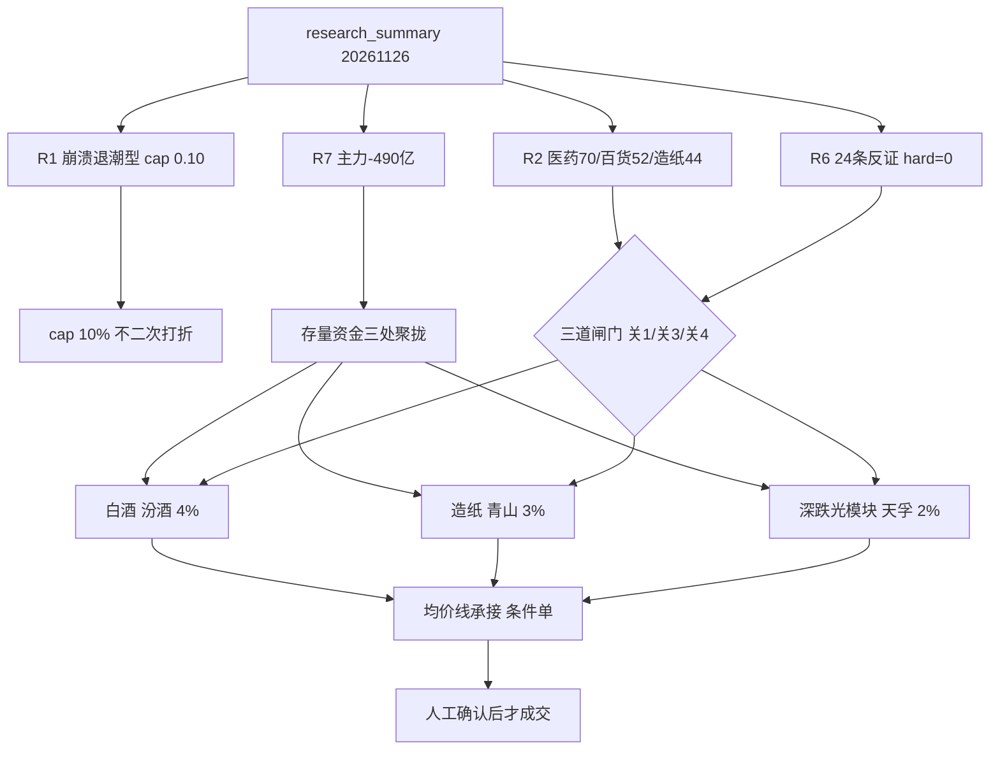

# 2026-11-26 · **主决策 / D1 盘前预案**

> **数据源新鲜度**: partial（R1-R7 全为本次新交付；R3 降级、R5 覆盖不全、识图不含执行池）
> **降级状态**: true · **置信度**: 0.52 · **决策来源**: llm（非规则版、非兜底）
> **仓位上限**: 10.0%（R1 原值，未二次打折）· **执行池**: 3 只 / 合计 9.0% / 利用率 0.90
> **不交易条件**: 9 条全部 active=false（详见文末）

## 一句话结论

崩溃退潮型 + 无已确认主线（R1 判「无主线·轮动」，行业次日留存仅 16.0%）；T-1 缩量普跌 -16.43%、广度 10.51%、炸板率 40.21%（三口径均 ≥35%）→ **今天不猜方向**。只做三处「资金连续为正」的**均价线承接**：白酒龙一（汾酒 4%）、造纸唯一涨停龙一（青山 3%）、深跌光模块单票资金第一（天孚 2%），合计 9%，**全部条件单 + 需人工确认，不打板、不追突破、不接高位老龙**。

## 守正出奇

### 正 — 当下最硬的逻辑：「存量资金的三处聚拢」

- **主要矛盾**：高位科技的派发（电子 -209.37 亿 / 半导体 -126.22 亿 / 印制电路板 -36.55 亿，昨日前十池 16 只中 14 只主力转负）与少数资金在低位/深跌端重新聚拢（造纸 +5.70 + 特种纸 +5.59 亿 5 日全正、白酒Ⅲ 10 日 +15.67 亿、天孚单票 +10.86 亿）之间的再平衡。指数级承接盘已枯竭（主力单日 -490.23 亿、20 日 -4194.29 亿、仅 7/20 天为正）→ **今日定价的是「存量资金挑谁来做承接」，不是「哪个板块要涨」**。
- **谁在定义市场**：`mixed`。游资在医药链/百货造首板潮（医药 13 家、百货 4 家，高度只到 5 板且 0 层空缺）；机构把钱搬去消费防御（茅台大单 +5.91 亿、白酒Ⅲ +6.12 亿、新零售概念 +11.22 亿＝全概念第 1）。两侧同时定价、两侧都没有价格主导权 → 只跟资金连续性，不跟板块故事。
- **主线与级别**：`small`。五共振 **1/5**：`primary_secondary=na`（三处无一级市场题材）、`cn_us=na`、`participant=miss`（白酒有大单无游资涨停；医药有游资无机构净买）、`timing_cycle=hit`（出现在连续杀跌后的避险时点）、`policy=miss` → hit ≤1 = small，**仓位不因此上调**。
- **题材公平性**：`unclear`。三处都不是新题材——白酒龙头已在 60 日高位（茅台距高 -0.73%、汾酒 -0.06%），造纸是资金 5 日连续买的既有地盘，光模块是别人深跌后的残局。在别人的存量地盘里做承接 → 收益预期压低、只做回踩不追高、止损优先于目标。
- **最硬的核心观点（可证伪）**：若今日仍不放量（全市场 09:30-10:30 成交额同比 <1.1 倍），资金会继续只在三处做回踩承接——白酒（汾酒 T-1 均价线 131.31）、造纸（青山 3.67）站回即买、光模块（天孚 131.17）只做第一波；而医药链 13 家首板潮若在 11:00 前形成不了 ≥3 家同细分连板，它就只是解套盘兑现、不是新主线。
- **证伪条件（可实测）**：① 白酒Ⅲ 当日 DC 净额 <0 且汾酒收盘破 128.45；② 造纸/特种纸 当日净额 <0 且青山收盘破 3.53；③ 全市场 10:00 涨停 <25 家且炸板率仍 >45%（→ 当日零新开）；④ 医药链 10:00 前 ≥3 家同细分 2 板/连板 且 宽度红盘率回升 >55%（→ 方向判断被推翻，应切医药）；⑤ 天孚当日主力转负 < -5 亿或收盘破 5 日线 116.12。

**正股（不每天换票的锚）**

| 正股 | 身位 | 为什么是它 | 持有依据 | 个股证伪 | 最长持有 |
|---|---|---|---|---|---|
| 600809 山西汾酒 | 白酒当日 #1/19 | 白酒Ⅲ 10 日 +15.67 亿 / 20 日 +5.8 亿、20 日 9/20 天为正；它 +3.74%、收盘位置 0.987、中单也净买 +0.14 亿＝内部筹码不抛 | 白酒Ⅲ 当日净额不为负 + 收盘不破 MA10 128.45 → 持有 | 板块净额转负且连续 2 日；收盘破 128.45；10:30 前板块跌 >2% | 5 天 |
| 600103 青山纸业 | 造纸唯一涨停 1/35 | 造纸/特种纸 5 日 +6.10/+7.04 亿全正（防御端唯一连续）；单票当日主力 +5.98 亿＝成交额 24.07%，超大单 +6.37 / 中单 -2.62＝大单接散户抛盘 | 板块当日净额不为负 + 收盘不破 5 日线 3.46 | 板块净额转负；收盘破 3.53；同链（百亚/洁柔）同步破 VWAP | 3 天 |
| 300394 天孚通信 | 通信设备 #1/138 | 全市场单票主力第一（+10.86 亿 / 成交 9.27%、5 日 +29.25 亿），电子派发日逆势 +7.65%；60 日 -47.55%、距高 -54.03% → 跌够了才有第一波反弹的赔率 | rebound 层：只做第一波 2-3 天，T+2 不创新高即走，不写「趋势持有」 | 当日主力转负超 -5 亿；收盘破 125.03；CPO 板块净额 < -3 亿 | 3 天 |

### 奇 — 今日无「奇」

`奇点 = 三处聚拢都不是新题材，任何「出奇」都只能在别人的存量地盘里制造故事。`

| 被否的出奇入口 | 为什么不能做 |
|---|---|
| 首板接力 · 医药链 13 家 | 宽度四口径全否（THS 流感红盘率 43.8% / 化学制药 30.8%），题材仅 1 日上榜（前 11 个交易日无记录）＝一日游最高档；且全部命中硬闸门：双鹭 7 次开板、合富/康芝 开板 2、新华 3、人民同泰 4、天圣一字且流通 15.3 亿、哈三联/拓新流通 <20 亿、特一/亨迪/拓新 layer=rotation |
| 分歧低吸 · 百货玄学 | R6 对杭州解百判「估值×位置双顶 + RR 0.31 → 任何档位都不得给」；国芳 rotation + Q3 单季转负；题材本体是财神庙玄学，R3 明确不做玄学 |
| 事件催化 · 大金融 4600 亿 | 叙事最强、盘面最弱：银行当日 0 涨停、无宽度、不在 R7 资金 top10（工商银行当日 -3.02 亿）→ 只作指数稳定器观察 |

> 「出奇为空」是结论不是遗漏：skill 允许守正方向内无入口时写「今日无出奇标的」。**硬凑出奇 = 回到散户心理。**

### 纪律 — 不换股

- **逻辑未变不换股**：正股优先沿用，不因当日涨跌换票。
- **换股三条件（须同时满足）**：① 正股逻辑被证伪（上述证伪条件命中）；② 出现更强同方向龙头且有带动性证据（需 板块内 #1 + 单日主力净额 ≥ 现正股 2 倍 + 封板质量更优，**不是涨得更多就算**）；③ 风险闸门强制（收盘破结构位 / 系统性风险 / 基本面反转）。
- **今日换股的性质**：主线由昨日 `ai_hardware_chain_cpo_pcb_1124` 切换为 `capital_repricing_low_defensive_1126`，属第 ③ 条「风险闸门强制」——昨日核心前提「AI 算力的钱还在」当日被数据推翻，不是「昨天涨完了」。

## 执行池（3 只 / 合计 9.0% / cap 10.0%）

| 票 | 题材 | 买区 | 触发 | 止损（收盘口径） | 止盈 | RR | 仓位 | 层 / 持有 |
|---|---|---|---|---|---|---|---|---|
| 600809 山西汾酒 | 白酒龙一·存量聚拢① | 130.65–132.62 | 131.57 站回均价线 | 128.45（-3.2%） | 140.96 | 2.0 | 4% | trend/near_high · 5 天 |
| 600103 青山纸业 | 造纸唯一涨停·存量聚拢② | 3.60–3.72（**低于昨收**） | 3.70 站回 3.67 | 3.53（-5.1%） | 4.10 | 2.0 | 3% | trend/pullback · 3 天 |
| 300394 天孚通信 | 深跌光模块·守正外试错 | 130.51–132.48 | 131.43 站回 131.17 | 125.03（-5.6%） | 147.38 | 2.0 | 2% | rebound · 3 天 |

> 三只全部 `auto_trade_enabled=false` + `requires_user_confirmation=true`：**没有人工确认不成交**。

### 1. 600809 山西汾酒 · 4% · trend/near_high

- **买**：竞价四档 → `-1.8%~0%`（130.65–133.00）按买区承接、**站回 131.31 才买**；跌破 130.65 不接（仅弱转强二次确认、仓位减半）；高开 >+2.6% 当日放弃。
- **盘中确认**：白酒Ⅲ 当日 DC 净额不为负 + 站回 T-1 均价线 + 09:35-10:30 全市场涨停 ≥25 家且炸板率 <45%。
- **怎么卖**：收盘破 128.45 次日开盘清（盘中触及不执行）；跌破买区下沿 130.65 且 30 分钟不收回即撤；触 140.96 减半；T+1 10:30 未创当日新高且浮盈 <1% 减半。
- **何时放弃**：竞价高于 136.40（+2.6%）；白酒板块净额转负；14:00 前未触发。

**大资金意图**：机构在把仓位从高价成长搬到消费防御（茅台大单 +5.91 亿、白酒Ⅲ 净额 +6.12 亿），汾酒中单也净买 +0.14 亿＝内部筹码不抛。
**为什么走强**：不是题材，是「唯一 10 日资金为正的板块 + 它在该板块 #1」。
**逻辑够不够硬**：够硬的是资金连续性（20 日 9/20 天为正），不够硬的是催化剂（无）→ 所以只给 4% 且只做回踩。
**风险点**：白酒是慢牛，目标 140.96（+6%）需要 3-5 天，若市场继续缩量下行，大概率不触发而非亏钱。

### 2. 600103 青山纸业 · 3% · trend/pullback · **关4 覆盖票**

- **买**：只在低开承接——竞价 3.60–3.82、站回 3.67 才买；**高于 3.82 直接放弃**（烂板后高开＝兑现盘）。
- **盘中确认**：造纸/特种纸 当日 DC 净额不为负 + 站回 T-1 均价线；不追封板、不打二次板。
- **怎么卖**：收盘破 3.53 离场；跌破 3.60 且 30 分钟不收回即撤；触 4.10 减半；T+1 10:30 未创新高且浮盈 <1% 减半。
- **何时放弃**：竞价 <3.60（破 5 日线）或 >3.82；14:30 后不再新开。

**大资金意图**：超大单 +6.37 亿、中单 -2.62、小单 -3.36＝大单接散户抛盘；但开板 3 次、换手 30.59% 说明筹码紊乱，是「资金想做、承接反复」。
**为什么走强**：造纸/特种纸 5 日 +6.10/+7.04 亿全正——防御端唯一连续的资金腿，它是这条线唯一涨停。
**逻辑够不够硬**：资金腿硬（单票主力＝成交额 24.07%），板型不硬（回封板）→ 所以买点压到昨收下方、仓位压到 3%。
**风险点**：**关4 命中「回封板(多次开板)」**，本次为显式覆盖（见文末不确定性第 1 条）；若次日低开后继续下杀，收盘破 3.53 立即走。

### 3. 300394 天孚通信 · 2% · rebound · 守正外试错档

- **买**：竞价 `-2.2%~+1.2%`（128.00–132.48）区间内、**站回 131.17 才买**；低开破 128 放弃，高开 >4% 放弃。
- **盘中确认**：通信设备/CPO 板块当日 DC 净额不为负 + 站回 T-1 均价线 + 不破 5 日线 116.12。
- **怎么卖**：收盘破 125.03 离场；rebound 层 T+2 不创新高即走；触 147.38 减半；CPO 板块净额 < -3 亿即离场。
- **何时放弃**：竞价破 128 或高于 136.10；14:00 后不再新开（rebound 必须当日完成确认）。

**大资金意图**：全市场单票主力第一（+10.86 亿 / 成交 9.27%、超大单 +8.99 / 小单 -5.01），5 日 +29.25 亿＝抄底资金连续 5 天买。
**为什么走强**：电子 -209.37 亿派发日它逆势 +7.65%——分离结构，深跌 54% 后资金先回来。
**逻辑够不够硬**：资金硬、结构不硬（周 K 空头、上方 138 压力、60 日 -47.55%）→ 只做第一波 2-3 天、仓位封 2%（低于试错档 8%）。
**风险点**：不在守正方向内，属「守正之外」；且 R2 已把 AI 硬件判为派发链，本腿只认个股资金、不认板块故事。

| 票 | 低开（不及预期） | 预期内 | 高开（超预期） | 过火（放弃） |
|---|---|---|---|---|
| 汾酒 | <130.65 → 不接，弱转强仓位减半 | 130.65–133.00 → 承接，站回 131.31 买 | 133.00–136.40 → 等回踩 132.62 | >136.40 |
| 青山 | <3.60 → 放弃 | 3.60–3.72 → 承接，站回 3.67 买 | 3.72–3.82 → 只接受 ≤3.78 且需回踩 3.72 | >3.82 |
| 天孚 | <128.00 → 放弃 | 128.00–132.48 → 站回 131.17 买 | 132.48–136.10 → 等回踩 132.48 | >136.10 |

## 预期差

`expectation_gap.json` 本次 **status=no_input**（90 篇文章 / 股票名录 0 只，未产出个股映射）→ 本栏目今日 **unavailable**，不以文章标题臆造「被点名个股」。替代信息：R3 飙升榜（亨迪 #2 / 康芝 #4 / 拓新 #9 / 哈三联 #24）与 R2 的 consensus_themes（医药 4 源 0.82 / 百货 3 源 0.61，均带 note「共识成立而强度不成立」）。

## 观察池（20 只 / setup 池 / 不预分配额度）

| 票 | 层 | 触发价（承接/上破） | 止损 | 止盈 | RR | 角色 |
|---|---|---|---|---|---|---|
| 002728 特一药业 | rotation | 8.22 | 7.87 | 9.10 | 2.0 | 医药链龙一·价格锚（8.35 不破则链有承接） |
| 301211 亨迪药业 | rotation | 10.79 | 10.30 | 12.04 | 2.0 | 20cm 弹性核心 |
| 603122 合富中国 | rebound | 9.81 | 9.40 | 10.87 | 2.0 | 医药商业首板（开板 2 次） |
| 000756 新华制药 | rebound | 11.93 | 11.70 | 12.69 | 2.0 | 化学制药首板（开板 3 次） |
| 600829 人民同泰 | rebound | 8.20 | 7.85 | 9.08 | 2.0 | 尾盘投机板 |
| 300086 康芝药业 | rebound | 4.67 | 4.58 | 4.97 | 2.0 | 20cm 首板 |
| 600814 杭州解百 | trend/near_high | 8.33 | 7.97 | 9.23 | 2.0 | 百货龙一 3 板·价格锚（R6 禁任何档位） |
| 601086 国芳集团 | rotation | 10.40 | 9.96 | 11.52 | 2.0 | 百货龙二（容量票） |
| 600858 银座股份 | rotation | 4.30 | 4.11 | 4.77 | 2.0 | 百货备份（#21/35） |
| 003006 百亚股份 | rotation | 20.02 | 19.17 | 22.20 | 2.0 | 造纸资金最强腿（20 日 +66.84 亿）但今日 -7.89% |
| 000568 泸州老窖 | rotation | 79.67 | 78.54 | 83.85 | 2.0 | 白酒第三腿（#3 → mid_laggard） |
| 000596 古井贡酒 | trend/pullback | 106.03 | 104.61 | 111.42 | 2.0 | 白酒 pullback（已破 MA10） |
| 603288 海天味业 | rotation | 36.13 | 35.47 | 38.32 | 2.0 | 食品（5 日资金为负） |
| 300476 胜宏科技 | rebound | 123.48 | 115.91 | 141.56 | 2.0 | PCB 深跌反弹（#16/311） |
| 300502 新易盛 | rebound | 182.30 | 173.54 | 204.20 | 2.0 | 光模块（5 日 +42.19 亿但今日转负） |
| 002463 沪电股份 | rebound | 81.79 | 80.03 | 87.29 | 2.0 | PCB（昨日执行腿，今日破位） |
| 688498 源杰科技 | rebound | 591.29 | 548.33 | 691.37 | 2.0 | 光芯片（订单正面、价格未修复） |
| 603083 剑桥科技 | rebound | 98.34 | 94.16 | 109.04 | 2.0 | 光模块（5 日资金为负） |
| 688981 中芯国际 | rotation | 122.99 | 116.33 | 139.25 | 2.0 | 半导体价格锚（站住 122.74 才算止跌） |
| 601138 工业富联 | rebound | 40.19 | 38.48 | 44.57 | 2.0 | 服务器（今日 -6.49 亿＝派发） |

> 观察池是 **setup 池**：装「位置+筹码+资金三条齐、只差一个触发日」的票，价位写**承接/上破触发**，不是「跌回来才买」。额度不预分配——命中时才从执行池未触发额度内临借，总额仍受 cap 10% 约束。整池 `position_pct=0` 且已写 `quota_note`，不是「买不了的展板」。

## B 计划（风险三条件触发，**不是执行池未成交的替补**）

`执行池不触发 = 价格没来（机会成本，正常）；B 计划启动 = 方向判断错了（风险事件，要换腿）。`

| 方向 | 候选 | 买区 / 触发 | 仓位 | 能不能下单 | 触发条件 |
|---|---|---|---|---|---|
| **对手盘**·医药链首板潮（与执行池白酒/造纸相反） | 002728 特一 | 8.16–8.28 / 8.22 | 0% | **不可下单**（research_only） | 执行池 ≥2 腿竞价破承接区下沿 **且** 医药链 10:00 前 ≥3 家同细分 2 板/连板 |
| 对手盘 · 同上 | 603122 合富中国 | 9.74–9.89 / 9.81 | 0% | **不可下单**（research_only） | 同上 + 它需 2 板零开板 |
| 同向替代·食品饮料 | 600887 伊利股份 | 33.15–33.65 / 33.39 | 0% | **不可下单**（research_only：关1 anti_rotation/laggard） | 白酒两腿全破位 + 食品饮料净额 >+4 亿 + 站回 33.32 |
| 防守·大金融（只记录） | 601398 工商银行 | 无买区 | 0% | **不可下单** | 上证破当日均价线且跌停 >60 家 → 只作降档信号 |

**反向提示**：若 B 计划方向（医药/百货）也同步走弱 → 全市场降档、执行池全部后置、当日零新开；**不以「B 也没成」为理由临时起意做第三个方向**（铁律⑧ 计划外不出手）。

## 风险与不确定性（必读）

1. **关4 板型覆盖（唯一硬闸门覆盖）**：青山纸业 T-1 开板 3 次＝「回封板」，skill 关4 对打板/接力入场的判据是「不碰」。本次为显式覆盖：入场是低开回踩 T-1 均价线的承接（买区 3.60–3.72 **全部低于昨收 3.78**），不接封板、不接二次冲高（竞价 >3.82 即放弃），板型风险由「买点低于昨收 + 收盘破位止损 3.53 + 仓位压到 3%」吸收。**若你不接受覆盖，这一腿请直接跳过，仓位降为 6%（汾酒 4% + 天孚 2%）。**
2. **R7 拦截项的处置**：R7 以「开板 3 次 + 20 日位置 91.1% + 止损 -21.69% + 机构缺席」拦下青山——其 -21.69% 是 10/20 日低点口径（不能当买入价止损），D1 止损按买入价 -5.1%；榜净买 +2.53 亿是游资席位（正是本策略目标资金），机构缺席不构成否决。茅台则**一致采纳** R7（并入 rejected，关1 同向否决）。
3. **茅台/伊利被关1 剔除，不是遗漏**：茅台 core=False / laggard / anti_rotation（个股-板块 20 日相关 0.02、个股-大盘 -0.55），板块内 #4 又中 mid_laggard；伊利同为 anti_rotation 且 20 日主力 -5.74 亿而价格 +30%（拉高派发）。它们的资金数据仍作白酒/食品饮料板块的定性背书。
4. **R5 未画像执行池 3 只**：汾酒/青山/天孚 均无 R5 六维画像 → alpha/risk 按契约缺省 B，只能给试错档（本次已封在 4/3/2%，均 ≤ trial 8%）。
5. **识图未覆盖执行池**：快照 13 只全是 R2/R5 的医药/百货候选，执行池 3 只无视觉交叉校验。快照读数（解百「追高风险偏高、等回踩确认」、国芳「震荡」、亨迪「受制 MA60 11.36」）整体支持「不追高只承接」的通道选择。
6. **无当日持仓台账**（`holdings_20261126.json` 不存在，最近一期 20261111）→ 执行池按空仓基准定量 9%，**不因「可能已有持仓」缩量**；持仓侧请你自行核对：若已持有这三只，按 exit_rules 收盘口径止损、不加仓。
7. **事件日历缺失**：R4 无 `event_calendar` 字段，`Step 0.55 大事件前夜`无法机器验证。已有事件（美联储 12 月加息预期 99.8%、核心 PCE 3.3%；英伟达被标普列入负面信用观察）属 11-25 **已定价**（A 股当日已杀跌反应）→ `post_event_only=false`。**若 12 月 FOMC 实际落在 11-26~11-30，本条失效，执行池全部作废。**
8. **R3 只有 L1 热榜**（L2 群聊连续 19 日断更、L3 WeFlow 下线）→ 共振维不参与定价，医药链「四源确认」实质是 1 个 L1 源 + 1 个不计等级的公众号源 + 1 条单日资金腿。
9. **cycle_position tier=single_down（连跌 1 天）**：不是 repair_window、也不是 continued_down → 按原节奏观察承接，未按修复窗口定制打法，也未清空执行池（硬契约 3-6 只）。
10. **R6 hard_reject 为空集不等于 6 票干净**：R6 自述「三层契约同时空转」（触发集为空 + cond1 0/6 + cond2 仅 1 票且幅度不成立）；板块级派发旁证在 R7（43 条告警中 5 只医药链同业）→ 24 条反证中 16 strong / 8 soft 已逐条吸收（详见 JSON `meta.r6_devil_advocate`）。

## 数据源审计

| 源 | 状态 | 抓取时间 | 记录数 | 备注 |
|---|---|---|---|---|
| 🟢 R1 风格 | ok | 06:13 | 15 | 崩溃退潮型 / 情绪 31.9 / cap 0.10 |
| 🟢 R2 主线 | ok | 06:43 | 3 | 医药 70.0 擦线未确认 / 百货 52.0 / 造纸 44.0 |
| 🟡 R3 情绪 | stale（degraded） | 06:31 | 3 | L2 断更 19 日、L3 下线 → 封顶 L1_only |
| 🟢 R4 消息 | ok | 07:35 | 8 | 无 event_calendar |
| 🟡 R5 画像 | ok（覆盖不全） | 06:58 | 6 | 只画像 R2 的 6 只 leaders |
| 🟢 R6 反证 | ok | 07:07 | 24 | hard_reject 0（空集，非放行） |
| 🟢 R7 资金 | ok | 05:04 | 49 | 主力 -490.23 亿；北向 retired |
| 🟢 识图快照 | ok（部分失败） | 06:45 | 13 | 9 成功 / 4 空响应；不含执行池 |
| 🔴 attention_signals | timeout（未落盘） | — | 0 | 人气维度无输入，用 R3 飙升榜替代 |
| 🟢 决策链 | llm 主路径 | 07:28 | — | 关1-关7 全部实跑（`_work/_d1_gates.json`） |

## 与其他 R/D/E 的关系

- **依赖**：R1 风格与 cap、R2 主线/次线与 layer、R3 方向（偏防守）、R4 事件、R5 画像（缺省 B）、R6 反证（24 条全部吸收）、R7 资金与跷跷板配对、`emotion_cycle.json`、`cycle_position.json`、`chart_vision_snapshot.json`、`data/user_preferences.yaml`
- **被消费**：execute（读 `watchlist_plan.json`）、P1 竞价校准（`auction_expectation` 四档 + `execution_gate`）、P2 午盘修订（B 计划触发条件）、E1 复盘（`corrections_applied` 与 `gates`）

## Sub-Agent 元数据

- skill: `main_decision_v1@1.11`（守正出奇 Step 0.6）
- artifact: `data/plans/20261126/watchlist_plan.json`（pydantic + `validate_plan_for_date` + `execution_pool_contract` 全过）
- 决策来源: `decision_source=llm`（非 `python_fallback`、非 `rule_v1`）
- 校验: exec 3 / watch 20 / rejected 13 / no_trade_conditions active 0 / 利用率 0.90
- model: deepseek-v4.1-flash
