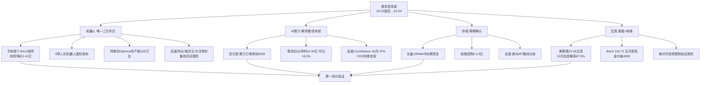

# 2026-10-24 · **群聊情绪共振（周末轻量档）**

> **数据源新鲜度**: partial · **降级状态**: true · **置信度**: 0.45
> **覆盖窗口**: 2026-10-23 20:45 → 2026-10-24 20:09（公众号 48 篇）／群聊 0 条
> **模式**: weekend（非交易日，不做竞价/连板/情绪周期阶段判定）

## 一句话结论
群聊断线、周六无榜，能确认的只有一件事：**机器人是唯一被三方（官媒+大V+榜单）同时点名的主线，但也因此拥挤度最高**；AI算力内部出现「需求端硬、资本端软」的罕见分裂，是本周末最值得盯的分歧。

## 🔴 先说实话：这一档的口径限制

R3 的共振等级定义里，**只有「热榜(L1)+群聊(L2)」同时命中才算正向共振**，公众号观点（L2b）按 skill 规定**不计入共振等级**。本期群聊 5/5 群抓取失败（`wechat-cli init` 未完成），所以：

- 严格口径下，本报告**没有任何一个主题达到 L1+L2**，最多是 **L1_only + 观点佐证**；
- 红线 3（`L1_only` 不得标为强共振）本档**全程生效**，请把下面的 top 主题读成「热度候选」而不是「已确认共振」；
- 真正的确认要等周一 07:30 群聊恢复后的 L2 复核，以及周一 09:25 竞价的右侧确认。

情绪温度沿用上游 R1（20261026 档）的 **72**，本档**不上调也不下调**：周末没有竞价、没有新连板结构，任何加减分都是编故事。

## 📊 上周五（10-23）已收盘的量化事实（不是估算）

| 指标 | 数值 | 口径 |
|---|---|---|
| 涨停家数 | 82 | Tushare limit_list_d（10-23 收盘） |
| 跌停家数 | 6 | 同上 |
| 炸板家数 | 12 | 同上（炸板率约 12.8%，属健康区间） |
| 上涨家数 | 4526 / 5572 | Tushare daily 10-23 收盘 pct_chg>0 |
| 指数形态 | 全天探底回升，午后集体走强 | 上海证券报 10-23 20:56 |
| 情绪温度（参考） | 72 | R1 上游基线，周末不重算 |

跌停仅 6 家、炸板 12 家、上涨 4526 家 —— **上周五是一个偏暖的普涨日**，这决定了周末发酵的题材有承接基础；但也要注意它同时是「高标分歧日」：海洋王 6 连板后被迫澄清、鸣志电器异动提示，都是高位筹码在换手。

## 🗺️ 情绪传导图

## 🎯 Top 主题（按拥挤度与信息密度排序，非共振等级排序）

### 1 · 人形机器人 / 具身智能 · 热榜第1（概念榜连续2日第1）· early_or_late = **late**

**窗口内新增证据**：宇树科技（688836）10-23 收 20% 涨停、报 624 元、成交 47.7 亿、换手 28.08%，龙虎榜机构专用净买 2.41 亿、外资对垒（高盛买 1.10 亿/卖 1.39 亿）；6 项人形机器人国家标准发布（2027-04-01 实施，优必选牵头）；特斯拉 Optimus 弗里蒙特产线投产、规划年产能 100 万台；工信部口径 2026H1 整机超 400 款、产量超 4 万台、全年预计破 10 万台。

- **大资金意图**：机构在「连续大涨之后仍单向净买」，说明买的不是当天涨幅，而是**明年量产爬坡的确定性**；外资同日双边对打（高盛、瑞银、摩根大通既买又卖）说明**定价权在从交易盘转向配置盘的过程中**，这种结构下股价更容易走「高位震荡换手」而非直线加速。
- **为什么走强**：周五机器人板块 14 家涨停、大业股份 5 板，是**梯队完整的板块效应**，不是单票独舞；叠加国标落地（把「能不能干」变成「可比较、可验证」）与 Optimus 产能指引，短期有事件、长期有产业，两头都能讲故事。
- **逻辑够不够硬**：**产业硬、位置不硬**。硬在零部件先兑现业绩（浙商：上游核心零部件率先规模效应）；不硬在整机成功率——野村口径工厂任务成功率约 60%，进生产系统要 98%，判断机器人现在是 **AlexNet 时刻而不是 ChatGPT 时刻**（傅里叶的猫 10-23 23:47 转述）。这条我认，它是**给仓位上限用的，不是给方向用的**。

### 2 · AI 算力 · 需求端与资本端第一次明显分裂 · middle

**窗口内新增证据**：亚马逊 CEO 贾西称 2026 年 2200 亿美元资本开支仍不够用，**AWS 2026 年主要算力产能已售罄、2027 年基本售罄、2028 年相当一部分已被预订**；美银预计 2028 年全球数据中心支出 2.1 万亿美元（2026 年 1 万亿）；寒武纪 Q3 营收 35.31 亿（同比+104.47%、环比+13.50%）、净利 14.04 亿（环比+8.16%）；对照面——CoreWeave 10 月以来跌约 37%、CDS 利差急剧走阔，GPU 租金却越租越贵（H200 租金指数年初 100→约 260）。

- **大资金意图**：海外资金正在**区分「卖铲子的」和「借钱买铲子的」**——同一景气度下，亚马逊/英伟达被买，重资产算力租赁被卖。这解释为什么 A 股算力链上周五是「指数级上涨但光模块主力净流出」的怪结构。
- **为什么走强（A股侧）**：寒武纪 Q3 是**真环比增长**（+8.16%），不是纯低基数故事；亚马逊「订单排到 2028」直接给 1.6T/CPO 的需求可见度续了两年。
- **逻辑够不够硬**：**需求侧硬、交易侧软**。硬需求的证据链完整（产能售罄+租金上涨+Token 调用放量）；软在筹码——中际旭创 20 日 -31.6%、新易盛 20 日 -38.5%，都在 MA20 下方，属于主跌后的护盘反抽，不是右侧突破。

### 3 · 存储 / DRAM · 周期确认但路线有分歧 · middle

**窗口内新增证据**：长鑫科技公开表态「对全球和中国 DRAM 中长期前景保持坚定信心，DRAM 作为战略性基础设施地位将更加强化」；佰维存储获控股股东提议回购 2-2.5 亿元，并主动公告「生产经营正常」；中微公司称本轮半导体规模跃升主要由**存储器驱动，价格贡献绝大部分、出货量只占两成**；SK 海力士放弃 Solidigm 美国 IPO（分析师认为利好美光/闪迪）。对照面：美光总裁称 4F² 无可行微缩路径、走 6F²+3D DRAM，与长鑫路线存在分歧；韩媒警告 2029 年转红海。

- **大资金意图**：存储是本轮**唯一「涨价→业绩→股价」闭环已经跑通**的方向，资金用它做「科技仓位的地基」，而不是弹性仓。
- **为什么走强**：涨价是当期财报能验证的（不是预期），佰维/长鑫在周末主动释放信心，属于**公司层面对股价的隐性背书**。
- **逻辑够不够硬**：**硬，但已经进入「信的人很多」阶段**。中微那句「价格贡献绝大部分」是双刃剑——价格是周期变量，一旦合约价环比转平，同比再炸裂也救不了股价（这正是 10-14 江波龙那课的通用形式）。

### 4 · 大模型 / AI 应用 · 供给端连续催化 · early

**窗口内新增证据**：月之暗面 10-24 凌晨发布 Kimi K3.1 Pro（3 万亿级参数、100 万 token 上下文，称全球参数规模最大开源模型，完整权重 11-04 前发布）；DeepSeek 完成约 1000 亿元融资（估值约 7000 亿），A 股侧完美世界（认缴 1.5 亿）、世纪华通（子公司 6.5 亿）、利通电子（9500 万）通过砺思星深/拾象尚势两只专项基金间接入股。

- **大资金意图**：一级市场在给国产大模型「重定价」，A 股买的是**股东名单的映射**而不是业绩（传导链极长）。
- **为什么走强**：开源权重 + 价格只有 GPT-6 Astra 的 1/5，叙事从「追赶」变成「性价比替代」，对 AI 应用/Agent/IDC/算力租赁是成本侧利好。
- **逻辑够不够硬**：**中等偏软**。映射票（完美世界/世纪华通）本质是财务投资+基金份额，业绩弹性远小于情绪弹性，属于典型「一日游高风险」题材。

### 5 · 油气 / 军工 · 事件驱动，天生不可持续 · early（但随时反转）

**窗口内新增证据**：特朗普称可能再对伊朗发动「小规模史诗怒火」；伊朗革命卫队称两艘超大型油轮在霍尔木兹海峡以南触雷起火（载油超 450 万桶）；Brent 收 116.72 美元（+3.14%），WTI 103.27（+3.82%），布伦特创近六个月新高；同时金价跌破 4000 美元、白银同步走弱（暗盘日内 -1%）——**说明这轮不是避险交易，而是「紧缩预期 + 供给中断」的组合**。

- **大资金意图**：买的是「一周内的供给溢价」，不是估值重估，所以节奏上必然快进快出。
- **为什么走强**：霍尔木兹是真实断供风险点，油运/油服/军工的事件弹性立刻可见。
- **逻辑够不够硬**：**事件硬、持续性软**。八国外长已在伊斯坦布尔开会呼吁外交解决，一旦美伊接触，溢价一周内回吐。

## 🧭 一致性预期盘点（本档最该警惕的东西）

| 主题 | 一致性 | 证据 | 风险含义 |
|---|:--:|---|---|
| 人形机器人 | **极高** | 官媒 2 篇深度+券商研报+出口数据+「13 只滞涨绩优潜力股」+概念榜 2 日第 1 | 一致性过高＝边际买盘转向「补涨杂毛」，高位股一旦分歧无人接 |
| 存储 | 高 | 长鑫/佰维/中微同日表态，龙头榜持续在榜 | 涨价逻辑已被充分定价，看环比不看同比 |
| 光模块/CPO | **分歧** | 回购护盘（天孚 1-1.5 亿、新易盛最高 10 亿）vs 主力弃高就低、20 日 -30%~-38% | 分歧不是坏事，但要右侧确认（站上 MA5）才算数 |
| AI 算力（海外） | **分裂** | 亚马逊订单排到 2028 vs CoreWeave -37%+CDS 走阔 | 传导到 A 股表现为「指数涨、龙头资金流出」 |
| 油气/军工 | 高但短 | 中东一日多条快讯 | 纯事件，消息一冷就退 |

**一句话**：周末卖方和媒体对机器人的一致度已经到「连补涨名单都替你选好了」的程度（证券时报 10-24 08:23《13 只滞涨绩优人形机器人潜力股出炉》）。按纪律，**这种时候该想的是「谁在卖」，不是「谁还能买」**。

## 关键证据

- 证据 1：宇树科技 20% 首板，机构专用席位净买 2.41 亿，外资双边对打 · 上海证券报 2026-10-23 20:56 · `wechat_official_20`
- 证据 2：6 项人形机器人国家标准发布（2027-04-01 实施，优必选牵头） · 上海证券报 2026-10-23 20:56 · 同上
- 证据 3：AWS 2026 主要算力产能售罄、2027 基本售罄、2028 部分预订 · 上海证券报 2026-10-24 19:44 · 同上
- 证据 4：CoreWeave 10 月跌约 37%、CDS 利差走阔，而 H200 租金指数 100→260 · 傅里叶的猫 2026-10-24 19:55 · 同上
- 证据 5：野村：工厂任务成功率约 60% vs 量产要求 98%，机器人处于 AlexNet 而非 ChatGPT 时刻 · 傅里叶的猫 2026-10-23 23:47 · 同上
- 证据 6：涨停 82 / 跌停 6 / 炸板 12 · Tushare limit_list_d 2026-10-23 收盘 · 上游 R3 20261026 档
- 证据 7：概念榜人形机器人连续 2 日第 1、热度单日 +119% · Tushare ths_hot_concept 2026-10-23 收盘 · `attention_weekend.json`

## 数据源审计

| 源 | 日期 | 状态 | 记录数 | 备注 |
|---|---|:--:|---|---|
| 焦点 5 群（wechat-cli） | 2026-10-24 | 🔴 | 0 | `wechat-cli init` 未完成，5/5 群失败——本档最大缺口 |
| 公众号 RSS（15 号） | 2026-10-24 | 🟢 | 48 | 5 号有更新（证券时报 24/上海证券报 20/傅里叶的猫 2/猫笔刀 1/李迅雷 1），10 号空 |
| 东财人气榜 + 同花顺热股/概念 | 2026-10-23 | 🟢 | 100/99/20 | 收盘口径；10-24 周六无新榜（not_available，不置 degraded） |
| weekend_persistent（跨日连续在榜） | 10-21~10-23 | 🟢 | 28 | 3 日连续：宁德时代、宇树科技、九阳股份、新华传媒、冰山冷热、海洋王、三峡新材、大业股份、吉大正元 |
| 涨跌停/炸板 | 2026-10-23 | 🟢 | 82/6/12 | 收盘口径，周末无更新 |
| WeFlow analytics | — | ⚪ | 0 | 2026-08-19 永久下线，按 skill 置空，不编造 |

## 不确定性 / 反证

1. **群聊缺失使「共振」结论不成立**：本档所有主题严格说是 L1_only，若周一 07:30 群聊恢复后显示 KOL 在聊的不是机器人（比如在聊油气或存储），主题排序要整体推翻。
2. **热度榜的滞后性**：10-23 概念榜第 1 是收盘后统计，反映的是**已被充分交易**的热度；用它去推周一，天然带「追高」偏差。
3. **周末榜单为空不等于热度消失**：10-24 各平台 0 行是采集口径问题（非交易日不更新），不能解读为「热度退了」。
4. **一致性预期本身就是风险**：机器人已是「媒体帮你选补涨」的状态，历史经验是这类阶段补涨票的赔率最差。
5. **海外叙事的两面性**：CoreWeave 的股债双杀如果继续，会否反过来压制 A 股算力链的估值（而不是只影响情绪），本档无法证伪。

## 与其他 R/D/E 的关系

- 依赖：`data/raw/20261024/wechat_official_20.jsonl`、`data/research/20261024/attention_weekend.json`、`data/research/20261026/R1_style.json`（情绪基准）、`data/research/20261026/R3_sentiment.json`（10-23 收盘口径透传）
- 被消费：D1 周一盘前预案（主题优先级与拥挤度提示）、R5 个股画像（人气维度）、R6 反证（一致性预期过高）
- 本档不与 `data/research/20261026/R3_sentiment.json` 冲突：那份是周一交易日正式档（15:00 前产出），本档是周末 24h 增量的轻量补充，**以周一档为准**

## Sub-Agent 元数据

- skill: analyze_sentiment_resonance_v1（weekend_light 变体）
- artifact: 本文件（周末档不落 R3_sentiment.json，避免覆盖周一正式档）
- 生成时刻: 2026-10-24T21:05:00+08:00
