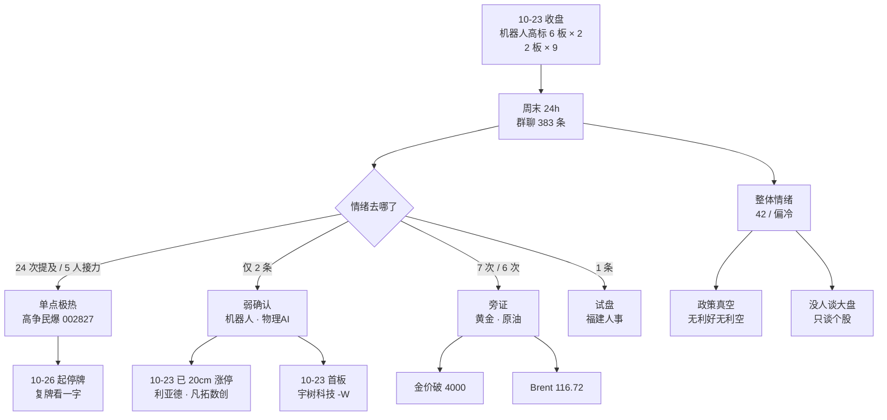

# 2026-10-25 · **群聊情绪共振（周末轻量档）**

> **数据源新鲜度**: partial · **降级状态**: false · **置信度**: 0.52
> **覆盖窗口**: 2026-10-24 18:01 → 2026-10-25 18:01（24h 自适应窗口，非完整 48h）
> **模式**: weekend —— **只做情绪温度与题材发酵，不给买卖点、不给点位、不给仓位**

## 一句话结论

这个周末的真实状态是**「整体极冷 + 单点极热」**：4 个群 383 条消息里几乎没人谈大盘，KOL 自己写下「财经圈非常安静，股票群异常的安静」；全部情绪火力压在一只停牌票（高争民爆）上，5 个人接力喊「保 5 争 10」「300e」——**情绪不是回升，是被一只票单点抽走了**。

## 🔴 先说实话：这一档的口径限制

1. **窗口只有 24 小时，不是完整周末**。抓取层因为上一次成功抓取在 16:02，自适应窗口收敛到 24h，所以 10-24 白天那段与昨天那档（`chzl_kg/投研交易/群聊情绪/20261024.md`）有重叠。本档只写今天新增的部分，重叠内容不重复叙事。
2. **10-25 当日热榜 not_available**。东财人气/飙升、同花顺热股/概念四个榜今天全部 0 行，这是非交易日的正常状态，**不是抓取失败，也不置 degraded**。所有榜单判读都基于 10-22 ~ 10-24 三个快照，榜内涨跌幅是 **10-23 收盘口径**，请勿当成"今天在涨"。
3. **WeFlow 已于 2026-08-19 永久下线**，L3 语义共振层整段不可用。本档最高等级只能到 `L1+L2`，`weflow_degraded=true` 是对历史的标注，不是本次事故。
4. **这 7 个群是散户口语群，不是机构信息群**。A 股板块名在口语里几乎不出现（"机器人"全程只提了 1 次），所以 L2 只能提供**情绪温度与一致性预期**，不能提供板块共振。任何把这里的话直接当板块证据的用法都是错的。

## 📊 情绪浓度

**sentiment_score = 42 / 100（偏冷）**

| 维度 | 观测值 | 对分数的贡献 |
|---|---|:--:|
| 基准（无 R1_style） | 20261025 无 `R1_style.json`，按 skill 约定取 50 并注明 | 50 |
| 群聊活跃度 | 7 群中 4 群有消息（105 / 68 / 199 / 7 条），3 群静默（量化克星、取经人、弱水三千仅 4 条）；单日中位消息长度 **11 字**，60 字以上仅 7 条 | −6 |
| KOL 明示情绪 | 群内长文原话："这个周末，财经圈非常安静，股票群异常的安静！政策层面，啥消息也没有……市场情绪极度低迷，之前被骗了太多次" | −6 |
| 正负词比 | 正面词命中 56 / 负面 26，比值 2.15（但绝对样本仅 82，权重有限） | +4 |
| 热榜存量结构 | 人气榜 top 全是 10-23 已有面孔（宇树、大业、海洋王、天华、长鑫），**无新面孔顶上**，属存量博弈 | 0 |
| **合计** | | **42** |

**5 维加权法（@市场情绪分析）：not_available**。非交易日无当日涨停强度 / 跌停压制 / 连板结构 / 炸板率 / 杠杆外资中位值，按纪律不估算、不置 degraded、不做 `r3_vs_5d_gap` 比较。

## 🗺️ 情绪传导图

## 🎯 Top 主题（按信号质量排序，非按热度排序）

> 等级说明：`L1` = 多平台热榜（存量榜，10-23 收盘口径）；`L2` = 群聊 KOL 语义。本档无 L3。

### 1 · 机器人 / 具身智能 — `L1+L2` · early_or_late = **late**

**L1 证据**：10-23 人气榜与概念榜里，宇树科技-W 20cm、大业股份 6 板、海洋王 6 板、襄阳轴承 2 板、兆威机电 2 板、埃斯顿涨停、华天科技连续三日人气榜前列；概念榜「人形机器人」10-23 涨 4.46% 居首。
**L2 证据（弱）**：全窗口仅 2 条——「9 个 2 板都是机器人，周五共振指数，最差也要抗一天吧」（14:12）、「物理AI彻底起飞了」（16:51）。

- **大资金意图**：周末没人讨论方向，全部讨论**位置**（"最差也要抗一天"）。这句话是典型的持仓者心态，不是准备加仓的心态——资金想的是怎么安全退出，不是怎么进攻。
- **为什么走强**：10-23 是**指数共振日**，机器人是唯一有完整梯队的板块，涨停股自然被热榜算法捕捉，形成"看起来很强"的自我强化。
- **逻辑够不够硬**：**方向硬，结构不硬**。我核对了 10-23 的连板结构：6 板 × 2（海洋王、大业股份），然后**直接跳到 2 板 × 9，中间 3/4/5 板是空的**。而且这 9 个 2 板里，真正在机器人链上的只有襄阳轴承（轴承→关节）、兆威机电（灵巧手）、华阳智能（微电机）、睿能科技（运动控制）4 只；林州重机、赛福天、正裕工业、南方路机、多伦科技属于**沾边设备 + 杂毛**。"9 个 2 板都是机器人"这句话是市场的口头简化，不是事实。
- **本档结论**：`late`。断层结构下的 6 板高标，一旦断板，那 9 个 2 板没有承接盘。这是**观察点，不是入场点**。

### 2 · 物理AI / 空间计算 · 数字内容 — `L1+L2` · early_or_late = **early→middle**

**L1 证据**：10-23 出现三个 20cm/10cm 新面孔——利亚德 +20%（光学光电）、凡拓数创 +20%（数字媒体）、天娱数科 +10%（广告营销），且 10-24 快照里天娱数科、利亚德、凡拓数创分别占据人气榜第 1 / 2 / 7 位；歌尔股份 +10% 排第 8。
**L2 证据**：「物理AI彻底起飞了」（16:51，单条）。

- **大资金意图**：这是**资金在机器人内部换赛道**——不买本体（太贵、太拥挤），改买"物理AI 的软件/内容/视觉"这一层。利亚德、凡拓数创、天娱数科三只市值都不大、都不是机构重仓票，典型的题材资金选品。
- **为什么走强**：港股五一视界（子公司 51Sim 入选英伟达 Halos SAFE 生态，名单里**唯一中国企业**）一周涨 58.92%、10-23 单日 +30.31%，给了 A 股一个"物理AI = 英伟达认证"的叙事锚。
- **逻辑够不够硬**：**偏软，但位置好**。硬的部分是「英伟达生态 + 唯一中国企业」这个事实本身；软的部分是这三只 A 股票与物理AI 的收入相关性都没被验证过，属于叙事映射。它现在的价值是"机器人的低位替代品"，不是"物理AI 的业绩兑现"。
- **本档结论**：这是本周末唯一一个 `early` 的方向，但**只有一条群消息确认**，L2 极薄，不足以判定为共振主线，只能进观察。

### 3 · 存储 / 半导体 — `L1+L2` · middle

**L1 证据**：华天科技（封测）连续三日人气榜第一；长鑫科技常驻前三；德明利（存储模组）位于本周主力净流入个股前二；10-23 半导体概念整体 3.34% 下跌但个股仍在榜（说明是**分歧中的高关注**）。
**L2 证据（质量最好的一条）**：群内关于服务器内存涨价的两条实证对话——「8900 一条 32g 的服务器内存」「当时 20 多万，现在 30 多万了，早知道当时多买几台服务器了」。这不是研报转述，是**采购端的价格记忆**。

- **大资金意图**：本周主力资金"弃高就低"——新能源与光通信被抛售，钱流进**存储芯片与消费电子**（本周半导体、消费电子净流入居前，兆易创新、德明利净流入最多）。这是撤退，不是进攻：从涨幅最大的地方撤到涨幅较小、且有涨价实证的地方。
- **为什么走强**：涨价是有实感的东西（内存条价格翻倍），比"算力需求"这种宏大叙事更容易被散户和游资同时接受。
- **逻辑够不够硬**：**硬**（涨价已验证、业绩已验证——云汉芯城 Q3 单季环比 +48%~+79%），但**已经进入"信的人很多"阶段**。华天科技人气榜连续三日第一，本身就是拥挤度指标。

### 4 · 光模块 / CPO — `L1+L2` · **负向共振** · early_or_late = **退潮**

**L1 证据**：中际旭创、新易盛、天孚通信仍在人气榜（10-23 分别 +3.82% / +1.16% / +1.93%，但 10-22 新易盛 **−12.28%**、中际旭创 **−8.76%**）；概念榜 CPO 10-22 跌 4.23%。
**L2 证据（本档最锐的判断，全部来自群内资深发言者）**：
- 「指数不一定会新低了，但是**光模块的票大概率还要新低**」
- 「都在想跑，这么重的仓位」（转述交易猿的持仓心态）
- 「旭创明牌你去做……**只是阶段结束了，认清，结账，离场**」
- 「那时候业绩股出业绩，那就代表高成长高增长的叙事结束了」
- 「后面肯定换新的东西啊，新的中际旭创……还守着老的大哥大干嘛」

- **大资金意图**：这是**一致性看空**，而且是从"业绩兑现=叙事结束"这个角度看的——不是嫌贵，是认为**产业周期的高点已经被三季报确认**。这个判断比"跌多了会反弹"要高级得多。
- **为什么走强**（本条是负向共振，故此处如实回答"为什么走弱"）：本周主力单周净流出新能源+光通信，宁德时代单周主力净减持超 37 亿；同时 10-23 有 647.95 亿 ETF 净流入（宽基 554.60 亿）——**指数被 ETF 托住，个股被主力卖出**。这个组合意味着：指数不跌，但持仓者亏钱。
- **逻辑够不够硬**：**硬**（资金流向 + 群内多位资深者同向 + 三季报验证），且它是本档唯一一个"L1 在榜 + L2 一致看空"的**负向共振**。负向共振的价值和正向共振一样大——它告诉你钱正在从哪儿离开。
- **本档结论**：不接反弹。这条不是"看空光模块的产业"，是"看空它在这个位置的赔率"。

## 📋 单源观察（**不构成共振**，按红线 4 单列）

| 对象 | 源 | 证据 | 为什么不进正式共振 |
|---|:--:|---|---|
| 高争民爆 002827 / 民爆·资产注入 | L2 only（24 次提及） | 5 人接力，明确价格目标"300e"、"保 5 争 10"、"参考江南嘉捷一波新高" | 停牌票不进任何榜单，无 L1；且群内一致预期已达到危险浓度，属**反向指标候选**而非共振 |
| 黄金 / 贵金属 | L2 only（7 次） | 「黄金一直跌」「4000 守不住就往下一档」「都在卖黄金补保证金」 | 人气榜无黄金股，L1 缺席；属宏观旁证 |
| 原油 / 炼化 | L2 only（6 次） | 「原油可能要去 100 多」「断供影响会大」「最后看空的死了」 | 同上，L1 缺席；且群内是**讨论期货不是股票** |
| 福建（人事） | L2（1 条）+ 官媒 | 群内 10:42「冲福建股」；10-24 官媒：郭宁宁任福建省政府党组书记、林涛任福建省委副书记、秦海翔任福州市委书记 | L1 无对应异动，只有 1 条群消息，属试盘 |

## 🧭 一致性预期盘点（本档最该警惕的东西）

**① 高争民爆：这是本周末唯一的高浓度一致预期，而且浓度高到危险。**

群内量化：全窗口 310 条有效消息中，与"高争/民爆/停牌/注入/资产"相关的题材词命中 **24 次**，占比 7.7%——对于一只**当日已停牌、周一继续停牌、无法交易**的票，这个浓度是异常的。更关键的是口径：
- 「还有 10 个一字」（15:35）
- 「10 个板不到，5 个板不止」（16:57）
- 「收到，保 5 争 10」（16:57）
- 「反正说是节前到 300e 的」（15:52）—— 当前总市值 143.5 亿，300e 是**翻倍预期**
- 「参考江南嘉捷，一波新高」（15:40）

同时也有清醒的声音：「你们的话我是一句不敢信」（3 人复读）、「明天各位一定要冷静，先让我走」、「亏的头大，停牌 5 天，这个月又是亏钱着结束」。

**我的判读**：这不是"利好被发现"，是**利好被定价过度**。群体把"资产注入"直接换算成"10 个一字板"，中间跳过了三个必须验证的环节：① 方案能否在 5 个交易日内披露；② 注入资产里真正投产的有多少（马牧普铜矿探转采要到明年上半年）；③ 复牌时的指数环境。**一致预期越具体，兑现时的落差越大**——这是错题本里反复出现的形态，不是我这次的新发现。

**② 机器人：「9 个 2 板都是机器人」是本周最流行的一句错话。**

事实是 9 个 2 板里有 5 只不在这条链上。当一个板块的**杂毛开始和龙头一起被同口径描述**的时候，板块已经进入"辨识度失效"阶段——这正是"龙头风险 < 杂毛风险"这条铁律最该被想起来的时候。

**③ 反向的一致性：财经圈"异常安静"。**

这句 KOL 观察我认为是本档最有信息量的一句话。它的含义不是"没人关心"，而是"**被骗太多次之后的集体沉默**"。历史上这种沉默有两种结局：一是在沉默中继续阴跌，二是在沉默中被一根放量阳线打破。**周末无法区分，只能等周一竞价给答案。** 昨天（10-23）已经出现"从大跌到大涨、量能较前一日放大 4200 亿"的过山车，说明这个位置的多空双方都很脆弱。

## 🧠 两只情绪锚票的观察链（**非买卖建议，无点位**）

> 按 weekend 纪律，四段结构里的"买入理由"回答的是"**为什么值得进观察池**"、"止损条件"只给**逻辑失效判据、不给价格**——**本档不含任何买点、点位、仓位**。

### 宇树科技-W 688836 · 机器人情绪的唯一真锚
- **买入理由**（周末档口径：本条回答"为什么值得进观察池"，**不给买点**）：10-23 收 624 元、20cm 首板、成交 47.7 亿、换手 28.08%，是机器人板块**唯一的"新股+龙头+20cm"三合一**标的；人气榜连续三日在前二。它的强弱是板块情绪的**温度计**，不是收益来源。
- **风险点**：上市即高位，20cm 品种的日内波动会放大情绪误判；且它是"次新+题材"双属性，一旦板块退潮，跌幅会大于板块。
- **止损条件**（周末档口径：只给逻辑失效判据，不给价格）：若周一开盘 30 分钟内机器人板块涨停家数明显少于 10-23，或大业股份/海洋王这两只 6 板出现炸板，则"板块仍在共振"的前提失效——此时它的任何上涨都只是个股行为，不能代表板块。
- **可验证假设**：假设"10-23 的机器人强度可以延续到 10-26"。验证方式：看 2 板那一批（襄阳轴承、兆威机电、华阳智能、睿能科技）能否晋级 3 板。若 9 个 2 板里晋级数为 0~1，假设基本证伪。

### 长鑫科技 688825 · 存储情绪的真锚
- **买入理由**（周末档口径：本条回答"为什么值得进观察池"，**不给买点**）：存储是本周主力资金**唯一持续净流入**的科技分支（德明利、兆易创新在个股净流入前列），长鑫是国产 DRAM 的叙事核心，人气榜常驻前五。它代表的是"钱还在不在存储"。
- **风险点**：10-23 只涨 7.93%、成交 197.98 亿（天量），换手极高；且此前长期在 MA20 下方运行，属于"资金关注度高但趋势未修复"的形态。
- **止损条件**（周末档口径：只给逻辑失效判据，不给价格）：若存储链涨价出现反向消息（原厂降价、下游砍单），或主力资金转为净流出，则"存储接力"失效。
- **可验证假设**：假设"存储是光模块资金的流入方向"。验证方式：周一若光模块继续下跌而存储/封测红盘，假设成立；若两者同跌，说明是整体撤退而非切换。

## 关键证据

- 证据 1：10-23 连板结构为 6 板 × 2（海洋王 002724、大业股份 603278）+ 2 板 × 9，**3/4/5 板为零** · Tushare `limit_list_d` 20261023 · 逐条核对 `limit_times` 字段
- 证据 2：9 个 2 板的行业归属为 汽车零部件 ×2、电机 ×2、专用设备、通用设备 ×2、工程机械、软件开发、其他电子 · 同上
- 证据 3：群内「9 个 2 板都是机器人，周五共振指数」· 焦点群 2026-10-25 14:12 · `wechat_cli_5groups`
- 证据 4：群内「这个周末，财经圈非常安静，股票群异常的安静……市场情绪极度低迷」· 焦点群 2026-10-25 13:29 · 同上
- 证据 5：群内光模块四连击（"还要新低"/"阶段结束了，结账，离场"/"叙事结束了"/"还守着老的大哥大干嘛"）· 2026-10-24 19:38 与 10-25 10:59-11:03 · 同上
- 证据 6：高争民爆相关题材词 24 次命中、5 人接力喊"保 5 争 10" · 2026-10-25 15:33-17:57 · 同上
- 证据 7：10-24 人气榜 top —— 天娱数科 / 利亚德 / 埃斯顿 / 东方财富 / 宇树科技-W / 大业股份 / 凡拓数创 / 歌尔股份 · `attention_weekend` 20261024 快照，pct 为 10-23 收盘口径
- 证据 8：本周主力净流出 849.99 亿，消费电子、半导体净流入居前，兆易创新、德明利净流入最多；宁德时代单周主力净减持超 37 亿 · 财联社快讯 2026-10-24 20:00 / 10:06
- 证据 9：10-23 ETF 净流入 647.95 亿，股票型 586.05 亿，宽基 554.60 亿 · 同花顺 iFinD，快讯 2026-10-24 09:24
- 证据 10：群内服务器内存价格实证「8900 一条 32g」「20 多万变 30 多万」· 2026-10-25 11:27 · `wechat_cli_5groups`

## 数据源审计

| 源 | 日期 | 状态 | 记录数 | 备注 |
|---|---|:--:|---|---|
| 焦点群 wechat-cli | 2026-10-24/25 | 🟢 | 383 | 7/7 群通；4 群有话（105/68/199/7），3 群静默；有效 310 条、中位 11 字 |
| 公众号 RSS（15 号） | 2026-10-24/25 | 🟢 | 41 | 8 号有更新：证券时报 21 / 上海证券报 14 / 财联社早知道 1 / 猫笔刀 1 / 调研先知 1 / 傅里叶的猫 1 / 财闻私享 1 / 贩财局 1 |
| news_cls 财联社+新浪 | 2026-10-24/25 | 🟢 | 624 | 与 A 股相关的 163 条，信息密度高于昨天 |
| news_major 长篇要闻 | 2026-10-24/25 | 🟡 | 618 | 标题多为地方新闻/机构点评，有效事件少 |
| anns_window 公告窗口 | 2026-10-24/25 | 🟢 | 2051（714 家） | 覆盖 10-24 / 10-25 自然日；**周日晚间公告 ann_date 记为 20261026，不在本窗口** |
| eastmoney 业绩预告 | 2026-09-30 期 | 🟢 | 500 | 本档只用于业绩极性交叉（详见 R4 档） |
| attention_weekend 人气榜 | 2026-10-22~24 | 🟡 | 100/日 | **10-25 当日 not_available**（非交易日无新榜，不置 degraded）；pct 为 10-23 收盘口径 |
| attention_signals | 20261023 | 🟢 | 532 | persistent 1889 / surge 22 / cross_platform 55 |
| Tushare limit_list_d | 2026-10-23 | 🟢 | 全量 | 仅用于连板结构核对，非当日数据 |
| WeFlow analytics | — | ⚫ | 0 | 2026-08-19 永久下线，L3 层不可用（结构性，不计降级） |

## 不确定性 / 反证

1. **L2 极薄，这是本档最大的弱点**。机器人只有 2 条、物理AI 只有 1 条群消息，按我自己定的红线，L2 证据弱到这个程度其实不该判 `L1+L2`。我仍然标了，但把置信度压到 0.52——如果下游把它当强共振用，就会重演"把散户一句话当板块证据"的老错误。
2. **散户群 ≠ 市场情绪**。7 个群 383 条、中位 11 字，本质是**熟人圈的口语闲聊**。它测的是"这批人的状态"，不是"全市场状态"。昨天那档因为 wechat-cli 全挂而缺 L2，今天有了 383 条，但两档之间的可比性几乎为零——**不要把"今天有数据"读成"情绪变了"**。
3. **"财经圈异常安静"可能是幸存者偏差**。说这句话的人本身就活跃在一个还有 199 条消息的群里。真正的沉默群体不会留下数据，所以这条观察无法被证伪，只能当叙事参考。
4. **黄金和原油的群内判断可能是错的，而且错得有价值**。群内认为"恐慌就该买黄金"，结果金价破 4000、一个月跌 100 元/克。这说明**避险叙事在这一轮已经失效**，真实定价的是流动性而不是风险——如果周一 A 股跟随外部下跌，别指望黄金股护盘。
5. **光模块的"一致性看空"本身也是一种拥挤**。当所有人都说"阶段结束了"，反弹往往发生在无人防守的位置。我把这条判为负向共振，但必须承认：**它在 10-23 已经涨了（旭创 +3.82%）**，说明还有人买。这是本档唯一一个我的判断有明确反证的地方。
6. **10-25 榜缺失导致"新面孔"不可知**。周末是否有新的题材被资金关注，本档完全看不到，只能等周一 09:00 之后的实时榜。

## 与其他 R/D/E 的关系

- **依赖**：`data/raw/20261025/{wechat_cli_5groups,wechat_official_20,news_cls,news_major,anns_window}.jsonl`、`data/research/20261025/attention_weekend.json`、`data/research/20261025/attention_signals.json`、Tushare `limit_list_d`（20261023，仅核对连板结构）
- **被消费**：R4 消息面（本档的"一致性预期"结论直接支撑其高争民爆风险段）、R6 反证（"9 个 2 板都是机器人"是现成的伪受益样本）、D1 周一盘前预案（冰箱温度与拥挤度）、E1 复盘（验证周末情绪是否被周一竞价兑现）
- **与 `20261024.md` 的关系**：昨日那档因 wechat-cli 全挂、L2 为 0，主题排序只能靠 L1；本档补上了 L2，因此**把光模块从"名单里的票"改判为"负向共振"**，这是两档之间唯一的实质性结论变化。

## Sub-Agent 元数据

- skill: analyze_sentiment_resonance_v1@1.0（**weekend_light 变体**：无买卖点 / 无 stop_loss / 无仓位 / 四段结构中的"止损条件"改为"失效条件"）
- artifact: 本文件（周末档不落 `R3_sentiment.json`，避免覆盖周一正式档 `data/research/20261026/R3_sentiment.json`）
- method: llm_v1（双源：群聊语义 + 多平台热榜；L3 因 WeFlow 下线不可用）
- 生成时刻: 2026-10-25T18:40:00+08:00
