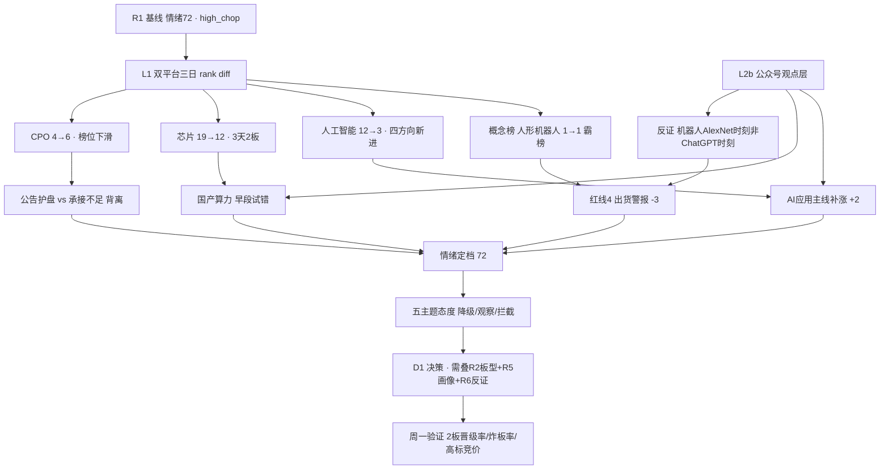

# 2026-10-26 · **群聊情绪共振（R3）**

> **数据源新鲜度**: partial
> **降级状态**: yes（群聊维度全缺 · WeFlow 永久下线 · 共振上限降为 L1+L2b）
> **置信度**: 0.45

## 一句话结论

情绪 72（高位震荡·深V修复第二日待确认）；机器人只作拥挤警报，AI 应用是唯一广度扩张方向，增量在国产算力。

## 详细分析

### 一、先认市场：周五是修复首日，不是主升

| 维度 | 20261023 收盘 | 读数含义 |
|---|---|---|
| 涨停 / 跌停 / 炸板 | 82 / 6 / 12 家 | 涨停 82 家属近月最强档，跌停只剩 6 家，空头当日无还手 |
| 炸板率 | 12.77% | 远低于 35% 红线，未触发"候选砍半"条款 |
| 昨日涨停池溢价 | +3.38%（中位 +4.55%） | 接力盘赚钱，情绪从主跌切到修复 |
| 连板高度 | 6 板（2 只）· 4-5 板真空 | 断层最要命：高标孤悬，没有 3-4 板缓冲 |
| 指数 | 上证 +0.89% / 深成 +2.79% / 创业板 +4.16% | 弹性全在小盘成长，属超跌反抽型修复 |
| 北向 | 净流入 31.3 亿（前值 23.3 / 22.2 / 20.9 亿） | 连续 4 日净流入且当日 +34%，外资不撤 |
| 两融 | 20261023 仅沪市有数 | 口径不全，弃用，不补中性值 |

结论：这是"政策底 + 宽基 ETF 放量"打出来的**修复首日**，不是主升确认。R1 的状态机把 `main_down→main_up` 判为非法跳级并修正为 `high_chop`，这个修正我完全同意——因为 4-5 板真空说明分歧只是被推迟到周一，而不是消失。

### 二、热度结构：宽度在机器人，广度在算力软件，位置在国产芯片

| 主题 | 概念榜位（22→23） | 板块涨停家数 | 板型高度 | 位置判断 | R3 态度 |
|---|---|---|---|---|---|
| 具身智能/人形机器人 | 1 → 1（霸榜 2 日） | 机器人概念 43 · 人形机器人 26 | 6 天 6 板（大业 6 板） | 拥挤 · 晚期 | **降级**（红线4 警报） |
| AI应用/算力软件 | 人工智能 12 → 3 · AI应用 9 → 4 | 人工智能 29 · AI应用 21 · 华为 20 | 5 天 3 板 · 8 天 4 板 | 中段 · 梯队完整 | **观察**（可作主线补涨来源） |
| 国产算力/半导体 | 芯片 19 → 12 · 存储 5 → 9 | 芯片 17（3 天 2 板） | 首板为主 | 早段 · 试错 | **观察**（信息增量最大） |
| CPO/光通信 | 4 → 6（-2 位） | 未进前 20 | 无封板 | 晚期 · 护盘 | **观察**（L1 与 L2b 背离） |
| 消费电子/端侧 | 未进前 20 | 消费电子 14（第 16 位） | 歌尔首板 0 开板 | 早段 · 单票 | **观察**（无板块效应） |

三个结构性事实：

1. **机器人是宽度第一、位置最差。** 概念热榜连续两日第 1，热度值 68387.5 → 149729（+119%），核心票 5 日最高 +94.68%。热度翻倍不是启动信号，是拥挤信号。按红线4，霸榜第一只能打警报，不能加分。
2. **算力软件是唯一还在"加方向"的板块。** 一个交易日内 MLOps（第 5）、中国 AI 50（第 17）、算力租赁（第 19）、华为欧拉（第 20）四个方向新进前 20，人工智能从第 12 直接跳到第 3。宽度在扩，位置在中段——这是能接力的形态。
3. **国产芯片是唯一位置还早的主线候选。** 芯片概念 19 → 12（第 1 天进前 12）、板块涨停 17 家（3 天 2 板）、华天科技跨平台热度第 1 但只涨 4.12% 没封板。热度在、位置低、没有一致性——这才是"低位试错"该有的样子。

### 三、推理三问：大资金意图 / 为什么走强 / 逻辑够不够硬

**① 具身智能/人形机器人**
- **大资金意图**：不是开新仓，是在既有 6 板高标上做最后一段加速。43 家涨停（板块第一）看着壮观，但接力盘薄——6 板大业股份 0 开板封单仅 0.95 亿，2 板襄阳轴承当日开板 **10 次**。真正干净的新买盘只有宇树科技：首板、0 开板、封单 4.04 亿。
- **为什么走强**：催化密度高——特斯拉 Optimus 量产线开启早期生产（22 日财报电话会）、人形机器人新增 6 项国家标准、王兴兴表态物理 AI "快则 1-2 年"、商务部口径具身智能机器人销售额 +22.6%。
- **逻辑够不够硬**：**半硬**。产业方向真实，但兑现节奏被卖方自己否掉：野村口径工厂场景任务成功率约 60%，进生产系统需 98%；泛化只在实验室涌现。叙事硬度 > 订单硬度，属"能讲三年、不能兑现三个月"的题材。

**② AI应用/算力软件**
- **大资金意图**：整条链一起抬。涨停家数 29（人工智能）+ 21（AI应用）+ 20（华为概念，8 天 4 板）+ 14（DeepSeek，3 天 2 板）+ 13（AIDC），说明是"算力→模型→应用"的链式配置，不是单点炒作。
- **为什么走强**：《国家信息化"十五五"规划》印发（顶层框架）、月之暗面发新模型（供给端）、多家 A 股参与 DeepSeek 千亿级融资（资本端）、天娱数科 1 分钟涨停封单 200 万手（证券时报口径）。
- **逻辑够不够硬**：**中**。政策 + 模型 + 资本三条腿都有，但个股层面多是"参股/合作"叙事；且国办同日发文"减缓 AI 应用就业替代影响"，监管开始关注负外部性，不全是加分项。

**③ 国产算力/半导体自主可控**
- **大资金意图**：给 A 股科技修复找一个不依赖外盘的支点。周五上午指数还在 -3% 时国产芯片链已连续第二天异动（观点层原文），午后随宽基放量转正——买的是"自主可控"的叙事独立性，不是跟美股半导体反弹。
- **为什么走强**：黄仁勋对与长鑫合作持开放态度、寒武纪营收利润双翻倍、硅光芯片龙头 IPO 注册获批、芯片概念榜 19→12。
- **逻辑够不够硬**：**中偏硬**。有业绩（寒武纪）、有外部背书（英伟达表态）、有位置（3 天 2 板）；变量是美光与长鑫的技术路线分歧尚未解决，且国产替代的毛利兑现周期长。

**④ CPO/光通信**：大资金意图是**对冲不是定价**——22 日新易盛 -12.28%、中际旭创 -8.76%，23 日午间五家龙头集体公告"在手订单充足"、两家回购（天孚 1.5 亿全部注销）。但买盘没把票买上涨停：中际旭创 +3.82%、新易盛 +1.16%，榜位双双下滑，板块未进涨停前 20。**逻辑硬度中，但资金硬度不够**。

**⑤ 消费电子/端侧**：歌尔股份首板 0 开板、封单 3.32 亿、换手仅 4.12%——低换手强封，筹码没松，是新增资金。但板块只有 14 家涨停（第 16 位），同日 iPhone Duo 溢价从 5000 跌到 2000，"订单上调 44%"又是引述未核。**单票事件驱动，不构成主线**。

### 四、首推研究票思维链（研究第一顺位，不是买入建议）

**天娱数科（002354.SZ）· AI应用 · 首板**

- **买入理由**：① 主线归属清晰——AI应用是唯一"榜位上升 + 梯队完整 + 四个方向新进"的板块，符合 R1 判定的第二条主线；② 量价干净——首板 1/1、封单 3.27 亿、换手 17.93%，封单/流通市值比在当日涨停股里属前列；③ 关注度结构性跳升——东财人气 74 位外 → 第 3，同花顺热股 74 → 7，双平台同向且是新进，不是存量博弈；④ 有事件锚——证券时报记"1 分钟直线涨停、封单超 200 万手"。
- **风险点**：① 当日开板 2 次，不是铁板，说明 3.27 亿封单里有一部分是对倒/接力盘；② 公司层面的"AI 应用"落地强度未经核实，热榜理由常把 APP 概念放大；③ 情绪在 high_chop，若周一 2 板晋级率 <30%，首板层会集体退潮，首板股的隔日溢价最脆弱；④ 群聊维度缺失，无法确认游资群是否已把它当"接力标的"还是"一日游"。
- **止损条件（逻辑止损，价格止损由 D1 计算）**：① 周一竞价若该票低开且 9:35 前不能回到前收上方，视为承接失败，逻辑证伪；② 若 AI应用板块当日涨停家数跌破 10 家（周五 21 家），板块效应消失，一并撤；③ 若公司发布澄清公告否认 AI 业务关联，立即证伪。**本 skill 不给价格止损，RR 由 D1 按 risk_reward 计算，RR<2 时该票降为 watch。**
- **可验证假设**：周一收盘时，① 天娱数科仍在东财人气或同花顺热股前 50；② AI应用板块涨停家数 ≥15 家；③ 全市场炸板率 <20%。三条中若两条成立，则"AI应用主线补涨"成立；若两条不成立，则该主题降级为观察。

> 为什么不是宇树科技：首板 0 开板封单 4.04 亿，封板质量是当日最好的一只，但它所在的主题已经连续两日霸榜、核心票 5 日 +94.68%。按"只做龙头或低位、躲中位和杂毛"的纪律，热度第一 + 位置最高 = 只能作警报，不能作研究第一顺位。

### 五、单源剔除与拦截（红线4 落地）

| 对象 | 层级 | 态度 | 依据 |
|---|---|---|---|
| 传媒/短剧/AI视频 | L1_only | **拦截** | 慈文传媒 dc 66→14 / ths 37→4，首板但换手 42.36%、开板 3 次、11 天 7 板；新华传媒连续 11 板后公司发风险提示且 22 日 -10.02%。无 L2b 同向证据 + 高位监管风险 |
| 券商 | L2b_only + 单票 L1 | **观察** | 华林证券首板 0 开板、封单 0.92 亿、换手 2.11%，双榜新进（dc 26 / ths 30）；花旗证券获批。但券商未进概念榜前 20、涨停板块前 20 无券商，缺板块级 L1，不进 |
| 军工 | L1_only | **拦截** | 概念榜 6 → 13（-7 位），兵装重组掉出前 20，热度退潮，与 R1"计划外事件线不追"一致 |
| 商业航天 | L1_only | **观察** | 15 → 10（+5 位）、+2.1%，无观点层与涨停家数佐证，单源不进 top5 |
| 创新药 | L1_only | **观察** | 榜位 7 → 7 持平、+1.68%，无新进个股，属存量 |
| 宁德时代 | L1个股 + L2b | **观察** | dc 2 / ths 9、+7.8%、成交额 A 股第一；是指数修复的被动受益，不是可交易主线，对 D1 的意义是"指数不塌" |

### 六、公众号观点（L2b · 只作观点证据，不计入共振等级与打分）

**命中 top 主题的观点**

| 号 | 时间 | 标题 | 归属 | 观点 |
|---|---|---|---|---|
| 股痴流沙河 | 10-23 10:33 | 解药 | 国产算力 | "AI 反弹受制于外盘，解药可能是国产芯片，不受海外 AI 影响……昨天今天连续两天都是国产芯片异动" |
| 傅里叶的猫 | 10-23 23:47 | 机器人的 ChatGPT 时刻何时到来？ | 具身智能（**反证**） | 野村：工厂任务成功率约 60%，进产线需 98%；机器人处 AlexNet 时刻而非 ChatGPT 时刻；模型/数据/部署/硬件四变量尚未同时可控 |
| 财联社早知道 | 10-23 19:11 | 【VIP日报】机器人板块持续爆发 | 具身智能 | Optimus 量产置信度提升，凡拓数创 5 日最高 +94.68%、大业股份 +50.57% |
| 上海证券报 | 10-23 20:56 | 人形机器人，新增 6 项国家标准 | 具身智能 | 标准化推进（不等于订单） |
| 证券时报 | 10-23 14:06 | 长鑫科技大涨 6%！黄仁勋表态 | 国产算力 | 外部背书型催化 |
| 上海证券报 | 10-23 18:23 | 美光、长鑫现技术路线分歧 | 国产算力（**不确定项**） | 存储路线存在分歧 |
| 证券时报 | 10-24 08:33 | 光通信龙头拟最高回购 1.5 亿元全部注销 | CPO | 天孚通信护盘型资本动作 |
| 证券时报 | 10-23 11:21 / 上证报 14:45 | iPhone Duo 开售溢价 / 溢价降温 | 消费电子（**分歧**） | 同日两种口径：开售溢价 2000 元 vs 溢价从 5000 跌到 2000 |

**宏观与情绪（这部分是判断情绪偏向的关键，不并入主题打分）**

- **李迅雷**：前三季度 GDP +4.6%，9 月出口 +36.3%（集成电路 +136%、自动数据处理设备 +92.9%），社零仅 +1.1%、固投 -7.2%。**供强需弱、K 型分化**——结构上利好 AI 硬件出口链，不利内需。
- **贩财局**（22 日口径）：全球资金撤离科技、买现金流资产与国债。这个判断在 23 日 A 股午后被反向修正——**说明周五的修复是"资金回来了"，不是"资金没走"**。
- **猫笔刀**：亲历周五午后惊天大逆转，提醒"剧烈波动很容易孕育激进赌狗"。属情绪噪声，但方向与 +3.38% 的溢价一致。
- **盘前纪要**：马斯克称人形机器人将成全球最大产业、明年末有望对外交付；易方达/华夏/富国/汇添富各 2 亿自购——**自购是政策底之后最常见的"表态型买盘"**。

## 关键证据

- 证据 1：概念热榜 20261022 与 20261023 连续两日第 1 均为「人形机器人」，热度值 68387.5 → 149729（+119%）· 来源 tushare.ths_hot(概念板块) · 触发红线4
- 证据 2：「人工智能」概念榜 12 → 3（+9 位），MLOps / 中国 AI 50 / 算力租赁 / 华为欧拉 四个方向新进前 20 · 来源 tushare.ths_hot 两日 rank diff
- 证据 3：limit_cpt_list 20261023 —— 机器人概念 up_nums=43（5 天 3 板）、人工智能 29、人形机器人 26（6 天 6 板）、AI应用 21、芯片概念 17（3 天 2 板）
- 证据 4：limit_list_d 20261023 —— 宇树科技-W 首板 0 开板封单 4.04 亿；大业股份 6 板 0 开板；襄阳轴承 2 板但开板 10 次；歌尔股份首板 0 开板封单 3.32 亿换手 4.12%
- 证据 5：东财人气 20261023 top3 —— 宇树科技-W（40→1，+20%）、宁德时代（2→2，+7.8%）、天娱数科（新进 3，+10%）
- 证据 6：moneyflow_hsgt 北向净流入 20261020 20.9 亿 → 21 日 22.2 亿 → 22 日 23.3 亿 → 23 日 31.3 亿，连续 4 日净流入且当日 +34%
- 证据 7：微信 RSS 100 篇/10 个号，其中「股痴流沙河」明确给出"解药是国产芯片"的方向判断，「傅里叶的猫」给出机器人产业的量化反证
- 证据 8：wechat_cli_5groups.jsonl 为 0 字节，manifest 记 groups_ok=0/5，全部 error「请运行 wechat-cli init」

## 数据源审计

| 源 | 状态 | 抓取日期 | 记录数 | 备注 |
|---|---|---|---|---|
| R1_style | 🟢 ok | 2026-10-24 | 1 | 当日 R1，degraded 但 score 72 可用 |
| tushare.ths_hot（热股） | 🟢 ok | 2026-10-24 | 299 | 三日各 99-100 条 |
| tushare.ths_hot（概念板块） | 🟢 ok | 2026-10-24 | 60 | 三日各 20 条 |
| tushare.dc_hot（人气/飙升） | 🟢 ok | 2026-10-24 | 600 | 三日各 200 条 |
| tushare.limit_list_d | 🟢 ok | 2026-10-24 | 100 | 涨停 82 / 跌停 6 / 炸板 12 |
| tushare.limit_cpt_list | 🟢 ok | 2026-10-24 | 20 | 板块涨停家数与连板统计 |
| tushare.moneyflow_hsgt | 🟢 ok | 2026-10-24 | 4 | 北向净流入 |
| tushare.margin | 🟡 partial | 2026-10-24 | 7 | 20261023 深市缺，弃用 |
| wechat_official_rss | 🟢 ok | 2026-10-24 | 100 | 10/15 feed 有内容，周末归档 |
| wechat_cli_5groups | 🔴 error | 2026-10-24 | 0 | wechat-cli init 未运行，5/5 群失败 |
| attention_weekend | 🟡 partial | 2026-10-24 | 20 | 仅 23 日有数据，周末两日空，weekend_persistent 为空 |
| WeFlow | ⚫ 下线 | - | 0 | 2026-08-19 永久移除，L3 不存在 |

> 群名一律以 G1-G5 匿名化：G1 盘中新闻群 / G2 震荡慢牛投研群 / G3 机构风向标群 / G4 题材基本面群 / G5 核心群。本轮 5/5 全部不可用。

## 不确定性 / 反证

1. **没有群聊，等于没有游资的"分歧读数"。** 我能看到 6 板高标、能看到 43 家涨停，但看不到游资群里对"周一是否核按钮"的真实态度。这是本次最大的盲区，也是置信度只给 0.45 而不是 0.6 的核心原因。三个替代源（榜单/公告/公众号）都是"公开且滞后"的，本质上是同一类证据。
2. **周末两日榜单为空，无法判断"周末发酵"。** attention_weekend 的 weekend_persistent 是空的，20261024/25 三平台都没有数据。所以"机器人周末继续发酵"或"周末情绪降温"这两种叙事，我**都无法证实**，只能以周五收盘榜为准。
3. **霸榜警报可能是错的。** 红线4 用"连续两日第 1"作代理，但这次热度值当日翻倍 +119%、板块仍涨 4.46%、涨停 26 家，形态上更像"加速"而不是"派发"。我按纪律执行降级，但必须标注：**这是一个可能过早的降级**，如果周一机器人继续放量涨停且炸板率 <20%，红线4 的代理指标应该被重新审视（连续第 1 日并不必然等于出货）。
4. **CPO 的"公告护盘"存在自我实现风险。** 五家集体澄清 + 两家回购，是极强的信号密度，但也可以解读为"跌到必须出面"。我用 L1 榜位下滑否掉了它，若周一 CPO 榜位回到前 5，这个判断就是错的。
5. **国产芯片的"位置早"依赖单一渠道。** 芯片 19→12 只是第 1 天，涨停 17 家（3 天 2 板）属初段；但"华天科技热度第 1 却只涨 4.12%"也可以解读为"承接不足"，而不是"筹码未松动"。我倾向后者，但这需要周一验证。
6. **情绪分 72 的争议点**：5 维法给 71（gap 1），两法一致，但两者都吃同一个 R1 基线；如果 R1 的 72 本身偏高（它的 4 维法给到 87，是靠状态机折扣压到 72 的），那我的 72 是"继承偏差"而不是独立验证。

## 与其他 R/D/E 的关系

- **依赖**：`data/research/20261026/R1_style.json`（情绪基线 72 / high_chop / 双主线 / cap 0.55）；`data/raw/20261026/wechat_official_rss.jsonl`（L2b 观点层）；`data/raw/20261026/manifest.json`（源健康度）；`data/research/20261026/attention_weekend.json`（周末榜单，实际为空）；tushare 双平台三日榜单 + 涨停/板型/北向数据（本轮实时拉取）。
- **被消费**：D1（canghai-plan）读 `sentiment_score` / `next_day_signal` / `resonance_top_themes` / `hotlist_signals` 组装 r3_r4_integration；E1（canghai-review）复盘时对照本主题排序与"降级/拦截"是否事后正确；R6 反证会检查本单元是否把 L1_only 当成了共振。
- **明确不做的**：不做板块排序（R2 职责）、不做个股画像与目标价（R5）、不给开仓资格与价格止损（D1）。本单元所有候选 `research_only=true`、`execution_eligible=false`。

## 周一（20261026）验证清单

| 观测量 | 阈值 | 若成立 | 若不成立 |
|---|---|---|---|
| 2 板晋级率 | ≥40% 确认 / <30% 证伪 | high_chop 上修 main_up，允许按 R1 的 55% 上限进攻 | 深V 判为单日脉冲，情绪退回退潮，仓位压到 30% 以下 |
| 炸板率 | <20% 健康 / >25% 转弱 | 首板与 2 板接力有效 | 首板层集体退潮，砍掉全部首板研究候选 |
| 6 板双标竞价 | 高开或平开 | 高标不死，梯队可重建 | 核按钮（低开 -5% 以上）→ 无缓冲，仓位压到 10% 以下 |
| AI应用板块涨停家数 | ≥15 家 | 主线补涨成立，天娱数科研究假设成立 | 该主题降级为观察 |
| 人形机器人概念榜 | 掉出第 1 | 霸榜解除，拥挤度下降，可重新评估 | 连续 3 日第 1 → 出货风险确认，彻底剔除 |
| 宽基 ETF 成交 | 维持万亿级别 | 修复有被动资金支撑 | ETF 缩量 → 政策脉冲，修复不延续 |

## Sub-Agent 元数据

- skill: analyze_sentiment_resonance_v1
- artifact: data/research/20261026/R3_sentiment.json
- 人读 md: chzl_kg/投研交易/群聊情绪/20261026.md
- 生成耗时: 约 21 分钟（含 3 日双平台榜单、涨停/板型、北向实时拉取）
- 用 model: ark-code-latest
- 共振等级说明: WeFlow 永久下线 + 群聊 0 条 → 理论最高 L1+L2 不可达；本次实际落地为 **L1+L2b（公众号观点层）**，已在每个主题 `resonance_level_note` 与 `official_account_opinions_meta.counts_toward_resonance=false` 中显式标注，不等同满分共振。
