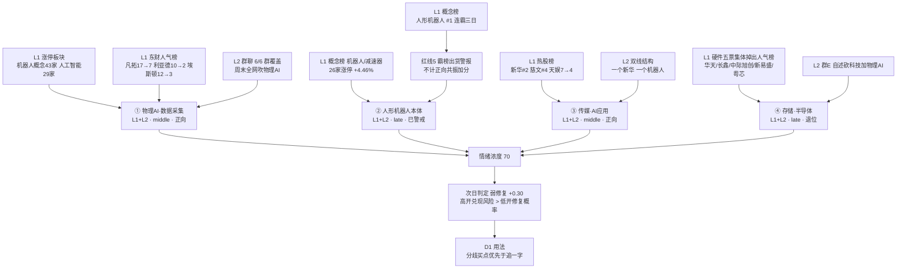

# 2026年10月26日 · **群聊情绪共振**（盘前）

> **数据源新鲜度**: ok（L1 双日 + L2 六群 + L2b 十一号，全部落在当日窗口）
> **降级状态**: false（WeFlow 为永久下线，不计入当日降级；东财热榜直连置空改用周末快照，已在审计表标黄）
> **置信度**: 0.65（R3 默认 0.65 × 新鲜度 1.0 × 独立源 1.0；上限 0.85 需 L1+L2+L3，L3 已不可达）

## 一句话结论

**情绪浓度 70（R1 基线 69），双源最高等级 L1+L2，共振主线是物理AI/数据采集——但人形机器人概念榜连霸三日已触发红线 5 出货警报，周末全网一致吹票让「高开兑现」概率超过「低开修复」，今日只做分歧买点，不追一字。**

---

## 一、情绪坐标：浓度够高，拥挤度更高

R1 给出的当日基线是 **连板情绪型 + 情绪浓度 69 + 独主线（代理）+ 总仓上限 65%**，形态是「首板宽度型」而不是「梯队接力型」：首板占 85.4%、4 板 5 板为 0、6 板只有 2 只孤峰。R3 在这个底座上加双源共振修正，结果是 **70**：

| 修正项 | 方向 | 依据 |
|---|:--:|---|
| R1 基线（当日 20261026，非前一日） | 69.0 | `R1_style.json` status=degraded、confidence 0.72 |
| 正向共振主题 3 个（物理AI数据采集 / 传媒AI应用 / 存储热度残值）×+2 | +6.0 | 见第三节 TOP1/3/4 |
| 霸榜警报 1 个（人形机器人概念榜三日第一）×−4 | −4.0 | 红线 5 |
| 拥挤惩罚：物理AI 群覆盖 6/6 = 100% ≥ 85% | −3.0 | 全群一致 = 认知已被科普 |
| 周末人气升级（人气榜 6 只跃升 ≥3 位 + 7 只新进前 20） | +2.0 | 东财人气榜 20261024 快照 |

五维校验独立跑一遍，`(0.25×82.0 + 0.20×92.68 + 0.20×60.0 + 0.15×48.9) / 0.80 = 72.96`（杠杆/外资中位仍缺可信值，按 v1.1 规则跳过该维、剩余权重归一，不用替代值凑分）。**R3 70 与五维 73 差 2.96，远低于 15 分背离阈值**，两个口径互相印证：温度是高的，但没有到失控。

高在哪：10-23 涨停 **82** 家、跌停 6 家、炸板 12 家（炸板率 **12.77%**）、全市场 4526 涨 909 跌、成交 19728 亿（较前日 +28.0%）、早盘（10 点前）首封占 26.8%。
没失控在哪：连板梯 `{1板:70, 2板:9, 3板:1, 6板:2}`，4-5 板全空 —— 这是**宽度**而不是**高度**，接力的钱还没进来，进场的多是首板隔日的一次性资金。

---

## 二、四源共振总览

四个主题全部达标 L1+L2（当前制度下的最高等级），但**只有两个是正向**：物理AI数据采集、传媒AI应用。人形机器人本体因霸榜被扣分，存储半导体是跷跷板的空头一侧。

| # | 主题 | 共振等级 | 阶段 | 正向 | 最硬的一条证据 |
|:-:|---|:--:|:--:|:--:|---|
| ① | 物理AI / 数据采集 | L1+L2 | middle | ✅ | MLOps 概念新进榜第 5，6/6 群覆盖，4 家公众号同日覆盖 |
| ② | 人形机器人 / 减速器 | L1+L2 | late | ❌ 霸榜 | 机器人概念 43 家涨停全市场第一，但概念榜三日 #1 |
| ③ | 传媒 / AI应用情绪高标 | L1+L2 | middle | ✅ | 天娱数科周末登顶东财人气榜，新华/慈文分列热股 2/4 |
| ④ | 存储 / 半导体硬件 | L1+L2 | late | ❌ 退位 | 五只硬件票同日掉出人气榜前 20，群内自述砍仓换股 |

---

## 三、TOP 主题深度（推理三问）

### ① 物理AI / 数据采集 —— 今日唯一「四源同步」的正向主线

- **大资金意图**: 机构不是这两天才进场的。群E 的原话是「物理AI 这种板块，从第一天就能看出来是机构建仓」，这意味着 9 月以来的筹码在机构手里，周末卖方（长城、GLMS、东财）集中出票池的动作是**给已建仓的方向补充叙事**，把估值锚从「硬件本体」切到「真机数据→大脑」的产业路径上。对手盘分两类：一类是周一追一字的短线资金，一类是踏空后去接「擦边补涨票」的散户资金（群E 直接点名星光股份、宝通科技这类）。席位线索是东财人气榜：凡拓数创 17→7、利亚德 10→2、埃斯顿 12→3 —— **注意力先行三天，价格跟上一天**。
- **为什么走强**: 位置是中位偏上而不是底部（凡拓数创 5 个交易日 32.50→61.44，累计 +89.0%，10-23 换手 39.3%）；催化有三条，硬的一条是智元开源首个真实场景 Physical Agent 数据集 + 财联社前瞻点名丝杠增量，软的两条是卖方票池与「入选英伟达生态」的媒体报道；筹码上，群B 转述利亚德有游资锁仓数亿 —— 这解释了为什么 7.32 元的低价股能被连续拉出 20cm。
- **逻辑够不够硬**: 硬在**独立源数量**（概念热榜新进、涨停板块家数、人气榜跃升、六群全覆、四家公众号，五个独立源同向，这是今天唯一做到的），软在**业绩**——数采设备卖的是资本开支预期，当期不产生利润，所以这是一笔纯叙事驱动的交易，只能按情绪周期给时间窗、不能按估值给空间。证伪路径有三条：周一高开后板块内 20cm 标的炸板 ≥2 只；周末卖方覆盖之后次日涨停家数掉到 3 家以下；智元数据集事件三日内没有第二家厂商跟进。

### ② 人形机器人 / 减速器 —— 热度满分，但按纪律必须扣分

- **大资金意图**: 这里的位置和 ① 完全不同。概念榜连霸三日意味着**该知道的人都已经知道了**，机构在这个位置的动作更可能是借卖方吹票完成派发，而不是继续加仓。群E 有一句非常精准的白描：「一旦被短线资金追出高潮，卖方分析师一定拼命吹，因为他们实在没其他可吹的战绩了」。对手盘就是周一去接一字板的资金。
- **为什么走强**: 位置是**高位**（概念榜 20261022/20261023/20261024 三个观测日全是第 1，机器人概念 43 家涨停、人形机器人 26 家 +4.46% 为全市场最强板块）；催化是旧逻辑再包装（丝杠增量、真机先行），没有新的硬事件；筹码是最大的问题 —— 海洋王 6/6、大业股份 16 天 8 板，两个 6 板孤峰之间 4 板 5 板全空，一字板结构让筹码无法换手，高位锁仓在次日是双刃剑。
- **逻辑够不够硬**: 产业逻辑本身是硬的（真机数据是刚需，链条最长），但**当前定价把未来两个季度的预期一次性打完了**。按红线 5，霸榜第一不构成正向共振，本单元把它从加分项里剔除并单独打警报 —— 这不是看空机器人，是拒绝在拥挤度顶格的位置给新增仓位背书。证伪路径：最高标断板；2 板晋级率跌破 30%；群内出现「接不了」的一致性表述（今天已经出现，群E 有人明确说「接不了，开盘卖出」）。

### ③ 传媒 / AI应用 —— 主线之外的第二个情绪容器

- **大资金意图**: 这是**分流资金**。机器人太拥挤，游资需要一个能承接中大型资金、又不与主线冲突的方向，天娱数科 132.9 亿总市值、17.9% 换手、10-22 跌 7.7% 后 10-23 直接反包涨停 —— 这个结构对中线游资最友好。群B 说得最直白：「机器人还是主线，我认为现在是走两条线，一个新华，一个还是机器人」。
- **为什么走强**: 位置是中位（天娱刚反包首板、新华传媒已经从东财人气榜前 20 掉出、慈文传媒小盘易拉）；催化偏软（首部 AI 院线电影、AI语料概念新进榜第 17）；筹码结构好（三只都是中小盘，龙虎榜容量小、拉抬成本低）。
- **逻辑够不够硬**: 三个榜单 + 两个群，源数够但**产业权重低**——它没有产业主线的时间跨度，只能在主线分歧日承接情绪，属于「容器」而不是「引擎」。所以给 middle 而不是 early：它的机会窗口只有主线分歧的那一两天。证伪路径：天娱不能一字；新华传媒继续掉榜；慈文断板后无接力。

### ④ 存储 / 半导体 —— 不是跌，是资金在做减法

- **大资金意图**: 这条是**跷跷板的空头一侧，而且是被主动卖出的一侧**。周末东财人气榜里华天科技（原第 4）、长鑫科技（原第 5）、中际旭创（原第 8）、新易盛（原第 16）、粤芯半导（原第 13）五只硬件票同日掉出前 20；群E 作者自述「科技周五其实已经掉队了，我双星都砍了打算周一继续加物理AI，滚动起来」。对手盘是还在等科技反弹的老持仓。
- **为什么走强**: 结论是反向的——它不是走强而是转弱。位置高位回落（存储芯片概念榜 5→9→12 连续两日下滑，CPO 4→6→10，PCB 8→11）；催化已经兑现成财报 —— 德明利前三季度净利暴增 32400%，但 Q3 环比只有 +2.2%，属于增收不增利，这是典型的「利好出尽」形态；筹码上华天科技仍居同花顺热股第 1，说明多空在这一只上争夺最激烈、方向未定。
- **逻辑够不够硬**: 涨价是**真的**（群C 给出实物证据：32G 服务器内存 8900 元涨到 1.4 万元，AI 端侧还在加需求），但股票提前反映了半年；今天它不给方向，只给**轮动证据**——它的弱不是普跌，是把钱挪到了应用端。证伪路径：周一硬件板块出现 3 家以上涨停，说明只是周末人气榜的技术性洗牌而不是资金迁移。

---

## 四、跷跷板信号：硬件 → 应用 + 金融科技

这是今天 R3 最可执行的一条，因为它同时有 L1 双榜和 L2 自述：

| 侧 | 证据 |
|---|---|
| 流出（硬件） | 东财人气榜 20261024：华天科技、长鑫科技、中际旭创、新易盛、粤芯半导 **五只集体掉出前 20**；同花顺热股同日掉出德明利、中际旭创、新易盛、有研新材、亨通光电、大洋电机、吉大正元 |
| 流入（应用） | 凡拓数创 17→7、利亚德 10→2、埃斯顿 12→3、歌尔股份 15→8、兆威机电 19→16；风语筑、能科科技、多伦科技、达实智能等 7 只新进前 20 |
| 流入（金融科技） | 同花顺概念榜 20261024 **互联网金融新进第 5**（20261023 未入前 20），东方财富人气榜 11→4 |
| L2 印证 | 群E：「科技周五已经掉队了，我双星都砍了打算周一继续加物理AI」；群C：「预期差科创吧 / 明天卖了去干科创半导体」——两条相互矛盾的自述，说明科技内部本身在分裂 |

一句话：**硬件不是被打死，是被卖出换成应用**。这决定了今天的操作不是「科技反抽」，而是「应用分歧」。

---

## 五、被红线挡在门外的两个「最热」

**1）高争民爆（L2_only，按红线 4 不进 top，且停牌不可交易）**
全市场讨论密度最高的单一事件：发股购买紫隆矿业 51%、紫源铜业 51%、晟源矿业 100%，注入资产对应利润约 30 亿，群A 从公告转贴到「保 5 争 10」「先搞个 300e」连刷了上百条。但两条硬约束把它挡在门外：一是 L1 完全没有信号（停牌股在 20261023 未进同花顺热股前 40 也未进东财人气榜前 20），单源不构成共振；二是自 20261026 起停牌，**今日不可交易**。只作复牌后的观察对象透传给 D1。

**2）L1_only 的四个方向（按红线 3 不算正向共振）**
创新药（概念榜第 6/7 稳定）、商业航天（15→10→7）、网络安全（16→9）、军工（6→13 下滑）—— 全部只有热榜、没有任何群聊或公众号独立佐证，单源信号在 R3 里一律按 `late` 处理，不作共振主题。

---

## 六、首推票思维链：凡拓数创 301313（R3 只做热度识别，不背书价格）

> 选它的理由不是R3在选股，而是它是**六群一致点名的「这波龙头」**（群E：「这波龙头凡拓数创吧，等分歧买」），并且同时出现在概念热榜新进、东财人气榜跃升（17→7）、涨停板块三个 L1 维度上，是当日唯一「KOL 点名 + 三榜同现」的标的。

- **买入理由**: ① 产业逻辑在链条最上游 —— 数采/数字孪生是「真机数据→大脑」路径的入口，卖方（长城《机器人王牌票池》的数采设备中军龙旗科技、物理AI 中军奥普特，以及 GLMS 机械的物理AI 票池）与财联社前瞻同日给出同向叙事，属于硬事件（智元开源 Physical Agent 数据集）+ 卖方共振的双催化；② 数据锚 —— 10-23 收 61.44 元、换手 39.3%、总市值 62.9 亿，10-19/10-20 连续两个 20cm 后 10-22 分歧回落 1.9%，10-23 直接反包涨停，是典型的「分歧后弱转强」结构，而不是单边连板。
- **风险点**: ① 短期风险 —— 5 个交易日累计 +89.0%，位置已经很高，且周末全群一致吹票，周一若一字开盘则风险收益比极差（买不到，买到的就是最高点）；② 中期反证 —— 数采是资本开支叙事，当期无利润兑现，一旦卖方覆盖完毕而无新增催化，容易在 3-5 日内被资金抛弃；同板块的擦边票（星光股份、宝通科技一类）一旦批量炸板，龙头也会被带崩。
- **止损条件**: 55.30 元（较 61.44 收盘 −10%，即反包日涨停板下方约半个板、且高于 10-22 分歧收盘 51.20）。跌破 55.30 视为「弱转强」证伪，无条件走，不讲故事；若开盘直接一字则改为「不成交即不参与」，不追单。
- **可验证假设**（24-72h）: ① 次日竞价高开 ≥+5% 且上午 10 点前封板 → 主升延续，可持有到板块分歧；② 高开 <+2% 或盘中炸板未回封 → 拥挤兑现，当日降级出局；③ 板块层面观察 人形机器人概念涨停家数是否守住 26 家以上（10-23 基准）→ 低于即判定主线退潮。

其余建议标的只做热度分层，不做画像（R5 职责）：

| 标的 | 所属 | 当日位置 | R3 判定 |
|---|---|---|:--:|
| 301313 凡拓数创 | 物理AI/数采 | 反包首板 61.44，5日 +89% | 研究首选（分歧才买） |
| 300296 利亚德 | 物理AI/显示 | 两记 20cm（10-21/10-23），7.32 元低价股 | 观察（有游资锁仓，需防高位） |
| 002747 埃斯顿 | 机器人本体 | 未涨停，人气 12→3 | 观察（补涨属性） |
| 688686 奥普特 / 603341 龙旗科技 | 机器视觉/数采 | 卖方中军票池 | 观察（机构票，弹性低） |
| 002354 天娱数科 | AI应用/传媒 | 反包首板 8.03，周末人气第 1 | 观察（第二线容器） |
| 600825 新华传媒 / 002343 慈文传媒 | 传媒 | 热股 2 / 4，新华已掉出人气榜 | 观察（分支走弱） |
| 002185 华天科技 / 688825 长鑫科技 | 存储半导体 | 热股仍第 1 但人气榜掉出 | 拦截（跷跷板空头侧） |

---

## 七、次日情绪方向

六群发言按五档分类（一条发言只计一次最强方向，含明确次日时点表述的命中 15 条）：

| 档位 | 条数 | 代表原话 |
|---|:--:|---|
| 强修复 | 3 | 「天娱明天10亿封单起步」「大业我觉得一字板」「9个2板都是机器人，最差也要抗一天」 |
| 弱修复 | 6 | 「开盘冲高找高点T」「高开冲高，也没有卖的必要」 |
| 震荡 | 5 | 「周末爆吹 周一砸？老套路嘛」「接不了，开盘卖出」「热度高的有点可怕」 |
| 弱续跌 | 1 | 「低开一把能不能」 |
| 强续跌 | 0 | — |

**判定 = 弱修复（score +0.30）**。但这个 +0.30 必须和另外两个信号合并读才有效：概念榜连霸三日 + 群覆盖 6/6 = 100%。**方向偏多，但拥挤度已经顶格，所以「高开兑现」的风险大于「低开修复」的概率**。这也解释了为什么群E 里最积极的作者，操作上写的是「等分歧买」而不是「开盘买」。

---

## 八、关键证据

- 证据 1: 20261023 涨停 82 / 跌停 6 / 炸板 12，炸板率 **12.77%**，早盘首封占比仅 26.8%，成交 19728 亿（+28.0%） · 来源 `tushare.limit_list_d`
- 证据 2: 连板梯 `{1板:70, 2板:9, 3板:1, 6板:2}`，6 板两只为海洋王（6/6）与大业股份（16 天 8 板），4-5 板全空 · 来源 `tushare.limit_list_d.up_stat`
- 证据 3: 人形机器人概念榜第 1 连续三个观测日（20261022/20261023/20261024），机器人概念 43 家涨停、人形机器人 26 家（+4.46%）· 来源 `tushare.ths_hot` + `tushare.limit_cpt_list`
- 证据 4: MLOps 概念 20261023 新进榜第 5（20261022 未入前 20），人工智能 12→3（+9），AI应用 9→4 · 来源 `tushare.ths_hot` 双日 diff
- 证据 5: 周末人气榜硬件五票集体掉出（华天 4、长鑫 5、中际旭创 8、新易盛 16、粤芯 13），同时凡拓 17→7、利亚德 10→2、埃斯顿 12→3、东方财富 11→4 · 来源 `attention_weekend.json` 东财人气榜
- 证据 6: 物理AI 在六群全覆盖（群A 单票事件除外），且出现明确的反身性警告「周末爆吹 周一砸？老套路」与「接不了，开盘卖出」 · 来源 `wechat_cli_5groups.jsonl` 540 条
- 证据 7: 公众号 11 号 48 篇中，7 篇直接落在物理AI/人形机器人/数采（财联社前瞻、调研先知的数采专家交流、证券时报的物理AI龙头、上海证券报的摄影机器人）· 来源 `wechat_official_rss.jsonl`
- 证据 8: 涨停行业分布 专用设备 8 + 通用设备 5 + 自动化设备 5 + 汽车零部件 6 = 24 家机械链；软件开发 7 + IT服务 6 = 13 家软件/数据链 · 来源 `tushare.limit_list_d` industry 字段

---

## 数据源审计

| 源 | 日期 | 状态 | 备注 |
|---|---|:--:|---|
| tushare/ths_hot（概念板块） | 2026-10-22 / 2026-10-23 | 🟢 | 各 20 条，用于 rank diff |
| tushare/ths_hot（热股） | 2026-10-23 | 🟢 | 99 条 |
| tushare/limit_cpt_list | 2026-10-23 | 🟢 | 20 条，机器人概念 43 家居首 |
| tushare/limit_list_d | 2026-10-23 | 🟢 | 104 条（U82/D6/Z12） |
| tushare/dc_hot（直连） | 2026-10-26 | 🟡 | 各组合返回 0 行，改用周末快照 |
| attention_weekend（东财人气榜/同花顺热股） | 2026-10-23 / 2026-10-24 | 🟡 | 各 100 条；20261025-20261026 平台无数据，周末仅 1 个观测点 |
| wechat_cli 群聊（匿名） | 2026-10-26 | 🟢 | 540 条 · 六群有内容（游资散户群 110 / 连板接力群 124 / 综合大群 200 / 指数细分群 23 / 量化研报群 77 / 小群 6），第七群窗口内 0 条 |
| wechat_official_rss（取阅） | 2026-10-26 | 🟢 | 11 号 48 篇 · 15/15 feed 可达 |
| R1_style | 2026-10-26 | 🟡 | 上游 status=degraded（confidence 0.72），sentiment_score 69 可用 |
| weflow/MCP | — | 🔴 | 2026-08-19 永久下线，L3 缺位，不编造 |
| xtick/MCP | 2026-10-26 | 🔴 | 本单元未调用（L1 已由 Tushare 双日热榜覆盖） |

---

## 九、不确定性 / 反证

- **霸榜警报可能是「强者更强」的误判**。历史上确实有概念榜连续多日第一之后仍有第二波的案例；本单元执行的是红线 5 的硬规则 —— 宁可错过第二波，也不在拥挤度顶格处给新增仓位背书。如果周一物理AI 依然批量涨停，这条警报会被证伪，E1 复盘应记一笔「红线 5 在强势主线里的假阳性成本」。
- **周末发酵只有一个观测点**。东财人气榜 20261025（周日）与 20261026（周一盘前）平台均无数据，所以「周末人气从硬件切到应用」这个结论只有 20261023→20261024 一次跨日比较，不能排除是周六榜的技术性洗牌。
- **群聊是散户实盘群，不是机构群**。六个群覆盖 100% 同向，更可能反映「物理AI 已经被科普到散户层」，这本身是拥挤证据，而不是聪明钱证据。原 spec 的 AA 系机构群在当前微信通讯录里已不存在，属结构性样本缺陷。
- **情绪基线本身是降级的**。R1 status=degraded（0.72），70 分继承了它的不确定性；跨资产坐标（DXY、商品、SOX/HSTECH）缺失，无法判定软着陆/降息/衰退任一宏观档位。
- **位置风险**。凡拓数创 5 日 +89%、利亚德两记 20cm、天娱反包 —— R3 只识别「热度在谁身上」，不对价格做任何背书；热度越高越需要 D1 用盈亏比闸门去卡，而不是用热度去豁免。

---

## 十、与其他 R/D/E 的关系

- **依赖**: `R1_style.json`（情绪基线 69）、`attention_weekend.json`（东财人气榜/热股周末快照）、`wechat_cli_5groups.jsonl`、`wechat_official_rss.jsonl`、`_r7_data/limit_list_d.json`（涨停结构）
- **被消费**:
  - D1（canghai-plan）读 `sentiment_score` / `next_day_signal` / `resonance_top_themes` / `hotlist_signals`
  - R5 读 `hotlist_signals.distribution_alert[].name`（=人形机器人）给该板块龙头加风险标记
  - R6（反证）读本单元作为「一致预期」的证伪输入
  - R2 用 `suggested_sectors` 做共振交叉
  - E1 复盘用 `next_day_signal` 的 verdict 与次日实际方向做校准

---

## Sub-Agent 元数据

- skill: analyze_sentiment_resonance_v1
- artifact: `data/research/20261026/R3_sentiment.json`（26.5 KB · 顶层字段对齐 D1/R5 消费契约）
- 装配脚本: `scripts/analysis/_tmp/r3_assemble_20261026.py`（可复算，接受当日 L1 原始件 + 周末快照）
- 生成耗时: 约 16 分钟（含 L1 双日拉取、540 条群聊语义抽取、48 篇公众号标题对齐）
- model: ark-code-latest（LLM 语义层，非关键词匹配）
- 数据源等级: L1+L2（WeFlow 永久下线，L3 不可达）
