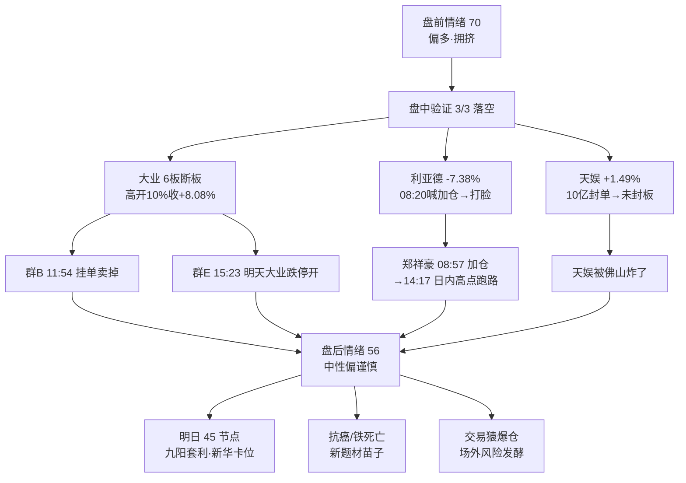

# 2026年10月26日 · **群聊情绪共振（盘后版）**

> **数据源新鲜度**: ok
> **降级状态**: false
> **置信度**: 0.68（盘后快照，L1 无盘后新榜）

## 一句话结论

**物理AI主线盘中验证失败：大业断板、利亚德-7.4%、天娱未封——盘前强预期3/3全部落空，群内实盘派集体转"日内冲高跑路"，情绪浓度从70下调至56，短线温度=分歧兑现。**

---

## 情绪结构图

---

## 详细分析

**① 盘前预期全部落空，是今天情绪的底色。** 昨晚到今早群里喊得最响的三件事：天娱"10亿封单起步/必须一字"（郑祥豪 00:15）、大业"一字板"（群E 19:34 盘前）、利亚德"加仓"（郑祥豪 08:20）——收盘对照：天娱 +1.49% 没封板、大业高开 +10% 收 +8.08% 断板、利亚德 -7.38%。**预判连续打脸本身就是情绪信号：群内观点的信息增量在下降，兑现情绪可能自我强化。**

**② 高度龙断板，梯队失去承接。** 大业股份（6板孤峰）是今天全群从开盘吵到收盘的核心：09:18 "大业一字" → 10:44 "垃圾大业封不住" → 11:54 群B 直接@所有人挂单卖掉 → 13:45 "大业该封了吧" → 盘后群E 15:23 "明天预期就是大业跌停开的，所以今天后面也不会去开仓机器人"。4-5 板空档本就无梯队，唯一高度断板 = 明日机器人线负反馈扩散的风险源。

**③ 实盘派午后集体改口，是分歧最真实的标本。** 郑祥豪（量化研报群，观点最密 61 条）完整走完"早盘喊多→午后转兑现"：08:57 "物理AI是主流，原有仓位都可以加仓" → 14:17 "今天回流比较差，弱修复日内冲高完回落，**等修复冲高，日内找高点跑路最合适**"。同一人一天内从加仓指令翻到跑路指令，比任何词频统计都说明问题。

**④ 意见领袖回避 = 场外风险在发酵。** 交易猿 1.7 倍杠杆梭哈东山精密爆仓（净值 4→1.2）的消息全群在传，但取经人群师傅只回了一句"不去评论，毕竟认识"、补一句"可能会爆"——按 quickcheck 经验，**意见领袖回避通常意味着该话题有真风险**。郑祥豪的解读更直白："大资金最怕套牢被市场知道，会引发挤兑。"

**⑤ 明天的资金去向已经有人在做预案。** 群B 冰哥盘后复盘："明天45节点，九百板看九阳套利""今天大业不封板，明天就新华该上板了"——高度资金在寻找物理AI之外的承接容器（传媒/九阳/新华）。群C 杰哥💡盘中转拆西湖大学 Cell 三连（铁死亡抗癌），属于"有人吹、没人敢跟"的新题材苗子，R4 次日可跟进 A 股映射标的。

---

## 关键证据

- 证据1: 大业股份 20261026 高开 +10% 未封，收 +8.08%（断板）· 来源 tushare daily 603278.SH
- 证据2: 利亚德 20261026 收 -7.38%，与郑祥豪 08:20 "加利亚德"直接打脸 · 来源 tushare daily 300296.SZ
- 证据3: 天娱数科 20261026 收 +1.49% 未封板，盘前 "10亿封单/必须一字" 落空 · 来源 tushare daily 002354.SZ
- 证据4: 群E 14:17 "弱修复日内冲高完回落，日内找高点跑路最合适" · 来源 群聊 20261026 14:17
- 证据5: 群E 15:23 "明天预期就是大业跌停开的，今天不会开仓机器人" · 来源 群聊 20261026 15:23
- 证据6: 群B 19:31 "大业不封板，明天就新华该上板了" · 来源 群聊 20261026 19:31

## 数据源审计

| 源 | 状态 | 抓取时间 | 记录数 | 备注 |
|---|---|---|---|---|
| 群聊 7 群 | ✅ ok | 10-26 21:07 | 1120 | 7/7 全活（含盘前为空的取经人群 199 条） |
| 公众号 RSS | ✅ ok | 10-26 21:07 | 76 | 均为周末文，当日无增量 |
| 行情锚 tushare | ✅ ok | 10-26 21:10 | 3 | 大业/利亚德/天娱 当日收盘 |
| L1 热榜 | 🟡 盘前快照 | 10-26 06:26 | - | 盘后无新榜，情绪以群聊修正为主 |

## 不确定性 / 反证

- **L1 缺盘后新榜**：情绪浓度主要靠群聊文本修正，若收盘后热榜出现极端变化（如物理AI整体出榜）结论需刷新。
- **KOL 预判连败**：郑祥豪今日三次预判全错——引用他的观点时必须挂"预判 vs 实际"两列，不能当结论。
- **样本属性**：7 群为散户实盘群，只能当情绪温度计，不能当机构观点层；板块共振死匹配不可靠，本报告主题判定以语义抽取为准。
- **反向可能**：若明日大业未如预期跌停开（弱转强模型），群内"跑路"共识反而构成预期差——Bob 已留了后门："如果再次弱转强走出很强的带动效应，并且指数回暖再看。"

## 与其他 R/D/E 的关系

- 依赖: data/raw/20261026/wechat_cli_5groups.jsonl（7群1120条）· data/research/20261026/R3_sentiment.json（盘前版基准）· tushare daily 行情锚
- 被消费: 明日盘前 R3 主批次（作为盘后情绪增量参照）· R4（抗癌/铁死亡题材苗子跟进）· D1（high_chop 判断的情绪侧佐证）· E1（错题本：KOL 隔夜预判连败案例）

## Sub-Agent 元数据

- skill: analyze_sentiment_resonance_v1（盘后版）
- artifact: data/research/20261026/R3_sentiment_evening.json
- 生成耗时: 约 5 分钟（含抓取与行情锚验证）
- model: deepseek-v4-flash-ga-260731
