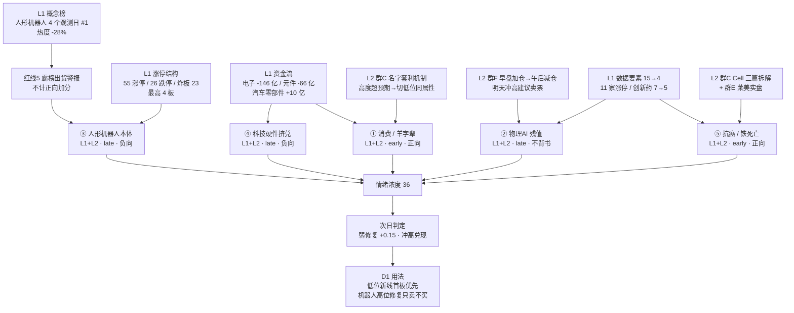

# 2026年10月27日 · **群聊情绪共振**（盘前）

> **数据源新鲜度**: partial（L1 双日 + L2 七群全部为当日窗口；XTick 502、attention 落盘在 T-1 目录、R1 上游 degraded）
> **降级状态**: false（L3 为永久下线不计当日降级；XTick 缺位由 Tushare 双日热榜覆盖，已在审计表标红）
> **置信度**: 0.56（base 0.65 × 新鲜度 0.9 × 源一致性 0.95）

## 一句话结论

**情绪浓度 36（低于 R1 基线 40.6）：高度从 6 板塌到 4 板、大业断板开板 11 次，硬件 -359 亿挤兑出逃；钱没有离场，而是切到消费/羊字辈与抗癌——今日只做低位新线首板，不接机器人高位修复。**

---

## 一、情绪坐标：宽度还在，高度已废，钱在换场

R1 当日基线是 **震荡分化型 + 情绪 40.6（中性）+ 独主线（代理）+ 总仓上限 45%**，结构是「首板宽度型」：55 家涨停、首板占 72.7%，但最高只有 4 板，炸板率 29.49%，跌停 26 家。R3 在双源共振上做修正，落到 **36**：

| 修正项 | 方向 | 依据 |
|---|:--:|---|
| R1 基线（20261027 当日，非前一日） | 40.6 | `R1_style.json` status=degraded、confidence 0.49 |
| 正向 L1+L2 主题 2 个（消费/羊字辈、抗癌/铁死亡）×+2 | +4.0 | 见第三节 ①⑤ |
| 霸榜警报 1 个（人形机器人概念榜 4 个观测日第 1）×−4 | −4.0 | 红线 5 |
| 拥挤惩罚：物理AI/机器人链覆盖 6/7 群 + 一致「修复冲高卖」 | −3.0 | 见 ②③ |
| 负向 L1+L2 退潮共振 1 组（硬件挤兑 + 本体断板同属一次退潮）×−2 | −2.0 | 见 ③④ |

五维校验独立跑一遍：`(0.25×55.0 + 0.20×48.0 + 0.20×65.2 + 0.15×0) / 0.80 = 45.49`（杠杆/外资中位缺可信值，按 v1.1 规则剔除该维、剩余权重归一，不用替代值凑分）。**R3 36 与五维 45.5 差 9.49，低于 15 分背离阈值**；两者差在「R1 的 40.6 含 capital 维 21.2，而 5D-4 维把资金维剔除了」，属口径差异而非信号冲突。

冷在哪：成交 16087 亿（**-17.75%**），涨 2082 / 跌 2991，中位 **-0.49%**，主力净流出 **-278.7 亿**（小单却净流入 +298.2 亿，是散户在接），创业板 -1.71%、科创50 -2.23%，跌停 26 家。宽度（55 涨停）与高度（4 板）背离，是典型的「换场不换钱」。

---

## 二、五源共振总览

五个主题全部达到 L1+L2（当前制度下最高等级），但**只有两个正向**：消费/羊字辈、抗癌/铁死亡；物理AI 是「关注度没退、钱在退」，人形本体与科技硬件是负向退潮。

| # | 主题 | 共振等级 | 阶段 | 正向 | 最硬的一条证据 |
|:-:|---|:--:|:--:|:--:|---|
| ① | 消费 / 羊字辈名字套利 | L1+L2 | early | ✅ | 上海九百 4 板封单 1.36 亿，乳业/白酒/免税店同日新进概念榜 |
| ② | 物理AI / 数据采集 | L1+L2 | late | ❌ 兑现 | 数据要素 15→4（热度 +521%），但群F 午后改口「该减就减」 |
| ③ | 人形机器人本体 / 减速器 | L1+L2 | late | ❌ 霸榜 | 大业 6/7 断板开板 11 次，机器人涨停 43→23 家 |
| ④ | 科技硬件 / CPO·PCB·存储 | L1+L2 | late | ❌ 挤兑 | 电子 -146.2 亿、元件 -5.71%、PCB -6.43%，杠杆爆仓全群发酵 |
| ⑤ | 抗癌 / 铁死亡 + 创新药 | L1+L2 | early | ✅ | 创新药 7→5（热度 +165%），Cell 三篇 + 莱美 +13.17% |

---

## 三、TOP 主题深度（推理三问）

### ① 消费 / 羊字辈名字套利 —— 今天唯一「方法可复制」的低位新线

- **大资金意图**: 这不是产业资金，是**接力资金在找新容器**。硬件当日净流出 359 亿、机器人高位断板，钱必须找一个「位置低、筹码干净、有辨识度」的地方停一晚。群C 把机制讲得很白：「有题材属性的高度出来，就切低位新属性的名字，资金会发动同题材的带羊个股」——上海九百打出 4 板高度后，同属性的「羊/阳/数字」被系统性扫货（三羊马、阳光乳业、百洋、皇台、九阳）。对手盘是明日去追「第 5 个板」和「第 2 个羊」的接力盘。
- **为什么走强**: 位置低 —— 上海九百流通市值 48.5 亿、4 板后收 12.10 元，属于典型小市值低位股；催化是「名字」而非业绩，不需要研报覆盖，只需要一个高度标杆；筹码上，上海九百封单 **1.36 亿**、仅开板 1 次，是全场质量最好的封板（对比华阳智能封单 146 万、开板 5 次）。同时 L1 给出三个独立确认：乳业新进概念榜第 9（+2.13%）、白酒新进第 12、免税店新进第 19（+1.79%），休闲食品 3 家涨停，东财人气 东百集团 60→19、百洋 95→14。
- **逻辑够不够硬**: **不硬，但有效**。它是情绪套利不是产业趋势，保质期 1-3 日，且高度依赖上海九百不断板。所以只能按「首板试错 + 断板即走」的规则做，不能按主线给仓位。证伪路径：上海九百竞价低于 +2% 或盘中开板不回封；同属性票出现 2 只以上炸板；九阳股份（群内认定的「纯换手核心」）不能维持红盘。

### ② 物理AI / 数据采集 —— 注意力还在，钱已经转身

- **大资金意图**: 数据要素概念榜 15→4、热度值 +521%，说明**关注度仍在顶部**；但资金动作已经反过来 —— 群F 一天之内从「物理AI是主流，原有仓位都可以加」走到「回流强度不够，这波回流该减就减」「明天冲高建议卖票」；另一交易员直接说「明天预期大业跌停开，今天后面不会去开仓机器人」。**注意力是别人的，筹码是自己的**：这个位置的大资金意图是借修复完成派发。
- **为什么走强**: 严格说它今天不强 —— 人形机器人 -0.79%、机器人概念 -0.71%、人工智能 -0.17%，数据要素 +0.16% 只是横住；强的是「榜单位次」。真正的支撑是 11 家数据要素涨停（4 天 3 板）和凡拓数创 6 天翻倍（收 67.85 元、+10.43%），但同日上海证券报已发风险提示类稿件，属于官方降温。
- **逻辑够不够硬**: 产业逻辑是全市场最硬的之一（真机数据是具身智能的刚需入口），但**当前定价已经把两个季度预期打完**，且叙事被卖方与公众号全面覆盖，认知差消失。按纪律「逻辑证伪即出」，本单元的判定是：**修复是卖点不是买点**，D1 不得以「数据要素跃升」为由给新仓。

### ③ 人形机器人本体 / 减速器 —— 红线 5 的警报被行情当场验证

- **大资金意图**: 借热度完成派发。概念榜连续 4 个观测日第 1、热度值却从 149729 掉到 107879（-28%），量价背离；机器人概念涨停家数从 43 家掉到 23 家、人形从 26 掉到 14。**热度还在榜上，钱已经在门口**。对手盘是「等修复」的老持仓和明日抄底「大业跌停开」的资金。
- **为什么走弱**: 高度断层 —— 大业股份 6/7 断板、盘中开板 **11 次**（收 17.25 元、+8.08%），慈文传媒跌停，最高标变成消费线的上海九百；3 板有 6 只，但封单质量分化极大（华阳智能封单 146 万、开板 5 次 vs 上海九百 1.36 亿）。宇树科技虽然热股 16→1、收 672 元（+7.69%），但证券时报与上海证券报同日两次「提示风险」，属于官方降温信号。
- **逻辑够不够硬**: 产业逻辑硬，**位置和筹码不硬**。按红线 5 霸榜第一不构成正向共振，本单元把它从加分项剔除并单独打警报 —— 不是看空机器人，是拒绝在拥挤度顶格、封单结构恶化时给新增仓位背书。证伪路径：明日大业低开后被承接并回封；机器人概念涨停家数回到 30 家以上；华阳智能封单放大到 5000 万以上。

### ④ 科技硬件 / CPO·PCB·存储 —— 不是普跌，是杠杆挤兑

- **大资金意图**: **被动卖出**，不是主动调仓。电子 -146.2 亿、元件 -66.3 亿（-5.71%）、印制电路板 -50.9 亿（-6.43%）、半导体 -48.7 亿（-3.79%）、通信 -47.5 亿（-1.74%），五大赛道合计约 -359 亿。群F 的白描最准确：「大资金最怕套牢被市场知道，会引发挤兑」「硬件筹码结构完全坏了，全是套牢盘爆仓盘，已经是流动性危机」。
- **为什么走弱**: 触发点是杠杆产品的净值崩塌 —— 某游资 1.7 倍杠杆梭哈东山精密（收 105.43 元、当日 -7.70%），产品净值 4→1.2，事件在 5 个群发酵；叠加 Anthropic 半年亏损 807 亿美元的 IPO 文件（AI 硬件再定价），CPO -3.85%、PCB -3.53%、存储 -3.62%、MLCC -4.21%，华天 -7.84%、生益 -9.52%、亨通 -8.14%。
- **逻辑够不够硬**: 产业景气没被证伪（HBM4 明年 Q2 量产、光模块获社保加仓），**但交易结构已经坏了**。这一类下跌的第一波是杠杆强平，第二波是风控被动减仓，历史上不会一天结束。判定：任何反抽都是减仓窗口，D1 不得做左侧「跌多了买」。

### ⑤ 抗癌 / 铁死亡 + 创新药 —— 今天唯一「事件硬 + 位置低」的新苗子

- **大资金意图**: 试探性建仓 + 事件驱动。医疗服务净流入 +7.8 亿、创新药概念榜 7→5（热度 +165%）、医疗器械 8 家涨停；莱美药业 +13.17%（收 8.85 元）、近岸蛋白 +13.08%、塞力医疗涨停。群C 的拆解很专业（延长生存期 / 逆转耐药 / 远位效应），并直接反问「这种题材在A股的药里边有过吗，不值得炒一轮又一轮吗」—— 这是**游资在给一个新故事定价**，不是机构行为。
- **为什么走强**: 事件硬 —— 西湖大学邹贻龙团队 Cell 三篇，打通 FSP1/GPX4 两条铁死亡通路；莱美子公司的纳米炭铁是全球首个公布人体 I 期数据的铁死亡抗癌药（病灶控制率 84.2%）；叠加 CXO 三季报超预期（药明康德上调全年指引）。位置低 —— 莱美 8.85 元、近岸与塞力都是中小市值，没有被卖方集中覆盖。
- **逻辑够不够硬**: **事件硬、资金确认不足**。只有 2 个群覆盖（群C 9 条 + 群E 4 条），L1 只有 1 个概念榜位次 + 3 只「大涨未涨停」的票，没有涨停确认。按纪律只能算「研究观察 + 首板试错」，不能当主线。证伪路径：明日铁死亡方向 0 家涨停；莱美高开低走跌破 8.50；群C 不再跟进拆解。

---

## 四、跷跷板信号：硬件 → 消费，机器人 → 医药/游戏

今天 R3 最可执行的一条，是资金流向与群聊自述同时指向的「换场」：

| 侧 | 证据 |
|---|---|
| 流出（硬件） | 电子 -146.2 亿、元件 -66.3 亿(-5.71%)、PCB -50.9 亿(-6.43%)、半导体 -48.7 亿(-3.79%)、通信 -47.5 亿；CPO/PCB/存储/MLCC 四个概念榜位次全部下滑或持平于大跌日 |
| 流入（消费/名字） | 乳业 新进第 9、白酒 新进第 12、免税店 新进第 19；上海九百 4 板（封单 1.36 亿）、百洋 12 天 8 板、三羊马/阳光乳业/皇台/青岛食品/桂发祥/良品铺子 首板；东财人气 东百 60→19、百洋 95→14 |
| 流入（医药/游戏） | 医疗服务 +7.8 亿、游戏Ⅱ +3.26%（+7.7 亿）；创新药 7→5、医疗器械 8 家涨停；电魂网络、盛天网络涨停 |
| L2 印证 | 群C：「今天就是消费加羊随便买」；群D：「让资金往下游 C 端靠靠先」；群F：「羊字辈容易在物理AI退的时候卡出来」；群C：铁死亡整段拆解 |

一句话：**硬件不是被打死，是被强平后卖出；钱去了低位、有名字、有事件的三个方向**。这决定了今天的操作不是「科技反抽」，而是「低位新线首板」。

---

## 五、被红线挡在门外的三个「最热」

**1）高争民爆（L2_only + 停牌，按红线 4 不进 top，且今日不可交易）**
群C 把凯龙股份当作「逻辑非常非常像」的代理票在推（凯龙当日仅 +2.25%，未涨停），并预期高争复牌后的涨幅；上海证券报同日确认「002827 官宣重组，标的资产有铜有锂」。但 002827 自 20261026 起停牌（Tushare daily 无行情），L1 完全没有信号，单源不构成共振，且**今日买不到**。只作复牌后观察对象透传给 D1/R5。

**2）传媒 / 游戏（L1+L2 但内部方向相反）**
AI应用概念榜 4→3、游戏净流入 +7.7 亿是正向；但影视端慈文传媒跌停（开板 8 次）、博纳影业 -10.06%、天娱数科炸板 +1.49%，而群F 还在预期「慈文明天量化反核」。**KOL 预期与当日事实冲突**，只能观察，不列入 top5。

**3）L1_only 的商业航天（按红线 3 不算正向共振）**
上海卫星互联网行动方案（3000 星 / 800 亿）落地、力箭二号待射，事件强度高；概念榜 10→11、板块 -1.62%，但群聊窗口内 0 条相关发言。单源信号一律按 `late` 处理，只作事件透传。

---

## 六、首推票思维链：上海九百 600838（R3 只做热度识别，不背书价格）

> 选它的理由不是 R3 在选股，而是它是**今日全场唯一的高度（4 板）+ 封单质量最好（1.36 亿）+ 新线核心**，同时被群C 的方法论（「上海九百超预期有高度，那么就做消费+羊」）与群E 的次日计划（「明天 45 节点，九百板看看九阳套利」）同时点名。

- **买入理由**: ① 位置与结构 —— 流通市值 48.5 亿、收 12.10 元，4 连板且仅开板 1 次，封单 1.36 亿是全场最厚的封板（同日华阳智能 3 板封单仅 146 万、开板 5 次），说明接力资金愿意在这个位置排队；② 方向承接 —— 硬件 -359 亿、机器人断板的同日，消费三个子方向（乳业/白酒/免税）新进概念榜，钱需要一个低位容器，它是唯一有高度的那个。
- **风险点**: ① 名字套利没有产业逻辑，保质期 1-3 日，一旦断板就是「最后一棒」；② 4 板已进入监管与异动关注区（同日宇树、上纬、凡拓均收到风险提示稿），高位股被官方降温的密度在上升；③ 若明日竞价一致性过高（一字或 +7% 以上），盈亏比迅速恶化，买到的就是最高点。
- **止损条件**: **11.00 元**（4 板前收盘价，即当日涨停板下沿；较 12.10 收盘 -9.1%，在 -5~-10% 硬区间内）。跌破 11.00 视为断板证伪，无条件走，不讲故事；若竞价一字则「不成交即不参与」，不追单。
- **可验证假设**（24-72h）: ① 次日竞价 +2%~+5% 且上午封板 → 新线成立，可持有到 5 板分歧；② 竞价 <+2% 或盘中开板未回封 → 断板兑现，当日降级出局；③ 板块层面看「羊/消费」同属性首板数量：≥2 家新增则线还在，0 家则是一日游。

其余标的只做热度分层，不做画像（R5 职责）：

| 标的 | 所属 | 当日位置 | R3 判定 |
|---|---|---|:--:|
| 600838 上海九百 | 消费/一般零售 | 4 板 12.10，封单 1.36 亿 | 研究首选（断板即走） |
| 002696 百洋股份 | 消费/饲料 | 12 天 8 板 11.28，封单 0.57 亿 | 观察（老妖，位置偏高） |
| 002242 九阳股份 | 消费/小家电 | 未涨停 21.52（-0.05%），群内「纯换手核心」 | 观察（换手确认才做） |
| 001317 三羊马 / 001318 阳光乳业 / 000995 皇台酒业 | 名字套利首板 | 首板，封单 0.43~0.68 亿 | 观察（首板试错层） |
| 300006 莱美药业 | 抗癌/铁死亡 | +13.17% 未涨停 8.85 | 观察（首板确认才做） |
| 301313 凡拓数创 | 物理AI | 6 天翻倍 67.85，+10.43% | 拦截（修复只卖不买） |
| 603278 大业股份 | 机器人本体 | 6/7 断板 17.25，开板 11 次 | 拦截（断板不接） |
| 301502 华阳智能 | 机器人/电机 | 3 板 77.76，封单 146 万 | 拦截（弱封，明日大概率开板） |
| 002185 华天科技 / 300308 中际旭创 / 002384 东山精密 | 科技硬件 | -7.84% / -2.96% / -7.70% | 拦截（挤兑未结束） |

---

## 七、次日情绪方向

七群发言按五档分类（一条发言只计一次最强方向，含明确次日时点表述的命中 14 条）：

| 档位 | 条数 | 代表原话 |
|---|:--:|---|
| 强修复 | 2 | 「今天大业不封板，明天就新华该上板了」「明天轮到长盈补涨 20%」 |
| 弱修复 | 4 | 「明天是带下影的中阳预期，物理AI 会有修复，但可能是弱修复日内冲高完回落」 |
| 震荡 | 5 | 「缩量太多了，反弹低看一眼」「市场没量，冲起来维持不住」「前半周护盘，下半周小心」 |
| 弱续跌 | 3 | 「明天预期就是大业跌停开的」「涨多了明天高开又要砸我们一天」 |
| 强续跌 | 0 | — |

**判定 = 弱修复（score +0.15）**。关键不在方向，在动作：14 条里 12 条隐含「有冲高就卖」，只有 2 条是主动做多；修复载体被指向物理AI 超跌反抽与九阳/新华换手接力，**不是机器人本体**。所以「弱修复」对 D1 的含义是**兑现窗口**，不是加仓窗口。

---

## 八、关键证据

- 证据 1: 20261026 涨停 55 / 跌停 26 / 炸板 23，炸板率 **29.49%**，最高 4 板，连板梯 `{1板:40, 2板:8, 3板:6, 4板:1}`，首板占 72.7% · 来源 `tushare.limit_list_d`
- 证据 2: 大业股份 6/7 断板、盘中开板 **11 次**（收 17.25，+8.08%）；上海九百 4 板封单 **1.36 亿**、开板 1 次；华阳智能 3 板封单仅 **146 万**、开板 5 次 · 来源 `tushare.limit_list_d`
- 证据 3: 人形机器人概念榜 4 个观测日第 1，热度值 149729→107879（**-28%**）；机器人概念涨停 43→23 家，人形 26→14 家 · 来源 `tushare.ths_hot` + `limit_cpt_list`
- 证据 4: 数据要素概念榜 15→4（热度 +521%）、AI应用 4→3、创新药 7→5（热度 +165%）；乳业/白酒/固态电池/免税店 新进前 20 · 来源 `tushare.ths_hot` 双日 diff
- 证据 5: 电子 -146.2 亿、元件 -66.3 亿(-5.71%)、PCB -50.9 亿(-6.43%)、半导体 -48.7 亿(-3.79%)、通信 -47.5 亿；汽车零部件 +10.2 亿、医疗服务 +7.8 亿、游戏 +7.7 亿 · 来源 `tushare.moneyflow_ind_dc`
- 证据 6: 群聊 1102 条中，消费/羊字辈 39 条覆盖 4 群、硬件科技 37 条覆盖 7 群、物理AI 21 条覆盖 5 群、传媒 18 条覆盖 3 群、抗癌 13 条覆盖 2 群 · 来源 `wechat_cli_5groups.jsonl`
- 证据 7: 公众号 13 号 81 篇中，3 篇为宇树/上纬/凡拓的风险提示或高位追踪（官方降温），2 篇覆盖消费高标（600838 四连板、002696 12天8板）· 来源 `wechat_official_rss.jsonl`
- 证据 8: 广度 2082 涨 / 2991 跌 / 144 平，中位 -0.49%，成交 16087 亿（-17.75%）；上证 +0.19%（3697.52）靠银行/石油护盘，创业板 -1.71%、科创50 -2.23% · 来源 `_r1_market.json`

---

## 数据源审计

| 源 | 日期 | 状态 | 备注 |
|---|---|:--:|---|
| tushare/ths_hot（概念板块） | 2026-10-23 / 2026-10-26 | 🟢 | 各 20 条，用于 rank diff |
| tushare/ths_hot（热股） | 2026-10-23 / 2026-10-26 | 🟢 | 99 / 100 条 |
| tushare/dc_hot（人气榜/飙升榜） | 2026-10-23 / 2026-10-26 | 🟢 | 各 100 条 × 2 日，直连恢复 |
| tushare/limit_cpt_list | 2026-10-26 | 🟢 | 20 条，机器人概念 23 家居首（前日 43） |
| tushare/limit_list_d | 2026-10-26 | 🟢 | 104 条（U55/D26/Z23） |
| tushare/moneyflow_ind_dc | 2026-10-26 | 🟢 | 496 个行业，电子 -146.2 亿最大流出 |
| attention_pipeline（多平台人气） | 2026-10-26（管道按已收盘日） | 🟡 | 320 条；700+ 只在榜标的，落盘在 T-1 目录 |
| wechat_cli 群聊（匿名） | 2026-10-26 至 2026-10-27 凌晨 | 🟢 | 1102 条 · 七群全部有内容（群A 197/30 人、群B 197/29 人、群C 198/44 人、群D 199/5 人、群E 127/12 人、群F 107/10 人、群G 77/22 人） |
| wechat_official_rss（取阅） | 2026-10-26 至 2026-10-27 | 🟢 | 15 feed 全可达，13 号 81 篇（上证报 40 / 证券时报 27 / 深度号 6） |
| R1_style | 2026-10-27 | 🟡 | 上游 status=degraded（confidence 0.49），sentiment_score 40.6 可用 |
| xtick（MCP + HTTP） | 2026-10-26 | 🔴 | MCP 无 token；HTTP 两接口 502，第三方情绪交叉缺位 |
| weflow/MCP | — | 🔴 | 2026-08-19 永久下线，L3 缺位，不编造 |

---

## 九、不确定性 / 反证

- **霸榜警报可能是「强者更强」的误判**。人形机器人概念榜连霸 4 个观测日，但热度值已 -28%，本单元按红线 5 执行。若明日机器人概念涨停家数回到 30 家以上、大业低开回封，这条警报就被证伪，E1 应记录「红线 5 在主升尾巴上的假阳性成本」。
- **情绪浓度 36 可能偏低**。R1 的 40.6 含 capital 维（21.2），我额外扣了 -6（拥挤+负向），若明日出现普涨，说明市场把「硬件挤兑」当成一次性事件；五维 45.5 是这个偏低的量化提示，两者差 9.49 未触发背离，但方向偏保守。
- **群聊是散户实盘群，不是机构群**。七群 1102 条里，群D（意见领袖）只有 5 人发言、群F 只有 10 人，观点集中度高；「消费+羊」是群C 一个人的方法论被另外三群引用，存在**回声室放大**的可能。
- **XTick 完全缺位**。本单元没有任何第三方情绪/连板数据交叉，L1 全部由 Tushare 承担；若 Tushare 热榜在收盘后有一次刷新差异，位次 diff 会有噪声。
- **名字套利的位置风险**。上海九百 4 板、百洋 12 天 8 板，都是高位；R3 只识别「热度在谁身上」，不对价格背书，D1 必须用盈亏比闸门卡，不能用热度豁免。
- **R1 上游降级**。R1 status=degraded（0.49），跨资产（DXY、商品、SOX/HSTECH）仍缺，36 分继承其不确定性。

---

## 十、与其他 R/D/E 的关系

- **依赖**: `R1_style.json`（当日情绪基线 40.6）、`attention_signals.json`（多平台人气）、`_r7_data/limit_list_d_20261026.json`（涨停结构）、`_r1_market.json`（广度/资金/指数）、`wechat_cli_5groups.jsonl`、`wechat_official_rss.jsonl`、`R4_news.json`（事件交叉验证）
- **被消费**:
  - D1（canghai-plan）读 `sentiment_score` / `next_day_signal` / `resonance_top_themes` / `hotlist_signals` / `seesaw_signals`
  - R5 读 `hotlist_signals.distribution_alert[].name`（=人形机器人）给该板块龙头加风险标记
  - R6（反证）读本单元作为「一致预期」的证伪输入（尤其「弱修复=兑现窗口」这一条）
  - R2 用 `suggested_sectors` 做共振交叉（注意 R3 不做板块排序）
  - E1 复盘用 `next_day_signal` 的 verdict 与次日实际方向做校准

---

## Sub-Agent 元数据

- skill: analyze_sentiment_resonance_v1
- artifact: `data/research/20261027/R3_sentiment.json`（27.6 KB · 顶层字段对齐 D1/R5 消费契约）
- 装配脚本: `scripts/analysis/_tmp/r3_assemble_20261027.py`（可复算：读 `_r3_l1_raw.json` + R1 + limit_list_d + attention）
- 生成耗时: 约 26 分钟（含 L1 双日拉取、1102 条群聊语义抽取、81 篇公众号标题对齐、XTick 502 排查）
- model: ark-code-latest（LLM 语义层，非关键词匹配）
- 数据源等级: L1+L2（WeFlow 永久下线，L3 不可达）
