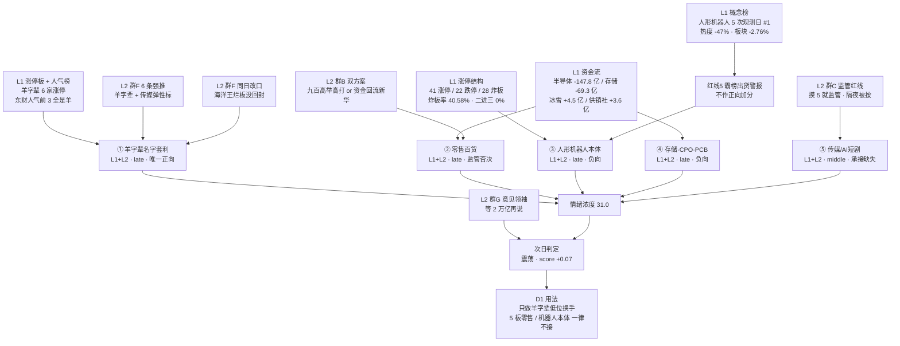

# 2026年10月28日 · **群聊情绪共振**（盘前）

> **数据源新鲜度**: partial（L1 三源 + L2 七群 + L2b 十四号全为当日窗口；WeFlow 永久缺位、attention 落盘在 T-1 目录、R1 上游 degraded）
> **降级状态**: false（L3 永久下线不计当日降级；XTick 本轮 HTTP 直连成功，已恢复第三方交叉）
> **置信度**: 0.61（base 0.80 × 上游 0.85 × 源广度 1.00 × 语义深度 0.90）

## 一句话结论

**情绪浓度 31.0（低于 R1 基线 38.0）：4601 家下跌、炸板率 40.58%、二进三晋级率 0%，主跌段确认；唯一有梯队的方向是羊字辈（8天7板海洋王 + 4板襄阳 + 3 只 2 板），但龙头当日开板 6 次、封单仅 0.33 亿——只做羊字辈低位换手，不接 5 板零售（监管函已下发）、不接机器人本体。**

---

## 一、情绪坐标：主跌段确认，唯一活口是名字套利

R1 当日基线是 **崩溃退潮型 + 情绪 38.0（恐惧桶）+ 无主线 + 仓位上限 10% + 情绪周期 main_down**，结构是「首板宽度型 + 高度断层」：41 家涨停、首板占 70.73%，最高 5 板但 3 板整层空缺，炸板率 40.58%，跌停 22 家。R3 在双源共振上做修正，落到 **31.0**：

| 修正项 | 方向 | 依据 |
|---|:--:|---|
| R1 基线（20261028 当日，非前一日） | 38.0 | `R1_style.json` status=degraded、confidence 0.49 |
| 正向 L1+L2 主题 1 个（羊字辈）×+2 | +2.0 | 见第三节 ① |
| 霸榜警报 1 个（人形机器人概念榜第 5 个观测日第 1）×−4 | −4.0 | 红线 5 |
| 拥挤惩罚：零售 / 机器人 / 存储三条线「热度在、价格与资金不在」，群内一致「冲高兑现」 | −3.0 | 见 ②③④ |
| 负向 L1+L2 退潮共振 1 组（机器人本体 + 存储/CPO/PCB 同属科技硬件减仓）×−2 | −2.0 | 见 ③④ |

五维校验独立跑一遍：`(0.25×41 + 0.20×56 + 0.20×69 + 0.15×2.37) / 0.80 = 44.06`（杠杆/外资中位缺可信值，按 v1.1 规则剔除该维、剩余权重归一，不用替代值凑分）。**R3 31.0 与五维 44.06 差 -13.06，低于 15 分背离阈值**；差在五维只量当日四项结构（涨停/跌停/连板/炸板），不含「热度-价格背离」与「KOL 一致性」，而本轮这两项恰恰是主要扣分来源。

冷在哪：成交 14608 亿（**-9.19%**），涨 576 / 跌 4601，中位 **-3.02%**，跌幅>5% 达 925 家；上证 -1.33%、创业板 -3.41%、**科创50 -4.81%**、中证500 -3.00%、北证50 -3.35%。这是全指数共振下跌，不是结构切换。

两个拒绝被骗的细节：
- **涨停溢价还在（55 样本：开盘均值 +1.58%、收盘均值 +1.36%、红盘率 50.91%、12 家回封）**，说明「隔日砸盘」没有想象中极端 —— 但样本是 20261026 的 55 家，即前一日的高标，本轮吃的是当时的残值，不是新钱。
- **首板集中在上午**（累计占比：开盘 9.76% → 半小时 58.54% → 1 小时 73.17% → 上午收盘 85.37% → 午后两小时 95.12%），下午只剩 5% 的新增，午后无接力，这是主跌段的典型形状。

---

## 二、五源共振总览

五个主题全部达到 L1+L2（WeFlow 下线后的最高等级），但**只有 1 个正向**：羊字辈。零售百货是「板块最强 + 监管否决」，机器人本体是「霸榜出货」，存储/CPO 是「热度升、价格跌、资金出」三杀，传媒是「催化真、承接假」。

| # | 主题 | 共振等级 | 阶段 | 正向 | 最硬的一条证据 |
|:-:|---|:--:|:--:|:--:|---|
| ① | 羊字辈 / 生肖名字套利 | L1+L2 | late | ✅ | 6 家涨停 + 东财人气前 3 全是羊字辈（襄阳 3→1、海洋王 13→2、大洋电机 84→3） |
| ② | 一般零售 / 内需百货 | L1+L2 | late | ❌ 监管 | 6 家涨停、板块逆势 +0.38%，但龙一 5 板当夜收监管工作函 |
| ③ | 人形机器人 / 物理AI | L1+L2 | late | ❌ 霸榜 | 概念榜 5 次第 1、热度两日 -47%、主力 -70.24 亿 |
| ④ | 存储 / CPO / PCB | L1+L2 | late | ❌ 背离 | 存储概念榜 10→4（+74%）却当日 -4.20%、-69.26 亿 |
| ⑤ | 传媒 / AI短剧 | L1+L2 | middle | ❌ 无承接 | 粤传媒盘中封板收 +6.56%（炸板），慈文传媒跌停 |

---

## 三、TOP 主题深度（推理三问）

### ① 羊字辈 / 生肖名字套利 —— 今天唯一有「龙头 + 梯队 + 三源人气」的方向

- **大资金意图**: 不是产业资金，是**存量接力资金在找一个能过夜的容器**。半导体 -147.83 亿、存储 -69.26 亿、PCB -59.54 亿、先进封装 -59.84 亿，科技硬件四条线合计流出超 330 亿；同日涨的板块是冰雪 +4.50 亿、供销社 +3.64 亿、红利破净 +3.44 亿、保险重仓 +6.67 亿 —— 钱在往「低位置 + 有名字 + 有辨识度」的地方躲。羊字辈的机制是：一个高度标杆（海洋王 8天7板）打出空间后，用「羊/洋/阳」把一批低价小票串成板块，对手盘是明日来接「第 2 个洋」「第 3 个羊」的接力盘。群F 把机制说得很直白：「羊字辈今天的主动性和板块效应都不错」「不会选票就海洋王，然后再猜一个弹性标」。
- **为什么走强**: 三源同时给票 —— ①涨停结构：6 家涨停（海洋王、襄阳轴承、光洋股份、阳光乳业、桂发祥、大洋电机），是当日唯一有「4 板 + 2 板×3 + 首板×2」完整梯队的方向；②人气榜：东财人气前 3 名全是羊字辈（襄阳轴承 3→1、海洋王 13→2、大洋电机 84→3，大洋电机 +81 是全场最大跃升），同花顺热股海洋王 5→1、襄阳 6→2；③封单质量：光洋股份 2 板封单 **1.70 亿 / 成交 3.4 亿 = 50%**，全场最厚且 0 开板。位置低是硬条件：光洋 88 亿、桂发祥 23 亿、阳光乳业 38 亿流通，都不需要机构定价，只需要辨识度。
- **逻辑够不够硬**: **不硬，但当下最有效**。名字套利没有产业逻辑、没有业绩，保质期按 1-3 日计，且高度依赖海洋王不断板。它的天花板已经写了：海洋王是 8天7板的高位老龙（日线 10/16 起 7 个涨停），当日成交 20.9 亿、换手 28.85%、开板 **6 次**、封单仅 0.33 亿（封单/成交 1.6%），群F 盘中自己都认「海洋王今天烂板没能回封」。所以本单元的判定不是「追龙头」，而是「龙头不死 → 低位换手才有意义；龙头断板 → 整条线一日游」。证伪路径：海洋王竞价低于 +2% 或开盘 30 分钟内开板不回封；光洋股份 3 板封单缩到 5000 万以下；羊字辈当日新增涨停 < 2 家。

### ② 一般零售 / 内需百货 —— 板块最强，但监管函把门关了

- **大资金意图**: **游资单点，不是板块资金**。6 家涨停（上海九百 5 板、国芳集团、新华百货、广百股份、茂业商业 + 百大集团），东财人气榜前 16 名占 6 席（九百 11→4、国芳 新进 10、新华百货 新进 12、百大 新进 14、广百 新进 15、茂业 新进 16），表面看是全场最强的板块效应。但同日零售概念主力净额 **-4.73 亿（-3.86%）**、新零售 **-8.55 亿（-2.34%）** —— 涨停的钱来自游资接力，板块层面的机构资金在出。政策催化是真的（发改委正研究制定扩大内需战略实施方案 2026—2030），但资金没跟。
- **为什么走强**: 低位 + 小市值 + 有 5 板高度标杆。九百流通 53 亿、收 13.31 元，5 板封单 1.50 亿、0 开板，封单/成交 38%，是当日质量最好的高位封板；溢价扩散到同业的国芳（0.56 亿/0 开板）、新华百货（0.11 亿）、广百（0.35 亿）、茂业（0.19 亿），属于典型「以点带面」的百货联动。
- **逻辑够不够硬**: **逻辑被监管直接掐断**。2026-10-27 夜间上交所对上海九百下发监管工作函，对象含上市公司、董监高、控股股东及实控人；公司同步披露异常波动公告，自曝静态 PE 117.71 / 滚动 106.40，而零售业均值仅 21.91 / 21.12 —— 5 板 + 监管函 + 5 倍估值溢价，三件事叠在同一天。群C 的判断是本单元最认同的一条：「上交现在摸 5 就监管，从传媒到大业再到 900」「所有半路下发的第二天都给了体面，但会影响竞价情绪，基本隔夜都是被按」。证伪/验证路径：明日九百竞价 <+3% → 群B 的「方案一接一进二零售」直接作废，资金按「方案二」回流老龙（传媒）；九百若一字开盘反而要防高开兑现。

### ③ 人形机器人本体 / 物理AI —— 红线 5 第 5 个观测日，警报没解除

- **大资金意图**: **借热度派发，且派发进入尾声**。概念榜连续 5 个观测日第 1（20261022/1023/1024/1026/1027），热度值 149729 → 107879 → **57662（两日 -47%）**，板块当日 -2.76%，主力净流出 **70.24 亿（-4.16%）**。同时在榜的高位票全绿：宇树科技 1→3（-4.77%）、万向钱潮 14→18（-5.74%）、埃斯顿 9→跌出前 20（-7.00%）。
- **为什么还在涨停**: 是**低位补涨在替高位撑场**，不是本体强。多伦科技 4 板（封单 1.15 亿、开板 1 次）、赛福天 4 板（0.25 亿、开板 1 次）、沪光股份/科瑞思 2 板；汽车零部件 8 家涨停、机器人概念 13 家涨停，但两个板块分别 -1.29% / -2.95%。也就是说：涨停家数在，板块指数在跌，钱在做「低位新面孔」而不是「老龙头」。官媒同日还在推（上证报《603528、603028，4连板！机器人概念，爆发！》），这正是热度见顶时的典型话术密度。
- **逻辑够不够硬**: 产业逻辑硬，**位置和筹码不硬，且个股逻辑已在自查**。多伦科技 4 板当日公告「不涉及人形机器人核心本体研发，机器人业务收入与利润占比极小」；赛福天 4 板的公告口径是「面向具身机器人等高端领域的钢丝绳/钨丝绳适配产品并送样，主业为特种绳索」。两只当日最高标的自己出来拆逻辑，是比任何反证更强的信号。判定：本体不做，低位零部件的 4 板不追（晋级率 0%），只观察。

### ④ 存储 / CPO / PCB —— 全场最危险的背离：热度在升，价格在跌

- **大资金意图**: **主力在出、抄底盘在接**。热度值上冲（存储芯片 10→4，热度 +74%；CPO 7→3，+34%；PCB 8→5，+11%），价格却 -4.20% / -3.95% / -3.95%，资金半导体 -147.83 亿、存储 -69.26 亿、CPO -51.31 亿、PCB -59.54 亿、先进封装 -59.84 亿。热度上升是「杀出来的关注」，谁在买？德明利 4→17 却 -7.64%、华正新材 42→20 跌停、中际旭创 12→19（-2.94%）、新易盛 16→40（-5.60%）—— 榜单在追，价格在崩，这是被套盘反复查看而非新增资金进场。
- **为什么有这么多消息**: 消息面全多：马斯克「机器人内存需求超乎想象」（上证报）、兆易创新已回购超 11 亿将全部注销（证券时报）、覆铜板龙头净利 +1012.67%（证券时报）、科创50ETF 近一周净流入 240 亿。群B/群G 同日都转了马斯克那条链接，群B 立刻有人回「我现在看到这种新闻怵得慌」—— 利好在手、情绪不接受，这是主跌段的典型反应。
- **逻辑够不够硬**: 产业景气没被证伪（HBM、光模块需求、覆铜板涨价都在），**但交易结构坏了**。R4 同日独立判定「光模块/CPO 净 -0.219 只观察不建仓」，与本单元同向。判定：任何反抽都是减仓窗口，D1 不得做「跌多了买」的左侧。

### ⑤ 传媒 / AI短剧 —— 催化是当日最硬的一条，承接是当日最差的一条

- **大资金意图**: **试盘，不是建仓**。催化极硬：腾讯绿泡泡短剧小程序月活过亿、10 月首周周活环比 **+44.1%**（财联社明日主题前瞻）；微短剧人均单日 **129 分钟**、红果短剧 DAU **1.68 亿**、AI 剧占比超九成（上证报）；远川同日发文《已严肃沉迷短剧》。三条独立来源指向同一产业事实，这是全市场当日最硬的题材催化。
- **为什么没走出来**: 因为没有承接。龙一粤传媒盘中封板（上证报午间称「6天3板」），**收盘只 +6.56%（炸板）**；慈文传媒三季报营收 **-89.67%**、归母净亏 4741.94 万（同比扩大 73.02%），20 日累涨 76.58% 后直接跌停；新华传媒 -6.00%。热股榜倒是热闹（粤传媒 97→12，+85 全场最大跃升；慈文 17→7），但 AI应用概念榜 3→7（退 4 位、热度 -70%），短剧互动游戏主力 -8.10 亿。**关注度前移、板块位次后移**，说明是单票博弈没有板块效应。
- **逻辑够不够硬**: 产业逻辑硬，**当日证据不支持做多**。按红线 ⑦「无封单承接=不封」与纪律「合力来自全市场不是抱团」，这条线只能观察。群F 赌「传媒明天可能有个牛逼的弹性标」（新华、果麦、兆讯、华是），但当日连一个封住的板都没有 —— KOL 预期与事实冲突时，本单元以事实为准。

---

## 四、跷跷板信号：硬件 → 消费，本体 → 零部件，高位 → 银行

| 侧 | 证据 |
|---|---|
| 流出（科技硬件） | 半导体 -147.83 亿(-4.96%)、存储 -69.26 亿(-4.74%)、PCB -59.54 亿(-4.93%)、先进封装 -59.84 亿(-6.35%)、CPO -51.31 亿(-3.83%)、人形机器人 -70.24 亿(-4.16%) |
| 流入（消费内需 + 低估值） | 冰雪经济 +4.50 亿(+3.45%)、供销社 +3.64 亿、保险重仓 +6.67 亿、红利破净 +3.44 亿；一般零售 6 家涨停、休闲食品 2 家 2 板、乳业 2 家 2 板 |
| 流入（低位名字套利） | 羊字辈 6 家涨停、东财人气前 3 全占、大洋电机人气 84→3（+81） |
| 分流（防御） | 工商银行进同花顺热股第 79（+0.47%）；群E 转述「四大行加交行创收盘价新高，全部」；群G 转述「中信昨天大幅加了空单」 |
| L2 印证 | 群F：「羊字辈的主动性强于物理AI」「赚 2 天之后撤出来再考虑低吸物理AI，这轮物理AI可能连续回调」；群E：「羊洋阳行情来了」；群G：「等，2 万亿再说」 |

一句话：**钱没有离场，是从「有产业逻辑、有机构持仓的高位科技」换到「没产业逻辑、只有辨识度的低位名字」，同时一部分去了银行避险**。这决定了今日操作不是「科技反抽」，而是「名字套利的低位换手」，且总仓位受 R1 的 10% 上限约束。

---

## 五、被红线挡在门外的主题

**1）并购重组 · 高争民爆 002827（L2_only + 停牌，按红线 4 不进 top，且今日不可交易）**
群D 仍在推「过去十年 A 股矿产收购分析」的估值路径，但 002827 处于停牌期（Tushare daily 无 20261027 行情），L1 完全无信号，单源不构成共振，**今日买不到**。只作复牌后观察对象透传给 D1/R5。

**2）冰雪产业（L1_only，按红线 3 不算正向共振）**
冰雪产业新进概念榜第 9（热度 10690）、冰雪经济主力 +4.50 亿（+3.45%，概念资金流入前列），冰山冷热热股 11→5、雪人集团 39→8（+31）。但两只都没封住：冰山冷热 **-4.43%**、雪人集团炸板 +5.24%（开板 3 次）。而且 L2 语义是「自救」不是「进攻」—— 群A：「冰山冷热，明显是想明天有人去救一救」。单源 + 无封板 + 语义为解套，只能观察。

**3）休闲食品 / 乳业（L1_only，政策底已现、扩散未见）**
桂发祥 2 板（0.44 亿、0 开板）、青岛食品 2 板（0.32 亿）、阳光乳业 2 板（0.17 亿、开板 4 次），桂发祥人气榜 46→19（+27）；政策面发改委扩大内需方案在研究。但食品类概念未进榜、L2 几乎无覆盖（只有群F 一句「九阳对标恒宝」的换手类比），够不上共振。

---

## 六、首推票思维链：光洋股份 002708（R3 只做热度识别，不背书价格）

> 选它的理由不是 R3 在选股，而是它是**唯一正向主题（羊字辈）里封单质量最好的一只**：2 板、封单 **1.70 亿 / 成交 3.4 亿 = 50%**、**0 开板**、流通 88 亿、收 17.22 元。对比同一主题内的其他票：海洋王 8天7板但开板 6 次、封单 0.33 亿（封单/成交 1.6%）、换手 28.85%；襄阳轴承 4 板、封单 1.28 亿但成交 14.9 亿、已进 4 板无承接区；大洋电机首板 7.70 元、封单 1.10 亿、人气跃升 +81。**按「只做龙头或低位，躲中位」的纪律，2 板 + 最强封单 = 低位前排，是这条线里盈亏比最合理的位置。**

- **买入理由**: ① **封单质量全场第一** —— 1.70 亿封单对应 3.4 亿成交（50%）、0 开板、换手仅 3.87%，说明接力盘在排队而不是在出货，这与海洋王的「烂板 6 次」形成鲜明对照；② **方向唯一** —— 当日 4601 家下跌、三条科技线集体失血的环境下，羊字辈是唯一有「龙头高度（海洋王 8天7板）+ 梯队（4 板/2 板/首板）+ 三源人气（东财前 3 全占）」的方向，2 板位置既在情绪中心又不在监管视野（对比 5 板九百的监管函）；③ **位置低** —— 88 亿流通、17.22 元，2 板累计涨幅约 21%，未进入「摸 5 就监管」的区间。
- **风险点**: ① 名字套利没有产业逻辑，整条线的命门是海洋王不断板 —— 海洋王 8天7板、换手 28.85%、开板 6 次，一旦断板，2-4 板全军覆没，光洋是最后一棒的高危位置；② 炸板率 40.58% 的交易日，任何封板都可能被 300 万级资金砸穿（群B 自述「多伦、襄阳、赛富尾盘全部漏单」，群A「3 分钟成交 200 多万怎么砸的穿的」）；③ R1 判定主跌段 + 仓位上限 10%，这意味着即便做对，也只能是小仓位试错，不能按主线给仓位。
- **止损条件**: **15.65 元**（2 板涨停板下沿，即前收盘价；较 17.22 收盘 -9.1%，在 -5~-10% 硬区间内）。竞价若一字或 +8% 以上则「不成交即不参与」，不追单；盘中若开板且 10 分钟内未回封，视同断板，当日出局不讲故事。
- **可验证假设**（24-72h）: ① 明日海洋王竞价 ≥+2% 且上午不回封失败 → 羊字辈线延续，光洋 3 板可持有到分歧；② 海洋王低开或炸板 → 2 板以上全线作废，光洋按止损走；③ 板块层面看羊字辈当日新增涨停家数：≥2 家则线还在，0-1 家则是一日游；④ 反证观察 —— 若明日零售（国芳/新华百货）接住一进二而羊字辈全灭，说明资金选的是「有政策的消费」而不是「纯名字」，本单元主题 1 的排序就错了。

其余标的只做热度分层，不做画像（R5 职责）：

| 标的 | 所属 | 当日位置 | R3 判定 |
|---|---|---|---|
| 002708 光洋股份 | 羊字辈/汽零 | 2 板 17.22，封单 1.70 亿/0 开板 | 研究首选（止损 15.65） |
| 002249 大洋电机 | 羊字辈/电机 | 首板 7.70，封单 1.10 亿，人气 84→3 | 观察（首板隔日，人气最强） |
| 002724 海洋王 | 羊字辈/照明 | 8天7板 13.09，开板 6 次、封单 0.33 亿 | 拦截（弱封 + 高位，只做信号不做仓） |
| 000678 襄阳轴承 | 羊字辈/轴承 | 4 板 16.01，封单 1.28 亿、开板 1 次 | 降级（4 板无 5 板承接，晋级率 0%） |
| 002820 桂发祥 / 001318 阳光乳业 | 食品/乳业 | 2 板 11.21 / 2 板 13.31 | 观察（首板试错层，封单偏薄） |
| 600838 上海九百 | 零售百货 | 5 板 13.31，封单 1.50 亿/0 开板 | 拦截（当夜监管工作函 + PE 117.71） |
| 601086 国芳集团 / 600785 新华百货 | 零售百货 | 首板 12.62 / 首板 | 观察（只做九百不倒的一进二） |
| 603528 多伦科技 / 603028 赛福天 | 机器人低位 | 4 板 9.85 / 4 板 | 拦截（自曝业务占比极小 + 晋级率 0%） |
| 002181 粤传媒 | 传媒/AI短剧 | 盘中触板收 +6.56%（炸板） | 观察（催化硬但无封单承接） |
| 002185 华天科技 / 300308 中际旭创 / 603986 兆易创新 | 存储·CPO | +3.15% / -2.94% / — | 拦截（热度升、资金出） |

---

## 七、次日情绪方向

七群发言按五档分类（一条发言只计一次最强方向，含明确次日时点表述的命中 14 条）：

| 档位 | 条数 | 代表原话 |
|---|:--:|---|
| 强修复 | 2 | 「权威消息，十月份还有三天就止跌了，稳住」「明天深水低开，931 拉红封板」 |
| 弱修复 | 3 | 「板块上就羊字辈+传媒，明天应该会轮动冲高」「海洋王今天烂板没能回封，明天羊字辈早盘可能有个承压再拉升」「预估二套方案，明天九百高举高大，去接一进二的零售」（原文如此） |
| 震荡 | 4 | 「等，2万亿再说，现在说，有点远」「今天所有都换手了，明天就要开始掉队了」「明天九百倒下，资金回流老龙新华」 |
| 弱续跌 | 5 | 「你保护好十月利润不要轻易出手了」「不及预期，分歧太大，次日都是多杀多」「今天开始空仓旅游省钱了」 |
| 强续跌 | 0 | — |

**判定 = 震荡（score +0.07）**。关键不在方向，在动作：14 条里 13 条的动作是「冲高卖」而不是「低吸买」；唯二的两条做多剧本（九百一进二、羊字辈早盘承压后再拉）都自带「赚两天就撤」的退出条件；意见领袖把门槛直接放在量能 2 万亿，而当日成交 14608 亿（-9.19%）。技术上更可能是「低开—反抽—再回落」的三段式。所以「震荡」对 D1 的含义是**兑现窗口 + 极小仓位试错**，不是加仓窗口。

---

## 八、关键证据

- 证据 1: 20261027 涨停 41 / 跌停 22 / 炸板 28，炸板率 **40.58%**，最高 5 板，连板梯 `{1板:29, 2板:8, 4板:3, 5板:1}`，**3 板整层空缺**，首板占 70.73% · 来源 `tushare.limit_list_d`
- 证据 2: XTick 交叉验证涨停 42 / 跌停 23 / 炸板 30，**jj2t3 = 0.0（二进三晋级率 0%）**、jj1t2 = 18.18%，梯队与最高板与 Tushare 一致 · 来源 `xtick /doc/hot/emotion`
- 证据 3: 海洋王 8天7板（日线 10/16、10/19、10/20、10/21、10/22、10/23、10/27 共 7 个涨停），当日成交 20.9 亿、换手 28.85%、**开板 6 次**、封单仅 **0.33 亿**；光洋股份 2 板封单 **1.70 亿 / 成交 3.4 亿 = 50%**、0 开板 · 来源 `tushare.limit_list_d` + `pro.daily`
- 证据 4: 人形机器人概念榜连续 **5** 个观测日第 1，热度 149729→107879→**57662（-47%）**，板块 -2.76%，主力净流出 **70.24 亿** · 来源 `tushare.ths_hot` + `moneyflow_ind_dc`
- 证据 5: 存储芯片 10→4（热度 +74%）但 -4.20%、-69.26 亿；CPO 7→3（+34%）但 -3.95%、-51.31 亿；半导体 -147.83 亿、PCB -59.54 亿、先进封装 -59.84 亿 · 来源 `tushare.ths_hot` + `moneyflow_ind_dc`
- 证据 6: 东财人气榜 前 10 名羊字辈占 3 席（襄阳 3→1、海洋王 13→2、大洋电机 84→3=+81 全场最大跃升）；零售百货占 5 席（九百 11→4、国芳新进 10、新华百货 12、百大 14、广百 15） · 来源 `tushare.dc_hot` 双日 diff
- 证据 7: 广度 576 涨 / **4601 跌** / 40 平，中位 **-3.02%**，跌幅>5% 达 925 家，成交 14608 亿（-9.19%）；上证 -1.33%、创业板 -3.41%、科创50 **-4.81%** · 来源 `R1_style.json.market_structure`
- 证据 8: 群聊 1105 条中，羊字辈/名字套利 **35 条覆盖 5 群**、机器人/物理AI **29 条覆盖 5 群**、传媒/AI短剧 **16 条覆盖 3 群（其中 12 条来自群F 一人）**、科技硬件 **15 条覆盖 5 群**、零售百货 **8 条覆盖 5 群**；≥60 字长文本仅 11 条 · 来源 `wechat_cli_5groups.jsonl`
- 证据 9: 公众号 14 号 86 篇中，上证报/证券时报占 71 篇（公告资讯流），短剧相关 3 篇（财联社主题前瞻 +「6天3板」+ 远川深度），零售高标 3 篇（含「5连板大牛股，监管工作函来了」） · 来源 `wechat_official_rss.jsonl`

---

## 数据源审计

| 源 | 日期 | 状态 | 备注 |
|---|---|:--:|---|
| tushare/ths_hot（概念板块） | 2026-10-26 / 2026-10-27 | 🟢 | 各 20 条，用于 rank diff 与热度环比 |
| tushare/ths_hot（热股） | 2026-10-26 / 2026-10-27 | 🟢 | 各 100 条 |
| tushare/dc_hot（人气榜/飙升榜） | 2026-10-26 / 2026-10-27 | 🟢 | 各 100 条 × 2 日，双榜 diff 可用 |
| tushare/limit_cpt_list | 2026-10-27 | 🟢 | 20 条，零售 11 位（6 家涨停）、机器人 13 家 |
| tushare/limit_list_d | 2026-10-27 | 🟢 | 91 条（U41/D22/Z28），与 R1 结构完全一致 |
| tushare/moneyflow_ind_dc | 2026-10-27 | 🟢 | 516 个概念，半导体 -147.83 亿最大流出 |
| xtick（HTTP 直连） | 2026-10-27 | 🟢 | emotion + board 两接口均 200，首次恢复第三方交叉（前一日 502） |
| attention_pipeline（多平台人气） | 2026-10-27（管道按已收盘日） | 🟡 | 320 条；trade_date=20261027，落盘在 T-1 目录 |
| wechat_cli 群聊（匿名） | 2026-10-27 至 2026-10-28 凌晨 | 🟢 | 1105 条 · 七群全部有内容（群A 194/33 人、群B 198/9 人、群C 193/44 人、群D 157/36 人、群E 195/42 人、群F 106/7 人、群G 62/5 人） |
| wechat_official_rss（取阅） | 2026-10-26 至 2026-10-27 | 🟢 | 15 feed 全可达，14 号 86 篇（上证报 40 / 证券时报 31 / 深度号 6） |
| R1_style | 2026-10-28 | 🟡 | 上游 status=degraded（confidence 0.49），sentiment_score 38.0 可用 |
| weflow/MCP | — | 🔴 | 2026-08-19 永久下线，L3 缺位，不编造 |

---

## 九、不确定性 / 反证

- **31.0 这个分数可能偏低**。五维 44.06 是量化提示：当日四项结构（涨停 41、跌停 22、连板梯、炸板率）单独看并不比前一交易日更差，本单元的额外扣分全部来自「热度-价格背离」与「KOL 一致看空」两项定性判断。如果明日出现普涨，说明我把「主跌段的一天」误判成「主跌段的开始」。
- **羊字辈的排序可能过于宽容**。它只有 1-3 日逻辑，龙头还是 8天7板的高位老龙（开板 6 次、封单 0.33 亿）。我把唯一正向分给了它，本质是「矮子里拔将军」——如果明日零售接住一进二、羊字辈全灭，说明资金选的是「有政策的消费」而不是「纯名字」，本轮排序就错了。
- **群聊是散户实盘群，不是机构群**。七群 1105 条里长文本（≥60 字）只有 11 条，观点以短句聚合为主；群B 只有 9 人、群F 只有 7 人、群G 只有 5 人，**「羊字辈+传媒」这套剧本在四群里被反复引用，存在回声室放大**。群F 一人当日先减仓（开盘半小时内「大业、利亚德、羊字辈我都减了」）再连发强推、午后尾盘又自认龙头烂板，一天三次改口，权重已按 0.5 系数下调（其上一轮三次喊单全错）。
- **群内数据与官方数据有一处冲突**。群D/群E 转贴的「10 月下跌家数」表记 10/27 为 4922 家，Tushare 全市场口径为 4601 家（5217 只样本），差 321 家，可能是统计口径（含北交所/含新股/含平盘）差异。本单元以 Tushare 为准，但提示群内自媒体的数据表不宜直接引用。
- **「监管函 → 次日被按」是群内经验，不是统计结论**。群C 说「所有半路下发的第二天都给了体面，但会影响竞价情绪，基本隔夜都是被按」，本单元采用它把零售降级，但这条规律没有样本量支撑（当日只有 1 例），存在把个案当规律的风险。
- **羊字辈没有板块级数据**。它是名字集合，没有对应行业/概念指数，无法给板块热度、资金净额、板块涨跌幅，只能用个股榜 + 涨停明细 + 日线还原 —— 这是主题 1 最大的度量缺口，也是我不给它更高正向权重的原因。
- **R1 上游降级**。R1 status=degraded（0.49），跨资产（DXY、商品、SOX/HSTECH）与两融仍缺，31.0 分继承其不确定性；attention 管道落盘在 T-1 目录，个股级人气底座有 1 个交易日的延迟。

---

## 十、与其他 R/D/E 的关系

- **依赖**: `R1_style.json`（当日情绪基线 38.0）、`attention_signals.json`（多平台人气）、`_r3_limit_list_20261027.json`（涨停结构）、`_r3_l1_raw.json`（热榜双日 + 概念资金流）、`_r3_xtick_raw.json`（XTick emotion + board）、`wechat_cli_5groups.jsonl`、`wechat_official_rss.jsonl`、`R4_news.json`（事件交叉验证）
- **被消费**:
  - D1（canghai-plan）读 `sentiment_score` / `next_day_signal` / `resonance_top_themes` / `hotlist_signals` / `seesaw_signals`
  - R5 读 `hotlist_signals.distribution_alert[].name`（=人形机器人）给该板块龙头加风险标记；读 `regulatory_cooling` 对上海九百/多伦科技/赛福天/慈文传媒加监管与业绩风险标记
  - R6（反证）读本单元作为「一致预期」的证伪输入（尤其「羊字辈是唯一正向」「震荡=兑现窗口」两条）
  - R2 用 `suggested_sectors` 做共振交叉（注意 R3 不做板块排序）
  - E1 复盘用 `next_day_signal` 的 verdict 与次日实际方向做校准

---

## Sub-Agent 元数据

- skill: analyze_sentiment_resonance_v1
- artifact: `data/research/20261028/R3_sentiment.json`（50.0 KB · 顶层字段对齐 D1/R5 消费契约）
- 装配脚本: `scripts/analysis/_tmp/r3_assemble_20261028.py`（可复算：读 `_r3_l1_raw.json` + `_r3_xtick_raw.json` + `_r3_limit_list_20261027.json` + R1 + attention）
- 生成耗时: 约 55 分钟（含 L1 双日拉取、XTick HTTP 直连 502 复测、1105 条群聊语义抽取、86 篇公众号标题对齐、两处事实修正）
- model: ark-code-latest（LLM 语义层，非关键词匹配）
- 数据源等级: L1+L2（WeFlow 永久下线，L3 不可达）
