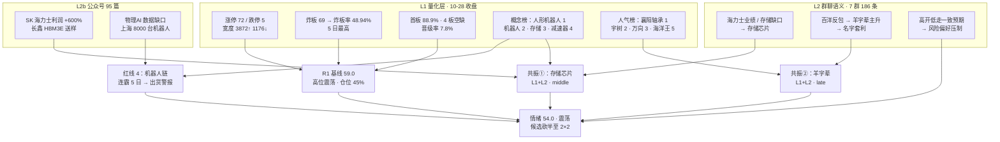

# 2026年10月29日 · **群聊情绪共振**（盘前）

> **数据源新鲜度**: partial（L1 四榜双日 + 涨停明细完整；L2 仅 186 条且窗口只到 10-28 早盘；WeFlow 永久缺位）
> **降级状态**: true（L3 永久缺位 + L2 窗口截断 + R1 上游 degraded）
> **置信度**: 0.54（L1 完整、L2 覆盖薄，靠 R4/R7 三方交叉补强）

## 一句话结论

**情绪浓度 54.0（低于 R1 基线 59.0）：10-28 是放量反包首日（涨停 72 / 跌停 5 / 涨 3872 家 / 成交 16283 亿 +11.46%），但炸板率 48.94%、4 板整层空缺、首板占 88.9%——是「宽度修复、高度没修复」的假强；双源共振只剩存储芯片（L1+L2 资金+文本双确认）与羊字辈名字套利（L1+L2 但双高位）两条，人形机器人概念连霸 5 个观测日触发红线 4 出货警报，只观察不进；炸板率 ≥35% 触发候选砍半，共振主题 2 个、每主题候选 ≤2 只。**

---

## 一、情绪坐标：宽度修复、高度没修复，反包次日防高开兑现

R1 当日基线 **震荡分化型 + 情绪 59.0（中性）+ 高位震荡 · 第 0 天 + 仓位上限 45%**。结构上是典型「首板宽度型」：涨停 72 家、首板 64 家（**88.89%**）、2 板仅 5 只、3 板 2 只、**4 板整层空缺**、最高 5 板是襄阳轴承一只孤票；炸板 69 家、炸板率 **48.94%** 为 5 日最高。R3 在双源共振上做定向修正，落到 **54.0**：

| 修正项 | 方向 | 依据 |
|---|:--:|---|
| R1 基线（20261029 当日，非前一日） | 59.0 | `R1_style.json` 震荡分化型 / high_chop / 仓位 45% |
| 跌停压制解除：22 → 5 家 | +4.0 | 5 日内最低，恐慌盘出清 |
| 广度修复：涨 3872 / 跌 1176，中位 +1.35%，涨>5% 649 家 | +3.0 | 5217 只全覆盖口径 |
| 昨日涨停溢价转正：收盘中位 +2.03%、红盘率 68.3%、再涨停 8 只 | +1.5 | n=41，开盘中位 0 → 全靠日内拉升 |
| 炸板率 48.94%（5 日序列 41.07 → 12.77 → 29.49 → 40.58 → 48.94） | −6.0 | 封板质量 5 日最差 |
| 连板断层：首板 88.9%、2 板 5 只、4 板空缺、晋级率 7.8% | −3.0 | 高度无法自我续命 |
| L2 一致性偏空：7 群中 6 群主基调「外围大涨 A 股独立下跌 / 高开低走 / 已破防」 | −1.5 | 186 条语义抽取 |
| 正向 L1+L2 共振 2 个，但均为单点无扩散 | +1.0 | 见第三节 |
| 红线 4 霸榜警报：人形机器人概念连霸 5 个观测日 | −4.0 | 与昨日同口径同权重 |

五维校验独立跑一遍：涨停强度 `1.25×72 = 90`、跌停压制 `100−8×5 = 60`、连板结构定性 `40`、炸板反向 `100−4×48.94 < 0 → 0`，`(0.25×90 + 0.20×60 + 0.20×40 + 0.15×0) / 0.80 = 53.1`（杠杆/外资维度无可信值——北向 10-28 起停抓、两融滞后 T+1，按 v1.1 只做 4 维归一，**不用替代值凑分**）。**R3 54.0 与五维 53.1 只差 0.9，无背离**：两套口径都指向「修复是真的，持续性不成立」。

分指数验证修复的成色：创业板 **+3.40%**、科创50 **+2.45%**、深成 **+2.02%**，而沪深300 仅 +0.85% —— 涨的是高 beta 科技，不是权重搭台；主力单日 **+237 亿**（净占比 1.46%、超大单 +254.3 亿、小单 −29.9 亿），但 **5 日仍 −1142.3 亿**、20 日 −5667.4 亿，两融 5 日 −705.9 亿（−2.85%）。**一天的净流入盖不住一周的净流出**，这是本单元把情绪压在 54 而不是跟着涨停数冲到 70+ 的核心理由。

---

## 二、双源共振总览

一句话读图：**L1 的宽度（A）和 L2 的悲观（H）互相打架，L1 的高度（B/C）站在悲观一边**——所以共振只可能在「有资金承接的产业线」里成立（存储），名字套利（T2）只能是高位接力，机器人（X）必须被红线拦掉。

---

## 三、TOP 主题深度（推理三问）

### ① 存储芯片 / DRAM-HBM 涨价链 —— 唯一「人气 + 资金 + 文本」三方同向的方向

- **大资金意图**: **从 20 日减仓转为 5 日回补，是配置盘在做左侧底仓**。数字芯片设计行业 10-28 单日主力 **+57.27 亿**、**5 日 +79.64 亿**，是全市场仅有两条 5 日净流入行业之一（另一条是汽车零部件 +39.69 亿）；半导体整体当日 +68.91 亿但 5 日仍 −42.24 亿、20 日 −756.07 亿，说明钱只挑了「设计」这个环节，不是无差别抄底。对手盘很清楚：20 日窗口里数字芯片设计累计净流出 324.86 亿，今天的 57 亿是回补而不是新钱。
- **为什么走强**: 三维同时给分。①位置：兆易创新 20 日分位仅 **15.4%**、距 20 日高 −28.96%，属超跌而非追高；②催化：SK 海力士营业利润同比 **+600%**、称内存售罄至 2029，TrendForce 料 2027 年 HBM 均价 +122%，长鑫科技启动 HBM3E 小批量送样并同日纳入上证指数成第一大权重（R4 三条硬事件，全部 ≥2 独立源）；③筹码：兆易 5 日主力 +19.43 亿（正日 2/5）、融资余额 5 日仅 −2.31%（未被动去杠杆），金安国纪首板封单 3.27 亿 / 成交 15.99 亿（**20.5%**）且只开板 1 次。人气端同步确认：金安国纪同花顺热股 **50→9（+41）**、华天科技 **21→7（+14）**、兆易飙升 **+58**、北京君正 **+73**。
- **逻辑够不够硬**: **硬在产业周期，软在筹码结构**。三个独立源（韩系业绩 / 长鑫送样 / TrendForce 价格）指向同一产业事实，这是全市场当日最硬的催化组；存储芯片概念 10-28 由第 4（−4.20%）跳到第 3（+3.97%），是「价格先动、热度后跟」，与昨天报告的「热度升、价格跌」完全反转——这是本单元给它 middle 而不是 late 的依据。软的地方：全板块 5 日仍净流出 243.6 亿（电子）、20 日 −1627.97 亿，且今天是反包首日，任何一天大票冲高回落都可能让回补变回流出。**证伪路径**：存储芯片概念跌出前 5 ／ 数字芯片设计行业转净流出 >30 亿 ／ 兆易成交额掉到 80 亿以下且收盘价低于 10-28 收盘 −3%。

### ② 羊 / 洋 / 百字辈 名字套利 —— 唯一给了具体打法的 L2 方向，但两只龙头都在高位

- **大资金意图**: **纯存量接力，找过夜容器**。这条线没有产业资金，机制是「一个高度标杆（海洋王）打出空间 → 用名字把低价小票串成伪板块 → 次日由接力盘接第二棒」。资金证据只能看载体行业：汽车零部件 5 日 **+25.24 亿（当日）/ +39.69 亿（5 日）** 是另一条 5 日正流入行业，但这条线里的 5 板襄阳轴承、3 板光洋股份属机器人零部件，与名字套利共用同一批低位筹码；真正的名字票（百洋 9/14 板、大洋电机、上海九百）没有对应的行业资金统计。
- **为什么走强**: 位置在退，辨识度在守。人气端是**双向信号**：百洋股份东财人气新进第 13（飙升 +41）、大洋电机 34→3（+31）、上海九百 14→2（+12），但同花顺热股端百洋 **9→34（−25）**、海洋王 **1→5** 并且东财 **26→14（−12）**——同一批票在两个平台上一个新进、一个回落，说明是**换手筹码在互相接，不是新增关注**。10-28 海洋王只涨 2.37%（未涨停），而百洋把板数刷到 9/14，龙头与补涨的身位已经错位。
- **逻辑够不够硬**: **不硬，且本单元的结论是「观察不进」**。按纪律 §2「只做龙头或低位，躲中位和杂毛」：海洋王榜龄 12 日、均值位 9.9，已是高位老龙；百洋 9/14 板 + 人气 −25，是典型的高位衰减。L2 里唯一给出打法的游资群原话是「百洋要是能吃反包，能认定羊字辈走主升」——这是一个**条件句，不是结论**，条件未成立前不构成共振买入理由。**证伪路径**：海洋王断板 → 整条线一日游终止；百洋若炸板后次日不能反包 → 名字套利降级为个股行情。

### ③ 人形机器人 / 机器人零部件 —— 人气第一，但红线 4 把门关着

- **大资金意图**: **零部件在被买，本体在被卖，两件事同时发生**。汽车零部件当日 +25.24 亿、5 日 +39.69 亿、20 日 +14.18 亿（唯一 20 日正收益的链条），通用设备当日 +17.57 亿但 5 日 −4.27 亿；涨停结构上汽车零部件 11 家 + 通用设备 8 家 = 19 家，占 72 家涨停的 **26.4%**。但概念层面「人形机器人」连霸 5 个观测日，5 日涨幅序列 −1.79 / +4.46 / −0.79 / −2.76 / +4.13，两度负收益——**热度不掉、价格不涨**，这是红线 4 定义的派发形态。
- **为什么走强**（名义上还在涨停）: 是**低位零部件替高位本体撑场**。襄阳轴承 5/5 板、光洋股份 3/3 板、凯众股份 2/2 板、万向钱潮 3/4 板，全部是零部件侧；上海证券报同日记录「午后 700 亿市值机器人概念股炸板」，与 48.94% 的炸板率互相印证。人气端襄阳轴承双榜第 1/2（均值位 1.5，榜龄 22 日）、宇树科技 1/3（榜龄 82 日、均值位 15.1），高位票仍在榜但已无溢价。
- **逻辑够不够硬**: **产业逻辑硬，交易结构不硬**。R4 对「人形机器人零部件」给了正面 high，对「纯概念跟风杂毛」给了负面 medium，同一板块内部已经分裂；叠加红线 4 的霸榜警报，本单元的处置是：**不计正向共振、不作为共振主题输出，只把零部件方向的资金事实透传给 R2/R5，由它们按各自口径决定是否进候选**。R5 应给人形机器人链龙头加风险标记。

---

## 四、跷跷板与资金分层

| 侧 | 证据（10-28 单日 / 5 日） |
|---|---|
| 流入（科技硬件回补） | 电子 +149.86 亿 / 5 日 −243.60 亿；通信设备 +78.53 / −72.19；半导体 +68.91 / −42.24；数字芯片设计 **+57.27 / +79.64**；元件 +50.31 / −144.11；PCB +47.02 / 负值 |
| 流入（低位制造） | 汽车零部件 **+25.24 / +39.69 / 20 日 +14.18**；通用设备 +17.57 / −4.27 |
| 流出（昨日强势方向） | 电力设备 −18.88 亿（5 日 −119.31）；电池 −14.40（5 日 −60.24）；证券 −13.98（5 日 −46.73） |
| L2 印证 | 群F「外围大涨两天，明天就得回调，我A提前预判了」；群C「量化只会高开砸盘」；群G「今天高开是可能下杀再拉升反包」 |
| L2 逆向信号 | 群B 意见领袖「有几个私募已经清盘了、早破防了」——散户侧已到情绪极值（贩财局同日亦写「量化指标接近历史级别极值」），这是反包发生的心理条件 |

一句话：**钱从「昨日强势（电力设备/电池/证券）」流向「超跌科技硬件 + 低位制造」，但只在两个 5 日口径为正的行业（数字芯片设计、汽车零部件）里形成持续**。其余流入都是一日反抽，明天不续就是二次探底。

---

## 五、单源主题透传（不进共振榜）

| 主题 | 层级 | 证据 | 处置 |
|---|:--:|---|---|
| 人形机器人 / 零部件 | L1_only | 概念 1/2、减速器 17→4；汽车零部件 11 家涨停；5 日 +39.69 亿 | 红线 4 排除，见 ③ |
| 光模块 / CPO / PCB | L1_only | CPO 5、PCB 6；中际旭创 23→4（成交 235.73 亿全市场第 1）、主力 +31.97 亿 | 只有人气与一日资金，5 日仍负 → 观察 |
| 物理AI 数据 / 传感器 | L1_only | 福莱新材 27→14（飙升 +51）、凡拓数创 49→39；公众号侧证据最足（10-19 以来数据类四股均涨 63.8%） | 公众号不计入共振等级 → 透传 R2/R4 |
| 消费零售（百货） | L1_only | 上海九百 14→2、国芳集团 25→12、茂业商业 2 板 | 无 KOL 语义、无 5 日行业资金 → 观察 |
| 碳酸锂 / 锂电 | L2_only | 群F 单条「碳酸锂反弹了」 | 文本 vs 电池 5 日 −60.24 亿相反 → 剔除 |
| 化学制药 / 创新药 | L2_only | 群E 调侃「梦到莱美涨停新高」；莱美药业 20cm 涨停 | 语义为调侃 → 不算共振 |

---

## 六、首推票思维链：兆易创新 603986（R3 只识别热度与共振，不背书价格）

- **买入理由**: ①产业锚——存储涨价周期由 SK 海力士 +600% 利润、内存售罄至 2029、长鑫 HBM3E 送样三条互相独立的硬事件确认，DRAM 设计是直接受益环节；②资金锚——10-28 主力净流入 **17.64 亿（净占比 14.36%）**、5 日 +19.43 亿，是存储链内唯一「当日与 5 日同时为正」的大票；③位置锚——20 日分位 **15.4%**、距 20 日高 −28.96%，属超跌反包而非高位追涨；④人气锚——双平台第 23、飙升 +58、榜龄 169 日，属长期关注度高但近期被冷落的修复型标的。
- **风险点**: ①它是「大票反包首日」，全市场炸板率 48.94%，同一批钱明天可能就去接更新的题材；②20 日行业资金 −324.86 亿、电子 20 日 −1627.97 亿，趋势资金尚未转向；③融资余额 5 日 −2.31%（未去杠杆，但也说明没有杠杆盘助推），一旦放量滞涨容易变成接力盘出货。
- **止损条件**: 收盘跌破 **275.4 元**（10-28 收盘 289.88 的 −5%）即减半；跌破 **261.0 元**（−10%）逻辑作废清仓；或存储芯片概念跌出同花顺概念榜前 5（逻辑证伪，不等价格）。
- **可验证假设**: 24 小时内可证真/证伪三条——①次日存储芯片概念仍在前 3（否则主题降级）；②兆易成交额 ≥80 亿且收盘不低于 10-28 收盘 −3%（量在价在）；③数字芯片设计行业主力净额不转成净流出 >10 亿（资金不撤）。

---

## 七、次日情绪方向：震荡，防高开兑现

| 情形 | 触发阈值 | 处置 |
|---|---|---|
| 高开兑现 | 竞价高开 >1%，且开盘 30 分钟内炸板家数 >15 | 高位票一律不接；存储一线等缩量回踩（相对涨停价仍低才叫低吸，不是抄底） |
| 平开走稳 | 平开震荡 + 存储芯片概念维持前 3 | 存储一线按计划内低吸（兆易 20 日分位 15.4%，位置允许） |
| 二次探底 | 炸板率再上 55% 或 数字芯片设计转净流出 >30 亿 | 全池降级 watch，不出手 |

**为什么是震荡而不是修复确认**：①高度没修复（4 板空缺、首板 88.9%、晋级率 7.8%）；②5 日资金仍 −1142 亿，单日 +237 亿是回补不是转向；③L2 一致预期是「高开低走」，而一致预期在反包次日最容易自我实现；④R1 已给定高位震荡第 0 天、仓位上限 45%，R3 不越权加仓，只把「候选砍半」写进透传。

---

## 八、关键证据

- 证据 1：数字芯片设计 10-28 主力 +57.27 亿、5 日 +79.64 亿，是全市仅有两条 5 日净流入行业之一 · 来源 R7 行业资金
- 证据 2：存储芯片概念 10-28 由第 4（−4.20%）升至第 3（+3.97%），价格先动、热度后跟 · 来源 同花顺概念榜双日
- 证据 3：SK 海力士营业利润同比 +600%、内存售罄至 2029；长鑫 HBM3E 送样并纳入上证指数第一大权重 · 来源 R4 事件 E01/E03 + 证券时报
- 证据 4：炸板 69 / 涨停 72 = 48.94%，4 板整层空缺、首板 88.89% · 来源 R1 limit_structure
- 证据 5：人形机器人概念连霸 5 个观测日（10-22/23/26/27/28），5 日涨幅两度负值 · 来源 概念榜 7 日序列
- 证据 6：七群 6 群主基调为「外围大涨 A 股独立下跌 / 高开低走」，群B 意见领袖「有几个私募已经清盘了」 · 来源 群聊语义抽取（匿名）
- 证据 7：海洋王东财人气 26→14、百洋同花顺热股 9→34，高位票人气反向 · 来源 人气榜双日 diff

## 数据源审计

| 源 | 日期 | 状态 | 备注 |
|---|---|:--:|---|
| tushare/attention 管道（东财人气+飙升、同花顺热股+概念） | 2026-10-28 | 🟢 | 320 条 · 双平台双榜 · 落盘在 T-1 目录 |
| 概念榜观测序列 | 2026-10-20 至 2026-10-28 | 🟢 | 7 个观测日 · 用于霸榜判定 |
| 涨停明细（limit_list_d） | 2026-10-28 | 🟢 | 72 条 · 行业/封单/开板次数全 |
| R1 风格基线 | 2026-10-29 | 🟡 | 1 条 · 上游 status=degraded，confidence 0.392 |
| R7 资金面 | 2026-10-29 | 🟢 | 496 板块 + 5 候选 · 行业与个股资金 |
| R4 消息面 | 2026-10-29 | 🟢 | 8 事件 · 板块映射用于语义对齐 |
| wechat_cli 群聊（匿名） | 2026-10-28 早盘 | 🟡 | 186 条 · 七群 7/7 有内容（群A 6 / 群B 44 / 群C 45 / 群D 20 / 群E 11 / 群F 51 / 群G 8）· 窗口截断 |
| wechat_official_rss 公众号 | 2026-10-29 | 🟢 | 95 篇 · 13 个号（官媒 81 + 自媒体 14） |
| weflow/MCP | — | 🔴 | DOWN · 2026-08-19 永久下线，L3 缺位不编造 |
| tushare 两融 | 2026-10-27 | 🟡 | T+1 滞后 · 仅作趋势参考，未参与打分 |

## 九、不确定性 / 反证

- **L2 语料是残缺的，这是本单元最大的软肋**。186 条全部落在 10-28 早盘，缺 10-28 全天与 10-29 凌晨——也就是说，市场在 10-28 用「普反 + 存储跳涨」证伪了群里的悲观，而群聊没有留下证伪之后的发言。任何把「6 群偏空」当作次日偏空证据的用法都是错的：它记录的是**反包前的情绪**，恰恰是反包的心理燃料。
- **名字套利线的证据质量低**。7 群中只有 1 个游资群给了具体标的，且是条件句；另外 6 群对名字套利零提及。这条线能进共振榜，是因为它同时满足 L1（人气榜前 5 + 新进 13）与 L2（明确语义），而不是因为证据强。
- **存储的「硬」有一半来自公众号**。海力士 +600%、长鑫纳入指数这两条，KOL 只说了「韩国因为海力士业绩」一句，重量级的产业细节全部来自 L2b 与 R4。按契约 L2b 不计入共振等级——如果读者认为公众号应计权，本单元的 verdict 会更强；若认为 KOL 才是市场情绪真相，存储的 L2 支撑其实是薄的。
- **反证方向**：若次日存储链高开低走、炸板率维持 45% 以上，那么 10-28 的 +237 亿就是单日脉冲，本单元 54.0 仍偏高，应回落到 45 以下；若次日存储继续放量并出现 2 板梯队，则 54.0 偏低，说明修复从宽度走向高度。
- **口径提醒**：R1 宽度 3872/1176 与 R7 4156/1239 不同，属样本口径差异（ST/北交所处理不同），本单元统一采用 R1 口径，不做混算。

## 十、与其他 R/D/E 的关系

- **依赖**：`data/research/20261029/R1_style.json`（情绪基线，当日，非前一日）、`data/research/20261028/attention_signals.json`（多平台人气）、`data/raw/20261029/wechat_cli_5groups.jsonl`（L2）、`data/raw/20261029/wechat_official_rss.jsonl`（L2b）、`R4_news.json`（事件语义对齐）、`R7_capital_flow_20261029.json`（资金交叉）
- **被消费**：R2（主线板块取 resonance_top_themes + l1_only_themes）、R5（对共振主题龙头做画像；`hotlist_signals.distribution_alert` 的人形机器人需加风险标记）、R6（反证可攻击本单元的「存储 L1+L2」与「名字套利不硬」两处）、D1（情绪 54.0 / 震荡 / 候选砍半 + next_day_playbook 三档阈值）、E1（T+1 回填 sentiment_score 与两条共振主题的成败）

## Sub-Agent 元数据

- skill: analyze_sentiment_resonance_v1
- artifact: data/research/20261029/R3_sentiment.json
- 生成耗时: 约 12 分钟
- model: ark-code-latest
- 数据来源: L1（多平台人气管道 + 涨停明细）· L2（7 群 186 条，匿名）· L2b（公众号 95 篇）· WeFlow 已下线
