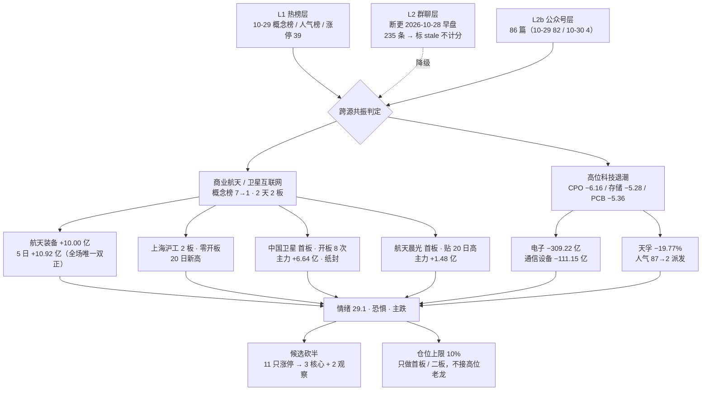

# 2026年10月30日 · **群聊情绪共振**

> **数据源新鲜度**: partial　**降级状态**: true　**置信度**: 0.45
> **口径**: 结算日 2026-10-29 收盘数据，服务 2026-10-30 盘前；本单元产出晚于开盘时刻，但**未引入任何盘中数据**，以免污染次日校核

## 一句话结论

主跌第 2 天、情绪 **29.1 分（恐惧）**：前主线机器人 / CPO / 存储集体崩塌，全场唯一有钱、有人气、有涨停簇的是 **商业航天（11 只涨停、航天装备 5 日 +10.92 亿）**，但商业航天板块指数当日仍 −2.21%，说明是**局部点火而非板块扩散** —— 只认 3 只，其余 8 只涨停一律划掉。

## 情绪刻度 · 29.1 是怎么来的

R1 当日基线 **28.6**（崩溃退潮型 / 无主线 / 仓位上限 10%），本单元在其上做六项加减，合计 **+0.5**，取 **29.1**：

| # | 修正项 | 方向 | 分数 | 证据 |
|---|---|---|---|---|
| 1 | 商业航天概念首日登顶，涨停 11 家（占全场 39 家的 28%），最高 2 板、首板为主 | ✅ 加 | **+3.0** | 概念榜 10-28 第 7 → 10-29 第 1 |
| 2 | 航天装备当日 +10.00 亿 / 5 日 +10.92 亿，全场唯一今日与 5 日**双正**行业 | ✅ 加 | **+1.5** | R7 独立同口径复核一致 |
| 3 | 高股息精选新进概念榜第 6、银行 +1.98%、证金持股 +15.62 亿 | ✅ 加 | **+1.0** | 防御资金进场托底，但属避险不属进攻 |
| 4 | 前主线集体崩塌：人形机器人 −4.09%、CPO −6.16%、存储 −5.28%、PCB −5.36% | 🔻 减 | **−2.5** | 概念榜排名同步下滑 |
| 5 | 人气榜前二被跌停股占据（榜首股 −19.77% 跌停仍升至第 2） | 🔻 减 | **−1.5** | 情绪锚从赚钱效应转为割肉围观 |
| 6 | 涨停结构极弱：涨停 39 < 跌停 41、炸板率 39.06%、最高 4 板、首板占 74.4% | 🔻 减 | **−1.0** | 接力链条断裂 |

**双法交叉**：五维法（涨停强度 / 跌停压制 / 连板结构 / 炸板 / 资金）独立算得 **28.6**，与 29.1 的 **gap = 0.5 分**，远低于 15 分阈值 —— 双法同向，无背离。

**阶段定性**：炸板率 39.06% ≥ 35%、跌停首次多于涨停、涨 756 / 跌 4400 —— 按纪律直接判 **主跌**，候选数**砍半**。

## 详细分析

### 一 · 市场在为「航天链」付钱，不是为科技付钱

10-29 是标准的放血日：涨停 39 家、跌停 41 家、炸板 25 家、涨 756 跌 4400、成交 15,562 亿（较前日 −4.42%）。但资金流向极端清晰 —— **电子 −309.22 亿、半导体 −136.40 亿、通信设备 −111.15 亿、元件 −90.04 亿、PCB −82.49 亿**，同时 **航天装备Ⅲ +10.00 亿（板块 +3.54%）、空间站概念 +10.5 亿、卫星导航 +9.93 亿、国防军工 +8.75 亿**。一边倒的抽血与一边倒的输血发生了同一小时，这是**高低切换**而不是普跌。

⚠️ 但要点在细节：国防军工 5 日仍 **−39.59 亿**，只有航天装备子链是今日与 5 日**双正**。所以不是「军工起来了」，是「航天这一小截被单独选中」。把国防军工当主线会踩到 5 日仍在流出的陷阱。

### 二 · 商业航天：11 只涨停，但 7 只是杂毛

商业航天概念榜从第 7 位直接跳到第 1，连板高度 2 天 2 板，涨停 11 家。拆开看结构就好判断了：

| 类型 | 个股 | 处理 |
|---|---|---|
| 真链核心 | 中国卫星（卫星总体）、航天晨光（航天配套）、上海沪工（卫星总装）、西部材料（航天钛材）、电科蓝天（空间电源） | ✅ 进候选 |
| 蹭概念杂毛 | 顺灏股份（包装印刷）、钧达股份（光伏）、邵阳液压（工程机械）、阳光照明（照明）、上海港湾（专业工程）、盛洋科技（光学）、龙溪股份（轴承） | ❌ 整组剔除 |

概念库 511 只成分股，涨停 11 只只占 2.2%，板块指数还跌 2.21% —— 这是**资金抱团 5 只真票点火**，不是板块行情。按「只做龙头或低位、躲中位和杂毛」的口径，杂毛一只不留。

### 三 · 人气榜被跌停股占领，是这轮最脏的信号

天孚通信当日 **−19.77% 跌停**，人气排名却从第 87 位跃到第 **2**（+85 位，87 日榜龄老票）；新易盛 **−11.06%**，人气 45→7。**人气顶与价格顶同时出现，是典型派发结构** —— 围观者不是来接力的，是来看戏的。这类票的一切「跌深低吸」都在纪律模式外，本单元直接列入禁止清单。

### 四 · 群聊层断更，如实降级而不是编造

这是本单元最需要说明的一点：`wechat_cli_5groups.jsonl` 落盘 0 字节，改用 wechat-cli 直读本地库补抓得 235 条，但**本地微信数据库自 2026-10-28 早盘后无任何新消息**（7/7 群会话列表最后时间同为该时点，我尝试唤起客户端后仍无同步）。该窗口比结算日早整整一个交易日，且当日正是崩塌日 —— 拿它当 10-30 的情绪证据就是**用过期语料冒充当日观点**。

因此：
- 群聊 235 条**全部标 stale，不计入 resonance_level**；
- 共振等级只能给到 **L1+L2b（热榜 + 公众号）**，按 skill 规定 L2b **不加权、不升级**，实际强度低于标准 L1+L2；
- 该窗口里唯一的板块观点（「羊字辈能否主升」）已被 10-29 行情证伪（百洋仅 +4.93%），一并作废。

### 五 · 昨日自己的账，先认

| 昨日（20261029 版）判断 | 10-29 实际 | 结论 |
|---|---|---|
| 存储芯片 / DRAM-HBM 属 middle 段主线，首推两只 | 概念榜 3→7、板块 −5.28%、兆易 −4.79% | ❌ **错** |
| 名字套利已 late，观察不进 | 海洋王人气 14→30、仅 +1.04% | ✅ 对 |
| 人形机器人连霸榜首 → distribution_alert | 当日让位第 2、板块 −4.09% | ✅ 对 |

**教训**：错在把「5 日资金净流入」当成持续性证据，漏看「概念榜已在 3 日高位、板块指数开始走弱」这个阶段信号。所以今天对商业航天**只用 1 日龄 + 2 板结构定性**，不拿 5 日资金单独下结论。

## 双源共振主题

| # | 主题 | 等级 | 阶段 | 结论 |
|---|---|---|---|---|
| 1 | 商业航天 / 卫星互联网 | L1+L2b | early（首日登顶、最高 2 板） | 唯一进攻通道，3 核心 + 2 观察 |
| 2 | 高位科技退潮（CPO / 存储 / AI 算力） | L1+L2b | late | **反向共振，只作禁做名单** |

**主题 1 的三问**

- **大资金意图**：从电子链抽出的钱需要落脚点，航天装备是唯一同时满足「有政策（上海卫星互联网方案 800 亿 / 3000 颗）、有订单（成飞火箭发射 9500 万）、有封板（11 家）」的容器 —— 这是避险资金里的**进攻性仓位**。
- **为什么走强**：10-26 政策给量 + 10-28 成飞中标公示（蓝箭第一、中科宇航第二，公示至 11-02）双重催化，恰好落在科技链崩塌的同一窗口，承接了无处可去的资金。
- **逻辑够不够硬**：**中等偏硬但不满分**。硬在政策+订单实锤、板块有 2 板高度；软在概念指数 −2.21%、511 只成分只有 11 只涨停，属局部点火，一旦资金撤得比进得快，一日游概率不低。

## 行情结构图

## 每票思维链

### ① 603131 上海沪工 · 2 板零开板（链内结构最好）

- **买入理由**：商业航天唯一「2 板 + 全天零开板」，封单 1.34 亿、换手 11.12% 不透支；收盘 15.95 即 20 日新高，突破形态成立；20 日涨幅仅 +14.3%、5 日 +21.9%，属**低位二板**而非高位接力。
- **风险点**：流通盘 54 亿偏小、易被大单砸穿；商业航天若次日高开兑现，2 板票是第一批被抛弃的对象；概念指数 −2.21% 说明板块本身没有广度支撑。
- **止损条件**：次日高开不足 2% 且 30 分钟内翻绿 → 直接走；封板后炸板不回封 → 走；跌破 14.11（5 日均线）→ 无条件止损，止损距约 −11.5%，超出 −5~−10% 硬区间则以 −10% 为上界。
- **可验证假设**：若商业航天真是新主线，沪工作为唯一 2 板标的应获资金优先，次日至少给出 3% 以上溢价；若次日反而弱于中国卫星，说明资金选的是容量票不是高度票，本票判断作废。

### ② 600118 中国卫星 · 首板但纸封（资金最重，结构最差）

- **买入理由**：航天链单票吸金最大（当日主力 **+6.64 亿**、5 日 +6.06 亿），卫星总体绝对龙头，人气双平台在列（均值 8.5）；低位启动（20 日 −3.2%，距 20 日高 59.72 尚有空间），流通 661 亿可承接大资金。
- **风险点**：**封板质量是全链最差** —— 首封拖到上午中段、尾封在尾盘，盘中开板 **8 次**、封单仅占成交 2.66%，是典型的「尾盘偷袭纸封」；纸封次日的开盘溢价极不稳定，容易高开低走。
- **止损条件**：次日若开在 +3% 以下且开盘 30 分钟内不创新高 → 视为纸封兑现失败离场；跌破 51.55（5 日均线）→ 止损，止损距约 −7.8%，在硬区间内。
- **可验证假设**：真龙头次日必须**补量**并把封单做厚；若次日成交缩到 20 亿以下同时价格滞涨，说明 6.64 亿只是一日游资金，本票降级为观察。

### ③ 600501 航天晨光 · 首板贴 20 日高（弹性替补）

- **买入理由**：收盘 16.89 紧贴 20 日高 16.94，5 日 +10.2%、20 日 +16.3% 处于温和上行通道；开板 2 次、封单/成交 4.0%，封板质量中等偏可；换手 8.07% 不拥挤。
- **风险点**：当日主力仅 +1.48 亿、5 日 +1.11 亿，资金强度明显弱于前两只，**属跟随票不是被选中票**；首板高度不如沪工，资金不如卫星，容易两头不靠。
- **止损条件**：跌破 16.00（5 日均线）止损，止损距约 −5.3%；若次日高开后被卫星/沪工甩开 3 个点以上，视作资金排序落败，直接放弃。
- **可验证假设**：若航天链能走三天，第三梯队必有补涨；若次日只有前两只红盘、本票翻绿，则属「一根阳线结束」，不进。

### 观察不上车（本单元不给开仓资格）

- **002149 西部材料**：首板 +10.01%、主力 +5.0 亿、5 日 +4.78 亿，资金不弱；但开板 1 次、封单仅 0.99 亿、换手 12.07%，且 20 日 −1.8% 尚未确立趋势，**只作替补观察**。
- **688818 电科蓝天**：+11.82%（科创 20cm 未涨停）、5 日 +25.4% 已偏高、贴近 20 日高 47.99，**追进去的盈亏比不划算**，观察。

## 三问复盘（本单元自身）

**① 漏纳入**：10-28 商业航天概念榜已从第 10 抬到第 7，10-26 上海政策已发布 —— 两个前置信号昨天都在盘面上，昨日 R3 却完全没把航天纳入视野，只盯存储与名字。**漏的是「概念榜排名抬升 + 涨停家数扩张」这个双指标组合**，它比单一资金流更早暴露主线候选。

**② 选错**：把存储芯片定为 middle 段主线并首推两只，当日板块 −5.28%、排名 3→7 直接破位。选错的根因是**用 5 日资金替代了阶段判断**。

**③ 做对**：名字/字辈套利坚持判 late、观察不进，避开了海洋王仅 +1.04% 的坑；人形机器人 distribution_alert 写进 hotlist_signals 后次日即兑现（让位第 2、−4.09%）—— 霸榜即派发这条红线又一次被验证。

## 关键证据

- **证据 1**：商业航天概念榜 10-28 第 7 → 10-29 第 1，涨停 11 家、最高 2 板、首板占 8/11 —— 来源 tushare concept_board / ths_concept 双日直拉
- **证据 2**：航天装备Ⅲ 当日 +10.00 亿（+3.54%）、5 日 +10.92 亿，为全场唯一双正行业；同口径国防军工 5 日仍 −39.59 亿 —— 来源 tushare moneyflow_ind_dc + R7 独立复核
- **证据 3**：电子 −309.22 亿、半导体 −136.40 亿、通信设备 −111.15 亿；天孚 −19.77% 跌停而人气 87→2 —— 来源 tushare 资金流 + 东财/同花顺双榜
- **证据 4**：上海六部门《卫星互联网产业创新发展行动方案（2027—2030）》800 亿 / 3000 颗；成飞火箭发射服务中标候选人公示（蓝箭 9500 万、中科宇航 1 亿，公示至 11-02）—— 来源 公众号 上海证券报 / 证券时报
- **证据 5**：涨停 39、跌停 41、炸板 25（39.06%）、首板占比 74.36%、昨日涨停股开盘 +1.89% 收盘 −0.94% —— 来源 tushare limit_list_d 逐票明细

## 数据源审计

| 源 | 状态 | 抓取日 | 记录数 | 备注 |
|---|---|---|---|---|
| R1_style（当日基线） | 🟢 ok | 2026-10-30 | 1 | 28.6 / 崩溃退潮型 / 无主线 / 仓位 10%，上游 status=degraded |
| tushare 热榜双日 | 🟢 ok | 2026-10-30 | 660 | ths_concept / ths_hot / dc_hot 10-28 与 10-29 全量，算 rank diff |
| tushare 涨停明细 | 🟢 ok | 2026-10-30 | 39 | 连板数 / 首末封 / 开板次数 / 封单额逐票 |
| tushare 行业资金 | 🟢 ok | 2026-10-30 | 1043 | 概念与行业双口径当日净流入 |
| attention_signals | 🟢 ok | 2026-10-30 | 59 | trade_date=20261029，按 T-1 基准使用 |
| 公众号 RSS | 🟢 ok | 2026-10-30 | 86 | 17 feed，10-29 共 82 篇 + 10-30 共 4 篇，本日唯一新鲜文本层 |
| R7 资金面 | 🟢 ok | 2026-10-30 | 5 | 独立复核航天装备 / 电子链，研究候选含中国卫星、西部材料 |
| 群聊 7 群 | 🔴 stale | 2026-10-28 | 235 | 本地库断更，窗口早于崩塌日一个交易日，**不计入共振等级** |
| WeFlow（L3） | 🔴 error | — | — | 2026-08-19 永久下线 |
| R2 / R4 / R5 / R6 | 🔴 missing | — | — | 本日未落盘，无法三源交叉 |

**群名匿名化**：全文群聊一律记作 群A–群G（群A 44 条 / 群B 12 条 / 群C 52 条 / 群D 54 条 / 群E 45 条 / 群F 8 条 / 群G 22 条），不出现任何群名、人名与时分秒。

## 不确定性 / 反证

- **反向看空商业航天的理由**：概念指数 −2.21%、511 只成分仅 11 只涨停 —— 板块广度几乎不存在，只是 5 只真票抱团；若 10-30 指数继续下杀，抱团票是最容易被流动性抽走的，**一日游概率不低**。
- **资金口径的可疑点**：航天装备 +10.00 亿背后是单一超大票（中国卫星 +6.64 亿）拉动的，**人均资金集中度极高**，一旦该票次日分歧，整链资金读数会瞬间转负。
- **本单元最大的证据缺口**：L2 群聊断更 2 个交易日，无法判断散户情绪是「绝望」还是「麻木」。公众号只能代表机构与官媒视角，**散户拥挤度这一维度本日为空白**，置信度因此打到 0.45。
- **上游缺位**：R2 无主线判定、R4 无事件清单，本单元的「商业航天为唯一通道」结论**缺三源交叉**，若 R4 补出其他同量级催化，主题排序需重排。

## 与其他 R / D / E 的关系

- **依赖**：`R1_style.json`（情绪基线 28.6）、`attention_signals`（T-1 人气底座）、`R7_capital_flow.json`（资金独立复核）、`wechat_official_rss`（L2b 文本层）、tushare 热榜 / 涨停 / 行业资金
- **被消费**：D1（`canghai-plan`）取共振主题与候选池；R5 需按 `hotlist_signals.distribution_alert` 给人形机器人链龙头加高位风险标记；E1 复盘按 `self_scorecard` 对账

## Sub-Agent 元数据

- skill: analyze_sentiment_resonance_v1
- artifact: data/research/20261030/R3_sentiment.json（25,323 B）
- 人读件: data/research/20261030/_body_R3.md
- 分析区间: 结算日 2026-10-29 收盘 → 2026-10-30 盘前
- 情绪分: 29.1（R1 基线 28.6 + 六项修正合计 +0.5）
- 共振主题: 2 条（L1+L2b ×2）· 单源透传 4 条 · 剔除 3 组
- 降级: L2 群聊断更 + L3 下线 + 上游 R1 degraded + R2/R4/R5/R6 缺位
- model: deepseek-v4.1-flash
