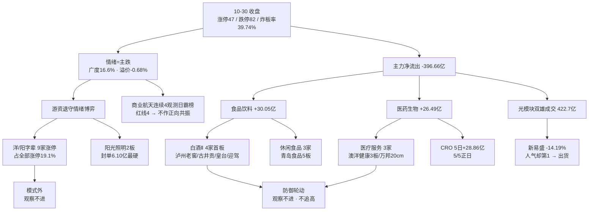

# 2026年11月02日 · **群聊情绪共振**（盘前）

> **数据源新鲜度**: partial
> **降级状态**: true
> **置信度**: 0.50

## 一句话结论

**情绪 30.8（恐惧 · 主跌第 3 天）**：钱从光模块/半导体撤向**白酒/食品/医药**（一级行业合计 +56.5 亿，三源同向），游资只剩**洋/阳字辈 9 家涨停**；科技线是出货不是回调，防御线只做观察、不做计划外追高。

## 详细分析

**第一，段位没变，但钱的去向变了。** 10-30 收盘涨停 47 / 跌停 82 / 炸板 31（炸板率 39.74%，连续第二日站上 35% 红线），涨家占比 16.6%，昨日涨停股收盘溢价 -0.68%、仅 9 只再涨停 —— 这是退潮第三天的标准读数，R1 给的是崩溃退潮型、仓位上限 10%、第 3 天修复窗口。但同一组数据里藏着一个反方向的事实：**主力全天净流出 396.66 亿，却有两个一级行业逆势净流入 —— 食品饮料 +30.05 亿、医药生物 +26.49 亿**，合计 56.54 亿，相当于把当日净流出的 14.3% 单独接走。钱没有离场，钱在换边。

**第二，换边在涨停结构上已经落地。** 消费链 10 家涨停（白酒Ⅱ 4 家全首板：泸州老窖、古井贡酒、皇台酒业、迎驾贡酒；休闲食品 3 家含 5 板的青岛食品；饮料乳品 2 家；食品加工 1 家），医药链 8 家（医疗服务 3 家含 3 板澳洋健康与 20cm 的万邦医药、中药 2 板桂林三金、器械 2 家、化学制药与医药商业各 1 家）。两条线合计 18 家，占全市场 47 家涨停的 **38.3%**——在跌停 82 家的日子里，接近四成涨停集中在防御方向，这不是随机分布。

**第三，科技线的问题不是跌，是"人气不认跌"。** 新易盛当日 **-14.19%**、成交 216.1 亿（全市场第一）却排东财人气榜**第 1**（前值第 7）；中际旭创 -4.99%、成交 206.6 亿、人气 4→7。两只票合计 422.7 亿，占全市场成交额的 2.5%，价格崩塌而人气滞留，这是出货形态里最典型的一格。文本侧完全同向：证金事《远离A股震中》直指 10-31 美股重灾区是光通信和半导体、基金三季报显示半导体配置环比 +10.35ppts 至 82.81%、中际旭创增持 2.31%、新易盛增持 8.11%、天孚通信 +59.51%，"反复诱多出货至今仓位只降 2-3 成"。R7 隔夜半导体篮子 -6.37%。三源一致：**这是被动多杀多，不是错杀**。

**第四，游资没有离场，只是不打主线。** 洋/阳字辈 9 家涨停，占全部涨停的 19.1%，其中阳光照明 2 板封单 6.10 亿（占流通市值 11.1%、换手仅 2.51%）、盛洋科技 2 板封单 2.43 亿、澳洋健康 3 板、东方海洋 2 板。周末三日人气榜里，东方海洋、阳光照明、盛洋科技、澳洋健康全部连续在榜 —— **周末发酵没有开辟新方向，只强化了 10-30 已有的两条线（防御 + 名字）**。这既是情绪还在的证据，也是"没有新故事"的证据。

**第五，文本层必须诚实交代。** 7 群群聊源已断更 5 个交易日（本地库最后一条停在 10-28 上午，微信客户端未运行），本单元**不用 10-28 旧文本冒充今日情绪**，文本层改由当日 47 篇公众号代位（官媒 24 / 自媒体 9）。按 skill 规则公众号不计入 L1/L2/L3 共振等级，因此全部共振标注为 **L1+L2b（b=代位）**，置信度 0.50，不得解读为满配双源。

## 双源共振总览

| # | 主题 | 等级 | 热度证据（L1） | 文本证据（L2b） | 资金（R7） | 阶段 | 结论 |
|:-:|---|---|---|---|---|---|:-:|
| ① | **消费防御：白酒/食品/乳业** | L1+L2b | 白酒概念 18→3（+15，当日概念榜最大斜率）；茅台 46→9、泸州老窖新进 11、皇台新进 14、五粮液 94→38 | 财闻私享「逆势走强的是白酒、食品、乳业」 | 食品饮料 +30.05 亿；白酒Ⅱ +25.0 亿、板块 +5.15%、5 日正日 4/5 | early | ✅ 正向共振 · 观察 |
| ② | **医药 / CRO / 医疗服务** | L1+L2b | 创新药 4→2；CRO 新进第 8；百花医药新进 16、万邦新进 25 | 财闻私享「医药股整体也很强」 | 医药生物 +26.49 亿；CRO +14.39 亿、5 日正日 5/5 | early | ✅ 正向共振 · 观察 |
| ③ | **名字套利：洋/阳字辈** | L1+L2b | 9 家涨停（占 19.1%）；阳光照明封单 6.10 亿、东方海洋 12→5、海洋王 30→8 | 财闻私享「涨停个股中，带"阳"的一枝独秀」 | 无板块资金口径 | late | ⛔ 模式外 · 观察不进 |

**候选砍半**：炸板率 39.74% ≥ 35% → 正向共振只保留 2 个、每主题 suggested_stocks ≤ 2 只，全部 research_only，R3 不授开仓权。

## TOP 主题深度（推理三问）

### ① 消费防御 —— 唯一"热度 + 文本 + 资金"三方同向的方向

- **大资金意图**：在跌停 82 家、科技线被隔夜外盘砸穿的窗口，机构需要一个**有业绩底、有分红、跌不动**的池子安放仓位。三季报给了这个理由（沪市八成盈利、714 家公司 1019 份稳信心公告、白酒 4 家涨停里泸州老窖流通市值 1134 亿仍封板）。对手盘是砍光模块的基金经理 —— 同一批钱在做高低切，不是新增资金。
- **为什么走强**：位置（白酒Ⅱ 此前连续多日在概念榜 18 名之外，属长期冷位）+ 催化（回购增持再贷款会议 + 消费基础设施政策 + 双十一）+ 筹码（迎驾贡酒封单 0.76 亿、换手仅 1.11%，属惜筹型涨停；泸州老窖首板换手 2.81%，无抛压）。
- **逻辑够不够硬**：三源独立共振（概念榜排名斜率 + 板块资金 + 公众号文本），硬业绩锚存在（三季报），**但硬时间锚缺失** —— 白酒是防御资产不是进攻主线，证伪路径很短：次日若白酒Ⅱ 转净流出 >15 亿，"换边"就降级为"避险一日游"。

| 涨停股 | 板型 | 封单 | 炸板 | 换手 | 流通 | 判读 |
|---|:-:|:-:|:-:|:-:|:-:|---|
| 000568 泸州老窖 | 首板 | 0.12 亿 | 0 | 2.81% | 1134 亿 | 权重涨停，大资金真买，封单薄靠体量 |
| 603198 迎驾贡酒 | 首板 | 0.76 亿 | 1 | 1.11% | 356 亿 | 低换手涨停，惜筹最明显 |
| 000596 古井贡酒 | 首板 | 0.41 亿 | 7 | 2.56% | 391 亿 | 炸 7 次，分歧最大 |
| 000995 皇台酒业 | 首板 | 0.39 亿 | 6 | 28.78% | 25 亿 | 小票高换手，游资盘 |
| 001219 青岛食品 | **5 板** | 0.57 亿 | 3 | 24.90% | 38 亿 | 空间龙，但炸 3 次+换手 24.9%，分歧区 |
| 002946 新乳业 | 首板 | 0.21 亿 | 0 | 1.69% | 135 亿 | 乳业跟风，封单偏薄 |

### ② 医药 / CRO —— 三源里资金持续性最硬的一段

- **大资金意图**：CRO 是全市场**唯一 5 日 5/5 正日**的细分（+28.86 亿），医疗服务 5 日 +34.9 亿、4/5 正日。这是"连续买"而不是"抄一把"，说明有中期配置盘在动，而不是日内游资。对手盘是 10 日仍 -91.74 亿的医药生物存量——即老钱在流出、新钱在流入，筹码在换手。
- **为什么走强**：位置（医药生物 10 日 -91.74 亿，属深跌后的低位）+ 催化（三季报 + 脑科学专项 + 创新药出海叙事）+ 筹码（桂林三金 2 板封单 1.07 亿、炸 0 次、换手 4.18%，是最干净的一只；万邦医药 20cm 封单 1.36 亿、炸 0 次）。
- **逻辑够不够硬**：资金侧最硬（5/5 正日不可伪造），文本侧只是"整体也很强"的泛描述，热度侧创新药概念当日仍 -0.56%。**结论是资金先行、热度滞后**——这类结构适合等回踩，不适合追首板。

| 涨停股 | 板型 | 封单 | 炸板 | 换手 | 判读 |
|---|:-:|:-:|:-:|:-:|---|
| 002275 桂林三金 | 2 板 | 1.07 亿 | 0 | 4.18% | 中药，封单/换手比最好，无炸板 |
| 301520 万邦医药 | 20cm 首板 | 1.36 亿 | 0 | 43.54% | CRO 弹性，换手过高需防兑现 |
| 002172 澳洋健康 | 3 板 | 0.60 亿 | 2 | 29.99% | 兼具名字套利属性，双重高位 |
| 002432 九安医疗 | 首板 | 1.15 亿 | 2 | 4.65% | 器械，封单厚但炸 2 次 |
| 300030 阳普医疗 | 20cm 首板 | 0.18 亿 | 0 | 18.80% | 名字套利叠加，封单薄 |

### ③ 名字套利 —— 9 家涨停，但这是模式外的钱

- **大资金意图**：没有产业资金参与，参与者是短线游资与跟风散户。阳光照明封单 6.10 亿、换手 2.51%，是**锁仓型**而非承接型——锁仓意味着次日高开概率大，但也意味着一旦开板无人接。这是"击鼓传花"的资金结构，不是"配置"的资金结构。
- **为什么走强**：位置（东方海洋 2.83 元、阳光照明 4.09 元、盛洋科技 11.95 元，全是低价股）+ 催化（无，纯字辈联想）+ 筹码（东方海洋换手 27.18%、澳洋健康 29.99%，已在高分歧区）。
- **逻辑够不够硬**：**不硬，且必须承认不硬**。唯一共振的是"文本点名 + 涨停集群"两件事，没有任何产业逻辑或业绩锚。按纪律 §6「模式外的钱永远不赚」、§2「只有龙头或低位」——澳洋 3 板、东方海洋 2 板均在中位分歧区，追入止损距需放到 -8% 以上才容错，RR<2 不成立。**结论：观察不进，只当情绪温度计**——9 家涨停说明游资还在场，只是不打主线；若次日降到 ≤3 家，说明最后的接力资金也退了。

## 出货警报与红线（明确不作正向共振）

| 对象 | 触发 | 数据 | 处置 |
|---|---|:-:|---|
| **商业航天**（概念榜第 1） | 红线 4：连续 4 个观测日霸榜第 1（10-29/30/31/11-01） | 10-30 当日 **-4.00%**，人气第 1 而板块下跌 | R5 对该链龙头加风险标记；D1 不得据其热度授开仓权；新催化（太空算力平台、载人登月）只作 L2b 观察透传 |
| **新易盛 / 光模块** | 人气与价格双背离 | 人气榜**第 1**（前值 7）而当日 **-14.19%**、成交 216.1 亿；中际旭创 -4.99%、206.6 亿 | 全线按出货处理，不接反抽；反抽后再跳水即确认 |
| **存储芯片 / DRAM** | 叙事正面、量价负面 | 概念榜第 9（-5.05%）；长鑫 -2.50%、华天 -1.12%；隔夜半导体篮子 **-6.37%** | R4 的涨价叙事（长鑫扭亏 1320 亿、野村称估值 2-3 倍）不构成买入依据，属"利好出货"窗口 |

## 单源主题透传（不进共振榜）

| 主题 | 等级 | 证据 | 为什么进不了共振榜 |
|---|:-:|---|---|
| 光模块 / CPO / 光通信 | L1_only（负向） | CPO 概念第 5（-4.91%）；双雄 422.7 亿成交 | 只有热度没有正向文本与资金，且方向为负 |
| PCB / 覆铜板 | L1_only | 金安国纪涨停 +10%、成交 40.8 亿、人气 70→4；但 PCB 概念 -3.92% | 概念负收益而个股涨停 = 个股行情，不是板块共振；文本明示"反杀追高" |
| 机器人零部件 | L1_only | 襄阳轴承人气 2/热股 1 但 -3.57%；大业股份 42→3（+9.17%）；埃斯顿 81→33 | 人形机器人概念 2→4（-4.20%）、机器人概念 5→7 双降，缺板块承接 |
| 太空算力 / 天地一体化 | L2b_only | 上证报：全球首个天地一体化太空算力云平台，40 余颗卫星；R4 事件 004 正面 | 无独立概念榜条目、无板块资金，且母板块已被红线 4 封 |
| 脑科学 / 脑机接口 | L2b_only | 财联社：国家科技重大专项启动；R4 事件 007 + 专属保险落地 | 纯事件、盘前无热无钱，属 R4 首板候选范畴 |
| AI 应用（Agent / 端侧） | L2b_only | DeepSeek Super-agent；苹果接入阿里千问、国行 Apple 智能 11-04 上线 | 有硬时间锚（11-04）但被 AI 资本开支空方压制，当日无热无钱 |

## 首推观察票思维链（R3 只识别热度与共振，不背书价格、不授开仓权）

### 000568 泸州老窖 —— 防御线里"大资金真买"的那一只

- **买入理由**：① 白酒Ⅱ 4 家首板中唯一千亿流通体量仍封板，说明不是游资点炮而是配置盘进场；② 食品饮料一级行业当日主力 +30.05 亿、白酒Ⅱ +25.0 亿且板块 +5.15%，在大盘 -1.44% 的日子里逆势上涨，资金确认已在盘后数据里；③ 人气榜新进第 11（前值榜外），热度从零起步，不是高位滞涨。
- **风险点**：① 封单仅 0.12 亿，靠体量而非封单强度，次日开盘若获利盘涌出容易一冲就散；② 防御线是"钱躲雨"不是"钱进攻"，一旦科技线止跌，这批钱会回流，白酒当日就可能变成一日游；③ 政策会议若只带来脉冲，白酒的"防御溢价"会立刻被兑现。
- **止损条件**：跌回涨停启动价下方 3%（即 10-30 涨停前收盘价附近）无条件离场；或次日白酒Ⅱ 板块转净流出 >15 亿，当日不留仓。
- **可验证假设**：24-72 小时内可观测两条 —— ① 白酒Ⅱ 是否维持概念榜前 5（10-30 为第 3）；② 食品饮料 5 日净流入是否由 +27.72 亿继续扩大。两条同时成立，防御轮动升级为可跟踪主线；任一破，降级为避险脉冲。

### 002275 桂林三金 —— 医药线里筹码最干净的一只

- **买入理由**：① 2 板封单 1.07 亿、炸板 0 次、换手仅 4.18%，是当日全部 9 只 2 板以上个股中"封单/换手"比最优的结构；② CRO/医疗服务 5 日资金 5/5 与 4/5 正日，是连续性最好的板块，中药作为低位补涨位承接溢出资金；③ 概念侧创新药 4→2、CRO 新进第 8，热度在抬升而非退潮。
- **风险点**：① 中药不是本轮资金主攻方向（主攻是 CRO/医疗服务），属"沾光"位，一旦主线回踩它先掉队；② 医药生物 10 日仍 -91.74 亿，中期趋势未反转，只有 5 日级别的新钱；③ 2 板位置已过最优买点，按纪律属"中位"，不满足"只做龙头或低位"。
- **止损条件**：跌破 2 板当日最低价即走；或 CRO 概念跌出概念榜前 10，整条线降级观察。
- **可验证假设**：48 小时内看两件事 —— ① 医疗研发外包 5 日正日数能否维持 5/5；② 医药涨停家数能否维持 ≥5 家（10-30 为 8 家）。维持则资金在加仓，萎缩则是一日避险。

## 次日情绪方向：主跌未改，防"利好脉冲"

| 情境 | 触发阈值 | 处置 |
|---|---|---|
| 高开兑现 | 竞价高开 >0.8% 且 30 分钟内炸板 >15 家 | 名字套利与消费首板群一律不追；两场会议落地若只带来脉冲，按利好兑现处理 |
| 平开走稳 | 白酒Ⅱ / 医疗服务维持概念前 5 | 防御线按计划内低吸（相对昨日涨停价仍低的位置），单票 ≤ 试验仓 |
| 二次探底 | 低开且盘初跌停 >50 家 | 全面观望，防御线也不接；只看消费/医药是否成为唯一逆势板块，若是则确认轮动而非普跌 |

**修复三判据（R1 口径，需同时成立）**：广度 >0.55（10-30 为 0.166）· 昨涨停红盘率 >60%（10-30 为 48.7%）· 板块级涨停潮 ≥3 只（消费/医药 10-30 已满足，需看延续）。

**证伪条件（任一成立即推翻本单元判断）**：白酒Ⅱ 或医疗服务次日转净流出 >15 亿 · 青岛食品 5 板断板且消费首板群炸板率 >50% · 名字套利涨停家数降至 ≤3 家 · 炸板率再上 45% 或跌停 >100 家 · 新易盛/中际旭创 放量反抽后再度跳水。

## 关键证据

- **证据 1**：10-30 涨停 47 / 跌停 82 / 炸板 31（39.74%）· 高度 5 板 · 涨 854 跌 4290（16.6%）· 成交 16742 亿（+7.58%）· 昨涨停收盘溢价 -0.68%、再涨停 9 只 —— 来源 `tushare_limit_list` + R1 `market_structure`
- **证据 2**：主力单日 -396.66 亿，但食品饮料 +30.05 亿、医药生物 +26.49 亿逆势流入 —— 来源 `r7_capital_flow.sector_net_inflow`
- **证据 3**：白酒概念概念榜 18→3（+15 位，当日最大斜率）、茅台人气 46→9、泸州老窖新进 11 —— 来源 `attention_signals` 10-30 vs 10-29
- **证据 4**：消费链 10 家 + 医药链 8 家涨停，占全市场 47 家的 38.3% —— 来源 `limit_list_d_20261030` 行业字段统计
- **证据 5**：洋/阳字辈 9 家涨停、阳光照明封单 6.10 亿占流通 11.1%、换手 2.51% —— 来源 `limit_list_d_20261030`
- **证据 6**：新易盛 -14.19% 却居人气榜第 1；中际旭创 -4.99%、人气 4→7 —— 来源 `attention_signals` + `daily_20261030`
- **证据 7**：商业航天概念连续 4 观测日第 1（10-29/30/31/11-01）—— 来源 `attention_signals` 14 个观测日序列 + `attention_weekend`
- **证据 8**：CRO 5 日 5/5 正日 +28.86 亿、医疗服务 5 日 4/5 正日 +34.9 亿 —— 来源 `r7_capital_flow.main_force.top_inflow_sectors`

## 数据源审计

| 源 | 日期 | 状态 | 备注 |
|---|---|:--:|---|
| tushare/limit_list_d | 2026-10-30 | 🟢 | 160 条明细（47 涨停 / 82 跌停 / 31 炸板）· 含封单额、连板数、开板次数 |
| tushare/daily | 2026-10-30 | 🟢 | 5571 条全市场日线 · 用于核对个股涨跌幅 |
| tushare/ths_hot 概念榜 | 2026-10-30 | 🟢 | 20 条概念榜 · 与 10-29 做双日 rank diff |
| tushare/dc_hot 人气榜 | 2026-10-30 | 🟢 | 100 条 · 含飙升榜 100 条 |
| tushare/ths_hot 个股 | 2026-10-30 | 🟢 | 100 条热股榜 |
| attention_weekend | 2026-10-30 至 2026-11-01 | 🟢 | 三日四榜全可用；11-02 盘前四榜为空（正常） |
| wechat_official_rss | 2026-11-02 | 🟢 | 47 篇 · 11 个号（官媒 24 / 自媒体 9 / 其他 14） |
| wechat_cli_7groups | 2026-10-28 | 🟡 | **0 条** · 本地库断更 5 日（客户端未运行），7 群实测 count=0 |
| r1_style | 2026-11-02 | 🟡 | 情绪基线 31.3 · 上游 status=degraded、confidence 0.49 |
| r4_news | 2026-11-02 | 🟢 | 8 条 top_events · 用于政策/太空算力/AI 资本开支交叉 |
| r7_capital_flow | 2026-11-02 | 🟢 | 行业净流入 + 隔夜美股 + 主力 -396.66 亿 |
| weflow-analytics/MCP | — | 🔴 | DOWN · 2026-08-19 起永久下线 |

## 不确定性 / 反证

**自我批判一：本单元的双源是"残缺"的。** 群聊源断更 5 个交易日，文本层由公众号代位，而公众号是"写给人看的成文"，天然比群聊滞后、收敛、少分歧。这会导致两个偏差：① 情绪读数偏"理性"，低估群聊里的极端悲观（10-28 那批"要不要割"的声音此后无从观测）；② 共振等级只能到 L1+L2b，若后续群聊恢复，同名主题可能被证实或被推翻。因此置信度压在 0.50，且所有主题只给"观察"不给"进"。

**自我批判二：防御线可能是"避险一日游"而非轮动。** 白酒Ⅱ 4 家首板封单都在 0.12-0.76 亿之间，属"薄封单群"，与真正的板块级进攻（连板龙头 + 厚封单 + 涨停潮延续三日）差一个量级。若次日白酒Ⅱ 转净流出，本单元主题①应被 E1 记为误判，而不是"再等一天"。

**自我批判三：情绪 30.8 与 R1 的 31.3 几乎一致，说明 R3 没有提供独立的反向信息。** 6 项修正净额仅 -0.5，本质是"政策托底 +2 被文本偏空 -2.5 和出货警报 -1.5 抵消"。真正的分歧点在**明天盘中**：如果两场会议带来的是脉冲而非趋势，那么情绪会继续向下；如果消费/医药连续第二日吸金，那么 30.8 就是本轮情绪的底部区域。这两种可能本单元都无法提前裁定，只能标为可验证假设。

**自我批判四：名字套利被我判为"观察不进"，但它是当日唯一成规模的赚钱效应。** 按纪律 §6 模式外不赚，这个判断是对的；但如果次日它继续走强（10 家以上涨停），说明"游资还在、主线未起"的窗口比预期长，D1 若因此空仓错过，属纪律内的合理代价，不应事后归因于 R3 保守。

## 与其他 R/D/E 的关系

- **依赖**：`R1_style.json`（情绪基线 31.3 / 崩溃退潮型 / cap 10%）、`R4_news.json`（政策会议、太空算力、AI 资本开支）、`R7_capital_flow.json`（板块资金、隔夜美股）、`attention_signals`（T-1 四榜）、`attention_weekend`（周末三日榜）、`limit_list_d`（涨停明细）
- **被消费**：R5（对主题①②龙头做六维画像；对商业航天链龙头加风险标记）、R6（反证：防御轮动是否成立、名字套利是否已到末端）、R7（次日盘中复核 CRO/白酒资金是否连续）、D1（候选池与仓位：只接收 research_only 标记，防御线不追高）
- **不承担**：不做板块排序（R2）、不做个股基本面（R5）、不授开仓资格（D1/E1）、不做消息面事件排序（R4）

## Sub-Agent 元数据

- skill: analyze_sentiment_resonance_v1
- artifact: data/research/20261102/R3_sentiment.json
- 生成耗时: 约 22 分钟（含群聊源 7 群实测探活与公众号语义抽取）
- model: deepseek-v4.1-flash
- 中间件: `data/research/20261102/_work/`（r3_l1_diff.json / r3_rss.json / build_r3.py）
- 降级声明: WeFlow 永久缺位 · 群聊源断更 5 日 · attention 落 T-1 · R1 上游 degraded
