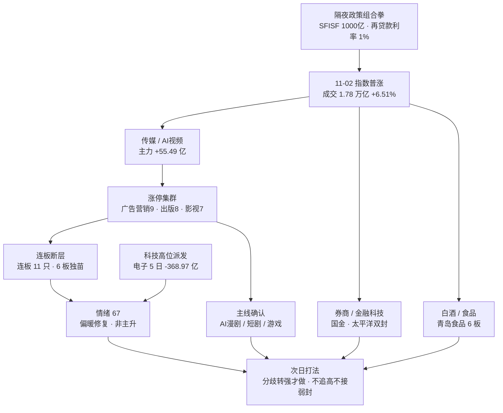

# 2026-11-03（周二）· **情绪与热度共振**

> **数据源新鲜度**: partial
> **降级状态**: true（群聊断更 6 日 · WeFlow 永久缺位 · L1 取 T-1 收盘榜）
> **置信度**: 0.45

## 一句话结论

AI 内容（漫剧/短剧/游戏）是唯一三榜同向的付钱方向，但只是修复第 2 天的单日脉冲；情绪 67 偏暖不亢奋，打板接力仍弱。

## 详细分析

**第一层，温度是回暖的，但回暖的质量不高。** 11-02 涨停 125 家、跌停 8 家、炸板 28 家（炸板率 18.30%）、成交 17832 亿（+6.51%）、上涨 4382 家（占比 85.1%）。这组数字放在任何一天都算强修复。但把天梯拆开看：125 家涨停里 114 家是首板，连板只剩 11 只，最高板是青岛食品的 6 板独苗，1 层出现空缺。数量修复了，接力没有修复——这正是 R1 把它定性为「高位震荡 + 修复段第 2 天」而不是「主升」的原因。情绪分给 67，不给 75 以上，就是扣在这里。

**第二层，钱只往一个方向去。** R7 数据显示，11-02 传媒主力净流入 +55.49 亿，是当日第一大流入行业；AI视频概念 +23.81 亿（5 日 +23.80 亿，几乎全部来自当日）；影视概念 +23.94 亿。涨停行业分布也在同一方向：广告营销 9 家、出版 8 家、影视院线 7 家、游戏Ⅱ 7 家、数字媒体 5 家。L1 概念榜同步给出 AI视频 第 1（+8.77%）、AI应用 第 2（+5.46%）、短剧游戏 第 4（+8.30%）。三套独立数据（概念榜、涨停行业、主力资金）指向同一条线，这是本次唯一够格称为「共振」的方向。

**第三层，文本层只剩半边。** 7 个焦点群的本地库最后一条停在 2026-10-28 上午，微信客户端未运行，跨 6 个交易日没有新消息，实测全部返回 0 条。按 skill 降级规则，文本层由当日 88 篇公众号代位（L2b）：其中官媒 70 篇（证券时报 38、上海证券报 32）、自媒体 18 篇。官媒给了政策与涨停潮的硬事实，自媒体给了「互动影游」「400 多亿援军」「明天短剧能不能接是高难度题」这类真实分歧。但必须承认：这不是群聊情绪，不能按满配 L1+L2 解读，置信度因此压到 0.45。

**第四层，政策是隔夜增量，不是当日共识。** 央行 11-03 开展第三次 SFISF 操作、申请额度超 1000 亿；回购增持再贷款利率由 1.25% 降至 1%、并由阶段性安排转为长期制度；证监会研究优化融资保证金比例与折算率；18 只主动 ETF 已募 350 亿、要求加快建仓。券商当日给出回应：国金证券、太平洋双涨停且均零开板，东方财富 +6.31%、东财人气 24→2，银之杰 20cm。但非银 5 日仍 -25.04 亿、证券Ⅱ 5 日 -28.04 亿，说明这是长期失血板块的第一次政策脉冲，只能按 early 试错对待。

**第五层，科技还在派发，且是最硬的反证。** 东山精密当日主力净流入 +13.44 亿、全市场第一，股价 +7.13%，却涨停炸板；中际旭创 -0.54%；电子 5 日 -368.97 亿、通信设备 5 日 -95.41 亿。上海证券报直接把存储链写成「业绩热、股价冷」——江波龙、德明利、佰维存储前三季净利同比 +1909%、扭亏、+28728%，股价却自高点回撤 70% 以上，券商投资部的原话是「利好兑现式出货」。猫笔刀也确认「光模块和芯片没有参与反弹，只想着趁行情继续卖」。这意味着：今天的修复是内容与政策的修复，不是科技的修复，抄科技反抽属于模式外。

## 情绪温度表

| 维度 | 数值 | 判定 |
|---|---|---|
| R1 情绪基线 | 68.0（贪婪） | 连板情绪型 · high_chop · 仓位上限 55% |
| R3 共振修正 | **-1.0**（+4.0 / +2.0 / -2.0 / -2.0 / -3.0） | 主线确认加分，结构与资金底座扣分 |
| **R3 情绪分** | **67.0** | 偏暖修复，非亢奋 |
| 五维交叉（独立复算） | 68.0 | 涨停 100 / 跌停 84 / 天梯 72.2 / 炸板 26.8 / 资金 38.5 |
| gap | 1.0 | < 15，无背离 |
| 涨停 / 跌停 / 炸板 | 125 / 8 / 28 | 炸板率 18.30%，低于 35% 红线 |
| 连板结构 | 连板 11 只 · 首板 114 只 · 最高 6 板 | 天梯断层，接力偏弱 |
| 广度 | 4382 涨 / 767 跌（85.1%） | 普涨修复 |
| 成交额 | 17832 亿（+6.51%） | 温和放量 |
| 昨日涨停溢价 / 再涨停 | +2.83% / 11 只 | 未过 +3%，赚钱效应刚转正 |
| 主力资金 | 当日 +119.54 亿 / 5 日 -1217.57 亿 | 存量回补，不是增量 |
| 两融（截至 10-30） | 5 日 -886.28 亿 | 杠杆仍在撤 |

## 双源共振总览

| # | 主题 | 共振等级 | L1 热度 | L2b 文本 | 资金确认 | 阶段 | 候选 |
|:-:|---|:--:|---|---|---|---|:--:|
| ① | AI 漫剧 / AI 视频（内容侧） | L1+L2b | 概念第 1/第 2/第 4；涨停行业 4 条 | 财联社 + 证券时报 + 股痴流沙河 + 财闻私享 | 传媒 +55.49 亿（当日第一） | middle | 芒果超媒、上海电影 |
| ② | 短剧游戏 / 游戏 | L1+L2b | 短剧游戏 第 4；游戏Ⅱ 7 家涨停 | 版号 195 款 + 影之刃零 400 万 + DLSS5（11-05） | 传媒子线，无独立 5 日转正 | middle | 巨人网络、掌阅科技 |
| ③ | 券商 / 金融科技 | L1+L2b | 证券Ⅱ +4.48%；东财 24→2 | SFISF 1000 亿 + 再贷款利率 1% + 主动 ETF 350 亿 | 非银 +31.61 亿，5 日 -25.04 亿 | early | 东方财富、国金证券 |
| ④ | 白酒 / 食品 | L1+L2b | 青岛食品 40→9（6 板）、泉阳泉 50→24 | 茅台重回 1400 + 机构净买 2.49 亿 | 白酒 5 日 +23.55 亿 | middle | 青岛食品、贵州茅台 |

## TOP 主题深度（推理三问）

### ① AI 漫剧 / AI 视频（内容侧）

- **大资金意图**: 机构在给「AI 应用变现最快的一条内容赛道」定价——海外短剧付费前十中国占 9 席、AI 漫剧活跃用户 1.5 亿、上海电影联合即梦 AI 首发内测 Seedance2.5，这些都是可验证的产业进度，不是纯题材。传媒当日主力 +55.49 亿，对手盘是 10 月持续失血的存量筹码（传媒 5 日仍 -2.94 亿、20 日 -61.11 亿），属于典型「长期没人要的板块第一次被重仓回补」。
- **为什么走强**: 位置是长期低位（传媒 20 日主力深度净流出）+ 催化是硬的（AI 漫剧出海数据、Seedance2.5、3A 游戏销量）+ 筹码是新进的（芒果超媒东财人气新进第 3、捷成股份新进 11、掌阅科技新进 19）。20cm 涨停里芒果超媒封单超 42 万手、零开板，是全场板型最硬的一只。
- **逻辑够不够硬**: 三个独立源同向（概念榜、涨停行业、主力资金）+ 一个硬产业数据（海外短剧前十中国 9 席）+ 一个硬时间锚（11 月优质供给密集上线）。够硬，但硬在「一天」——5 日资金没转正、传媒龙虎榜已出现净卖（芒果超媒 -0.53 亿、慈文传媒 -0.71 亿），所以定性为 middle 而不是 early，只做分歧转强，不做加速追高。

### ② 短剧游戏 / 游戏

- **大资金意图**: 游戏是 AI 内容里现金流最实的一档——世纪华通前三季营收 332.98 亿、巨人网络营收 +98.45%、恺英网络 +78.11%，版号供给稳定（10 月 195 款、全年 1766 款）。资金买的是「AI 降本 + 版号放量 + 3A 出海」三重确定性，不是单纯炒概念。
- **为什么走强**: 位置中位（游戏Ⅱ 不是超跌最狠的一档）+ 催化密集（《影之刃零》72 小时 400 万份、Steam 畅销第一；DLSS5 11-05 登陆 3A 大作；互动影游新分支）+ 筹码分散（巨人网络首封后仅 1 次开板、掌阅科技零开板）。游戏Ⅱ 7 家涨停，是传媒之外唯一成规模的子行业。
- **逻辑够不够硬**: 有硬数据（销量、版号、财报）、有硬时间锚（11-05），但缺少独立资金口径（游戏没有单独的 5 日主力转正证据），只能作为主题①的子线。若次日传媒整体转负，游戏无法独走——这是它的证伪路径。

### ③ 券商 / 金融科技（政策组合拳）

- **大资金意图**: 这不是市场自发选择，是政策直接指定的增量——SFISF 申请额度超 1000 亿、要求「报足做实、大型机构带头、拿到央票尽快融资开展投资」，同时 18 只主动 ETF 已募 350 亿被要求加快建仓。买券商等于买「政策执行力」，对手盘是过去两个月持续减仓的杠杆资金（非银 5 日 -25.04 亿）。
- **为什么走强**: 位置低（非银 20 日持续失血）+ 催化硬（11-03 招标、再贷款利率下调、融资保证金研究优化）+ 筹码新（东方财富东财人气 24→2、银之杰 20cm 新进、太平洋新进 13）。国金证券与太平洋均早盘首封、零开板，是政策线里板型最干净的两只。
- **逻辑够不够硬**: 政策是硬的，但市场响应只有 2 家涨停，不构成「券商集体涨停」的风格切换确认；猫笔刀直接说 1000 亿「有点用，但不够」，参照两年前经验起码再加一个零。硬政策 + 弱响应 = early 试错，不是主线。证伪路径很清楚：次日国金/太平洋炸板且非银转负，政策脉冲结束。

### ④ 白酒 / 食品（消费防御 + 6 板空间龙）

- **大资金意图**: 机构在修复日买「确定性现金流」——茅台重回 1400 元、创半年新高，机构净买入 2.49 亿；白酒 5 日 +23.55 亿、食品饮料 5 日 +20.86 亿，是五日内少数持续为正的方向。对手盘是前期抱团科技的基金，属于风格再平衡的受益端。
- **为什么走强**: 位置中位偏上（茅台创半年新高）+ 催化偏软（三季报单季改善、无强政策）+ 筹码集中（青岛食品 6 板零开板、皇台酒业 2 板零开板）。青岛食品是整个市场唯一 6 板，空间龙地位明确，但成交仅 7.72 亿，容量有限。
- **逻辑够不够硬**: 资金底座是四个主题里最硬的（5 日双正），但当日单日白酒 -2.45 亿、食品饮料 -3.94 亿——是「不失血」而不是「被抢」，且 6 板独苗意味着接力风险极高。结论：只把茅台当趋势中军、青岛食品当情绪温度计，不接力 6 板。

## 出货警报与红线

| 对象 | 状态 | 证据 | 处置 |
|---|:--:|---|---|
| 商业航天 | 警报到期 | 10-29、10-30 连续两日概念榜第 1，当日 -2.21% / -4.00%；11-02 降至第 5（+2.38%） | 不作正向共振；R5 对龙头的高位风险标记建议保留一个观察周期 |
| 人形机器人 | 警报到期 | 10-19~10-28 共 7 个观测日居第 1（中间被数据要素打断），11-02 第 3（+2.06%） | 已从主线降为个股标签，本单元不给正向分 |
| 科技高位（光模块/PCB/存储） | **风险透传** | 东山精密主力第一却涨停炸板；电子 5 日 -368.97 亿；上证报直指存储「利好兑现式出货」 | 不进共振榜，写入 excluded_themes，R5/R6 需对高位票加派发标记 |
| AI视频（当日第 1） | 未触发红线 | 仅 1 个观测日居第 1（+8.77%），不满足「霸榜 ≥2 日」 | 正常给正向共振，但当日即 middle，不追高 |

## 单源主题透传（不进共振榜）

| 主题 | 等级 | 为什么单源 | 处置 |
|---|:--:|---|---|
| 人形机器人 / 物理 AI | L1_only | 概念第 3 但无 L2b 深度拆解、无板块资金确认；襄阳轴承的驱动是「羊/阳字辈 + 减速器」双标签 | 只记录，不作为付钱方向 |
| 商业航天 | L1_only | 概念第 5，88 篇公众号无一条把它当主攻 | 只记录，警报已到期 |
| 名字套利 / 地名+ | L1+L2b 但 late | 襄阳轴承双榜第 1、澳洋健康 4 板、东方海洋 3 板；但 12 只相关票中 8 只盘中开板（沈阳机床 8 次、国芳集团 9 次） | **明确不进**：纯情绪、板型差、已 late，属模式外 |
| 存储芯片 / DRAM | L2b_only | L1 未进前 5；文本是「业绩热股价冷」，资金是单日回补（兆易 +9.41 亿、君正 +7.00 亿） | 透传 R5/R7 做超跌修复观察，R3 不给共振分 |
| 健康消费 | L2b_only | 仅股痴流沙河一篇提及，无 L1 热度、无资金 | 只记录 |

## 首推观察票思维链（研究级，不授开仓权）

### 芒果超媒（300413.SZ）· 主线总龙候选

- **买入理由**: ① AI 漫剧/短剧主线的板型最强标的——20cm 涨停、零开板、封单超 42 万手，平台+内容双属性，是传媒板块的总市值与情绪双龙头；② 位置不极端——11-02 收盘 26.76 元，距 20 日高仍有空间，且是东财人气新进第 3（不是连续霸榜的高位票），符合「做龙头不做中位」的纪律。
- **风险点**: ① 传媒 5 日主力仍 -2.94 亿，当日 +55.49 亿是脉冲，龙虎榜已出现净卖 -0.53 亿，「钱真、板硬、底座假」的风险存在；② 20cm 品种日内波动大，若次日高开低走，-5% 的止损带会被瞬间击穿，容错空间只有主板的一半。
- **止损条件**: 25.42 元（11-02 收盘价 -5% 的机械止损带），跌破即出，不做盘中「再等等」。
- **可验证假设**: 次日开盘 30 分钟内不破 25.42 元、且传媒概念主力净流入仍为正 → 「AI 内容是修复段主线」成立；若开盘即炸板或全天封不住涨停价 26.76 元并收跌 >5% → 主线证伪，全部 AI 内容候选降级。

### 上海电影（601595.SH）· AI 漫剧核心（20cm 主板弹性）

- **买入理由**: ① 与即梦 AI 联合首发内测 Seedance2.5，是 AI 视频里少数有「模型—内容」直接绑定的标的，产业逻辑比纯 IP 股硬；② 10cm 首封零开板、成交 3.96 亿，封板质量干净，且不在东财人气前 20（未被散户挤爆），符合「低位前排」而非「高位杂毛」。
- **风险点**: ① 市值与成交容量偏小，一旦传媒板块退潮，流动性折价会放大跌幅；② Seedance2.5 仍在内测，商业化节奏不可控，若 11 月无上线/付费数据，催化会空窗。
- **止损条件**: 28.74 元（11-02 收盘价 -5%），或 AI视频概念跌出同花顺前 5 且传媒主力转负，二者任一触发即出。
- **可验证假设**: 次日守住 28.74 元且 AI视频概念仍在前 3 → 「AI 视频是内容侧最强子线」成立；若概念跌出前 5 且个股跌破 28.74 元 → 子线证伪，只保留芒果超媒一只观察。

### 东方财富（300059.SZ）· 政策线总入口

- **买入理由**: ① 政策组合拳的最直接受益标的——SFISF、融资保证金优化、主动 ETF 建仓三条都指向券商与金融科技，东财是流量+经纪+基金代销的总入口；② 东财人气 24→2（+22）、同花顺热股新进 19、当日主力 +12.30 亿，是政策线里唯一「人气与资金同步跳升」的票。
- **风险点**: ① 非银 5 日 -25.04 亿、证券Ⅱ 5 日 -28.04 亿，长期失血板块的政策脉冲经常一日游；② 券商只有 2 家涨停，没有出现「集体涨停」的风格切换确认，东财 +6.31% 也未涨停，强度弱于国金/太平洋。
- **止损条件**: 17.77 元（11-02 收盘价 -5%）；若国金证券、太平洋次日双双炸板且非银主力净流出 >10 亿，直接放弃，不等止损。
- **可验证假设**: 次日东财守 17.77 元、证券Ⅱ 主力不转负 → 政策线延续，可留作观察；若非银转负且券商涨停家数归零 → 政策脉冲证伪，主题③降级。

## 次日情绪方向：修复第 2 天，验证 / 分歧

| 情景 | 触发条件 | 动作 |
|---|---|---|
| 高开兑现 | 竞价高开 >1.5%，30 分钟内炸板家数 >20 | 一律不追，AI 内容按利好兑现处理，只留观察 |
| 平开走稳 | 平开且传媒/游戏维持概念前 5、券商不破前日涨停价 | 主线内做分歧低吸（相对 11-02 涨停价仍低的位置），单票 ≤ 试验仓 |
| 二次探底 | 低开且跌停盘初 >20 或传媒概念转负 | 修复证伪，全部候选降级观察，不接反抽 |

三条判断锚：① 广度 >0.55（11-02 为 0.851，防高位回落）；② 昨日涨停红盘率 >60%（11-02 为 66.0%）；③ 传媒/AI 内容 ≥5 家涨停且至少 1 只 2 板以上——只有首板群就是一日游。

四条证伪条件：传媒次日转负或主力净流出 >20 亿；芒果超媒/上海电影炸板或高开低走 >5%；券商一日游（国金/太平洋炸板且非银转负）；炸板率回升 >35% 或跌停 >30 家。

## 关键证据

- 证据 1：11-02 传媒主力净流入 +55.49 亿、AI视频概念 +23.81 亿，是当日唯一「概念榜第 1 + 涨停行业 4 条 + 资金第一」三重同向的方向 · 来源 attention_signals_T1 / R7_capital_flow
- 证据 2：125 家涨停中首板 114 家、连板 11 只、最高 6 板独苗、炸板 28 家（18.30%）——数量修复但接力未修复 · 来源 tushare_limit_list
- 证据 3：7 个焦点群跨 6 个交易日 0 条新消息，微信客户端未运行；文本层由 88 篇公众号代位（官媒 70 / 自媒体 18） · 来源 wechat_cli_7groups / wechat_official_rss
- 证据 4：央行 11-03 开展第三次 SFISF（申请额度超 1000 亿）、回购增持再贷款利率 1.25%→1%、证监会研究优化融资保证金比例、18 只主动 ETF 已募 350 亿 · 来源 wechat_official_rss（证券时报 12 篇 + 上海证券报 6 篇）
- 证据 5：东山精密主力 +13.44 亿（全市场第一）却涨停炸板；电子 5 日 -368.97 亿；上证报称存储「利好兑现式出货」 · 来源 R7_capital_flow / wechat_official_rss

## 数据源审计

| 源 | 日期 | 状态 | 备注 |
|---|---|:--:|---|
| R1_style | 2026-11-03 | 🟡 | 1 条 · 情绪 68.0 / high_chop，上游自评 degraded（0.49） |
| attention_signals（T-1） | 2026-11-02 | 🟢 | 320 条 · 四榜 100/100/100/20，11-03 盘前抓取 |
| attention_weekend | 2026-11-01 | 🟢 | 320 条 · 10-30/10-31/11-01 三日，周末持续 25 只 |
| ths_concept_multi_day | 2026-11-02 | 🟢 | 30 个观测日 · 红线 4 霸榜判定 |
| tushare limit_list_d | 2026-11-02 | 🟢 | 161 条 · U125/D8/Z28，最高 6 板 |
| tushare daily | 2026-11-02 | 🟢 | 5571 条 · 全市场收盘价 |
| datapro mf_industry/concept | 2026-11-02 | 🟢 | 行业/概念主力资金，与 R7 交叉一致 |
| R7_capital_flow | 2026-11-03 | 🟢 | 1 条 · 行业/概念/个股资金 + 龙虎榜 |
| wechat_cli 焦点群（匿名） | 2026-10-28 | 🔴 | 0 条 · 7 群停更，客户端未运行，跨 6 个交易日 |
| wechat_official_rss | 2026-11-03 | 🟢 | 88 篇 · 15 个号（官媒 70 / 自媒体 18） |
| weflow-analytics | — | 🔴 | 永久下线（2026-08-19），snapshot ConnectError |

## 不确定性 / 反证

1. **文本层失真风险最高。** 88 篇文章里 79.5% 是官媒，天然偏正面叙事；自媒体只有 18 篇，且多为盘后复盘（事后归因），不等于盘前预期。用它替代群聊情绪，可能系统性高估情绪温度——这是 0.45 置信度的主要来源。
2. **L1 是 T-1 收盘榜。** 11-02 收盘后到 11-03 开盘之间，隔夜纳指 +0.80%、纳斯达克中国金龙 +3%，可能已经改变盘前情绪；本单元无法捕捉竞价后的变化。
3. **单日脉冲 vs 趋势。** 传媒 5 日 -2.94 亿、计算机 5 日 -132.96 亿、全市场 5 日 -1217.57 亿，当日流入是存量回补。若次日资金不续，今天的所有共振都会退化为一日游。
4. **连板断层是反向证据。** 125 家涨停只有 11 只连板、6 板独苗，说明游资在高位是谨慎的；用「涨停多」推导「情绪好」会高估。
5. **名字套利与地名+的活跃是情绪温度计，也是风险信号。** 当资金开始炒「羊/阳/海洋/地名」，通常意味着主线不够硬、资金在找借口；这与 AI 内容的产业逻辑形成对冲。
6. **R1 上游 degraded。** 外盘、两融、商品三项数据缺口，情绪基线 68.0 本身的置信度只有 0.49，R3 的 67.0 继承了这个不确定性。

## 与其他 R/D/E 的关系

- **依赖**: `R1_style.json`（情绪基线 68.0 / high_chop）、`attention_signals.json`（T-1 四榜）、`attention_weekend.json`、`limit_list_d`、`daily`、`mf_industry/concept`、`R7_capital_flow`、`wechat_official_rss`。R4 本单元运行时尚无产出（`data/research/20261103/` 只有 R1 与 R7），事件层由本单元从 88 篇公众号自行抽取，不做事件定级。
- **被消费**: D1（主线浓度与情绪温度）、R6（反证输入：单日脉冲、连板断层、文本层失真）、E1（次日回填情绪分与主题表现）。

## Sub-Agent 元数据

- skill: analyze_sentiment_resonance_v1@1.0
- artifact: data/research/20261103/R3_sentiment.json
- 生成耗时: 约 18 分钟（含 30 个观测日概念榜回扫、88 篇公众号抽取、五维独立复算）
- model: deepseek-v4.1-flash
