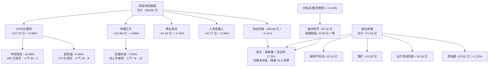

# 2026 年 11 月 04 日 · **群聊情绪共振**

> **数据源新鲜度**: partial（L1 新鲜 · L2 群聊 stale · L2b 公众号当日新鲜）
> **降级状态**: degraded=true（群聊断更第 5 日 + WeFlow 永久缺位）
> **置信度**: 0.42

## 一句话结论

情绪 34.0 · **恐惧退潮**：科技四线单日失血 409.83 亿，锂电上游与消费白马只承接 71.56 亿（17.5%），切换未完成，无主线不开新仓。

## 详细分析

### 一、盘面定性：这不是普跌，是「主线崩塌 + 低位试探」同时发生

11-03 的读数放在一起看，指向的是同一件事——**前一日的主线死了，新主线还没立起来**。

| 指标 | 11-02（修复首日） | 11-03（T-1 回吐） | 变化 |
|---|---|---|---|
| 涨停家数 | 125 | 48 | −61.6% 🟥 |
| 跌停家数 | 3 | 17 | 5.7 倍 🟥 |
| 炸板率 | 17.6% | 41.46% | 破 35% 阈值 🟥 |
| 涨幅家占比 | 84.0% | 37.85%（2023 涨 / 3045 跌） | −46.2pct 🟥 |
| 最高板 | 6 板 | 4 板 | 高度回落 🟨 |
| 昨日涨停收盘溢价 | — | +0.95%（未达 +1% 修复线） | 不确认 🟨 |
| 成交额 | 17832 亿 | 17029 亿（−4.50%） | 缩量 🟨 |

炸板率 41.46% ≥ 35%，按纪律所有输出标 **情绪=震荡/主跌**，候选数砍半。涨停行业从 AI 传媒（广告营销 9 / 出版 8 / 影视院线 7）一夜切换到电池 7 / 一般零售 4 / 服装家纺 3——这是**换防**，不是**扩散**。换防第一天的涨停板是不能接的，因为承接方自己都还没证明能连板。

### 二、钱从哪里走、往哪里去：流出是流入的 5.7 倍

流出集群 409.83 亿，承接集群 71.56 亿，比值 **5.7 : 1**。这个比例说明两件事：一是科技里的钱是真的走了（不是洗盘，中际旭创单票 293 亿成交、−12.69%，新易盛 174 亿、−9.46%，都是放量出货形态）；二是低位方向只够「有人试」，不够「有人抢」。

### 三、锂电上游：唯一「量价资金」三者都不矛盾的方向

电池行业 7 家涨停是全场最多，锂电池概念 up_nums 10 家、3 天 2 板。但必须切开看：**上游在吸金、中游在失血**。锂矿 +16.30 亿（前一日 +8.33 亿，加速）、钠离子电池 +18.16 亿（前一日 +11.33 亿，连续两日）、动力电池回收 +16.18 亿、麒麟电池 +12.08 亿；而锂电池概念板块资金 −5.84 亿、固态电池 −3.41 亿、板块指数 −0.82%。这是典型的「上游涨价逻辑 + 中游杀估值」并存结构，不是板块整体走强。

**大资金意图**：用锂矿/钠电/回收三个上游分支做低位卡位，宁德时代 +3.80%、155 亿成交是「中军不倒」的锚，圣阳股份封 2.57 亿（全场最硬封单）是「先锋试盘」。
**为什么走强**：碳酸锂产业链价格与固态电池产业化叙事的双重低位修复，叠加科技崩塌后的资金避风港需求；公众号侧上海证券报《「宁王」大涨！电池板块多股涨停》、财联社《固态电池逆势活跃…核心公司 20cm 涨停》同日印证。
**逻辑够不够硬**：**半硬**。硬在资金连续两日同向（钠电 11.33→18.16、锂矿 8.33→16.30）+ 涨停家数全场第一 + 封单质量最好；软在中游仍在失血、板块指数收跌、最高板只到 2 板（紫竹高科），没有 3 板以上龙头站出来。判断为 **early（首日上榜，1 日龄）**，可以观察，不可以重仓。

### 四、消费白马：资金只买权重，不买题材

茅指数连续两日资金全场第一（11-02 +23.08 亿 / +1.95% → 11-03 +20.92 亿 / +2.13%），贵州茅台逆市 +2.84%、成交 108.3 亿；涨停侧一般零售 4 家 + 服装家纺 3 家 + 饮料乳品 2 家 + 白酒 1 家 = **10 家**，比电池的 7 家更多。

但结构很脆：零售概念 −1.38 亿、乳业 −2.15 亿、新零售 −6.83 亿，全在流出；涨停小票封单薄得可怜（大连友谊 0.19 亿、友好集团 0.20 亿、大东方 0.23 亿）。也就是说 20.92 亿几乎全进了茅指数权重，题材小票只是「被指数带起来的跟风位」。

**大资金意图**：在无主线 + 主跌修复未确认的阶段，把仓位临时停泊在确定性最高的权重资产，同时用低位零售/服装小票维持盘面活跃度。
**为什么走强**：政策组合拳（证监会维护平稳、千亿互换便利落地、30 余家回购增持、回购增持贷款加速）给权重资产提供下限；白酒国庆后动销与提价预期提供基本面抓手。
**逻辑够不够硬**：**偏软**。资金只认中军（茅台），不认题材；皇台酒业 4 板是唯一高度，但流通市值 30.4 亿、封单 1.38 亿、换手 1.93%，属锁筹型小票而非板块龙头。判断 **middle（资金已连续两日）**，作为防御观察，不作为进攻方向。

### 五、红线与背离：人气榜成了出货榜

同花顺热股榜前 10 里，中际旭创（第 7、−12.69%）、大业股份（第 6、−10.02%）在跌；东财人气榜第 2 的中际旭创跌 12.69%、第 8 的新易盛跌 9.46%、第 12 的长鑫科技跌 7.00% 并创上市新低。人气越高、跌幅越大，这是**人气滞留型派发**——眼球还在，钱已经在走。

同时 **襄阳轴承已构成红线 4 派发警报**：10-30、11-02 连续两个观测日霸榜同花顺热股第 1，11-03 掉到第 4（+1.86%），人气见顶后价格不跟。

## 双源共振主题

群聊层（L2）断更，文本层由当日 88 篇公众号代位（标 L2b）。按 skill 定义，L2b 不计入原生共振等级，以下两条为 **L1 + L2b**，置信度已打折。

### ① 锂电上游（钠离子电池 / 锂矿 / 动力电池回收） · L1+L2b · early

| 维度 | 证据 |
|---|---|
| 榜单（L1） | 锂电池概念新进第 20 位，up_nums 10 家全场第一（3 天 2 板）；圣阳股份热股 61→8；宁德时代人气 64→24；东财飙升榜新进武汉蓝电 #3（+8.9%）、宝明科技 #4（+10.0%）、博力威 #5（+7.1%） |
| 文本（L2b） | 上海证券报《「宁王」大涨！电池板块多股涨停》；财联社《固态电池逆势活跃 栏目解读行业政策 核心公司 20cm 涨停》 |
| 资金 | 钠离子电池 +18.16 亿（两日连增）、锂矿 +16.30 亿（加速）、动力电池回收 +16.18 亿、麒麟电池 +12.08 亿、换电 +9.65 亿 |
| 涨停 | 电池行业 7 家；圣阳股份 1/1 封 2.57 亿（全场最硬）、紫竹高科 2/2 封 0.73 亿、丰元股份/龙蟠科技/时代万恒/尚水智能/野马电池各 1 板 |
| 位置 | early（概念首日进榜，1 日龄，无 3 板以上龙头） |

### ② 消费白马（白酒 / 茅指数 / 低位零售服装） · L1+L2b · middle

| 维度 | 证据 |
|---|---|
| 榜单（L1） | 茅指数资金连续两日全场第一；白酒概念 3→9→5 位（+0.86%）；超级品牌新进 12 位；同花顺漂亮 100 新进 18 位；七匹狼热股 40→14（+10.01%） |
| 文本（L2b） | 证券时报《001230，准「天地板」！贵州茅台，逆市大涨》；证券时报《超 30 家 A 股公司，进场！股票回购增持贷款再加速》 |
| 资金 | 茅指数 +20.92 亿（+2.13%）、白酒 +1.48 亿（+0.92%）；反向：零售 −1.38 亿、乳业 −2.15 亿、新零售 −6.83 亿 |
| 涨停 | 一般零售 4 + 服装家纺 3 + 饮料乳品 2 + 白酒 1 = 10 家；皇台酒业 4/7 板封 1.38 亿 |
| 位置 | middle（资金连续两日，属防御性停泊，非进攻主线） |

## L1 单源（不进共振）

| 主题 | 证据 | 否决理由 |
|---|---|---|
| 中船系 / 海洋经济 | 概念榜第 1（+3.44%）；财联社《到 2030 年我国海洋生产总值预计将突破 13 万亿元》 | 海洋经济 −20.16 亿、船舶制造 +0.08 亿 ≈ 零，价格强而资金零承接 = 单源，红线 4 不进 |
| 猪肉 / 农业 | 概念榜第 3（+2.34%）；百洋股份新进人气 #20（+9.96%） | 无资金 top20、无涨停聚集，单源不进 |
| 光伏 / 储能 | 储能 up_nums 7 首板、光伏概念 up_nums 7（2 天 2 板）；上海证券报《光伏板块，连续两日拉升》 | 同花顺概念榜前 20 无身影，热榜层未确认，L1 缺失 |

## 排除清单（叙事正面但量价背离 / 纯资金流出）

| 主题 | 量价 | 资金 | 判定 |
|---|---|---|---|
| CPO / 光模块 / 算力 | 概念榜第 2 而 −5.02%；中际旭创 −12.69%、新易盛 −9.46%、天孚通信 −12.8% | −157.76 亿（−5.99%） | 叙事与价格背离，出货，不做二波 |
| 存储芯片 | 榜 15（−4.82%）；长鑫科技 −7.00% 创上市新低 | −124.96 亿（−4.86%） | 海外强 / A 股弱，背离 |
| 商业航天 | 榜 8（−2.00%）；一箭十八星 + 600261 四连板（叙事正面） | −64.34 亿 | 事件驱动但量价负，只做事件不参与共振 |
| 人形机器人 | 榜 6（−2.75%）；大业股份 −10.02% | −62.77 亿 | 小米落地进展属 L2b 消息，无资金承接 |
| AI 应用 / AI 视频 / 短剧游戏 | AI 视频榜 1→16（+8.77%→−0.80%）一日游；短剧游戏仅 +0.12% | AI 应用 −23.97 亿 | 动能衰减，文投控股开板 10 次 |
| 创新药 / CRO | 榜 9（−0.95%） | −24.64 亿 | 前一日流入已回吐 |

## 关键证据

- **证据 1**：科技四线合计失血 409.83 亿（CPO −157.76 / 存储 −124.96 / 商业航天 −64.34 / 机器人 −62.77），承接侧仅 71.56 亿，比值 5.7:1 · 来源 tushare `moneyflow_ind_dc`（20261103）
- **证据 2**：炸板率 41.46%（34 家炸板 / 48 家涨停）、跌停 17 家、涨家占比 37.85%、昨日涨停收盘溢价 +0.95% 未达修复阈值 · 来源 R1 `market_structure`
- **证据 3**：人气与价格背离——东财人气 #2 中际旭创 −12.69%、#8 新易盛 −9.46%、#12 长鑫科技 −7.00% 创新低 · 来源 `dc_hot` + `daily_20261103`
- **证据 4**：锂电上游资金两日连增（钠电 11.33→18.16 亿、锂矿 8.33→16.30 亿）+ 电池行业 7 家涨停全场最多 · 来源 `moneyflow_ind_dc` + `limit_U_20261103`
- **证据 5**：茅指数资金连续两日全场第一（23.08 → 20.92 亿），茅台逆市 +2.84%/108.3 亿 · 来源 `moneyflow_ind_dc` + `daily_20261103`

## 个股思维链

### 圣阳股份（002580.SZ）· 锂电上游先锋 · 首板封 2.57 亿全场最硬

- **买入理由**：钠离子电池 + 动力电池回收双概念，11-03 首板封 2.57 亿（全场最大封单）、开板 0 次、换手 8.77%，热股榜 61→8、东财人气新进 #3，多平台合力 5.5；同向资金连续两日流入钠电（+11.33 → +18.16 亿），属「板块合力」而非单票抱团。
- **风险点**：流通市值 84.5 亿，属中位小盘，一旦板块次日分化最先被砸；上游涨价逻辑只走了一天，锂矿/钠电板块指数当日几乎没涨（+0.02% / +0.67%），说明资金是「先占位后等验证」，验证失败会直接闷杀；大盘炸板率 41.46% 的背景下，首板次日溢价期望被压到 +1% 附近。
- **止损条件**：次日开盘低于涨停价 −3%（约 18.11 元）不接；盘中跌破首板实体下沿（约 17.70 元，即 −5%）无条件走；若开盘 30 分钟不能站上 19.10 元（+2.3%）按弱转强失败处理。
- **可验证假设**：①次日锂矿/钠电板块资金仍为正流入（≥ +5 亿）→ 上游逻辑延续；②电池行业再现 ≥3 家涨停 → 板块效应成立；③昨日涨停红盘率 ≥60% → 情绪允许接力。三条中两条不成立，视同逻辑证伪，当日不参与。

### 贵州茅台（600519.SH）· 消费白月中军 · 逆市 +2.84% / 108.3 亿

- **买入理由**：茅指数资金连续两日全场第一，茅台单票 108.3 亿成交逆市收涨 2.84%，是弱市里唯一有「大资金主动买」的权重锚；政策组合拳（回购增持贷款加速、千亿互换便利）直接利好权重资产的估值下限。
- **风险点**：中军不提供短线弹性，20% 仓位上限内做茅台等于用防守仓位换指数 β；消费涨停侧全是 0.2 亿级封单的杂毛（大连友谊 0.19 亿、友好集团 0.20 亿），一旦权重歇脚，题材小票没有任何承接力。
- **止损条件**：以 11-03 阳线实体中位（约 1455 元）为防守位，跌破且当日不能收回即视为防御失败；不做加仓摊薄。
- **可验证假设**：①茅指数第三日仍为正流入 → 防御线延续；②白酒概念涨停家数 ≥2 家 → 板块从权重扩散到题材；③两市成交额不再缩量（≥ 17500 亿）→ 有增量资金。三条中仅①成立时只做观察仓，不做进攻仓。

## 数据源审计

| 源 | 状态 | 抓取时间 | 记录数 | 备注 |
|---|---|---|---|---|
| R1 风格基线 | 🟢 ok | 2026-11-04 | 1 | 情绪 39.5 / 震荡分化型 / main_down / 仓位 20% / 自评 degraded |
| 人气榜管道（T-1） | 🟢 ok | 2026-11-03 | 440 | persistent 1923 / surge 18 / cross 63 |
| 同花顺概念榜 | 🟢 ok | 2026-11-04 | 60 | 三日各 20 行（10-30 / 11-02 / 11-03） |
| 同花顺热股榜 | 🟢 ok | 2026-11-04 | 300 | 三日各 100 行 |
| 东财人气 / 飙升榜 | 🟢 ok | 2026-11-04 | 400 | 两日各 100 行 |
| 涨停最强板块 | 🟢 ok | 2026-11-04 | 40 | 11-02 / 11-03 各 20 行 |
| 概念资金流 | 🟢 ok | 2026-11-04 | 1062 | 两日各 531 行 |
| 涨停明细 | 🟢 ok | 2026-11-04 | 48 | 含封单 / 开板 / 换手 / 连板 |
| 全市场日线 | 🟢 ok | 2026-11-04 | 5570 | 个股涨跌幅与成交额核对 |
| 群聊（7 群匿名） | 🟡 stale | 2026-11-04 | 0 | 全部 0 条，本地库停 10-28 上午，客户端未运行 |
| 公众号 RSS（16 账号） | 🟢 ok | 2026-11-04 | 88 | 17 feed 全 ok，1 空 feed |
| WeFlow | 🔴 error | — | — | 已永久下线（404） |

## 不确定性 / 反证

- **最可能错的地方**：把「科技崩塌」读成趋势而非单日调仓。11-03 深夜海外半导体/存储大涨（纳指 +0.83%、费半 +2.63%），若 11-04 A 股 CPO/存储高开修复，则 409.83 亿流出属于「节前式洗盘」，我的 34.0 分偏低至少 8–10 分。反证观察点：中际旭创能否收回 5 日均线、CPO 概念资金是否转正。
- **第二个风险**：锂电上游只走了一天，钠电/锂矿板块指数当日几乎零涨幅，资金是「占位」不是「抢筹」；若 11-04 上游不接力，圣阳股份这类首板会成为最直接的接盘位。
- **第三个风险**：消费白马的 20.92 亿全进权重，题材侧封单普遍 <0.5 亿，把「10 家涨停」当板块效应是过度解读——这 10 家里至少 7 家是杂毛。
- **数据层自省**：群聊层连续 5 日断更，等于砍掉了 skill 原本最重要的语义源；L2b 公众号偏正式、发文少，无法反映盘中的情绪突变。因此本次「共振」严格说是 L1 单源 + 文本佐证，等级标 L1+L2b 已属降级口径，不宜与有群聊的日子等量齐观。

## 与其他 R/D/E 的关系

- **依赖**：`data/research/20261104/R1_style.json`（当日情绪基线 39.5，未使用前一日）、`data/research/20261103/attention_signals.json`、`data/raw/20261104/wechat_official_rss.jsonl`
- **被消费**：D1（canghai-plan）取 `sentiment_score=34.0 / 恐惧 / 候选砍半` 与 `resonance_top_themes`；R6 反证取 `distribution_alert`（襄阳轴承红线 4、中际旭创/新易盛/长鑫科技人气背离）与 `excluded_themes`；R5 按 `suggested_stocks / watch_stocks` 排画像优先级；E1 盘后校验情绪分与次日实际溢价

## Sub-Agent 元数据

- **skill**: analyze_sentiment_resonance_v1
- **artifact**: data/research/20261104/R3_sentiment.json
- **人读报告**: data/research/20261104/_body_R3.md（由 publish_unit_md.py 发布到 chzl_kg/投研交易/群聊情绪/）
- **生成耗时**: 约 13 分钟（含 L1 三日榜单 / 资金 / 涨停明细拉取与 88 篇公众号抽取）
- **model**: deepseek-v4.1-flash
- **method**: llm_v1
