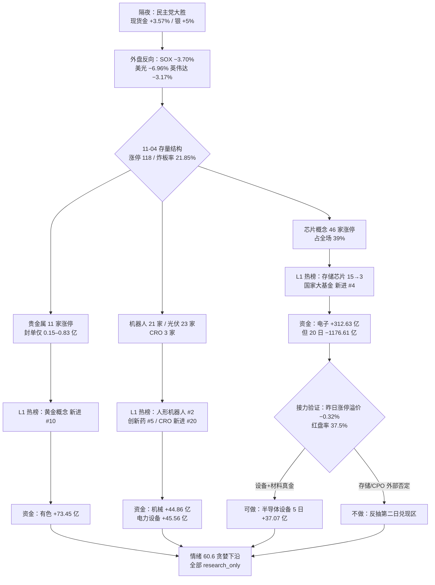

# 2026 年 11 月 5 日 · **群聊情绪共振**

> **双源口径**：L1 热榜 × L2b 公众号（L2 群聊连续第 6 日 0 条，L3 WeFlow 永久下线）
> **降级状态**：`degraded=true` · **置信度**：0.52 · **新鲜度**：partial

## 一句话结论

结构极强、接力极弱：118 家涨停里 46 家压在芯片一条链上，但昨日涨停收盘溢价 −0.32%、红盘率 37.5%，情绪只能给「贪婪下沿 60.6」——今日只做设备、贵金属、CRO 的低吸承接，不追存储与 CPO 的二日反抽。

## 情绪仪表盘

| 维度 | 读数 | 方向 | 解读 |
|---|---|:--:|---|
| 情绪浓度 | **60.6 / 100** | 🟡 | R1 当日基线 64.1（贪婪下沿），8 项修正净 −3.5 |
| 涨停 / 跌停 | `118 / 9` | 🟢 | 涨停为前日 48 家的 2.46 倍，跌停收敛到个位数 |
| 炸板率 | `21.85%`（33 家） | 🟢 | 远低于 35% 红线，不触发候选砍半 |
| 连板高度 | `3 板`（7 家） | 🟡 | 高度未打开，首板 105 家占 89.0% |
| 市场广度 | `4667 涨 / 779 跌`（83.76%） | 🟢 | 中位 +1.88%，成交 20519 亿（+19.64%） |
| 昨日涨停溢价 | 收盘 −0.32%（中位 −2.342%） | 🔴 | 红盘率 37.5%、再涨停 12/48 —— 打板仍在亏钱 |
| 主力资金 | `+500.28 亿`（净流入率 +2.46%） | 🟢 | 20 日最大单日，但 20 日累计仍 −4685.5 亿 |
| 主线集中度 | 芯片概念 `46 家`涨停（占 39%） | 🟢 | 单一产业链内部三层扩散，非抱团 |
| 修复段位置 | 第 4 个交易日（D4） | 🟡 | 同口径「强修复次日」样本 2/2 回吐 |

## 双源共振传导图

## 情绪浓度与五维交叉

五维加权（用 11-04 收盘结构独立复算，不引用 R1 结果）：

| 维度 | 权重 | 读数 | 得分 | 口径 |
|---|:--:|---|:--:|---|
| 涨停强度 | 0.25 | 118 家 | 98.3 | 118 ÷ 1.2，封顶 100 |
| 跌停压制 | 0.20 | 9 家 | 73.0 | 100 − 9×3 |
| 连板结构 | 0.20 | 最高 3 板 | 50.0 | 3 ÷ 6 × 100 |
| 炸板 | 0.15 | 21.85% | 12.6 | 100 − 4×21.85 |
| 杠杆外资 | 0.20 | 两融 22989 亿（5 日 −4.60%） | 65.0 | R7 读数 |

`0.25×98.3 + 0.20×73.0 + 0.20×50.0 + 0.15×12.6 + 0.20×65.0 = 64.1`

- **R3 多源分 = 60.6，五维分 = 64.1，gap = 3.5 < 15 → 无背离。**
- 差额全部来自前瞻性因素：隔夜外盘否定（−3.0）、龙虎榜诱多（−1.5）、人气与价格背离（−2.0），不是对当日结构有分歧。
- 结论：**当日结构确实在贪婪区，但前瞻信号指向「兑现」而非「加速」**，所以给「贪婪下沿」而不给「贪婪中位」。

## 五条共振主线

### 1️⃣ 半导体（存储 / 设备 / 先进封装）· `L1+L2b` · middle · **进（仅设备/材料）**

| 证据层 | 读数 |
|---|---|
| L1 概念榜 | 存储芯片 `15→3`（+9.24%，热度 130306 全场第 3）；国家大基金持股 新进 `#4`（+10.74%）；先进封装 新进 `#16`（+8.32%）；科创次新 新进 `#13`（+11.43%） |
| L1 涨停结构 | 芯片概念 `46 家`涨停（全场第一，占 118 家的 39%）；存储芯片 22 家；半导体及元件 19 家（+10.55%）；先进封装 19 家 |
| L1 个股人气 | 长鑫科技 东财 `43→25`（+13.63%）居人气 `#1`；云南锗业 新进 `#9`（+10.0%）；通富微电 / 长电科技 / 有研新材 / 华天科技 / 江丰电子 同日新进 |
| 封单质量 | 通富微电 3.80 亿 · 0 开板；北方华创 3.56 亿 · 0 开板；先导基电 3.11 亿 · 0 开板；长电科技 2.30 亿 · 开板 4 次 |
| 资金 | 电子 +312.63 亿 · 半导体 +195.89 亿 · 数字芯片设计 +82.47 亿；**5 日唯一净流入子行业 = 半导体设备 +37.07 亿** |
| 反证 | 20 日电子 −1176.61 亿、半导体 −454.59 亿；隔夜 SOX −3.70%、费半盘中 −5.00%（收 −3.13%）、美光 −6.96%、英伟达 −3.17% |

- **大资金意图**：+312.63 亿不是主动加仓，而是「国家队 ETF 托举 + 空头回补」的合成结果——猫笔刀记录的科创半导体 ETF 单日 315 亿天量只可能来自官军。对手盘是 7 月 3.3 万亿融资盘降到 2.6 万亿后的剩余杠杆多头。所以这笔钱的意图是「止跌」，不是「造势」。
- **为什么走强**：位置 = 超跌（30 日窗半导体类仍 −18% 至 −20%）；催化 = 长鑫回购上限提至 50 亿 + 磷化铟长单 + 存储现货涨价；筹码 = 首板 105 家、龙头封单 0 开板。三维里「位置」和「筹码」成立，「催化」只有事件没有业绩。
- **逻辑够不够硬**：不够硬。三个独立源（热榜、涨停结构、资金）共振成立，但硬时间锚只有「存储涨价」一条，且隔夜被美光 −6.96%、SOX −3.70% 直接否定。可证伪路径极短：今日竞价半导体高开 >3% 而封单 <1 亿，即兑现。**故分层：设备（5 日 +37.07 亿真金）＞ 材料（磷化铟/靶材）＞ 存储/CPO（外部否定，兑现区）。**

### 2️⃣ 贵金属（黄金 / 白银）· `L1+L2b` · early · **进（低吸，不追高开）**

| 证据层 | 读数 |
|---|---|
| L1 概念榜 | 黄金概念 新进 `#10`（+4.51%，热度 44830） |
| L1 涨停 | 贵金属 `11 家`涨停（兴业银锡、招金黄金、盛达资源、山金国际、四川黄金、湖南黄金、湖南白银、晓程科技） |
| 封单质量 | 山金国际 0.83 亿 · 开板 2 次；四川黄金 0.64 亿 · 开板 1 次；湖南黄金 0.15 亿 · 开板 3 次 —— **涨停潮成立、锁仓不成立** |
| 催化 | 现货金破 4070（+3.57%）、现货银 +5% 报 52.26、花旗 0-3 月目标 4500；民主党大胜打压美元美债 |
| 资金 | 有色金属 +73.45 亿（+4.67%）；贵金属行业 +10.45%、主力 +16.86 亿 |
| 瑕疵 | 黄金股无一只进入人气榜前 15 —— 榜位与涨停潮不同步 |

- **大资金意图**：买的是「美元信用折价」，不是 A 股黄金公司的业绩。对手盘是做多美元/美债的资金。这是宏观对冲盘，不是题材游资盘，所以封单薄、开板多、持续性取决于现货而非盘口。
- **为什么走强**：位置 = 中位（黄金股年内已有涨幅，非超跌）；催化 = 硬事件（中期选举 + 现货破 4070）；筹码 = 涨停 11 家但封单全部 <1 亿，筹码松散。三维里只有「催化」硬。
- **逻辑够不够硬**：中等偏硬。硬事件 + 现货连续两个交易日 + 资金净流入三源共振；但驱动是一次性政治事件，A 股是映射方不是定价方。证伪路径：现货金回落 4000 以下，或今日竞价高开 >5%（说明情绪已一次性打完）。

### 3️⃣ 人形机器人 / 物理 AI · `L1+L2b` · middle · **观察（等新龙头）**

| 证据层 | 读数 |
|---|---|
| L1 概念榜 | 人形机器人 `#2`（+4.78%，热度 144354 全场第 2）；机器人概念 `#14`（+3.59%） |
| L1 涨停 | 机器人概念 `21 家`涨停；自动化设备 5 家、通用设备 4 家 |
| L1 个股 | 冰山冷热 东财 `28→4`（+10.0%，3 连板，换手 48.69%，封单仅 0.14 亿）；襄阳轴承 同花顺 `#4`（−3.85%）；大业股份 `#13`（−8.16%） |
| 催化 | 王兴兴「距离 GPT 时刻只差几毫米 / 2027 为行业临界点」；特斯拉新一代人形机器人进博会亮相（单机长期成本 2-3 万美元）；京东五年采购 300 万台；NVIDIA 物理 AI 闭环 |
| 资金 | 机械设备 +44.86 亿（+3.85%），未进资金前五 |

- **大资金意图**：主力没有集中下注——机械 +44.86 亿散在 21 家涨停里，单票摊薄。真实下注方是散户与游资，官军只做指数托底。这是「题材有共识、资金无主力」的典型结构。
- **为什么走强**：位置 = 中位偏高（冰山冷热 3 板）；催化 = 硬事件密集（王兴兴 + 特斯拉 + 京东，三源独立）；筹码 = 龙头股全在亏钱（襄阳 −3.85%、大业 −8.16%），换手 48.69% 属高位派发。三维里「催化」最硬，「筹码」最烂。
- **逻辑够不够硬**：题材逻辑硬、交易逻辑不硬。产业叙事（具身智能临界点）是 2027 年级别的长逻辑，但当前筹码结构决定了它今天只能出「换手龙」不能出「连板龙」。证伪路径：今日机器人方向涨停 <8 家，或 605488 / 688507 / 603381 全部不能连板。

### 4️⃣ 光伏 / 清洁能源（含储能、电池）· `L1+L2b` · middle · **观察**

| 证据层 | 读数 |
|---|---|
| L1 概念榜 | 光伏概念 新进 `#8`（+4.08%）；固态电池 `#15`（+3.96%） |
| L1 涨停 | 光伏概念 `23 家`涨停（全场第 2）；储能 18 家；锂电池概念 18 家；新能源汽车 30 家 |
| 个股 | 永臻股份 同花顺 `52→21`（+10.01%，2/2，封 0.75 亿 · 0 开板）；艾能聚 东财飙升榜 `#1`（+29.99%） |
| 催化 | 民主党大胜利好清洁能源（光伏/电池/电网）；新疆新型储能装机破 2500 万千瓦；阳光电源 20 天完成 1243MWh 并网 |
| 资金 | 电力设备 +45.56 亿（+3.69%），排第 9 |

- **大资金意图**：这是「事件套利盘」——买的是民主党大胜对清洁能源的隔夜映射，不是买光伏的产能周期。对手盘是次日兑现的抢跑盘。
- **为什么走强**：位置 = 超跌；催化 = 隔夜政治事件（一次性）；筹码 = 23 家涨停但无一只封单过 1 亿，成交分散。三维里只有「位置」成立。
- **逻辑够不够硬**：不硬。涨停家数第 2 却没有一只封单 >1 亿，说明是普涨补涨而非合力；且 11-04 A 股已抢跑一天。证伪路径：今日光伏涨停 <10 家 → 一日游确认。

### 5️⃣ CRO / 创新药 · `L1+L2b` · early · **进（仅大票低吸）**

| 证据层 | 读数 |
|---|---|
| L1 概念榜 | 创新药 `#5`（+2.89%，热度 85799）；CRO 概念 新进 `#20`（+5.16%） |
| L1 涨停 | 医疗服务 3 家：药明康德（封 3.23 亿 · 开板 2 · 换手 2.30%）、凯莱英（封 1.85 亿 · 0 开板 · 换手 2.91%）、昭衍新药（封 0.19 亿 · 开板 8 次） |
| 催化 | 民主党大胜利好医疗/创新药；CRO 三票齐涨停，药明康德「久违涨停」 |
| 资金 | **医药未进板块资金前十** —— 无板块级主力净额确认 |

- **大资金意图**：买的是「外资回补 + 低位补涨」。药明 4516 亿市值、换手仅 2.30% 却封 3.23 亿，是典型惜售型涨停——卖方不愿在这个位置割，买方用少量钱就能封住。对手盘是 7 月以来持续减仓的外资。
- **为什么走强**：位置 = 低位（医药远低于科技）；催化 = 事件（民主党大胜）+ 板块内龙头业绩预期；筹码 = 大票低换手、封单质量全场最好。三维里「位置」和「筹码」双成立。
- **逻辑够不够硬**：中等。三只 CRO 同涨停是板块效应，封单质量是全场最好，但医药没有板块级资金确认，且昭衍开板 8 次暴露内部分化。证伪路径：药明今日不能站上 148.81，或 CRO 三票有 2 只翻绿。

## 首推票思维链

> 说明：R3 不授开仓资格，以下「首推」指**研究池第一顺位**，不是买入指令。

### 002156.SZ 通富微电（封装 / 存储链硬封龙头）

**买入理由**
1. **封板质量是全场第一档**：封单 3.80 亿、**0 开板**、成交 42 亿、换手 6.76% —— 在 46 家芯片涨停里，同时满足「大封单 + 零开板 + 中等换手」的只有它和北方华创。
2. **位置不是高位接力**：11-04 首板（`1/1`），PE_TTM 19.73、总市值 674.7 亿，处在 30 日窗半导体 −18% ~ −20% 的超跌带里。
3. **产业链硬锚三条**：存储芯片 22 家涨停 + 先进封装 19 家涨停 + 国家大基金持股概念 +10.74%，它同时落在三条支线交集。

**风险点**
1. **隔夜外盘直接否定**：美光 −6.96%、SOX −3.70%、英伟达 −3.17%，存储/封装是美股被砍的分支。
2. **20 日底座仍是负的**：半导体 20 日 −454.59 亿，+195.89 亿只是单日回补，不构成建仓。
3. **反抽第二日兑现**：R7 明确把存储/CPO 划为「高危兑现区」，昨日涨停溢价 −0.32% 已经给出预告。

**止损条件**
- 收盘跌破 `40.21`（−5%）无条件出，不看理由。
- 开盘 30 分钟跌破分时均价，且半导体方向涨停家数 <15 家 → 立即出，不等收盘。

**可验证假设**
- 成立：今日半导体（含封装）方向涨停 ≥8 家，且通富竞价涨幅落在 `0% ~ +4%`、竞价封单 ≥1 亿。
- 证伪：竞价高开 >+7%，或封单 <0.5 亿 —— 说明昨日封单是尾盘做价，直接放弃。

### 603259.SH 药明康德（CRO 大票惜售型涨停）

**买入理由**
1. **封单质量全场最好**：4516 亿市值封 3.23 亿、换手仅 2.30% —— 大票低换手涨停意味着抛压枯竭。
2. **板块效应成立**：药明康德 +10.00%、凯莱英（封 1.85 亿 · 0 开板 · 换手 2.91%）、昭衍新药同日涨停，CRO 概念新进榜 `#20`、创新药 `#5`。
3. **低位 + 事件双锚**：医药位置远低于科技，叠加民主党大胜利好医疗/创新药。

**风险点**
1. **无板块级资金确认**：医药未进资金前十，全靠三只大票撑场。
2. **内部分化明显**：昭衍新药开板 8 次，跟风票质量差。
3. **外资重仓属性**：若隔夜美股生物科技走弱，开盘即被压制。

**止损条件**
- 收盘跌破 `141.37`（−5%）出。
- CRO 三票中有 2 只翻绿 → 出，不等个股止损。

**可验证假设**
- 成立：竞价不低于 `144.35`（−3%），凯莱英红盘，CRO 概念仍在榜。
- 证伪：开盘 30 分钟跌破 148.81 且凯莱英翻绿 —— 说明是单票行为不是板块行为。

### 观察池与五档态度

| 标的 | 板型 | 龙头认定 | 盈亏比 | 态度 |
|---|---|---|---|---|
| 002428.SZ 云南锗业 | 首板 · 封 4.09 亿 · **开板 3 次** · 换手 13.15% | 磷化铟材料支线龙一（人气 `96→2`，多平台 avg 5.5） | RR 1.0~1.5（PE 276.59 无安全垫） | **降级 watch** |
| 002371.SZ 北方华创 | 首板 · 封 3.56 亿 · 0 开板 · 换手 1.68% | 设备绝对龙头（5 日 +37.07 亿真金） | RR<2（大市值弹性不足） | **观察** |
| 000975.SZ 山金国际 | 首板 · 封 0.83 亿 · 开板 2 | 贵金属封单第一 | 封单薄，RR<2 | **观察** |
| 000530.SZ 冰山冷热 | 3 板 · 封 0.14 亿 · **换手 48.69%** | 机器人换手龙（但已 3 板） | 高位换手，RR<1 | **拦截**（不接力） |
| 600892.SH 大晟文化 | 3 板 · 封 1.43 亿 | 短剧最高连板 | 高位接力 | **拦截**（不接力） |
| 000678.SZ 襄阳轴承 | 掉队 · −3.85% | 曾 3 日霸榜第 1，现派发 | — | **不进**（派发样本） |

## 排除与警报

**排除（不进正向共振）**

| 主题 | 排除理由 |
|---|---|
| **CPO / 光模块** | 概念榜 `#1`（+7.54%，热度 164605 全场最高），但 **东山精密 +7.04% 当日净卖 −18.38 亿、机构专用 −29.74 亿**；CPO 20 日 −1003.29 亿；隔夜费半 −5.00%。热度第一 + 资金反向 = 红线 4 邻域，判派发 |
| **短剧游戏 / AI 漫剧** | 大晟文化 3/3（封 1.43 亿）、浙文影业 3/3（封 1.86 亿）为全场最高连板，但文投控股人气 `#10` 仅 +0.41%、板块资金未进前十 → 高位接力，落选第 6 |
| **商业航天** | 10-29 / 10-30 连续 2 观测日霸榜第 1，11-04 退至 `#6`（+4.09%）→ 热度衰减确认，旧警报继续留档 |
| **次新股** | 皇冠新材 同花顺 `#2`（−20.86%）、C皇冠 东财 `#5`（−20.86%）→ 人气最高的次新当日腰斩，人气与价格反向 |
| **电网设备 / 互动影游** | 仅「股痴流沙河」单篇自媒体提法，无榜位、无涨停家数、无资金，L2b 单源 |

**霸榜警报（`hotlist_signals.distribution_alert`）**

| 标的 | 类型 | 证据 |
|---|---|---|
| 襄阳轴承 `000678.SZ` | 霸榜后派发（续报） | 10-29 / 10-30 / 11-02 连续 3 观测日霸榜同花顺热股 `#1`，11-03 / 11-04 掉至 `#4`，11-04 −3.85% 且换手放大 |
| 七匹狼 `002029.SZ` | 人气-价格背离 | 同花顺热股 `#1` 而当日 **−9.97%**、换手 23.86% —— 跌停博弈盘吸走注意力 |
| 中际旭创 / CPO 链 | 热度-资金背离 | 概念热度 `#1` 而板块 20 日 −1003.29 亿、机构专用净卖 −29.74 亿 |

**概念霸榜核查**：不成立 —— 商业航天 2 日后已退位；11-02 为 AI视频、11-03 为中船系、11-04 为 CPO，均为首次登顶，不发新警报。

## 明日执行纪律

1. **开仓资格**：R1 主线扩散型、仓位上限 55%，但修复段 D4 + 昨日涨停溢价 −0.32% → **R3 不给任何票开仓资格**，全部 `research_only`；D1 若要采用，须自行跑 `forbidden_filter` / `risk_reward` 闸门。
2. **半导体分层**：设备（5 日 +37.07 亿真金）与材料可低吸；存储 / CPO 竞价高开 >3% 或封单 <1 亿 → 不进。
3. **贵金属只做低吸**：竞价高开 >5% 一律放弃（事件映射 + 封单 0.15–0.83 亿）。
4. **机器人只观察**：等 605488 / 688507 / 603381 出一只换手龙头；襄阳轴承、大业股份不做。
5. **CRO 只认药明康德 / 凯莱英**：昭衍开板 8 次属跟风，剔除。
6. **盘前三判据**（任一不成立即降级为空仓/极小试错）：① 竞价广度 ≥0.55 ② 昨日涨停红盘率 ≥60%（11-04 仅 37.5%，须验证）③ 半导体 + 贵金属 + 机器人三方向合计竞价封单 >1 亿的标的 ≥3 只。
7. **高度纪律**：全场最高仅 3 板（大晟文化 / 浙文影业 / 冰山冷热 / 紫竹高科 / 金安国纪），4/5 与 4/8 为个股逻辑（桂林三金、闽发铝业），一律不接力。

## 数据源审计

| 源 | 日期 | 状态 | 备注 |
|---|---|:--:|---|
| tushare.limit_list_d | 2026-11-04 | 🟢 | 118 条涨停明细 · 含封单额/开板次数/连板统计 |
| tushare.limit_cpt_list | 2026-11-04 | 🟢 | 20 条概念簇 · 芯片概念 up_nums=46 居首 |
| attention_pipeline（东财人气/飙升 + 同花顺热股/概念） | 2026-11-04 | 🟢 | 440 行 · 四榜 100/100/100/20 |
| tushare.daily + daily_basic | 2026-11-04 | 🟢 | 14 只焦点票收盘/换手/市值/PE |
| wechat_official_rss（取阅 RSS） | 2026-11-05 | 🟢 | 85 篇 · 17 feed 全 ok / 13 feed 有文 / 9 个 core feed 全 ok |
| wechat_cli_5groups（7 群，匿名 群A–群G） | 2026-11-05 | 🔴 | **0 条** · 7 群 status ok 但 count 全 0 · 连续第 6 日断更 |
| weflow-analytics MCP（L3） | — | 🔴 | 2026-08-19 永久下线 |
| R1_style.json | 2026-11-05 | 🟡 | 当日基线 64.1 · degraded · confidence 0.39 |
| R4_news.json | 2026-11-05 | 🟢 | 8 条 top_events · complete · confidence 0.70 |
| R7_capital_flow.json | 2026-11-05 | 🟡 | partial · 主力 +500.28 亿 · 6 只候选全 research_only |

## 不确定性 / 反证

- **L2 归零是硬伤**：7 个实盘群连续 6 个交易日 0 条，本文的「群聊情绪」实际由 85 篇公众号代位，其中 71 篇来自两大官媒（上海证券报 41 / 证券时报 30），只有 8 篇是自媒体复盘。**这是编辑与机构口径，不是散户情绪口径**，不能拿来判断「游资明天敢不敢接力」。
- **反向情形一**：若今日半导体高开高走、涨停家数 >30 家，说明隔夜外盘的否定被国家队托举对冲掉，本文把存储/CPO 划入兑现区就偏保守，会漏掉主升。
- **反向情形二**：若半导体高开后炸板率 >35%，则「反抽第二日兑现」成立，本文的低吸纪律就是当天最正确的动作。
- **口径风险**：CPO 概念热度第 1 与机构净卖 −29.74 亿同时出现，两者只能有一个对。我选择相信龙虎榜（真金白银），但承认这是单点证据，若今日 CPO 缩量新高，本判断即被证伪。
- **上游依赖**：R1 自身 degraded（0.39），其 55% 仓位上限不具备强约束力；D1 不应把 60.6 当作可加仓信号。

## 与其他 R/D/E 的关系

- **依赖**：`R1_style.json`（当日情绪基线 64.1 / 主线扩散型 / 修复段 D4）、`R4_news.json`（8 条催化与板块极性）、`R7_capital_flow.json`（板块资金与龙虎榜）、`attention_signals.json`（T-1 收盘榜）、`wechat_official_rss.jsonl`（L2b 文本层）
- **被消费**：D1（用 60.6 定情绪上限、用五条共振做候选权重）、R5（襄阳轴承派发样本、CPO 链风险标记）、R6（本文的「半导体兑现区」判断是首要反证对象）、E1（对首推票四段思维链做 T+N 回填）

## Sub-Agent 元数据

- **skill**: analyze_sentiment_resonance_v1@1.1
- **artifact**: `data/research/20261105/R3_sentiment.json`
- **人读副本**: 本文件（由 `scripts/research/publish_unit_md.py` 发布至 `chzl_kg/投研交易/群聊情绪/20261105.md`）
- **生成耗时**: 约 12 分钟（含 L1 涨停结构重算 + L2b 85 篇语义抽取）
- **model**: deepseek-v4.1-flash
- **resonance level**: L1+L2b（L2 群聊 0 条、L3 永久下线，最高可达等级未达成）
