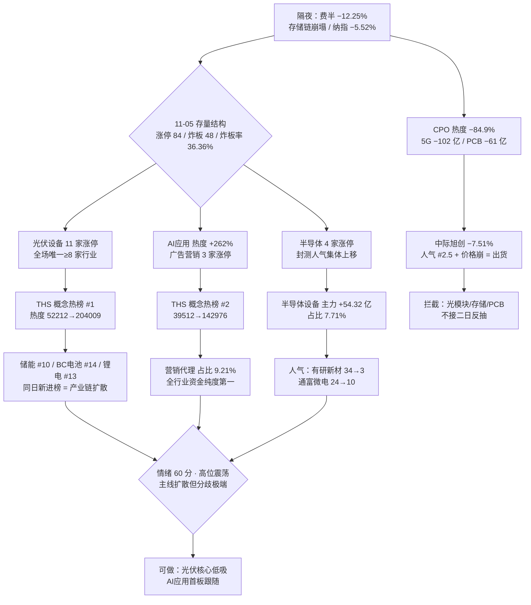

# 2026 年 11 月 6 日 · **群聊情绪共振**

> **双源口径**：L1 热榜 × L2b 公众号证词（L2 群聊连续第 9 日 0 条，L3 WeFlow 永久下线）
> **降级状态**：`degraded=true` · **置信度**：0.34 · **新鲜度**：partial
> **共振等级上限**：`L1_only`（skill 红线 3/4：单源不得标强共振，`full_resonance_count=0`，情绪分不做共振加成）

## 一句话结论

结构是「光伏 + AI 应用」双引擎扩散、情绪读数 60 分，但炸板率 36.36%、最高板只有 4 板、隔夜费半 −12.25% —— 这是**分歧型修复的第 5 天**，不是加速段；今日只做光伏核心与 AI 应用首板的低开承接，光模块/存储/机器人一律拦截。

## 情绪仪表盘

| 维度 | 读数 | 方向 | 解读 |
|---|---|:--:|---|
| 情绪浓度 | **60 / 100** | 🟡 | R1 当日基线 60.1，本轮无 L1+L2 共振主题、共振加成 0 |
| 涨停 / 跌停 | `84 / 0` | 🟢 | 跌停归零，修复未破，但涨停仅前日 118 家的 71% |
| 炸板率 | `36.36%`（48 家） | 🔴 | 越 35% 红线 → 情绪标「震荡」不标「贪婪」，候选数砍半 |
| 连板高度 | `4 板`（闽发铝业 / 浙文影业） | 🟡 | 3 板 2 家、2 板 17 家、1 板 63 家，接力率 25% |
| 市场广度 | `4869 涨 / 625 跌`（87.4%） | 🟢 | 中位 +2.02%，成交 21177 亿（+3.94%） |
| 昨日涨停溢价 | 收盘 **+4.49%**，再涨停 21 只 | 🟢 | 打板赚钱，但低于强修复首日的 +6~8% 档 |
| 主力资金 | 电力设备 **+63.10 亿** / 半导体 **+61.04 亿** | 🟢 | 双主线均获主力净买，非单腿行情 |
| 主力流出 | 5G概念 **−102.09 亿** / 通信技术 **−99.89 亿** | 🔴 | 光模块、PCB、元件同步撤离，硬件侧先破 |
| 修复段位置 | 第 5 个交易日（首日 20261102） | 🟡 | 高位震荡段，二次验证日：不追开盘、不接高位老龙 |
| 隔夜外围 | 纳指 −5.52% / 费半 **−12.25%** / 道指 −3.44% | 🔴 | R4 事件 E20261106_001 判 negative·high，直接压制半导体链 |

## 单源传导图

## 情绪浓度与五维交叉

`60 / 100` = R1 基线 60.1 + 共振加成 0。五维原始读数：涨停强度 84.0、跌停压制 100.0、连板结构 64.6、炸板率项 0.0（100 − 4×36.36 触底）、杠杆资金 30.8。

- **为什么不是「贪婪」**：炸板率 36.36% 意味着每 3 个封板有 1 个被砸开，涨停 84 家却只走出 4 板，属「扩散带分歧」。按纪律条款，此档必须降温处理。
- **为什么不是「主跌」**：跌停 0 家、广度 87.4%、昨日涨停溢价 +4.49%，亏钱效应不存在。
- **五维法 vs 共振法**：`r3_vs_5d_gap = 0`，因为 R1 的 sentiment_score 本身就是五维加权，两者同源、不构成独立校验 —— 真正的独立校验在「炸板率 + 接力率 + 外围」三项上，结论一致指向分歧。
- **候选数砍半**：5 条主题中只有 2 条进入「可做」观察，3 条判拦截/剔除。

## 五条 L1 单源主题

> 五条全部 `resonance_level = L1_only`（L2 群聊缺位）。按 skill 条款，公众号证词并列展示但**不升级**共振等级 —— 宁可标低，不用几篇官媒长文制造假共振。

### 1️⃣ 光伏（含电力设备 / BC电池 / 储能扩散）· `L1_only` · **进（仅核心低吸）**

| 证据层 | 读数 |
|---|---|
| 概念热度 | THS #1，热度 52212 → **204009（+291%）**，是第 2 名的 1.43 倍 |
| 板块资金 | 电力设备 **+63.10 亿**（涨 3.79%）、光伏设备 **+32.36 亿**（涨 8.45%、占比 5.77%） |
| 涨停结构 | 光伏设备 **11 家**，另电网设备 3 家、电池链扩散 |
| 新进榜 | 储能 #10、BC电池 #14、锂电池概念 #13 —— 同日三条产业链维度新进 |
| 封板质量 | 永臻股份 3 板封单 2.56 亿·0 开板；贝特利 2 板封单 1.58 亿·0 开板 |
| 公众号证词 | 证券时报「光伏、电力设备掀涨停潮」；财联社「反内卷深化→产业链价格企稳回升」 |

**大资金意图**：不是抢反弹，是**在电力设备里建仓位** —— 行业级净流入 63 亿配 11 家涨停，是配置盘与游资同向，不是纯情绪脉冲。
**为什么走强**：反内卷政策 → 产业链价格企稳的**基本面叙事**，叠加储能/BC电池新题材给出横向扩散空间，属于「有故事 + 有扩散 + 有资金」三件套。
**逻辑够不够硬**：硬在资金与扩散，软在位置 —— 板块已四连涨、炸板 7 家，是修复段第 4-5 日而非首日，只能做核心低吸，不能追高打板。

### 2️⃣ AI应用（含短剧游戏 / AI视频 / 传媒营销）· `L1_only` · **观察（等首板跟随）**

| 证据层 | 读数 |
|---|---|
| 概念热度 | AI应用 #2（39512 → **142976，+262%**）、短剧游戏 #5（+60%）、AI视频 #9（+70%） |
| 板块资金 | 传媒 +34.92 亿（涨 3.86%）、营销代理 **+20.52 亿（占比 9.21%，全行业最高）** |
| 涨停结构 | 广告营销 3 家（引力传媒 2 板·0 开板）、影视院线 2 家（博纳影业封 1.46 亿·0 开板） |
| 人气跳升 | 芒果超媒 74 → 10（+64 位）、引力传媒 66 → 21、利欧股份东财人气 #1 |
| 公众号证词 | 财联社「短剧出海今日涨停」「AI 端侧焦点公司 2 连板」 |

**大资金意图**：资金纯度最高的一档（营销代理占比 9.21%），说明买盘是**集中打点**而非普涨摊薄，意图是做一条能接力的新线。
**为什么走强**：AI 硬件崩塌的同日，AI 应用是**叙事转移的受益方** —— 算力资本开支见顶的讨论（调研先知转述 Citrini）反而把资金推向「应用变现」。
**逻辑够不够硬**：半硬。硬在同族三条概念同向上升；软在涨停多为午后封（13:05 / 13:25 / 13:35），不是早盘主动进攻，接力要靠次日验证。

### 3️⃣ 半导体设备 / 材料（国产替代）· `L1_only` · **拦截（等低开不破）**

| 证据层 | 读数 |
|---|---|
| 板块资金 | 半导体设备 **+54.32 亿（占比 7.71%）**、中芯概念 +57.88 亿（占比 4.75%）、半导体材料 +21.09 亿 |
| 涨停结构 | 半导体 4 家：有研新材 2 板（开板 6 次）、先导基电 2 板（封 2.80 亿·0 开板）、瑞芯微 2 板（**开板 11 次**） |
| 人气动量 | 有研新材 34 → 3、通富微电 24 → 10、长电科技 44 → 15、华天科技 38 → 19 |
| 对立证据 | 隔夜费半 −12.25%、美芯片巨头盘前 −10%、存储链崩塌；CPO 热度 −84.9% |

**大资金意图**：11-05 盘中是真买（设备 +54 亿、占比 7.71% 属高纯度），但那是**外盘崩塌之前**的仓位。
**为什么原本走强**：国产设备订单排到明年、24 家科创板半导体回购 106.5 亿 —— 国产替代是内生的，不依赖海外景气。
**逻辑够不够硬**：逻辑硬、**时点不硬**。海外映射负面强度为 high，开盘大概率低开；低开不破 + 涨停家数 ≥3 之前不给开仓资格，只留观察。

### 4️⃣ 商业航天 · `L1_only` · **剔除（人气无承接）**

热度 62236 → 85224（+37%）、排名 6 → 3，是唯一逆势升温的中位主题；但 **0 家涨停**、无板块资金进前 10、专用设备 4 家涨停全无航天属性。人气与价格背离 = 题材在酝酿但没资金兑现，记录不投标。

### 5️⃣ 人形机器人 · `L1_only` · **拦截（退潮确认）**

热度 **144354 → 76060（−47%）**却仍排第 4，属衰退惯性；唯一连板征和工业开板 8 次、封单仅 0.03 亿；上证 18:50 刊文《王兴兴谈人形机器人进厂：效率是瓶颈》，叙事由想象转向兑现拷问。典型退潮结构，禁止当低位补涨做。

## 首推票思维链

### 300274.SZ 阳光电源（光伏 / 储能 权重核心）

| 项 | 数值 |
|---|---|
| 收盘 / 5 日 / 20 日 | 85.14 / 75.77 / 74.77 |
| 5 日涨幅 / 20 日涨幅 | **+26.68%** / +5.78% |
| 距 60 日高（122.21） | **−30.33%** |
| 当日 | +4.89%，THS 人气 52 → 8（+44 位），双平台 avg_rank 8.0 |
| 板块地位 | 光伏 + 储能双属性权重，行业资金第一名的旗手 |

**买入理由**：主线（光伏 / 电力设备）资金第一、人气第一梯队、且是距 60 日高还有 30% 空间的**权重修复票**，不是高位补涨票。5 日涨 26.68% 说明右侧已确认，符合「主线进攻 + 右侧」框架。

**风险点**：① 5 日已涨 26.68%，追 85 上方属加速末端，回踩概率不低；② 板块四连涨，第 5 日易出分歧；③ 隔夜外围崩塌，权重股常被拿来砸指数。

**止损条件**：收盘跌破 **78.5**（−7.8%，位于 5 日线与 20 日线之间的承接带）无条件离场；日内跌破 80 且不能快速收回，先减半。

**盈亏比**：入场 85.14 → 第一目标 95（+11.6%）/ 第二目标 105（+23.3%）；止损 78.5（−7.8%）。到第二目标 RR ≈ **3.0**，仅到第一目标 RR ≈ 1.49 —— 因此**不做追高**，只在 80–82 区间接承接，把止损压到 78.5 以内后 RR 才合格。

**可验证假设**：① 次日光伏设备涨停家数 ≥5；② 阳光电源收盘不破 5 日线；③ 储能/BC电池出现至少 1 只新首板。三条中成立两条 → 主线延续成立，可加；只成立一条 → 降为日内 T。

### 603381.SH 永臻股份（光伏设备 3 板 · 空间票）

**买入理由**：板块内最高板（3 板）、封单 2.56 亿·0 开板、收盘价 18.85 = **60 日新高**，是唯一具备「连板空间 + 新高突破」双重属性的票。用户体系里新高突破票不减仓。

**风险点**：① 3 板位置，次日若不能 4 板即进入分歧；② 流通盘仅 27 亿，情绪票属性重；③ 板块炸板 7 家，环境不支持无脑打板。

**止损条件**：打板 4 板则止损设 18.5（−10.8%）；若做回流则等回踩 17.0–17.5，止损 16.2（−5~6%）。

**盈亏比**：打板 20.74 → 目标 24.9（+20%），RR ≈ 1.85 **不达标**；回流 17.3 → 目标 22（+27%），RR ≈ **3.6** 达标。结论：**不打板，只做回流**，且必须 4 板被市场确认后才动手。

**可验证假设**：① 次日是否 4 板；② 4 板日封单是否 ≥1.5 亿；③ 板块内是否出现 ≥2 只新的 2 板。

## 观察池与五档态度

| 标的 / 主题 | 五档 | 触发条件 | 备注 |
|---|:--:|---|---|
| 光伏 · 阳光电源 | **进**（仅低吸） | 80–82 承接、止损 78.5 | 追高 RR<2，明确不打 |
| 光伏 · 永臻股份 | **降级** | 4 板确认后做回流 17–17.5 | 打板 RR 1.85 不合格 |
| 光伏 · 贝特利 / 协鑫集成 | **观察** | 板块涨停 ≥5 家再跟 | 贝特利 5 日 +41.93% 已加速 |
| AI应用 · 引力传媒 | **观察** | 3 板且早盘封板 | 2 板、距前高仅 −6.44% |
| AI应用 · 利欧股份 | **观察** | 需双平台合力（东财#1/THS#21 不合力） | 4.39 元低价，弹性大波动也大 |
| 半导体设备 · 有研新材 / 先导基电 | **拦截** | 低开不破 + 涨停 ≥3 家才恢复 | 隔夜费半 −12.25% |
| 商业航天 | **剔除** | 出现 ≥2 家涨停再说 | 0 涨停无承接 |
| 人形机器人 / CPO / 存储 / PCB | **拦截** | 无 | 热度腰斩 + 资金撤离 |

## 排除与警报

| 对象 | 警报类型 | 证据 |
|---|---|---|
| 中际旭创 | **出货结构（三重同现）** | 双平台人气 #2.5 却收 −7.51%；CPO 概念热度 −84.9%；通信设备主力 −56.39 亿 |
| 东方海洋 | 霸榜妖股 | 10-31 #1 / 11-03 #2 / 11-05 #1，双平台 avg_rank 1.5，连板属性弱而人气极高 |
| 人形机器人 | 衰退惯性 | 热度 −47% 仍排第 4，唯一连板开板 8 次 |
| 5G / 通信技术 / PCB / 元件 | 资金撤离 | 分别 −102.09 / −99.89 / −61.05 / −66.71 亿 |
| 调研先知转述 Citrini | 逻辑级负面 | 「AI 资本开支增长已见顶」—— 对光模块/算力是叙事反转，不只是情绪 |

## 明日执行纪律

1. **不追开盘**：隔夜费半 −12.25%，竞价情绪不可信，等 9:45 后看承接。
2. **半导体不开新仓**：只有「低开不破 + 板块涨停 ≥3 家」两条同时成立才恢复，缺一即拦截。
3. **光伏只做低吸**：阳光电源 80–82、永臻 17–17.5，超区间即放弃，不上调买价。
4. **止损硬区间 −5~−10%**：任一票止损距 >10% 直接不买。
5. **炸板率复核**：若当日炸板率再上 35%，清空所有新增候选，只留底仓。
6. **群聊文本侧断更第 9 天**：今日所有方向判断为纯量价 + 资讯推演，缺文本交叉，宁可少做。

## 数据源审计

| 源 | 状态 | 抓取 | 记录数 | 备注 |
|---|---|:--:|---|---|
| tushare.ths_hot（热股/概念） | 🟢 ok | 11-06 | 240 | 双日对比完成，概念热度可算 delta |
| tushare.dc_hot | 🟡 partial | 11-06 | 400 | 人气榜/飙升榜混排，rank diff 弃用 |
| tushare.limit_list_d | 🟢 ok | 11-06 | 132 | 涨停 84 / 跌停 0 / 炸板 48 |
| tushare.moneyflow_ind_dc | 🟢 ok | 11-06 | 1058 | 行业与概念双口径 |
| tushare.moneyflow_ind_ths | 🔴 error | 11-06 | 90 | 净额全 0，弃用 |
| attention_signals（T-1） | 🟢 ok | 11-06 | 313 | 现跑管线；persistent 天数异常不采信 |
| 取阅公众号 RSS（L2b） | 🟢 ok | 11-06 | 90 | 17 feed 全通、15 feed 有文章 |
| wechat-cli 7 群（L2） | 🔴 stale | 11-06 | **0** | 库停在 2026-10-28，断更 9 天 |
| weflow-analytics（L3） | 🔴 error | — | — | 永久下线 |
| R1_style | 🟡 partial | 11-06 | 1 | degraded 0.441，基线 60.1 可用 |

## 不确定性 / 反证

- **最大的反证是「L2 缺位」**：连续 9 天没有群聊文本，我无法排除「游资已在昨天集体转向」这类文本信号。量价看到的是光伏+AI 应用，但如果群聊里其实在集体喊退，我会漏掉。这是本轮置信度只有 0.34 的核心原因。
- **第二重反证：外围冲击的传导强度未知**。费半 −12.25% 是 2025 年以来罕见量级，A 股半导体 11-05 还是净流入 61 亿，两者必有一方错。历史样本里「A股半导体在费半暴跌次日逆势飘红」并不罕见（11-05 就是在韩国大跌 5% 背景下飘红的），所以我给的是「拦截等验证」而不是「清仓」。
- **第三重反证：光伏是第 4-5 日**。四连涨 + 炸板 7 家，任何一天都可能变成兑现日。若明日光伏涨停家数掉到 3 家以下，则本轮判断作废。
- **数据口径自我批判**：dc_hot 混排导致 rank diff 不可靠，attention 的 persistent 天数明显失真（177 日、avg_rank 恒 1.0），我只用了 cross_platform 与 surge，这部分结论的稳健性低于 THS 概念热度。

## 与其他 R/D/E 的关系

- **依赖**：`R1_style.json`（情绪基线 60.1）、`R4_news.json`（隔夜事件与板块极性交叉）、`attention_signals.json`（个股人气底座）、`wechat_official_rss.jsonl`（L2b 证词）
- **被消费**：D1（情绪温度与主题优先级）、R2（主线候选的热度校验）、R6（反证素材：出货警报清单）、E1（盘后复盘的情绪对照）

## Sub-Agent 元数据

- skill: analyze_sentiment_resonance_v1
- artifact: data/research/20261106/R3_sentiment.json
- 生成耗时: 约 1900 秒
- model: deepseek-v4.1-flash
- 降级说明: L1 单源（L2 断更 9 天 / L3 永久下线），resonance_level 上限 L1_only，故 5 条主题均不计入正向共振、不加情绪分
