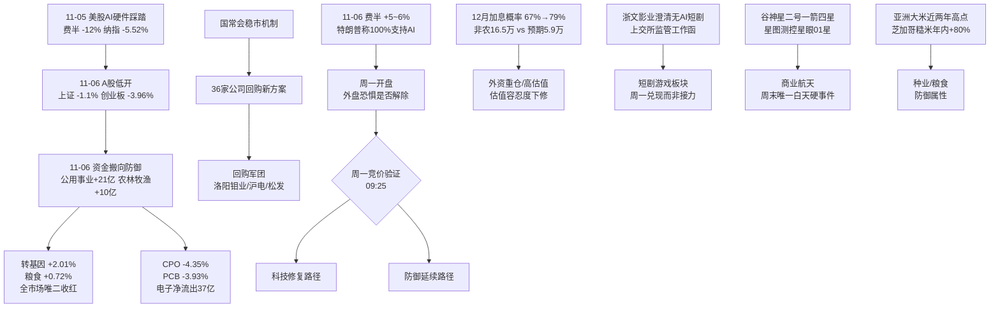

# 2026年11月07日 · **周末群聊情绪与题材发酵（轻量档）**

> **数据源新鲜度**: partial · **降级状态**: degraded(群聊层空) · **置信度**: 0.42
> **覆盖窗口**: 2026-11-06 06:03 → 2026-11-07 18:00（36h，含周五全天 + 周五盘后 + 周六）
> **口径**: 只用「群聊 + 公众号」两源提观点、只用「多平台热榜」提热度顺位；**不计算情绪周期阶段**（周末无涨停/炸板/连板结构可测）

## 一句话结论

外盘AI链急跌后反抽、国内回购与稳市组合拳同日落地，题材热度集中在光伏/商业航天/转基因，但**群聊样本为 0，散户侧一致性预期无法验证**——周五盘面唯一的红是转基因(+2.01%)与粮食(+0.72%)，防御属性明显，不能把这轮反弹读成风险偏好回归。

## 🗺️ 周末情绪传导图

## 一、先说数据缺口（不藏在正文里）

1. **群聊 0 条**。7 个群全部 `status=ok / count=0`，`wechat_cli_5groups.jsonl` 是 0 字节。这不是报错，是空返回。后果：本 skill 的 Layer 2（KOL 语义层）不可用，**任何主题都只能到 `L1_only`**，按红线 3 不能标强共振，也不能进 `resonance_top_themes` 意义上的"共振"。下面给的排序是**热度顺位 + 公众号观点密度**，不是共振等级。
2. **周六当日热榜 not_available**。`attention_weekend` 里 20261107 四张榜全 0 行（周六无收盘数据，属正常）。可用的最新三日榜是 11-04 / 11-05 / 11-06。
3. **R1 情绪基准本身是 degraded**。11-06 的 R1 `sentiment_score=60.1 / confidence=0.441 / status=degraded`，拿它当周末档的底会放大误差，所以本档不引用它做分，只作对照。

## 二、周末在聊什么（公众号观点层，不计入共振）

100 篇文章、9 个号有文。剔除纯宏观与转载后，观点密度最高的几件事：

| 话题 | 出现在几个号 | 观点方向 | 关键表述 |
|---|---|:--:|---|
| 美股AI链"鬼故事" | 证券时报 / 上海证券报 / 贩财局 / 傅里叶的猫 / 猫笔刀（5个） | 分歧 | 傅里叶的猫：是仓位与杠杆的踩踏，市场在提前交易 2028 年资本开支拐点；猫笔刀：连涨4年强弩之末，民主党不会真砍自家金主，回撤15%可能不够 |
| 回购/护盘 | 证券时报 / 上海证券报（2个） | 一致偏暖 | "回购军团再扩容"、"密集披露"、中金/银河/申万宏源完成互换便利买入、锐方基金5亿自购 |
| 政策稳市 | 证券时报 / 上海证券报（2个） | 一致偏暖 | 国常会"完善资本市场稳市机制，增强股市内在稳定性" |
| 算力硬订单 | 证券时报 / 上海证券报（2个） | 一致偏暖 | 杰创智能49.15亿；中国移动2027算力投资超1000亿、采购总额5000亿以上 |
| 磷化铟/光通信材料 | 上海证券报 / 证券时报（2个） | 一致偏暖 | 光智科技与Coherent签6.01亿美元，"迄今全球已披露最大6英寸磷化铟衬底供货协议" |
| AI漫剧证伪 | 上海证券报 / 证券时报（2个） | 一致偏负 | 浙文影业5连板后收监管工作函，明确"无AI短剧相关业务"，上半年影视收入154.96万元、占比不足0.1% |
| 国资整合 | 上海证券报（1个） | 偏暖 | 富奥股份/富维股份实控人变更为国务院国资委 |
| 粮食/转基因 | 证券时报 / 盘前纪要（2个） | 偏暖 | 亚洲大米近两年高点、芝加哥糙米年内涨超80%、FAO预计全球产量十多年首降 |

**一致性预期在哪里**：回购+稳市、算力订单、磷化铟材料三条是"多号同向"的，属于周末最硬的一致性；AI漫剧是"多号同向看空"，属于一致性证伪。分歧最大的是美股AI链——同一晚既有"流动性踩踏"也有"黄金坑"两种读法。

## 三、热度顺位（L1 热榜 + 公众号密度，非共振）

> 说明：`ths_hot_concept` 三日排名 + 11-06 板块涨跌幅 + 公众号观点密度三者合成。**没有 L2，所以没有 L1+L2**。

| 位次 | 题材 | 热榜三日排名 | 11-06 板块涨跌 | 群聊 | 公众号密度 | 档位 | 早/中/晚 |
|:--:|---|---|:--:|:--:|:--:|:--:|:--:|
| 1 | 光伏（电力设备/BC电池） | #8→#1→#1 | **-1.79%** | 0 | 高 | L1_only | 中偏晚 |
| 2 | 商业航天 | #6→#3→#2 | -2.41% | 0 | 中(周末新增) | L1_only | 早偏中 |
| 3 | 转基因/粮食 | 未入前20→未入→#3 | **+2.01% / +0.72%** | 0 | 中 | L1_only | 早 |
| 4 | 短剧游戏/AI漫剧 | #9→#5→#4 | -1.40% | 0 | 高(但反向) | L1_only | 晚 |
| 5 | AI硬件（CPO/存储/PCB） | CPO #1→#11→#5；存储 #3→#17→#11 | -4.35%/-3.31%/-3.93% | 0 | 高 | L1_only | 中(叙事受损) |
| 6 | 人形机器人 | #2→#4→#8 | -2.93% | 0 | 中 | L1_only | 中后段 |
| 7 | 高股息/电力/央企 | #15(11-06新进) | +0.01% | 0 | 中 | L1_only | 中 |

**读这张表最重要的一句**：热榜第一的光伏，11-06 板块是 **-1.79%**；唯一两个收红的（转基因 +2.01%、粮食 +0.72%）热榜位次都不高。**榜位与价格背离 = 高位分歧，不是强势延续。**

## 四、五个重点题材：三问

### 1 · 光伏 · 热榜三日第一但当日收跌

- **大资金意图**：11-06 主力资金流向给了答案——电子净流出 37 亿、有色净流出 20 亿，而公用事业净流入 21 亿、农林牧渔/纺服/交运各超 10 亿。资金在从"高波动科技"往"防御+政策"搬。光伏虽然榜位第一，但它是"美国中期选举→民主党扫两院→新能源政策预期"这条外部叙事的载体，11-06 那天叙事没继续加强，价格就撑不住。
- **为什么走强**（这一格要反过来读：榜位第一但价格已转弱）：因为**榜位是滞后的**。11-04/11-05 光伏连续两天第一（11-05 还是四连涨的尾声），11-06 补跌只是把榜位滞后暴露出来。三日榜里它是"过去最强"，不是"现在最强"。
- **逻辑够不够硬**：**中等偏硬但不新**。硬的部分是数据：能源局 Q3 新增光伏装机 38.76GW，同比 +38%；软的部分是驱动来自美国政策预期，这个变量 11-04 已充分定价，周末只添了墨西哥 650MW 这种小订单。**没有新增硬催化的榜一，是最容易被兑现的榜一。**

### 2 · 商业航天 · 周末唯一真新增催化

- **大资金意图**：这条线的资金意图最干净——它不需要外部叙事，靠自身事件节奏就能发酵。11-06 榜位从 #6 升到 #2，是"提前埋伏"，因为市场知道 11-07 早上有发射窗口。
- **为什么走强**：11-07 07:37 谷神星二号遥三在酒泉一箭四星成功（观澜试验星、云遥一号28星、中北大学一号、钧天一号06A）。其中钧天一号06A 即"星眼01星"，由**星图测控(920116.BJ)抓总设计**、钧天航宇联合研制，是"星眼"太空感知星座首发星。同一条消息里还有星河动力 IPO 辅导券商由华泰联合变更为中信证券。事件、主体、资本动作三件凑在同一天。
- **逻辑够不够硬**：**硬在事件，软在业绩**。事件是硬的（发射成功是既成事实，且带明确上市公司主体）；业绩是软的（星图测控这块是"星座首发验证星"，验证性质，不是收入确认）。这条属于"叙事级别够、财务级别不够"的题材，通常对应 1-3 日的情绪窗口，不是主线级别。

### 3 · 转基因/粮食 · 周五唯一收红，且是基本面驱动

- **大资金意图**：11-06 全市场 4700+ 只下跌，农林牧渔却拿到超 10 亿主力净流入，转基因 +2.01% 是概念榜前 20 里唯一像样的红。这说明资金不是"炒题材"，是**在普跌日找有独立供需逻辑的避风港**。
- **为什么走强**：基本面链条完整——亚洲大米基准价升至近两年最高（泰国5%碎米499美元/吨）、芝加哥糙米年内涨超80%、FAO 预计 2026/27 全球大米产量十多年来首降、美国农业部预计本季全球产量首降。叠加农业农村部"秋粮收获过九成、全年产量连续第3年1.4万亿斤以上"——**外部涨价 + 内部丰收**，两件事不矛盾：外部涨价炒的是进口替代与种业，内部丰收压的是粮价失控预期。
- **逻辑够不够硬**：**硬在价格，弱在传导**。米价上涨对 A 股种业/种植股的利润传导是慢变量，且多数标的市值小、业绩薄。这条更像"低位补涨+防御"而非"业绩驱动"。此外它还叠了玄学：东方海洋 13天8板（近7日6板）是"东方"系+"羊"谐音，不是粮食逻辑。

### 4 · 短剧游戏/AI漫剧 · 热度最高但龙头被证伪

- **大资金意图**：11-06 浙文影业拿到逾 9 亿主力净流入，同时是 dc 热榜 #7 / ths #16。资金意图很清楚：**在证伪公告出来之前先炒完**。龙虎榜显示买一国泰海通上海长宁江苏路 7089 万、买二华鑫深圳分公司 6703 万，卖一南京证券张家港东环路 7777 万——**买卖席位在同一价位对打**，这是典型的高位换手而非单边吸筹。
- **为什么走强**：产业叙事是真的。汉语拼音"duanju"已成专属英文词，海外短剧付费应用前十中国厂商占九席，AI漫剧海外活跃用户超1.5亿，2026 国内 AI 短剧/漫剧市场规模有望超400亿（财联社引研报）。芒果超媒 3日最高 +29.28%、上海电影 +18.41% 都是真的。
- **逻辑够不够硬**：**叙事硬、载体假**。浙文影业 11-06 晚公告写明"主营业务仍为影视业务与毛纺织业务，无AI短剧相关业务"，上半年影视收入 154.96 万元、占比不足 0.1%，前三季 99% 营收来自纺织。同晚收到上交所监管工作函，5 连板累计 +61.27%、换手率 21.97%。**龙头被交易所+公司双重否认，这个板块的周一开盘是"兑现"而不是"接力"。**

### 5 · AI硬件（CPO/存储/PCB） · 热度下降 + 中期叙事被质疑

- **大资金意图**：11-06 三大科技细分全跌（CPO -4.35%、PCB -3.93%、存储 -3.31%），电子净流出 37 亿。但同一晚美股费半 +5~6%、AMD/Coherent 涨超12%、美光+8%。**A 股资金在白天先跑了，晚上外围才反抽**——说明卖的是"隔夜恐惧"，不是"基本面判断"。
- **为什么走强**（这条反过来问：为什么反而走弱）：11-05 美股费半 -12%、纳指 -5.52%（2025年4月以来最差单日），触发是民主党中期选举大胜后市场担心 AI 监管收紧（安萨里法案"全面暂停所有先进AI研发"）+ 微软终止与甲骨文的 AI 云算力租赁 + OpenAI 重新评估下一年数据中心容量 + Anthropic IPO 估值从 1.5 万亿下修到 1.2-1.3 万亿。核心是**"2028 年以后还建不建数据中心"这个远期争论被提前引爆**。
- **逻辑够不够硬**：**当期硬、远期软**。当期：存储涨价延续（10月通用DRAM创近十年新高）、华虹宏力 Q3 净利同比 +136%/环比 +222%、在手订单（芯原 185.69 亿）。远期：SOX 两年远期 PE 已压到约 9.9 倍（GS），但市场怀疑的是分母里的 E。**这种"微观强、宏观坏"的组合，历史上对应的是震荡而非单边**，而且周末已经给了修复（外围反抽 + 36 家公司回购新方案）。

## 五、观察标的四段（不写价位、不写买卖建议）

> 周末档不给买点。以下四段是"观察逻辑"，不是"买入逻辑"。

### 中际旭创 300308 · 光模块龙头
- **观察理由**：11-06 午间与天孚通信、新易盛、三环集团、大普微、立讯精密、领益智造集体公告回购（猫笔刀判断为"被窗口指导了，出来喊话安抚市场"）；同日 dc 热榜 #2 / ths #3，是全市场热度第二；机构调研本周 550+ 家公司中 AI 产业链是三大主线之一。
- **风险点**：10-23 中午同款喊话曾经奏效（光模块午后暴涨），这次"涨了不到1%就被砸回来"——护盘工具的边际效力在衰减；且它是创业板指第一大权重股（权重 15.46%），创业板指修订本身就是冲它来的。
- **失效条件**：若周一开盘 30 分钟内板块龙头集体翻绿且不收复，说明"喊话+回购"这套组合已被市场定价完，护盘叙事失效。
- **可验证假设**：周末费半 +5~6% 的修复能否在周一 09:30-10:00 传导到 A 股光模块。传导成功 = 外围恐惧已被证伪；传导失败 = A 股走独立下跌逻辑。

### 东方海洋 002086 · 玄学龙头（高风险样本）
- **观察理由**：13天8板（近7日6板）、11-06 超28万手封单、dc 与 ths 双榜第一（avg_rank=1.0）、连续 3 日在榜。它的驱动是"东方"系 + "羊"谐音，不是海洋或大健康业务。
- **风险点**：公司自己公告写死——"两大板块均处于亏损状态""整体经营承压""非理性波动特征突出"；13天8板已在极高位；它同时是"霸榜第一"，按红线 4 属**出货警报区**，不能当正向信号读。
- **失效条件**：周一若开板且封单显著小于前一日（28万手），按纪律视为接力断裂。
- **可验证假设**：这轮玄学的扩散度——11-06 东方创业/大东方/日出东方/东方新能/东方嘉盛集体涨停，若周一"东方系"只剩东方海洋一只在涨，说明玄学已收敛到单票，是退潮前兆。

### 星图测控 920116 · 商业航天新主体
- **观察理由**：11-07 07:37 一箭四星中的"星眼01星"由它抓总设计，是"星眼"太空感知星座首发星；商业航天概念 11-06 热榜 #2；同一条新闻里星河动力 IPO 辅导换中信证券，产业资本动作同步。
- **风险点**：北交所标的，流动性与涨跌幅制度与主板不同；"首发验证星"是验证性质，短期不产生收入；商业航天在 A 股历来是"事件涨一天、随后回吐"的模式。
- **失效条件**：若周一高开后 30 分钟内回落至平盘以下，说明事件已被一次性定价。
- **可验证假设**：商业航天榜位能否在周一继续留在前 5。留得住 = 有资金接力；掉出前 10 = 纯事件脉冲。

### 金健米业 600127 · 粮食线的补涨位
- **观察理由**：ths 热榜 #5 / dc #18（avg 11.5），是粮食概念里榜位最高的 A 股主板标的；粮食概念 11-06 +0.72% 是全市场少数收红板块；盘前纪要把它列为粮食四标的之首（金健米业、万向德农、农发种业、神农种业）。
- **风险点**：米价上涨对它的利润传导是慢变量，业绩弹性有限；粮食题材在 A 股历史上持续性差，多为 1-2 日脉冲。
- **失效条件**：若周一种业/粮食板块整体高开低走，说明"防御"属性已被科技修复取代。
- **可验证假设**：周一若外盘继续反弹，粮食线是否还留得住资金。留不住 = 11-06 的红只是避险，不是新主线。

## 六、情绪档位自评（替代交易日 sentiment_score）

| 维度 | 权重 | 读数 | 依据 |
|---|:--:|:--:|---|
| 外盘修复度 | 0.25 | 0.55 | 费半 11-05 -12% → 11-06 +5~6%，跌幅未收复，只算反抽 |
| 内部护盘强度 | 0.25 | 0.85 | 36 家公司回购新方案 + 国常会稳市 + 券商互换便利买入 + ETF 单日净流入 126.24 亿 |
| 题材新鲜度 | 0.20 | 0.60 | 商业航天/粮食有新增催化；光伏/AI硬件是旧叙事 |
| 一致性与拥挤度 | 0.15 | 0.30 | 短剧龙头被证伪、东方海洋13天8板霸榜，拥挤度高 |
| 海外流动性 | 0.15 | 0.25 | 12月加息概率 67%→79%，强非农 16.5万 vs 预期 5.9万 |
| **合计** | 1.00 | **55/100** | **中性**：护盘强、外盘弱、题材新旧交替 |

> 口径声明：这套权重是人定的，不是统计拟合，只用于档位参考，不能当因子用。

## 七、关键证据

- 证据 1：11-06 A股 上证 -1.1% / 深成 -2.57% / 创业板 -3.96% / 科创综 -3.24%，全市场超 4700 只下跌，成交额 1.67 万亿 · 证券时报 2026-11-06 15:57
- 证据 2：11-06 概念榜前20中仅转基因 +2.01%、粮食概念 +0.72%、高股息 +0.01% 未跌；CPO -4.35%、PCB -3.93%、存储芯片 -3.31% · tushare ths_hot_concept（rank_time 2026-11-06 22:30）
- 证据 3：dc 与 ths 双榜第一 东方海洋（avg_rank 1.0）、第二 中际旭创（2.5）、第三 东山精密（3.5）· attention_signals 20261106
- 证据 4：浙文影业"无AI短剧相关业务"+上交所监管工作函，5连板累计 +61.27%，换手 21.97%，上半年影视收入 154.96 万元 · 上海证券报 2026-11-07 00:19
- 证据 5：谷神星二号遥三一箭四星成功，"星眼01星"由星图测控抓总设计 · 上海证券报 2026-11-07 08:31
- 证据 6：美国 10 月非农 16.5 万（预期 5.9 万），12月加息概率升至 79% · 财联社快讯 2026-11-06 21:40
- 证据 7：群聊 7 群 count 全为 0，文件 0 字节 · data/raw/20261107/wechat_cli_5groups.jsonl

## 数据源审计

| 源 | 日期 | 状态 | 抓取时间 | 记录数 | 备注 |
|---|---|:--:|---|--:|---|
| wechat_cli_5groups（7群） | 2026-11-06→11-07 | 🔴 | 18:02 | 0 | **7 群全 ok 但 count=0，0 字节；L2 不可用** |
| wechat_official_rss（取阅17源） | 2026-11-06→11-07 | 🟢 | 18:02 | 100 篇 | 17/17 feed ok，9 个有文，core 5/9；空 feed 8 个 |
| attention_weekend 11-04/05/06 | 2026-11-04→11-06 | 🟢 | 18:02 | 960 | 三日榜全 ok |
| attention_weekend 11-07 | 2026-11-07 | 🟡 | 18:02 | 0 | **not_available（周六无新榜）** |
| attention_signals（T-1 基准） | 2026-11-06 | 🟢 | 18:02 | 2353 | 人气榜100/飙升100/热股100/persistent1962/surge21/合力70 |
| ths_hot_concept（板块涨跌） | 2026-11-06 | 🟢 | 22:30(源) | 20 | 用于"榜位 vs 价格背离"判定 |
| R1_style（情绪基准） | 2026-11-06 | 🟡 | 11-06 07:00 | — | T-1 且 degraded/confidence 0.441，仅作对照 |
| WeFlow | — | ⚫ | — | — | **已于 2026-08-19 永久下线，本档不调用** |

> 主源缺失即 degraded：本档 `degraded=true`，根因是 **L2 群聊层为空**（非报错），不是公众号或热榜缺失。

## 不确定性 / 反证

1. **最大的反证是样本本身**：群聊 0 条意味着"散户/KOL 侧情绪"这一维度**完全没有观测**。本报告的所有"一致性预期"判断都只来自公众号（偏正式、发文少、有立场），不能代表群聊里的真实声音。如果用户手上有群，这一层应该由人补上，我不该替它编。
2. **热榜滞后性**：周末用的是 11-06 收盘后的榜，11-07 无榜。到周一开盘前，榜位可能已经变了一轮，这份"热度顺位"的有效期只到 11-09 集合竞价前。
3. **外盘的双面性**：费半 11-05 -12%、11-06 +5~6%，两天净跌幅仍有 6-7%。把它读成"修复"是乐观读法；读成"高波动延续"是保守读法。我倾向后者，因为触发因素（AI 监管 + 2028 资本开支）没消失，只是被"特朗普称100%支持人工智能"暂时压住。
4. **一致性与事实的冲突**：回购+稳市是"多号同向偏暖"，但 11-06 盘面是 4700 只下跌、六大宽基 ETF 显著缩量（猫笔刀"一整天没看到官军进场的痕迹"，而当日 ETF 实际净流入 126.24 亿——两个说法打架，我采信资金数据而非博主观感）。**这类冲突我不做调和，标出来给下游。**
5. **单点风险**：东方海洋是"玄学+霸榜第一"，把它当题材代表会误导下游。它是**风险样本**，不是**机会样本**。

## 十、与其他 R/D/E 的关系

- **依赖**：`data/raw/20261107/{manifest.json, wechat_cli_5groups.jsonl(空), wechat_official_rss.jsonl}`；`data/research/20261107/attention_weekend.json`；`data/research/20261106/attention_signals.json`；`data/research/20261106/R1_style.json`（仅对照）
- **被消费**：R2 主线（热度顺位可作板块冷热参照）、R6 反证（"榜位 vs 价格背离"与"霸榜出货"两条可直接引用）、D1 盘前（周一观察池排序参考）、E1 复盘（周末发酵 vs 周一实际表现的对照基）

## Sub-Agent 元数据

- skill: analyze_sentiment_resonance_v1（weekend_light 变体）
- artifact: 本 md（周末档不落 R3_sentiment.json，避免下游把周末档误读为交易日档）
- method: llm_v1 · 双源（L2 群聊为空 + L2b 公众号 + 热榜顺位）
- 生成时刻: 2026-11-07T18:40:00+08:00
- 已执行约束: 不写买卖建议、不给价位、不计算情绪周期阶段、不伪造涨停家数/竞价数据
