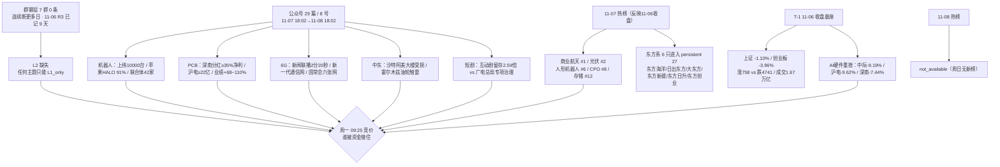

# 2026年11月08日 · **周末群聊情绪与题材发酵（轻量档）**

> **数据源新鲜度**: partial · **降级状态**: degraded（群聊层空）· **置信度**: 0.44
> **覆盖窗口**: 2026-11-07 18:02 → 2026-11-08 18:02（24h，周六盘后 + 周日全天）；题材对照用 T-1 11-06 收盘基座
> **口径**: 只用「群聊 + 公众号」两源提观点、只用「多平台热榜」提热度顺位；**不计算情绪周期阶段，不伪造涨停/竞价/连板数据**

## 一句话结论

周末没有形成新的强共振：公众号把「机器人里程碑 / PCB 硬业绩+分红 / 6G 政策」讲得很热，但**群聊层 0 条（连续断更多日，11-06 R3 已记 9 天），散户侧的一致性无法验证**；热榜仍是「东方系 + 商业航天 + 光伏」的旧结构，且 11-08 无新榜。**结论：题材在换（机器人/PCB/6G），人气没换（东方系），资金没跟（AI 硬件主力净卖出 100 亿+）。**

## 🗺️ 周末情绪传导图

## 一、先说数据缺口（不藏在正文里）

1. **群聊 0 条**。7 个群全部 `status=ok / count=0`，`wechat_cli_5groups.jsonl` 0 字节。这不是报错，是空返回；但后果是 Layer 2（KOL 语义层）完全不可用。**任何主题都只能到 `L1_only`，按红线 3 不能标强共振，也不该进 `resonance_top_themes` 意义上的"共振"。** 注：R3 11-06 的 notes 已写"群聊断更 9 天"，本档已是连续断更多日之后，属持续性源故障，不是周末没人说话。
2. **11-08 当日热榜 not_available**。`attention_weekend` 里 20261108 四张榜全 0 行（周日无收盘数据，正常）。可用的最新榜是 11-05/11-06/11-07 三日；其中 11-07 是周六，榜位反映的是 11-06 收盘热度，**不是周末新增热度**。
3. **公众号覆盖偏薄**。17 个 feed 仅 8 个有文、29 篇；`盘前纪要`、`股痴流沙河`、`ymj0418`、`安静拆主线`、`盘口逻辑拆解`、`远川研究所`、`李迅雷金融与投资`、`金渐成`、`贩财局` 均零篇。周末零篇属正常，但意味着观点密度集中在证券时报/上海证券报/财联社早知道等少数号。
4. **R1 情绪基准本身 degraded**。11-06 R1 `sentiment_score=60.1 / confidence=0.441 / status=degraded`，本档不引用它做分，只作 T-1 对照。

## 二、窗口内谁在说什么（公众号观点层，不计入共振）

> 群聊为空，下面全是「公众号观点」——偏正式、发文少、有立场，不能当散户情绪用。

| 号 | 篇数 | 在聊什么 | 方向 | 关键表述 |
|---|:--:|---|:--:|---|
| 证券时报 | 11 | PCB分红、6只连板风险、SMEE光刻机、油价周跌16%、18只主动ETF、纳斯达克23h | 中性（事实流） | 深南"分红≥净利润35%"；6只连板"警惕非理性炒作"；SMEE"国产化率突破90%、已规模化量产" |
| 上海证券报 | 8 | SMEE光刻机、新一代通信网、武汉天源再融资、进博会签约 | 中性偏产业 | "6G基站不光能通信还能当雷达"；"关键零部件国产化率突破90%" |
| 财联社早知道 | 1 | AI互动短剧 + 国家数据集团 | 偏暖（有推广属性） | "互动剧第7日留存为普通剧集2.59倍、观看时长1.52倍"；国家数据集团 10-20 雄安成立 |
| 调研先知 | 1 | 野村：蓝潮=中必赢？ | 偏暖（外资观点） | "美国蓝潮整体显著利好中国AI经济"；"中国有机会拿到更便宜的AI芯片" |
| 傅里叶的猫 | 1 | 美股 AI 基建 vs 云厂分化、Anthropic 账单 | 中性偏空 | "72家AI基建股 -13.3%，5大云厂 +1.7%"；Anthropic Q3 收入169.56亿美元但资本开支98.63亿、营业亏损5.67亿 |
| 财闻私享 | 1 | 周末 A 股值得关注：国常会、券商买入、东方系、机器人、6G、寒潮 | 偏暖但列风险 | "国常会今年首次提及股市"；"4000多家下跌、成交1.67万亿缩量4635亿"；"名字带东方多股涨停" |
| 证金事 | 1 | 三季报结构：总利润创新高但中位数下降 | 中性偏空 | 前三季归母 5.10 万亿、+8.30%，但 1496 家亏损（十年前 4.73 倍）、净利中位数 0.60 亿（-20%）、仅 47.68% 增长 |
| 猫笔刀 | 1 | 但斌回撤、徒步故事 | 噪声 | 与 A 股次日定价无直接关系 |

**一句话读法**：周末观点层的"暖"集中在**产业事件**（机器人、PCB、6G、光刻机），"冷"集中在**交易结构**（6只连板风险提示、短剧证伪、AI 硬件主力抛售、三季报中位数下降）。这两层不是同一个东西——产业事件决定"有没有故事"，交易结构决定"周一有没有人接"。

## 三、热度顺位（L1 热榜 + 公众号密度，非共振）

> 说明：`ths_hot_concept` 11-07 榜位 + 11-06 板块涨跌幅 + 公众号密度三者合成。**没有 L2，所以没有 L1+L2。**

| 位次 | 题材 | 11-07 热榜 | 11-06 板块涨跌 | 群聊 | 公众号密度 | 档位 | 早/中/晚 |
|:--:|---|---|:--:|:--:|:--:|:--:|:--:|
| 1 | 商业航天 | **#1**（热度 28586） | **-2.41%** | 0 | 中（一箭四星/SpaceX） | L1_only | 早偏中 |
| 2 | 光伏（电力设备/BC电池/储能） | #2（22869） | **-1.79%** | 0 | 高 | L1_only | 中偏晚 |
| 3 | AI应用（短剧/AI视频/传媒） | #3（12787），短剧 #5 | **-2.20% / -1.40%** | 0 | 高（但反向） | L1_only | 晚 |
| 4 | 人形机器人/机器人概念 | #6（9287）/ #7（6929） | **-2.93% / -2.43%** | 0 | **最高**（6篇+） | L1_only | 早（叙事） |
| 5 | CPO/存储/AI硬件 | CPO #8（5865）、存储 #12（3875） | **-4.35% / -3.31%** | 0 | 高（多空对打） | L1_only | 中（叙事受损） |
| 6 | 转基因/粮食 | #11（4199） | **+2.01%** | 0 | 低 | L1_only | 早 |
| 7 | 高股息/电力/央企 | #10（4797） | **+0.01%** | 0 | 低 | L1_only | 中 |

**读这张表最重要的一句**：热度第一的商业航天 11-06 是 **-2.41%**；唯一收红的转基因 **+2.01%** 只排 #11。**榜位与价格继续背离 = 高位分歧，不是强势延续。** 机器人则是反过来的背离：**消息密度第一、热榜只排 #6/#7、价格 -2.93%**——这是"叙事在升温、资金在退潮"的典型形态。

## 四、六个重点题材：三问

### 1 · 机器人/具身智能 · 消息最热、价格最冷

- **大资金意图**：产业资本在扩产——上纬新材启元机器人第 10000 台下线，从 5000 台到 10000 台只用了 14 天；月活超 98%、日均在线峰值超 40%、人均日交互 100 多次。苹果研究团队公开 HALO 人形机器人控制系统，6 个真实环境 360 次单项任务平均成功率 91%；"通用具身大脑产业创新联合体"42 家企业启动（含宇树、优必选）；马斯克称 Optimus 可能"只租不卖"。**产业侧的意图很清楚：从"演示"走向"量产/租赁/数据闭环"**。但交易侧 11-06 人形机器人 -2.93%、机器人概念 -2.43%，征和工业跌停、开板 8 次——**产业资本在加码，交易资金在撤**。
- **为什么走强（反着问：为什么没走强）**：因为缺"订单/收入"确认。上周的机器人行情是"特斯拉产线 + 灵巧手"叙事，本周换成"上纬台数 + 苹果论文 + 联合体"，都是**产业进展**而非**上市公司订单**。加上 10 月以来机器人板块已退潮，热榜热度从 144354 掉到 76060（-47%），资金没有重新定价的理由。
- **逻辑够不够硬**：**产业趋势硬、交易逻辑软**。硬在"10000 台/14 天"是量产爬坡的硬数字，苹果 91% 成功率是硬论文；软在这些数字不落在 A 股上市公司报表里。**这条要变成主线，周一必须出现"板块内新面孔首板 + 成交额放大"，否则只是事件脉冲。**

### 2 · AI算力/PCB · 业绩与估值的对撞

- **大资金意图**：11-07 财联社/新浪报"长鑫科技、中际旭创、天孚通信、胜宏科技遭主力抛售共超 100 亿元"，同日长鑫 -4.98%、中际 -9.19%、天孚 -5.79%、胜宏 -7.92%。**交易盘在卖"蓝潮→美国数据中心监管→2028 资本开支下修"这条叙事**。但产业侧同周有 550+ 家公司机构调研，中际旭创、景旺电子明确说"AI 算力需求仍然旺盛"；PCB 四家业绩预告全部高增（深南 +74~78%、沪电 +100~110%、生益 +68~75%、广合 +100~107%）。**这是"业绩腿"和"叙事腿"在打架，不是单边看空。**
- **为什么走强 / 为什么走弱（这条要反着读）**：三条负反馈同时出现——① 美国中期选举"蓝潮"后，数据中心审批/电价/地方反对升温（欧洲多国抗议、微软拟终止甲骨文算力租约）；② 存储价格松动，11-07 同花顺行业追踪显示 eMMC/128G 环比大幅下跌，"存储涨价"叙事出现裂缝；③ 周五 A 股 AI 硬件已经先跌（中际 -9.19%、沪电 -9.62%、深南 -7.44%），周末没有新的海外修复。
- **逻辑够不够硬**：**当期硬、远期软**。当期：深南/沪电/生益/广合的业绩和分红是真金白银；远期：SOX 估值、2028 资本开支、存储价格方向都不确定。**这种组合对应震荡，不是单边；周一的读法是"低开是否被业绩腿接住"，不是"AI 完了"。**

### 3 · 光伏/电力设备 · 榜位高、基本面亏

- **大资金意图**：11-06 电力设备主力净流入 63.1 亿、光伏设备 32.36 亿，板块分别 +3.79%/+8.45%，涨停 11 家；但同一周媒体统计"光伏产业链集体巨亏，通威 48 亿豪赌是抄底还是接盘"。**资金在抱"政策+涨价预期"，不是抱"利润"**。
- **为什么走强**：蓝潮→民主党支持新能源的预期 + 2026 能源投资 9400 亿美元 + 新型储能 2030 装机 3 亿千瓦。但 11-06 光伏概念只排热榜 #2、板块 -1.79%——**榜位高、价格已转弱，说明连涨四天后进入分歧**。
- **逻辑够不够硬**：**政策硬、盈利软**。政策是十五五级别的，盈利是全行业亏损级别的；这两者不矛盾，但决定了它是"情绪修复"而非"业绩主线"。**阶段偏晚，周一高开更容易兑现，不容易接力。**

### 4 · 商业航天 · 人气第一、价格背离

- **大资金意图**：11-07 商业航天热榜 #1（28586），星图测控在 dc 飙升榜 #2；但 11-06 板块 -2.41%、0 涨停。事件是 11-07 谷神星二号遥三"一箭四星"（观澜试验星、云遥一号28星、中北大学一号、钧天一号06A），其中"星眼01星"由星图测控抓总设计；同时 SpaceX 抛出"明年年化收入 5000 亿美元、Terafab 一太瓦"目标、周五美股涨超 8%。
- **为什么走强**：事件密度高、叙事远、且带明确上市公司主体（星图测控），是周末最容易"讲"的题材。但**事件已在周六发生，周一开盘前没有新增变量**。
- **逻辑够不够硬**：**事件硬、业绩软**。发射成功是既成事实，"星眼01星"是验证星、短期不产生收入。**1-3 日情绪窗口，不是主线级别。**

### 5 · 短剧/AI应用 · 从一致看多到一致看空

- **大资金意图**：11-06 浙文影业 5 连板、累计 +61.27%、换手 21.97%，dc #7 / ths #5；但同晚公司公告"无 AI 短剧相关业务"、收到上交所监管工作函；11-08 证券时报又集中提示 6 只连板股风险（含浙文）。**资金意图是"在证伪前炒完"，现在证伪已落地。**
- **为什么走强 / 为什么走弱（由强转弱）**：三重压制——① 广电总局 11-06 部署新一轮微短剧低俗化同质化专项治理（11-01 至 12-31，重点 AI 微短剧"盗脸""偷声"）；② 龙头浙文被公司+交易所双重否认；③ 人民网三评"字节时间"、红果短剧下线金币激励，监管从"内容"延伸到"机制"。
- **逻辑够不够硬**：**叙事硬、载体假**。财联社早知道同日给了正面细分：互动剧第 7 日留存是普通剧集 2.59 倍、观看时长 1.52 倍，永吉股份互动产品 ROI 超 2、德才股份上线《零号档案：降临》。**但这是"细分产品的逻辑"，对冲不了"板块高位+政策治理"的贝塔。**

### 6 · 东方系玄学 · 人气最霸榜，但已是扩散末期特征

- **大资金意图**：`weekend_persistent` 27 只里 6 只是"东方"系——东方海洋（3 日榜、best_rank 1）、日出东方（2 日、best_rank 1）、大东方（2 日、best_rank 3）、东方新能（2 日、best_rank 4）、东方日升（2 日、best_rank 6）、东方创业（2 日、best_rank 14）。11-06 东方创业/大东方/日出东方/东方新能/东方嘉盛集体涨停。**资金就是在做"名字玄学"的扩散。**
- **为什么走强（为什么还能走）**：因为"东方"叠加热点题材（东方日升=光伏、东方新能=电力、东方嘉盛=物流/光刻机概念）在弱市里是低成本的情绪载体；加上去年 11 月"东方"系炒过一轮的历史记忆。
- **逻辑够不够硬**：**纯情绪，无基本面**。东方海洋 13 天 8 板但公司自述"两大板块均亏损、经营承压"；11-08 证券时报的 6 只风险提示里它排第一。**媒体开始总结"东方系"= 扩散末期特征；可以观察，但不能把"霸榜"读成"强势"（红线 4：霸榜第一 = 出货警报区）。**

## 五、一致性预期盘点（周末最重要的一张表）

| 一致性预期 | 支持证据 | 反对证据 | 判定 |
|---|---|---|---|
| "AI硬件跌多了会反抽" | 550+家机构调研称 AI 需求旺盛；深南/沪电/生益/广合业绩 +68~110%；野村称蓝潮利好中国 AI | 主力抛售长鑫/中际/天孚/胜宏 100 亿+；中际 -9.19%、沪电 -9.62%；eMMC/128G 价格环比大幅下跌 | **未验证：叙事在，资金不在** |
| "机器人是下一主线" | 上纬 10000 台/14 天；苹果 HALO 91%；联合体 42 家；Optimus 只租不卖 | 人形机器人热榜 #6、热度 -47%；11-06 板块 -2.93%；征和工业跌停、开板 8 次 | **叙事领先资金，等首板确认** |
| "光伏还能涨" | 电力设备主力 +63 亿、光伏设备 +32 亿；能源投资 9400 亿美元；储能 3 亿千瓦 | 光伏产业链集体巨亏；通威 48 亿豪赌；光伏概念热榜 #2 但 11-06 -1.79% | **高位分歧，偏兑现** |
| "东方系玄学扩散" | 6 只东方系进 persistent 27；日出东方首板封单 1.93 亿；东方海洋 13 天 8 板 | 东方海洋亏损+风险提示；媒体开始总结；证券时报集中提示 6 只连板 | **扩散末期，风险样本** |
| "短剧要兑现" | 浙文被公司+交易所双重否认；广电总局专项治理；6 只连板风险提示 | 财联社早知道互动剧留存 2.59 倍；永吉 ROI>2 | **一致转空，细分有亮点** |
| "稳市能托底" | 国常会"完善资本市场稳市机制"；6 家券商已买入 A 股；18 只主动 ETF 超募 440 亿；回购潮 | 11-06 涨 758 / 跌 4741；成交 1.67 万亿缩量 4635 亿；三季报净利中位数 -20% | **政策强、市场弱，托底不等于反转** |

**结论**：周末的一致预期不是"看多"或"看空"，而是**"跌多了总会反抽"**——这句话在 AI 硬件、机器人、光伏三个板块上同时成立，但三个板块的资金行为全部是"卖"或"不追"。**一致性预期与资金行为背离，是周一最大的风险来源。**

## 六、观察标的四段（不写价位、不写买卖建议）

> 周末档不给买点。以下是"观察逻辑"，不是"买入逻辑"。

### 上纬新材 688585 · 机器人产业锚
- **观察理由**：启元机器人第 10000 台下线，5000→10000 仅 14 天；月活 98%、日均在线峰值 40%、人均日交互 100+。这是周末机器人链最硬的产业数字，且带上市公司主体。11-06 收盘 180.02 元、-1.65%，流通市值约 726 亿。
- **风险点**：市值已大、股价高位；"台数"不等于"收入/利润"；科创板波动大；机器人板块热度已从高点腰斩。
- **失效条件**：若周一机器人板块没有出现第二只涨停/首板，只有它一只在撑，说明是单票事件而非板块行情。
- **可验证假设**：周一 09:30-10:00 机器人板块成交额能否回到 11-06 的 1.5 倍以上；回不去 = 事件脉冲。

### 深南电路 002916 · PCB 业绩+分红锚
- **观察理由**：控股股东提议 2026 年度现金分红不低于归母净利的 35%；前三季归母 41.29 亿、+77.54%，扣非 40.98 亿、+87.8%；业绩预告区间 +74.13~78.43%。AI 加速卡/服务器/高速交换机/光模块/存储类封装基板订单都在增长。11-06 收盘 199.92 元、-7.44%，流通市值约 1329 亿。
- **风险点**：分红是"提议"不是"决议"；11-08 晚公告未进 18:00 快照，需周一核公告原文；AI 硬件 β 仍在杀估值；大市值弹性有限。
- **失效条件**：若周一 PCB 板块高开低走、深南不能收复 11-06 跌幅的一半，说明"业绩+分红"这条腿没被资金接受。
- **可验证假设**：沪电/生益/广合能否同步止跌；四家一起止跌 = 板块 α；只有深南一家 = 个股事件。

### 中国移动 600941 · 6G/算力运营商锚
- **观察理由**：国常会 11-06 提"加快重大项目和六张网建设"；新闻联播 11-07 用 2 分 20 秒讲新一代通信网（5G-A/6G/万兆光网/卫星互联网）；上海证券报 11-08 再提"建设提速"；中国移动算力投资从 370 亿加码到 1000 亿。11-06 运营商逆势收红：中国移动 +3.24%、中国电信 +4.22%、中国联通 +1.13%，在创业板 -3.96% 的背景下是明显的防御+政策交易。
- **风险点**：运营商是大市值、低弹性；6G 资本开支尚未落地；"六张网"是政策表述，不等于订单。
- **失效条件**：若周一运营商集体低开且不能回补，说明周五的逆势只是避险，不是 6G 主线。
- **可验证假设**：6G 概念能否在周一进入热榜前 20；进不去 = 资金仍未定价。

### 日出东方 603366 · 东方系人气龙头（高风险样本）
- **观察理由**：11-06 首板、封单 1.93 亿、换手 17.56%；dc 热榜 11-07 #1、ths #3；"东方"系玄学扩散的核心载体之一。流通市值约 73 亿。
- **风险点**：纯名字玄学、无基本面；同系东方海洋已被证券时报列入 6 只风险提示；媒体开始总结"东方系"= 扩散末期；首板封单 1.93 亿看似强，但玄学票的封单撤得也快。
- **失效条件**：若周一"东方系"只剩它一只涨停，其他（大东方/东方新能/东方创业/东方嘉盛）掉队，说明玄学收敛到单票。
- **可验证假设**：东方系涨停家数能否维持在 3 家以上；维持不住 = 退潮开始。

### 浙文影业 601599 · 短剧证伪样本（风险样本）
- **观察理由**：5 连板、累计 +61.27%、换手 21.97%；但公司公告"无 AI 短剧相关业务"，上半年影视收入 154.96 万元、占比不足 0.1%，并收到上交所监管工作函；11-08 又被证券时报列入 6 只连板风险提示。流通市值约 59 亿。
- **风险点**：公司+交易所双重否认；广电总局专项治理；5 板高位；短剧板块整体转空。
- **失效条件**：若周一开板且封单显著小于前一日，按纪律视为接力断裂；若继续封板，说明市场完全无视证伪（小概率）。
- **可验证假设**：短剧板块周一跌停/炸板家数是否增加；增加 = 政策治理被定价。

## 七、情绪档位自评（替代交易日 sentiment_score）

| 维度 | 权重 | 读数 | 依据 |
|---|:--:|:--:|---|
| 外盘修复度 | 0.25 | 0.35 | 费半 11-06 +5~6% 是反抽，但周末无新交易；蓝潮监管叙事未修复，SOX 两日仍净跌 6~7% |
| 内部护盘强度 | 0.25 | 0.85 | 国常会稳市 + 6 家券商已买入 + 18 只主动 ETF 超募 440 亿 + 回购潮（36 家） |
| 题材新鲜度 | 0.20 | 0.75 | 机器人 10000 台 / PCB 分红+业绩 / SMEE 光刻机 / 6G 通信网，四条新事件 |
| 一致性与拥挤度 | 0.15 | 0.35 | 东方系 6 只霸榜、6 只连板风险提示、短剧龙头证伪——拥挤但在降温 |
| 地缘与海外流动性 | 0.15 | 0.15 | 中东周末升级（沙特阿美大楼/霍尔木兹油轮触雷）；12 月加息概率 79% |
| **合计** | 1.00 | **53/100** | **中性偏弱：护盘强、题材新、但地缘与资金背离压制** |

> 口径声明：这套权重是人定的，不是统计拟合，只用于档位参考，不能当因子用。周末档的 53 与交易日 sentiment_score 不可直接比较。

## 八、关键证据

- 证据 1：11-06 A股 上证 3649.18（-1.10%）/ 深成 11175.78（-2.57%）/ 创业板 2465.23（-3.96%）/ 科创50 1253.20（-2.60%）/ 北证50 888.48（-2.37%）；涨 758 / 跌 4741 / 平 74；成交 1.67 万亿 · `data/raw/20261106/daily_20261106.json` + `index_20261106.json`
- 证据 2：11-06 涨停 84 家、连板高度 4 板、炸板率 36.36%、R1 sentiment 60.1 / confidence 0.441 / degraded · `data/research/20261106/R1_style.json`
- 证据 3：11-07 热榜 商业航天 #1（-2.41%）、光伏 #2（-1.79%）、人形机器人 #6（-2.93%）、CPO #8（-4.35%）、存储 #12（-3.31%）、转基因 #11（+2.01%）、高股息 #10（+0.01%）· `data/research/20261108/attention_weekend.json`
- 证据 4：`weekend_persistent` 27 只，其中东方系 6 只：东方海洋/日出东方/大东方/东方新能/东方日升/东方创业 · 同上
- 证据 5：上纬新材启元机器人第 10000 台下线、5000→10000 用 14 天、月活 98%、人均日交互 100+ · 证券时报 2026-11-08 14:56
- 证据 6：深南电路拟分红不低于归母净利 35%；前三季归母 41.29 亿（+77.54%）、扣非 40.98 亿（+87.8%）；沪电拟 2026 分红不低于 22 亿 · 证券时报 2026-11-08 17:26
- 证据 7：SMEE 新一代前道干式扫描投影光刻机 SSC800/SSB800 模型亮相，国产化率突破 90%、已规模化量产、累计流片超千万片 · 上海证券报 2026-11-08 14:42
- 证据 8：国常会 11-06 明确"完善资本市场稳市机制，增强股市内在稳定性"；"加快重大项目和六张网建设" · 央视/财联社 2026-11-06 19:23（`data/raw/20261107/news_cls.jsonl`）
- 证据 9：广电总局 11-06 部署新一轮微短剧低俗化同质化专项治理，为期两个月（11-01 至 12-31） · 财联社 2026-11-06 23:12（`data/raw/20261107/news_cls.jsonl`）
- 证据 10：11-07 主力抛售长鑫科技/中际旭创/天孚通信/胜宏科技共超 100 亿元；同日长鑫 -4.98%、中际 -9.19%、天孚 -5.79%、胜宏 -7.92% · 财联社/新浪 2026-11-07 11:28（`data/raw/20261108/news_major.jsonl`）
- 证据 11：群聊 7 群 count 全为 0，文件 0 字节 · `data/raw/20261108/wechat_cli_5groups.jsonl`

## 数据源审计

| 源 | 日期 | 状态 | 抓取时间 | 记录数 | 备注 |
|---|---|:--:|---|--:|---|
| wechat_cli_5groups（7群） | 2026-11-07→11-08 | 🔴 | 18:02 | 0 | **7 群全 ok 但 count=0，0 字节；L2 不可用（连续断更多日 · 11-06 R3 已记 9 天）** |
| wechat_official_rss（取阅17源） | 2026-11-07→11-08 | 🟢 | 18:02 | 29 篇 | 17/17 feed 可达，8 个有文，9 个零篇；core 5/9 |
| attention_weekend 11-05/06/07 | 2026-11-05→11-07 | 🟢 | 18:02 | 960 | 三日榜全 ok |
| attention_weekend 11-08 | 2026-11-08 | 🟡 | 18:02 | 0 | **not_available（周日无新榜），不置 degraded** |
| attention_signals（T-1 基准） | 2026-11-06 | 🟢 | 18:00 | 2353 | 人气榜100/飙升100/热股100/persistent1962/surge21/合力70 |
| ths_hot_concept（板块涨跌） | 2026-11-06 | 🟢 | 22:30(源) | 20 | 用于"榜位 vs 价格背离"判定 |
| R1_style（情绪基准） | 2026-11-06 | 🟡 | 06:48 | — | T-1 且 degraded/confidence 0.441，仅作对照 |
| WeFlow | — | ⚫ | — | — | **2026-08-19 永久下线，本档不调用** |

> 主源缺失即 degraded：本档 `degraded=true`，根因是 **L2 群聊层为空**（非报错），不是公众号或热榜缺失。

## 不确定性 / 反证

1. **最大的反证是样本本身**：群聊 0 条意味着"散户/KOL 侧情绪"完全没有观测。本报告的"一致性预期"全部来自公众号（偏正式、发文少、有立场），不能代表群聊真实声音。如果用户手上有群，这一层应由人补，我不该替它编。
2. **热榜滞后性**：11-08 无新榜，用的是 11-07 榜（反映 11-06 收盘）。到周一开盘前榜位可能已变，这份"热度顺位"的有效期只到 11-09 集合竞价前。
3. **"周末发酵"可能是伪命题**：周六/周日发的产业新闻，很多是周五盘后公告的二次解读（上纬 10000 台、深南分红、SMEE 光刻机），并非新增信息。**把二次解读当新增催化，是周末档最容易犯的错。**
4. **外盘的双面性**：费半 11-05 -12%、11-06 +5~6%，两天净跌幅仍有 6~7%；周末中东又升级。把它读成"修复"是乐观读法，读成"高波动延续"是保守读法。我倾向后者。
5. **一致性与事实的冲突**：国常会+回购+ETF 是"政策强"，但 11-06 是 4741 只下跌、成交缩量 4635 亿。"政策底"与"市场底"不是同一个东西；这类冲突我不做调和，标出来给下游。
6. **单点风险**：东方海洋是"玄学+霸榜第一"，把它当题材代表会误导下游。它是**风险样本**，不是**机会样本**；同理浙文影业是**证伪样本**，不是**低吸标的**。

## 与其他 R/D/E 的关系

- **依赖**：`data/raw/20261108/{manifest.json, wechat_cli_5groups.jsonl(空), wechat_official_rss.jsonl, news_cls.jsonl, news_major.jsonl, anns_window.jsonl}`；`data/research/20261108/attention_weekend.json`；`data/research/20261108/attention_signals.json`；`data/research/20261106/R1_style.json`（仅对照）
- **被消费**：R2 主线（热度顺位可作板块冷热参照）、R4 消息面（本档的"一致性预期"可直接进 R4 的 sector_cross_summary）、R6 反证（"榜位 vs 价格背离""霸榜出货""叙事领先资金"三条可直接引用）、D1 盘前（周一观察池排序参考）、E1 复盘（周末发酵 vs 周一实际表现的对照基）

## Sub-Agent 元数据

- skill: analyze_sentiment_resonance_v1（weekend_light 变体）
- artifact: 本 md（周末档不落 R3_sentiment.json，避免下游把周末档误读为交易日档）
- method: llm_v1 · 双源（L2 群聊为空 + L2b 公众号 + 热榜顺位）
- 生成时刻: 2026-11-08T18:16:00+08:00
- 已执行约束: 不写买卖建议、不给价位、不计算情绪周期阶段、不伪造涨停家数/竞价数据

