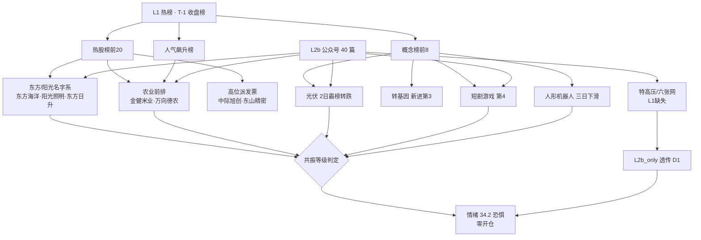

# 2026-11-09 · 🎭 **群聊情绪共振（L1+L2b 双源）**

> **数据源新鲜度**: partial（L1 实抓 · L2b 当日在库 · L2 群聊 0 条 · L3 已下线）
> **降级状态**: true
> **置信度**: 0.55

## 一句话结论

**情绪 34.2（恐惧）比当日 R1 基线 38.7 再降 4.5 分：热股前排被两只跌停的高位票与一堆名字玄学占位，唯一有产业逻辑的正面线索是农业/种业的低位放量，光伏则已触发霸榜出货警报。**

## 一、情绪刻度：34.2 · 恐惧 · 无开仓资格

R1 当日快照给出 38.7（恐惧、震荡分化型、无主线、仓位上限 35%、情绪周期 high_chop 第 2 天）。R3 在基线上做 6 项可追溯修正，净 **-4.5**：

| 编号 | 修正项 | 调整 | 依据 |
|---|---|:--:|---|
| A1 | 热股前排质量差 | **-2.0** | T-1 热股第 3/第 4 位是当日 `-9.19%`、`-10.00%` 的高位派发票 |
| A2 | 概念榜霸榜出货 | **-1.5** | 光伏概念连续 2 观测日第 1，当日转跌 `-1.79%` |
| A3 | 前排结构=名字玄学 | **-1.5** | 热股前 6 位中 4 只属「东方/阳光」套利与农业，无产业主线承接 |
| A4 | 广度与炸板恶化 | **-1.0** | 涨家占比 13.9%、中位 `-1.85%`、炸板率 30.43%、成交额 `-21.73%` |
| A5 | 连板结构偏强 | **+1.0** | 最高 5 板、连板结构分 75.3、涨停 32 对跌停 15（2.1:1） |
| A6 | 政策暖意未入 R1 打分 | **+0.5** | 年内首提股市内在稳定性、六张网、26 家券商申请 700 亿互换便利且 6 家已首批买入 |

五维法独立重算 **38.7**（涨停 32 / 跌停 70 / 连板 75.3 / 炸板 0.0 / 资金 8.4），与 R3 分 **gap 4.5 < 15**，不触发背离——差异全部来自上表的情绪修正项，不是口径打架。

**纪律闸门**：炸板率 30.43% 未越 35% 分歧线，候选**不砍半**；但情绪恐惧 + R1 判无主线 → **5 条共振全部 `research_only`，今日零开仓资格**。

## 二、双源共振图谱

## 三、五条正向共振（L1+L2b，按优先级）

| 序 | 主题 | 等级 | 阶段 | L1 证据 | L2b 证据 | 结论 |
|:--:|---|:--:|:--:|---|---|:--:|
| 1 | 农业/种业（转基因） | L1+L2b | early | 转基因概念新进第 3 `+2.01%`；金健米业 41→5、万向德农新进 13、康农种业东财第 2 | 周末复盘点名「盘面比较强的是光伏和农业」 | **进（research_only）** |
| 2 | 短剧游戏 | L1+L2b | middle | 概念 5→4 `-1.40%`；芒果超媒 62→15、浙文影业 50→16 | 复盘把短剧定为「周一情绪企稳节点」旗帜 | 观察 |
| 3 | 名字玄学（东方系） | L1+L2b | late | 东方海洋三日第 3→1→1、阳光照明 8→4→2、东方日升新进第 6 | 专段解释 11 月历史记忆与「东方能赢」寄托 | **拦截（霸榜警报）** |
| 4 | 光伏 | L1+L2b | late | 概念 2 日霸榜第 1，当日 `-1.79%`；东方日升 `+15.26%` 新进第 6 | 复盘列为「周三指数企稳节点最强方向」 | **拦截（出货警报）** |
| 5 | 人形机器人/具身智能 | L1+L2b | late | 概念 2→4→8 `-2.93%`；襄阳轴承 4→7→14 `-9.98%` | 上纬新材万台下线、丰田设机器人部门、拓斯达 Star 发布 | 观察（降温不进） |

### 1 · 农业/种业（转基因）· early · 进（research_only）

- **大资金意图**: 在全市场 13.9% 涨家占比、中位 `-1.85%` 的极弱广度里，主力需要一个「跌不动、有涨价叙事、位置低」的避风港；农业符合三条：种业/转基因有政策锚、农产品有涨价链、股价处在 30 日簇中位以下，对手盘是追高位科技票的接力资金。
- **为什么走强**: 位置低（金健米业 5 日 `+17.3%` 仍属启动段，非连板高位）；催化是「农业为周五强势方向」的板块级验证 + 转基因概念逆势翻红；筹码端金健米业单日成交 28.67 亿、万向德农 8.05 亿，属放量换手而非缩量拉抬。
- **逻辑够不够硬**: 硬证据只有「概念逆势红 + 两只票人气跳升 + 公众号单独点名」三源局部共振，缺硬业绩、缺部委级新政策时间锚，**属预期驱动的低位轮动**；证伪路径清晰——周一若农业不能延续红盘、金健米业掉出热股前 20，则视为一日游。

### 2 · 短剧游戏 · middle · 观察

- **大资金意图**: 资金在情绪企稳节点选了一个「轻资产、无业绩负担、可快速接力」的题材做旗帜，用传媒小票维持场内赚钱效应，对手盘是等指数确认后才进场的右侧资金。
- **为什么走强**: 位置偏高（芒果超媒 5 日 `+56.19%`，已非低位）；催化是情绪节点叙事而非新事件；筹码端芒果超媒单日成交 47.12 亿，属大资金换手，但概念当日整体 `-1.40%` 未翻红，属「个股强、板块弱」。
- **逻辑够不够硬**: 只有「节点旗帜 + 两票人气跳升」两条，**没有第三条独立源**，且 5 日涨幅已透支；证伪路径——若概念榜掉出前 8 或芒果超媒跌出热股前 30，即确认撤退。

### 3 · 名字玄学（东方系）· late · 拦截

- **大资金意图**: 无产业逻辑可下注，纯粹是弱市里资金用最低成本维持「有票在涨」的幻觉，把接力风险转嫁给相信玄学的散户，对手盘就是最后一批接棒者。
- **为什么走强**: 位置极高（东方海洋 5 日 `+40.28%`，连续 2 日热股第 1）；催化是 2024 年 11 月的历史记忆 + 「东方能赢」的情绪寄托，全是软叙事；筹码端东方海洋单日成交 25.76 亿、换手极大，属高位派发形态。
- **逻辑够不够硬**: **零硬证据**——无业绩、无政策、无产业事件，三源里 L1 只是热度而非资金质量；霸榜个股级警报成立，按红线 4 直接判 late + 不进。

### 4 · 光伏 · late · 拦截

- **大资金意图**: 前期资金在「指数企稳节点」建仓光伏做反弹主线，两日霸榜后已进入兑现窗口，当日 `-1.79%` 说明买方在借热度出货，对手盘是看霸榜追进来的跟风盘。
- **为什么走强**: 位置高（东方日升 5 日 `+33.72%`、当日 `+15.26%` 冲高）；催化是能源投资 9400 亿美元的中期叙事，但短期已被消耗；筹码端概念当日转跌而个股仍涨，是典型的「龙头掩护、板块撤退」。
- **逻辑够不够硬**: 中线逻辑硬（政策 + 能源投资），**短线资金逻辑已坏**（霸榜 + 转跌 + 前排票分化）；证伪路径就在当日——若周一光伏概念不能重回 `+1%` 以上并站上榜单第 1，警报升级为退潮确认。

### 5 · 人形机器人/具身智能 · late · 观察

- **大资金意图**: 产业资本在真实兑现（万台下线、丰田设部门），但二级资金已在 1104 高点撤离，留下的是被消息吸引的接力盘，对手盘是相信「产业进度=股价」的持有者。
- **为什么走强**: 走势其实在走弱——概念榜 2→4→8 三日连降、人气龙襄阳轴承 `-9.98%`；催化密度很高（一周四条产业消息）却换不来榜单热度，说明买盘已被消耗；筹码端前期高位票在派发。
- **逻辑够不够硬**: 产业逻辑硬、**资金逻辑弱**，属「消息多、人气少」的背离；证伪路径——若周一机器人概念重回前 5 且襄阳轴承止跌，背离才修复，否则确认退潮。

## 四、L2b 单源主题（不入共振，透传 D1）

| 主题 | 为何单源 | 关键声音 | 交叉参考 |
|---|---|---|:--:|
| 特高压/新型电网（六张网） | L1 概念榜与热股前 20 均无对应标的 | 阿坝 1000 千伏变电站年底投运、直流是能源大动脉；六张网含新型电网；能源投资 9400 亿美元 | R4 独立报道国网「一交两直」591 亿核准 |
| 算力金属/资源涨价（铜·锡·钽） | L1 仅个别稀有金属票在榜且当日 `-0.26%` | 23 类品种 16 个涨价，矿山端利润率 40.2% vs 加工端 2.0%；铜精矿加工费连续 21 个月为负 | — |
| 国产半导体/光刻机 | L1 无对应概念板块，兆易创新人气升但价格 `-8.99%` | SMEE 新一代前道光刻机模型亮相进博会，物镜与双工件台全链条自主可控 | — |

**透传口径**：以上三条只作 D1 观察清单输入，**不计入情绪分、不授予开仓资格**（红线 4：L2_only 不进 `resonance_top_themes`）。

## 五、风险警示：AI 算力/CPO 属高位派发，不作正向共振

| 证据 | 数据 |
|---|---|
| 概念端 | CPO 概念当日 `-4.35%`，为前排概念最差 |
| 个股端 | 中际旭创 `-9.19%`、东山精密 `-10.00%`、新易盛 `-7.28%` 同时占据热股第 3/4/9 |
| 人气端 | 东财榜东山精密 34→3（`+31` 位）、新易盛 26→9（`+17` 位）——**人气跳升伴随跌停** |
| 基本面 | 深南电路提出分红不低于净利 35%，属利好与价格背离 |

**结论**：这是「人气留存型派发」的标准形态，R5 对 CPO/PCB 龙头应加派发风险标记，D1 不得将其纳入开仓池。

## 六、首推观察票思维链（research_only · 零开仓许可）

### 600127.SH 金健米业 · 农业/种业前排（热股 41→5）

- **买入理由**: ①板块级验证——转基因概念是 T-1 唯一逆势翻红的概念前排（`+2.01%`），农业被周末复盘单独点名；②个股级验证——热股排名单日跃升 36 位、成交 28.67 亿放量，5 日 `+17.3%` 仍处启动段而非高位。
- **风险点**: ①短期——农业属低位轮动，一日游概率高，若周一不能延续红盘则接力链条立刻断；②中期反证——无硬业绩兑现，涨价叙事若被证伪（粮价未跟上），估值无支撑。
- **止损条件**: 收盘跌破 11.19 元前一日大阳线实体中点（约 `10.60` 元）即出，或次日高开低走收阴且成交额低于 15 亿即出；不设「灵活调整」。
- **可验证假设**: 24 小时内——①转基因概念榜维持前 5（观测量：概念榜排名）；②金健米业维持热股前 20；③农业板块涨停家数 ≥3。三条中两条不成立即降级 watch。

### 600371.SH 万向德农 · 农业/种业补涨位（热股新进 13）

- **买入理由**: ①当日 `+10.04%` 涨停且新进热股前 20，是板块内的接力位而非首推位；②种业属性纯正、市值小，弹性大于金健米业；③东财与同花顺双榜同时命中，属多平台合力。
- **风险点**: ①短期——5 日已 `+28.26%`，涨停后接力位最易被砸；②中期反证——种业政策若无新文件落地，纯题材溢价难以维持。
- **止损条件**: 涨停板打开且收盘跌破 `11.90` 元（涨停价下方约 4%）即出；或次日无法维持热股前 30 即出。
- **可验证假设**: 24 小时内——①万向德农封板或高开不破 5 日均线；②种业/转基因概念榜不进则退（跌出前 8 即证伪）。两条任一不成立即降至 watch。

> **重要**：以上两只均为 study-only 观察对象，R3 不授予开仓资格；实际是否进场由 D1 在主线确认后决定，且今日 R1 判定「无主线」，默认不开新仓。

## 七、与其他 R/D/E 的关系

- **依赖**：`R1_style.json`（当日情绪基线 38.7）、`attention_signals.json`（T-1）、`attention_weekend.json`（周末档）、`wechat_official_rss.jsonl`（40 篇）、`ths_hot`/`dc_hot`（三日全量）
- **被消费**：D1（共振主题 → 观察清单；霸榜警报 → 排除）、R5（光伏/东方海洋派发标记）、E1（T+N 回填「农业是否一日游」「短剧是否退潮」「机器人背离是否修复」）

## 数据源审计

| 源 | 日期 | 状态 | 备注 |
|---|---|:--:|---|
| tushare/ths_hot 热股 | 2026-11-04 ~ 2026-11-06 | 🟢 | 三日各 494~542 行，含热股/概念板块/行业板块 |
| tushare/ths_hot 概念板块 | 2026-11-04 ~ 2026-11-06 | 🟢 | 每日 20 行，用于霸榜与降温判定 |
| tushare/dc_hot A股市场 | 2026-11-04 ~ 2026-11-06 | 🟢 | 每日约 200 行，用于双榜交叉 |
| attention_signals | 2026-11-06 | 🟡 | T-1 基准，当日盘前档未生成 |
| attention_weekend | 2026-11-08 | 🟢 | 4 日榜单 + 27 只 weekend_persistent |
| wechat_official_rss | 2026-11-09 | 🟢 | 40 篇 · 方向性判断 4 条 |
| wechat_cli_5groups | 2026-11-09 | 🔴 | 0 字节 · 7 群匿名（群A~群G）全部无发言 |
| weflow-analytics | — | 🔴 | DOWN · 2026-08-19 永久下线，L3 不可恢复 |
| R1_style | 2026-11-09 | 🟢 | 当日基线 38.7 · data_day=20261106 |
| R4_news | 2026-11-09 | 🟢 | 仅作特高压/机器人交叉参考，不入共振等级 |

## 不确定性 / 反证

1. **文本层缺「人」**：群聊 7 群 0 条已连续多日，公众号是编辑加工后的观点，会把「恐慌/亢奋」磨平。今日 34.2 的恐惧读数，其广度与炸板证据是硬的，但「情绪温度」缺散户实时声音校准。
2. **对农业的自我 pushback**：它可能只是「弱市里矮子里拔将军」。若周一开盘农业即回落、转基因概念跌出前 8，本次 early 判定就是错的，应记入 E1 复盘。
3. **对光伏警报的反证**：霸榜 2 日 + 转跌是历史高胜率派发形态，但也存在「洗盘后再起」的可能（能源投资叙事仍在）；本报告选择按红线执行不放行，宁可错过不接刀。
4. **L1 时点限制**：周一盘前只能用 T-1 收盘榜，当日竞价前的真实热度无法观测，所有排名判断均有 1 个交易日的时滞。
5. **共振等级封顶**：WeFlow 下线后最高只能到 L1+L2b，过去「三源共振」的强度不可复现，任何「强共振」表述都应打折。

## Sub-Agent 元数据

- skill: analyze_sentiment_resonance_v1
- artifact: data/research/20261109/R3_sentiment.json（21 KB · 5 主题 + 3 条 L2b + 2 条警报）
- 生成耗时: 约 900 秒
- model: deepseek-v4.1-flash
- 中间件: `_work/_r3_hot_raw.json`（1.0 MB 原始三日报表）、`_work/_r3_l1_signals.json`、`_work/_r3_quotes.json`
