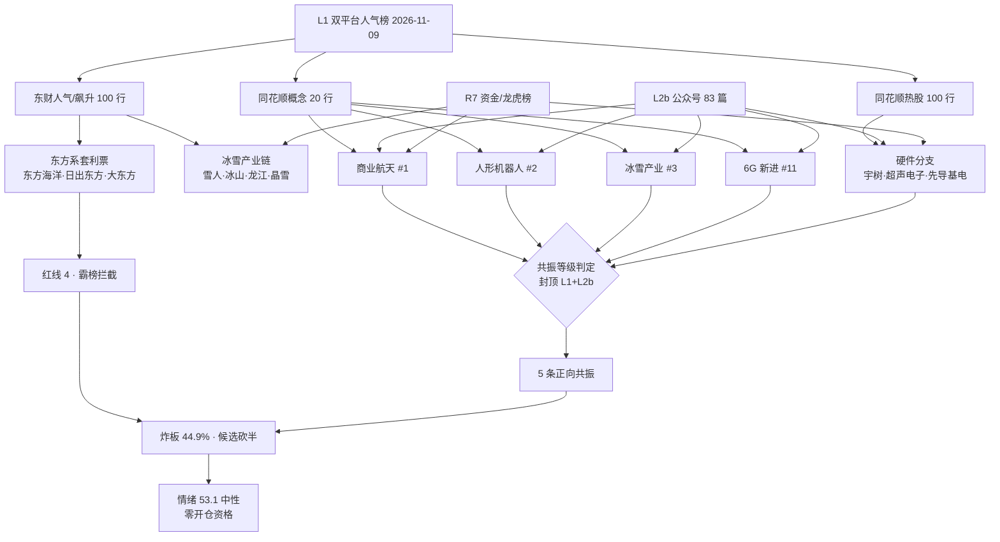

# 2026-11-10 · 🎭 **群聊情绪共振（L1+L2b 双源）**

> **数据源新鲜度**: partial（L1 实抓 · L2b 当日在库 · L2 群聊 0 条 · L3 已下线）
> **降级状态**: true
> **置信度**: 0.55

## 一句话结论

**情绪 53.1（中性）比当日 R1 基线 55.1 再降 2.0 分：商业航天五日连升与冰雪产业首日「涨停群+机构钱」是真增量，但被 7 只东方系名字涨停、东方海洋三日霸榜与 44.9% 炸板率抵掉；炸板越线 → 候选砍半，5 条共振全部 `research_only`，今日零开仓资格。**

## 一、详细分析：情绪刻度与双源共振图谱

### 1.1 情绪刻度

R1 当日快照（`trade_date=20261110`、`data_day=20261109`）给出 **55.1（中性）、震荡分化型、无主线、仓位上限 40%、情绪周期 high_chop 第 2 个交易日**。R3 在同日基线上做 6 项可追溯修正，净 **-2.0**：

| 编号 | 修正项 | 调整 | 依据 |
|---|---|:--:|---|
| A1 | 商业航天五日连升 + 主线级催化 | **+1.5** | 概念榜 8→6→3→2→1 连续 5 观测日上行；星云星座计划、太空算力网、星间激光通信三源催化；R7 当日主力 `+50.53` 亿 |
| A2 | 冰雪产业首日三点齐备 | **+1.0** | 概念 `#20→#3`、同链 3 只涨停、雪人集团龙虎榜机构净买 `2.95` 亿 |
| A3 | 前排结构＝名字玄学 | **-2.0** | 54 只涨停中 7 只东方系，东方海洋连续 3 观测日热股第 1 且机构净卖 `2.51` 亿 |
| A4 | 广度与炸板 | **-1.0** | 涨家占比 40.3%、中位 `-0.35%`、炸板率 44.90%、成交额 `-10.57%` |
| A5 | 英伟达事件压制光模块 | **-1.0** | R4 判负面；CPO 20 日 `-785.67` 亿、光通信模块 20 日 `-554.00` 亿，CPO 概念仍第 5 属衰退惯性 |
| A6 | 反抽不改 20 日底色 | **-0.5** | 全市场 20 日 `-3980.75` 亿、6/20 天为正；单日 `+128.82` 亿里超大单 `+130.88`、中小单 `-133.24` |

五维独立核算 **55.1**（涨停 54.0 / 跌停 98.0 / 连板 64.2 / 炸板 0.0 / 资金 45.7），与 R3 分 **gap 2.0 < 15**，不触发背离——差异全部来自上表修正项，不是口径打架。

**纪律闸门**：炸板率 **44.90% ≥ 35%** → 候选**砍半**；R1 判无主线 → `open_permission=false`，5 条共振全部 `research_only`。

### 1.2 双源共振图谱

### 1.3 五条正向共振（L1+L2b，按优先级）

| 序 | 主题 | 等级 | 阶段 | L1 证据 | L2b 证据 | 结论 |
|:--:|---|:--:|:--:|---|---|:--:|
| 1 | 冰雪产业/冰雪经济 | L1+L2b | early | 概念 `#20→#3` `+1.49%`；雪人集团东财新进 #2 涨停、冰山冷热 `42→5`、龙江交通新进 #13、晶雪节能涨停 | 收评「煤炭、冰雪经济等热点轮番活跃」；前瞻「热泵成为欧洲供暖市场重要选择」 | **进（research_only）** |
| 2 | 商业航天/太空算力 | L1+L2b | middle | 概念五日 8→6→3→2→1 `+1.39%`；中国卫星双榜新进 #8/#12 `+4.55%`、信维通信 #9 `+12.77%` | 太空算力 20cm、星云星座计划发布、星间激光通信主流组网 | 观察（龙头炸板） |
| 3 | 人形机器人/具身智能 | L1+L2b | middle | 人形机器人 `8→2` `+1.60%`、机器人概念 `10→6`；宇树科技 `35→2` `+9.04%` | 宇树市值重回 3000 亿、苹果机器人大脑、Hitch Open 物理智能开源 | 观察（不追高位） |
| 4 | 6G/新一代通信网 | L1+L2b | early | 6G 概念新进 #11 `+2.12%`（top20 涨幅第 1）、卫星导航新进 #16；亨通光电 `39→24` | 前瞻头条「各地加快推动新一代通信网建设」；星间激光通信 | 观察（首日政策映射） |
| 5 | PCB/覆铜板（算力硬件低位） | L1+L2b | late | PCB 概念 `12→10`；元件 3 只涨停；东山精密 #4、中际旭创 #5 | PCB 供应偏紧集体大涨、002913 涨停、午报「煤炭、PCB 双双走强」 | 只认低位（不接光模块） |

#### 1 · 冰雪产业/冰雪经济 · early · 进（research_only）

- **大资金意图**: 高位科技票炸板率 44.9%、名字套利占满人气前排的当口，主力需要一个「有季节性时间锚、位置低、可容纳跟风盘」的新方向来维持场内赚钱效应；冰雪链有明确时间锚（冬季/供暖季），题材跨度足够容纳 3-4 只涨停的跟风盘，对手盘是等确认后才追的接力资金。
- **为什么走强**: 位置低（雪人集团 5 日 `+12.5%`、冰山冷热 `+11.3%`、龙江交通 `+13.2%`，均属启动段而非连板高位）；催化是季节切换 + 欧洲热泵前瞻；筹码端雪人集团成交 27.45 亿放量涨停、封单 6.95 亿，龙虎榜净买 `2.67` 亿 / 机构 `2.95` 亿为当日机构承接第 1，属真实换手而非缩量拉抬。
- **逻辑够不够硬**: 硬度来自「概念榜跃升 17 位 + 同链 3 只涨停 + 机构龙虎榜真金」三点，缺的是业绩兑现与政策级别催化，**属季节预期驱动的首日板块**；证伪路径清晰——若今日冰雪概念跌出前 8、同链只剩 1 只红盘，即按一日游处理。

#### 2 · 商业航天/太空算力 · middle · 观察

- **大资金意图**: 产业资本与政策同时给锚（星云星座计划、太空算力网、星间激光通信），主力用「卫星互联网+算力」的复合叙事承接从 CPO 撤出的高位资金，对手盘是相信「太空算力=下一个算力」的追高盘。
- **为什么走强**: 位置已不低（商业航天概念五日连升、信维通信 5 日 `+18.0%`）；催化密集且是当日唯一「政策+产业+海外（低轨组网）」三源同向的题材；筹码端中国卫星成交 38.26 亿、盘中触板后炸板 2 次，信维通信成交 48.65 亿、炸板 1 次，说明买盘够大但封不住。
- **逻辑够不够硬**: 中线逻辑硬（低轨组网与太空算力是 2026 年产业主线级），**短线资金逻辑只到 middle**：龙头炸板 = 承接不足，概念榜第 1 但涨停群不厚（仅 2 只真正涨停 + 2 只炸板）；证伪路径——今日若中国卫星不能收在 `+3%` 以上且概念跌出前 3，则热度转向下一轮。

#### 3 · 人形机器人/具身智能 · middle · 观察

- **大资金意图**: 人气高度集中在龙一宇树科技身上（热股 `35→2`、东财 #4），主力用单一龙头的市值叙事（重回 3000 亿）维持板块存在感，板块内其他票只是跟风补充；对手盘是看到「产业消息密集」就认为板块在涨的持有者。
- **为什么走强**: 位置中高（宇树科技 5 日 `+14.6%`、上纬新材 5 日 `+38.6%`）；催化是宇树市值重回 3000 亿 + 苹果机器人大脑 + 物理智能开源平台，密度高；筹码端宇树成交 51.17 亿，上纬新材 20cm 但 4 次开板且公司当晚紧急提示风险 = 高位接力盘。
- **逻辑够不够硬**: 产业逻辑硬、**扩散逻辑弱**（概念回到 #2 但只有一只龙一在人气前列）；上纬新材的风险提示是板块过热的显性信号；证伪路径——今日若宇树科技不能维持热股前 5、或上纬新材跌停，则本轮人气只是存量抱团。

#### 4 · 6G/新一代通信网（卫星互联网·激光通信）· early · 观察

- **大资金意图**: 政策端在盘前给了「新一代通信网」的顶层框架（5G-A/6G+万兆光网+卫星互联网），主力提前卡位尚未被充分定价的政策方向，对手盘是等首板群出现后才追的资金。
- **为什么走强**: 位置低（6G 概念首次进前 20、亨通光电 5 日 `+4.4%` 仍在底部区间）；催化是前瞻头条（发文时间在 2026-11-09 晚间，今日首日发酵）；筹码端亨通光电成交 52.04 亿、信维通信 48.65 亿，资金已在通信设备落地（行业 `+37.34` 亿、通信网络设备及器件 `+27.56` 亿）。
- **逻辑够不够硬**: 政策框架硬、**板块验证不足**：6G 概念只到第 11、无成规模涨停群（仅东方通信涨停），属「政策先行、首板未出」；证伪路径——今日若 6G 概念跌出前 20 或通信设备资金转负，则本主题顺延至下一政策节点。

#### 5 · PCB/覆铜板（算力硬件低位分支）· late · 只认低位

- **大资金意图**: 主力把「算力硬件」的资金从光模块高位票挪到元件/覆铜板低位分支——同一条产业逻辑，换更低的筹码位置，对手盘是仍抱着光模块高位票等解套的资金。
- **为什么走强**: 位置分化（超声电子 5 日 `+7.1%` 属低位补涨，而中际旭创 `-5.9%`、东山精密 `-7.5%` 仍在负区间）；催化是「PCB 供应偏紧」的产业级涨价叙事；筹码端元件 +38.42 亿（行业第 2）、印制电路板 +37.63 亿（第 3），超声电子龙虎榜机构净买 `3.21` 亿。
- **逻辑够不够硬**: 短逻辑硬（供应偏紧+机构净买+3 只涨停），**中期逻辑存疑**（20 日元件 `-340.61` 亿、PCB `-256.64` 亿仍是失血）；且同题材受英伟达治理风暴压制，属 late 阶段补涨；证伪路径——今日若元件行业资金转负、PCB 概念跌出前 12，则补涨结束。

## 二、关键证据

- 证据 1：冰雪产业概念榜 2026-11-06 `#20` → 2026-11-09 `#3`（`+1.49%`），同链雪人集团/冰山冷热/龙江交通/晶雪节能 4 只涨停 · 来源 `attention_signals` 概念榜 + `limit_list_d`
- 证据 2：雪人集团龙虎榜净买 `2.67` 亿、机构净买 `2.95` 亿（当日机构承接第 1），成交 27.45 亿、封单 6.95 亿 · 来源 `R7_capital_flow.hot_money.net_buy_top10`
- 证据 3：商业航天概念五日 8→6→3→2→1 连升，当日概念主力 `+50.53` 亿（第 12 位），但 20 日 `-355.06` 亿 · 来源 `R7.main_force.concept_flows`
- 证据 4：54 只涨停中 7 只东方系（东方新能/东方嘉盛/东方创业/东方通信/东方环宇/大东方/日出东方），东方海洋连续 3 观测日热股第 1，当日 6 次开板、龙虎榜机构净卖 `2.51` 亿 · 来源 `limit_list_d` + `hot_money.distribution_alerts`
- 证据 5：炸板率 44.90%（涨停 54 / 炸板 44 / 跌停 1）、涨家占比 40.3%、中位 `-0.35%`、成交额 14824 亿（`-10.57%`） · 来源 `R1_style.market_structure`
- 证据 6：宇树科技热股 `35→2`（`+33` 位，`+9.04%`），上证报「市值重回 3000 亿元」；上纬新材 20cm 但 4 次开板并当日晚间提示风险 · 来源 `attention_signals` + `wechat_official_rss`

## 三、L2b 单源主题（不入共振，透传 D1）

| 主题 | 为何单源 | 关键声音 | 交叉参考 |
|---|---|---|:--:|
| 煤炭/焦炭（冷冬补库） | L1 概念榜前 20 无煤炭，仅 3 只个股涨停 + 东财人气新进 #14 | 收评「煤炭、冰雪经济等热点轮番活跃」；午报「煤炭、PCB 双双走强」 | 郑州煤电/云煤能源/安泰集团涨停，与冰雪同属冷冬链 |
| 中医药新规 | L1 无中医药概念板块，仅盘龙药业涨停 | 上海证券报「中医药行业，迎重磅新规」 | — |
| 端侧AI/AI硬件 | L1 芯片概念 #12 无端侧细分 | 研选「端侧算力与低功耗交互芯片」；北京发文支持 AI 终端与超级智能体 | — |
| 对美关税暂停延续 | 宏观级催化，无对应板块热度 | 24% 对美加征税率再暂停 2 个月，保留 10% | R4 已收录为宏观项 |

**透传口径**：以上四条只作 D1 观察清单输入，**不计入情绪分、不授予开仓资格**（红线 4：单源不进 `resonance_top_themes`）。

## 四、风险警示：三条拦截项

| 对象 | 形态 | 数据 |
|---|---|---|
| 东方海洋（002086.SZ） | 个股三日霸榜 | 热股连续 3 观测日第 1、5 日 `+27.8%`、4 涨停 1 跌停交替、当日 6 次开板、机构龙虎榜净卖 `2.51` 亿 |
| 名字玄学（东方系） | 主题级 late | 7 只东方系涨停且无产业承接；大东方、东方创业涨停但龙虎榜净卖（`-0.29` / `-0.24` 亿） |
| 上纬新材（688585.SH） | 高位接力 | 20cm、4 次开板、5 日 `+38.6%`、公司当晚紧急提示风险 |

**AI 算力/CPO·光模块**：R4 判英伟达治理风暴（董事会调查+国会传唤，美股开盘跌超 7%）对光模块负面；R7 显示 CPO 单日 `+48.93` 亿、光通信模块 `+53.30` 亿，但 20 日分别 `-785.67` / `-554.00` 亿，中际旭创 5 日 `-5.9%`、东山精密 `-7.5%` 仍占热股 #4/#5 = 人气留存型派发，**不得作正向共振**，R5 应给光模块龙头加派发标记。

## 五、首推观察票思维链（research_only · 零开仓许可）

### 002639.SZ 雪人集团 · 冰雪产业链前排（东财人气新进 #2 · 涨停）

- **买入理由**: ①板块级验证——冰雪产业概念单日跃升 17 位到第 3，同链 3 只涨停，是今日唯一「概念+涨停群+机构钱」三点齐备的新方向；②个股级验证——涨停封单 6.95 亿、成交 27.45 亿放量，龙虎榜机构净买 `2.95` 亿列当日第 1；③位置合适——5 日 `+12.5%` 属启动段，非连板高位。
- **风险点**: ①短期——季节题材首日脉冲，一日游概率高，若今日不能延续红盘，接力链条立刻断；②中期反证——冰雪/热泵无业绩兑现，纯季节预期，冬季过后无锚；③筹码端当日 4 次开板，封板质量不是铁板。
- **止损条件**: 收盘跌破 `15.00` 元（涨停价下方约 5.96%）即出；跌破 `14.50` 元（前收/涨停起点）无条件出；不设「灵活调整」。
- **可验证假设**: 24 小时内——①冰雪产业概念榜维持前 5；②同链（冰山冷热/龙江交通/晶雪节能）至少 2 只红盘；③雪人集团维持热股前 20。三条中两条不成立即降级 watch。

### 000823.SZ 超声电子 · PCB/元件低位分支（涨停 · 机构净买 3.21 亿）

- **买入理由**: ①产业级叙事——「PCB 供应偏紧」是当日唯一有涨价逻辑的硬件分支，元件行业资金 `+38.42` 亿（第 2）、印制电路板 `+37.63` 亿（第 3）；②机构验证——龙虎榜净买 `2.53` 亿、机构净买 `3.21` 亿；③位置低——5 日 `+7.1%`，远低于同题材高位票（中际旭创 `-5.9%`、东山精密 `-7.5%`）。
- **风险点**: ①短期——属 late 阶段补涨，若光模块高位票继续杀跌会拖累整条硬件线；②中期反证——元件 20 日 `-340.61` 亿、PCB 20 日 `-256.64` 亿，趋势未反转；③英伟达治理风暴的负面外溢（R4 判 high）。
- **止损条件**: 收盘跌破 `16.80` 元（涨停价下方约 5.9%）即出；跌破 `16.24` 元（前收）无条件出。
- **可验证假设**: 24 小时内——①PCB 概念榜维持前 10；②元件行业主力资金次日仍为正；③奥士康/世运电路次日不炸板。三条中两条不成立即降至 watch。

> **重要**：以上两只均为 study-only 观察对象，R3 不授予开仓资格；中国卫星、信维通信当日均炸板（触板 2 次/1 次），**不列入首推**，只作研究观察。实际是否进场由 D1 在主线确认后决定，今日 R1 判定「无主线」+ 炸板率越线，默认不开新仓。

## 六、上一期判定复盘（E1 预填）

| 2026-11-09 判定 | 2026-11-09 实际 | 结论 |
|---|---|:--:|
| 农业/种业 early「进」 | 金健米业 `-2.59%`（热股 5→20）、万向德农 13→50、康农种业掉出前 100；红太阳 2 板但 10 次开板、龙虎榜净卖 | **证伪 · 一日游** |
| 名字玄学 late「拦截」 | 东方海洋再涨停 `+10.08%`、日出东方 2 板 | 方向正确但错过；派发信号（6 次开板+机构净卖）同步成立 |
| 光伏 late「拦截」 | 光伏概念 `-0.15%`、榜 1→4 | 拦截正确 |
| 人形机器人 late「降温不进」 | 概念 8→2、宇树科技 `35→2` | **阶段判定错一个周期**（把重启当退潮），本期改 middle 但不追高位 |

## 七、数据源审计

| 源 | 日期 | 状态 | 备注 |
|---|---|:--:|---|
| 东财人气榜 dc_hot | 2026-11-09 | 🟢 | 100 行 · 当日 06:02 落盘，用于前排质量与霸榜判定 |
| 东财飙升榜 dc_hot | 2026-11-09 | 🟢 | 100 行 · 19 条 rank_jump（宇树科技 74→4） |
| 同花顺热股 ths_hot | 2026-11-09 | 🟢 | 100 行 · 与东财交叉 60 只多平台命中 |
| 同花顺概念 ths_hot | 2026-11-03 ~ 2026-11-09 | 🟢 | 每日 20 行 · 概念榜五日序列，用于连升/霸榜 |
| attention_signals | 2026-11-09 | 🟡 | T-1 基准；当日 20261110 盘前档未生成 |
| wechat_official_rss | 2026-11-09 ~ 2026-11-10 | 🟢 | 83 篇 · 方向性判断 5 条 |
| wechat_cli_5groups | 2026-11-10 | 🔴 | 0 字节 · 群A~群G 全部无发言（连续断更） |
| weflow-analytics | — | 🔴 | DOWN · 2026-08-19 永久下线，L3 不可恢复 |
| R1_style | 2026-11-10 | 🟢 | 当日基线 55.1 · data_day=20261109 |
| R7_capital_flow | 2026-11-10 | 🟢 | 概念/行业资金 + 龙虎榜，仅作交叉验证不入共振等级 |
| R4_news | 2026-11-10 | 🟢 | 英伟达治理风暴（负面）作 CPO 拦截依据 |

## 八、不确定性 / 反证

1. **L1 有一个交易日的时滞**：当日 20261110 盘前档 `attention_signals` 未生成，全部排名判断基于 2026-11-09 收盘/隔夜榜；竞价前的真实热度不可观测。
2. **冰雪的自我 pushback**：季节题材首日脉冲的失败率很高，雪人集团当日已有 4 次开板。若今日概念跌出前 8、同链只剩 1 只红盘，early 判定即错，应记入 E1。
3. **商业航天的反证**：概念第 1 但龙头炸板，存在「题材强、筹码散」的典型分歧；若今日中国卫星继续炸板，则 middle 应下调为 late。
4. **文本层缺「人」**：群聊 7 群 0 条连续断更，公众号是编辑加工后的观点，会把恐慌/亢奋磨平；今日 53.1 的中性读数，广度与炸板证据是硬的，温度校准是软的。
5. **共振等级封顶**：WeFlow 下线后最高只能到 `L1+L2b`，历史上「三源共振」的强度不可复现，任何「强共振」表述都应打折。

## 九、与其他 R/D/E 的关系

- **依赖**：`R1_style.json`（当日基线 55.1）、`attention_signals.json`（T-1 双平台人气榜）、`wechat_official_rss.jsonl`（83 篇）、`R7_capital_flow.json`（概念/行业资金与龙虎榜交叉）、`R4_news.json`（英伟达负面事件）
- **被消费**：D1（5 条共振 → 观察清单；东方系/东方海洋/上纬新材/CPO → 排除与拦截）、R5（东方海洋、上纬新材、光模块龙头派发标记）、E1（冰雪是否一日游、商业航天龙头炸板是否转分歧、6G 首板群是否出现）

## Sub-Agent 元数据

- skill: analyze_sentiment_resonance_v1
- artifact: data/research/20261110/R3_sentiment.json（25 KB · 5 主题 + 4 条 L2b + 3 条负向 + 3 条警报）
- 生成耗时: 约 420 秒
- model: deepseek-v4.1-flash
- 中间件: `_work/_r3_l1.json`（双平台榜前排 30 行 + 飙升 + 多平台交叉）
