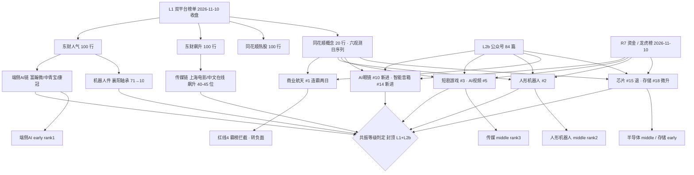

# 2026-11-11 · 🎭 **群聊情绪共振（L1+L2b 双源）**

> **数据源新鲜度**: partial（L1 实抓 · L2b 当日在库 · L2 群聊 0 条 · L3 已下线 · R2 缺位）
> **降级状态**: true
> **置信度**: 0.58

## 一句话结论

**情绪 71.4 贪婪·修复确认；端侧AI 领跑，机器人与传媒中期，商业航天拥挤警报，全数观察。**

## 一、详细分析：情绪刻度与双源共振图谱

### 1.1 情绪刻度

R1 当日快照（`trade_date=20261111`、`data_day=20261110`）给出 **71.9（贪婪）、连板情绪型、三主线以上（代理 6 条）、仓位上限 70%、情绪周期 `main_up` 修复段第 3 个交易日**。R3 在同一基线上做 6 项可追溯修正，净 **-0.5**，落到 **71.4（贪婪）**：

| 编号 | 修正项 | 调整 | 依据 |
|---|------|:--:|---|
| A1 | 涨停结构修复确认 | **+2.0** | 涨停 93 / 跌停 0 / 最高 7 板；炸板率 **16.96%**（前一日 44.90%，腰斩）；昨日涨停隔日红盘占比 88.89%、次日收盘中位 **+4.43%**；主力连续 2 日净买 **+173.37 亿** |
| A2 | 端侧AI 新方向三点齐备 | **+1.5** | AI眼镜 概念榜新进 **#10**、智能音箱 新进 **#14**；虚拟现实 18 家 / 消费电子 16 家 / 智能穿戴 14 家 / AI眼镜 12 家涨停**首次成群（days=1）**；富瀚微 20cm 机构净买 **4.14 亿** |
| A3 | 外部利率与 AI 权重压制 | **-1.5** | 核心 CPI 环比 +0.3% 超预期、12 月加息概率 **95.6%**；黄金暴跌 3%、美债抛售；英伟达跌逾 6%、距高点 -30%、遭股东集体诉讼 |
| A4 | 人气前排被套利与高位板占位 | **-1.0** | 东财人气 top15 东方系 **4 席**（日出东方 #2、东方海洋 #6、东方新能 #7、大东方 #8）；闽发铝业 7 板机构净卖 **3.42 亿** |
| A5 | KOL 文本层 0 条 | **-0.5** | 7 群 0 条 0 字节，共振只能 L1+L2b，缺真人话语维度 |
| A6 | 商业航天连霸第 1 两日 | **-1.0** | 概念榜 8→6→3→2→1→1，红线 4 霸榜警报成立，最拥挤处不计入正向 |

**五维交叉校验**：涨停强度 93 / 跌停压制 100 / 连板结构 65.4 / 炸板项 32.2（=100−4×16.96）/ 杠杆外资 53.7（取 R1 capital 分项）→ 加权 **71.9**，与 R3 的 71.4 差 **0.5**，远低于 15 分背离线，**无背离**。

广度补充：涨家 4003 / 5218（**76.7%**）、中位 **+1.37%**、成交额 **15045.9 亿**（+1.49%）、涨超 5% 455 家 / 跌超 5% 仅 8 家。这是「指数温和、个股极强」的普涨结构，也正是端侧AI 与传媒能在同日首次成群的土壤。

炸板率 **16.96% < 35% 红线** → 候选**不砍半**（5 → 5）。但「不砍半」只表示可以列，不表示可买。

### 1.2 双源共振图谱

### 1.3 五条正向共振（L1+L2b，按优先级）

#### 1 · 端侧AI / AI 终端硬件（AI眼镜·智能穿戴·消费电子）· **early** · 进（research_only）

- **L1**：AI眼镜 概念榜新进 #10（+4.07%）、智能音箱 新进 #14（+4.82%）、虚拟现实 #7；涨停结构 虚拟现实 18 / 消费电子 16 / 智能穿戴 14 / AI眼镜 12，全部 days=1。个股：富瀚微 新进 #11（+20.01%·机构 **4.14 亿**）、中青宝 #12（+20%·1.06 亿）、康冠科技 涨停（1.41 亿）、阳光照明 #14（+9.96%）。
- **L2b**：财联社【收评】「端侧AI概念站上风口」+【午报】「反复活跃」+【VIP日报】「端侧AI概念走强」；上海证券报「端侧AI硬件，行情升温」；Meta 轻量模型 Muse Ember→Agent 商业化提速。
- **大资金意图**：三只票同日进龙虎榜机构净买（4.14 / 1.41 / 1.06 亿），买的是「AI 从云端算力向终端迁移」的确定性——出货量与 SoC 订单，不是纯概念。电子 +92.02 亿（全市场第 1）、消费电子 +23.11 亿与个股承接同向。
- **为什么走强**：外因三重（Meta 端侧模型可跑、谷歌 TPU 与英伟达竞争把算力下沉、平头哥分拆给国产 SoC 叙事）；内因是**四个子板块同日首次进涨停榜**，属"板块首次成群"，不是单票脉冲。
- **逻辑够不够硬**：资金硬、成群硬，**持续性不硬**——days=1 只有一次观测，且"端侧AI"本身不是标准榜名单，是 AI眼镜/智能音箱/虚拟现实三块的归并，存在命名分散带来的虚高。判 early，只做首板前排。

#### 2 · 人形机器人 / 具身智能（减速器·丝杠·触觉）· **middle** · 观察

- **L1**：涨停结构 **机器人概念 #1（34 家 · 6 天 5 板）**、人形机器人 概念榜 #2（序列 6→2→4→8→2→2）、机器人概念榜 13→14→8→10→6→4 单调上行。个股：宇树科技-W **双榜 #1**（+6.29%）、襄阳轴承 飙升 71→10（+9.99%·在榜 42 日）、宁波华翔 新进 #31 涨停（机构 1.19 亿）、豪能股份 新进 #42 涨停。
- **L2b**：财联社【明日主题前瞻】头条「蚂蚁灵波开源 LingBot-Touch 触觉基础模型（近 5000 小时真实触觉数据）」；上证「物理AI龙头股价翻倍」；证券时报「宇树科技，A股第三（自低点反弹近 100%）」；证券时报「603121 2连板提示风险：机器人相关产品尚未形成收入」。
- **大资金意图**：宁波华翔首板机构 +1.19 亿、汽车零部件 +21.36 亿——大钱在**低位机器人件（汽零/减速器）扩散**，同时 7 板闽发铝业机构净卖 3.42 亿，同一叙事内明确高低切。资金买的是"低位补涨"而非"高位接力"。
- **为什么走强**：触觉模型补上了灵巧手的数据底座（产业瓶颈），叠加宇树人气回升与涨停家数蝉联第一，人气+产业双确认。
- **逻辑够不够硬**：产业逻辑硬，**位置不硬**——宇树反弹近 100%、已出现"产品未形成收入"风险提示，middle 阶段只认总龙与首板低位，中位二板命中禁止清单 1（mid_laggard）直接划掉。

#### 3 · 传媒 / AI漫剧·短剧游戏（AI视频）· **middle** · 观察

- **L1**：短剧游戏 概念榜 **#3**（+4.51%，top10 内涨幅最大，六观测日 4→9→5→4→7→3 创新高）、AI视频 **#5**（1109 #14 → +9 位）、文化传媒 新进 #16；涨停结构 文化传媒 16 / AIGC 16 / 腾讯 13 / 元宇宙 13 / 短剧 12，全部 days=1。个股：文投控股 #3（2 板·机构 1.07 亿）、华策影视 #13（+16.39%）、上海电影 涨停（飙升 74→29）、中文在线 +8.07%、掌阅/慈文 涨停。
- **L2b**：财联社【收评】「AI漫剧」；证券时报「超4200股飘红！A股资金涌入传媒」+「002425，4分钟封板」；上证「AI短剧爆火，业内人士泼冷水」。
- **大资金意图**：传媒 **+46.88 亿**（行业第 2 流入、涨幅 +4.53% 第 1），买的是 AI 内容成本坍缩后的出海付费现金流想象，5 个子板块同日成群说明是板块级配置而非单票博弈。
- **为什么走强**：短剧/AI视频概念榜 6 日新高 + 涨停结构首次成群 + 微盘普涨风格（涨家 76.7%）。
- **逻辑够不够硬**：资金硬、扩散硬，**基本面软**——上证同一窗口已载"业内人士泼冷水"，浙文影业涨停却机构净卖 0.82 亿。middle：只做涨停前排，不做跟风补涨（禁止清单 1 / 6）。

#### 4 · 半导体国产化（RISC-V / 平头哥·芯片设计）· **middle** · 观察（人气在退）

- **L1**：芯片概念 概念榜 **#15**（1109 #12，回落 3 位）、涨停 14 家（days=2）；富瀚微 +20.01%（端侧与芯片双属性重叠）、盛洋科技 2 板（机构 1.30 亿）、长鑫科技 ths #34（+1.15% 高开回落）。
- **L2b**：上证「超130亿元，资金连续加仓半导体」+「阿里巴巴：已正式申请平头哥独立上市」；证券时报同题；谷歌两款新 TPU、费城半导体指数 +6%；上证早知道「688138 拟不超15亿加码半导体掩膜版」。
- **大资金意图**：半导体 +40.62 亿、电子 +92.02 亿，押的是 RISC-V/CPU 国产替代的**股权重估**（平头哥证券化），属事件驱动型配置。
- **为什么走强**：130 亿加仓 + 分拆上市 + TPU 竞争 + 掩膜版扩产，四腿消息同日。
- **逻辑够不够硬**：消息硬、钱硬，**人气软**——概念榜 #12→#15 是"钱进人退"结构；且英伟达距高点 -30%、遭集体诉讼，海外 AI 算力链与国内国产化链方向分离。只认同链机构承接票，不追概念榜尾部。

#### 5 · 存储芯片 / DRAM·DDR5 涨价链 · **early** · 观察（人气未起）

- **L1**：存储芯片 概念榜 #18（1109 #20 → 微升 2 位，+2.28%；序列 15→3→17→11→20→18 无趋势）；长鑫科技 ths #34 +1.15%；**无存储链个股进入东财人气 top20**，涨停结构无存储板块上榜。
- **L2b**：CFM 上调 26Q4 **DDR5 RDIMM 合约价 +10%-15%**；华为新型存储系统即将试商用；上证「算力网，10万亿元级建设高歌猛进」。
- **大资金意图**：无独立存储资金项，电子/半导体的大钱先给了终端与国产化，长鑫科技高开回落的走势说明**资金尚未接力**。
- **为什么走强**：合约价是产业级硬指标（涨价链最硬的一类催化），但目前只反映在消息面，未反映在人气与涨停结构。
- **逻辑够不够硬**：产业逻辑硬、**确认度为零**。early 只作前瞻观察，禁止清单 5 / 6 提示：不得逆情绪抢跑、不得在确认退潮或未确认时抢筹。

### 1.4 六条负面 / 拦截（不进正向共振）

| 对象 | 类型 | 判定 |
|---|---|---|
| 商业航天 / 太空算力 | 拥挤·红线4 | 概念榜 1109、1110 **连霸第 1**，序列 8→6→3→2→1→1 六日单调上行；产业侧仍有真实承接（盛洋科技 2 板机构 +1.30 亿、中国卫星 +4.64%、星云星座 + 10 万亿算力网），判**人气过热非逻辑证伪**，R5 对板块龙头加风险标记，D1 不得据本条直接否定板块 |
| 名字玄学·东方系 | late 拦截 | 东方系 **4 席**占东财 top15（日出东方 #2、东方海洋 #6、东方新能 #7、大东方 #8），无产业承接、不可扩散；东方海洋自 #1 掉至 #6（3 日霸榜警报到期） |
| 冰雪产业 | 退潮 | 概念榜 14→20→3→**9**；冰山冷热涨停但雪人集团 +0.94% 机构净卖 1.54 亿、龙江交通涨停机构净卖 1.11 亿，链条转前排派发 |
| 光伏 / 闽发铝业 | 高位派发 | 光伏概念 8→1→1→4→**6**；闽发铝业 **7 板**涨停但机构净卖 **3.42 亿**，属高度板出货后的低位反抽 |
| 贵金属 / 黄金 | 宏观负面 | 概念榜 10→18→18→17→**20**；CPI 超预期、加息概率 95.6%、黄金暴跌 3% |
| CPO / 光模块 | 海外链负面 | CPO 概念 2→1→11→5→5→**11** 再度回落；英伟达跌 6%、Nscale 推迟 350 亿 IPO、软银收敛 AI 投资；中际旭创在榜 179 日属人气留存型 |

## 二、关键证据

- **证据 1（修复确认）**：炸板率 44.90% → **16.96%**、涨停 93 / 跌停 0、昨日涨停隔日红盘 88.89%·收盘中位 +4.43%、主力连续 2 日净买 +173.37 亿 · 来源 `_r1_market.json` + `R7_capital_flow.json`
- **证据 2（端侧AI 三点齐）**：AI眼镜 新进 #10、智能音箱 新进 #14，虚拟现实/消费电子/智能穿戴/AI眼镜 四板块同日 days=1；富瀚微 20cm 机构净买 **4.14 亿**（当日机构净买第 1）· 来源 `attention_signals 20261110` + `R7.hot_money` + `_r1_limit_cpt_20261110`
- **证据 3（板块级成群）**：涨停板块榜前 20 中 **11 个板块 days=1**（虚拟现实/文化传媒/AIGC/消费电子/智能家居/智能穿戴/元宇宙/腾讯/短视频/短剧/AI眼镜），说明本日不是单板块行情而是"新方向集中首日"· 来源 `_r1_limit_cpt_20261110`
- **证据 4（拥挤警报）**：商业航天概念榜连续 2 观测日第 1，为六日单调上行末端 · 来源 `attention_signals 20261103/04/05/06/09/10` 序列 diff
- **证据 5（媒体反向信号）**：证券时报「603121 2连板提示风险·机器人产品尚未形成收入」、上证「AI短剧爆火，业内人士泼冷水」、盘口「市场有些亢奋」· 来源 `wechat_official_rss 84 篇`

## 三、首推观察票思维链（research_only · 零开仓许可）

### 300613.SZ 富瀚微 · 端侧AI-芯片设计分支（20cm 首板 · 机构净买 4.14 亿）

- **买入理由**：本日唯一同时满足「20cm 首板 + 龙虎榜机构净买第 1（4.14 亿）+ 概念榜新进」三重确认的票；机构真金白银进场，不是游资对倒封板；所属端侧AI 是唯一四板块同日首次成群的方向。
- **风险点**：① 端侧AI 仅 days=1，无第二观测日；② 20cm 首板次日溢价不确定，机构大额参与的首板常见"次日兑现"；③ 深市创业板 20cm 波动放大，止损空间被压缩；④ 芯片概念榜 #12→#15 说明同属芯片的资金热度在退，存在"个股强、板块退"的错配。
- **止损条件**：研究口径止损距 **-7%**（落在 -5~-10% 硬区间内），跌破首板实体中位即视为逻辑证伪；超短不达预期隔日走（纪律 ⑨），不用 T 或补仓掩盖看错（禁止清单 12）。
- **可验证假设**：次日若同时满足 (a) 端侧AI 再有 ≥2 个子板块进入涨停榜、(b) 竞价不破 -3%、(c) 消费电子板块资金连续第 2 日净流入 >10 亿 → 升格为可交易候选交 D1；任一不满足则降 watch 并记入 E1。

| 项目 | 判定 |
|---|---|
| 板型 | 20cm 首板（创业板），非连板型，不做接力 |
| 龙头认定 | 端侧AI-芯片设计分支第一（机构净买第 1、唯一 20cm）；过纪律 §2 三条（分支最强 / 有资金 / 有人气），非总龙 |
| 盈亏比 | 止损 -7%、首目标 +12~15% → RR **≈1.7-2.1**，临界；按纪律 §4（RR<2 降级）→ **降 watch 观察**，不进 execution |
| 禁止清单 | 14 项未命中（非中位杂毛、非退潮后买入、非计划外、非梭哈）；但"首板隔日不确定"使其只能 watch |

**其余观察票只标档位，不给执行**：宇树科技 688836（人气双榜 #1·无涨停·反弹近 100%，位置命中禁止清单 7 cross_high_climax → 只观察）；文投控股 600715（2 板·传媒前排·机构 1.07 亿，RR≈1.7 → watch）；长鑫科技 688825（无涨停·人气 #34 → 不列候补）；盛洋科技 603703（2 板·商业航天，被红线 4 板块拥挤警报覆盖 → 排除，不入本 skill 候选）。

## 四、上一期判定复盘（E1 预填）

| 上一期（20261110）判定 | 本期结果 | 结论 |
|---|---|---|
| 冰雪产业 early · 进 | 概念 #3 → **#9**，雪人集团机构净卖 1.54 亿、龙江交通净卖 1.11 亿 | **证伪**：首日脉冲误判为 early，E1 记一条"概念榜单日跃升 ≠ 方向成立" |
| 商业航天 middle · 观察 | 连霸第 1 第二日，触发红线 4 拥挤警报 | 方向兑现但**拥挤度超预期**，middle 定性正确、追高判断正确 |
| 人形机器人 middle · 观察 | 涨停结构蝉联 #1（34 家），概念榜稳 #2 | **正确**，middle 未被打破 |
| 6G / 新一代通信网 early · 观察 | 当日概念榜无 6G 条目，未扩散 | **未兑现**，单日新进榜不构成方向 |
| PCB late · 只认低位 | PCB 概念 #10 → **#13**，温和退潮未破位 | **定性正确**（late 且未给机会） |

## 五、数据源审计

| 源 | 状态 | 抓取日 | 记录数 | 备注 |
|---|---|:--:|:--:|---|
| attention_signals（东财人气/飙升） | 🟢 ok | 2026-11-10（落盘 2026-11-11） | 100 / 100 | 数据日=最近收盘日，backfill=0 |
| attention_signals（同花顺热股/概念） | 🟢 ok | 2026-11-10（落盘 2026-11-11） | 100 / 20 | 六观测日概念序列完整 |
| 公众号 RSS（L2b） | 🟢 ok | 2026-11-11 | 84 | 财联社/证券时报/上证为主，含 6 篇大 V 复盘 |
| 群聊 wechat-cli（L2） | 🔴 error | 2026-11-11 | 0 | 群A–群G 共 7 群全空（文件 0 字节） |
| WeFlow（L3） | 🔴 unavailable | — | 0 | 2026-08-19 永久下线 |
| R1_style | 🟢 ok | 2026-11-11 | 1 | 基线 71.9 · 连板情绪型 |
| R4_news | 🟢 ok | 2026-11-11 | 8 事件 / 15 板块极性 | 宏观负面 + 产业正面并存 |
| R7_capital_flow | 🟢 ok | 2026-11-11 | 9 研究 / 8 观察 | 主力 +173.37 亿，龙虎榜全量 |
| R2_main_sectors | 🔴 missing | — | 0 | 当日未产出，主线交叉缺位 |
| xTick | ⚪ not_used | — | 0 | 情绪量化由 R1 承接，不重复拉取 |

## 六、不确定性 / 反证

1. **端侧AI 的"成群"可能是归并出来的**：AI眼镜/智能音箱/虚拟现实/智能穿戴四个榜单名称互有重叠（一只票可同时在 3 个榜内），"四板块 18/16/14/12 家"存在重复计数，真实独立涨停家数可能只有 25-30 家。若如此，T1 的成色被高估，应降为 L1_only 观察。
2. **情绪 71.4 的"贪婪"与外部环境矛盾**：CPI 超预期、加息概率 95.6%、英伟达距高点 -30%，A 股当日靠微盘普涨与资金内部腾挪维持。若隔夜美股再杀，71.4 会一夜失效，R1 的 `main_up` 定性也可能被推翻。
3. **KOL 层全空意味着缺一环验证**：连续 7 个交易日 7 群 0 条，R3 无法判断"真人是否在同一方向加仓"，所有 early 判定都缺少话语层佐证，这是本日置信度只给 0.58 的主因。
4. **商业航天拦得对不对**：产业催化（10 万亿算力网、星舰试飞窗口）与机构承接都真实存在，红线 4 是机械规则。本条只拦"正向共振"资格，不拦产业逻辑——若 R2/R5 给出更强证据，D1 应独立判断，不要被 R3 的警报误导成"板块已死"。
5. **炸板率 16.96% 的低值本身可疑**：涨停 93 家而炸板仅 19 家，通常对应指数单边上行的封板环境；本日指数冲高回落、尾盘收窄，若次日高开低走，炸板率会报复性回升。

## 七、与其他 R/D/E 的关系

- **依赖**：`R1_style.json`（当日情绪基线 71.9 + 五维分项）、`R7_capital_flow.json`（板块资金 + 龙虎榜机构承接）、`R4_news.json`（宏观负面与产业催化极性）、`attention_signals 20261103-10`（六观测日概念序列）
- **被消费**：D1（`canghai-plan`）取 resonance_top_themes 与 discipline_gate；R5 对 T1/T2 龙头做画像并接受 distribution_alert 标记（商业航天龙头加风险标记）；R6 反证可挑战 T1 的"成群"归并假设与 T4 的"钱进人退"；E1 复盘本表第四节五条判定
- **边界**：R3 不做板块排序（R2 职责）、不做个股画像（R5 职责）、不签发开仓资格（D1/R6 职责）

## Sub-Agent 元数据

- skill: analyze_sentiment_resonance_v1
- artifact: data/research/20261111/R3_sentiment.json
- 生成耗时: 约 19 分钟（含 L1 六观测日 diff 与 L2b 84 篇抽取）
- model: deepseek-v4.1-flash
