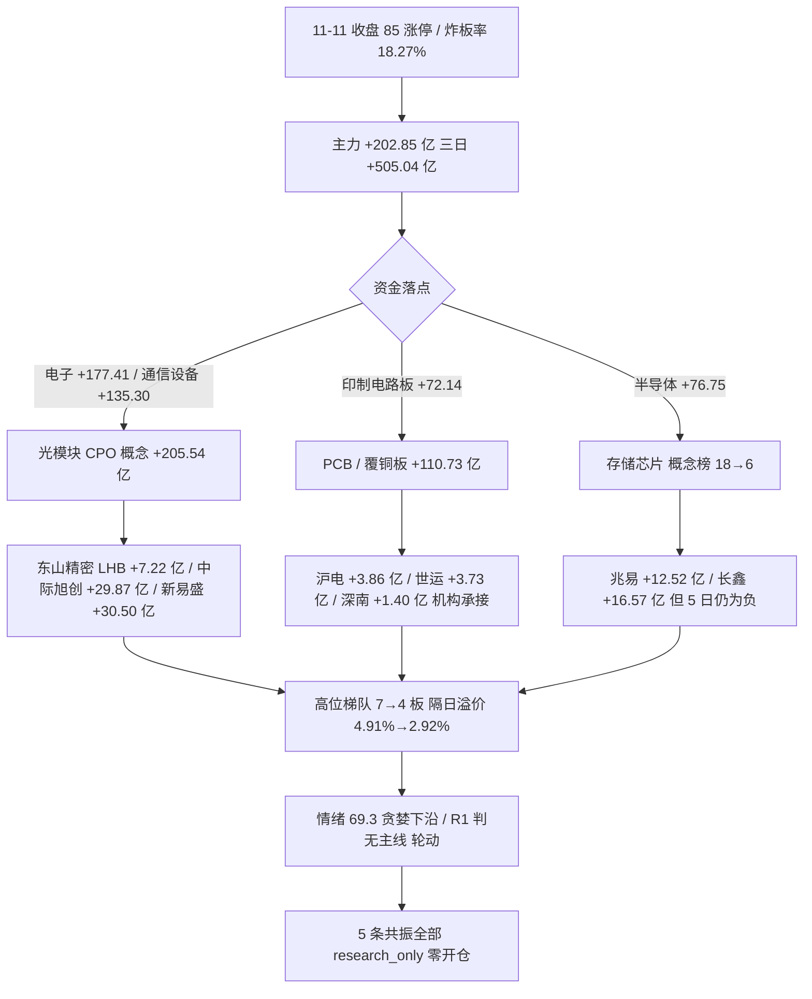

# 2026 年 11 月 12 日 · **群聊情绪共振**

> **数据源新鲜度**: partial（L1 当日全量 · L2 群聊断更 · L2b 公众号 88 篇 · L3 永久下线）
> **降级状态**: true（WeFlow 下线 / KOL 0 条 / R2 缺位）
> **置信度**: 0.56

## 一句话结论

情绪 69.3 仍在贪婪档，但高度在退：钱切回光模块/CPO 与 PCB，人气留在机器人/短剧高标而主力反手；R1 判无主线，5 条共振全部只做研究观察、零开仓资格。

## 详细分析

**一、情绪读数：基线 70.3，修正 −1.0，落 69.3 贪婪下沿。** 当日 R1 把 11-11 定性为「连板情绪型 + 修复段第 4 个交易日」，五维加权自身给 70.3（涨停 85 / 跌停 0 / 连板结构 63.9 / 炸板率 18.27% / 杠杆外资 61.0）。R3 在当日基线上做七项修正：资金结构切换（+2.0）、CPO 首板群成立（+1.5）为正向；高度与梯队退化（−1.5）、高标主力反手（−1.0）、KOL 断更（−0.5）、外部利率净负（−0.5）、20 日中期失血（−1.0）为负向，净 −1.0。五维交叉 70.3，gap 1.0 < 15，无背离。修正后仍属贪婪，但**贪婪的来源从「连板梯队」换成了「机构资金」**——这正是今天最需要说清的结构变化。

**二、L1 层面：钱与人都换到了「光互联」。** 同花顺概念榜 CPO 从前一日 #11 直跳 #1（+4.62%，热度 263,648），六观测日序列 2→1→11→5→5→11→1，属于跳升而非连霸；光纤 #11（+4.42%）、PCB #7（+3.34%）。涨停结构端 CPO 11 家**全部首板**（days=1 / cons=0），5G 19 家、数据中心 AIDC 16 家。个股端东山精密同时拿下东财人气 #1 与同花顺 #7（+10.00%，龙虎榜净买 7.22 亿、机构 9.36 亿，在榜 155 日），中际旭创 #2（+15.07%，主力 +29.87 亿）、新易盛 #4（+16.97%，主力 +30.50 亿）、天孚 +13.96%、光迅 +10.00%（龙虎榜 +2.46 亿）、源杰 20cm、剑桥 +10.00%。这批票距 20 日高仍在 −20%~−55%，是深调后的修复首日，不是新高接力。

**三、资金与消息相互确认，不是单源叙事。** R7 当日主力 +202.85 亿、三日累计 +505.04 亿（补回 11-06 主跌的 95.6%），但 5 日仅 +66.76 亿、20 日 −3146.51 亿——**三日修复是止血，不是转势**。落点极集中：电子 +177.41、通信设备 +135.30、通信 +133.83、元件 +81.79、印制电路板 +72.14；概念端 CPO +205.54（+5.83%）、光通信模块 +190.90、光纤 +135.80、PCB +110.73。R4 板块极性矩阵把「光模块/CPO」打到全市场最强 +1.359（美股 AI 回暖 E001 + FCC 限制中国光收发器推迟至 2028-2029 的 E002），PCB +0.800，存储 +0.578。公众号池 88 篇侧同样把 11-11 读作「算力硬件卷土重来」，与龙虎榜机构承接同向。

**四、人气仍在旧方向，但资金已经先撤。** 人形机器人概念 #2、机器人概念 #4（连续 4 个观测日前二）、涨停 27+17 家，人气极强；但光洋股份 3 板开板 2 次、主力 −1.13 亿，襄阳轴承 2 板开板 6 次、主力 −0.99 亿，宇树科技从同花顺 #1 掉到 #13（仅 +0.52%、主力 −1.34 亿），锋龙股份 3 板却异动公告自证「1-9 月无机器人零部件收入」。短剧端文投控股拿下同花顺热股 #1（+10.18%），但 3 板开板 9 次，传媒行业主力 −16.13 亿（前一日还是 +46.88 亿）。这两条都是**人气留存型派发**，只列观察不列机会。

**五、高度在退，是今天最硬的负向证据。** 最高板 7→4，前一日 93 只涨停的隔日收盘溢价由 +4.91% 降到 +2.92%，再涨停 19 只（20.4%），梯队 66/12/5/2、首板占比 77.65%，xTick 1 进 2 仅 16.0%。中单 −179.33 亿说明散户/中小单在被抽走，接力盘在变薄。这意味着今日若做，只能做**资金已经确认的低位首板/低位补涨**，不接 3 板以上高标。

## 主题一 · 光模块/CPO（AI 硬件光互联） · L1+L2b · early

| 维度 | 证据 |
|---|---|
| 概念榜 | CPO **#1**（前一日 #11，跃升 10 位，+4.62%，热度 263,648）；六观测日 2→1→11→5→5→11→1，非连霸 |
| 涨停结构 | CPO 11 家**全部首板**（days=1、cons=0）；5G 19 家、AIDC 16 家 |
| 个股 | 东山精密 dc#1/ths#7 +10.00%（LHB +7.22 亿·机构 9.36 亿）；中际旭创 dc#2 +15.07%（+29.87 亿）；新易盛 dc#4 +16.97%（+30.50 亿）；光迅 +10.00%（LHB +2.46 亿）；剑桥 +10.00%；源杰 20cm |
| 位置 | 距 20 日高：中际旭创 −20.28%、东山 −28.36%、新易盛 −32.81%、天孚 −37.37% —— 深调修复，非新高 |
| 资金 | CPO 概念 +205.54 亿（+5.83%）、光通信模块 +190.90、光纤 +135.80、通信设备 +135.30 |
| 消息 | FCC 限制中国光收发器推迟至 2028-2029（R4 E002）；隔夜纳指 +1.62%、费半盘中 +7%；证券时报「4 分钟涨停 CPO 爆发」 |

- **大资金意图**: 机构在深调 20-55% 的光模块核心票上一次性回补，东山精密 7.22 亿、沪电 3.86 亿、光迅 2.46 亿的龙虎榜买盘全部标注机构专用；对手盘是 11-10 追高机器人/端侧的中小单（当日中单 −179.33 亿）。这是「AI 硬件光互联」链条的机构定价权回归，不是普涨。
- **为什么走强**: 位置（深调后首日修复，距 20 日高仍有 20-55% 空间）+ 催化（FCC 禁令推迟 2-3 年是硬时间锚，隔夜费半 +5.66% 是硬映射）+ 筹码（11 家首板、机构龙虎榜真金）三维同向。
- **逻辑够不够硬**: 三个独立源（海外政策/美股映射、国内龙虎榜机构承接、概念资金 +205.54 亿）同向，硬事件与硬资金两项齐备，够硬。证伪路径：11-12 竞价前排高开低走、CPO 炸板率 >35%、或机构龙虎榜次日反手净卖出——任一出现即降级为一日反抽。

**首推票思维链 · 300308 中际旭创（总龙，+15.07%，主力 +29.87 亿，距 20 日高 −20.28%）**

- **买入理由**: ①光模块总龙，全球 800G/1.6T 份额与北美云厂资本开支直接挂钩，FCC 禁令推迟直接移除 2027-2029 的供给端尾部风险；②当日主力 +29.87 亿为全市场个股前三，5 日 +16.06 亿转正，机构在深调 −20% 位置回补；③板块 11 家首板成群体，龙头享有溢价。
- **风险点**: ①20 日主力仍为净流出，单日回补可能是空头回补而非趋势建仓；②美核心 CPI 三个月年化 3.7%、12 月加息几乎确定，高估值成长股折现率压力未解；③若白宫否认推迟传闻，政策折价立刻回补。
- **止损条件**: 跌破买入价 −5%（以 542.00 收盘计为 514.90）或 CPO 板块当日炸板率 >35%，两者任一触发即离场，不留隔夜。
- **可验证假设**: 24 小时内看三项——①11-12 集合竞价昨日涨停股红盘率 ≥50%；②CPO 概念当日主力净流入仍为正；③中际旭创分时不破当日均价线。三项中两项不成立即证伪「机构回补」假设。

**首推票思维链 · 002384 东山精密（PCB 龙头 + 人气第一，+10.00%，LHB 机构 9.36 亿）**

- **买入理由**: ①同时属 PCB 与光模块两条最强链，东财人气 #1 + 同花顺 #7 的双平台合力，155 个交易日在榜属人气留存型；②龙虎榜净买 7.22 亿、机构 9.36 亿，是当日全市场最大单票机构承接；③PCB 概念 +110.73 亿、印制电路板行业 +72.14 亿，板块级资金验证。
- **风险点**: ①5 日主力仍净流出 5.61 亿，今日属反转首日，筹码未完成换手；②距 20 日高 −28.36%，上方套牢盘密集；③PCB 链的生益科技当日否认英伟达撤单，传闻扰动会传导至整个覆铜板分支。
- **止损条件**: 跌破买入价 −5%（以 92.06 收盘计为 87.46）或 PCB 概念当日主力转净流出，任一触发离场。
- **可验证假设**: 24 小时内看——①沪电股份/深南电路能否同步封板（板块效应）；②东山精密龙虎榜次日是否出现机构净卖出；③PCB 概念榜维持 top10。两项不成立即证伪「板块级机构建仓」。

## 主题二 · PCB/覆铜板（AI 算力载板） · L1+L2b · early

| 维度 | 证据 |
|---|---|
| 概念榜 | PCB #7（前一日 #13，+3.34%）；印制电路板行业 +72.14 亿（+5.76%） |
| 个股 | 东山精密 dc#1（双属性）；沪电 +10.00%（LHB +3.86 亿·机构 5.69 亿，开板 3 次）；世运 +8.39%（LHB +3.73 亿）；深南 涨停（LHB +1.40 亿）；胜宏 +9.92%（+6.47 亿）；生益 +8.39%（5 日 −9.35 亿，风险） |
| 消息 | 上海证券报「PCB 板块大面积涨停！机构看好景气度延续」；证券时报「被英伟达撤单？生益科技紧急回应」（扰动项） |

- **大资金意图**: 机构把 PCB 当作光模块的「低估值配套」同步建仓——沪电、世运、深南三只龙虎榜合计机构净买超 11 亿，买的是 AI 服务器/交换机载板的确定性，而非概念弹性。
- **为什么走强**: 位置（板块整体距 20 日高 25-38%，属修复）+ 催化（美股 AI 资本开支回暖）+ 筹码（大面积涨停 + 机构龙虎榜），但龙头沪电当日开板 3 次说明分歧不小。
- **逻辑够不够硬**: 资金与消息两源硬，缺独立的产业价格锚（覆铜板涨价未被证实），只能算「强联动」不算「独立主线」；证伪路径是生益科技撤单传闻扩散或龙头封板失败转放量阴线。

## 主题三 · 存储芯片/DRAM·DDR5 涨价链 · L1+L2b · early

| 维度 | 证据 |
|---|---|
| 概念榜 | 存储芯片 **#6**（前一日 #18，跃升 12 位，+3.13%）；六观测日 15→3→17→11→20→18→6，无连霸 |
| 个股 | 长鑫科技 飙升 90→34（+4.01%，主力 +16.57 亿，在榜 139 日）；兆易创新 +6.15%（+12.52 亿，距 20 日高 −11.93%）；普冉/德明利 5 日主力为负 |
| 消息 | 上海证券报「存储厂商酝酿新一轮涨价？记者求证」；华为新型存储系统 11-12 贵安启动试商用（R4 E007）；大摩警示旧存储价格见顶（R4 E008 负面） |

- **大资金意图**: 机构在存储上做的是「涨价求证 + 国产替代」双线，长鑫 +16.57 亿是次新龙头回补，兆易 +12.52 亿是成熟标的承接；但两者 5 日仍为净流出（长鑫 −20.26 亿、兆易 −13.37 亿），说明这是首日回补不是持续建仓。
- **为什么走强**: 催化（华为试商用今日落地，硬时间锚）+ 人气（概念榜 18→6 跃升）+ 位置（兆易距 20 日高仅 −11.93%，属相对高位），三维中位置一项不利。
- **逻辑够不够硬**: 涨价求证尚无官方确认，大摩同日给出反向观点，属「消息强、证据弱」；只做前瞻观察，不出手。

## 主题四 · 人形机器人/具身智能（含减速器·轴承） · L1+L2b · late · **拦截**

| 维度 | 证据 |
|---|---|
| 概念榜 | 人形机器人 #2（+2.19%，连续 4 个观测日前二）；机器人概念 #4（+1.73%）；减速器 #19 |
| 涨停结构 | 机器人概念 27 家（6 天 4 板）、人形机器人 17 家、新能源汽车 29 家 |
| 个股 | 襄阳轴承 dc#5/ths#3 +10.02%（2 板、开板 6 次、主力 −0.99 亿）；光洋 3 板（开板 2 次、主力 −1.13 亿、已澄清机器人业务占比低）；福莱新材 2 板（5 日 +40.72%）；宇树 ths#1→#13（+0.52%、主力 −1.34 亿）；锋龙 3 板（公告自证无机器人收入） |
| 消息 | 北京具身智能三年行动方案（2028 京津冀整机产能占全国 25%）；大摩调研「部署时间表平均延后约一年、仅 18% 满意」 |

- **大资金意图**: 机构在这个位置是**减仓方**——宇树、襄阳、光洋三只人气核心主力全部净卖，接力的是开板 2-6 次的高标游资盘；对手盘是还在用「人气第一」做多的小单。
- **为什么走强**: 不成立——位置（板块已连涨 6 天、龙头 3 板高位）+ 催化（大摩延后一年对冲北京方案）+ 筹码（高标开板率高、主力净卖），三维里两维转负。
- **逻辑够不够硬**: 产业逻辑仍在（北京方案是硬政策），但交易逻辑已走到派发段；只保留观察，不进。

## 主题五 · 短剧游戏/AI 漫剧·传媒 · L1+L2b · late · **拦截**

| 维度 | 证据 |
|---|---|
| 概念榜 | 短剧游戏 #5（前一日 #3，+1.20%）；AI视频 #14（前一日 #5）；AI应用 #8 |
| 个股 | 文投控股 ths#1/dc#3（+10.18%，3 板、开板 9 次）；果麦 +20.00%（LHB +2.04 亿·机构 4.47 亿，在榜 12 日）；风语筑 2 板（LHB +1.79 亿）；上海电影 dc#15；凯撒文化 飙升 36→17 |
| 资金 | 传媒行业主力 **−16.13 亿**（前一日 +46.88 亿），5 日仍 +40.96 亿 |
| 消息 | 上海证券报「巨头纷纷加码，AI 短剧火上浇油」；证券时报「刘强东入局短剧」；此前「AI 短剧爆火，业内泼冷水」 |

- **大资金意图**: 机构只在新票（果麦 20cm、风语筑 2 板）做承接，对 3 板龙头文投控股是**边打边撤**——开板 9 次就是证据；传媒板块单日从 +46.88 亿转为 −16.13 亿，是整条链的资金反手。
- **为什么走强**: 不成立——位置（文投 3 板高位、开板 9 次）+ 资金（板块净流出）+ 催化（消息仍正但已被充分定价），人气第一反而是最危险的位置。
- **逻辑够不够硬**: 产业催化真实（AI 短剧降本增效、巨头入场），但交易结构已到分歧顶；观察，不进。

## 关键证据

- 证据 1 · **CPO 概念 #11→#1 跃升 10 位、11 家全部首板** —— 来源 `tushare/ths_hot` + `tushare/limit_cpt`（data day 2026-11-11）。
- 证据 2 · **CPO 概念主力 +205.54 亿、光通信模块 +190.90 亿、PCB +110.73 亿** —— 来源 `tushare/moneyflow_ind_dc`（R7）。
- 证据 3 · **东山精密龙虎榜净买 7.22 亿 / 机构 9.36 亿，沪电 3.86 亿 / 5.69 亿，光迅 2.46 亿 / 3.71 亿** —— 来源 `tushare/top_list + top_inst`（R7）。
- 证据 4 · **最高板 7→4、隔日溢价 +4.91%→+2.92%、1 进 2 仅 16.0%** —— 来源 `tushare/limit_list_d` + `xtick/market_emotion`。
- 证据 5 · **修正是止血不是转势：主力 20 日 −3146.51 亿、仅 8/20 天为正、中单 −179.33 亿** —— 来源 `tushare/moneyflow_dc`（R7）。
- 证据 6 · **FCC 限制中国光收发器推迟至 2028-2029** —— 来源 `news_major`（R4 E002）+ 公众号深度。

## 数据源审计

| 源 | 日期 | 状态 | 备注 |
|---|---|:--:|---|
| tushare/ths_hot（热股 50 + 概念 20） | 2026-11-11 | 🟢 | 经 attention_pipeline 落盘，五观测日序列完整 |
| tushare/dc_hot（人气 50 + 飙升 30） | 2026-11-11 | 🟢 | 与同花顺榜交叉出 47 只双平台合力票 |
| tushare/limit_list_d + limit_cpt | 2026-11-11 | 🟢 | 85 涨停 / 0 跌停 / 19 炸板 / 最高 4 板 |
| tushare/moneyflow_ind_dc + top_list/top_inst | 2026-11-11 | 🟢 | R7 当日落盘，板块与龙虎榜可交叉 |
| R1_style（当日基线） | 2026-11-12 | 🟢 | 70.3 贪婪 · 连板情绪型 · high_chop 修复段第 4 日 |
| R4_news（事件极性） | 2026-11-12 | 🟢 | 8 条 top event，光模块 +1.359 最强 |
| wechat_official_rss（公众号池） | 2026-11-11 | 🟢 | 18 feeds / 12 有文 / 88 篇 |
| wechat_cli_5groups（焦点群 7 个，匿名） | 2026-11-12 | 🔴 | 0 条 0 字节，连续断更 |
| weflow-analytics（L3） | — | 🔴 | 2026-08-19 永久下线 |
| R2_main_sectors | 2026-11-12 | 🟡 | 当日未产出，主线交叉缺位 |
| xtick/market_emotion | 2026-11-11 | 🟡 | 返回 85/1/19/4 与 R1 一致（跌停口径差 1）；hot_bk 无排行字段未用 |

## 不确定性 / 反证

**最可能错的地方，是把「单日机构回补」当成「趋势切换」。** 三个反证点必须摆在桌面上：①主力 20 日 −3146.51 亿、仅 8/20 天为正，5 日窗口只有 +66.76 亿（11-04 的 +507.57 亿滚出），三日修复是止血；②光模块核心票距 20 日高仍有 20-55%，属于下跌中继里的反弹，不是新一轮主升；③最高板 7→4、隔日溢价腰斩、1 进 2 只有 16%，赚钱效应正在从中位向低位收缩，若 11-12 昨日涨停股竞价红盘率跌破 50%，今日所有 early 判断立刻降级为一日反抽。

**L2 缺位的代价：** 7 个焦点群 0 条，今天所有「人气」结论都只来自榜单与公众号，缺真人话语的情绪温度计。公众号 88 篇是媒体侧（偏正式、发文少），按 skill 规定不计入共振等级，只作观点证据。共振最高等级只能是 L1+L2b，这一点不因结论偏多而放宽。

**另一个自证风险：** 我把机器人/短剧判为 late 派发，依据是「主力净卖 + 高标开板」，但 11-11 机器人概念仍有 27 家涨停、短剧热股 #1，若 11-12 这两条链重新缩量加速，则派发判断被证伪——这属于「人气留存型」板块的正常反复，不构成对资金证据的否定。

## 与其他 R/D/E 的关系

- 依赖: `data/research/20261112/R1_style.json`（当日情绪基线 70.3）、`data/research/20261111/attention_signals.json`（L1 双平台榜单）、`data/research/20261112/R4_news.json`（事件极性矩阵）、`data/research/20261112/R7_capital_flow.json`（资金与龙虎榜）、`data/raw/20261112/wechat_official_rss.jsonl`（L2b 观点）。
- 被消费: D1（canghai-plan）读 `sentiment_score` / `resonance_top_themes` / `hotlist_signals` / `discipline_gate` / `negative_theme_warnings`；R5 读 `hotlist_signals.distribution_alert` 给龙头加风险标记（当日无活警报）；R6 读 `resonance_top_themes` 与 `hotlist_signals` 做模式一/模式六交叉；E1 盘后回填 5 条主题与首推票的可验证假设。

## Sub-Agent 元数据

- skill: analyze_sentiment_resonance_v1
- artifact: data/research/20261112/R3_sentiment.json
- 生成耗时: 约 6 分钟（07:22 起，07:28 落盘）
- model: deepseek-v4.1-flash
- 说明: WeFlow 永久下线，L1+L2b 双源；KOL 层 0 条已按降级处理，未编造任何群聊内容。
