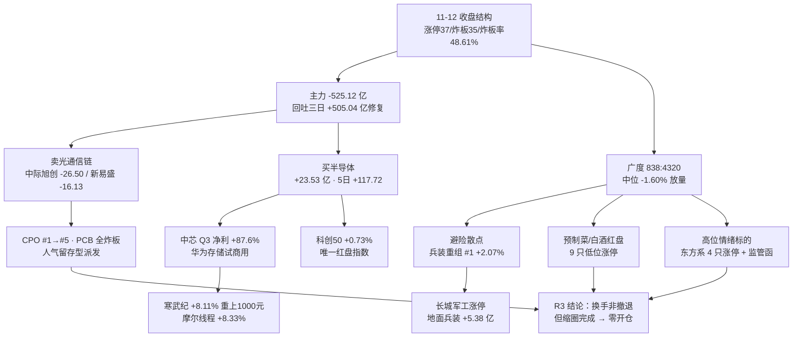

# 2026-11-13 · **群聊情绪共振**

> **数据源新鲜度**: partial（A 股主源 🟢，群聊 🔴，WeFlow 🔴）
> **降级状态**: true — 共振上限 L1+L2b，真等级 **L1_only**
> **置信度**: 0.53（0.78 × 0.75 × 0.9）

## 一句话结论

**半导体换手接棒、光通信链集体派发**；情绪 44.6（中性下沿），炸板率 48.61% 越过 35% 硬红线 → 候选砍半、**零开仓资格**。

## 情绪读数：基线 47.1 → 44.6

| 维度 | 读数 | 解读 |
|---|---|---|
| 当日 R1 基线 | `47.1` · 中性 | 震荡分化型，无主线（行业次日留存 12.0%、解释力 13.85%） |
| 涨停 / 跌停 / 炸板 | `37 / 5 / 35` | 炸板率 **48.61%**，前一日仅 18.27%，单日跳升 30.3pct |
| 最高连板 | `5 板`（大东方 / 日出东方） | 两只均收到上交所股价波动监管工作函 |
| 晋级率（xTick） | `1进2 = 7.58%` / 2进3 16.67% / 3进4 40.0% | 首板次日晋级几乎断档，接力链条断裂 |
| 广度与量能 | 涨 838 / 跌 4320（16.2%）· 中位 `-1.60%` · 成交 19319 亿（+15.26%） | **放量下跌**，不是缩量整理 |
| 主力资金 | 单日 `-525.12 亿`（前一日 +202.85），5 日 -548.6 亿 | 一日回吐 11-09/10/11 三日全部 +505.04 亿修复 |
| 昨日涨停溢价 | 开盘 +2.17%，**收盘 -0.87%**（中位 -2.05%），红盘率 37.6% | 高开低走，追板即亏 |
| R3 修正 | **−2.5**（7 项） | 半导体承接 +1.5、游资未死 +0.5，对冲派发 -1.5、外盘 -1.0、接力断档 -1.0、KOL 断更 -0.5、溢价转负 -0.5 |

**五维交叉校验**：`score_5d = 47.1`，`r3_vs_5d_gap = 2.5 < 15` → **无背离**。杠杆外资维度因两融 T+1（最新 2026-11-11）与北向口径不可用，只做 4 维加权归一，未用替代值凑分。

## 双源共振全景

## 共振主题 Top5

### 1️⃣ 半导体/国产算力（晶圆代工·封测·设备·存储）· `early` · research_only

| 项目 | 内容 |
|---|---|
| 共振等级 | L1+L2b（KOL 缺位，**真等级 L1_only**，红线 3 下不算强共振） |
| L1 人气 | 通富微电 ths #8（+5.36%，炸板 3 次）、寒武纪 ths #27 / dc #33（+8.11%）、长电 #26、华天 #28、沪电 #30、长鑫 #36、兆易 #38 |
| L1 概念 | 芯片概念 #14（-1.62%）、存储芯片 #16（由 #6 回落，八观测日 15→3→17→11→20→18→6→16）—— 概念榜前五被兵装/机器人/航天/CPO 占据 |
| 板型缺陷 | **板块内 0 只涨停**，通富微电属炸板；赚钱效应在「涨幅」不在「板型」，打板模板不适用 |
| L2b 官媒 | 中芯国际 Q3 营收 219.83 亿（+28.1%）/ 净利 28.47 亿（+87.6%）· 寒武纪重上 1000 元 · 华为磁电存储贵安试商用 · 长鑫研判 · 科创半导体 ETF 举牌安集科技 |
| 资金 | 半导体 `+23.53 亿`（5 日 +117.72 / 20 日 +85.66，**20 日唯一累计为正的成长板块**）、设备 +17.33、制造 +8.85、封测 +5.73、大基金持股 +24.49 |
| 名单 | 688256 寒武纪 / 688981 中芯国际 / 002156 通富微电 / 002371 北方华创 / 688347 华虹宏力 / 301660 粤芯半导体 |

- **大资金意图**: 机构在中芯 Q3 报表与华为存储试商用两个硬时间锚当日，把 5 日 117.72 亿继续加在半导体，卖的是自己前一日买的光模块。对手盘是追「CPO 批量 2 连板」的打板客 —— 机构做的是**同赛道换分支**，不是离场。
- **为什么走强**: 位置（寒武纪 20 日位置 82.6 分位但 20 日仅 +8.45%，非高位加速）＋催化（硬业绩 87.6% + 硬时间锚当日落地）＋筹码（龙虎榜粤芯机构净买 3.01 亿、通富主力 +8.62 亿，机构腿而非游资腿）。
- **逻辑够不够硬**: 三源同向（L1 人气 + R7 资金 + R4 极性矩阵），且含硬业绩一项 → **够硬**。但缺一条：板块内 0 涨停 0 连板，游资合力未成形。证伪路径：11-13 半导体设备转负且科创 50 翻绿，则「换分支」实为「一起撤」。

### 2️⃣ 兵装重组/地面兵装（军工新题材）· `early` · watch

- **L1**: 兵装重组概念 **榜外 → #1**（+2.07%，全市场仅 3 条红盘概念之一）；军工 11-09 曾 #18、11-10/11 掉榜后回 #11；海峡两岸 #4（上一在榜 #17）。个股长城军工 dc #7（+10.02%，地面兵装，开板 2 次，42 日在榜 max #3），飙升榜军工电子链 4 只（航天南湖 +10.23 / 天秦装备 +3.79 / 佳驰科技 +1.51 / 捷强装备 +2.56）。
- **资金**: 地面兵装 `+5.38 亿`、板块 `+3.19%` —— **全市场唯一「涨幅+资金」双正板块**。
- **证据缺口**: 官媒 **0 条**，仅自媒体晚间资讯 1 条提及；R4 事件极性矩阵无军工条目 → 属「有人气有资金但没故事」。
- **大资金意图**: 指数杀跌日资金唯一的去处不是科技而是重组预期，体量小（+5.38 亿）但集中度高 —— 游资在找「不跌的下游确定性」，对手盘是次日接力盘。
- **为什么走强**: 位置（长城军工 42 日在榜、avg #5，非一日冲榜）＋催化（重组预期，无公告）＋筹码（仅 1 只涨停、开板 2 次、无二板以上梯队）。
- **逻辑够不够硬**: 只有 2 独立源（概念榜 + 资金），**硬事件 0 条** → 不硬。一纸澄清即可打回，故只给 watch，不给研究首选。

### 3️⃣ AI营销/广告（AI 应用缩圈分支）· `middle` · watch

- **L1**: 蓝色光标 dc #4 / ths #5（+10.89%，双平台 avg #4.5，62 日在榜）；金螳螂 ths #23（+3.77% 炸板）、新华传媒 #43（+2.90%）。
- **资金**: 营销代理 `+19.28 亿`（板块 -2.0%）、广告营销 `+18.86 亿`（板块 -2.02%）、小红书概念 +16.95、智谱 AI +18.67、跨境电商 +14.09 —— **板块下跌、资金逆势进**。
- **同层负面对照**: 赵丽颖起诉红果短剧（官媒 2 篇）、AI 漫剧午后集体调整、上海电影跌停、芒果超媒 -9.54%、文投控股炸板 8 次。
- **大资金意图**: 23.47 亿单票净买在 -525 亿的市场里属逆势大单，买的是「有收入落地的 AI 投放/代运营」，弃的是被版权诉讼与监管打掉的内容高标 —— 传媒内部同类切换。
- **为什么走强**: 位置（蓝色光标首度进前五，属人气重新点火非高位接力）＋催化（无硬事件，纯叙事）＋筹码（板块 pct -2.02% 而个股 +10.89%，筹码高度集中单票）。
- **逻辑够不够硬**: 两源其实是「同一笔钱」的两面，严格算 1.5 源，无硬业绩无硬政策 → 不硬。只 watch。

### 4️⃣ 预制菜/食品零售·白酒（低位防御轮动）· `early` · **不进**

- **L1**: 预制菜 #12（+0.37%）、白酒 #19（+0.24%）—— 与兵装重组并列当日仅有的 3 条红盘概念；零售/食品/渔业相关涨停 **9 家占 24.3%**（一般零售 3 / 服装家纺 2 / 白酒 1 / 食品加工 1 / 渔业 1 / 饲料 1）。
- **资金反向**: 白酒 `-1.62 亿` 而板块 +0.74%（价涨钱走）、食品饮料无正流入、一般零售不在流入前十。
- **催化错配**: 官媒当期条目是「18 起涉食品安全重大犯罪案件挂牌督办」（对预制菜叙事偏负面），唯一正面是商务部对等降税（E007，净 +0.245，受益在农业/渔业）。
- **大资金意图**: 散户与大单在杀跌日买「便宜 + 不跌」；价格红盘但主力净流出 = 承接盘而非建仓盘，对手盘就是次日想卖的人。
- **为什么走强**: 位置（白酒 5 日 -23.71 亿、20 日 -1.56 亿，绝对低位）＋催化（仅间接）＋筹码（皇台酒业开板 6 次、澳洋健康机构净卖 0.59 亿，封板质量差）。
- **逻辑够不够硬**: 单源（价格表象），资金反向、催化错配 → 不硬。按纪律「无资金无催化不推」直接**不进**。

### 5️⃣ 人形机器人/具身智能（减速器·轴承）· `late` · **拦截**

- **L1**: 人形机器人 #2（-3.15%，**连续 4 个观测日稳居 #2**，八观测日 6→2→4→8→2→2→2→2）；机器人概念 #6（-2.42%，前值 #4）。个股宇树 -8.38%（105 日在榜 max #2）、光洋 -5.60%、襄阳轴承 +3.54%（炸板 4 次）、锋龙 +6.63%（炸板 6 次）、福莱新材**跌停 -10.00%**（前一日 2 板）、宁波东力炸板 10 次。
- **资金**: 机器人板块 `-19.87 亿`（-4.51%，5 日 -13.93 由正转负）、机械设备 -66.99 亿。
- **唯一正面**: 华为云首款昇腾原生具身世界模型（上海证券报单条，无订单/产能落地）。
- **大资金意图**: 机构与游资已在 11-09/10/11 把机器人换成光模块再换成半导体；11-12 留给散户的是概念榜 #2 的排名和跌停的福莱新材。
- **为什么走强（为什么弱）**: 位置（连续 4 日 #2 = 高位人气）＋催化（单点、无落地）＋筹码（炸板集中：襄阳 4 次、锋龙 6 次、宁波东力 10 次）。
- **逻辑够不够硬**: 两源方向相反且资金侧占绝对权（-19.87 亿 > 任何叙事）→ 不硬。唯一正确动作是**拦截**。

## 首推票思维链（3 只研究候选）

### 688256.SH 寒武纪 · 半导体总龙

- **买入理由**: ①20 日主力累计 +50.03 亿、5 日 +34.21 亿，是当日全场唯一「20 日累计为正」的成长方向龙头；②硬业绩锚 — 中芯 Q3 净利 +87.6% 验证国产算力景气，寒武纪当日 +8.11% 重回 1000 元。
- **风险点**: ①20 日位置 82.6 分位，若 11-13 高开被砸即为「业绩兑现即出货」；②隔夜英伟达 CEO 辞职（E001）压整条 AI 硬件链，国产替代受益需 1-2 日情绪传导才可能兑现。
- **止损条件**: 跌破当日收盘价的 -5%（即前一日大阳线实体中枢失守）无条件出；若开盘竞价跌破 1000 元整数关口，直接不参与。
- **可验证假设**: 24h 内 — ①11-13 半导体板块主力仍为正流入；②科创 50 维持红盘；③寒武纪收盘站在 1000 元之上。三条中两条不成立即证伪。

### 002156.SZ 通富微电 · 先进封装龙二

- **买入理由**: ①主力单日 +8.62 亿、5 日 +8.66 亿、20 日 +7.39 亿，封测方向资金连续为正；②先进封装概念 +17.52 亿、HBM +15.28 亿同向，属中芯业绩最直接受益环节。
- **风险点**: ①当日**炸板 3 次**（+5.36% 未封住），板型缺陷明显；②炸板率 48.61% 的环境下二次冲高大概率再被打回。
- **止损条件**: 跌破炸板日最低价（约 -4%）离场；开盘若低开超过 -3% 且 15 分钟内不收回，不进。
- **可验证假设**: 24h 内 — ①封测/先进封装概念资金继续为正；②该票竞价红盘且不低开破 -2%；③20 日位置 78.4 分位不再下移。

### 601606.SH 长城军工 · 兵装重组唯一有资金背书的首板

- **买入理由**: ①地面兵装是当日唯一「涨幅 +3.19% + 资金 +5.38 亿」双正板块；②兵装重组概念从榜外直冲 #1，42 日在榜 avg #5 属长驻人气票而非一日冲榜。
- **风险点**: ①**官媒 0 条事件**，纯重组预期，一纸澄清即断；②首板次日晋级率全场仅 7.58%，接力概率结构性偏低；③开板 2 次，封板质量未过检验。
- **止损条件**: 竞价跌破首板涨停价 -6%（即承接彻底失败）；若开盘直接低开 -4% 以上且不修复，不参与。
- **可验证假设**: 24h 内 — ①兵装重组概念维持前 10；②地面兵装板块资金仍为正；③该票不出现澄清公告。

## 负向警示 6 条

| # | 主题 | 级别 | 核心证据 |
|---|---|---|---|
| 1 | CPO/光模块·PCB | 🔴 high | 中际旭创 -6.11%（主力 -26.50 亿）、新易盛 -4.38%（-16.13 亿）、东山精密 ths 人气 #2 但仅 +1.77%；剑桥/景旺/奥士康/博敏/超声**全炸板**；R4 PCB 极性 -0.85 |
| 2 | 英伟达链/AI服务器 | 🔴 high | E001 黄仁勋辞去总裁/CEO/董事即刻生效；英伟达盘后 -9%、盘前 -6%；工业富联 -4.85%（主力 -13.84 亿） |
| 3 | 短剧/AI漫剧·影视传媒 | 🔴 high | 赵丽颖起诉红果短剧 ×2 官媒 + 集体调整；上海电影跌停、芒果超媒 -9.54%、文投控股炸板 8 次 |
| 4 | 商业航天 | 🟡 medium | 概念 #3（-2.09%，八观测日 8→6→3→2→1→1→3→3）人气仍在，资金与催化双缺 |
| 5 | 名字玄学/东方系 | 🔴 high | 东方海洋 #1（up_stat 9/17）、日出东方 5 连板、大东方 5 连板、东方环宇 4/4 —— 4 只涨停 + 上交所工作函（E008） |
| 6 | 冰雪/黑龙江 | 🟢 low | 龙江交通单票飙升 61→13、冰山冷热 -2.93%，板块 -1.28% 未成形 |

## 热门榜信号与红线 4 检查

- **排名跃升（概念）**: 兵装重组 榜外→#1 · 海峡两岸 #17（11-10）→#4 · 军工 #18（11-09）→#11 · 预制菜 新进 #12 · 英伟达概念 新进 #18
- **排名跃升（个股）**: 天普 99→45 · 九阳 87→38 · 中重科技 82→35 · 金辰 86→44 · 天安新材 81→43 · 龙江交通 61→13 · 日上集团 59→18 · 惠发食品 57→19
- **新进 top**: 好当家 / 北纬科技 / 中重科技 / 天安新材 / 天普股份 / 双成药业 / 国统股份
- **派发警报（3 条）**: ①**东方系集群** —— 4 只涨停 + 5 连板两股收监管函，东方海洋 24 日在榜 max #1；②**光模块双龙** —— 双平台前十但单日 -6.11% / -4.38%、主力 -26.50 / -16.13 亿，人气霸榜 + 资金反手；③**人形机器人概念** —— 连续 4 观测日 #2 而当日 -3.15%、资金 -19.87 亿，人气与资金背离
- **红线 4 连霸检查**: 本日**无**符合「连续 ≥2 观测日概念 top1」的标的（兵装重组为首日 #1、人形机器人连续 #2 但非 #1）。已解除：商业航天（11-09/10 连霸后回落 #3）、光伏（11-05/06 后早已回落 #7）、东方海洋个股（11-05/06/09 连霸后 11-12 解除，本日回归记为单日重启）

## 公众号观点（L2b · 不计入共振等级）

95 篇 / 14 源（官媒 70：上海证券报 40、证券时报 30、财联社早知道 7；自媒体 25）。

| 主题 | 篇数 | 代表标题 |
|---|:--:|---|
| 英伟达/黄仁勋 | 18 | 『突发，黄仁勋辞职』·『英伟达盘后重挫超 9%』·『火线解读！跌入后黄仁勋时代』·『竞争对手大涨』 |
| 半导体国产算力 | 6 | 『中芯国际，业绩超预期』·『寒武纪，股价重上 1000 元』·『华为新型存储系统启动试商用』·『长鑫科技，最新研判』 |
| AI应用/传媒 | 5 | 『AI漫剧，午后集体调整』·『赵丽颖起诉红果短剧』·『9 项脑机接口行业标准立项』 |
| 预制菜/食品（含监管） | 5 | 『18 起涉食品安全重大犯罪案件挂牌督办』·『商务部：中美正就降税保持密切沟通』 |
| 光模块/CPO | 4 | 『1.6T 光传输迈入千公里量级』·『多家光通信巨头回应砍单传闻』·『CPO 概念，批量 2 连板』 |
| 机器人 | 3 | 『华为云首款昇腾原生具身世界模型来了』 |
| 军工/兵装 | 1 | 仅自媒体晚间资讯提及 |
| 宏观与情绪 | — | 官媒统一口径『冲高回落、超 4600 股飘绿，算力芯片逆势走强』，与量化 838:4320、炸板率 48.61% 完全吻合；自媒体对黄仁勋事件已从「突发」转为「后黄仁勋时代」框架 → **文本不恐慌，但承认叙事断点** |

## 数据源审计

| 源 | 日期 | 状态 | 备注 |
|---|:--:|:--:|---|
| attention_pipeline（东财人气/飙升·同花顺热股/概念） | 2026-11-12 | 🟢 | 230 行（50/30/50/20）· persistent 1975 · surge 14 · cross_platform 56 |
| tushare/limit_list_d 涨跌停逐票 | 2026-11-12 | 🟢 | 77 条（涨停 37 / 炸板 35 / 跌停 5）· 全市场 |
| xtick/market_emotion | 2026-11-12 | 🟢 | zt 37 / dt 5 / zb 36 / mhigh 5 · 1进2 7.58% |
| tushare/dc_hot + ths_hot | 2026-11-12 | 🟢 | 双平台全量，与前值序列交叉 |
| wechat_cli_5groups（7 群匿名） | 2026-11-13 | 🔴 | **0 条 0 字节**，连续断更 → L2 缺位 |
| wechat_official_rss | 2026-11-13 | 🟢 | 95 篇 / 14 源（官媒 3 源 70 篇） |
| weflow-analytics MCP | — | 🔴 | 2026-08-19 永久下线，L3 缺位 |
| R1_style | 2026-11-13 | 🟢 | 基线 47.1 中性 · 震荡分化型 · 无主线 |
| R4_news | 2026-11-13 | 🟢 | 8 事件 · 极性矩阵 11 板块 · confidence 0.68 |
| R7_capital_flow | 2026-11-13 | 🟢 | 主力/龙虎榜/板块 496+557 全量 · 执行池 0 |
| R2_main_sectors | 2026-11-13 | 🔴 | 当日未产出（07:30 并行）· 主线交叉缺位 |

## 纪律闸门

| 项 | 结果 | 依据 |
|---|---|---|
| 炸板率 | **48.61% ≥ 35%** | 硬红线触发，候选砍半 |
| 候选数 | 5 → **2** | T1/T2 保留 research_only；T3 降 watch；T4 不进；T5 拦截 |
| 情绪档 | 中性下沿 44.6 | R1 47.1 + 7 项修正净 -2.5 |
| 阶段 | high_chop 第 2 天（连跌 1 天） | R1 仓位上限 0.45，不因单日反弹放大 |
| 可交易主线 | **无** | R1 判无主线（留存 12.0% / 解释力 13.85%）；R7 执行池 0 |
| **开仓资格** | **false** | 五项否决：无主线 + 炸板率红线 + L2 缺位（真等级 L1_only）+ 阶段高位震荡 + 执行池 0 |

## 不确定性 / 反证

1. **真等级只有 L1**：KOL 连续断更，所有主题的「人味」都是缺的，公众号 95 篇只能证明市场**说了**什么，不能证明市场**正在做**什么。
2. **半导体是最容易被自己证伪的方向**：当日板块 pct -0.84%，是「资金流入 + 价格下跌」的组合，一旦 11-13 价格继续跌，就是机构边打边撤的诱多。
3. **兵装重组没有一条官媒**：概念榜 #1 可能是榜单算法的短期噪声（热度值 50205 远低于 CPO 的 263648 与前几日的榜首量级）。
4. **名字玄学的涨停集群是情绪的残余热度，不是方向**：4 只东方系涨停 + 2 份监管函同时出现，恰好说明资金在退潮期只能玩这些东西。
5. **反向可能**：若 11-13 炸板率回落到 30% 以下、涨停回到 60 家以上且半导体继续承接，当前 44.6 的判读偏保守，属「修复中断而非退潮」。

## 与其他 R/D/E 的关系

- **依赖**: R1_style.json（当日基线 47.1）· R7_capital_flow.json（资金/龙虎榜/板块）· R4_news.json（事件极性矩阵）· attention_signals（T-1 双平台榜单）· xtick market_emotion
- **被消费**: D1（canghai-plan）取 `sentiment_score` / `resonance_top_themes` / `discipline_gate`；E1（canghai-review）复盘情绪判读与派发警报兑现率；R5 按 `hotlist_signals.distribution_alert` 给东方系与光模块双龙加风险标记

## Sub-Agent 元数据

- skill: analyze_sentiment_resonance_v1
- artifact: `data/research/20261113/R3_sentiment.json`（41 KB）
- 生成耗时: 约 3 分钟（07:00 起，07:02 落盘 JSON，07:03 落盘正文）
- model: deepseek-v4.1-flash
- status: complete · degraded=true · confidence 0.53
